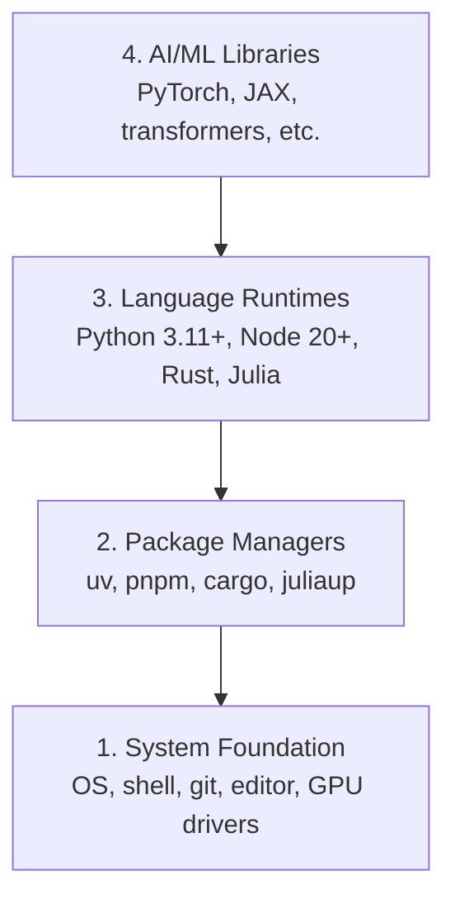

# Dev Environment · 开发环境

> Your tools shape your thinking. Set them up once, set them up right.

**Type:** Build
**Languages:** Python, Node.js, Rust
**Prerequisites:** None
**Time:** ~45 minutes

## Learning Objectives · 学习目标

- 从零装好 Python 3.11+、Node.js 20+ 和 Rust 工具链
- 配置虚拟环境和包管理器，得到可复现的构建
- 用 CUDA/MPS 验证 GPU 可用，并跑一次测试张量运算
- 理解四层栈：系统、包、运行时、AI 库

> Set up Python 3.11+, Node.js 20+, and Rust toolchains from scratch
> Configure virtual environments and package managers for reproducible builds
> Verify GPU access with CUDA/MPS and run a test tensor operation
> Understand the four-layer stack: system, packages, runtimes, AI libraries

## The Problem · 问题在哪

你将在 500+ 节课里学习 AI 工程，用到 Python、TypeScript、Rust 和 Julia。如果环境是坏的，每一节课都会变成和工具搏斗，而不是学习。

大多数人会跳过环境配置，然后花上几个小时调试 import 错误、版本冲突和缺失的 CUDA 驱动。我们要一次把它做对。

> You're about to learn AI engineering across 500+ lessons using Python, TypeScript, Rust, and Julia. If your environment is broken, every single lesson becomes a fight against tooling instead of learning.
> Most people skip environment setup. Then they spend hours debugging import errors, version conflicts, and missing CUDA drivers. We're going to do this once, properly.

## The Concept · 概念

AI 工程环境有四层：



我们自底向上安装。每一层都依赖它下面那一层。

```figure
s0-env-stack
```

> An AI engineering environment has four layers:
> We install bottom-up. Each layer depends on the one below it.

## Build It · 动手造

### Step 1: System Foundation · 系统基础

检查你的系统，装好基础工具。

```bash
# macOS
xcode-select --install
brew install git curl wget

# Ubuntu/Debian
sudo apt update && sudo apt install -y build-essential git curl wget unzip

# Windows (use WSL2)
wsl --install -d Ubuntu-24.04
```

> Check your system and install the basics.

### Step 2: Python with uv · 用 uv 管理 Python

我们用 `uv` —— 它比 pip 快 10-100 倍，还能自动管理虚拟环境。

```bash
curl -LsSf https://astral.sh/uv/install.sh | sh

uv python install 3.12

uv venv
source .venv/bin/activate  # or .venv\Scripts\activate on Windows

uv pip install numpy matplotlib jupyter
```

验证：

```python
import sys
print(f"Python {sys.version}")

import numpy as np
print(f"NumPy {np.__version__}")
a = np.array([1, 2, 3])
print(f"Vector: {a}, dot product with itself: {np.dot(a, a)}")
```

> We use `uv` — it's 10-100x faster than pip and handles virtual environments automatically.
> Verify:

### Step 3: Node.js with pnpm · 用 pnpm 管理 Node.js

TypeScript 课程会用它（agents、MCP 服务器、web 应用）。

```bash
curl -fsSL https://fnm.vercel.app/install | bash
fnm install 22
fnm use 22

npm install -g pnpm

node -e "console.log('Node', process.version)"
```

fnm 的安装脚本会先检查 `unzip`，缺失时便以 `Not installing fnm due to missing dependencies.` 退出：在 Linux 上它要解压一个 zip 包，在 macOS 上则通过 Homebrew 安装。macOS 自带 `unzip`；Ubuntu、Debian 和 WSL2 从 Step 1 的 apt 那行装上它即可（如果当时跳过了，执行 `sudo apt install -y unzip`）。

**macOS / Apple Silicon（M1/M2/M3/M4）：** 如果安装脚本停在 `Error: Cannot install under Rosetta 2 in ARM default prefix (/opt/homebrew)`，说明你的终端正跑在 Rosetta 2 下（`arch` 输出 `i386`），而 Homebrew 是原生 arm64 构建。强制以 arm64 安装 fnm、把它接进 shell 配置，然后从 `fnm install 22` 开始重跑上面的命令：

```bash
arch -arm64 brew install fnm
echo 'eval "$(fnm env --use-on-cd)"' >> ~/.zshrc
source ~/.zshrc
```

> For TypeScript lessons (agents, MCP servers, web apps).
> The fnm installer checks for `unzip` first and exits with `Not installing fnm due to missing dependencies.` when it is absent: on Linux it unpacks a zip archive, on macOS it installs through Homebrew. macOS ships `unzip`; Ubuntu, Debian, and WSL2 get it from the Step 1 apt line (`sudo apt install -y unzip` if you skipped that step).
> **macOS / Apple Silicon (M1/M2/M3/M4):** If the installer stops with `Error: Cannot install under Rosetta 2 in ARM default prefix (/opt/homebrew)`, your terminal is running under Rosetta 2 (`arch` prints `i386`) while Homebrew is a native arm64 build. Install fnm forcing arm64, wire it into your shell, then rerun the commands above from `fnm install 22`:

### Step 4: Rust

性能关键的课程用它（推理、系统类）。

```bash
curl --proto '=https' --tlsv1.2 -sSf https://sh.rustup.rs | sh

rustc --version
cargo --version
```

> For performance-critical lessons (inference, systems).

### Step 5: Julia (Optional) · Julia（可选）

数学计算重的课程用它，Julia 在这类课上大放异彩。

```bash
curl -fsSL https://install.julialang.org | sh

julia -e 'println("Julia ", VERSION)'
```

> For math-heavy lessons where Julia shines.

### Step 6: GPU Setup (If You Have One) · GPU 设置（如果你有 GPU）

**NVIDIA（Linux / Windows）：**

```bash
nvidia-smi

# Install PyTorch with CUDA
uv pip install torch torchvision torchaudio --index-url https://download.pytorch.org/whl/cu124
```

**macOS / Apple Silicon（M1/M2/M3/M4）：** Mac 上没有 CUDA —— 这是预期行为，不是故障。**不要**加 `--index-url .../cuXXX`（那些 wheel 只支持 Linux/Windows，加了必然安装失败）。安装普通构建即可，其中已包含 Apple 的 MPS（Metal）GPU 后端：

```bash
uv pip install torch torchvision torchaudio
```

验证（任何平台都适用）：

```python
import torch
print(f"CUDA available: {torch.cuda.is_available()}")           # False on macOS — expected
print(f"MPS available:  {torch.backends.mps.is_available()}")   # True on Apple Silicon
if torch.cuda.is_available():
    print(f"GPU: {torch.cuda.get_device_name(0)}")
```

没有 GPU？没关系。大多数课程在 CPU 上就能跑。训练量大的课程请用 Google Colab 或云 GPU。

> **NVIDIA (Linux / Windows):**
> **macOS / Apple Silicon (M1/M2/M3/M4):** There is no CUDA on a Mac — that's expected, not a failure. Do **not** pass `--index-url .../cuXXX` (those wheels are Linux/Windows only, so the install fails). Install the plain build, which includes Apple's MPS (Metal) GPU backend:
> Verify (works on any platform):
> No GPU? No problem. Most lessons work on CPU. For training-heavy lessons, use Google Colab or cloud GPUs.

### Step 7: Verify the route you want to start · 验证你想开始的路线

本课的所有命令都在仓库根目录——即包含 `README.md` 和 `phases/` 的那个目录——下运行。预检只检查启动所选路线需要的东西，默认跳过后面课程才用到的工具，这样新学习者看到的是一个清晰的答案，而不是一整面警告墙。

启动完整的 beginner 序列：

```bash
python3 phases/00-setup-and-tooling/01-dev-environment/code/verify.py --route beginner
```

或者只检查你想要的那条路线：

```bash
python3 phases/00-setup-and-tooling/01-dev-environment/code/verify.py --route ml-foundations
python3 phases/00-setup-and-tooling/01-dev-environment/code/verify.py --route llm-engineering
python3 phases/00-setup-and-tooling/01-dev-environment/code/verify.py --route agents
python3 phases/00-setup-and-tooling/01-dev-environment/code/verify.py --route mcp
python3 phases/00-setup-and-tooling/01-dev-environment/code/verify.py --route agent-skills
python3 phases/00-setup-and-tooling/01-dev-environment/code/verify.py --route certification
```

想让同一套预检顺带检查后续课程用到的可选工具和依赖时，加 `--show-later`。后面的工具缺失永远不会阻塞所选路线。

每一个失败的必需检查都会给出检测到的路径或 import 错误，外加一条精确的修复命令。Agent Skills 和 certification 路线还会显示手动主机检查，因为 Python 脚本无法证明某个 AI 主机已经发现了一个技能，也无法证明你选的技能目录可写。

beginner 预检通过时，它会打印出确切的第一个可运行课程：

```text
Ready to start Beginner course.
Next: python3 phases/01-math-foundations/01-linear-algebra-intuition/code/vectors.py
```

> Run every command in this lesson from the repository root, the directory that
> contains `README.md` and `phases/`. The preflight checks only what you need to
> start the selected route. It skips later tools by default so a new learner sees
> one clear answer instead of a wall of warnings.
> Start the full beginner sequence:
> Or check only the route you want:
> Add `--show-later` when you want the same preflight to inspect optional tools
> and dependencies used by later lessons. A missing later tool never blocks the
> selected route.
> Each failed required check includes the detected path or import error and an
> exact corrective command. The Agent Skills and certification routes also show
> manual host checks because a Python script cannot prove that an AI host has
> discovered a skill or that your chosen skill scope is writable.
> When the beginner preflight passes, it prints the exact first runnable lesson:

## Use It · 实战用法

你的环境已经可以启动你检查过的那条路线了。等课程需要时再装后面的工具，不要让第一节课卡在整套装机上。整个课程体系中你会用到：

| Language 语言 | Used In 用在哪 | Package Manager 包管理器 |
|----------|---------|-----------------|
| Python | Phases 1-12（ML、DL、NLP、视觉、音频、LLM） | uv |
| TypeScript | Phases 13-17（工具、Agents、蜂群、基础设施） | pnpm |
| Rust | Phases 12、15-17（性能关键系统） | cargo |
| Julia | Phase 1（数学基础） | Pkg |

> Your environment is ready to start the route you checked. Install later tools
> when a lesson asks for them instead of blocking your first lesson on the whole
> stack. Here is what you will use across the curriculum:

## Ship It · 交付

本课产出一个验证脚本，任何人都可以运行它来检查自己的环境配置。

`outputs/prompt-env-check.md` 里有一个帮助 AI 助手诊断环境问题的提示词。

> This lesson produces a verification script that anyone can run to check their setup.
> See `outputs/prompt-env-check.md` for a prompt that helps AI assistants diagnose environment issues.

## Exercises · 练习

1. 运行验证脚本，修好所有失败项
2. 为这门课创建一个 Python 虚拟环境并安装 PyTorch
3. 用全部四种语言各写一个「hello world」并逐一运行

> 1. Run the verification script and fix any failures
> 2. Create a Python virtual environment for this course and install PyTorch
> 3. Write a "hello world" in all four languages and run each one
