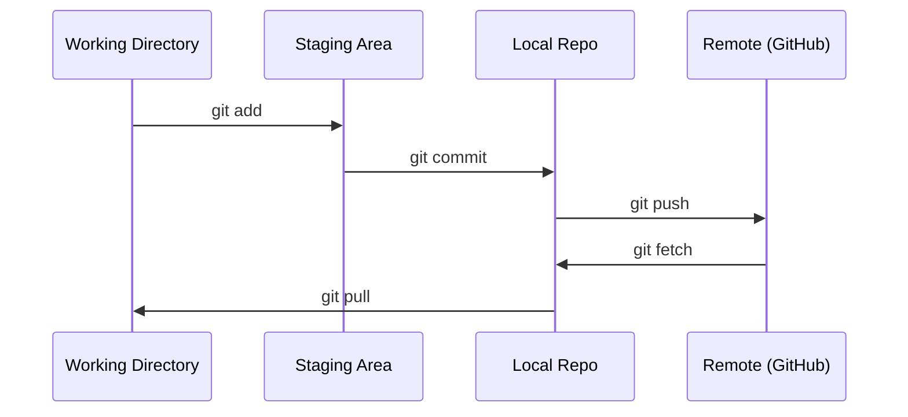

# Git & Collaboration · Git 与协作

> Version control is not optional. Every experiment, every model, every lesson you build here gets tracked.

**Type:** Learn
**Languages:** --
**Prerequisites:** Phase 0, Lesson 01
**Time:** ~30 minutes

## Learning Objectives · 学习目标

- 配置 git 身份，熟练使用 add、commit、push 的日常工作流
- 创建并合并分支来做隔离的实验，不弄坏 main
- 写出一个能排除模型 checkpoint 和大二进制文件的 `.gitignore`
- 用 `git log` 浏览提交历史，理解项目的演进

> Configure git identity and use the daily workflow of add, commit, and push
> Create and merge branches for isolated experiments without breaking main
> Write a `.gitignore` that excludes model checkpoints and large binary files
> Navigate the commit history with `git log` to understand project evolution

## The Problem · 问题在哪

你将在 20 个阶段里写下成百上千个代码文件。没有版本控制，你会丢掉工作成果、把东西改坏到无法撤销，也没法和别人协作。

Git 是工具，GitHub 是代码住的地方。本课只讲这门课程需要的内容，多一点也不讲。

> You're about to write hundreds of code files across 20 phases. Without version control you will lose work, break things you can't undo, and have no way to collaborate with others.
> Git is the tool. GitHub is where the code lives. This lesson covers what you need for this course and nothing more.

## The Concept · 概念



记住三件事：
1. 常保存（`git commit`）
2. 推到远端（`git push`）
3. 开分支做实验（`git checkout -b experiment`）

```figure
s0-commit-dag
```

> Three things to remember:
> 1. Save often (`git commit`)
> 2. Push to remote (`git push`)
> 3. Branch for experiments (`git checkout -b experiment`)

## Build It · 动手造

### Step 1: Configure git · 配置 git

```bash
git config --global user.name "Your Name"
git config --global user.email "you@example.com"
```

### Step 2: The daily workflow · 日常工作流

```bash
git status
git add file.py
git commit -m "Add perceptron implementation"
git push origin main
```

### Step 3: Branching for experiments · 开分支做实验

```bash
git checkout -b experiment/new-optimizer

# ... make changes, commit ...

git checkout main
git merge experiment/new-optimizer
```

### Step 4: Working with this course repo · 在本课程仓库上工作

你没法直接 push 到课程仓库本身 —— 只有维护者有写权限。先在 GitHub 上 fork 一份（右上角的 Fork 按钮），让 `origin` 指向你自己的副本：

```bash
git clone https://github.com/YOUR-USERNAME/ai-engineering-from-scratch.git
cd ai-engineering-from-scratch

git checkout -b my-progress
# work through lessons, commit your code
git push origin my-progress
```

> You can't push to the course repo itself — only maintainers have write access.
> Fork it on GitHub first (the Fork button, top right) so `origin` points at your own copy:

## Use It · 实战用法

这门课你需要的命令就是下面这些：

| Command 命令 | When 什么时候用 |
|---------|------|
| `git clone` | 拿到课程仓库 |
| `git add` + `git commit` | 保存你的工作 |
| `git push` | 备份到 GitHub |
| `git checkout -b` | 尝试一些东西而不弄坏 main |
| `git log --oneline` | 看看你做过什么 |

就这些。这门课用不到 rebase、cherry-pick 或 submodule。

> For this course, you need exactly these commands:
> That's it. You don't need rebase, cherry-pick, or submodules for this course.

## Exercises · 练习

1. Fork 这个仓库、clone 你的 fork、创建一个叫 `my-progress` 的分支、新建一个文件、commit、然后 push
2. 写一个 `.gitignore`，排除模型 checkpoint 文件（`.pt`、`.pth`、`.safetensors`）
3. 用 `git log --oneline` 看这个仓库的提交历史，读一读每节课是怎么加进来的

> 1. Fork this repo, clone your fork, create a branch called `my-progress`, make a file, commit it, push it
> 2. Create a `.gitignore` that excludes model checkpoint files (`.pt`, `.pth`, `.safetensors`)
> 3. Look at the commit history of this repo with `git log --oneline` and read how lessons were added

## Key Terms · 术语表

| Term 术语 | What people say 人们常说 | What it actually means 实际含义 |
|------|----------------|----------------------|
| Commit | 「保存了」 | 在某个时间点对你整个项目拍下的一份快照 |
| Branch | 「一份副本」 | 指向某个 commit 的指针，会随着你的工作向前移动 |
| Merge | 「合并代码」 | 把一个分支上的改动取过来，应用到另一个分支上 |
| Remote | 「云端」 | 你的仓库托管在别处（GitHub、GitLab）的一份副本 |
