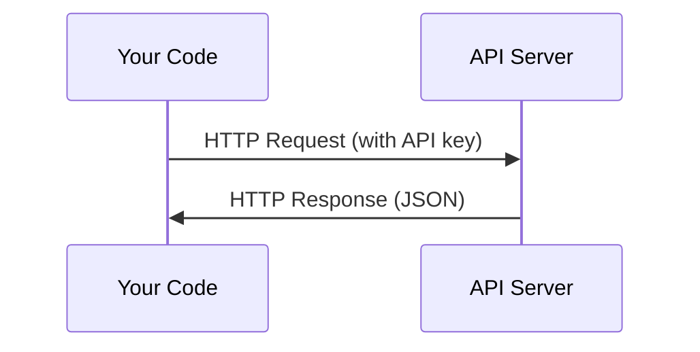

# APIs & Keys · API 与密钥

> Every AI API works the same way: send a request, get a response. The details change, the pattern doesn't.

**Type:** Build
**Languages:** Python, TypeScript
**Prerequisites:** Phase 0, Lesson 01
**Time:** ~30 minutes

## Learning Objectives · 学习目标

- 用环境变量（environment variables）和 `.env` 文件安全存放 API key
- 分别用 Anthropic Python SDK 和裸 HTTP 发起 LLM API 调用
- 对比基于 SDK 和裸 HTTP 的请求/响应格式，用于调试
- 识别并处理常见 API 错误，包括认证失败和限流（rate limit）

> Store API keys securely using environment variables and `.env` files
> Make an LLM API call using both the Anthropic Python SDK and raw HTTP
> Compare SDK-based and raw HTTP request/response formats for debugging
> Identify and handle common API errors including authentication and rate limits

## The Problem · 问题在哪

从 Phase 11 起，你会开始调用 LLM API（Anthropic、OpenAI、Google）。Phase 13-16 你会构建在循环里使用这些 API 的 agent。你需要知道 API key 怎么工作、怎么安全存放，以及怎么发出你的第一次 API 调用。

> Starting from Phase 11, you'll call LLM APIs (Anthropic, OpenAI, Google). In
> Phase 13-16 you'll build agents that use these APIs in loops. You need to know
> how API keys work, how to store them safely, and how to make your first API call.

## The Concept · 概念



每次 API 调用都有：
1. 一个 endpoint（URL）
2. 一个 API key（身份验证）
3. 一个请求体（你想要什么）
4. 一个响应体（你拿回来什么）

```figure
s0-secret-inject
```

> Every API call has:
> 1. An endpoint (URL)
> 2. An API key (authentication)
> 3. A request body (what you want)
> 4. A response body (what you get back)

## Build It · 动手造

### Step 1: Store API keys safely · 安全存放 API key

永远不要把 API key 写进代码。用环境变量。

```bash
export ANTHROPIC_API_KEY="sk-ant-..."
export OPENAI_API_KEY="sk-..."
```

或者用一个 `.env` 文件（记得把它加进 `.gitignore`）：

```
ANTHROPIC_API_KEY=sk-ant-...
OPENAI_API_KEY=sk-...
```

> Never put API keys in code. Use environment variables.
> Or use a `.env` file (add it to `.gitignore`):

### Step 2: First API call (Python) · 第一次 API 调用（Python）

```python
import os

import anthropic

client = anthropic.Anthropic()

MODEL = os.environ.get("LLM_MODEL", "claude-sonnet-5")

response = client.messages.create(
    model=MODEL,
    max_tokens=256,
    messages=[{"role": "user", "content": "What is a neural network in one sentence?"}]
)

print(response.content[0].text)
```

`LLM_MODEL` 用来选择 Anthropic 的模型 id，默认值是不带日期的 Sonnet 别名。其他提供商（OpenAI、Google 等）遵循同样的「key + 模型 id」模式，但各有各的 SDK、endpoint 和请求/响应 schema。

> `LLM_MODEL` selects the Anthropic model id, and the default is the un-dated
> Sonnet alias. Other providers (OpenAI, Google, and others) follow the same
> pattern of a key plus a model id, but each has its own SDK, endpoint, and
> request/response schema.

### Step 3: First API call (TypeScript) · 第一次 API 调用（TypeScript）

```typescript
import Anthropic from "@anthropic-ai/sdk";

const client = new Anthropic();

const MODEL = process.env.LLM_MODEL ?? "claude-sonnet-5";

const response = await client.messages.create({
  model: MODEL,
  max_tokens: 256,
  messages: [{ role: "user", content: "What is a neural network in one sentence?" }],
});

console.log(response.content[0].text);
```

### Step 4: Raw HTTP (no SDK) · 裸 HTTP（不用 SDK）

```python
import os
import urllib.request
import json

url = "https://api.anthropic.com/v1/messages"
headers = {
    "Content-Type": "application/json",
    "x-api-key": os.environ["ANTHROPIC_API_KEY"],
    "anthropic-version": "2023-06-01",
}
body = json.dumps({
    "model": os.environ.get("LLM_MODEL", "claude-sonnet-5"),
    "max_tokens": 256,
    "messages": [{"role": "user", "content": "What is a neural network in one sentence?"}],
}).encode()

req = urllib.request.Request(url, data=body, headers=headers, method="POST")
with urllib.request.urlopen(req) as resp:
    result = json.loads(resp.read())
    print(result["content"][0]["text"])
```

这就是各 SDK 在底层做的事。理解裸 HTTP 调用，在调试时会有帮助。

> This is what the SDKs do under the hood. Understanding the raw HTTP call helps when debugging.

## Use It · 实战用法

这门课里：

| API | When you need it 什么时候需要 | Free tier 免费额度 |
|-----|-----------------|-----------|
| Anthropic (Claude) | Phase 11-16（agents、工具） | 注册送 $5 额度 |
| OpenAI | Phase 11（做对比） | 注册送 $5 额度 |
| Hugging Face | Phase 4-10（模型、数据集） | 免费 |

你不需要现在就把它们全部配好。课程需要时再设置。

> For this course:
> You don't need all of them right now. Set them up when the lesson requires it.

## Ship It · 交付

本课产出：
- `outputs/prompt-api-troubleshooter.md` - 诊断常见 API 错误

> This lesson produces:
> - `outputs/prompt-api-troubleshooter.md` - diagnose common API errors

## Exercises · 练习

1. 拿到一个 Anthropic API key，发出你的第一次 API 调用
2. 试试裸 HTTP 版本，把它的响应格式和 SDK 版本对比一下
3. 故意用一个错误的 API key，读一读错误信息

> 1. Get an Anthropic API key and make your first API call
> 2. Try the raw HTTP version and compare the response format to the SDK version
> 3. Intentionally use a wrong API key and read the error message

## Key Terms · 术语表

| Term 术语 | What people say 人们常说 | What it actually means 实际含义 |
|------|----------------|----------------------|
| API key | 「API 的密码」 | 唯一标识你的账户并为请求授权的字符串 |
| Rate limit | 「我被限流了」 | 每分钟/每小时的最大请求数，用来防止滥用、保证公平使用 |
| Token | 「一个词」（在 API 语境下） | 计费单位：输入 token 和输出 token 分开计数、分开计费 |
| Streaming | 「实时响应」 | 一个词一个词地接收响应，而不是等完整响应一起返回 |
