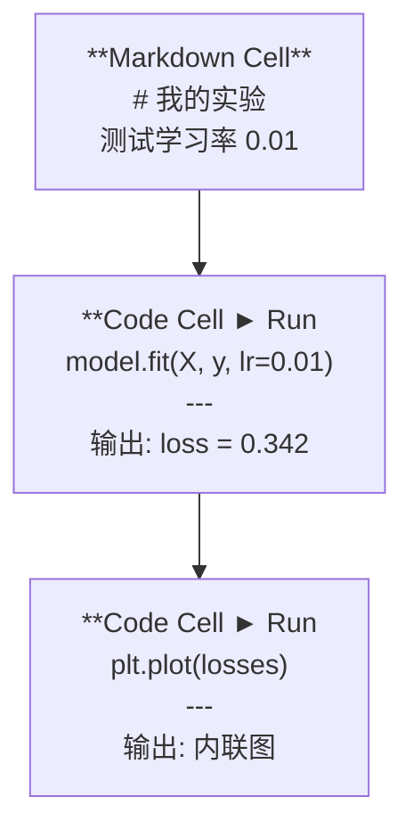
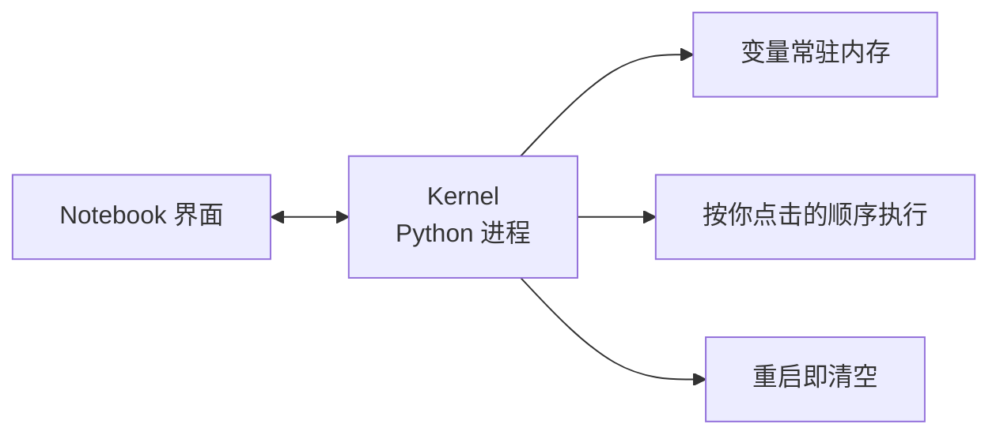

# Jupyter Notebook

> Notebook 是 AI 工程的实验台。在这里做原型，把跑通的搬到生产。

**类型:** Build
**语言:** Python
**前置课程:** Phase 0, Lesson 01
**时间:** ~30 分钟

## 学习目标

- 装起并启动 JupyterLab、Jupyter Notebook，或用 VS Code 的 Jupyter 扩展
- 用魔法命令（`%timeit`、`%%time`、`%matplotlib inline`）做基准测试和内联绘图
- 分清 notebook 和脚本各自该用在哪，落地"在 notebook 里探索，在脚本里交付"
- 识别并避开三个经典陷阱：乱序执行、幽灵状态、内存泄漏

## 问题背景

每一篇 AI 论文、每一个教程、每一场 Kaggle 比赛都在用 Jupyter。它让你一段一段地跑代码、就地看输出、把代码和解释写在一起、快速迭代。不学AI 而不用 notebook，就像做数学题不打草稿。

但 notebook 有真实的坑。很多人拿它干所有事，包括它极不擅长的事。知道什么时候该用 notebook、什么时候该用脚本，能省掉你后面无数个debugging 的夜晚。

## 核心概念

一个 notebook 就是一个 cell 列表，每个 cell 要么是代码，要么是文本。



kernel 是后台跑的一个 Python 进程。你运行一个 cell 时，前端把代码发给 kernel，kernel 执行完把结果发回来。所有 cell 共用同一个 kernel，所以变量在 cell 之间存活。



"按你点击的顺序执行"这一点，既是超能力也是坑。

## 动手构建

### 第1 步：选界面

三个选项，同一种文件格式：

| 界面 | 安装 | 适合 |
|------|------|------|
| JupyterLab | `pip install jupyterlab` 然后 `jupyter lab` | 完整 IDE 体验，多标签、文件浏览器、内置终端 |
| Jupyter Notebook | `pip install notebook` 然后 `jupyter notebook` | 轻量，一次开一个 notebook |
| VS Code | 装 "Jupyter" 扩展 | 已经在你的编辑器里，git 集成好调|

三者读写同一个 `.ipynb` 文件，挑顺手的就行。AI 工作里 JupyterLab 最常见。

```bash
pip install jupyterlab
jupyter lab
```

### 第 2 步：真正重要的快捷键

你在两种模式间切换。`Escape` 回命令模式（左侧蓝条），`Enter` 进编辑模式（绿条）。

**命令模式（最常用）：**

| 按键 | 动作 |
|------|------|
| `Shift+Enter` | 运行 cell，跳到下一个 |
| `A` / `B` |在上方 / 下方插入 cell |
| `DD` | 删除 cell |
| `M` / `Y` | 转markdown / 转代码 |
| `Z` | 撤销 cell 操作 |
| `Ctrl+Shift+H` | 查看全部快捷键 |

**编辑模式：**

| 按键 | 动作 |
|------|------|
| `Tab` | 补全 |
| `Shift+Tab` | 看函数签名 |
| `Ctrl+/` | 切换注释 |

`Shift+Enter` 是你一天要按上千次的键。先记住它。

### 第 3 步：cell 类型

**代码 cell** 跑Python 并显示输出：

```python
import numpy as np
data = np.random.randn(1000)
data.mean(), data.std()
```

输出：`(0.0032, 0.9987)`

**Markdown cell** 渲染格式文本。用来记录你做什么、为什么这么做。支持标题、粗体、斜体、LaTeX 公式（`$E = mc^2$`）、表格、图片。

### 第 4 步：魔法命令

这不是 Python，是 Jupyter 特有命令，以 `%`（行魔法）或 `%%`（cell 魔法）开头。

**给代码计时：**

```python
%timeit np.random.randn(10000)
```

输出：`45.2 us +/- 1.3 us per loop`

```python
%%time
model.fit(X_train, y_train, epochs=10)
```

输出：`Wall time: 2.34 s`

`%timeit` 会跑很多次取平均，`%%time` 只跑一次。微基准用 `%timeit`，训练用 `%%time`。

>为什么必须多次平均：单次计时会被噪声主导。本课实测同一段 `np.random.randn(1000)` 连跑 8次，结果是`4.61 0.01 0.01 0.01 0.01 0.01 0.01 0.01 ms`——首次调用要触发懒加载和内存页分配，差582 倍。只跑一次的话，那个 4.61 ms 就是你的"性能数据"，而且完全是假的。

**开启内联绘图：**

```python
%matplotlib inline
```

之后每个 `plt.plot()` / `plt.show()` 都直接渲染在 notebook 里。

**不离开 notebook 装包：**

```python
!pip install scikit-learn
```

`!` 前缀可以执行任意 shell 命令。

**查看环境变量：**

```python
%env CUDA_VISIBLE_DEVICES
```

### 第 5 步：富输出

notebook 会自动显示 cell 里最后一个表达式的值。但你可以控制：

```python
import pandas as pd

df = pd.DataFrame({
    "model": ["Linear", "Random Forest", "Neural Net"],
    "accuracy": [0.72, 0.89, 0.94],
    "training_time": [0.1, 2.3, 45.6]
})
df
```

渲染成HTML 表格，不是纯文本。画图同理：

```python
import matplotlib.pyplot as plt

plt.figure(figsize=(8, 4))
plt.plot([1, 2, 3, 4], [1, 4, 2, 3])
plt.title("Inline Plot")
plt.show()
```

图就出现在 cell 下方。这就是 notebook 统治 AI 工作的原因——代码、数据、图三者在一起。

显示图片：

```python
from IPython.display import Image, display
display(Image(filename="architecture.png"))
```

> 脚本里为什么不能这么写：脚本顶部的 `matplotlib.use("Agg")` 走的是保存到文件的路径，而 notebook 走 `%matplotlib inline` 这条完全不同的渲染分支。所以把 notebook 代码搬进 `.py` 时，这两行都要改。

### 第 6 步：Google Colab

Colab 是云端的免费 Jupyter，自带GPU、预装库、Google Drive 集成，零配置。

1. 打开 [colab.research.google.com](https://colab.research.google.com)
2. 上传本课程的任意 `.ipynb` 文件
3. 运行时 > 更改运行时类型 > T4 GPU（免费）

Colab 和本地 Jupyter 的差别：

- 文件在会话之间不保留（存到 Drive 或下载）
- 预装：numpy、pandas、matplotlib、torch、tensorflow、sklearn
- `from google.colab import files` 上传/下载文件
- `from google.colab import drive; drive.mount('/content/drive')` 挂载持久存储
- 免费版 90 分钟无操作即超时

## 实战运用

### notebook vs 脚本：什么时候用哪个

| 用 notebook 做 | 用脚本做 |
|---------------|---------|
| 探索数据集 | 训练流水线 |
| 原型模型 | 可复用工具函数 |
| 可视化结果 | 任何带 `if __name__` 的东西 |
| 讲清楚你的思路 | 定时运行的代码 |
| 快速实验 | 生产代码 |
| 课程练习 | 包和库 |

规则一句话：**在 notebook 里探索，在脚本里交付。**

AI 领域的常见流程：

1. 在 notebook 里探索数据
2. 在 notebook 里原型模型
3. 跑通了，把代码挪进 `.py` 文件
4. 再把这些 `.py` import 回notebook 继续实验

第 3 步最容易被跳过，也最该做。挪进 `.py` 的过程会强迫你回答一个问题：**这段代码依赖了哪些变量？** 答不上来，就说明它有幽灵状态。

### 三个经典陷阱

**乱序执行。** 你按cell 5、cell 2、cell 7 的顺序点了一遍。notebook 在你机器上好着，别人从上到下跑就崩。修法：分享前 Kernel > Restart & Run All。

>实测：先跑用`data` 的 cell → `NameError`；再跑定义 `data` 的 cell → 成功。**notebook 里没有一行代码是错的，错的只是你的点击顺序。**

**幽灵状态。** 你删掉了一个 cell，但它创建的变量还在内存里。notebook 看着很干净，实际依赖一个已经不存在的 cell。修法：定期重启 kernel。

>实测：同一个 cell，第一次 `NameError: name 'threshold' is not defined`，中间补跑一个定义 `threshold` 的 cell，**一行没改**就成功了。

**内存泄漏。** 载入 4GB 数据、训练模型、再载入 4GB。什么都没释放。修法：`del 变量名` 加 `gc.collect()`，或者直接重启 kernel。

## 本课产物

- `outputs/prompt-notebook-helper.md` —— 调试 notebook 问题用

## 练习

1. 打开 JupyterLab，新建 notebook，用 `%timeit` 对比列表推导和 numpy 生成 100000个随机数
2. 写一个 markdown + 代码混排的 notebook：读CSV、展示 dataframe、画图。然后 Kernel > Restart & Run All 验证能从头跑通
3. 把 `code/notebook_tips.py` 的代码贴进 Colab notebook，用免费 GPU 跑一遍

## 关键术语

| 术语 | 口头说法 | 实际含义 |
|------|---------|---------|
| Kernel | "跑我代码的那个东西" | 一个独立 Python 进程，执行 cell 并让变量常驻内存 |
| Cell | "一块代码" | notebook 里可独立运行的一个单元，要么代码要么 markdown |
| 魔法命令 | "Jupyter 小技巧" | 以 `%` 或 `%%` 开头的特殊命令，控制 notebook 环境 |
| `.ipynb` | "notebook 文件" | 一个 JSON 文件，装cells、输出和元数据。IPython Notebook 的缩写 |

## 延伸阅读

- [JupyterLab 文档](https://jupyterlab.readthedocs.io/) —— 完整功能列表
- [Google Colab FAQ](https://research.google.com/colaboratory/faq.html) —— Colab 的限制和特性
- [28 个 Jupyter Notebook 技巧](https://www.dataquest.io/blog/jupyter-notebook-tips-tricks-shortcuts/) —— 高手向快捷键