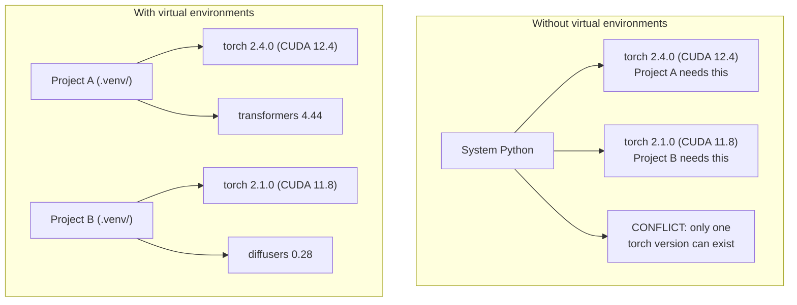

# Python 环境（Python Environments）

> 依赖地狱是真实存在的。虚拟环境就是解药。
>
> Dependency hell is real. Virtual environments are the cure.

**类型 (Type):** Build
**语言 (Languages):** Shell
**前置课程 (Prerequisites):** Phase 0, Lesson 01
**时间 (Time):** ~30 分钟

## 学习目标（Learning Objectives）

- 用 `uv`、`venv` 或 `conda` 创建隔离的虚拟环境
- 编写带可选依赖组（optional dependency groups）的 `pyproject.toml`，并生成 lockfile 保证可复现
- 诊断并修复常见陷阱：全局安装、pip/conda 混用、CUDA 版本不匹配
- 为依赖互相冲突的项目制定"按阶段划分环境"（per-phase）的策略

> - Create isolated virtual environments using `uv`, `venv`, or `conda`
> - Write a `pyproject.toml` with optional dependency groups and generate lockfiles for reproducibility
> - Diagnose and fix common pitfalls: global installs, pip/conda mixing, CUDA version mismatches
> - Implement a per-phase environment strategy for projects with conflicting dependencies

## 问题背景（The Problem）

你为一个微调项目装了 PyTorch 2.4。下周另一个项目需要 PyTorch 2.1，因为它的 CUDA 构建版本被钉死了。你全局升级，第一个项目坏了；你降级，第二个项目坏了。

这就是依赖地狱。它在 AI/ML 工作中不断发生，原因是：

- PyTorch、JAX、TensorFlow 各自带一套 CUDA 绑定
- 模型库钉死了特定的框架版本
- 一次全局 `pip install` 会覆盖掉之前的一切
- CUDA 11.8 的构建在 CUDA 12.x 驱动上跑不起来（反之亦然）

解法：每个项目都有自己独立的环境和独立的包。

> You install PyTorch 2.4 for a fine-tuning project. Next week, a different project needs PyTorch 2.1 because its CUDA build is pinned. You upgrade globally, and the first project breaks. You downgrade, and the second one breaks.
>
> This is dependency hell. It happens constantly in AI/ML work because:
>
> - PyTorch, JAX, and TensorFlow each ship their own CUDA bindings
> - Model libraries pin specific framework versions
> - A global `pip install` overwrites whatever was there before
> - CUDA 11.8 builds don't work with CUDA 12.x drivers (and vice versa)
>
> The fix: every project gets its own isolated environment with its own packages.

## 核心概念（The Concept）



```figure
s0-env-isolation
```

> 上图：没有虚拟环境时，系统 Python 只能装一个 torch 版本，项目 A 和 B 直接冲突；有了虚拟环境，每个项目自带一套包，互不干扰。

### 机制：虚拟环境不是 Python 特性，是一个目录约定

这是本课最该记住的一句话。`.venv/` 里就是三样东西：

| 内容 | 说明 |
|------|------|
| `bin/python` | 一个指向基础 Python 的**符号链接** |
| `lib/python3.12/site-packages/` | 这个环境独有的包 |
| `pyvenv.cfg` | 记着基础 Python 的位置和 `include-system-site-packages` |

**没有 magic，没有 hook，没有守护进程。** Python之所以"认"这个目录，是因为
`site-packages` 的路径是从**解释器自身所在位置**推导出来的。

实测一个标准 venv 的 `pyvenv.cfg`（macOS / Homebrew Python 3.14.8）：

```text
home = /opt/homebrew/opt/python@3.14/bin
include-system-site-packages = false        ← 「隔离」这两个字的全部实现
version = 3.14.8
command = /opt/homebrew/opt/python@3.14/bin/python3.14 -m venv /private/tmp/venv_lab/std_venv
```

### 机制：`activate` 只改 PATH

`activate` 脚本干的事就三件：

```bash
_OLD_VIRTUAL_PATH="$PATH"
export PATH="/private/tmp/venv_lab/env_a/bin:$PATH"   # 插到最前面
export VIRTUAL_ENV="/private/tmp/venv_lab/env_a"      # 记个标记
export PS1="(...) $PS1"                              # 提示符加前缀
```

实测激活前后的 PATH 首段：

```text
激活前：/Applications/WorkBuddy.app/.../brokered-bin
激活后：/private/tmp/venv_lab/env_a/bin                ← 只是插到最前面
```

三个直接推论：

1. `deactivate` 就是把 PATH 字符串还原 —— 它不是"卸载"
2. `source` 是必须的 —— `activate` 是 shell 脚本不是可执行文件，`./activate` 会失败
3. `activate` 只影响当前 shell 会话 —— 开新终端窗口自动失效

### 实测：两环境装不同版本，互不干扰

| 环境 | Python | numpy | 包路径 |
|------|--------|-------|--------|
| `env_a` | 3.12.15 | **1.26.4** | `env_a/lib/python3.12/site-packages/numpy/` |
| `env_b` | 3.14.8 | **2.2.6** | `env_b/lib/python3.14/site-packages/numpy/` |
| 系统 Python | 3.14.8 | **未安装** | — |

注意两件事：**系统 Python 到现在仍然干净**（这就是 `include-system-site-packages = false`
在起作用）；以及两个环境的 **Python 版本本身就不同**（3.12 vs 3.14）。

判断隔离是否生效，看 `sys.prefix` 和 `sys.base_prefix`：

```bash
python -c "import sys; print(sys.prefix, sys.base_prefix)"
# /private/tmp/venv_lab/env_a      /opt/homebrew/opt/python@3.14/...
# ↑ 环境自身                ↑ 「逃逸回系统」的通道。两者不同 = 隔离生效
```

### 坑：uv 环境里没有 pip

本课程 `.venv` 是 `uv` 建的，实测有两个差异：

```text
.venv/bin/python -> ~/.local/share/uv/python/cpython-3.12-macos-aarch64-none/bin/python3.12
                ↑ 连系统 Python 都不是，是 uv 自己下的独立 Python

.venv/bin/ 里 pip 文件数： 0                ← 根本没装 pip
```

**所以在 uv 环境里跑 `python -m pip` 会报 `No module named pip`** —— 而这个报错极具
误导性，它不会告诉你「你用错工具了」。三种正确写法：

```bash
uv pip install numpy             # 方式1：uv 自己的 pip（快，推荐）
uv add numpy                     # 方式2：自动更新 pyproject.toml + uv.lock
python -m ensurepip              # 方式3：把 pip 装回来（不推荐）
```

**记住这条就够**：`uv venv` 配`uv pip`；`python -m venv` 配 `python -m pip`。工具跟着环境走。

### 实测：体积对比

| 文件 | 体积 |
|------|------|
| `.venv/`（只装了一个 numpy） | **69 MB** |
| `pyproject.toml`（含三个可选组） | **297 字节** |

差约 24 万倍。PyTorch 环境普遍 2~8 GB。**提交 `pyproject.toml` 和 lockfile，
不要提交 `.venv/`。**

## 动手构建（Build It）

### 方案一：uv venv（推荐）（Option 1: uv venv (Recommended)）

`uv` 是最快的 Python 包管理器（比 pip 快 10-100 倍）。它一个工具搞定虚拟环境、Python 版本和依赖解析。

> `uv` is the fastest Python package manager (10-100x faster than pip). It handles virtual environments, Python versions, and dependency resolution in one tool.

```bash
curl -LsSf https://astral.sh/uv/install.sh | sh

uv python install 3.12

cd your-project
uv venv
source .venv/bin/activate
```

安装包（Install packages）：

```bash
uv pip install torch numpy
```

一步创建带 `pyproject.toml` 的项目（Create a project with `pyproject.toml` in one step）：

```bash
uv init my-ai-project
cd my-ai-project
uv add torch numpy matplotlib
```

### 方案二：venv（内置）（Option 2: venv (Built-in)）

装不了 `uv` 的话，Python 自带 `venv`：

> If you can't install `uv`, Python ships with `venv`:

```bash
python3 -m venv .venv
source .venv/bin/activate  # Linux/macOS
.venv\Scripts\activate     # Windows

pip install torch numpy
```

比 `uv` 慢，但凡是装了 Python 的地方都能用。

> Slower than `uv`, but works everywhere Python is installed.

### 方案三：conda（确有需要时）（Option 3: conda (When You Need It)）

Conda 管理的是非 Python 依赖：CUDA 工具包、cuDNN、C 库。这些情况用它：

- 需要特定版本的 CUDA 工具包，但不想装到系统级
- 你在共享集群上，装不了系统包
- 某个库的安装说明写着 "use conda"

> Conda manages non-Python dependencies like CUDA toolkits, cuDNN, and C libraries. Use it when:
>
> - You need a specific CUDA toolkit version without installing it system-wide
> - You're on a shared cluster where you can't install system packages
> - A library's install instructions say "use conda"

```bash
# Install miniconda (not the full Anaconda)
curl -LsSf https://repo.anaconda.com/miniconda/Miniconda3-latest-Linux-x86_64.sh -o miniconda.sh
bash miniconda.sh -b

conda create -n myproject python=3.12
conda activate myproject

conda install pytorch torchvision torchaudio pytorch-cuda=12.4 -c pytorch -c nvidia
```

一条铁律：如果一个环境用 conda 创建，这个环境里所有包都用 conda 装。往 conda 环境里混 `pip install` 会造成极难调试的依赖冲突。

> One rule: if you use conda for an environment, use conda for all packages in that environment. Mixing `pip install` into a conda env causes dependency conflicts that are painful to debug.

### 本课程：按阶段划分环境（For This Course: Per-Phase Strategy）

你可以给整门课建一个环境。别这样干。不同阶段需要不同的（有时互相冲突的）依赖。

> You could create one environment for the whole course. Don't. Different phases need different (sometimes conflicting) dependencies.

策略（Strategy）：

```
ai-engineering-from-scratch/
├── .venv/                    <-- shared lightweight env for phases 0-3
├── phases/
│   ├── 04-neural-networks/
│   │   └── .venv/            <-- PyTorch env
│   ├── 05-cnns/
│   │   └── .venv/            <-- same PyTorch env (symlink or shared)
│   ├── 08-transformers/
│   │   └── .venv/            <-- might need different transformer versions
│   └── 11-llm-apis/
│       └── .venv/            <-- API SDKs, no torch needed
```

`code/env_setup.sh` 这个脚本会为本课程创建基础环境。

> The script in `code/env_setup.sh` creates the base environment for this course.

## pyproject.toml 基础（pyproject.toml Basics）

每个 Python 项目都应该有 `pyproject.toml`。它一个文件取代 `setup.py`、`setup.cfg` 和 `requirements.txt`。

> Every Python project should have a `pyproject.toml`. It replaces `setup.py`, `setup.cfg`, and `requirements.txt` in one file.

```toml
[project]
name = "ai-engineering-from-scratch"
version = "0.1.0"
requires-python = ">=3.11"
dependencies = [
    "numpy>=1.26",
    "matplotlib>=3.8",
    "jupyter>=1.0",
    "scikit-learn>=1.4",
]

[project.optional-dependencies]
torch = ["torch>=2.3", "torchvision>=0.18"]
llm = ["anthropic>=0.39", "openai>=1.50"]
```

然后安装（Then install）：

```bash
uv pip install -e ".[torch]"    # base + PyTorch
uv pip install -e ".[llm]"     # base + LLM SDKs
uv pip install -e ".[torch,llm]" # everything
```

## Lockfile（Lockfiles）

lockfile 把每个依赖（包括间接依赖）钉死到精确版本。这保证了可复现：任何人从 lockfile 安装，拿到的包完全一致。

> A lockfile pins every dependency (including transitive ones) to exact versions. This guarantees reproducibility: anyone who installs from the lockfile gets exactly the same packages.

```bash
# uv generates uv.lock automatically when using uv add
uv add numpy

# pip-tools approach
uv pip compile pyproject.toml -o requirements.lock
uv pip install -r requirements.lock
```

把 lockfile 提交进 git。别人克隆仓库后从 lockfile 安装，拿到完全相同的版本。

> Commit your lockfile to git. When someone clones the repo, they install from the lockfile and get identical versions.

## 常见错误（Common Mistakes）

### 1. 全局安装（Installing globally）

```bash
pip install torch  # BAD: installs to system Python

source .venv/bin/activate
pip install torch  # GOOD: installs to virtual environment
```

检查包装到哪去了（Check where your packages go）：

```bash
which python       # should show .venv/bin/python, not /usr/bin/python
which pip           # should show .venv/bin/pip
```

### 2. pip 和 conda 混用（Mixing pip and conda）

```bash
conda create -n myenv python=3.12
conda activate myenv
conda install pytorch -c pytorch
pip install some-other-package   # BAD: can break conda's dependency tracking
conda install some-other-package # GOOD: let conda manage everything
```

非要用 pip 装进 conda 环境（有些包只在 PyPI 上有）的话：先装完所有 conda 包，最后再装 pip 包。

> If you must use pip inside conda (some packages are pip-only), install all conda packages first, then pip packages last.

### 3. 忘记激活环境（Forgetting to activate）

```bash
python train.py           # uses system Python, missing packages
source .venv/bin/activate
python train.py           # uses project Python, packages found
```

shell 提示符里应该能看到环境名（Your shell prompt should show the environment name）：

```
(.venv) $ python train.py
```

### 4. 把 .venv 提交进 git（Committing .venv to git）

```bash
echo ".venv/" >> .gitignore
```

虚拟环境有 200MB-2GB。它是本地的，机器之间不可移植。要提交的是 `pyproject.toml` 和 lockfile。

> Virtual environments are 200MB-2GB. They're local, not portable between machines. Commit `pyproject.toml` and the lockfile instead.

### 5. CUDA 版本不匹配（CUDA version mismatch）

```bash
nvidia-smi                # shows driver CUDA version (e.g., 12.4)
python -c "import torch; print(torch.version.cuda)"  # shows PyTorch CUDA version

# These must be compatible.
# PyTorch CUDA version must be <= driver CUDA version.
```

## 实战运用（Use It）

运行安装脚本，创建你的课程环境（Run the setup script to create your course environment）：

```bash
bash phases/00-setup-and-tooling/06-python-environments/code/env_setup.sh
```

它会在仓库根目录创建一个 `.venv`，装好核心依赖并逐项验证。

> This creates a `.venv` at the repo root with core dependencies installed and verified.

## 练习（Exercises）

1. 运行 `env_setup.sh`，确认所有检查通过
2. 创建第二个虚拟环境，在里面装一个不同版本的 numpy，验证两个环境互相隔离
3. 为一个同时需要 PyTorch 和 Anthropic SDK 的项目写一份 `pyproject.toml`
4. 故意全局安装一个包（不激活 venv），观察它装到了哪，然后卸载掉

> 1. Run `env_setup.sh` and verify all checks pass
> 2. Create a second virtual environment, install a different version of numpy in it, and confirm the two environments are isolated
> 3. Write a `pyproject.toml` for a project that needs both PyTorch and the Anthropic SDK
> 4. Deliberately install a package globally (without activating a venv), notice where it goes, then uninstall it

## 关键术语（Key Terms）

| 术语 (Term) | 口头说法 | 实际含义 |
|------|----------------|----------------------|
| Virtual environment | "A venv" | 一个隔离目录，内含 Python 解释器和包，与系统 Python 分开 |
| Lockfile | "Pinned dependencies" | 列出每个包及其精确版本的文件，保证各机器安装结果一致 |
| pyproject.toml | "The new setup.py" | 标准 Python 项目配置文件，取代 setup.py/setup.cfg/requirements.txt |
| Transitive dependency | "A dependency of a dependency" | 包 B 依赖 C；装 A 时 A 依赖 B，于是 C 是 A 的间接依赖 |
| CUDA mismatch | "My GPU isn't working" | PyTorch 编译时用的 CUDA 版本与 GPU 驱动支持的版本不一致 |

**English original:**

| Term | What people say | What it actually means |
|------|----------------|----------------------|
| Virtual environment | "A venv" | An isolated directory containing a Python interpreter and packages, separate from the system Python |
| Lockfile | "Pinned dependencies" | A file listing every package and its exact version, guaranteeing identical installs across machines |
| pyproject.toml | "The new setup.py" | The standard Python project configuration file, replacing setup.py/setup.cfg/requirements.txt |
| Transitive dependency | "A dependency of a dependency" | Package B depends on C; if you install A which depends on B, C is a transitive dependency of A |
| CUDA mismatch | "My GPU isn't working" | PyTorch was compiled for a different CUDA version than what your GPU driver supports |
