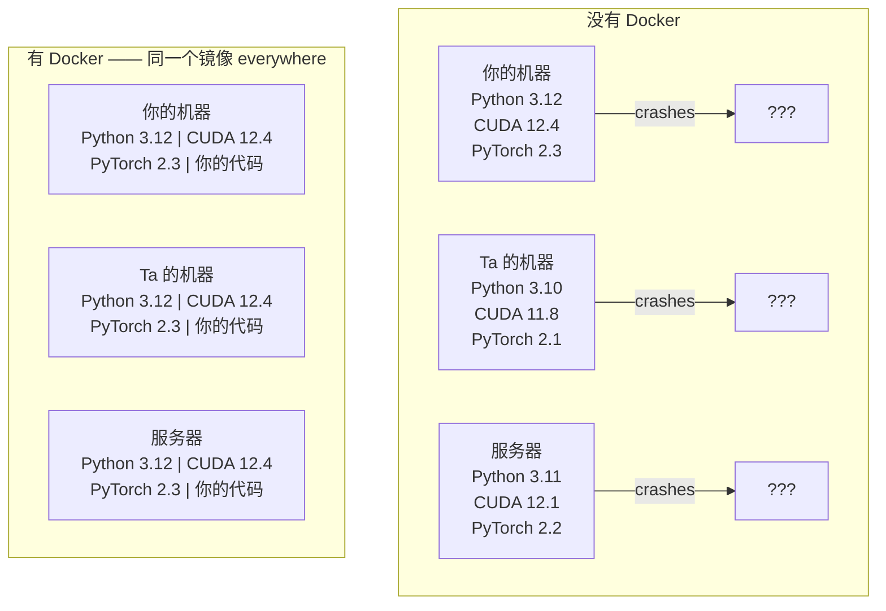

# Docker for AI

> 容器让「在我机器上能跑」成为过去式。

**类型:** Build
**语言:** Docker
**前置课程:** Phase 0, Lesson 01 and 03
**时间:** ~60 分钟

## 学习目标

- 从 Dockerfile 构建带CUDA、PyTorch 和 AI 库的 GPU 镜像
- 把宿主目录挂载成 volume，让模型、数据集、代码跨容器重建存活
- 配置 NVIDIA Container Toolkit，让容器内可见 GPU
- 用 Docker Compose 编排多服务 AI 应用（推理服务 + 向量数据库）

## 问题背景

你在笔记本上用 PyTorch 2.3、CUDA 12.4、Python 3.12 训了个模型。同事那边是 PyTorch 2.1、
CUDA 11.8、Python 3.10。你的模型在Ta 机器上崩了。你的 Dockerfile 在两边都能跑。

AI 项目是依赖噩梦的典型。一个常见的栈包括：Python、PyTorch、CUDA 驱动、cuDNN、
系统级 C 库，还有 flash-attn 这类需要精确编译器版本的包。Docker 把这一整套打包成
**一个镜像**，在任何地方跑都一样。

## 核心概念

Docker 把你的代码、运行时、库和系统工具包进一个隔离单元，叫**容器**。可以理解成
轻量级虚拟机，但它**共享宿主 OS 内核**而不是跑自己的，所以启动是秒级而不是分钟级。



> 上图：三个机器各自环境不同，同一个模型在哪儿都崩。同一个镜像在哪儿都能跑。

### 为什么 AI 项目比别的项目更需要 Docker

**1. GPU 驱动很脆弱。** CUDA 12.4 的代码跑不了 CUDA 11.8。Docker 把 CUDA toolkit
关在容器里，同时通过 NVIDIA Container Toolkit 共享宿主的 GPU 驱动。

**2. 模型权重很大。** 7B 参数模型 fp16 是 14 GB。你不想每次重建容器都重新下一遍。
volume 让你把宿主机的 models 目录挂进去。

**3. 多服务架构很常见。** 一个真实的 AI 应用不只是一个 Python 脚本，而是推理服务 +
RAG 的向量数据库 + 可能还有前端。Compose 用一条命令拉起全部。

### 关键术语

| 术语 | 含义 |
|------|------|
| 镜像 Image | 只读模板。你的配方。由 Dockerfile 构建。 |
| 容器 Container | 镜像的运行实例。你的厨房。 |
| Dockerfile | 构建镜像的指令。逐层构建。 |
| Volume | 持久存储，容器重启后数据还在。 |
| docker-compose | 用 YAML 定义多容器应用的工具。 |

### AI 领域常见的三种容器形态

```text
开发容器（Dev Container）
  完整工具链。编辑器支持、Jupyter、调试工具。
  用于开发和实验阶段。

训练容器（Training Container）
  最小化。只有训练脚本和依赖。
  跑在 GPU 集群上。无编辑器、无 Jupyter。

推理容器（Inference Container）
  为服务而优化。镜像小、冷启动快。
  跑在负载均衡器后面。
```

## 动手构建

### 第 1 步：安装 Docker

```bash
# macOS
brew install --cask docker
open /Applications/Docker.app

# Ubuntu
curl -fsSL https://get.docker.com | sh
sudo usermod -aG docker $USER
# 需要登出重新登录，组权限才生效
```

验证：

```bash
docker --version
docker run hello-world
```

### 第 2 步：安装 NVIDIA Container Toolkit（Linux + NVIDIA GPU）

它让容器能用上你的 GPU。**macOS 和 Windows（WSL2）可以跳过** —— 那两个平台的
Docker Desktop 用不同方式处理 GPU 直通。

```bash
distribution=$(. /etc/os-release;echo $ID$VERSION_ID)
curl -fsSL https://nvidia.github.io/libnvidia-container/gpgkey | sudo gpg --dearmor -o /usr/share/keyrings/nvidia-container-toolkit-keyring.gpg
curl -s -L https://nvidia.github.io/libnvidia-container/$distribution/libnvidia-container.list | \
    sed 's#deb https://#deb [signed-by=/usr/share/keyrings/nvidia-container-toolkit-keyring.gpg] https://#g' | \
    sudo tee /etc/apt/sources.list.d/nvidia-container-toolkit.list

sudo apt-get update
sudo apt-get install -y nvidia-container-toolkit
sudo nvidia-ctk runtime configure --runtime=docker
sudo systemctl restart docker
```

测容器内 GPU 可见：

```bash
docker run --rm --gpus all nvidia/cuda:12.4.1-base-ubuntu22.04 nvidia-smi
```

看到GPU 信息就说明 toolkit 生效了。

### 第 3 步：理解基础镜像

选对基础镜像能省几小时的debug。

```text
nvidia/cuda:12.4.1-devel-ubuntu22.04
  完整 CUDA toolkit，含编译器。
  用于：需要 nvcc 的包（flash-attn、bitsandbytes）
  体积：~4 GB

nvidia/cuda:12.4.1-runtime-ubuntu22.04
  只含 CUDA runtime，无编译器。
  用于：跑已经编好的代码
  体积：~1.5 GB

pytorch/pytorch:2.6.0-cuda12.4-cudnn9-runtime
  PyTorch 已预装在 CUDA 之上。
  用于：跳过 PyTorch 安装步骤
  体积：~6 GB

python:3.12-slim
  无 CUDA，纯 CPU。
  用于：CPU 推理、轻量工具
  体积：~150 MB
```

### 第 4 步：写AI 开发用 Dockerfile

完整文件见 `code/Dockerfile`。这里逐条讲：

```dockerfile
FROM --platform=linux/amd64 nvidia/cuda:12.4.1-devel-ubuntu22.04

ENV DEBIAN_FRONTEND=noninteractive
ENV PYTHONUNBUFFERED=1

RUN apt-get update && apt-get install -y --no-install-recommends \
    software-properties-common \
    git \
    curl \
    build-essential \
    && add-apt-repository -y ppa:deadsnakes/ppa \
    && apt-get update && apt-get install -y --no-install-recommends \
    python3.12 \
    python3.12-venv \
    python3.12-dev \
    && rm -rf /var/lib/apt/lists/*

RUN update-alternatives --install /usr/bin/python python /usr/bin/python3.12 1

RUN curl -sSL https://raw.githubusercontent.com/pypa/get-pip/3b73145063be545b649ad9ca83ea8da5fc915a4f/public/get-pip.py -o /tmp/get-pip.py \
    && echo "a341e1a43e38001c551a1508a73ff23636a11970b61d901d9a1cad2a18f57055  /tmp/get-pip.py" | sha256sum -c - \
    && python /tmp/get-pip.py \
    && rm /tmp/get-pip.py \
    && update-alternatives --install /usr/bin/pip pip /usr/local/bin/pip3.12 1

RUN python -m pip install --no-cache-dir --upgrade pip setuptools wheel

RUN python -m pip install --no-cache-dir \
    torch==2.6.0+cu124 \
    torchvision==0.21.0+cu124 \
    torchaudio==2.6.0+cu124 \
    --index-url https://download.pytorch.org/whl/cu124

RUN python -m pip install --no-cache-dir \
    numpy \
    pandas \
    scikit-learn \
    matplotlib \
    jupyter \
    transformers \
    datasets \
    accelerate \
    safetensors

WORKDIR /workspace

VOLUME ["/workspace", "/models"]

EXPOSE 8888

CMD ["python"]
```

构建：

```bash
docker build -t ai-dev -f phases/00-setup-and-tooling/07-docker-for-ai/code/Dockerfile .
```

第一次构建耗时较长（下载 CUDA 基础镜像 + PyTorch）。后续构建走缓存。

运行：

```bash
docker run --rm -it --gpus all \
    -v $(pwd):/workspace \
    -v ~/models:/models \
    ai-dev python -c "import torch; print(f'PyTorch {torch.__version__}, CUDA: {torch.cuda.is_available()}')"
```

在容器里跑 Jupyter：

```bash
docker run --rm -it --gpus all \
    -v $(pwd):/workspace \
    -v ~/models:/models \
    -p 8888:8888 \
    ai-dev jupyter notebook --ip=0.0.0.0 --port=8888 --no-browser --allow-root
```

### 分层与缓存：Dockerfile 怎么写才不浪费

`Dockerfile` 里每条指令产生一层，**从上到下顺序执行**。三条性质决定了写法：

1. 后面的层只在前面层之上叠加，前面的层只读
2. 某层输入没变 → 命中缓存，直接复用
3. 删掉中间一层 → 下面所有层失效要重建

按这个规则，本课的 Dockerfile 拆成13 层，实测体积估算：

| 层 | 内容 | 估体积 |
|---|---|---|
| 1 | `FROM nvidia/cuda:12.4.1-devel` | ~4 GB |
| 2-3 | `ENV DEBIAN_FRONTEND` / `PYTHONUNBUFFERED` | 0 |
| 4 | `RUN apt-get update && install`（合并成一条） | ~300 MB |
| 5 | `RUN update-alternatives` | ~30 MB |
| 6 | `RUN get-pip.py`（带 sha256 校验） | ~5 MB |
| 7 | `RUN pip install --upgrade pip setuptools` | ~20 MB |
| 8 | `RUN pip install torch+cu124` | **~2.6 GB ← 最贵** |
| 9 | `RUN pip install numpy pandas transformers …` | ~250 MB |
| 10-13 | `WORKDIR` / `VOLUME` / `EXPOSE` / `CMD` | 0 |

**改第 9 层** → 只重跑第 9 层，几秒。
**改第 7 层** → 第 7~13 层全废，包含那个 2.6 GB 的 PyTorch 层。

### 四个反直觉但正确的设计

**① `apt-get update && apt-get install` 必须写在一起**

分成两行的话：

```dockerfile
RUN apt-get update        # 这层单独缓存，几天后就过期
RUN apt-get install ...   # 这层命中了旧缓存里的包索引
```

问题在于 `apt-get update` 的结果放在一个会被清理的临时位置。分开写，**第二层会一直用
构建时那份过期索引**，装出旧版本或直接 404。合在一起，每层只存最终产物。

**② 每个 `pip install` 都要 `--no-cache-dir`**

pip 的 HTTP 缓存在 `/root/.cache/pip`。不加这个参数，它会**留在某一层里**。改
Dockerfile 后那层失效，缓存跟着丢，重装时又得重新下载。**缓存该在的地方是 volume，
不该在镜像层里。**

**③ `--platform=linux/amd64` 是给 Apple Silicon 用的**

PyTorch 的 `cu124` wheel **只有 x86_64 版本**，没有 arm64。不加这个 flag，
`pip install torch==2.6.0+cu124` 在 M系列 Mac 上会报：

```text
ERROR: No matching distribution found for torch==2.6.0+cu124
```

加了它就是拉 x86_64 镜像用模拟跑 —— 但容器里**依然没有 GPU**，因为 macOS 本来就
没有 CUDA。

**④ `get-pip.py` 带 sha256 校验**

```dockerfile
RUN curl -sSL https://raw.githubusercontent.com/pypa/get-pip/.../get-pip.py -o /tmp/get-pip.py \
    && echo "a341e1a4...  /tmp/get-pip.py" | sha256sum -c - \
    && python /tmp/get-pip.py \
    && rm /tmp/get-pip.py
```

`curl | bash` 有个经典风险：**中间人改了脚本你就直接执行了**。这里改成下载 → 校验哈希
→ 执行，三步分开，哈希写死在 Dockerfile 里。这是**供应链安全**的最低成本实践。

### 第 5 步：volume 挂载数据和模型

AI 开发里 volume 挂载是刚需。没有它，你的 14 GB 模型在容器停止时就消失了。

```bash
# 挂你的代码
-v $(pwd):/workspace

# 挂共享的 models 目录
-v ~/models:/models

# 挂数据集
-v ~/datasets:/data
```

训练脚本里从挂载路径加载：

```python
from transformers import AutoModel

model = AutoModel.from_pretrained("/models/llama-7b")
```

模型活在宿主文件系统上。容器想重建多少次都行，不用重新下载。

### 第 6 步：Docker Compose 编排多服务 AI 应用

一个真实的 RAG 应用需要推理服务和向量数据库。Compose 用一条命令跑两个。

见 `code/docker-compose.yml`：

```yaml
services:
  ai-dev:
    build:
      context: .
      dockerfile: Dockerfile
    deploy:
      resources:
        reservations:
          devices:
            - driver: nvidia
              count: all
              capabilities: [gpu]
    volumes:
      - ../../../:/workspace
      - ~/models:/models
      - ~/datasets:/data
    ports:
      - "8888:8888"
    stdin_open: true
    tty: true
    command: jupyter notebook --ip=0.0.0.0 --port=8888 --no-browser --allow-root

  qdrant:
    image: qdrant/qdrant:v1.12.5
    ports:
      - "6333:6333"
      - "6334:6334"
    volumes:
      - qdrant_data:/qdrant/storage

volumes:
  qdrant_data:
```

全部启动：

```bash
cd phases/00-setup-and-tooling/07-docker-for-ai/code
docker compose up -d
```

现在你的 AI 开发容器可以用服务名 `http://qdrant:6333` 访问向量数据库。Compose 会
自动创建一个共享网络。

从 AI 容器内部测连通：

```python
from qdrant_client import QdrantClient

client = QdrantClient(host="qdrant", port=6333)
print(client.get_collections())
```

全部停止：

```bash
docker compose down
```

加 `-v` 连qdrant 的 volume 一起删：

```bash
docker compose down -v
```

> **服务名即主机名**：这里的 `qdrant` 不是 IP 也不是 localhost，是 **Compose 内建DNS
> 自动解析的服务名**。和微服务里的服务发现是同一类问题，只是 DNS 由 Compose 内建而非
> 注册中心。

### 第 7 步：AI 工作里常用的 Docker 命令

```bash
# 列运行中的容器
docker ps

# 列所有镜像和体积
docker images

# 清理未使用的镜像（回收磁盘）
docker system prune -a

# 查看运行中容器的 GPU 使用
docker exec -it <container_id> nvidia-smi

# 从容器拷文件到宿主
docker cp <container_id>:/workspace/results.csv ./results.csv

# 看容器日志
docker logs -f <container_id>
```

## 实战运用

你现在有了一套可复现的 AI 开发环境。本课程后续：

- 用 `docker compose up` 一次启动开发环境和向量数据库
- 把代码、模型、数据挂成 volume，重建不丢东西
- 课程要求新包时，加进 Dockerfile 重新构建
- 把 Dockerfile 发给同事，他们拿到完全一样的环境

### 没有 GPU？

去掉 `--gpus all` 和 `deploy` 里的 NVIDIA 段。容器对CPU 课程照常工作。PyTorch 检测不到
CUDA 会自动退回CPU。

> **Apple Silicon（M1/M2/M3/M4/M5）的现实取舍**
>
> 课程 Dockerfile 的 `FROM --platform=linux/amd64` 就是为了让这个构建在 Mac 上能成功。
> PyTorch 的 `cu124` wheel 只发x86_64 版，不加这个 flag 会直接报
> `No matching distribution found`。
>
> 代价是：构建变慢（走模拟），而且**容器里依然没有 GPU**（macOS 本来就没有 CUDA）。
> Mac 上要去掉 `docker run` 里的 `--gpus all`。
>
> **结论：Apple Silicon 上做 GPU 工作，直接用 Lesson 01 的 MPS 原生跑更快。**
> 这个镜像留给将来 x86_64 Linux + NVIDIA GPU 的服务器。

## 练习

1. 构建 Dockerfile，在容器里跑 `python -c "import torch; print(torch.__version__)"`
2. 启动 docker-compose 栈，验证 AI 容器能用 `http://qdrant:6333/collections` 访问 Qdrant
3. 往 Dockerfile 加 `flask`，重新构建，在 5000 端口跑一个简单 API。用 `-p 5000:5000` 映射端口
4. 用 `docker images` 量镜像体积。把基础镜像从 `devel` 换成 `runtime`，对比大小

## 关键术语

| 术语 | 口头说法 | 实际含义 |
|------|---------|---------|
| 容器 | "轻量 VM" | 共享宿主内核的隔离进程，有自己的文件系统和网络 |
| 镜像层 | "缓存的步骤" | Dockerfile 每条指令产生一层。未变化的层命中缓存，所以重建很快。 |
| NVIDIA Container Toolkit | "Docker 里用 GPU" | 一个 runtime hook，通过 `--gpus` flag 把宿主 GPU 暴露给容器 |
| Volume 挂载 | "共享文件夹" | 宿主上的目录映射进容器。容器停止后改动依然在。 |
| 基础镜像 | "起点" | `FROM` 的那个镜像，决定预装了什么。 |

## 延伸阅读

- [Docker 官方文档](https://docs.docker.com/) —— 完整参考
- [Dockerfile 最佳实践](https://docs.docker.com/build/building/best-practices/) —— 官方推荐的写法
- [Compose 规范](https://docs.docker.com/compose/compose-file/) —— `compose.yaml` 各字段含义
- [NVIDIA Container Toolkit 文档](https://docs.nvidia.com/datacenter/cloud-native/container-toolkit/) —— GPU 直通原理