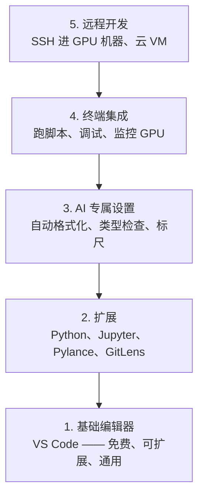

# 编辑器配置

> 编辑器是你的副驾驶。配一次，之后它就不再挡路，而是开始干活。

**类型:** Build
**语言:** --
**前置课程:** Phase 0, Lesson 01
**时间:** ~20 分钟

## 学习目标

- 安装 VS Code 及AI 工作必需的扩展：Python、Jupyter、linting、远程 SSH
- 配置 format-on-save、类型检查、notebook 输出滚动等 AI 工作流设置
- 配置 Remote SSH，让远程 GPU 机器上的编辑和调试像本地一样
- 评估编辑器替代方案（Cursor、Windsurf、Neovim）及其取舍

## 问题背景

你会在编辑器里花几千小时：写 Python、跑 notebook、调试训练循环、SSH 到 GPU 机器。
编辑器配错了，每次都是摩擦：没补全、没类型提示、没行内报错、手动格式化、终端别扭。

配对了 20 分钟。不配，每天多花 20 分钟。

## 核心概念

一个 AI 工程编辑器需要五样东西：



**顺序不能颠倒。** 底层没配好，上面四层都是空中楼阁。

## 动手构建

### 第 1 步：安装 VS Code

VS Code 是推荐编辑器。免费、全平台、Jupyter 支持一流、扩展生态覆盖 AI 工作全部需求。

从 [code.visualstudio.com](https://code.visualstudio.com/) 下载。

终端验证：

```bash
code --version
```

macOS 上如果提示找不到 `code`：打开 VS Code，按 `Cmd+Shift+P`，输入 "Shell Command"，
选 "Install 'code' command in PATH"。

### 第 2 步：安装必需扩展

在 VS Code 集成终端里（所有平台都是 `` Ctrl+` ``）装这些扩展：

```bash
code --install-extension ms-python.python
code --install-extension ms-python.vscode-pylance
code --install-extension ms-toolsai.jupyter
code --install-extension eamodio.gitlens
code --install-extension ms-vscode-remote.remote-ssh
code --install-extension ms-python.debugpy
code --install-extension ms-python.black-formatter
code --install-extension charliermarsh.ruff
```

每个扩展干什么：

| 扩展 | 作用 |
|------|------|
| Python | 语言支持、虚拟环境检测、运行/调试 |
| Pylance | 快速类型检查、补全、import 解析 |
| Jupyter | 在 VS Code 里跑 notebook、变量浏览器 |
| GitLens | 看谁改了什么、行内 git blame |
| Remote SSH | 把远程 GPU 机器上的目录当本地一样打开 |
| Debugpy | Python 单步调试 |
| Black Formatter | 保存时自动格式化，风格统一 |
| Ruff | 快速 lint，抓常见错误 |

本课的 `code/.vscode/extensions.json` 有完整推荐列表。打开项目目录时 VS Code 会提示安装。

### 第 3 步：配置设置

复制本课 `code/.vscode/settings.json` 的内容，或通过 `Settings > Open Settings (JSON)` 手动应用。

AI 工作的关键设置：

```jsonc
{
    "python.analysis.typeCheckingMode": "basic",
    "editor.formatOnSave": true,
    "editor.rulers": [88, 120],
    "notebook.output.scrolling": true,
    "files.autoSave": "afterDelay"
}
```

为什么这些重要：

- **类型检查设basic**：跑之前抓出错参数类型，省下调试 tensor 维度不匹配和 API 参数用错的时间
  （⚠️ 但注意它**抓不到维度不匹配** —— 见下方「实测纠正」）
- **保存时格式化**：再也不用想格式的事，Black 帮你处理
- **标尺 88 和 120**：Black 在 88 处换行，120 那个标记提示 docstring 和注释开始过长了
- **notebook 输出滚动**：训练循环打印几千行，不滚动的话输出面板会炸
- **自动保存**：你一定会忘记保存，训练脚本就会跑旧代码

### 第 4 步：终端集成

VS Code 的集成终端是你跑训练脚本、监控 GPU、管理环境的地方。

配好：

```jsonc
{
    "terminal.integrated.defaultProfile.osx": "zsh",
    "terminal.integrated.defaultProfile.linux": "bash",
    "terminal.integrated.fontSize": 13,
    "terminal.integrated.scrollback": 10000
}
```

常用快捷键：

| 动作 | macOS | Linux/Windows |
|------|-------|---------------|
| 切换终端 | `` Ctrl+` `` | `` Ctrl+` `` |
| 新建终端 | `` Ctrl+Shift+` `` | `` Ctrl+Shift+` `` |
| 分屏终端 | `Cmd+\` | `Ctrl+Shift+5` |

分屏终端很有用：一个跑脚本，一个用 `nvidia-smi -l 1` 监控 GPU。

### 第 5 步：远程开发（SSH 进 GPU 机器）

这是 AI 工作最重要的扩展。你会在远程机器上训练（云 VM、实验室服务器、Lambda、Vast.ai）。
Remote SSH 让你打开远程文件系统、编辑文件、开终端、调试，**就像本地一样**。

配置：

1. 装 Remote SSH 扩展（第 2 步已做）
2. 按 `Ctrl+Shift+P`（macOS 是 `Cmd+Shift+P`），输入 "Remote-SSH: Connect to Host"
3. 输入 `user@your-gpu-box-ip`
4. VS Code 会自动在远程机器上安装它的 server 组件

要免密码访问，配SSH key：

```bash
ssh-keygen -t ed25519 -C "your-email@example.com"
ssh-copy-id user@your-gpu-box-ip
```

加到 `~/.ssh/config` 里方便：

```
Host gpu-box
    HostName 203.0.113.50
    User ubuntu
    IdentityFile ~/.ssh/id_ed25519
    ForwardAgent yes
```

之后 `Remote-SSH: Connect to Host > gpu-box` 秒连。

## 实测纠正：类型检查抓不到 tensor 维度错误

课程原文说 `typeCheckingMode: basic` 能"saves debugging time on tensor shape
mismatches"。**这一半是不准确的。** 实测（`learning-artifacts/phase0/type_checking_demo.py`）：

```python
x = torch.randn(32, 100)
out = x.reshape(x.size(1), x.size(0))   # 作者想写转置
# 零报错，但 out 是 reshape 不是转置，两者元素不同
```

**根本原因：shape 不在类型系统里。** `Tensor` 这个注解对里面是 `(32, 100)` 还是
`(100, 32)` 一无所知。这是动态语言的固有代价 —— 类型注解给你的是**接口契约**，
不是**数值语义**。

实测对照表：

| 错误 | 类型检查能抓？ | 表现 |
|---|---|---|
| 拼错的关键字参数名（`SGD(learning_rate=)`） | ✅ 抓得到 | `TypeError` |
| 参数类型传错（int 传成 str） | ✅ 抓得到 | 类型不匹配 |
| 返回值类型不符声明 | ✅ 抓得到 | 返回值校验 |
| import 路径写错 | ✅ 抓得到 | `ImportError` |
| **batch 维与特征维混淆** | ❌ **抓不到** | 静默算错 |
| 该 mean 的地方用了 sum | ❌ 抓不到 | 静默算错 |
| tensor 当 numpy 用 | ❌ 抓不到 | 鸭子类型兼容 |
| 显存不够就开 train | ❌ 抓不到 | OOM |

顺带一个发现：`pred.backward()`（pred 是非标量）**PyTorch 自己会拦**：

```text
RuntimeError: grad can be implicitly created only for scalar outputs
```

这是 PyTorch 的运行时检查，不是类型检查器 —— 它覆盖了一部分「意图错」。

**所以完整防线是两层**：

```
类型检查（抓接口用错）+ smoke test（抓意图算错）
```

smoke test 就是跑一遍，断言关键张量的 shape 和 loss 的量级。五行代码，省几小时 debug。

## 替代方案

### Cursor

[cursor.com](https://cursor.com) 是 VS Code 的 fork，内置 AI 代码生成。用同一套扩展生态和
settings 格式。用 Cursor 的话本课所有内容照样适用，导入同样的 `settings.json` 和
`extensions.json` 就行。

### Windsurf

[windsurf.com](https://windsurf.com) 另一个 AI 优先的 VS Code fork。同样：同样扩展、
同样设置格式、同样支持 Remote SSH。

### Vim / Neovim

如果你已经在用并且用得开，就留着。AI Python 工作的最低配置：

- **pyright** 或 **pylsp** 做类型检查（通过 Mason 或手动装）
- **nvim-lspconfig** 接语言服务器
- **jupyter-vim** 或 **molten-nvim** 做notebook 式执行
- **telescope.nvim** 搜文件和符号
- **none-ls.nvim** 配 black 和 ruff 做格式化/lint

**如果你本来不用 Vim，现在别开始。** 学习曲线会跟学AI 工程抢时间。用 VS Code。

## 实战运用

配好之后，你的日常流程是这样：

1. 在 VS Code 打开项目目录（或通过 Remote SSH 连到 GPU 机器）
2. 写 Python，有补全、类型提示、行内报错
3. 用 Jupyter 扩展内联跑 notebook
4. 用集成终端跑训练脚本、`uv pip install`、监控 GPU
5. 提交前用 GitLens 复查改动

## 练习

1. 安装 VS Code 和第 2 步列出的所有扩展
2. 把本课的 `settings.json` 复制进你的 VS Code 配置
3. 打开一个 Python 文件，验证 Pylance 显示类型提示、Black 在保存时格式化
4. 如果你有远程机器，配好 Remote SSH 并打开它上面的目录

## 关键术语

| 术语 | 口头说法 | 实际含义 |
|------|---------|---------|
| LSP | "补全引擎" | Language Server Protocol：编辑器从语言专用服务器拿类型信息、补全、诊断的标准协议 |
| Pylance | "Python 插件" |微软的 Python 语言服务器，用 Pyright 做类型检查和 IntelliSense |
| Remote SSH | "在服务器上工作" | VS Code 扩展，在远程机器上跑一个轻量 server，把 UI 流到本地编辑器 |
| 保存时格式化 | "自动 prettier" | 编辑器每次保存就跑一遍格式化器，代码风格永远一致 |

## 延伸阅读

- [VS Code Python 文档](https://code.visualstudio.com/docs/languages/python) —— 官方配置指南
- [Pylance 设置](https://github.com/microsoft/pylance-release/blob/main/docs/settings.md) —— 所有 `python.analysis.*` 选项
- [Remote SSH 文档](https://code.visualstudio.com/docs/remote/ssh) —— 远程开发完整说明
- [Python typing 规范](https://typing.python.org/en/latest/spec/typing.html) —— 类型注解的正式规范