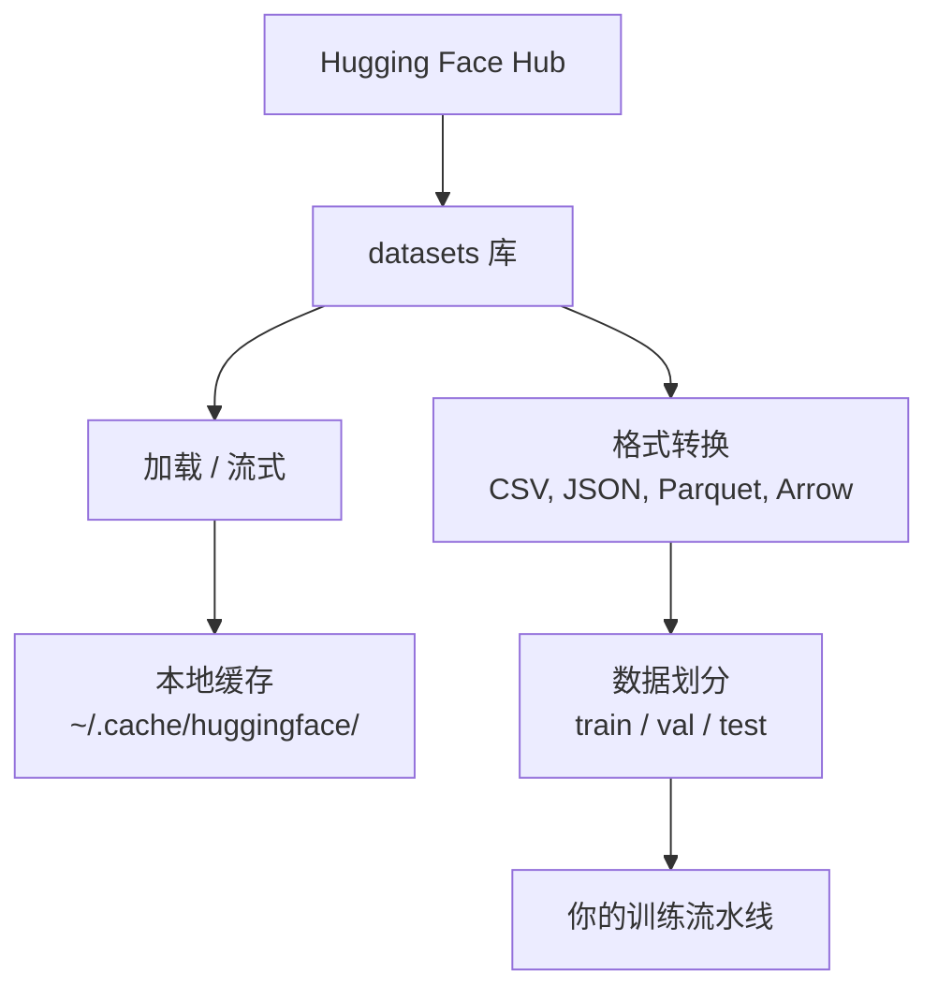

# 数据管理

> 数据是燃料。你怎么管它，决定你走多快。

**类型:** Build
**语言:** Python
**前置课程:** Phase 0, Lesson 01
**时间:** ~45 分钟

## 学习目标

- 用Hugging Face `datasets` 库加载、流式读取、缓存数据集
- 在 CSV、JSON、Parquet、Arrow 格式之间转换并解释各自的取舍
- 用固定随机种子创建可复现的训练/验证/测试划分
- 用 `.gitignore`、Git LFS 或 DVC 管理大模型和大数据文件

## 问题背景

每个 AI 项目都从数据开始。你需要找数据集、下载、在格式之间转换、为训练和评估做划分、
并给它们打版本以便实验可复现。每次手动做这些事既慢又容易出错。你需要一条可重复的工作流。

## 核心概念



Hugging Face 的 `datasets` 库是 AI 工作里加载数据的标准方式。下载、缓存、格式转换、
流式读取全都开箱即用。

## 动手构建

### 第 1 步：安装 datasets 库

```bash
pip install datasets huggingface_hub
```

> **用 uv 的环境里没有 pip**（见 Phase 0 Lesson 06），改用：
> ```bash
> uv pip install datasets huggingface_hub
> ```

### 第 2 步：加载数据集

```python
from datasets import load_dataset

dataset = load_dataset("stanfordnlp/imdb")
print(dataset)
print(dataset["train"][0])
```

这会下载 IMDB 影评数据集。首次下载后，之后从 `~/.cache/huggingface/datasets/` 的
缓存加载。

### 第 3 步：流式读取大数据集

有些数据集大到磁盘放不下。流式读取让你逐行处理，不必下载全量。

```python
dataset = load_dataset("wikimedia/wikipedia", "20231101.en", split="train", streaming=True)

for i, example in enumerate(dataset):
    print(example["title"])
    if i >= 4:
        break
```

流式给你一个 `IterableDataset`。行到即处理，**无论数据集多大，内存占用保持恒定**。

### 第 4 步：数据集格式

`datasets` 库底层用 Apache Arrow。可以根据流水线需要转成别的格式。

```python
dataset = load_dataset("stanfordnlp/imdb", split="train")

dataset.to_csv("imdb_train.csv")
dataset.to_json("imdb_train.json")
dataset.to_parquet("imdb_train.parquet")
```

格式对比：

| 格式 | 体积 | 读取速度 | 适合 |
|------|------|---------|------|
| CSV | 大 | 慢 | 人读、表格软件 |
| JSON | 大 | 慢 | API、嵌套数据 |
| Parquet | 小 | 快 | 分析、按列查询 |
| Arrow | 小 | **最快** | 内存内处理（`datasets` 内部用的就是它）|

AI 工作里，**Parquet 是最好的存储格式**，Arrow 是你在内存里操作的格式，CSV 和 JSON
用于交换。

> **为什么 Parquet 小且快**：它是**列式存储**——同一列的数据物理上连续存放。
> 这意味着「只要 age 这一列」时只需读那一列的连续字节，不用解析整个文件的每一行。
> CSV 只能一行一行顺序读。这就是「压缩好 + 查询快」的双重收益。
>
> 代价是**不可读**——你不能用文本编辑器打开它。

### 第 5 步：数据划分

每个 ML 项目都需要三个划分：

- **Train**：模型学这个（通常 80%）
- **Validation**：训练过程中检查进度（通常 10%）
- **Test**：训练完成后做最终评估（通常 10%）

有些数据集自带划分。没有的话自己切：

```python
dataset = load_dataset("stanfordnlp/imdb", split="train")

split = dataset.train_test_split(test_size=0.2, seed=42)
train_val = split["train"].train_test_split(test_size=0.125, seed=42)

train_ds = train_val["train"]
val_ds = train_val["test"]
test_ds = split["test"]

print(f"Train: {len(train_ds)}, Val: {len(val_ds)}, Test: {len(test_ds)}")
```

**必须设 seed**，否则每次划分都不一样，实验就没法复现。同一个 seed 每次给出同样的划分。

> **为什么要三个而不是两个**：因为你要用 test 集做最终评估，如果拿它来调超参，
> 它就不再是「没见过的数据」了——你在 test 上做的每个决定都泄漏了一点信息，
> 最后报出来的指标会偏乐观。val 集就是给调参用的「替身test」。
>
> **划分比例的来历**：先切出 20% 给 test。剩下的 80% 里再切 12.5% 给 val——
> 0.125 × 0.8 = 0.1，正好是全量的 10%。

### 第 6 步：下载和缓存模型

模型是大文件。`huggingface_hub` 库负责下载和缓存。

```python
from huggingface_hub import hf_hub_download, snapshot_download

model_path = hf_hub_download(
    repo_id="sentence-transformers/all-MiniLM-L6-v2",
    filename="config.json"
)
print(f"Cached at: {model_path}")

model_dir = snapshot_download("sentence-transformers/all-MiniLM-L6-v2")
print(f"Full model at: {model_dir}")
```

模型缓存到 `~/.cache/huggingface/hub/`。下载过一次之后，后续运行瞬间加载。

### 第 7 步：处理大文件

模型权重和大数据集不该进 git。三个方案：

**方案 A：.gitignore（最简单）**

```
*.bin
*.safetensors
*.pt
*.onnx
data/*.parquet
data/*.csv
models/
```

**方案 B：Git LFS（在 git 里跟踪大文件）**

```bash
git lfs install
git lfs track "*.bin"
git lfs track "*.safetensors"
git add .gitattributes
```

Git LFS 把指针存在你的仓库里，真实文件存在独立服务器上。GitHub 免费额度 1 GB。

**方案 C：DVC（数据版本控制）**

```bash
pip install dvc
dvc init
dvc add data/training_set.parquet
git add data/training_set.parquet.dvc data/.gitignore
git commit -m "Track training data with DVC"
```

DVC 生成小`.dvc` 文件指向你的数据，数据本身放S3、GCS 等远程存储。

| 方案 | 复杂度 | 适合 |
|------|-------|------|
| .gitignore | 低 | 个人项目、能重新拉的数据 |
| Git LFS | 中 | 通过 git 共享模型权重的团队 |
| DVC | 高 | 可复现实验、大数据集、团队协作 |

本课程用 `.gitignore` 就够了。需要跨机器复现精确实验时用 DVC。

### 第 8 步：存储模式

**本地存储**适合 10 GB 以下的数据集。HF 缓存自动处理。

**云存储**用于更大的或跨机器共享的：

```python
import os

local_path = os.path.expanduser("~/.cache/huggingface/datasets/")

# s3_path = "s3://my-bucket/datasets/"
# gcs_path = "gs://my-bucket/datasets/"
```

DVC 能直接对接 S3 和 GCS：

```bash
dvc remote add -d myremote s3://my-bucket/dvc-store
dvc push
```

本课程本地存储够用。在远程 GPU 实例上微调时云存储才有意义。

## 本课程用到的数据集

| 数据集 | 用到的课 | 体积 | 教什么 |
|--------|---------|------|-------|
| IMDB | 分词、分类 | 84 MB | 文本分类基础 |
| WikiText | 语言建模 | 181 MB | 下一个 token 预测 |
| SQuAD | 问答系统 | 35 MB | 问答、片段抽取 |
| Common Crawl（子集） | 嵌入 | 变化 | 大规模文本处理 |
| MNIST | 视觉基础 | 21 MB | 图像分类基础 |
| COCO（子集） | 多模态 | 变化 | 图文对 |

现在不用都下载。每课会说明需要哪个。

## 实战运用

跑工具脚本验证一切正常：

```bash
python code/data_utils.py
```

它会下载一个小数据集、转换格式、划分划分，然后打印摘要。

## 本课产物

- `code/data_utils.py` —— 可复用的数据加载与缓存工具
- `outputs/prompt-data-helper.md` —— 为任务找合适数据集的prompt

## 练习

1. 加载 `glue` 数据集的 `mrpc` 配置，看前 5 个例子
2. 流式读取 `c4` 数据集，数一数 10 秒内能处理多少例子
3. 把数据集转成 Parquet，对比文件体积和 CSV 的差异
4. 用固定种子创建 70/15/15 的训练/验证/测试划分，验证三者大小

## 关键术语

| 术语 | 口头说法 | 实际含义 |
|------|---------|---------|
| 数据集划分 | "训练数据" | 命名好的子集（train/val/test），在ML 生命周期不同阶段使用 |
| 流式读取 | "懒加载" | 从远程源逐行处理，不下载全量 |
| Parquet | "压缩过的 CSV" | 列式文件格式，为分析查询和存储效率优化 |
| Arrow | "快的 dataframe" | `datasets` 内部用的内存列式格式，零拷贝读取 |
| Git LFS | "大文件的 git" | 把大文件存在 git 仓库外，同时在版本控制里留指针的扩展 |
| DVC | "数据的 git" | 数据集和模型的版本控制系统，对接云存储 |
| 缓存 | "已经下过了" | 之前获取的数据的本地副本，默认在 `~/.cache/huggingface/` |

## 延伸阅读

- [Hugging Face datasets 文档](https://huggingface.co/docs/datasets/) —— 官方 API 参考
- [Parquet 格式规范](https://parquet.apache.org/docs/) —— 列式存储的设计原理
- [Apache Arrow](https://arrow.apache.org/) —— 内存列式格式
- [DVC 文档](https://dvc.org/doc) —— 数据版本控制完整指南