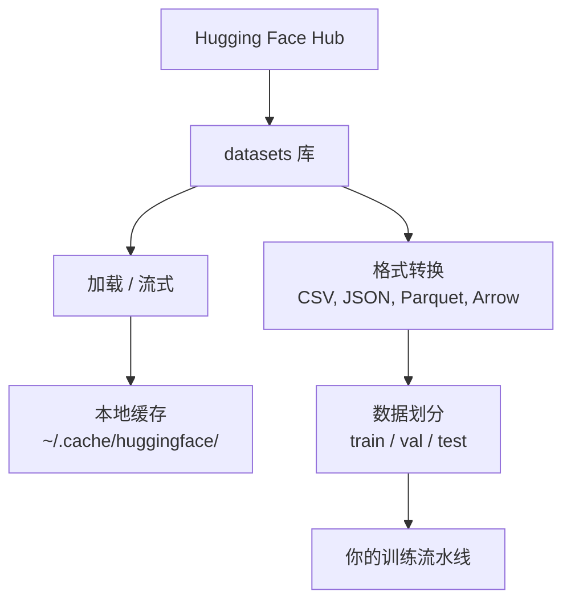

# 数据管理（Data Management）

> 数据是燃料。你怎么管它，决定你走多快。
>
> Data is the fuel. How you manage it determines how fast you go.

**类型 (Type):** Build
**语言 (Languages):** Python
**前置课程 (Prerequisites):** Phase 0, Lesson 01
**时间 (Time):** ~45 分钟

## 学习目标（Learning Objectives）

- 用 Hugging Face `datasets` 库加载、流式读取、缓存数据集
- 在 CSV、JSON、Parquet、Arrow 格式之间转换并解释各自的取舍
- 用固定随机种子创建可复现的训练/验证/测试划分
- 用 `.gitignore`、Git LFS 或 DVC 管理大模型和大数据文件

> - Load, stream, and cache datasets using the Hugging Face `datasets` library
> - Convert between CSV, JSON, Parquet, and Arrow formats and explain their tradeoffs
> - Create reproducible train/val/test splits with fixed random seeds
> - Manage large model and dataset files using `.gitignore`, Git LFS, or DVC

## 问题背景（The Problem）

每个 AI 项目都从数据开始。你需要找数据集、下载、在格式之间转换、为训练和评估做划分、
并给它们打版本以便实验可复现。每次手动做这些事既慢又容易出错。你需要一条可重复的工作流。

> Every AI project starts with data. You need to find datasets, download them, convert between formats, split them for training and evaluation, and version them so experiments are reproducible. Doing this manually every time is slow and error-prone. You need a repeatable workflow.

## 核心概念（The Concept）



```figure
s0-data-pipeline
```

Hugging Face 的 `datasets` 库是 AI 工作里加载数据的标准方式。下载、缓存、格式转换、
流式读取全都开箱即用。

> The Hugging Face `datasets` library is the standard way to load data for AI work. It handles downloading, caching, format conversion, and streaming out of the box.

## 动手构建（Build It）

### 第 1 步：安装 datasets 库（Step 1: Install the datasets library）

```bash
pip install datasets huggingface_hub
```

> **用 uv 的环境里没有 pip**（见 Phase 0 Lesson 06），改用：
> ```bash
> uv pip install datasets huggingface_hub
> ```
>
> 本机实测：`.venv` 里已装 `datasets 5.1.0` / `huggingface-hub 1.33.0` / `pandas 3.0.6` / `pyarrow 25.0.1`。

### 第 2 步：加载数据集（Step 2: Load a dataset）

```python
from datasets import load_dataset

dataset = load_dataset("stanfordnlp/imdb")
print(dataset)
print(dataset["train"][0])
```

这会下载 IMDB 影评数据集。首次下载后，之后从 `~/.cache/huggingface/datasets/` 的
缓存加载。

> This downloads the IMDB movie review dataset. After the first download, it loads from cache at `~/.cache/huggingface/datasets/`.

### 第 3 步：流式读取大数据集（Step 3: Stream large datasets）

有些数据集大到磁盘放不下。流式读取让你逐行处理，不必下载全量。

```python
dataset = load_dataset("wikimedia/wikipedia", "20231101.en", split="train", streaming=True)

for i, example in enumerate(dataset):
    print(example["title"])
    if i >= 4:
        break
```

流式给你一个 `IterableDataset`。行到即处理，**无论数据集多大，内存占用保持恒定**。

> Some datasets are too large to fit on disk. Streaming loads them row by row without downloading the full thing. Streaming gives you an `IterableDataset`. You process rows as they arrive. Memory usage stays constant regardless of dataset size.

### 第 4 步：数据集格式（Step 4: Dataset formats）

`datasets` 库底层用 Apache Arrow。可以根据流水线需要转成别的格式。

```python
dataset = load_dataset("stanfordnlp/imdb", split="train")

dataset.to_csv("imdb_train.csv")
dataset.to_json("imdb_train.json")
dataset.to_parquet("imdb_train.parquet")
```

格式对比（课文原表）：

| 格式 | 体积 | 读取速度 | 适合 |
|------|------|---------|------|
| CSV | 大 | 慢 | 人读、表格软件 |
| JSON | 大 | 慢 | API、嵌套数据 |
| Parquet | 小 | 快 | 分析、按列查询 |
| Arrow | 小 | **最快** | 内存内处理（`datasets` 内部用的就是它）|

AI 工作里，**Parquet 是最好的存储格式**，Arrow 是你在内存里操作的格式，CSV 和 JSON
用于交换。

> The `datasets` library uses Apache Arrow under the hood. For AI work, Parquet is the best storage format. Arrow is what you work with in memory. CSV and JSON are for interchange.

> **为什么 Parquet 小且快**：它是**列式存储**——同一列的数据物理上连续存放。
> 这意味着「只要 age 这一列」时只需读那一列的连续字节，不用解析整个文件的每一行。
> CSV 只能一行一行顺序读。这就是「压缩好 + 查询快」的双重收益。
>
> 代价是**不可读**——你不能用文本编辑器打开它。
>
> **实测补充**：Arrow 那行的「小」不成立，见下文「实测数据与纠正」——
> `save_to_disk` 落盘体积和 CSV 一个量级，它赢在**读速**（mmap 零拷贝）不是体积。

### 第 5 步：数据划分（Step 5: Data splits）

每个 ML 项目都需要三个划分：

- **Train**：模型学这个（通常 80%）
- **Validation**：训练过程中检查进度（通常 10%）
- **Test**：训练完成后做最终评估（通常 10%）

有些数据集自带划分。没有的话自己切：

```python
dataset = load_dataset("stanfordnlp/imdb", split="train")

split = dataset.train_test_split(test_size=0.2, seed=42)
train_val = split["train"].train_test_split(test_size=0.125, seed=42)

train_ds = train_val["train"]
val_ds = train_val["test"]
test_ds = split["test"]

print(f"Train: {len(train_ds)}, Val: {len(val_ds)}, Test: {len(test_ds)}")
```

**必须设 seed**，否则每次划分都不一样，实验就没法复现。同一个 seed 每次给出同样的划分。

> Always set a seed for reproducibility. The same seed produces the same split every time.

> **为什么要三个而不是两个**：因为你要用 test 集做最终评估，如果拿它来调超参，
> 它就不再是「没见过的数据」了——你在 test 上做的每个决定都泄漏了一点信息，
> 最后报出来的指标会偏乐观。val 集就是给调参用的「替身 test」。
>
> **实测纠正**：上面这段课文代码切出来是 **70/10/20**，和文字声称的 80/10/10
> 不一致。正确的 80/10/10 切法见下文「实测数据与纠正」第三组。

### 第 6 步：下载和缓存模型（Step 6: Download and cache models）

模型是大文件。`huggingface_hub` 库负责下载和缓存。

```python
from huggingface_hub import hf_hub_download, snapshot_download

model_path = hf_hub_download(
    repo_id="sentence-transformers/all-MiniLM-L6-v2",
    filename="config.json"
)
print(f"Cached at: {model_path}")

model_dir = snapshot_download("sentence-transformers/all-MiniLM-L6-v2")
print(f"Full model at: {model_dir}")
```

模型缓存到 `~/.cache/huggingface/hub/`。下载过一次之后，后续运行瞬间加载。

> Models are large files. The `huggingface_hub` library handles downloading and caching. Models cache to `~/.cache/huggingface/hub/`. Once downloaded, they load instantly on subsequent runs.

### 第 7 步：处理大文件（Step 7: Handle large files）

模型权重和大数据集不该进 git。三个方案：

**方案 A：.gitignore（最简单）**

```
*.bin
*.safetensors
*.pt
*.onnx
data/*.parquet
data/*.csv
models/
```

**方案 B：Git LFS（在 git 里跟踪大文件）**

```bash
git lfs install
git lfs track "*.bin"
git lfs track "*.safetensors"
git add .gitattributes
```

Git LFS 把指针存在你的仓库里，真实文件存在独立服务器上。GitHub 免费额度 1 GB。

**方案 C：DVC（数据版本控制）**

```bash
pip install dvc
dvc init
dvc add data/training_set.parquet
git add data/training_set.parquet.dvc data/.gitignore
git commit -m "Track training data with DVC"
```

DVC 生成小 `.dvc` 文件指向你的数据，数据本身放 S3、GCS 等远程存储。

| 方案 | 复杂度 | 适合 |
|------|-------|------|
| .gitignore | 低 | 个人项目、能重新拉的数据 |
| Git LFS | 中 | 通过 git 共享模型权重的团队 |
| DVC | 高 | 可复现实验、大数据集、团队协作 |

本课程用 `.gitignore` 就够了。需要跨机器复现精确实验时用 DVC。

> Git LFS stores pointers in your repo and the actual files on a separate server. GitHub gives you 1 GB free. DVC creates small `.dvc` files that point to your data. For this course, `.gitignore` is enough. Use DVC when you need to reproduce exact experiments across machines.

### 第 8 步：存储模式（Step 8: Storage patterns）

**本地存储**适合 10 GB 以下的数据集。HF 缓存自动处理。

**云存储**用于更大的或跨机器共享的：

```python
import os

local_path = os.path.expanduser("~/.cache/huggingface/datasets/")

# s3_path = "s3://my-bucket/datasets/"
# gcs_path = "gs://my-bucket/datasets/"
```

DVC 能直接对接 S3 和 GCS：

```bash
dvc remote add -d myremote s3://my-bucket/dvc-store
dvc push
```

本课程本地存储够用。在远程 GPU 实例上微调时云存储才有意义。

> Local storage works for datasets under ~10 GB. Cloud storage is for anything larger or shared across machines. For this course, local storage is sufficient.

## 实测数据与纠正（本机 M5 Pro / .venv，2026-10-10）

产物：`learning-artifacts/phase0/data_formats_lab.py`（20,000 行 × 4 列合成文本数据集，
id/text/label/score；`.venv/bin/python data_formats_lab.py` 可复跑）。

### 实测一：格式体积与读写速度

| 格式 | 体积 | vs CSV | 写入 | datasets 读 | pandas 读 |
|------|------|-------|------|------------|----------|
| CSV | 8.97 MB | 1.0x | 0.072 s | 0.256 s | 0.038 s |
| JSON (JSONL) | 9.61 MB | **0.9x（比 CSV 还大）** | 0.029 s | 0.108 s | 0.028 s |
| Parquet | 2.80 MB | **3.2x 小** | 0.015 s | **0.012 s** | **0.008 s** |
| Arrow (`save_to_disk`) | 9.23 MB | 1.0x | **0.004 s** | **0.001 s** | — |

- 课文说 Parquet「小 + 快」**成立**：体积是 CSV 的 1/3.2，读取快 21 倍（0.012 vs 0.256）。
- **纠正一：Arrow 的「小」不成立。** `save_to_disk` 写的 Arrow IPC 文件不压缩，
  9.23 MB 和 CSV 同量级。它的强项是**读速 0.001 s**（memory-mapped 零拷贝），
  「最快的读取」对，「小」是把内存列式语义误写成了磁盘体积。
- **纠正二：JSON 比 CSV 还大**（9.61 vs 8.97 MB）。JSONL 每行重复列名，
  课文说「大」其实还低估了。两者都只配当交换格式。
- 顺带：`datasets` 读 CSV（0.256 s）比 pandas（0.038 s）慢 6.7 倍——
  同一份 CSV，工具选择比文件格式更影响读速。

**实测一补：投影下推（单列查询，warm 中位数 × 20 次）**

| 场景 | Parquet | CSV | 领先 |
|------|---------|-----|------|
| 只读 `label` 一列 | 0.18 ms | 11.21 ms | **61x** |
| 读全部 4 列 | 3.45 ms | 36.11 ms | 10.5x |

- 列式优势随「跳过的列越多」而放大：Parquet 单列只读 label 的列块
  （0.18 ms = 全列的 5%）；CSV 就算 `usecols=["label"]` 也要逐行扫
  （11.2 ms = 全列的 31%）——`usecols` 省的是解析，不是 I/O。
- **冷启动计时不可信**：同一单列查询冷跑 12.7 ms、warm 0.18 ms，差 **70x**
  （0/05 的 `%timeit` 铁律再次应验：单次计时没有意义）。
- **压缩率不是固定倍数**：`data_utils.py` 对 500 行**完全相同**的 text 实测
  Parquet 比 CSV 小 **11x**（字典编码吃满）；2 万行各异 text 只有 3.2x。
  列内越同质，压得越狠。

### 实测二：seed 与可复现性

| 操作 | 结果 |
|------|------|
| 同 seed=42 切两次 | 划分**完全一致** ✓ |
| seed=42 vs seed=7 | id 重合率 20.9%（≈ 随机重合，划分确实换了） |
| **不设 seed** 切两次 | **不一致** —— 每次划分都不同 |

课文「必须设 seed」被实测证实：`train_test_split` 不传 seed 时用随机状态，
两次调用给出不同划分，实验无法复现。

### 实测三：纠正——课文 Step 5 的划分代码切出 70/10/20

```
课文 Step 5 代码：  train 14000 (70%) / val 2000 (10%) / test 4000 (20%)
课文文字声称：      train 80% / val 10% / test 10%        <-- 不一致！
data_utils.py：     train 16000 (80%) / val 2000 (10%) / test 2000 (10%)  <-- 与文字一致
```

**为什么错**：`test_size=0.2` 先切走 20% 当 test；剩下 80% 再切 `0.125` 当 val
（0.125 × 0.8 = 0.1）；train 就只剩 70%。切走的 test 是 20%，不是文字说的 10%。

**正确的 80/10/10 切法**（对半分那 20%，`code/data_utils.py` 的 `make_splits` 就是
这么实现的）：

```python
split = dataset.train_test_split(test_size=0.2, seed=42)          # 80 / 20
val_test = split["test"].train_test_split(test_size=0.5, seed=42) # 20 -> 10 / 10
train_ds, val_ds, test_ds = split["train"], val_test["train"], val_test["test"]
```

练习 4 要的 70/15/15 同理：`test_size=0.3` 再对半切，实测 14000/3000/3000 ✓。

**教训**：课文的示例代码和随课产物要对拍——本课 `data_utils.py` 是对的，
课文内联代码是错的。数字先自己算一遍再信。

### 实测四：HF 网络与缓存行为（环境事实 + 纠正）

- **网络**：`huggingface.co` 与 `hf-mirror.com` 实测均 `Connection refused`
  （本机系统代理关闭、无代理环境变量）。今天 `load_dataset` / `hf_hub_download`
  走不通，第 2/3/6 步的「下载」环节改用本地合成数据实测；网络恢复后再补。
- **纠正三：本地文件加载也会写 HF 缓存。** `Dataset.from_csv/from_json/from_parquet`
  会把转换后的 Arrow 副本写进 `~/.cache/huggingface/datasets/`——跑一次 lab，
  缓存从 0 涨到 **27 MB**（09:00 实测）。缓存目录不只是给 Hub 下载用的，
  本地加载同样占磁盘。
- 本机 `git-lfs` 未安装；`~/.cache/huggingface/hub/` 尚不存在（还没下过模型）。

## 本课程用到的数据集（Datasets Used in This Course）

| 数据集 | 用到的课 | 体积 | 教什么 |
|--------|---------|------|-------|
| IMDB | 分词、分类 | 84 MB | 文本分类基础 |
| WikiText | 语言建模 | 181 MB | 下一个 token 预测 |
| SQuAD | 问答系统 | 35 MB | 问答、片段抽取 |
| Common Crawl（子集） | 嵌入 | 变化 | 大规模文本处理 |
| MNIST | 视觉基础 | 21 MB | 图像分类基础 |
| COCO（子集） | 多模态 | 变化 | 图文对 |

现在不用都下载。每课会说明需要哪个。

> You do not need to download all of these now. Each lesson specifies what it needs.

## 实战运用（Use It）

跑工具脚本验证一切正常：

```bash
python code/data_utils.py
```

它会下载一个小数据集、转换格式、做划分，然后打印摘要。

> Run the utility script to verify everything works. This downloads a small dataset, converts it, splits it, and prints a summary.

## 本课产物（Ship It）

- `code/data_utils.py` —— 可复用的数据加载与缓存工具
- `outputs/prompt-data-helper.md` —— 为任务找合适数据集的 prompt

## 练习（Exercises）

1. 加载 `glue` 数据集的 `mrpc` 配置，看前 5 个例子
2. 流式读取 `c4` 数据集，数一数 10 秒内能处理多少例子
3. 把数据集转成 Parquet，对比文件体积和 CSV 的差异
4. 用固定种子创建 70/15/15 的训练/验证/测试划分，验证三者大小

> 1. Load the `glue` dataset with the `mrpc` config and inspect the first 5 examples
> 2. Stream the `c4` dataset and count how many examples you can process in 10 seconds
> 3. Convert a dataset to Parquet and compare the file size to CSV
> 4. Create a 70/15/15 train/val/test split with a fixed seed and verify the sizes

## 关键术语（Key Terms）

| 术语 (Term) | 口头说法 | 实际含义 |
|------|----------------|----------------------|
| Dataset split | "训练数据" | 命名好的子集（train/val/test），在 ML 生命周期不同阶段使用 |
| Streaming | "懒加载" | 从远程源逐行处理，不下载全量 |
| Parquet | "压缩过的 CSV" | 列式文件格式，为分析查询和存储效率优化 |
| Arrow | "快的 dataframe" | `datasets` 内部用的内存列式格式，零拷贝读取 |
| Git LFS | "大文件的 git" | 把大文件存在 git 仓库外，同时在版本控制里留指针的扩展 |
| DVC | "数据的 git" | 数据集和模型的版本控制系统，对接云存储 |
| Cache | "已经下过了" | 之前获取的数据的本地副本，默认在 `~/.cache/huggingface/` |

**English original:**

| Term | What people say | What it actually means |
|------|----------------|----------------------|
| Dataset split | "Training data" | A named subset (train/val/test) used at different stages of the ML lifecycle |
| Streaming | "Load it lazily" | Processing data row by row from a remote source without downloading the full dataset |
| Parquet | "Compressed CSV" | A columnar file format optimized for analytical queries and storage efficiency |
| Arrow | "Fast dataframe" | An in-memory columnar format used internally by the datasets library for zero-copy reads |
| Git LFS | "Git for big files" | An extension that stores large files outside the git repo while keeping pointers in version control |
| DVC | "Git for data" | A version control system for datasets and models that integrates with cloud storage |
| Cache | "Already downloaded" | A local copy of previously fetched data, stored at ~/.cache/huggingface/ by default |

## 延伸阅读

- [Hugging Face datasets 文档](https://huggingface.co/docs/datasets/) —— 官方 API 参考
- [Parquet 格式规范](https://parquet.apache.org/docs/) —— 列式存储的设计原理
- [Apache Arrow](https://arrow.apache.org/) —— 内存列式格式
