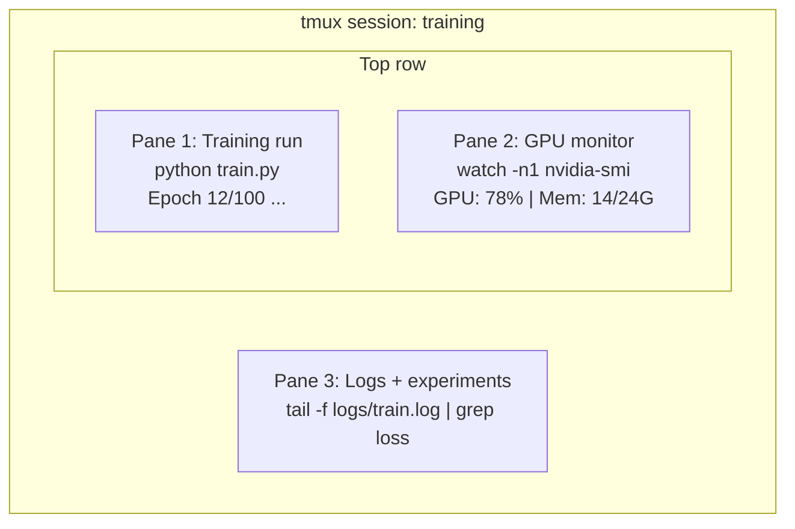

# 终端与 Shell（Terminal & Shell）

> 终端是 AI 工程师真正待的地方。在这里待舒服了。
>
> The terminal is where AI engineers live. Get comfortable here.

**类型 (Type):** Learn
**语言 (Languages):** --
**前置课程 (Prerequisites):** Phase 0, Lesson 01
**时间 (Time):** ~35 分钟

## 学习目标（Learning Objectives）

- 用管道、重定向和 `grep` 在命令行里过滤和处理训练日志
- 用 tmux 建多窗格的持久会话，同时跑训练和 GPU 监控
- 用 `htop`、`nvtop`、`nvidia-smi` 监控系统和 GPU 资源
- 用 SSH、`scp`、`rsync` 在本地和远程机器之间传输文件

> - Use piping, redirects, and `grep` to filter and process training logs from the command line
> - Create persistent tmux sessions with multiple panes for concurrent training and GPU monitoring
> - Monitor system and GPU resources with `htop`, `nvtop`, and `nvidia-smi`
> - Transfer files between local and remote machines using SSH, `scp`, and `rsync`

## 问题背景（The Problem）

你待在终端里的时间会比任何编辑器都长。训练、GPU 监控、日志跟踪、远程 SSH、环境管理——
每个 AI 工作流都要过 shell。这里慢，处处慢。

本课只讲 AI 工作用得上的终端技能。不讲 Unix 历史，不深挖 Bash 脚本，只要够用的。

> You will spend more time in the terminal than in any editor. Training runs, GPU monitoring, log tailing, remote SSH sessions, environment management. Every AI workflow touches the shell. If you're slow here, you're slow everywhere. This lesson covers the terminal skills that matter for AI work. No history of Unix. No deep-dive into Bash scripting. Just what you need.

## 核心概念（The Concept）



```figure
s0-shell-pipeline
```

三个东西同时跑，一个终端。你可以 detach 回家，SSH 回来 reattach，训练还在跑。

> Three things running at once. One terminal. You can detach, go home, SSH back in, and reattach. The training keeps running.

## 动手构建（Build It）

### 第 1 步：认准你的 shell（Step 1: Know your shell）

```bash
echo $SHELL
```

大多数系统是 `bash` 或 `zsh`。都能用，本课命令两者通吃。必须会的几件事：

```bash
# Move around
cd ~/projects/ai-engineering-from-scratch
pwd
ls -la

# History search (most useful shortcut you'll learn)
# Ctrl+R then type part of a previous command
# Press Ctrl+R again to cycle through matches

# Clear terminal
clear   # or Ctrl+L

# Cancel a running command
# Ctrl+C

# Suspend a running command (resume with fg)
# Ctrl+Z
```

> Most systems use `bash` or `zsh`. Both work fine. The commands in this course work in either. Ctrl+R history search is the most useful shortcut you'll learn.

### 第 2 步：管道与重定向（Step 2: Piping and redirects）

管道把命令串起来——处理日志、过滤输出、串联工具全靠它，天天用。

```bash
# Count how many times "loss" appears in a log
cat train.log | grep "loss" | wc -l

# Extract just the loss values from training output
grep "loss:" train.log | awk '{print $NF}' > losses.txt

# Watch a log file update in real time, filtering for errors
tail -f train.log | grep --line-buffered "ERROR"

# Sort experiments by final accuracy
grep "final_accuracy" results/*.log | sort -t= -k2 -n -r

# Redirect stdout and stderr to separate files
python train.py > output.log 2> errors.log

# Redirect both to the same file
python train.py > train_full.log 2>&1
```

必须会的三个重定向（The three redirects you need）：

| 符号 | 作用 |
|--------|-------------|
| `>` | stdout 写入文件（覆盖） |
| `>>` | stdout 追加到文件 |
| `2>` | stderr 写入文件 |
| `2>&1` | stderr 送去 stdout 所在的地方 |
| `\|` | 前一个命令的 stdout 作为后一个命令的 stdin |

> Piping connects commands together. This is how you process logs, filter output, and chain tools. You will use this constantly.

> **实测陷阱**：`2>&1` 的位置有讲究——它把 stderr 送到「当时 stdout 所在的地方」。
> `python train.py 2>&1 > f.log` 是错的：重定向 `2>&1` 时 stdout 还指着终端，
> 于是 stderr 去了终端、只有 stdout 进了文件。**必须先 `> f.log` 再 `2>&1`**，
> 见下文「实测数据与纠正」第一组。

### 第 3 步：后台进程（Step 3: Background processes）

训练一跑几小时，终端不能一直开着。

```bash
# Run in background (output still goes to terminal)
python train.py &

# Run in background, immune to hangup (closing terminal won't kill it)
nohup python train.py > train.log 2>&1 &

# Check what's running in background
jobs
ps aux | grep train.py

# Bring a background job to foreground
fg %1

# Kill a background process
kill %1
# or find its PID and kill that
kill $(pgrep -f "train.py")
```

`&`、`nohup`、`screen`/`tmux` 的区别：

| 方式 | 关终端后活着？ | 能重新接上？ |
|--------|-------------------------|---------------|
| `command &` | 否 | 否 |
| `nohup command &` | 是 | 否（只能看日志文件） |
| `screen` / `tmux` | 是 | 是 |

超过几分钟的任务，一律用 tmux。

> Training runs take hours. You don't want to keep your terminal open the whole time. For anything longer than a few minutes, use tmux.

### 第 4 步：tmux（Step 4: tmux）

tmux 让你建带多窗格的持久会话——管理训练任务的第一神器。

```bash
# Install
# macOS
brew install tmux
# Ubuntu
sudo apt install tmux

# Start a named session
tmux new -s training

# Split horizontally
# Ctrl+B then "

# Split vertically
# Ctrl+B then %

# Navigate between panes
# Ctrl+B then arrow keys

# Detach (session keeps running)
# Ctrl+B then d

# Reattach
tmux attach -t training

# List sessions
tmux ls

# Kill a session
tmux kill-session -t training
```

典型的 AI 工作会话（A typical AI workflow session）：

```bash
tmux new -s train

# Pane 1: start training
python train.py --epochs 100 --lr 1e-4

# Ctrl+B, " to split, then run GPU monitor
watch -n1 nvidia-smi

# Ctrl+B, % to split vertically, tail the logs
tail -f logs/experiment.log

# Now detach with Ctrl+B, d
# SSH out, go get coffee, come back
# tmux attach -t train
```

> tmux lets you create persistent terminal sessions with multiple panes. This is the single most useful tool for managing training runs.

> **本机事实**：tmux 未安装。按 MEMORY 约束 agent 不跑 `brew install`（沙箱嵌套必失败），
> 你自己在终端执行 `brew install tmux` 即可。

### 第 5 步：htop 和 nvtop 监控（Step 5: Monitoring with htop and nvtop）

```bash
# System processes (better than top)
htop

# GPU processes (if you have NVIDIA GPU)
# Install: sudo apt install nvtop (Ubuntu) or brew install nvtop (macOS)
nvtop

# Quick GPU check without nvtop
nvidia-smi

# Watch GPU usage update every second
watch -n1 nvidia-smi

# See which processes are using the GPU
nvidia-smi --query-compute-apps=pid,name,used_memory --format=csv
```

htop 常用键（htop keybindings you'll use）：

- `F6` 或 `>` 按列排序（按内存排，找内存泄漏）
- `F5` 树状视图（看子进程）
- `F9` 杀进程
- `/` 搜索进程名

> htop: F6 or > to sort by column (sort by memory to find memory leaks), F5 tree view, F9 kill, / search.

> **本机事实**：`nvidia-smi`/`nvtop` 是 NVIDIA 专用，M5 Pro 上不存在。
> Apple Silicon 看 GPU 用 `sudo powermetrics --samplers gpu_power -i 1000`
> （需要 sudo，你自己跑）或活动监视器 → 窗口 → GPU 历史记录。
> `watch` 命令 macOS 也没有，等价写法：`while true; do clear; <命令>; sleep 1; done`。

### 第 6 步：SSH 连远程 GPU（Step 6: SSH for remote GPU boxes）

租云 GPU（Lambda、RunPod、Vast.ai）都走 SSH。

```bash
# Basic connection
ssh user@gpu-box-ip

# With a specific key
ssh -i ~/.ssh/my_gpu_key user@gpu-box-ip

# Copy files to remote
scp model.pt user@gpu-box-ip:~/models/

# Copy files from remote
scp user@gpu-box-ip:~/results/metrics.json ./

# Sync a whole directory (faster for many files)
rsync -avz ./data/ user@gpu-box-ip:~/data/

# Port forward (access remote Jupyter/TensorBoard locally)
ssh -L 8888:localhost:8888 user@gpu-box-ip
# Now open localhost:8888 in your browser

# SSH config for convenience
# Add to ~/.ssh/config:
# Host gpu
#     HostName 192.168.1.100
#     User ubuntu
#     IdentityFile ~/.ssh/gpu_key
#
# Then just:
# ssh gpu
```

> When you rent a cloud GPU (Lambda, RunPod, Vast.ai), you connect via SSH. Port forward to access remote Jupyter/TensorBoard locally. Add entries to `~/.ssh/config` so you can just type `ssh gpu`.

> **本机事实**：`~/.ssh/config` 还不存在——练习 4 可以先用 `localhost` 练语法建一个。
> 0/08 的复习项（Remote SSH + ssh config）在这里落地。

### 第 7 步：AI 工作常用别名（Step 7: Useful aliases for AI work）

加进 `~/.zshrc`（本机是 zsh）：

```bash
source phases/00-setup-and-tooling/10-terminal-and-shell/code/shell_aliases.sh
```

核心别名（The key aliases）：

```bash
# GPU status at a glance
alias gpu='nvidia-smi --query-gpu=index,name,utilization.gpu,memory.used,memory.total,temperature.gpu --format=csv,noheader'

# Kill all Python training processes
alias killtraining='pkill -f "python.*train"'

# Quick virtual environment activate
alias ae='source .venv/bin/activate'

# Watch training loss
alias watchloss='tail -f logs/*.log | grep --line-buffered "loss"'
```

完整版见 `code/shell_aliases.sh`（含 `killtrain`、`taillog`、`bigmodels`、`syncto`/
`syncfrom`、`newexp`/`lastexp`、`trainenv` 等函数）。

> Add these to your `~/.bashrc` or `~/.zshrc`, or copy the ones you want. See `code/shell_aliases.sh` for the full set.

> **实测纠正**：别名字脚本里的 `memhogs` 在 macOS **静默空输出**——
> `ps aux --sort=-%mem` 是 GNU ps 专用，BSD ps（macOS）不认；报错被 `2>/dev/null`
> 吞掉，而管道退出码取的是 head 的 0，`|| ps aux -m` 后备分支永不触发。
> macOS 正确写法：`ps aux -m | head -11`。详见「实测数据与纠正」第三组。
> 另外 `checkenv` 里的 `pip --version` 在本课程 .venv 会失败（0/06：uv 建的环境没有 pip），
> 换 `uv pip --version`。

### 第 8 步：AI 终端常见套路（Step 8: Common AI terminal patterns）

实战里反复出现的组合拳：

```bash
# Run training, log everything, notify when done
python train.py 2>&1 | tee train.log; echo "DONE" | mail -s "Training complete" you@email.com

# Compare two experiment logs side by side
diff <(grep "accuracy" exp1.log) <(grep "accuracy" exp2.log)

# Find the largest model files (clean up disk space)
find . -name "*.pt" -o -name "*.safetensors" | xargs du -h | sort -rh | head -20

# Download a model from Hugging Face
wget https://huggingface.co/model/resolve/main/model.safetensors

# Untar a dataset
tar xzf dataset.tar.gz -C ./data/

# Count lines in all Python files (see how big your project is)
find . -name "*.py" | xargs wc -l | tail -1

# Check disk space (training data fills disks fast)
df -h
du -sh ./data/*

# Environment variable check before training
env | grep -i cuda
env | grep -i torch
```

> These come up repeatedly in practice: tee to log while watching, process substitution to diff filtered logs, find+du+sort to find disk hogs, df/du for disk space, env|grep for pre-training checks.

> **本机事实**：`mail` 通知本机不可用（没有配置 MTA）。macOS 替代：
> `osascript -e 'display notification "训练完成" with title "train.py"'`。

## 实测数据与纠正（本机 macOS 26.7 / M5 Pro / zsh，2026-10-10）

产物：`learning-artifacts/phase0/shell_lab.sh`（可复跑，`bash learning-artifacts/phase0/shell_lab.sh`）。

### 实测一：管道与重定向

- 1000 epoch 假日志（`loss=1/i`）：`grep "loss:" | awk '{print $NF}' | wc -l` →
  **1000 条，4 ms**。管道不是玩具，是毫秒级日志处理器。
- **`2>&1` 顺序陷阱实锤**：同一份双流脚本，
  - `2>&1 > wrong.log` → wrong.log **只有 stdout 一行**，stderr 从未进文件
    （它把 stderr 送到「当时 stdout 所在的终端」）；
  - `> right.log 2>&1` → **2 行全在**。
  - 口诀：**先安家（`>`），再搬家（`2>&1`）**。
- 顺带：`bc` 算 `scale=4; 1/1000` 输出 `.0010` 而不是 `0.0010`（不带前导零），
  写解析脚本时要防。

### 实测二：进程控制

- `sleep 30 &` → `jobs` 显示 `[1]+ Running` → `kill %1` **秒杀**（30 秒的任务立即死）。
- `nohup sleep 1 &` 脱离会话启动，关闭终端不影响。
- 关终端 = 发 SIGHUP：裸 `&` 会死，`nohup` 不死，tmux 是第三种活法（会话整个活着，
  还能 reattach 看实时输出——这就是它赢 `nohup` 的地方：**可回来看，不是只能翻日志**）。

### 实测三：纠正——`memhogs` 别名在 macOS 静默失败

```
课文 memhogs: ps aux --sort=-%mem 2>/dev/null | head -11 || ps aux -m | head -11
macOS 实测:   空输出！
```

三层原因：① `--sort` 是 GNU ps 专用，BSD ps（macOS）不认；② 报错被 `2>/dev/null`
吞掉；③ 管道的退出码取**最后一个命令**（head）的 0，`||` 后备分支永不触发。
**macOS 正确写法：`ps aux -m | head -11`**。

教训：`2>/dev/null` + 管道 + `||` 三件套叠起来，错误会被无声吞掉——
静默失败比报错危险得多（0/08 的 smoke test 教训同类）。

### 实测四：BSD 工具链兼容性

| 课文用法 | macOS 实测 |
|---------|-----------|
| `sort -rh` | ✓ 支持（`printf "1.5K\n2M\n900" | sort -rh` 正确排出 2M） |
| `grep --line-buffered` | ✓ 支持（`watchloss` 别名可用） |
| `ps aux --sort=-%mem` | ✗ GNU 专用，见实测三 |
| `bc` 前导零 | ⚠ 输出 `.0010` 不带 `0` |

### 环境事实

- `tmux`、`watch`、`nvidia-smi`、`nvtop` 未安装；`htop`、`bc`、`rsync` 已装。
- `brew install tmux` 由你自己执行（agent 不跑 brew，沙箱嵌套必失败）。
- `watch -n1 nvidia-smi` 的 macOS 等价：`while true; do clear; <命令>; sleep 1; done`。
- `~/.ssh/config` 不存在，练习 4 用 `localhost` 练语法。
- 磁盘账：根卷剩 594 Gi / 926 Gi；`.venv` 1.4 GB；HF 缓存 53 MB——
  `df -h` + `du -sh` 这两个命令 Phase 3 起每周都要跑。

## 实战运用（Use It）

课程里各工具的出场时机：

| 工具 | 什么时候用 |
|------|----------------|
| tmux | 每次训练（Phase 3 起） |
| `tail -f` + `grep` | 盯训练日志 |
| `nohup` / `&` | 快速后台任务 |
| `htop` / `nvtop` | 排查慢训练、OOM |
| SSH + `rsync` | 云 GPU 工作 |
| 管道 + 重定向 | 处理实验结果 |
| 别名 | 省重复命令的时间 |

> Here's when each tool comes into play during this course.

## 练习（Exercises）

1. 装 tmux，建三窗格会话：一格跑 `htop`，一格跑 `watch -n1 date`，一格跑 Python 脚本。detach 再 reattach
2. 把 `code/shell_aliases.sh` 的别名加进 shell 配置，`source ~/.zshrc` 重载
3. 用 `for i in $(seq 1 100); do echo "epoch $i loss: $(echo "scale=4; 1/$i" | bc)"; sleep 0.1; done > fake_train.log` 造假日志，再用 `grep`、`tail`、`awk` 提取 loss 值
4. 给一台你有权限的服务器（或 `localhost`）建 SSH config 条目

> 1. Install tmux, create a session with three panes, run htop / watch / a Python script, detach and reattach
> 2. Add the aliases to your shell config and reload
> 3. Create a fake training log and extract loss values with grep, tail, and awk
> 4. Set up an SSH config entry for a server (or use localhost to practice)

## 关键术语（Key Terms）

| 术语 (Term) | 口头说法 | 实际含义 |
|------|----------------|----------------------|
| Shell | "终端" | 解释你命令的程序（bash、zsh、fish） |
| tmux | "终端复用器" | 在一个窗口里跑多个终端会话、可 detach/reattach 的程序 |
| Pipe | "竖杠" | `\|` 操作符，把前一个命令的输出作为后一个的输入 |
| PID | "进程号" | 每个运行中进程的唯一编号，用于监控或杀掉它 |
| nohup | "不挂断" | 让命令免疫挂断信号，关终端不死 |
| SSH | "连服务器" | Secure Shell，在远程机器上执行命令的加密协议 |

**English original:**

| Term | What people say | What it actually means |
|------|----------------|----------------------|
| Shell | "The terminal" | The program that interprets your commands (bash, zsh, fish) |
| tmux | "Terminal multiplexer" | A program that lets you run multiple terminal sessions inside one window, and detach/reattach |
| Pipe | "The bar thing" | The `\|` operator that sends one command's output as input to another |
| PID | "Process ID" | A unique number assigned to every running process, used to monitor or kill it |
| nohup | "No hangup" | Runs a command immune to the hangup signal, so closing the terminal won't kill it |
| SSH | "Connecting to the server" | Secure Shell, an encrypted protocol for running commands on a remote machine |
