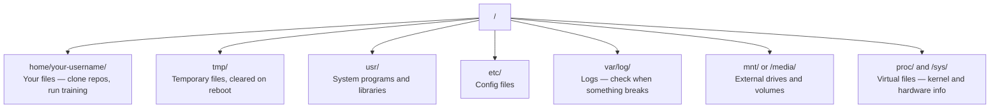

# Linux for AI —— 给 AI 工程师的 Linux 生存指南

> 中文讲义（双语对照）。正文为中文，每段下方 `>` 引用块保留英文原文；代码块、命令、术语名不译。

**类型 (Type):** Learn
**语言 (Languages):** --
**前置课程 (Prerequisites):** Phase 0, Lesson 01
**时间 (Time):** ~30 分钟

> Most AI runs on Linux. You need to know enough to not be stuck.

## 学习目标（Learning Objectives）

- 在命令行里在 Linux 文件系统中导航并做基本文件操作
- 用 `chmod`、`chown` 管理文件权限，解决 "Permission denied"
- 用 `apt` 装系统包，把一台全新的 GPU 机器配成 AI 工作站
- 认清 macOS → Linux 的差异，这些差异在远程机器上最容易踩坑

> - Navigate the Linux file system and perform essential file operations from the command line
> - Manage file permissions with `chmod` and `chown` to resolve "Permission denied" errors
> - Install system packages with `apt` and set up a fresh GPU box for AI work
> - Identify macOS-to-Linux differences that commonly trip up developers working on remote machines

## 问题（The Problem）

你在 macOS 或 Windows 上开发。但只要你 SSH 进云 GPU 机器、租一台 Lambda 实例、或起一台 EC2，你就落进了 Ubuntu。终端是你唯一的界面——没有 Finder、没有 Explorer、没有图形界面。如果你不能用命令行导航文件系统、装包、管理进程，你就会在 Google "how to unzip a file in Linux" 的时候白白烧掉闲置的 GPU 小时费。

这是一份生存指南。只讲在远程 Linux 机器上做 AI 工作需要的东西，不多讲。

> You develop on macOS or Windows. But the moment you SSH into a cloud GPU box, rent a Lambda instance, or spin up an EC2 machine, you land in Ubuntu. The terminal is your only interface. There is no Finder, no Explorer, no GUI. If you can't navigate the file system, install packages, and manage processes from the command line, you're stuck paying for idle GPU hours while googling "how to unzip a file in Linux."
>
> This is a survival guide. It covers exactly what you need to operate on a remote Linux machine for AI work. Nothing more.

## 文件系统布局（File System Layout）

Linux 把一切都组织在单一根目录 `/` 之下。没有 `C:\`，也没有 `/Volumes`。你真正会打交道的目录：

- `home/你的用户名/`：你的文件——clone 仓库、跑训练都在这
- `tmp/`：临时文件，重启即清空
- `usr/`：系统程序与库
- `etc/`：配置文件
- `var/log/`：日志——出问题时来这查
- `mnt/` 或 `/media/`：外接磁盘与挂载卷
- `proc/` 与 `/sys/`：虚拟文件——内核与硬件信息

你的 home 目录就是 `~` 或 `/home/你的用户名`。几乎所有事情都发生在这里。

> Linux organizes everything under a single root `/`. There is no `C:\` or `/Volumes`. The directories you'll actually touch:
> 
> - `home/your-username/` — Your files — clone repos, run training
> - `tmp/` — Temporary files, cleared on reboot
> - `usr/` — System programs and libraries
> - `etc/` — Config files
> - `var/log/` — Logs — check when something breaks
> - `mnt/` or `/media/` — External drives and volumes
> - `proc/` and `/sys/` — Virtual files — kernel and hardware info
>
> Your home directory is `~` or `/home/your-username`. Almost everything you do happens here.



## 核心命令（Essential Commands）

这 15 个命令覆盖你在远程 GPU 机器上 95% 的操作。

> These are the 15 commands that cover 95% of what you'll do on a remote GPU box.

### Moving Around（移动）

```bash
pwd                         # Where am I?
ls                          # What's here?
ls -la                      # What's here, including hidden files with details?
cd /path/to/dir             # Go there
cd ~                        # Go home
cd ..                       # Go up one level
```

### Files and Directories（文件与目录）

```bash
mkdir my-project            # Create a directory
mkdir -p a/b/c              # Create nested directories in one shot

cp file.txt backup.txt      # Copy a file
cp -r src/ src-backup/      # Copy a directory (recursive)

mv old.txt new.txt          # Rename a file
mv file.txt /tmp/           # Move a file

rm file.txt                 # Delete a file (no trash, it's gone)
rm -rf my-dir/              # Delete a directory and everything inside
```

`rm -rf` 是永久的，没有撤销。按回车之前把路径再看一遍。

> `rm -rf` is permanent. There is no undo. Double-check the path before hitting enter.

### Reading Files（读文件）

```bash
cat file.txt                # Print entire file
head -20 file.txt           # First 20 lines
tail -20 file.txt           # Last 20 lines
tail -f log.txt             # Follow a log file in real time (Ctrl+C to stop)
less file.txt               # Scroll through a file (q to quit)
```

### Searching（搜索）

```bash
grep "error" training.log           # Find lines containing "error"
grep -r "learning_rate" .           # Search all files in current directory
grep -i "cuda" config.yaml          # Case-insensitive search

find . -name "*.py"                 # Find all Python files under current dir
find . -name "*.ckpt" -size +1G     # Find checkpoint files larger than 1GB
```

## 权限（Permissions）

Linux 里每个文件都有属主和权限位。脚本不能执行、目录不能写入时，你就撞上它了。

`ls -l train.py` 的输出形如 `-rwxr-xr--`：前三位是属主权限（读 r、写 w、执行 x），中间三位是组权限，最后三位是其他人。

常用修法：`chmod +x train.sh` 让脚本可执行；`chmod 755 deploy.sh` 属主全权、其他人读+执行；`chmod 644 config.yaml` 属主读写、其他人只读；`chown user:group file.txt` 改属主（需要 sudo）。

见到 "Permission denied"，几乎总是权限问题。`chmod +x` 或 `sudo` 能解决大多数情况。

> Every file in Linux has an owner and permission bits. You'll run into this when scripts won't execute or you can't write to a directory.
>
> Common fixes:
> - `chmod +x train.sh` — Make a script executable
> - `chmod 755 deploy.sh` — Owner: full, others: read+execute
> - `chmod 644 config.yaml` — Owner: read+write, others: read only
> - `chown user:group file.txt` — Change who owns a file (needs sudo)
>
> When something says "Permission denied," it's almost always a permissions issue. `chmod +x` or `sudo` will fix most cases.

```bash
ls -l train.py
# -rwxr-xr-- 1 user group 2048 Mar 19 10:00 train.py
#  ^^^             owner permissions: read, write, execute
#     ^^^          group permissions: read, execute
#        ^^        everyone else: read only
```

常用修法：

```bash
chmod +x train.sh           # Make a script executable
chmod 755 deploy.sh         # Owner: full, others: read+execute
chmod 644 config.yaml       # Owner: read+write, others: read only

chown user:group file.txt   # Change who owns a file (needs sudo)
```

## 包管理 apt（Package Management）

Ubuntu 用 `apt` 装系统级软件。**先 `sudo apt update` 刷新包索引，再 install**——顺序反了会装到过期版本。

新 GPU 机器到手常装的一批：build-essential（C 编译器和 make，很多 Python 包编译时要）、git、curl、wget、tmux、htop、unzip、python3-venv（见下方代码块）。

> Ubuntu uses `apt`. This is how you install system-level software. `sudo apt update` refreshes the package list (always do this first). `build-essential` provides the C compiler, make, etc., needed by many Python packages. `tmux` keeps sessions alive after disconnect.

```bash
sudo apt update             # Refresh the package list (always do this first)
sudo apt install -y htop    # Install a package (-y skips confirmation)
sudo apt install -y build-essential  # C compiler, make, etc. Needed by many Python packages
sudo apt install -y tmux    # Terminal multiplexer (keep sessions alive after disconnect)

apt list --installed        # What's installed?
sudo apt remove htop        # Uninstall
```

新 GPU 机器到手常装的一批：

```bash
sudo apt update && sudo apt install -y \
    build-essential \
    git \
    curl \
    wget \
    tmux \
    htop \
    unzip \
    python3-venv
```

## 用户与 sudo（Users and sudo）

你通常以普通用户登录。有些操作需要 root（管理员）权限：`whoami` 看当前用户；`sudo command` 以 root 跑单条命令；`sudo su` 变成 root（`exit` 退出回来，慎用）。

云 GPU 实例上通常只有你一个用户、且已有 sudo 权限。但不要什么都用 root 跑——只在需要时用 sudo。

> You're usually logged in as a regular user. Some operations need root (admin) access.
>
> On cloud GPU instances, you're typically the only user and already have sudo access. Don't run everything as root. Use sudo only when needed.

```bash
whoami                      # What user am I?
sudo command                # Run a single command as root
sudo su                     # Become root (exit to go back, use sparingly)
```

## 进程与 systemd（Processes and systemd）

训练卡住、或想看什么在跑：`htop` 交互式进程查看器（q 退出）、`ps aux | grep python` 找 Python 进程、`kill 12345` 优雅停止、`kill -9 12345` 强杀（优雅的不行再用）、`nvidia-smi` 看 GPU 进程与显存。

systemd 管理服务（后台守护进程）。跑推理服务时会用到：`systemctl start/stop/restart/status/enable`，其中 `enable` 是开机自启。

> When your training hangs, or you need to check what's running:
>
> systemd manages services (background daemons). You'll use it if you run inference servers: `sudo systemctl start|stop|restart|status|enable nginx`.

```bash
htop                        # Interactive process viewer (q to quit)
ps aux | grep python        # Find running Python processes
kill 12345                  # Gracefully stop process with PID 12345
kill -9 12345               # Force kill (use when graceful doesn't work)
nvidia-smi                  # GPU processes and memory usage
```

systemd 管理服务（后台守护进程）。跑推理服务时会用到：

```bash
sudo systemctl start nginx          # Start a service
sudo systemctl stop nginx           # Stop it
sudo systemctl restart nginx        # Restart it
sudo systemctl status nginx         # Check if it's running
sudo systemctl enable nginx         # Start automatically on boot
```

## 磁盘空间（Disk Space）

GPU 机器磁盘经常很紧张。模型和数据集填得飞快。

- `df -h`：所有挂载盘的用量；`df -h /home` 单看 /home
- `du -sh *`：当前目录每一项多大
- `du -sh ~/.cache`：缓存目录大小（pip、HuggingFace 模型都落在这里）
- 找空间大户：`du -h --max-depth=1 / 2>/dev/null | sort -hr | head -20`

省空间三板斧：`pip cache purge` 清 pip 缓存；`sudo apt clean` 清 apt 缓存；`rm -rf checkpoints/epoch_01/` 删不要的旧 checkpoint。

> GPU boxes often have limited disk space. Models and datasets fill it fast. Use `df -h`, `du -sh`, and the space-hog finder above. Common space savers: `pip cache purge`, `sudo apt clean`, remove old checkpoints you don't need.

```bash
df -h                       # Disk usage for all mounted drives
df -h /home                 # Disk usage for /home specifically

du -sh *                    # Size of each item in current directory
du -sh ~/.cache             # Size of your cache (pip, huggingface models land here)
du -sh /data/checkpoints/   # Check how big your checkpoints are

# Find the biggest space hogs
du -h --max-depth=1 / 2>/dev/null | sort -hr | head -20
```

省空间三板斧：

```bash
# Clear pip cache
pip cache purge

# Clear apt cache
sudo apt clean

# Remove old checkpoints you don't need
rm -rf checkpoints/epoch_01/ checkpoints/epoch_02/
```

## 网络（Networking）

命令行里下模型、传文件、打 API：

- 下载：`wget URL`、`curl -O URL`；打 API 并美化 JSON：`curl -s URL | python3 -m json.tool`
- 传文件：`scp model.bin user@remote:/data/`；从远程拷回：`scp user@remote:/data/results.csv .`；目录加 `-r`
- 同步目录：`rsync -avz --progress ./data/ user@remote:/data/`

**大传输一律用 rsync 而不是 scp**：rsync 只传变化的字节、断了能续传。

> You'll download models, transfer files, and hit APIs from the command line. Use `rsync` over `scp` for anything large. It only transfers changed bytes and handles interrupted connections.

```bash
# Download files
wget https://example.com/model.bin                   # Download a file
curl -O https://example.com/data.tar.gz              # Same thing with curl
curl -s https://api.example.com/health | python3 -m json.tool  # Hit an API, pretty-print JSON

# Transfer files between machines
scp model.bin user@remote:/data/                     # Copy file to remote machine
scp user@remote:/data/results.csv .                  # Copy file from remote to local
scp -r user@remote:/data/checkpoints/ ./local-dir/   # Copy directory

# Sync directories (faster than scp for large transfers, resumes on failure)
rsync -avz --progress ./data/ user@remote:/data/
rsync -avz --progress user@remote:/results/ ./results/
```

## tmux：让会话活着（tmux: Keep Sessions Alive）

SSH 进远程机器后，合上笔记本盖子就等于杀掉训练。tmux 防的就是这个（与 0/10 呼应）。

`tmux new -s train` 起会话 → 起训练 → `Ctrl+B` 然后 `D` 分离（训练继续跑）→ `tmux ls` 列会话 → `tmux attach -t train` 重连。会话内：`Ctrl+B %` 纵分屏、`Ctrl+B "` 横分屏、`Ctrl+B` + 方向键切窗格。

长训练任务**永远**在 tmux 里跑。

> When you SSH into a remote box, closing your laptop kills your training run. tmux prevents this. Always run long training jobs inside tmux. Always.
> （注：本地跑时合盖睡眠是另一回事，tmux 管不到机器睡眠——见 0/10 实测笔记的 caffeinate 一条。）

```bash
tmux new -s train           # Start a new session named "train"
# ... start your training, then:
# Ctrl+B, then D            # Detach (training keeps running)

tmux ls                     # List sessions
tmux attach -t train        # Reattach to session

# Inside tmux:
# Ctrl+B, then %            # Split pane vertically
# Ctrl+B, then "            # Split pane horizontally
# Ctrl+B, then arrow keys   # Switch between panes
```

## Windows 用户的 WSL2（WSL2 for Windows Users）

Windows 上 WSL2 给你一个真正的 Linux 环境，不用双系统。PowerShell（管理员）里 `wsl --install -d Ubuntu-24.04`，重启后从开始菜单打开 Ubuntu，`sudo apt update && sudo apt upgrade -y`。

WSL2 跑的是真 Linux 内核，本课所有命令在里面都能用。你的 Windows 文件从 WSL 里看在 `/mnt/c/Users/你的名字/`。

GPU 直通需要在 Windows 侧装 NVIDIA 驱动（装 Windows 版驱动，不是 Linux 版），装好后 WSL2 里就有 CUDA。

> If you're on Windows, WSL2 gives you a real Linux environment without dual-booting. WSL2 runs a real Linux kernel. Everything in this lesson works inside it. Your Windows files are at `/mnt/c/Users/YourName/` from inside WSL. GPU passthrough works with NVIDIA drivers installed on the Windows side.

```bash
# In PowerShell (admin)
wsl --install -d Ubuntu-24.04

# After restart, open Ubuntu from Start menu
sudo apt update && sudo apt upgrade -y
```

## 踩坑对照表：macOS → Linux（Gotchas）

从 macOS 过来会被这些东西绊倒：

> Things that will trip you up if you're coming from macOS:

| macOS | Linux | Notes |
|-------|-------|-------|
| `brew install` | `sudo apt install` | 包名常不同：`brew install htop` ≈ `sudo apt install htop`，但 `brew install readline` 对应 `sudo apt install libreadline-dev` |
| `open file.txt` | `xdg-open file.txt` | 远程机器没有 GUI，用 `cat` 或 `less` |
| `pbcopy` / `pbpaste` | 不存在 | SSH 上没有剪贴板管道 |
| `~/.zshrc` | `~/.bashrc` | macOS 默认 zsh，多数 Linux 服务器用 bash |
| `/opt/homebrew/` | `/usr/bin/`、`/usr/local/bin/` | 可执行文件位置不同 |
| `sed -i '' 's/a/b/' file` | `sed -i 's/a/b/' file` | macOS 的 sed 需要 `-i` 后跟空串，Linux 不需要 |
| 文件系统大小写不敏感 | 大小写敏感 | Linux 上 `Model.py` 和 `model.py` 是两个文件 |
| 行尾 `\n` | 行尾 `\n` | 相同。但 Windows 用 `\r\n`，会弄坏 bash 脚本；用 `dos2unix` 修 |

> Things that will trip you up if you're coming from macOS: see the table above (original column headings preserved).

## 速查卡（Quick Reference Card）

（速查卡原文照录，见下方代码块。）

> Quick Reference Card.

```
Navigation:     pwd, ls, cd, find
Files:          cp, mv, rm, mkdir, cat, head, tail, less
Search:         grep, find
Permissions:    chmod, chown, sudo
Packages:       apt update, apt install
Processes:      htop, ps, kill, nvidia-smi
Services:       systemctl start/stop/restart/status
Disk:           df -h, du -sh
Network:        curl, wget, scp, rsync
Sessions:       tmux new/attach/detach
```

```figure
s0-process-fork
```

## 练习（Exercises）

（5 道练习，原文在下。）

> 5 Exercises.

1. SSH 进任意 Linux 机器（或打开 WSL2），回到 home 目录。用 `touch` 建一个项目文件夹和里面三个空文件，然后用 `ls -la` 列出来。
2. 用 apt 装 `htop`，跑起来，找出哪个进程占内存最多。
3. 起一个 tmux 会话，在里面跑 `sleep 300`，detach，列出会话，再 reattach。
4. 用 `df -h` 看磁盘余量，再用 `du -sh ~/.cache/*` 找出缓存里什么占空间。
5. 用 `scp` 把一个文件从本地传到远程，再用 `rsync` 做同样传输，比较两者的体验。

> 1. SSH into any Linux machine (or open WSL2) and navigate to your home directory. Create a project folder, create three empty files inside it with `touch`, then list them with `ls -la`.
> 2. Install `htop` with apt, run it, and identify which process is using the most memory.
> 3. Start a tmux session, run `sleep 300` inside it, detach, list sessions, and reattach.
> 4. Use `df -h` to check available disk space, then use `du -sh ~/.cache/*` to find what's taking up space in your cache.
> 5. Transfer a file from your local machine to a remote one using `scp`, then do the same transfer with `rsync` and compare the experience.

## 实测数据与纠正（Measured Corrections）


1. **macOS 上 `sed -i` 与 `du --max-depth` 的差异实测**（本机 zsh 5.9 / Darwin 24.3）：

   ```bash
   sed -i '' 's/a/b/' file   # macOS：-i 后必须跟空串 ''
   sed -i 's/a/b/' file      # Linux：直接写，多了 '' 会报 sed: can't read s/a/b/: No such file or directory

   du --max-depth=1 .        # macOS/BSD：报 du: unrecognized option `--max-depth=1`
   du -d 1 .                 # macOS/BSD 的等价写法
   ```

   > 实测纠正：本课的「空间大户」命令 `du -h --max-depth=1 / | sort -hr | head -20` 在 **Linux 上**成立；macOS 上要换成 `du -hd1 / | sort -hr | head -20`（`-d 1` = depth 1）。`sort -hr` 两边通用（BSD sort 支持 `-h`）。

2. **`sort -h` 人类可读排序**（`-hr` = human-readable + reverse）：让 `10G` 排在 `2M` 前面。没有 `-h` 时字符串排序会把 `9M` 排在 `10G` 后面——排序数字单位时永远带 `-h`。

3. **`rm -rf` 无撤销**（教训级）：本课原文强调"Double-check the path before hitting enter"。配合 tmux/远程机器尤其危险——云端没有回收站。习惯：先 `ls` 看路径，再执行 `rm -rf`；危险路径永远不要手打，用 Tab 补全或先 `echo` 展开检查。

4. **`sudo apt update` 与 `upgrade` 分离**：`update` 只刷新索引（快），`upgrade` 才真正升级包（慢、可能重启服务）。教程里 `sudo apt update && sudo apt upgrade -y` 是新机器初始化用的，日常加包只需 `update && install`。

5. **本机环境事实**：当前工作机是 macOS（Darwin 24.3 / zsh 5.9），**没有 apt、没有 Linux**——本课命令练习可在 WSL2 或云 GPU 机器上做，macOS 上做练习 1/2 时按上表换等价命令。`brew install` 在本沙箱必失败（见 .workbuddy/memory/MEMORY.md），装工具需用户在自己终端执行。
