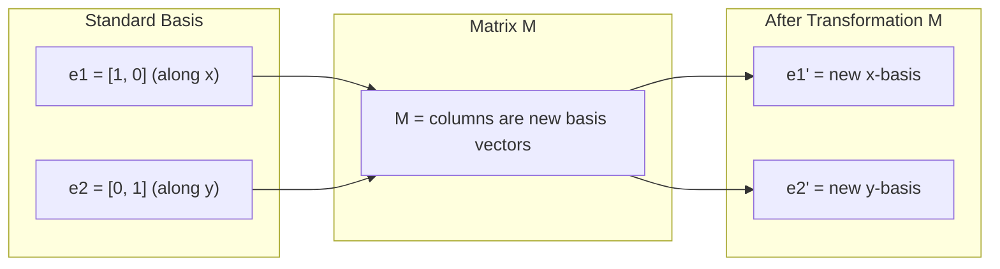
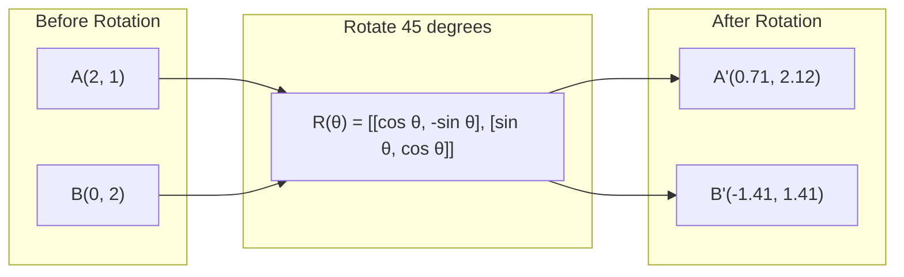
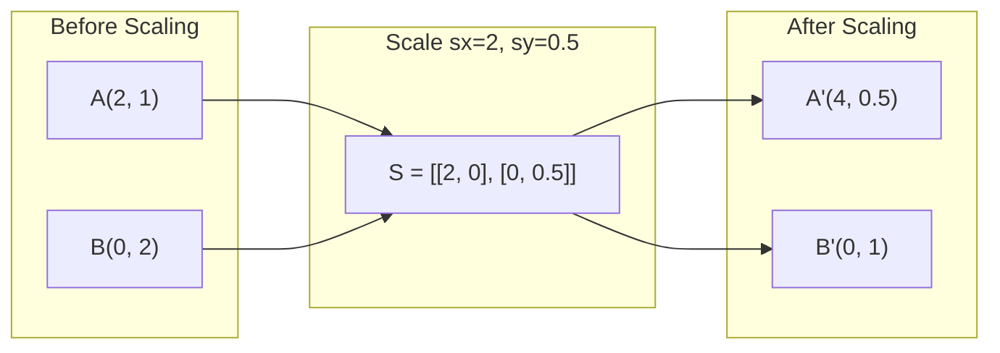
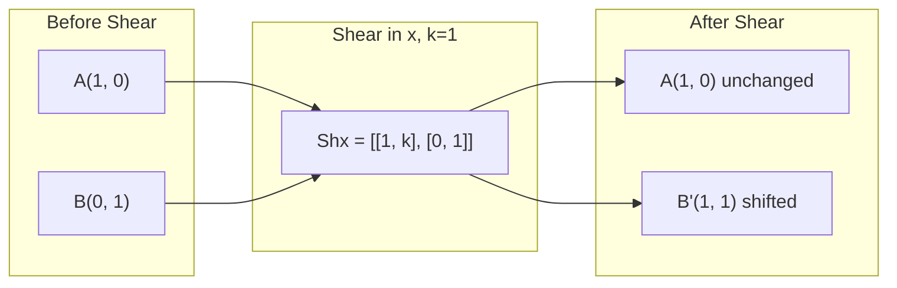
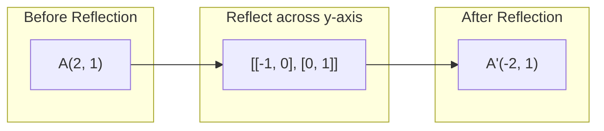

# 矩阵变换（Matrix Transformations）

> 中文讲义（双语对照）。正文为中文，每段下方 `>` 引用块保留英文原文；代码块、mermaid 图、术语名不译。

> A matrix is a machine that reshapes space. Learn what it does to every point, and you understand the whole transformation.

**类型 (Type):** Build
**语言 (Languages):** Python, Julia
**前置课程 (Prerequisites):** Phase 1, Lessons 01-02 (Linear Algebra Intuition, Vectors & Matrices Operations)
**时间 (Time):** ~75 分钟

## 学习目标（Learning Objectives）

- 构造旋转、缩放、剪切、反射矩阵，并把它们作用到 2D 与 3D 点上
- 用矩阵乘法复合多个变换，并验证顺序确实有影响
- 从特征方程出发，计算 2x2 矩阵的特征值与特征向量
- 解释为什么特征值决定了 PCA 方向、RNN 稳定性、谱聚类的行为

> - Construct rotation, scaling, shearing, and reflection matrices and apply them to 2D and 3D points
> - Compose multiple transformations by matrix multiplication and verify that order matters
> - Compute eigenvalues and eigenvectors of 2x2 matrices from the characteristic equation
> - Explain why eigenvalues determine PCA directions, RNN stability, and spectral clustering behavior

## 问题（The Problem）

你读 PCA，看到"求协方差矩阵的特征向量"；读模型稳定性，看到"检查所有特征值的模是否小于 1"；读数据增强，看到"施加一个随机旋转"。**在你理解矩阵对空间做了什么几何动作之前，这些全都讲不通。**

矩阵不只是数字网格，它们是**空间的机器**。旋转矩阵把点转起来，缩放矩阵把它们拉伸，剪切矩阵把它们推歪。神经网络对数据施加的每一个变换，都是这些操作之一或它们的复合。本课把这些操作变得具体可感。

> You read about PCA and see "find the eigenvectors of the covariance matrix." You read about model stability and see "check if all eigenvalues have magnitude less than 1." You read about data augmentation and see "apply a random rotation." None of this makes sense until you understand what matrices do to space geometrically.
>
> Matrices are not just grids of numbers. They are spatial machines. A rotation matrix spins points. A scaling matrix stretches them. A shearing matrix tilts them. Every transformation a neural network applies to data is one of these operations or a composition of them. This lesson makes those operations concrete.

## 核心概念（The Concept）

### 变换就是矩阵

2D 里的每个线性变换都能写成一个 2x2 矩阵。**这个矩阵精确地告诉你基向量 [1,0] 和 [0,1] 最终去哪了**——其余一切都是推论。

> Every linear transformation in 2D can be written as a 2x2 matrix. The matrix tells you exactly where the basis vectors [1, 0] and [0, 1] end up. Everything else follows.



### 旋转（Rotation）

2D 旋转 θ 角，**保持距离与角度不变**，每个点沿圆弧移动。

> A 2D rotation by angle theta keeps distances and angles intact. It moves every point along a circular arc.



3D 里你绕着某根轴旋转，每根轴有自己的旋转矩阵：

```
Rz(theta) = | cos  -sin  0 |     Rotate around z-axis
            | sin   cos  0 |     (x-y plane spins, z stays)
            |  0     0   1 |

Rx(theta) = | 1   0     0    |   Rotate around x-axis
            | 0  cos  -sin   |   (y-z plane spins, x stays)
            | 0  sin   cos   |

Ry(theta) = |  cos  0  sin |     Rotate around y-axis
            |   0   1   0  |     (x-z plane spins, y stays)
            | -sin  0  cos |
```

### 缩放（Scaling）

缩放沿每根轴独立地拉伸或压缩。

> Scaling stretches or compresses along each axis independently.



### 剪切（Shearing）

剪切让一根轴倾斜而另一根不动，**把矩形变成平行四边形**。

> Shearing tilts one axis while keeping the other fixed. It turns rectangles into parallelograms.



剪切矩阵：
- `Shx = [[1, k], [0, 1]]` 把 x 平移 k * y
- `Shy = [[1, 0], [k, 1]]` 把 y 平移 k * x

### 反射（Reflection）

反射把点沿某根轴或某条线镜像。

> Reflection mirrors points across an axis or line.



反射矩阵：
- 沿 y 轴反射：`[[-1, 0], [0, 1]]`
- 沿 x 轴反射：`[[1, 0], [0, -1]]`

### 复合：把变换串起来（Composition）

先施加变换 A 再施加 B，等价于把它们的矩阵相乘：`result = B @ A @ point`。**顺序有影响**：先转再缩，和先缩再转，结果不同。

> Applying transformation A then B is the same as multiplying their matrices: `result = B @ A @ point`. Order matters. Rotate then scale gives different results than scale then rotate.

```
先旋转 90°、再缩放 (2, 0.5):
  (1, 0) --Rotate 90--> (0, 1) --Scale--> (0, 0.5)
  Composed: S @ R = [[0, -2], [0.5, 0]]

先缩放 (2, 0.5)、再旋转 90°:
  (1, 0) --Scale--> (2, 0) --Rotate 90--> (0, 2)
  Composed: R @ S = [[0, -0.5], [2, 0]]
```

结果不同。**矩阵乘法不满足交换律。**

### 特征值与特征向量

大多数向量被矩阵作用后会改变方向。**特征向量很特殊：矩阵只缩放它们，从不旋转它们**。缩放系数就是特征值。

> Most vectors change direction when a matrix hits them. Eigenvectors are special: the matrix only scales them, never rotates them. The scaling factor is the eigenvalue.

```
A @ v = lambda * v

v 是特征向量（存活下来的方向）
lambda 是特征值（拉伸了多少）

例子：A = | 2  1 |
          | 1  2 |

特征向量 [1, 1]，特征值 3：
  A @ [1,1] = [3, 3] = 3 * [1, 1]     （同方向，放大 3 倍）

特征向量 [1, -1]，特征值 1：
  A @ [1,-1] = [1, -1] = 1 * [1, -1]  （同方向，不变）
```

这个矩阵沿 [1, 1] 方向把空间拉伸 3 倍，而 [1, -1] 方向保持不变。**其余每个方向都是这两个方向的混合。**

### 特征分解（Eigendecomposition）

如果一个矩阵有 n 个线性无关的特征向量，它可以被分解：

```
A = V @ D @ V^(-1)

V = 列为特征向量的矩阵
D = 特征值组成的对角矩阵
V^(-1) = V 的逆

这句话的意思是：旋转到特征向量坐标系 → 沿每根轴缩放 → 再旋转回来。
```

> If a matrix has n linearly independent eigenvectors, it can be decomposed: `A = V @ D @ V^(-1)`. [...]
>
> This says: rotate into eigenvector coordinates, scale along each axis, rotate back.

### 特征值为什么重要

- **PCA。** 协方差矩阵的特征向量就是主成分，特征值告诉你每个成分捕获了多少方差。按特征值排序、保留前 k 个，就得到了降维。
- **稳定性。** 在循环网络和动力系统里，**模 > 1 的特征值让输出爆炸，模 < 1 让输出消失**——这就是梯度消失/爆炸问题的一句话表述。
- **谱方法。** 图神经网络用邻接矩阵的特征值，谱聚类用拉普拉斯矩阵的特征值，特征向量揭示了图的结构。

> **PCA.** The eigenvectors of the covariance matrix are the principal components. [...]
>
> **Stability.** In recurrent networks and dynamical systems, eigenvalues with magnitude > 1 cause outputs to explode. Magnitude < 1 causes them to vanish. This is the vanishing/exploding gradient problem stated in one sentence.
>
> **Spectral methods.** Graph neural networks use eigenvalues of the adjacency matrix. Spectral clustering uses eigenvalues of the Laplacian. The eigenvectors reveal the structure of the graph.

### 行列式 = 体积缩放因子

变换矩阵的行列式告诉你它把面积（2D）或体积（3D）缩放了多少。

> The determinant of a transformation matrix tells you how much it scales area (2D) or volume (3D).

```
det = 1:   面积不变（旋转）
det = 2:   面积翻倍
det = 0:   空间被压扁到更低维度（奇异）
det = -1:  面积不变但朝向翻转（反射）

| det(旋转) | = 1          （永远）
| det(缩放 sx, sy) | = sx * sy
| det(剪切) | = 1            （面积不变）
| det(反射) | = -1           （朝向翻转）
```

```figure
matrix-transform
```

## 动手构建（Build It）

### Step 1：从零写变换矩阵（Python）

```python
import math

def rotation_2d(theta):
    c, s = math.cos(theta), math.sin(theta)
    return [[c, -s], [s, c]]

def scaling_2d(sx, sy):
    return [[sx, 0], [0, sy]]

def shearing_2d(kx, ky):
    return [[1, kx], [ky, 1]]

def reflection_x():
    return [[1, 0], [0, -1]]

def reflection_y():
    return [[-1, 0], [0, 1]]

def mat_vec_mul(matrix, vector):
    return [
        sum(matrix[i][j] * vector[j] for j in range(len(vector)))
        for i in range(len(matrix))
    ]

def mat_mul(a, b):
    rows_a, cols_b = len(a), len(b[0])
    cols_a = len(a[0])
    return [
        [sum(a[i][k] * b[k][j] for k in range(cols_a)) for j in range(cols_b)]
        for i in range(rows_a)
    ]

point = [1.0, 0.0]
angle = math.pi / 4

rotated = mat_vec_mul(rotation_2d(angle), point)
print(f"Rotate (1,0) by 45 deg: ({rotated[0]:.4f}, {rotated[1]:.4f})")

scaled = mat_vec_mul(scaling_2d(2, 3), [1.0, 1.0])
print(f"Scale (1,1) by (2,3): ({scaled[0]:.1f}, {scaled[1]:.1f})")

sheared = mat_vec_mul(shearing_2d(1, 0), [1.0, 1.0])
print(f"Shear (1,1) kx=1: ({sheared[0]:.1f}, {sheared[1]:.1f})")

reflected = mat_vec_mul(reflection_y(), [2.0, 1.0])
print(f"Reflect (2,1) across y: ({reflected[0]:.1f}, {reflected[1]:.1f})")
```

### Step 2：变换的复合

```python
R = rotation_2d(math.pi / 2)
S = scaling_2d(2, 0.5)

rotate_then_scale = mat_mul(S, R)
scale_then_rotate = mat_mul(R, S)

point = [1.0, 0.0]
result1 = mat_vec_mul(rotate_then_scale, point)
result2 = mat_vec_mul(scale_then_rotate, point)

print(f"Rotate 90 then scale: ({result1[0]:.2f}, {result1[1]:.2f})")
print(f"Scale then rotate 90: ({result2[0]:.2f}, {result2[1]:.2f})")
print(f"Same? {result1 == result2}")
```

### Step 3：从零算 2x2 特征值

对 2x2 矩阵 `[[a, b], [c, d]]`，特征值是特征方程 `lambda^2 - (a+d)*lambda + (ad - bc) = 0` 的根。

```python
def eigenvalues_2x2(matrix):
    a, b = matrix[0]
    c, d = matrix[1]
    trace = a + d
    det = a * d - b * c
    discriminant = trace ** 2 - 4 * det
    if discriminant < 0:
        real = trace / 2
        imag = (-discriminant) ** 0.5 / 2
        return (complex(real, imag), complex(real, -imag))
    sqrt_disc = discriminant ** 0.5
    return ((trace + sqrt_disc) / 2, (trace - sqrt_disc) / 2)

def eigenvector_2x2(matrix, eigenvalue):
    a, b = matrix[0]
    c, d = matrix[1]
    if abs(b) > 1e-10:
        v = [b, eigenvalue - a]
    elif abs(c) > 1e-10:
        v = [eigenvalue - d, c]
    else:
        if abs(a - eigenvalue) < 1e-10:
            v = [1, 0]
        else:
            v = [0, 1]
    mag = (v[0] ** 2 + v[1] ** 2) ** 0.5
    return [v[0] / mag, v[1] / mag]

A = [[2, 1], [1, 2]]
vals = eigenvalues_2x2(A)
print(f"Matrix: {A}")
print(f"Eigenvalues: {vals[0]:.4f}, {vals[1]:.4f}")

for val in vals:
    vec = eigenvector_2x2(A, val)
    result = mat_vec_mul(A, vec)
    scaled = [val * vec[0], val * vec[1]]
    print(f"  lambda={val:.1f}, v={[round(x,4) for x in vec]}")
    print(f"    A@v = {[round(x,4) for x in result]}")
    print(f"    l*v = {[round(x,4) for x in scaled]}")
```

### Step 4：行列式作为体积缩放因子

```python
def det_2x2(matrix):
    return matrix[0][0] * matrix[1][1] - matrix[0][1] * matrix[1][0]

print(f"det(rotation 45) = {det_2x2(rotation_2d(math.pi/4)):.4f}")
print(f"det(scale 2,3)   = {det_2x2(scaling_2d(2, 3)):.1f}")
print(f"det(shear kx=1)  = {det_2x2(shearing_2d(1, 0)):.1f}")
print(f"det(reflect y)   = {det_2x2(reflection_y()):.1f}")

singular = [[1, 2], [2, 4]]
print(f"det(singular)     = {det_2x2(singular):.1f}")
print("Singular: columns are proportional, space collapses to a line.")
```

## 学以致用（Use It）

NumPy 用优化过的例程处理这一切：`np.linalg.eig` 求特征值/特征向量、`np.linalg.det` 求行列式、`V @ D @ np.linalg.inv(V)` 验证特征分解能还原原矩阵。

```python
import numpy as np

theta = np.pi / 4
R = np.array([[np.cos(theta), -np.sin(theta)],
              [np.sin(theta),  np.cos(theta)]])

point = np.array([1.0, 0.0])
print(f"Rotate (1,0) by 45 deg: {R @ point}")

S = np.diag([2.0, 3.0])
composed = S @ R
print(f"Scale(2,3) after Rotate(45): {composed @ point}")

A = np.array([[2, 1], [1, 2]], dtype=float)
eigenvalues, eigenvectors = np.linalg.eig(A)
print(f"\nEigenvalues: {eigenvalues}")
print(f"Eigenvectors (columns):\n{eigenvectors}")

for i in range(len(eigenvalues)):
    v = eigenvectors[:, i]
    lam = eigenvalues[i]
    print(f"  A @ v{i} = {A @ v}, lambda * v{i} = {lam * v}")

print(f"\ndet(R) = {np.linalg.det(R):.4f}")
print(f"det(S) = {np.linalg.det(S):.1f}")

B = np.array([[3, 1], [0, 2]], dtype=float)
vals, vecs = np.linalg.eig(B)
D = np.diag(vals)
V = vecs
reconstructed = V @ D @ np.linalg.inv(V)
print(f"\nEigendecomposition A = V @ D @ V^-1:")
print(f"Original:\n{B}")
print(f"Reconstructed:\n{reconstructed}")
```

### 用 NumPy 做 3D 旋转

```python
def rotation_3d_z(theta):
    c, s = np.cos(theta), np.sin(theta)
    return np.array([[c, -s, 0], [s, c, 0], [0, 0, 1]])

def rotation_3d_x(theta):
    c, s = np.cos(theta), np.sin(theta)
    return np.array([[1, 0, 0], [0, c, -s], [0, s, c]])

point_3d = np.array([1.0, 0.0, 0.0])
rotated_z = rotation_3d_z(np.pi / 2) @ point_3d
rotated_x = rotation_3d_x(np.pi / 2) @ point_3d

print(f"\n3D point: {point_3d}")
print(f"Rotate 90 around z: {np.round(rotated_z, 4)}")
print(f"Rotate 90 around x: {np.round(rotated_x, 4)}")
```

## 交付物（Ship It）

本课为 PCA（Phase 2）和神经网络权重分析打下几何基础。这里写的特征值/特征向量代码，**就是生产级 ML 系统里做降维、谱聚类、稳定性分析的同一套算法**。

> This lesson builds the geometric foundation for PCA (Phase 2) and neural network weight analysis. The eigenvalue/eigenvector code built here is the same algorithm that powers dimensionality reduction, spectral clustering, and stability analysis in production ML systems.

## 练习（Exercises）

1. 把旋转、缩放、剪切作用到单位正方形（角点在 [0,0]、[1,0]、[1,1]、[0,1]），打印每种变换后的角点，验证旋转保持角点间距离不变。
2. 手算矩阵 `[[4, 2], [1, 3]]` 的特征值（用特征方程），再用你从零写的函数和 NumPy 各验证一次。
3. 构造三个变换的复合（旋转 30°、缩放 [1.5, 0.8]、kx=0.3 剪切），作用到排成圆形的 8 个点上，打印变换前后坐标。计算复合矩阵的行列式，验证它等于各单独行列式的乘积。

> 1. Apply rotation, scaling, and shearing to a unit square [...]
> 2. Find the eigenvalues of the matrix [[4, 2], [1, 3]] by hand [...]
> 3. Create a composition of three transformations [...] verify it equals the product of the individual determinants.

## 关键术语（Key Terms）

| 术语 | 人们的说法 | 它实际是什么 |
|------|----------------|----------------------|
| Rotation matrix | "把东西转起来" | 正交矩阵，让点沿圆弧移动，保持距离与角度。行列式永远是 1。 |
| Scaling matrix | "把东西变大" | 对角矩阵，沿每根轴独立拉伸/压缩。行列式是各缩放因子的乘积。 |
| Shearing matrix | "把东西推歪" | 让一个坐标正比于另一个坐标平移，把矩形变成平行四边形。行列式是 1。 |
| Reflection | "镜像" | 让空间沿轴/平面翻转。行列式是 -1。 |
| Composition | "做两件事" | 把变换矩阵相乘来串联操作。**顺序有影响**：`B @ A` 意味着先 A 后 B。 |
| Eigenvector | "特殊方向" | 矩阵只缩放、从不旋转的方向。变换的指纹。 |
| Eigenvalue | "拉伸了多少" | 矩阵缩放其特征向量的标量因子。可以是负数（翻转）或复数（旋转）。 |
| Eigendecomposition | "把矩阵拆开" | 写成 `V @ D @ V^(-1)`，拆成基本的缩放方向与大小。 |
| Determinant | "矩阵算出的一个数" | 变换缩放面积（2D）或体积（3D）的因子。为 0 意味着变换不可逆。 |
| Characteristic equation | "特征值的出处" | `det(A - lambda * I) = 0`，根就是特征值的那个多项式。 |

> | Term | What people say | What it actually means |
> |------|----------------|----------------------|
> | Rotation matrix | "Spins things" | An orthogonal matrix that moves points along circular arcs while preserving distances and angles. Determinant is always 1. |
> | Scaling matrix | "Makes things bigger" | A diagonal matrix that stretches or compresses independently along each axis. Determinant is the product of scale factors. |
> | Shearing matrix | "Slants things" | A matrix that shifts one coordinate proportionally to another, turning rectangles into parallelograms. Determinant is 1. |
> | Reflection | "Mirrors things" | A matrix that flips space across an axis or plane. Determinant is -1. |
> | Composition | "Do two things" | Multiplying transformation matrices to chain operations. Order matters: B @ A means apply A first, then B. |
> | Eigenvector | "Special direction" | A direction that the matrix only scales, never rotates. The transformation's fingerprint. |
> | Eigenvalue | "How much it stretches" | The scalar factor by which the matrix scales its eigenvector. Can be negative (flip) or complex (rotation). |
> | Eigendecomposition | "Break the matrix apart" | Writing a matrix as V @ D @ V^(-1), separating it into its fundamental scaling directions and magnitudes. |
> | Determinant | "A single number from a matrix" | The factor by which the transformation scales area (2D) or volume (3D). Zero means the transformation is irreversible. |
> | Characteristic equation | "Where eigenvalues come from" | det(A - lambda * I) = 0. The polynomial whose roots are the eigenvalues. |

## 延伸阅读（Further Reading）

- [3Blue1Brown: Linear Transformations](https://www.3blue1brown.com/lessons/linear-transformations) -- 矩阵如何重塑空间的可视化直觉
- [3Blue1Brown: Eigenvectors and Eigenvalues](https://www.3blue1brown.com/lessons/eigenvalues) -- 特征向量几何意义的最佳可视化讲解
- [MIT 18.06 Lecture 21: Eigenvalues and Eigenvectors](https://ocw.mit.edu/courses/18-06-linear-algebra-spring-2010/) -- Gilbert Strang 的经典讲授

> - [3Blue1Brown: Linear Transformations](https://www.3blue1brown.com/lessons/linear-transformations) -- visual intuition for how matrices reshape space
> - [3Blue1Brown: Eigenvectors and Eigenvalues](https://www.3blue1brown.com/lessons/eigenvalues) -- the best visual explanation of what eigenvectors mean geometrically
> - [MIT 18.06 Lecture 21: Eigenvalues and Eigenvectors](https://ocw.mit.edu/courses/18-06-linear-algebra-spring-2010/) -- Gilbert Strang's classic treatment

## 实测数据与纠正（Measured Corrections）

以下为实机运行 `code/transformations.py` 的真实输出（macOS，Python 3.9.6），以及逐项核对：

```
=== 基本变换 ===
Rotate (1,0) by 45 deg: [0.7071, 0.7071]      # √2/2 ✓
Scale (1,1) by (2,3):   [2.0, 3.0]
Shear (1,1) kx=1:       [2.0, 1.0]            # x += k*y = 1+1 = 2 ✓
Reflect (2,1) y-axis:   [-2.0, 1.0]
Reflect (2,1) x-axis:   [2.0, -1.0]

=== 单位正方形 ===
Rotate 45°:  (1,1) -> (0.0, 1.4142)   # 到原点距离 √2 不变 ✓ ; det = 1.0
Scale(2,0.5): (1,1) -> (2, 0.5)       # det = 1.0  ← 注意！
Shear kx=0.5: (1,1) -> (1.5, 1)       # det = 1.0
Reflect y:    (1,1) -> (-1, 1)        # det = -1

=== 复合（关键对照）===
Point [1,0]
Rotate 90 then scale (2,0.5): [0.0, 0.5]     # S @ R
Scale (2,0.5) then rotate 90: [0.0, 2.0]     # R @ S  ← 与课文一致 ✓
det(S @ R) = 1.0 = det(S) * det(R) = 1.0 * 1.0

=== 特征值（从零实现）===
对称 [[2,1],[1,2]]      -> λ = 3.0, 1.0
   λ=3: v=[0.7071, 0.7071]  (即 [1,1] 归一化) ; A@v == λ*v ✓
   λ=1: v=[0.7071,-0.7071]  (即 [1,-1] 归一化); A@v == λ*v ✓
上三角 [[3,1],[0,2]]    -> λ = 3.0, 2.0   （正好是对角线元素）
对角 [[3,0],[0,5]]      -> λ = 5.0, 3.0
旋转 90 [[0,-1],[1,0]]  -> λ = 1j, -1j     （复数！纯旋转，无实特征向量）

=== 特征分解 ===
A=[[3,1],[0,2]] -> V@D@V^-1 = [[3.0,1.0],[0.0,2.0]]   # 完美还原 ✓

=== 行列式 ===
det(Rotation 45) = 1.0  (面积不变)
det(Scale (2,3)) = 6    (面积放大 6 倍)
det(Shear kx=1)  = 1    (面积不变)
det(Reflect y)   = -1   (朝向翻转)
det([[1,2],[2,4]]) = 0  (空间塌缩，不可逆)
```

**实测纠正与易错点**：

1. **`det = 1` 不等于"这是旋转"。** 实测里 `Scale(2, 0.5)` 的行列式也是 **1.0**——面积守恒，但正方形被拉成了 2×0.5 的长方形。**只有既是正交（orthogonal）又 det=1 的矩阵才是旋转。** 这是超高频误解。
2. **复合顺序实测印证**：`Rotate 90 → Scale` 得 `[0, 0.5]`，`Scale → Rotate 90` 得 `[0, 2.0]`——同一个点，结果差 4 倍。**`B @ A` 表示"先 A 后 B"**（矩阵从右往左作用在向量上），写代码时极易搞反。
3. **本课的行列式乘积测试是"退化"的**：`det(S)=1.0` 且 `det(R)=1.0`，所以 `det(S@R)=1.0` 验证不出什么。**想做有效验证，请把 S 换成 `scale(2,3)`（det=6）**，这样 `det(S@R)=6` 才能说明问题——这也正是练习 3 的用意。
4. **三角矩阵的特征值就是对角线元素**：实测 `[[3,1],[0,2]]` → λ = 3, 2。这个捷径在分析深度学习里的上三角权重结构时很有用。
5. **旋转矩阵一般没有实数特征向量**：实测旋转 90° 得到 λ = `1j, -1j`（复数）。**这不是 bug，是数学本质**——旋转不保留任何方向的直线。复数特征值的辐角就编码了旋转角（90° ↔ i）。从零实现的 `eigenvalues_2x2` 用 `discriminant < 0` 分支返回复数对，这个分支必须保留。
6. **`eigenvector_2x2` 的归一化让结果长得不像课本**：课本写特征向量 `[1, 1]`，实测算出来是 `[0.7071, 0.7071]`——**同一个方向，只是单位化了**。比较方向别看数值，看比值（0.7071/0.7071 = 1，即 y = x）。
7. **本机未装 NumPy**：实测末尾打印 `NumPy not installed. Skipping.`——纯 Python 部分全部跑通；`Use It` 与 `3D rotations` 节需要 `uv pip install numpy`（`UV_CACHE_DIR=$PWD/.uv-cache`）。
