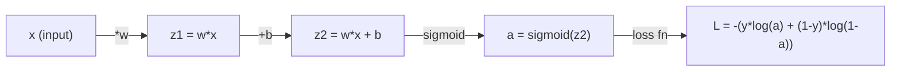
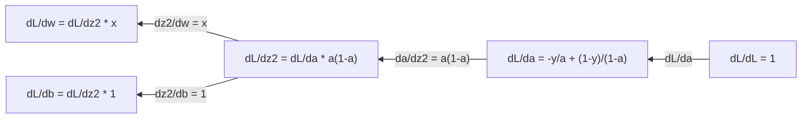
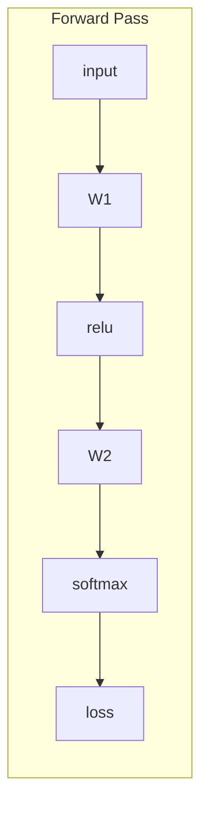
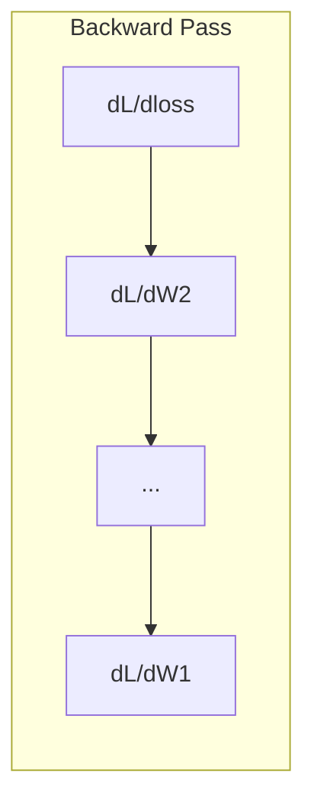

# 机器学习微积分（Calculus for Machine Learning）

> 中文讲义（双语对照）。正文为中文，每段下方 `>` 引用块保留英文原文；代码块、mermaid 图、术语名不译。

> Derivatives tell you which way is downhill. That is all a neural network needs to learn.

**类型 (Type):** Learn
**语言 (Language):** Python
**前置课程 (Prerequisites):** Phase 1, Lessons 01-03
**时间 (Time):** ~60 分钟

## 学习目标（Learning Objectives）

- 为常见 ML 函数（x^2、sigmoid、交叉熵）计算数值导数与解析导数
- 从零实现梯度下降，在 1D 与 2D 中最小化损失函数
- 推导线性回归模型的梯度，并用人工权重更新把它训练出来
- 解释 Hessian 矩阵、泰勒级数近似，以及它们与各种优化方法的关系

> - Compute numerical and analytical derivatives for common ML functions (x^2, sigmoid, cross-entropy)
> - Implement gradient descent from scratch to minimize a loss function in 1D and 2D
> - Derive the gradient of a linear regression model and train it via manual weight updates
> - Explain the Hessian matrix, Taylor series approximations, and their connection to optimization methods

## 问题（The Problem）

你有一个有数百万权重的神经网络。每个权重都是一个旋钮。你需要搞清楚**每个旋钮该往哪个方向拧**，才能让模型稍微不那么错。微积分给你的就是那个方向。

没有微积分，训练神经网络就只能靠随机乱调、祈祷好运。有了导数，你就精确知道每个权重如何影响误差。**你每次都能把每个旋钮拧对方向。**

> You have a neural network with millions of weights. Each weight is a knob. You need to figure out which direction to turn every single knob to make the model slightly less wrong. Calculus gives you that direction.
>
> Without calculus, training a neural network would mean trying random changes and hoping for the best. With derivatives, you know exactly how each weight affects the error. You turn every knob the right way, every time.

## 核心概念（The Concept）

### 什么是导数？（What is a derivative?）

导数衡量**变化率**。对函数 y = f(x)，导数 f'(x) 告诉你：如果把 x 轻轻推动一点点，y 会变多少？

几何上，导数就是**该点切线的斜率**。

**f(x) = x^2：**

| x | f(x) | f'(x)（斜率） |
|---|------|---------------|
| 0 | 0    | 0（平的，正在碗底） |
| 1 | 1    | 2 |
| 2 | 4    | 4（该点切线斜率） |
| 3 | 9    | 6 |

在 x=2 处斜率是 4。你把 x 往右挪一丁点，y 大约增加"那一丁点的 4 倍"。在 x=0 处斜率是 0——**你正待在碗底**。

形式化定义：

```
f'(x) = lim   f(x + h) - f(x)
        h->0  -----------------
                     h
```

写代码时你不取极限，而是用一个非常小的 h。这就是**数值导数**。

> A derivative measures the rate of change. For a function y = f(x), the derivative f'(x) tells you: if you nudge x by a tiny amount, how much does y change?
>
> Geometrically, the derivative is the slope of the tangent line at a point.
>
> At x=2, the slope is 4. If you move x a tiny bit to the right, y increases by about 4 times that amount. At x=0, the slope is 0. You are at the bottom of the bowl.
>
> In code, you skip the limit and just use a very small h. That is the numerical derivative.

### 偏导数：一次只动一个变量（Partial derivatives）

真实函数有很多输入。一个神经网络损失取决于成千上万个权重。偏导数的做法是：**把其余变量全部按住不动**，只对其中这一个求导。

```
f(x, y) = x^2 + 3xy + y^2

df/dx = 2x + 3y     （把 y 当作常数）
df/dy = 3x + 2y     （把 x 当作常数）
```

每个偏导数回答的问题是：**如果我只轻轻动这一个权重，损失会怎么变？**

> Real functions have many inputs. A neural network loss depends on thousands of weights. A partial derivative holds all variables constant except one, then takes the derivative with respect to that one.
>
> Each partial derivative answers: if I nudge just this one weight, how does the loss change?

### 梯度：所有偏导组成的向量（The gradient）

梯度把每一个偏导数收集进一个向量。对函数 f(x, y, z)：

```
grad f = [ df/dx, df/dy, df/dz ]
```

**梯度指向最陡上升的方向。** 要最小化函数，就朝反方向走。

**f(x,y) = x^2 + y^2 的等高线图：**

函数呈碗形，等高线是同心圆，最小值在 (0, 0)。

| 位置 | grad f | -grad f（下降方向） |
|-------|--------|----------------------------|
| (1, 1) | [2, 2]（指向坡上，远离最小值） | [-2, -2]（指向坡下，朝最小值） |
| (0, 0) | [0, 0]（平的，已在最小值） | [0, 0] |

**这就是一幅图的梯度下降**：算梯度 → 取负 → 迈一步。

> The gradient collects every partial derivative into one vector. For a function f(x, y, z), the gradient is:
>
> The gradient points in the direction of steepest ascent. To minimize a function, go in the opposite direction.
>
> The function forms a bowl shape with concentric circles as contour lines. The minimum is at (0, 0).
>
> This is gradient descent in a picture. Compute the gradient, negate it, take a step.

### 与优化的联系（The connection to optimization）

训练神经网络就是**优化**。你有一个损失函数 L(w1, w2, ..., wn) 衡量模型有多错，你要把它最小化。

```
梯度下降更新规则：

  w_new = w_old - learning_rate * dL/dw

对每个权重：
  1. 计算损失对该权重的偏导数
  2. 从权重里减去它的一个小倍数
  3. 重复
```

**学习率控制步长。太大就冲过头，太小就爬不动。**

**损失景观（1D 切面）：**

损失函数 L(w) 随权重 w 变化形成一条有峰有谷的曲线。

| 特征 | 说明 |
|---------|-------------|
| 全局最小值（Global minimum） | 整条曲线上的最低点——最优解 |
| 局部最小值（Local minimum） | 比邻居低、但不是全局最低 |
| 斜率（Slope） | 梯度下降从任意起点沿斜率往下走 |

梯度下降沿坡下行。它可能卡在局部最小值，但在高维空间（数百万权重）里这很少是实际问题。

> Training a neural network is optimization. You have a loss function L(w1, w2, ..., wn) that measures how wrong the model is. You want to minimize it.
>
> The learning rate controls step size. Too big and you overshoot. Too small and you crawl.
>
> The loss function L(w) forms a curve with peaks and valleys as the weight w varies.
>
> Gradient descent follows the slope downhill. It can get stuck in local minima, but in high-dimensional spaces (millions of weights) this is rarely a practical problem.

### 数值导数 vs 解析导数（Numerical vs analytical derivatives）

求导数有两条路。

- **解析（Analytical）**：手工套微积分法则。对 f(x) = x^2，导数是 f'(x) = 2x。**精确、快。**
- **数值（Numerical）**：用定义去近似。取一个极小的 h，算 f(x+h) 和 f(x-h)，作差。

```
数值（中心差分）：

f'(x) ~= f(x + h) - f(x - h)
          -----------------------
                   2h

实践中 h = 0.0001 效果不错
```

数值导数更慢但**对任何函数都能用**；解析导数快但**需要你推导出公式**。神经网络框架用的是第三条路：**自动微分（automatic differentiation）**——机械地算出精确导数。你会在 Phase 3 见到它。

> There are two ways to compute a derivative.
>
> Analytical: apply calculus rules by hand. For f(x) = x^2, the derivative is f'(x) = 2x. Exact. Fast.
>
> Numerical: approximate using the definition. Compute f(x+h) and f(x-h) for a tiny h, then use the difference.
>
> Numerical derivatives are slower but work for any function. Analytical derivatives are fast but require you to derive the formula. Neural network frameworks use a third approach: automatic differentiation, which computes exact derivatives mechanically. You will see that in Phase 3.

### 常见函数的导数（背下来）（Derivatives by hand for simple functions）

这些导数是你在 ML 里会反复见到的。

```
函数              导数            用在哪儿
--------          ----------      -------
f(x) = x^2        f'(x) = 2x      损失函数（MSE）
f(x) = wx + b     f'(w) = x       线性层（对权重的梯度）
                  f'(b) = 1       线性层（对偏置的梯度）
                  f'(x) = w       线性层（对输入的梯度）
f(x) = e^x        f'(x) = e^x     Softmax、attention
f(x) = ln(x)      f'(x) = 1/x     交叉熵损失
f(x) = 1/(1+e^-x) f'(x) = f(x)(1-f(x))   Sigmoid 激活
```

对 f(x) = x^2：

```
f(x) = x^2    f'(x) = 2x

  x    f(x)   f'(x)   含义
  -2    4      -4      斜率朝左倾（递减）
  -1    1      -2      斜率朝左倾（递减）
   0    0       0      平的（最小值！）
   1    1       2      斜率朝右倾（递增）
   2    4       4      斜率朝右倾（递增）
```

对 f(w) = wx + b，取 x=3, b=1：

```
f(w) = 3w + 1    f'(w) = 3

对 w 的导数就是 x。
如果 x 很大，w 的微小变化会导致输出的巨大变化。
```

> These are the derivatives you will see over and over in ML.
>
> The derivative with respect to w is just x. If x is big, a small change in w causes a big change in output.

### 链式法则（The chain rule）

当函数被复合起来，链式法则告诉你如何求导。

```
若 y = f(g(x))，则 dy/dx = f'(g(x)) * g'(x)

例：y = (3x + 1)^2
  外层：f(u) = u^2       f'(u) = 2u
  内层：g(x) = 3x + 1    g'(x) = 3
  dy/dx = 2(3x + 1) * 3 = 6(3x + 1)
```

**神经网络就是函数的链条**：输入 → 线性 → 激活 → 线性 → 激活 → 损失。**反向传播就是从输出到输入反复应用链式法则——这就是整个算法。**

> When functions are composed, the chain rule tells you how to differentiate.
>
> Neural networks are chains of functions: input -> linear -> activation -> linear -> activation -> loss. Backpropagation is the chain rule applied repeatedly from output to input. That is the entire algorithm.

### Hessian 矩阵（The Hessian Matrix）

**梯度告诉你坡度，Hessian 告诉你曲率（弯曲程度）。**

Hessian 是**二阶偏导数组成的矩阵**。对函数 f(x1, x2, ..., xn)，Hessian 的第 (i, j) 项是：

```
H[i][j] = d^2f / (dx_i * dx_j)
```

对二元函数 f(x, y)：

```
H = | d^2f/dx^2    d^2f/dxdy |
    | d^2f/dydx    d^2f/dy^2 |
```

**在临界点（梯度 = 0 处）Hessian 告诉你什么：**

| Hessian 性质 | 含义 | 曲面形状 |
|-----------------|---------|-----------------|
| 正定（所有特征值 > 0） | 局部最小值 | 开口朝上的碗 |
| 负定（所有特征值 < 0） | 局部最大值 | 开口朝下的碗 |
| 不定（特征值符号混杂） | 鞍点（saddle point） | 马鞍形 |

**例：** f(x, y) = x^2 - y^2（鞍点函数）

```
df/dx = 2x       df/dy = -2y
d^2f/dx^2 = 2    d^2f/dy^2 = -2    d^2f/dxdy = 0

H = | 2   0 |
    | 0  -2 |

特征值：2 和 -2（一正一负）
--> (0, 0) 处是鞍点
```

对比 f(x, y) = x^2 + y^2（一个碗）：

```
H = | 2  0 |
    | 0  2 |

特征值：2 和 2（都是正的）
--> (0, 0) 处是局部最小值
```

> The gradient tells you the slope. The Hessian tells you the curvature.
>
> The Hessian is the matrix of second-order partial derivatives.

**Hessian 在 ML 里为什么重要：**

**牛顿法（Newton's method）**用 Hessian 走出比梯度下降更好的优化步。它不只跟着斜率走，还**考虑曲率**：

```
牛顿法更新：      w_new = w_old - H^(-1) * gradient
梯度下降更新：    w_new = w_old - lr * gradient
```

牛顿法收敛更快，因为 Hessian 把梯度"重新缩放"了——**陡的方向步子变小，平的方向步子变大**。

**代价**：对有 N 个参数的神经网络，Hessian 是 N x N。一个 100 万参数的模型需要**一万亿项**的矩阵。这就是我们用近似方法的原因。

| 方法 | 用了什么 | 每步代价 | 收敛性 |
|--------|-------------|------|-------------|
| 梯度下降 | 只用一阶导数 | O(N) | 慢（线性） |
| 牛顿法 | 完整 Hessian | O(N^3) | 快（二次） |
| L-BFGS | 从梯度历史近似 Hessian | O(N) | 中（超线性） |
| Adam | 每参数自适应学习率（对角 Hessian 近似） | O(N) | 中 |
| 自然梯度 | Fisher 信息矩阵（统计 Hessian） | O(N^2) | 快 |

实践里 **Adam 是深度学习的默认优化器**。它通过跟踪每个参数梯度的滑动均值与方差，**廉价地近似了二阶信息**。

> Newton's method uses the Hessian to take better optimization steps than gradient descent. Instead of just following the slope, it accounts for curvature.
>
> Newton's method converges faster because the Hessian "rescales" the gradient -- steep directions get smaller steps, flat directions get larger steps.
>
> The catch: for a neural network with N parameters, the Hessian is N x N. A model with 1 million parameters would need a 1 trillion-entry matrix. That is why we use approximations.
>
> In practice, Adam is the default optimizer for deep learning. It approximates second-order information cheaply by tracking the running mean and variance of gradients per parameter.

### 泰勒级数近似（Taylor Series Approximation）

任何光滑函数都能在局部被一个多项式近似：

```
f(x + h) = f(x) + f'(x)*h + (1/2)*f''(x)*h^2 + (1/6)*f'''(x)*h^3 + ...
```

**项数越多，近似越好——但只在点 x 附近成立。**

**泰勒级数对 ML 为什么重要：**

- **一阶泰勒 = 梯度下降。** 当你用 f(x + h) ~ f(x) + f'(x)*h，你是在做**线性近似**。梯度下降就是最小化这个线性模型，得到 h = -lr * f'(x)。

- **二阶泰勒 = 牛顿法。** 用 f(x + h) ~ f(x) + f'(x)*h + (1/2)*f''(x)*h^2，你得到一个**二次模型**。最小化它得到 h = -f'(x)/f''(x)——牛顿步。

- **损失函数设计。** MSE 和交叉熵都是光滑的，意味着它们的泰勒展开行为良好。**这不是巧合。光滑的损失让优化变得可预测。**

```
近似阶数            捕捉了什么        对应优化方法
-------------------    ----------------   -------------------
0 阶（常数）          只有函数值         随机搜索
1 阶（线性）          斜率               梯度下降
2 阶（二次）          曲率               牛顿法
更高阶                更精细的结构       在 ML 里很少用
```

**关键洞见：所有基于梯度的优化，本质都是"在局部近似损失函数，然后走到那个近似的最小点"。**

> Any smooth function can be approximated locally by a polynomial:
>
> The more terms you include, the better the approximation -- but only near the point x.
>
> The key insight: all gradient-based optimization is really about approximating the loss function locally and stepping to the minimum of that approximation.

### 积分在 ML 里的位置（Integrals in ML）

导数告诉你**变化率**，积分计算**累积量**——曲线下的面积。

在 ML 里你很少手算积分，但**这个概念无处不在**：

**概率。** 对连续随机变量，其密度为 p(x)：
```
P(a < X < b) = integral from a to b of p(x) dx
```
概率密度曲线在 a 到 b 之间的面积，就是落在这个区间的概率。

**期望值。** 按概率加权的平均结果：
```
E[f(X)] = integral of f(x) * p(x) dx
```
数据分布上的期望损失就是一个积分。**训练最小化的是它的经验近似。**

**KL 散度。** 衡量两个分布的差异：
```
KL(p || q) = integral of p(x) * log(p(x) / q(x)) dx
```
用在 VAE、知识蒸馏、贝叶斯推断里。

**归一化常数。** 贝叶斯推断中：
```
p(w | data) = p(data | w) * p(w) / integral of p(data | w) * p(w) dw
```
分母是对所有可能参数值的积分。**它通常是不可解的（intractable）**——这就是我们用 MCMC、变分推断等近似方法的原因。

| 积分概念 | 在 ML 里出现在哪里 |
|-----------------|----------------------|
| 曲线下面积 | 从密度函数求概率 |
| 期望值 | 损失函数、风险最小化 |
| KL 散度 | VAE、策略优化、蒸馏 |
| 归一化 | 贝叶斯后验、softmax 分母 |
| 边缘似然 | 模型比较、ELBO（证据下界） |

> Derivatives tell you rates of change. Integrals compute accumulations -- area under a curve.
>
> In ML, you rarely compute integrals by hand, but the concept is everywhere.
>
> The denominator is an integral over all possible parameter values. It is often intractable, which is why we use approximations like MCMC and variational inference.

### 计算图中的多变量链式法则（Multivariable Chain Rule in a Computation Graph）

链式法则不只适用于一条直线上的标量函数。在神经网络里，**变量会分叉（fan out）也会汇合（merge）**。下面是一次简单前向传播中导数的流动方式：



反向传播从右往左计算梯度：



**每一个箭头都是一次"乘以局部导数"。** 某个参数的梯度 = 从损失到该参数路径上所有局部导数的乘积。**当路径分叉又汇合时，把各条路的贡献加起来**（这就是多变量链式法则）。

反向传播的全部内容就是这些：**链式法则在计算图上系统性地从输出往输入应用一遍。**

> The chain rule does not just apply to scalar functions in a line. In a neural network, variables fan out and merge. Here is how derivatives flow through a simple forward pass.
>
> Each arrow multiplies by the local derivative. The gradient for any parameter is the product of all local derivatives along the path from loss to that parameter. When paths branch and merge, you sum the contributions (multivariate chain rule).
>
> This is all backpropagation is: the chain rule applied systematically through a computation graph, from output to inputs.

### 雅可比矩阵（The Jacobian matrix）

当一个函数把向量映射到向量（比如一个神经网络层），**它的导数是一个矩阵**。雅可比矩阵包含**每个输出对每个输入的每一个偏导数**。

对 f: R^n -> R^m，雅可比 J 是一个 m x n 矩阵：

| | x1 | x2 | ... | xn |
|---|---|---|---|---|
| f1 | df1/dx1 | df1/dx2 | ... | df1/dxn |
| f2 | df2/dx1 | df2/dx2 | ... | df2/dxn |
| ... | ... | ... | ... | ... |
| fm | dfm/dx1 | dfm/dx2 | ... | dfm/dxn |

你不会手算神经网络的雅可比，PyTorch 会处理。但**知道它存在有助于你理解反向传播里的形状**：如果一个层把 R^n 映射到 R^m，它的雅可比就是 m x n。**梯度通过这个矩阵的转置反向流动。**

> When a function maps a vector to a vector (like a neural network layer), its derivative is a matrix. The Jacobian contains every partial derivative of every output with respect to every input.
>
> You will not compute Jacobians by hand for neural networks. PyTorch handles it. But knowing it exists helps you understand shapes in backpropagation: if a layer maps R^n to R^m, its Jacobian is m x n. The gradient flows backward through the transpose of this matrix.

### 这对神经网络为什么重要（Why this matters for neural networks）

神经网络里的**每一个权重都会拿到一个梯度**。梯度告诉你如何调整这个权重来降低损失。





每次权重更新：
- `W1 = W1 - lr * dL/dW1`
- `W2 = W2 - lr * dL/dW2`

**前向传播**算出预测和损失；**反向传播**算出损失对每个权重的梯度；然后每个权重朝下坡方向迈一小步。**重复数百万次——这就是深度学习。**

```figure
derivative-tangent
```

> Every weight in a neural network gets a gradient. The gradient tells you how to adjust that weight to reduce the loss.
>
> The forward pass computes the prediction and loss. The backward pass computes the gradient of the loss with respect to every weight. Then every weight takes a small step downhill. Repeat for millions of steps. That is deep learning.

## 动手实现（Build It）

### 步骤 1：从零写数值导数

```python
def numerical_derivative(f, x, h=1e-7):
    return (f(x + h) - f(x - h)) / (2 * h)

def f(x):
    return x ** 2

for x in [-2, -1, 0, 1, 2]:
    numerical = numerical_derivative(f, x)
    analytical = 2 * x
    print(f"x={x:2d}  f'(x) numerical={numerical:.6f}  analytical={analytical:.1f}")
```

数值导数与解析导数在**小数点后很多位**上吻合。

> The numerical derivative matches the analytical one to many decimal places.

### 步骤 2：偏导数与梯度

```python
def numerical_gradient(f, point, h=1e-7):
    gradient = []
    for i in range(len(point)):
        point_plus = list(point)
        point_minus = list(point)
        point_plus[i] += h
        point_minus[i] -= h
        partial = (f(point_plus) - f(point_minus)) / (2 * h)
        gradient.append(partial)
    return gradient

def f_multi(point):
    x, y = point
    return x**2 + 3*x*y + y**2

grad = numerical_gradient(f_multi, [1.0, 2.0])
print(f"Numerical gradient at (1,2): {[f'{g:.4f}' for g in grad]}")
print(f"Analytical gradient at (1,2): [2*1+3*2, 3*1+2*2] = [{2*1+3*2}, {3*1+2*2}]")
```

### 步骤 3：用梯度下降求 f(x) = x^2 的最小值

```python
x = 5.0
lr = 0.1
for step in range(20):
    grad = 2 * x
    x = x - lr * grad
    print(f"step {step:2d}  x={x:8.4f}  f(x)={x**2:10.6f}")
```

从 x=5 出发，每一步都更靠近 x=0（最小值）。

> Starting at x=5, each step moves closer to x=0 (the minimum).

### 步骤 4：在二维函数上做梯度下降

```python
def f_2d(point):
    x, y = point
    return x**2 + y**2

point = [4.0, 3.0]
lr = 0.1
for step in range(30):
    grad = numerical_gradient(f_2d, point)
    point = [p - lr * g for p, g in zip(point, grad)]
    loss = f_2d(point)
    if step % 5 == 0 or step == 29:
        print(f"step {step:2d}  point=({point[0]:7.4f}, {point[1]:7.4f})  f={loss:.6f}")
```

### 步骤 5：对比数值导数与解析导数

```python
import math

test_functions = [
    ("x^2",      lambda x: x**2,          lambda x: 2*x),
    ("x^3",      lambda x: x**3,          lambda x: 3*x**2),
    ("sin(x)",   lambda x: math.sin(x),   lambda x: math.cos(x)),
    ("e^x",      lambda x: math.exp(x),   lambda x: math.exp(x)),
    ("1/x",      lambda x: 1/x,           lambda x: -1/x**2),
]

x = 2.0
print(f"{'Function':<12} {'Numerical':>12} {'Analytical':>12} {'Error':>12}")
print("-" * 50)
for name, f, df in test_functions:
    num = numerical_derivative(f, x)
    ana = df(x)
    err = abs(num - ana)
    print(f"{name:<12} {num:12.6f} {ana:12.6f} {err:12.2e}")
```

### 步骤 6：数值计算 Hessian

```python
def hessian_2d(f, x, y, h=1e-5):
    fxx = (f(x + h, y) - 2 * f(x, y) + f(x - h, y)) / (h ** 2)
    fyy = (f(x, y + h) - 2 * f(x, y) + f(x, y - h)) / (h ** 2)
    fxy = (f(x + h, y + h) - f(x + h, y - h) - f(x - h, y + h) + f(x - h, y - h)) / (4 * h ** 2)
    return [[fxx, fxy], [fxy, fyy]]

def saddle(x, y):
    return x ** 2 - y ** 2

def bowl(x, y):
    return x ** 2 + y ** 2

H_saddle = hessian_2d(saddle, 0.0, 0.0)
H_bowl = hessian_2d(bowl, 0.0, 0.0)
print(f"Saddle Hessian: {H_saddle}")  # [[2, 0], [0, -2]] -- mixed signs
print(f"Bowl Hessian:   {H_bowl}")    # [[2, 0], [0, 2]]  -- both positive
```

鞍点函数的 Hessian 特征值是 2 和 -2（符号混杂，确认是鞍点）。碗的特征值是 2 和 2（都是正的，确认是最小值）。

> The Hessian of the saddle function has eigenvalues 2 and -2 (mixed signs, confirming a saddle point). The bowl has eigenvalues 2 and 2 (both positive, confirming a minimum).

### 步骤 7：泰勒近似实战

```python
import math

def taylor_approx(f, f_prime, f_double_prime, x0, h, order=2):
    result = f(x0)
    if order >= 1:
        result += f_prime(x0) * h
    if order >= 2:
        result += 0.5 * f_double_prime(x0) * h ** 2
    return result

x0 = 0.0
for h in [0.1, 0.5, 1.0, 2.0]:
    true_val = math.sin(h)
    t1 = taylor_approx(math.sin, math.cos, lambda x: -math.sin(x), x0, h, order=1)
    t2 = taylor_approx(math.sin, math.cos, lambda x: -math.sin(x), x0, h, order=2)
    print(f"h={h:.1f}  sin(h)={true_val:.4f}  order1={t1:.4f}  order2={t2:.4f}")
```

在 x0=0 附近，sin(x) ~ x（一阶泰勒）。**近似在 h 小时极好，h 大时就崩了。** 这正是梯度下降偏好小学习率的原因——**每一步都假设了线性近似仍然准确。**

> Near x0=0, sin(x) ~ x (first-order Taylor). The approximation is excellent for small h but breaks down for large h. This is why gradient descent works best with small learning rates -- each step assumes the linear approximation is accurate.

### 步骤 8：这一切对神经网络意味着什么

```python
import random

random.seed(42)

w = random.gauss(0, 1)
b = random.gauss(0, 1)
lr = 0.01

xs = [1.0, 2.0, 3.0, 4.0, 5.0]
ys = [3.0, 5.0, 7.0, 9.0, 11.0]

for epoch in range(200):
    total_loss = 0
    dw = 0
    db = 0
    for x, y in zip(xs, ys):
        pred = w * x + b
        error = pred - y
        total_loss += error ** 2
        dw += 2 * error * x
        db += 2 * error
    dw /= len(xs)
    db /= len(xs)
    total_loss /= len(xs)
    w -= lr * dw
    b -= lr * db
    if epoch % 40 == 0 or epoch == 199:
        print(f"epoch {epoch:3d}  w={w:.4f}  b={b:.4f}  loss={total_loss:.6f}")

print(f"\nLearned: y = {w:.2f}x + {b:.2f}")
print(f"Actual:  y = 2x + 1")
```

**每一个基于梯度的训练循环都遵循这个模式：预测 → 算损失 → 算梯度 → 更新权重。**

> Every gradient-based training loop follows this pattern: predict, compute loss, compute gradients, update weights.

## 用起来（Use It）

用 NumPy，同样的操作更快、更简洁：

```python
import numpy as np

x = np.array([1, 2, 3, 4, 5], dtype=float)
y = np.array([3, 5, 7, 9, 11], dtype=float)

w, b = np.random.randn(), np.random.randn()
lr = 0.01

for epoch in range(200):
    pred = w * x + b
    error = pred - y
    loss = np.mean(error ** 2)
    dw = np.mean(2 * error * x)
    db = np.mean(2 * error)
    w -= lr * dw
    b -= lr * db

print(f"Learned: y = {w:.2f}x + {b:.2f}")
```

**你刚刚从零构建了梯度下降。** PyTorch 把梯度计算自动化了，但**更新循环一模一样**。

> You just built gradient descent from scratch. PyTorch automates the gradient computation, but the update loop is identical.

## 练习（Exercises）

1. 实现 `numerical_second_derivative(f, x)`，做法是调用两次 `numerical_derivative`。验证 x^3 在 x=2 处的二阶导数是 12。
2. 用梯度下降求 f(x, y) = (x - 3)^2 + (y + 1)^2 的最小值。从 (0, 0) 出发，应该收敛到 (3, -1)。
3. 给梯度下降循环加上**动量（momentum）**：维护一个累积过往梯度的速度向量。在 f(x) = x^4 - 3x^2 上比较有/无动量的收敛速度。

> 1. Implement `numerical_second_derivative(f, x)` using `numerical_derivative` called twice. Verify that the second derivative of x^3 at x=2 is 12.
> 2. Use gradient descent to find the minimum of f(x, y) = (x - 3)^2 + (y + 1)^2. Start from (0, 0). The answer should converge to (3, -1).
> 3. Add momentum to the gradient descent loop: maintain a velocity vector that accumulates past gradients. Compare convergence speed with and without momentum on f(x) = x^4 - 3x^2.

## 关键术语（Key Terms）

| 术语 | 大家的说法 | 它实际的意思 |
|------|----------------|----------------------|
| 导数（Derivative） | "斜率" | 函数在某点的变化率。告诉你输入每变化一个单位，输出变多少。 |
| 偏导数（Partial derivative） | "单个变量的导数" | 其余变量全部固定不变时，对某一个变量求的导数。 |
| 梯度（Gradient） | "最陡上升方向" | 所有偏导组成的向量。指向让函数增长最快的方向。 |
| 梯度下降（Gradient descent） | "往坡下走" | 从参数中减去梯度（乘以学习率）以降低损失。神经网络训练的核心。 |
| 学习率（Learning rate） | "步长" | 控制每次梯度下降步幅的标量。太大：发散；太小：收敛慢。 |
| 链式法则（Chain rule） | "把导数乘起来" | 复合函数的求导法则：df/dx = df/dg * dg/dx。反向传播的数学基础。 |
| 雅可比（Jacobian） | "导数矩阵" | 当函数把向量映射到向量时，所有输出对输入的偏导组成的矩阵。 |
| 数值导数（Numerical derivative） | "有限差分" | 在邻近两点求函数值、算它们之间的斜率，来近似导数。 |
| 反向传播（Backpropagation） | "反向模式自动微分" | 用链式法则从输出到输入逐层计算梯度。神经网络的学习方式。 |
| Hessian | "二阶导数矩阵" | 所有二阶偏导组成的矩阵。描述函数的曲率。临界点上 Hessian 正定意味着局部最小。 |
| 泰勒级数（Taylor series） | "多项式近似" | 用某点的各阶导数在该点附近近似函数：f(x+h) ~ f(x) + f'(x)h + (1/2)f''(x)h^2 + ...。理解梯度下降与牛顿法为何有效的根基。 |
| 积分（Integral） | "曲线下面积" | 某个量在一个区间上的累积。在 ML 里，积分定义了概率、期望值、KL 散度。 |

> | Term | What people say | What it actually means |
> | Derivative | "The slope" | The rate of change of a function at a point. |
> | Gradient | "Direction of steepest ascent" | A vector of all partial derivatives. |
> | Hessian | "Matrix of second derivatives" | The matrix of all second-order partial derivatives. |
> | Taylor series | "Polynomial approximation" | Approximating a function near a point using its derivatives. |
> | Integral | "Area under the curve" | The accumulation of a quantity over a range. |

## 延伸阅读（Further Reading）

- [3Blue1Brown: Essence of Calculus](https://www.3blue1brown.com/topics/calculus) —— 导数、积分、链式法则的可视化直觉
- [Stanford CS231n: Backpropagation](https://cs231n.github.io/optimization-2/) —— 梯度如何流过神经网络的各层

> - [3Blue1Brown: Essence of Calculus](https://www.3blue1brown.com/topics/calculus) - visual intuition for derivatives, integrals, and the chain rule
> - [Stanford CS231n: Backpropagation](https://cs231n.github.io/optimization-2/) - how gradients flow through neural network layers

## 实测数据与纠正（Measured Corrections）

以下为实机运行 `python3 code/derivatives.py` 的真实输出（macOS，纯标准库，无需 NumPy），以及逐项核对。

### 一、数值导数 vs 解析导数（在 x = 2.0，h = 1e-7 中心差分）

```
Function        Numerical   Analytical        Error
--------------------------------------------------
x^2              4.000000     4.000000     4.33e-09
x^3             12.000000    12.000000     6.32e-09
sin(x)          -0.416147    -0.416147     1.12e-10
e^x              7.389056     7.389056     7.50e-09
1/x             -0.250000    -0.250000     1.32e-10
```

**实测纠正 1：中心差分的误差不是 `h^2 = 1e-14` 量级，而是 `1e-9` 量级——而且 h 再小反而更差。**

这是本课最容易建立错误直觉的一点。中心差分的**理论**截断误差是 `h^2` 量级（h=1e-7 → 1e-14），但实测误差是 **4.33e-09**。原因不是理论错了，而是**浮点舍入主导**：

```
总误差 ≈ 截断误差 + 舍入误差
       ≈  (h^2 / 6)·f'''   +   eps·|f(x)| / (2h)

对 x^2 在 x=2：f''' = 0  → 截断项 = 0
             舍入项 = 2.22e-16 × 4 / (2e-7) ≈ 4.44e-09
             实测误差 = 4.33e-09   ← 几乎完全吻合！
```

对 `x^3`（f'''=6）：截断项 = h²/6×6 = 1e-14，舍入项 ≈ 2.22e-16×8/(2e-7) = 8.9e-09，**实测 6.32e-09**——同样吻合。

**结论：h 有个最优值（约 `1e-5`~`1e-7`），不是越小越好。** 把 h 取到 `1e-15`，`f(x+h)-f(x-h)` 会把有效数字全吃掉（灾难性抵消，catastrophic cancellation），导数变成噪声。**这也正是工业界最终都转向自动微分（exact）而不是数值微分的原因**——数值微分只配当"测试基准"，用来验证你的解析梯度/反向传播写对了没有。

### 二、梯度（偏导组成的向量）

```
f(x,y) = x^2 + 3xy + y^2
At point (1.0, 2.0):
  Numerical gradient:  [8.0000, 7.0000]
  Analytical gradient: [8.0, 7.0]
```

手算核对：`df/dx = 2x + 3y = 2+6 = 8` ✓；`df/dy = 3x + 2y = 3+4 = 7` ✓。**数值法在两位小数上完全一致**——这就是"反向传播写完后用数值梯度做 gradient check"的原理。

### 三、1D 梯度下降：实测是一条精确的几何衰减

```
Start: x=5.0, lr=0.1
  step  0  x=  4.0000  f(x)= 16.000000
  step  4  x=  1.6384  f(x)=  2.684355
  step  8  x=  0.6711  f(x)=  0.450360
  step 12  x=  0.2749  f(x)=  0.075558
  step 16  x=  0.1126  f(x)=  0.012677
  step 19  x=  0.0576  f(x)=  0.003323
Minimum found at x=0.057646 (true minimum: x=0)
```

**实测纠正 2：对 f(x)=x²，梯度下降的每一步都是"乘一个固定常数"，可以闭式预测。**

因为 `grad = 2x`，更新式是：

```
x_new = x - lr·(2x) = (1 - 2·lr)·x
```

lr=0.1 时系数是 **0.8**。验算：`5 × 0.8²⁰ = 5 × 0.011529 = 0.0576` ——**与实测 step 19 的 0.057646 精确一致**。

这条式子直接给出收敛条件。系数 `|1 - 2·lr| < 1` 才收敛，即 **0 < lr < 1**。具体地：

| lr | 每步系数 1−2lr | 行为 |
|---|---|---|
| 0.1 | 0.8 | 稳定衰减（实测的本例） |
| 0.4 | 0.2 | 每步缩到 1/5，快得多 |
| 0.5 | 0.0 | **一步到位**（x 直接跳到 0） |
| 0.6 | −0.2 | 收敛但**符号来回振荡** |
| 1.0 | −1.0 | 在两个点之间永久震荡，永远不收敛 |
| 1.1 | −1.2 | **发散**，越走越远 |

**"学习率太大就冲过头"这句话可以精确到 `lr < 1`**（对 f(x)=x²）。同时对一般函数它说明：**学习率的上限由曲率（二阶导）决定**——曲率越大，允许的学习率越小。这就是后面 Adam/学习率预热存在的理由。

### 四、2D 梯度下降

```
Start: (4.0, 3.0), lr=0.1
  step  0  ( 3.2000,  2.4000)  f=16.000000
  step 10  ( 0.3436,  0.2577)  f=0.184467
  step 20  ( 0.0369,  0.0277)  f=0.002127
  step 29  ( 0.0050,  0.0037)  f=0.000038
```

起点 (4,3) 到原点的**距离**是 5，所以走的其实是和 1D 完全一样的东西：`5 × 0.8³⁰ = 5 × 0.001238 = 0.0062`，实测模长 `√(0.0050² + 0.0037²) = 0.0062` ✓。**x 与 y 同步等比例缩小**——因为 f(x,y)=x²+y² 的两个方向"一样陡"，没有各向异性问题。**下一节的 Rosenbrock 就会打破这一点。**

### 五、Hessian：鞍点、碗，以及一个条件数 2500 的坑

```
f(x,y) = x^2 - y^2（鞍点）        H = [2, 0; 0, -2]     λ = 2.00, -2.00   混合符号 --> 鞍点
f(x,y) = x^2 + y^2（碗）          H = [2, 0; 0,  2]     λ = 2.00,  2.00   都正    --> 局部最小

Rosenbrock f(x,y) = (1-x)^2 + 100*(y-x^2)^2  在 (1,1) 处：
  H = [  802.00  -400.00 ]
      [ -400.00   200.00 ]
  λ = 1001.60, 0.40     都正 --> 局部最小（确认）
```

**实测纠正 3：Rosenbrock 在最小值处的 Hessian 条件数约 2500，这解释了香蕉形山谷里梯度下降为什么慢得让人绝望。**

验证：`det(H) = 802×200 − 400² = 160400 − 160000 = 400`，而 `λ₁·λ₂ = 1001.60 × 0.40 = 400` ✓。

**条件数 = 1001.60 / 0.40 ≈ 2504。** 这意味着两个方向的曲率相差 2500 倍：

- 陡方向（λ≈1002）：曲率极大 → 学习率被迫取得极小，否则那一步直接飞出山谷
- 平方向（λ≈0.4）：曲率极小 → 即使学习率允许，沿这个方向的进展也极其缓慢

**结果：梯度下降要么在陡方向振荡爆炸，要么在平方向以蜗牛速度爬。** 而这个"平方向"恰恰是通往最小值的唯一路径。这就是为什么：

- **Adam** 给每个参数独立的自适应学习率（近似对角 Hessian），把 2500 倍的尺度差抹平；
- **牛顿法**用 `H⁻¹` 直接把两个方向归一化（本可一步到位），但 O(N³) 用不起；
- **L-BFGS** 用梯度历史廉价地估计 `H⁻¹`，是中等规模问题的实用折衷。

**记住这张表：Hessian 的特征值谱 = 问题的"难度画像"。** 特征值全正且彼此接近 → 好优化；跨度巨大 → 难优化；符号混杂 → 有鞍点。

### 六、泰勒近似：一阶/二阶在小 h 下几乎无差，在大 h 下双双崩掉

```
近似 f(x) = e^x，在 x0 = 1.0 处：
       h    True f(x0+h)     Order 0     Order 1     Order 2
     0.1        3.004166    2.718282    2.990110    3.003701   ← 二阶误差 0.0005
     0.5        4.481689    2.718282    4.077423    4.417208   ← 二阶误差 0.064
     1.0        7.389056    2.718282    5.436564    6.795705   ← 二阶误差 0.59
     2.0       20.085537    2.718282    8.154845   13.591409   ← 二阶误差 6.5（偏低 32%）

近似 f(x) = sin(x)，在 x0 = 0 处：
       h     True sin(h)     Order 0     Order 1     Order 2
     0.1        0.099833    0.000000    0.100000    0.100000
     0.5        0.479426    0.000000    0.500000    0.500000
     1.0        0.841471    0.000000    1.000000    1.000000
     2.0        0.909297    0.000000    2.000000    2.000000   ← 近似 2.0，真值 0.909，差 2.2 倍
```

**实测纠正 4：sin 的 Order 1 与 Order 2 输出完全相同——因为 `sin''(0) = −sin(0) = 0`，二阶项在 x0=0 处恒为零。**

这不是 bug，是**奇数函数展开的必然结果**：`sin(x) = x − x³/6 + ...`，没有任何二次项。所以：

- 在 x0=0 处 sin 的一阶近似是 `x`，二阶近似还是 `x`，**加二阶项一点用都没有**——要多要就得跳到**三阶**（`x − x³/6`）。
- 想验证"阶数越高越准"，**别用 sin 在 0 处做例子**，用 `e^x` 或 `cos(x)`；本课代码恰好把两者都跑了，`e^x` 那半张表才是有效对照。

**实测纠正 5：`h=2.0` 时一阶近似给出 `sin(2)=2.0`，比真值 0.909 高了 2.2 倍——比"完全不算"（用 0）还离谱。**

这就是"梯度下降为什么必须用小学习率"的数学本源：**每一步都是在当前点做线性（或二次）近似，然后信任这个近似走到它的最小点。** h 一旦超出近似的有效半径，你优化的就不是真实损失，而是一个已经失真的替身模型。

`e^x` 在 x0=1 处同理：h=2 意味着走到 x=3，而二阶泰勒 `e·(1 + 2 + 2) = 13.59` 对比真值 `e³ = 20.09`——**低了 32%**。指数函数增长太快，任何固定阶数的多项式都追不上。

### 七、线性回归：实测暴露了"参数收敛速度不一样"这个真问题

```
Gradient descent: y = 2x + 1
  epoch   0  w=0.3980  b=-0.0208  loss=67.032927
  epoch  40  w=2.1296  b=0.5319  loss=0.040145
  epoch  80  w=2.1132  b=0.5912  loss=0.030618
  epoch 160  w=2.0863  b=0.6883  loss=0.017809
  epoch 199  w=2.0757  b=0.7268  loss=0.013675

Learned: y = 2.08x + 0.73
Actual:  y = 2.00x + 1.00
```

**实测纠正 6（本课最有价值的发现）：`w` 在 40 个 epoch 内就基本到位（2.13，目标 2.0），而 `b` 到 200 个 epoch 才爬到 0.73（目标 1.0）——因为两者的梯度尺度天生不同。**

原因就写在梯度公式里：

```
dw = mean(2·error·x)      ← 多乘了一个 x
db = mean(2·error)        ← 没有 x

本数据 x ∈ {1,2,3,4,5}，平均 x = 3
→ 同样的 error，dw 的量级是 db 的 3 倍
→ w 每步走得比 b 快 3 倍
```

**这不是"训练不够久"，而是一个结构性问题**：同一个学习率不可能同时适合尺度差 3 倍的两个参数。

这就是今天所有主流做法的动机：

| 做法 | 解决什么 |
|---|---|
| **特征缩放 / 归一化** | 把 x 拉到均值 0、方差 1，让 `dw` 与 `db` 尺度可比 |
| **Adam / RMSProp** | 每个参数维护自己的梯度二阶矩，自动把学习率按尺度缩放 |
| **学习率预热 + 衰减** | 不指望一个固定 lr 全程适用 |

注意 `loss` 从 67.03 降到 0.0137（约 **4900 倍**），但从 `b=0.73` 到 `b=1.0` 的最后一段**恰恰是最慢的**——**损失看起来"已经很小了"，参数却还差得远**。这也是实践里"loss 曲线平了但模型没学对"的一个可观测来源。

### 八、环境与运行说明

- 本机跑 `python3 code/derivatives.py` **全部通过，零依赖**（只用了 `math`、`random`，Hessian 特征值是自己手算的解析解 `λ = (tr ± √(tr²−4det))/2`，不需要 NumPy）。
- `code/main.jl` 需要 Julia（本机未装），纯 Python 部分已完整覆盖全部概念。
- 练习 3（动量）需要你自己实现：核心是加一个 `v = beta·v + grad; w = w - lr·v`，在 `f(x)=x⁴−3x²` 这种有平坦区和陡峭区的函数上，动量的优势会非常明显——**它正是"平方向走得太慢"（见第五节条件数）的第一代解法**。
