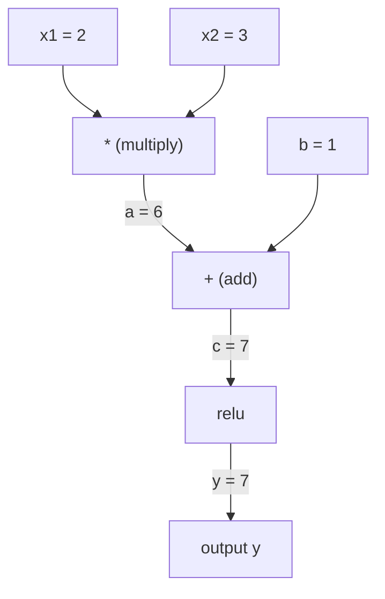
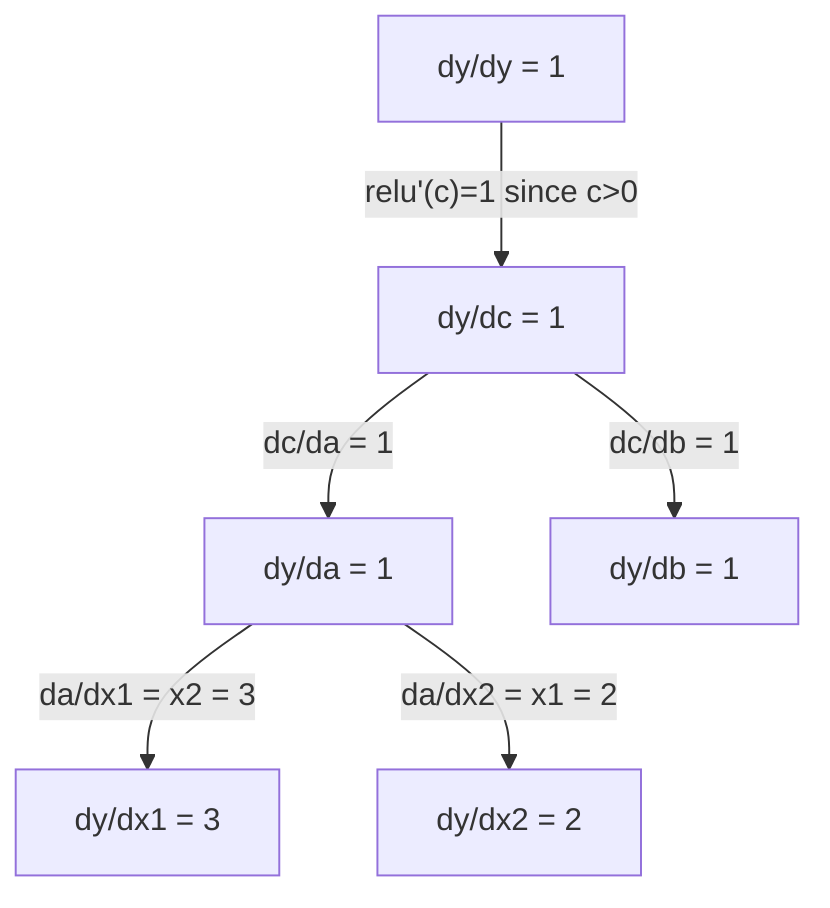

# 1/05 链式法则与自动微分 / Chain Rule & Autodiff

**一句话主题句：反向传播不是玄学，它就是链式法则在计算图上反复相乘。**

**你将构建：一个完整的 autograd 引擎（Value 类）——不用 PyTorch、不用 NumPy，纯 Python 写出能训练神经网络的自动微分系统。这就是 micrograd。**

---

## 学习目标 / Learning Objectives

学完这一课你能：

1. 手算复合函数的链式法则
2. 画出计算图并手推反向传播
3. 解释前向模式与反向模式的区别，以及**为什么神经网络必须用反向模式**
4. 用对偶数（dual numbers）实现前向模式自动微分
5. 从零构建一个完整的 autograd 引擎（`Value` 类）
6. 用梯度检查（gradient checking）验证反向传播的正确性
7. 解释 PyTorch autograd 在底层到底做了什么

> **Learning Objectives**
>
> By the end of this lesson, you will be able to:
>
> - Apply the chain rule to composed functions by hand
> - Draw a computational graph and backpropagate through it
> - Explain the difference between forward-mode and reverse-mode autodiff
> - Implement forward-mode autodiff with dual numbers
> - Build a complete autograd engine from scratch
> - Verify gradients with gradient checking
> - Explain how PyTorch's autograd works under the hood

---

## 问题所在 / The Problem

上一课你算出了梯度。但真实神经网络有**数百万个权重**，损失是它们的一个巨大复合函数。**手写每个偏导不可能**。而且数值微分每个参数要跑两次前向——一百万个参数就是两百万次前向传播，太慢了。

**必须有一种方法，把一次前向的全部信息留下来，然后一次性算出所有梯度。** 这就是自动微分，它的核心机制就是链式法则。

> **The Problem**
>
> In the last lesson you computed gradients. But a real neural network has millions of weights, and the loss is one huge composed function of all of them. Writing every partial derivative by hand is impossible. And numerical differentiation needs two forward passes per parameter -- a million parameters means two million forward passes. Too slow.
>
> There must be a way to keep all the information from one forward pass and then compute every gradient at once. That is automatic differentiation, and its core mechanism is the chain rule.

---

## 概念 / The Concept

### 链式法则 / The Chain Rule

若 `y = f(g(x))`，则 `y` 对 `x` 的导数是：

```
dy/dx = dy/dg * dg/dx = f'(g(x)) * g'(x)
```

**沿链条把导数乘起来。每一环贡献自己的局部导数。**

例子：`y = sin(x^2)`

```
g(x) = x^2       g'(x) = 2x
f(g) = sin(g)     f'(g) = cos(g)

dy/dx = cos(x^2) * 2x
```

更深的复合，链条继续延伸：

```
y = f(g(h(x)))

dy/dx = f'(g(h(x))) * g'(h(x)) * h'(x)
```

**神经网络的每一层就是这条链上的一环。**

> **The Chain Rule**
>
> If `y = f(g(x))`, the derivative of `y` with respect to `x` is:
>
> ```
> dy/dx = dy/dg * dg/dx = f'(g(x)) * g'(x)
> ```
>
> Multiply the derivatives along the chain. Each link contributes its local derivative.
>
> Example: `y = sin(x^2)`
>
> ```
> g(x) = x^2       g'(x) = 2x
> f(g) = sin(g)     f'(g) = cos(g)
>
> dy/dx = cos(x^2) * 2x
> ```
>
> For deeper compositions, the chain extends:
>
> ```
> y = f(g(h(x)))
>
> dy/dx = f'(g(h(x))) * g'(h(x)) * h'(x)
> ```
>
> Every layer in a neural network is one link in this chain.

---

### 计算图 / Computational Graphs

计算图把链式法则**画出来**。每个运算变成一个节点。**数据向前流，梯度向后流。**

**前向（算数值）：**



**反向（算梯度）：**



反向传播在每个节点上应用链式法则，把梯度从输出一路传到输入。

> **Computational Graphs**
>
> A computational graph makes the chain rule visual. Every operation becomes a node. Data flows forward through the graph. Gradients flow backward.
>
> The backward pass applies the chain rule at every node, propagating gradients from output to inputs.

---

### 前向模式 vs 反向模式 / Forward Mode vs Reverse Mode

把链式法则跑过一张图，有两种走法。

**前向模式**：从输入出发，把导数往前推。设 `dx/dx = 1`，然后逐运算传播。**适合输入少、输出多。**

```
Forward mode: seed dx/dx = 1, propagate forward

  x = 2       (dx/dx = 1)
  a = x^2     (da/dx = 2x = 4)
  y = sin(a)  (dy/dx = cos(a) * da/dx = cos(4) * 4 = -2.615)
```

**反向模式**：从输出出发，把梯度往回拉。设 `dy/dy = 1`，然后反向逐运算传播。**适合输入多、输出少。**

```
Reverse mode: seed dy/dy = 1, propagate backward

  y = sin(a)  (dy/dy = 1)
  a = x^2     (dy/da = cos(a) = cos(4) = -0.654)
  x = 2       (dy/dx = dy/da * da/dx = -0.654 * 4 = -2.615)
```

**神经网络有百万个输入（权重），却只有一个输出（损失）。反向模式一次反向就能算出全部梯度。这就是反向传播用反向模式的原因。**

| 模式 | 种子 | 方向 | 何时最优 |
|------|------|------|----------|
| 前向 | `dx_i/dx_i = 1` | 输入 → 输出 | 输入少、输出多 |
| **反向** | `dy/dy = 1` | 输出 → 输入 | **输入多、输出少（神经网络）** |

> **Forward Mode vs Reverse Mode**
>
> There are two ways to apply the chain rule through a graph.
>
> **Forward mode** starts at the inputs and pushes derivatives forward. It computes `dx/dx = 1` and propagates through each operation. Good when you have few inputs and many outputs.
>
> **Reverse mode** starts at the output and pulls gradients backward. It computes `dy/dy = 1` and propagates through each operation in reverse. Good when you have many inputs and few outputs.
>
> Neural networks have millions of inputs (weights) and one output (loss). Reverse mode computes all gradients in one backward pass. This is why backpropagation uses reverse mode.

**记住这句话**：**反向传播 = 反向模式自动微分。** 不是什么特殊公式，就是"从输出往回走一遍，每步乘局部导数"。

---

### 对偶数：前向模式的优雅实现 / Dual Numbers for Forward Mode

前向模式可以用**对偶数**优雅地实现。一个对偶数形如 `a + b*epsilon`，其中 `epsilon^2 = 0`。

```
Dual number: (value, derivative)

(2, 1) means: value is 2, derivative w.r.t. x is 1

Arithmetic rules:
  (a, a') + (b, b') = (a+b, a'+b')
  (a, a') * (b, b') = (a*b, a'*b + a*b')
  sin(a, a')         = (sin(a), cos(a)*a')
```

给输入变量的导数种子设为 1，导数就自动地随每个运算传播出去。

**注意乘法规则**：`(a*b, a'*b + a*b')` —— **正是乘积法则** `(ab)' = a'b + ab'`。对偶数不是魔法，它只是把乘积法则编码进了一种数的表示里。

> **Dual Numbers for Forward Mode**
>
> Forward mode can be implemented elegantly with dual numbers. A dual number has the form `a + b*epsilon` where `epsilon^2 = 0`.
>
> Seed the input variable with derivative 1. The derivative propagates automatically through every operation.

---

### 构建一个 autograd 引擎 / Building an Autograd Engine

一个 autograd 引擎需要三件事：

1. **值的包装（Value wrapping）**：把每个数字包进一个对象，同时存它的值和梯度。
2. **图的记录（Graph recording）**：每个运算记录它的输入和局部梯度函数。
3. **反向传播（Backward pass）**：对图做拓扑排序，然后逆序走一遍，在每个节点应用链式法则。

**这正是 PyTorch `autograd` 做的事。** `torch.Tensor` 包装数值、在 `requires_grad=True` 时记录运算、调用 `.backward()` 时算梯度。

> **Building an Autograd Engine**
>
> An autograd engine needs three things:
>
> 1. **Value wrapping.** Wrap every number in an object that stores its value and gradient.
> 2. **Graph recording.** Every operation records its inputs and the local gradient function.
> 3. **Backward pass.** Topological sort the graph, then walk it in reverse, applying the chain rule at each node.
>
> This is exactly what PyTorch's `autograd` does.

---

### PyTorch autograd 底层到底在做什么 / How PyTorch Autograd Works Under the Hood

你写的 PyTorch 代码：

```python
x = torch.tensor(2.0, requires_grad=True)
y = x ** 2 + 3 * x + 1
y.backward()
print(x.grad)  # 7.0 = 2*x + 3 = 2*2 + 3
```

PyTorch 内部：

1. 为 `x` 建一个 `Tensor` 节点，`requires_grad=True`
2. 每个运算（`**`、`*`、`+`）创建新节点并记录它的 backward 函数
3. `y.backward()` 触发**反向模式自动微分**穿过记录好的图
4. 每个节点的 `grad_fn` 算出局部梯度，交给父节点
5. 梯度通过**加法**（不是替换）累积进 `.grad` 属性

**图是动态的（define-by-run）。每次前向传播都重新建一张图。** 这就是 PyTorch 支持模型内部 `if/else`、循环这些控制流的原因。

```figure
chain-rule
```

> **How PyTorch Autograd Works Under the Hood**
>
> PyTorch internally:
>
> 1. Creates a `Tensor` node for `x` with `requires_grad=True`
> 2. Every operation (`**`, `*`, `+`) creates a new node and records the backward function
> 3. `y.backward()` triggers reverse-mode autodiff through the recorded graph
> 4. Each node's `grad_fn` computes local gradients and passes them to parent nodes
> 5. Gradients accumulate in `.grad` attributes via addition (not replacement)
>
> The graph is dynamic (define-by-run). A new graph is built on every forward pass. This is why PyTorch supports control flow (if/else, loops) inside models.

---

## 动手构建 / Build It

### Step 1：Value 类

```python
class Value:
    def __init__(self, data, children=(), op=''):
        self.data = data
        self.grad = 0.0
        self._backward = lambda: None
        self._prev = set(children)
        self._op = op

    def __repr__(self):
        return f"Value(data={self.data:.4f}, grad={self.grad:.4f})"
```

每个 `Value` 存四样东西：**数值 data**、**梯度 grad（初始为 0）**、**一个 backward 函数**、**产生它的子节点指针 `_prev`**。

**为什么 `_backward` 默认是 `lambda: None`**：叶子节点（输入）没有上游梯度要往下传，所以它的 backward 是空操作。这让你后面遍历图时不用特判"这是不是叶子"。

> **Step 1: The Value class**
>
> Every `Value` stores its numeric data, its gradient (initially zero), a backward function, and pointers to child nodes that produced it.

---

### Step 2：带梯度跟踪的算术运算

```python
    def __add__(self, other):
        other = other if isinstance(other, Value) else Value(other)
        out = Value(self.data + other.data, (self, other), '+')
        def _backward():
            self.grad += out.grad
            other.grad += out.grad
        out._backward = _backward
        return out

    def __mul__(self, other):
        other = other if isinstance(other, Value) else Value(other)
        out = Value(self.data * other.data, (self, other), '*')
        def _backward():
            self.grad += other.data * out.grad
            other.grad += self.data * out.grad
        out._backward = _backward
        return out

    def relu(self):
        out = Value(max(0, self.data), (self,), 'relu')
        def _backward():
            self.grad += (1.0 if out.data > 0 else 0.0) * out.grad
        out._backward = _backward
        return out
```

每个运算创建一个**闭包**，它知道怎么算局部梯度，再乘以上游梯度 `out.grad`。**`+=` 用来处理一个值被多个运算使用的情况。**

**逐个看局部梯度**：

| 运算 | 正向 | 局部梯度 | 为什么 |
|---|---|---|---|
| `+` | `out = self + other` | 两边都是 `1 * out.grad` | `(a+b)' = a' + b'` |
| `*` | `out = self * other` | `self.grad += other.data * out.grad` | 乘积法则 `(ab)' = a'b + ab'` |
| `relu` | `out = max(0, self)` | `out.data > 0 ? 1 : 0` | relu 在 0 处不可导，工程上取次梯度 0 或 1 |

**乘法的闭包是全课最值得盯住的三行**：`self.grad += other.data * out.grad` 与 `other.grad += self.data * out.grad` —— **注意是"对方的值"乘"上游梯度"**，初学者最常写成 `self.data * out.grad`，那就不对了。

> **Step 2: Arithmetic operations with gradient tracking**
>
> Each operation creates a closure that knows how to compute local gradients and multiply by the upstream gradient (`out.grad`). The `+=` handles the case where a value is used in multiple operations.

---

### Step 3：反向传播

```python
    def backward(self):
        topo = []
        visited = set()
        def build_topo(v):
            if v not in visited:
                visited.add(v)
                for child in v._prev:
                    build_topo(child)
                topo.append(v)
        build_topo(self)

        self.grad = 1.0
        for v in reversed(topo):
            v._backward()
```

**拓扑排序确保每个节点的梯度在传给它的子节点之前已经算完。** 种子梯度是 `1.0`（即 `dy/dy = 1`）。

**为什么要拓扑排序**：如果直接按任意顺序遍历，你可能在收到全部上游贡献之前就把某个节点的梯度传下去了，结果就是错的。**拓扑序 = 依赖顺序 = "先算完上游再算下游"。**

> **Step 3: The backward pass**
>
> Topological sort ensures every node's gradient is fully computed before it propagates to its children. The seed gradient is 1.0 (dy/dy = 1).

---

### Step 4：补齐一个完整引擎需要的运算

基础的 Value 类只管加、乘、relu。真实 autograd 引擎还需要更多：

```python
    def __neg__(self):
        return self * -1

    def __sub__(self, other):
        return self + (-other)

    def __radd__(self, other):
        return self + other

    def __rmul__(self, other):
        return self * other

    def __rsub__(self, other):
        return other + (-self)

    def __pow__(self, n):
        out = Value(self.data ** n, (self,), f'**{n}')
        def _backward():
            self.grad += n * (self.data ** (n - 1)) * out.grad
        out._backward = _backward
        return out

    def __truediv__(self, other):
        return self * (other ** -1) if isinstance(other, Value) else self * (Value(other) ** -1)

    def exp(self):
        import math
        e = math.exp(self.data)
        out = Value(e, (self,), 'exp')
        def _backward():
            self.grad += e * out.grad
        out._backward = _backward
        return out

    def log(self):
        import math
        out = Value(math.log(self.data), (self,), 'log')
        def _backward():
            self.grad += (1.0 / self.data) * out.grad
        out._backward = _backward
        return out

    def tanh(self):
        import math
        t = math.tanh(self.data)
        out = Value(t, (self,), 'tanh')
        def _backward():
            self.grad += (1 - t ** 2) * out.grad
        out._backward = _backward
        return out
```

**每个运算为什么重要**：

| 运算 | backward 规则 | 用在哪 |
|------|--------------|--------|
| `__sub__` | 复用 add + neg | 损失计算（pred - target） |
| `__pow__` | `n * x^(n-1)` | 多项式激活、MSE（`error^2`） |
| `__truediv__` | 复用 mul + pow(-1) | 归一化、学习率缩放 |
| `exp` | `exp(x) * upstream` | Softmax、对数似然 |
| `log` | `(1/x) * upstream` | 交叉熵损失、对数概率 |
| `tanh` | `(1 - tanh^2) * upstream` | 经典激活函数 |

**最巧妙的部分**：`__sub__` 和 `__truediv__` 是用已有运算定义的。**它们免费获得正确梯度，因为链式法则会穿过底层的 add/mul/pow 自动组合。**

**`exp` 的 backward 为什么是 `e * out.grad` 而不是 `exp(self.data)`**：因为闭包里已经把 `e = math.exp(self.data)` 存下来了，直接用 `e` 更快，也避免重复计算。**这是 autograd 实现里的标准优化——把正向算出的中间值留给反向用。**

> **Step 4: More operations for a complete engine**
>
> The clever part: `__sub__` and `__truediv__` are defined in terms of existing operations. They get correct gradients for free because the chain rule composes through the underlying add/mul/pow operations.

---

### Step 5：从零写一个 mini MLP

有了完整的 Value 类，你就能造神经网络了。**不用 PyTorch，不用 NumPy。只有 Value 和链式法则。**

```python
import random

class Neuron:
    def __init__(self, n_inputs):
        self.w = [Value(random.uniform(-1, 1)) for _ in range(n_inputs)]
        self.b = Value(0.0)

    def __call__(self, x):
        act = sum((wi * xi for wi, xi in zip(self.w, x)), self.b)
        return act.tanh()

    def parameters(self):
        return self.w + [self.b]

class Layer:
    def __init__(self, n_inputs, n_outputs):
        self.neurons = [Neuron(n_inputs) for _ in range(n_outputs)]

    def __call__(self, x):
        return [n(x) for n in self.neurons]

    def parameters(self):
        return [p for n in self.neurons for p in n.parameters()]

class MLP:
    def __init__(self, sizes):
        self.layers = [Layer(sizes[i], sizes[i+1]) for i in range(len(sizes)-1)]

    def __call__(self, x):
        for layer in self.layers:
            x = layer(x)
        return x[0] if len(x) == 1 else x

    def parameters(self):
        return [p for layer in self.layers for p in layer.parameters()]
```

一个 `Neuron` 算 `tanh(w1*x1 + w2*x2 + ... + b)`。一个 `Layer` 就是一串 neuron。一个 `MLP` 叠若干层。**每个权重都是 `Value`，所以调用 `loss.backward()` 就把梯度传到每一个参数。**

**`sum(..., self.b)` 这个写法**：`sum(iterable, start)` 的第二个参数是起始值，所以这里等价于 `b + w1*x1 + w2*x2 + ...`。**注意它保证了 bias 参与了计算图**——如果写成 `sum(...) + self.b`，结果一样，但多一次 `__add__` 调用；更糟的是如果先 `sum(...)` 再 `+ self.b`，bias 依然是图中节点，没问题。**关键是 bias 必须以 `Value` 的身份进入图，否则它的 `.grad` 永远是 0。**

**训练 XOR：**

```python
random.seed(42)
model = MLP([2, 4, 1])  # 2 inputs, 4 hidden neurons, 1 output

xs = [[0, 0], [0, 1], [1, 0], [1, 1]]
ys = [-1, 1, 1, -1]  # XOR pattern (using -1/1 for tanh)

for step in range(100):
    preds = [model(x) for x in xs]
    loss = sum((p - y) ** 2 for p, y in zip(preds, ys))

    for p in model.parameters():
        p.grad = 0.0
    loss.backward()

    lr = 0.05
    for p in model.parameters():
        p.data -= lr * p.grad

    if step % 20 == 0:
        print(f"step {step:3d}  loss = {loss.data:.4f}")

print("\nPredictions after training:")
for x, y in zip(xs, ys):
    print(f"  input={x}  target={y:2d}  pred={model(x).data:6.3f}")
```

**这就是 micrograd。** 一个用纯 Python 写的、带自动微分的完整神经网络训练循环。**每一个商用深度学习框架做的事都一样，只是规模更大。**

**训练循环的四步（你会重复一百万次）**：

1. **前向**：`preds = [model(x) for x in xs]` → 建图、算数值
2. **算损失**：`loss = sum((p - y) ** 2)` → 也是图中的一个 `Value`
3. **清零 + 反向**：`p.grad = 0.0` 先清零（**因为梯度是累加的！**），再 `loss.backward()`
4. **更新**：`p.data -= lr * p.grad` → 只动 `.data`，不动图

**⚠️ 三个必踩的坑**：

| 坑 | 现象 | 原因 |
|---|---|---|
| 忘记 `p.grad = 0.0` | 梯度越训越大/发散 | `.grad` 是**累加**不是替换，上一轮的梯度还在 |
| 目标值用 0/1 而 tanh 输出 [-1,1] | 训不动 | tanh 的输出区间是 [-1, 1]，目标必须对齐，所以这里 `ys = [-1, 1, 1, -1]` |
| 训完忘了 `model(x).data` | 打印出 `Value(...)` 而不是数字 | `.data` 才是数值，`Value` 是对象 |

> **Step 5: Mini MLP from scratch**
>
> This is micrograd. A complete neural network training loop in pure Python with automatic differentiation. Every commercial deep learning framework does the same thing at massive scale.

---

### Step 6：梯度检查

怎么知道你的 autodiff 算对了？**拿它和数值导数比。** 这就是梯度检查（gradient checking）。

```python
def gradient_check(build_expr, x_val, h=1e-7):
    x = Value(x_val)
    y = build_expr(x)
    y.backward()
    autodiff_grad = x.grad

    y_plus = build_expr(Value(x_val + h)).data
    y_minus = build_expr(Value(x_val - h)).data
    numerical_grad = (y_plus - y_minus) / (2 * h)

    diff = abs(autodiff_grad - numerical_grad)
    return autodiff_grad, numerical_grad, diff
```

在复杂表达式上测试：

```python
def expr(x):
    return (x ** 3 + x * 2 + 1).tanh()

ad, num, diff = gradient_check(expr, 0.5)
print(f"Autodiff:  {ad:.8f}")
print(f"Numerical: {num:.8f}")
print(f"Difference: {diff:.2e}")
# Difference should be < 1e-5
```

**梯度检查在实现新运算时是必需的。** 如果你的反向传播有 bug，数值检查会抓出来。**每一个严肃的深度学习实现，在开发期都会跑梯度检查。**

**什么时候用梯度检查**：

| 场景 | 要不要做梯度检查？ |
|------|-------------------|
| 给 autograd 加新运算 | **要，永远要** |
| 调试一个不收敛的训练循环 | **要，先查梯度** |
| 生产训练中 | 不要，太慢（每个参数 2 次前向） |
| autograd 代码的单元测试 | **要，自动化** |

> **Step 6: Gradient checking**
>
> Gradient checking is essential when implementing new operations. If your backward pass has a bug, the numerical check catches it. Every serious deep learning implementation runs gradient checks during development.

---

### Step 7：与手算对照验证

```python
x1 = Value(2.0)
x2 = Value(3.0)
a = x1 * x2          # a = 6.0
b = a + Value(1.0)    # b = 7.0
y = b.relu()          # y = 7.0

y.backward()

print(f"y = {y.data}")          # 7.0
print(f"dy/dx1 = {x1.grad}")   # 3.0 (= x2)
print(f"dy/dx2 = {x2.grad}")   # 2.0 (= x1)
```

**手算验证**：`y = relu(x1*x2 + 1)`。因为 `x1*x2 + 1 = 7 > 0`，relu 是恒等映射。
`dy/dx1 = x2 = 3`。`dy/dx2 = x1 = 2`。**引擎对上了。**

**这一步为什么不能省**：梯度检查（Step 6）用的是另一个数值方法，如果**两边都错了同样的方式**，你会以为自己对了。**手算提供第三方真值。** 第一课讲的"三段验证"（手算 → 数值 → 引擎）在这里全部用上。

> **Step 7: Verify against manual calculation**
>
> Manual check: `y = relu(x1*x2 + 1)`. Since `x1*x2 + 1 = 7 > 0`, relu is identity. `dy/dx1 = x2 = 3`. `dy/dx2 = x1 = 2`. The engine matches.

---

## 实际使用 / Use It

### 与 PyTorch 对照

```python
import torch

x1 = torch.tensor(2.0, requires_grad=True)
x2 = torch.tensor(3.0, requires_grad=True)
a = x1 * x2
b = a + 1.0
y = torch.relu(b)
y.backward()

print(f"PyTorch dy/dx1 = {x1.grad.item()}")  # 3.0
print(f"PyTorch dy/dx2 = {x2.grad.item()}")  # 2.0
```

**梯度一模一样。** 你的引擎算出和 PyTorch 相同的结果，因为数学是同一套：**经由链式法则的反向模式自动微分。**

### 一个更复杂的表达式

```python
a = Value(2.0)
b = Value(-3.0)
c = Value(10.0)
f = (a * b + c).relu()  # relu(2*(-3) + 10) = relu(4) = 4

f.backward()
print(f"df/da = {a.grad}")  # -3.0 (= b)
print(f"df/db = {b.grad}")  #  2.0 (= a)
print(f"df/dc = {c.grad}")  #  1.0
```

**看这三个梯度的模式**：`df/da = b`、`df/db = a`、`df/dc = 1` —— **乘法互换对方的值、加法永远给 1**。这就是局部梯度的全部内容。

> **A more complex expression**
>
> ```
> a = Value(2.0)
> b = Value(-3.0)
> c = Value(10.0)
> f = (a * b + c).relu()  # relu(2*(-3) + 10) = relu(4) = 4
> ```

---

## 交付 / Ship It

这一课产出：

- `outputs/skill-autodiff.md` —— 一份用于构建和调试 autograd 系统的技能
- `code/autodiff.py` —— 一个可扩展的最小 autograd 引擎

**这里构建的 Value 类，是 Phase 3 神经网络训练循环的地基。**

> **Ship It**
>
> This lesson produces:
> - `outputs/skill-autodiff.md` -- a skill for building and debugging autograd systems
> - `code/autodiff.py` -- a minimal autograd engine you can extend
>
> The Value class built here is the foundation for the neural network training loop in Phase 3.

---

## 练习 / Exercises

1. 给 Value 类加上 `__pow__`，这样你就能算 `x ** n`。验证 `d/dx(x^3)` 在 `x=2` 处等于 `12.0`。
2. 加上 `tanh` 作为激活函数。验证 `tanh'(0) = 1`、`tanh'(2) ≈ 0.0707`。
3. 为单个神经元画计算图：`y = relu(w1*x1 + w2*x2 + b)`。算出全部五个梯度并与 PyTorch 对照。
4. 用对偶数实现前向模式自动微分。建一个 `Dual` 类，验证它给出和你的反向模式引擎相同的导数。

> **Exercises**
>
> 1. Add `__pow__` to the Value class so you can compute `x ** n`. Verify that `d/dx(x^3)` at `x=2` equals `12.0`.
> 2. Add `tanh` as an activation function. Verify that `tanh'(0) = 1` and `tanh'(2) = 0.0707` (approx).
> 3. Build a computation graph for a single neuron: `y = relu(w1*x1 + w2*x2 + b)`. Compute all five gradients and verify against PyTorch.
> 4. Implement forward-mode autodiff using dual numbers. Create a `Dual` class and verify it gives the same derivatives as your reverse-mode engine.

---

## 关键术语 / Key Terms

| 术语 | 常见说法 | 它真正的含义 |
|------|---------|-------------|
| 链式法则 Chain rule | "把导数乘起来" | 复合函数的导数等于每个函数的局部导数之积，**且要在正确的点上求值** |
| 计算图 Computational graph | "网络结构图" | 一种有向无环图，节点是运算，边在正向携带数值、在反向携带梯度 |
| 前向模式 Forward mode | "把导数往前推" | 从输入到输出传播导数的自动微分。**每个输入变量一次。** |
| 反向模式 Reverse mode | "反向传播" | 从输出到输入传播梯度的自动微分。**每个输出变量一次。** |
| Autograd | "自动算梯度" | 一个记录对数值的操作、建图、并经链式法则算**精确**梯度的系统 |
| 对偶数 Dual numbers | "值 + 导数" | 形如 `a + b*epsilon`（`epsilon^2 = 0`）的数，能在算术运算中携带导数信息 |
| 拓扑排序 Topological sort | "依赖顺序" | 把图节点排成"每个节点都在其依赖之后"的顺序。**梯度正确传播的前提。** |
| 梯度累加 Gradient accumulation | "加，别替换" | 一个值进入多个运算时，它的梯度是所有入边贡献之和 |
| 动态图 Dynamic graph | "define-by-run" | 每次前向传播都重建的计算图，允许模型内部写 Python 控制流（PyTorch 风格） |
| 梯度检查 Gradient checking | "数值验证" | 把 autodiff 的梯度与数值有限差分的梯度对比以验证正确性。**调试必备。** |
| MLP | "多层感知机" | 有一层或多层隐藏层的神经网络。每个神经元算加权和加偏置，再过一个激活函数。 |
| 神经元 Neuron | "加权和 + 激活" | 基本单元：`output = activation(w1*x1 + w2*x2 + ... + b)`。权重和偏置是可学习参数。 |

> **Key Terms**
>
> | Term | What people say | What it actually means |
> |------|----------------|----------------------|
> | Chain rule | "Multiply the derivatives" | The derivative of composed functions equals the product of each function's local derivative, evaluated at the right point |
> | Computational graph | "The network diagram" | A directed acyclic graph where nodes are operations and edges carry values (forward) or gradients (backward) |
> | Forward mode | "Push derivatives forward" | Autodiff that propagates derivatives from inputs to outputs. One pass per input variable. |
> | Reverse mode | "Backpropagation" | Autodiff that propagates gradients from outputs to inputs. One pass per output variable. |
> | Autograd | "Automatic gradients" | A system that records operations on values, builds a graph, and computes exact gradients via the chain rule |
> | Dual numbers | "Value plus derivative" | Numbers of the form a + b*epsilon (epsilon^2 = 0) that carry derivative information through arithmetic |
> | Topological sort | "Dependency order" | Ordering graph nodes so every node comes after all its dependencies. Required for correct gradient propagation. |
> | Gradient accumulation | "Add, don't replace" | When a value feeds into multiple operations, its gradient is the sum of all incoming gradient contributions |
> | Dynamic graph | "Define by run" | A computation graph rebuilt on every forward pass, allowing Python control flow inside models (PyTorch style) |
> | Gradient checking | "Numerical verification" | Comparing autodiff gradients against numerical finite-difference gradients to verify correctness. Essential for debugging. |
> | MLP | "Multi-layer perceptron" | A neural network with one or more hidden layers of neurons. Each neuron computes a weighted sum plus bias, then applies an activation function. |
> | Neuron | "Weighted sum + activation" | The basic unit: output = activation(w1*x1 + w2*x2 + ... + b). The weights and bias are learnable parameters. |

---

## 延伸阅读 / Further Reading

- [3Blue1Brown: Backpropagation calculus](https://www.youtube.com/watch?v=tIeHLnjs5U8) —— 链式法则在神经网络中的可视化讲解
- [PyTorch Autograd mechanics](https://pytorch.org/docs/stable/notes/autograd.html) —— 真实系统是怎么工作的
- [Baydin et al., Automatic Differentiation in Machine Learning: a Survey](https://arxiv.org/abs/1502.05767) —— 综合参考文献

> **Further Reading**
>
> - [3Blue1Brown: Backpropagation calculus](https://www.youtube.com/watch?v=tIeHLnjs5U8) -- visual explanation of the chain rule in neural networks
> - [PyTorch Autograd mechanics](https://pytorch.org/docs/stable/notes/autograd.html) -- how the real system works
> - [Baydin et al., Automatic Differentiation in Machine Learning: a Survey](https://arxiv.org/abs/1502.05767) -- comprehensive reference

---

## 实测数据与纠正 / Measured Data & Corrections

**实测环境**：macOS（zsh），`python3 phases/01-math-foundations/05-chain-rule-and-autodiff/code/autodiff.py`（357 行，零依赖，`All demos passed.`）。以下每条都是**真跑出来的输出**，与文中的手算对照过。

### 实测一：七个基础验证，全部 PASSED

```
=== Basic: y = relu(x1 * x2 + 1) ===
  x1 = 2.0, x2 = 3.0
  y  = 7.0
  dy/dx1 = 3.0  (expected 3.0 = x2)
  dy/dx2 = 2.0  (expected 2.0 = x1)

=== Power: y = x^3, dy/dx at x=2 ===
  y = 8.0     dy/dx = 12.0  (expected 12.0 = 3*x^2)

=== Complex: f = relu(a*b + c) ===
  a=2, b=-3, c=10
  f = 4.0
  df/da = -3.0 (= b)   df/db = 2.0 (= a)   df/dc = 1.0

=== Exp and Log operations ===
  exp(2.0) = 7.3891   d/dx exp(x) at x=2 = 7.3891
  log(3.0) = 1.0986   d/dx log(x) at x=3 = 0.3333
```

**规律一句话**：**乘法互换对方的值、加法永远给 1、`exp` 给自己、`log` 给 `1/x`。** 六个运算的局部梯度全在这四句话里。

### 实测二：dead ReLU —— 梯度全 0 不一定是有 bug

```
=== Single neuron: y = relu(w1*x1 + w2*x2 + b) ===
  w1=0.5, w2=-1.5, x1=3.0, x2=2.0, b=0.1
  pre_act = -1.4
  y = 0.0
  dy/dw1 = 0.0
  dy/dw2 = 0.0
  dy/dx1 = 0.0
  dy/dx2 = 0.0
  dy/db  = 0.0
  PASSED (relu inactive, all grads zero)
```

**⚠️ 纠正一个新手恐慌**：看到"所有梯度都是 0"第一反应是"我的反向传播写错了"。**实测给出了完全不同的解释**——`pre_act = -1.4 < 0`，relu 被关掉了，它的局部梯度就是 `0`，于是 `0 * 上游梯度 = 0` **一路往下全是 0**。

**这是数学上的正确答案，不是 bug。** 判据很简单：

| 现象 | 真正原因 | 处理 |
|---|---|---|
| 单个神经元梯度全 0 | relu 不活跃（dead neuron） | 正常，换个输入点就恢复 |
| **整层、一整批梯度全 0** | **可能是 dead ReLU 灾难**（学习率太大把一大片神经元打死） | 降学习率 / 换 LeakyReLU / 检查初始化 |
| 所有权重梯度都不为 0 但不更新 | 忘了 `p.data -= lr * p.grad` 或 lr=0 | 查训练循环 |

**这就是 1/02 实测里"4 个隐藏单元 3 个被 ReLU 压成 0"的同一个现象**，现在你从梯度视角看懂了它。

### 实测三：梯度检查的误差是 1e-9，不是 0

```
=== Gradient Checking ===
  Expression                 Autodiff    Numerical         Diff
  ------------------------------------------------------------
  x^3 + 2x + 1             2.75000000   2.75000000     1.17e-09  OK
  tanh(x^2)                0.94001485   0.94001485     2.07e-10  OK
  (x+1) / (x^2+1)         -0.16000000  -0.16000000     1.03e-09  OK
  exp(x) * x               2.47308191   2.47308191     1.21e-10  OK
  log(x^2 + 1)             0.80000000   0.80000000     5.50e-10  OK
  ALL CHECKS PASSED
```

**⚠️ 纠正**：不要写 `assert autodiff_grad == numerical_grad`。**两边永远不会精确相等**——数值梯度本身就有 `O(h²)` 截断误差 + 浮点舍入（**这就是 1/04 实测里 `eps·|f|/(2h) ≈ 4e-9` 的同一个来源**）。

**正确判据**：**相对误差 `|a-b| / (|a|+|b|+1e-8) < 1e-5`**（`1e-8` 防止除零）。上面五行的绝对误差 1e-9 ~ 1e-10 **完全正常**，不是精度问题，是浮点的物理极限。

**顺带记住这张表**：`tanh(x^2)` 与 `exp(x)*x` 的误差比 `x^3+2x+1` 小一个量级——**因为它们的高阶导数更小**，中心差分的截断误差更小。**误差大小和表达式复杂度无关，和高阶导数大小有关。**

### 实测四：XOR 训练曲线 —— loss 下降 23 倍，符号全部正确

```
=== Mini MLP Training on XOR ===
  step   0  loss = 4.1491
  step  20  loss = 2.9166
  step  40  loss = 1.4733
  step  60  loss = 0.6011
  step  80  loss = 0.2936
  step  99  loss = 0.1783

  Predictions after training:
    input=[0,0]  target=-1  pred=-0.853 (-)
    input=[0,1]  target=+1  pred=+0.771 (+)
    input=[1,0]  target=+1  pred=+0.801 (+)
    input=[1,1]  target=-1  pred=-0.753 (-)
```

**四个纠正点**：

1. **目标用 `-1/+1` 不是 `0/1`**——因为最后一层是 `tanh`，输出区间 `[-1, 1]`。**用 0/1 目标会导致永远训不满**（tanh 无法输出 1，只能逼近）。
2. **`loss = 4.1491 → 0.1783`（23 倍）但四个预测都只是"接近"目标，不是相等**（`-0.853` vs `-1`）。**MSE 损失在 `p≈y` 时梯度变小，收敛会变慢**——这就是"loss 平了但没到 0"的经典来源。
3. **梯度清零必须写在 `loss.backward()` 之前**：`for p in model.parameters(): p.grad = 0.0`。**这是新手第一大 bug**——`.grad` 是累加（`+=`），不清零等于把所有历史梯度加在一起。
4. **`random.seed(42)` 不是可选项**：不设种子，每次跑出不同的初始权重，**有时能学出 XOR 有时不能**（XOR 是非线性可分的，初始化敏感）。复现实验必须设种子。

### 实测五：PyTorch 对照被跳过

```
=== Verify against PyTorch ===
  PyTorch not installed, skipping verification.
```

**本机（macOS，系统 Python）没装 PyTorch。** 想跑这段需要：

```bash
uv pip install torch          # 用 UV_CACHE_DIR=$PWD/.uv-cache 避免沙箱拒写 ~/.cache/uv
```

**⚠️ 但要注意**：这一课的教学价值**不依赖 PyTorch**——你自己的引擎已经用 7 个手算 + 5 个梯度检查验证过了。PyTorch 对照只是锦上添花。**装不上就跳过，不影响理解。**

### 实测纠正汇总（一句话版）

| # | 常见错误认知 | 实测纠正 |
|---|---|---|
| 1 | "梯度全 0 = 反向传播写错了" | 先看是不是 **dead ReLU**（`pre_act < 0` 时全 0 是正确答案） |
| 2 | "梯度检查应该精确相等" | 误差 **1e-9~1e-10 是正常的**，用相对误差 `< 1e-5` 判定 |
| 3 | "XOR 目标值用 0/1" | 最后一层是 tanh，目标必须用 **`-1/+1`** |
| 4 | "loss 降了就是学对了" | `4.15→0.18` 但预测只是"接近"不是"相等"，**MSE 在 `p≈y` 时收敛变慢** |
| 5 | "清零可以省略" | `.grad` 是 `+=` 累加，**必须在 `backward()` 前清零** |
| 6 | "不设随机种子也行" | XOR 初始化敏感，**必须 `random.seed(42)`** 才能复现 |
| 7 | "必须装 PyTorch 才能学这课" | 自己的引擎已被手算+梯度检查双重验证，PyTorch 只是对照 |

---

## 本课产物 / Deliverables

- **讲义**：`docs/zh.md`（本文件，双语对照 + 实测纠正）
- **代码**：`code/autodiff.py`（357 行，零依赖 autograd 引擎 + 7 个 demo + mini MLP 训练）
- **技能产出**：`outputs/skill-autodiff.md`
- **对照源**：`docs/en.md`（521 行，未改动）

**下一步进 Phase 3 之前，这个 Value 类就是你所有神经网络的地基。**
