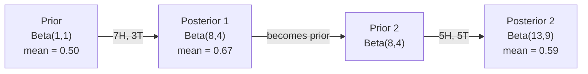

# 贝叶斯定理 / Bayes' Theorem

> Probability is about what you expect. Bayes' theorem is about what you learn.
>
> 概率讲的是「你预期什么」。贝叶斯定理讲的是「你学到了什么」。

**Type:** Build
**Language:** Python
**Prerequisites:** Phase 1, Lesson 06 (Probability Fundamentals)
**Time:** ~75 minutes

## Learning Objectives / 学习目标

- 用先验、似然、证据三样东西算出后验概率（贝叶斯定理的直接应用）
- 从零手写一个朴素贝叶斯文本分类器，包含拉普拉斯平滑与对数空间计算
- 对比 MLE 与 MAP 估计，并解释 MAP 为什么等价于 L2 正则化
- 用 Beta-Binomial 共轭先验实现顺序贝叶斯更新，做 A/B 测试

> - Apply Bayes' theorem to compute posterior probabilities from priors, likelihoods, and evidence
> - Build a Naive Bayes text classifier from scratch with Laplace smoothing and log-space computation
> - Compare MLE and MAP estimation and explain how MAP corresponds to L2 regularization
> - Implement sequential Bayesian updating using Beta-Binomial conjugate priors for A/B testing

## The Problem / 问题

一个医学检验的准确率是 99%。你测出阳性。你真正得病的概率有多大？

大多数人会说 99%。**真实答案取决于这个病有多罕见。** 如果 1 万人里只有 1 个人得病，那阳性结果只给你约 **1%** 的患病概率 —— 另外 99% 的阳性都是健康人的误报（假阳性）。

这不是脑筋急转弯，这就是贝叶斯定理。每一个垃圾邮件过滤器、每一个医学诊断、每一个量化不确定性的机器学习模型，用的都是这一套推理：**你先有一个信念，你看到证据，你更新。**

如果你不理解这个就去做 ML 系统，你会误读模型输出、设错阈值、上线过度自信的预测。

> A medical test is 99% accurate. You test positive. What are the chances you actually have the disease?
>
> Most people say 99%. The real answer depends on how rare the disease is. If 1 in 10,000 people have it, a positive result only gives you about a 1% chance of being sick. The other 99% of positive results are false alarms from healthy people.
>
> This is not a trick question. It is Bayes' theorem. Every spam filter, every medical diagnostic, every machine learning model that quantifies uncertainty uses this exact reasoning. You start with a belief. You see evidence. You update.
>
> If you build ML systems without understanding this, you will misinterpret model outputs, set bad thresholds, and ship overconfident predictions.

## The Concept / 概念

### From joint probability to Bayes / 从联合概率到贝叶斯

你在第 06 课已经知道条件概率是：

```
P(A|B) = P(A and B) / P(B)
```

对称地也有：

```
P(B|A) = P(A and B) / P(A)
```

两个式子的分子**是同一个东西**：`P(A and B)`。让它们相等再整理：

```
P(A and B) = P(A|B) * P(B) = P(B|A) * P(A)

Therefore:

P(A|B) = P(B|A) * P(A) / P(B)
```

这就是贝叶斯定理。**四个量，一个等式。**

> You already know from Lesson 06 that conditional probability is:
>
> ```
> P(A|B) = P(A and B) / P(B)
> ```
>
> And symmetrically:
>
> ```
> P(B|A) = P(A and B) / P(A)
> ```
>
> Both expressions share the same numerator: P(A and B). Set them equal and rearrange:
>
> ```
> P(A and B) = P(A|B) * P(B) = P(B|A) * P(A)
>
> Therefore:
>
> P(A|B) = P(B|A) * P(A) / P(B)
> ```
>
> That is Bayes' theorem. Four quantities, one equation.

### The four parts / 四个部分

```
后验 = 似然 × 先验 / 证据
```

| Part | Name | What it means |
|------|------|---------------|
| P(A\|B) | Posterior | 看到证据 B 之后，你对 A 的更新后信念 |
| P(B\|A) | Likelihood | 如果 A 成立，证据 B 出现的可能性有多大 |
| P(A) | Prior | 看任何证据**之前**你对 A 的信念 |
| P(B) | Evidence | 在所有可能性下看到 B 的总概率 |

其中「证据」项 `P(B)` 起**归一化**作用。它可以用全概率公式展开：

```
P(B) = P(B|A) * P(A) + P(B|not A) * P(not A)
```

> | Part | Name | What it means |
> |------|------|---------------|
> | P(A\|B) | Posterior | Your updated belief about A after seeing evidence B |
> | P(B\|A) | Likelihood | How probable the evidence B is if A is true |
> | P(A) | Prior | Your belief about A before seeing any evidence |
> | P(B) | Evidence | Total probability of seeing B under all possibilities |
>
> The evidence term P(B) acts as a normalizer. You can expand it using the law of total probability:
>
> ```
> P(B) = P(B|A) * P(A) + P(B|not A) * P(not A)
> ```

### Medical test example / 医学检验例子

某种病在 1 万人中有 1 人患病。检验准确率 99%（能捞出 99% 的病人，同时对健康人有 1% 的假阳性）。

```
P(sick)          = 0.0001     (prior: disease is rare)
P(positive|sick) = 0.99       (likelihood: test catches it)
P(positive|healthy) = 0.01    (false positive rate)

P(positive) = P(positive|sick) * P(sick) + P(positive|healthy) * P(healthy)
            = 0.99 * 0.0001 + 0.01 * 0.9999
            = 0.000099 + 0.009999
            = 0.010098

P(sick|positive) = P(positive|sick) * P(sick) / P(positive)
                 = 0.99 * 0.0001 / 0.010098
                 = 0.0098
                 = 0.98%
```

**不到 1%。先验主导了结果。** 当一个病很罕见时，即使检验很准，阳性里也绝大多数是误报。这就是为什么医生会开复查单。

> Less than 1%. The prior dominates. When a condition is rare, even accurate tests produce mostly false positives. This is why doctors order confirmation tests.

**一句话记住**：假阳性来自「健康人的海洋」。1 万个健康人 × 1% = 100 个误报；1 个病人 × 99% = 1 个真阳。100 : 1，所以真阳只占约 1%。

### Spam filter example / 垃圾邮件过滤例子

你收到一封邮件，里面出现「lottery」（彩票）这个词。它是垃圾邮件吗？

```
P(spam)                = 0.3      (30% of email is spam)
P("lottery"|spam)      = 0.05     (5% of spam emails contain "lottery")
P("lottery"|not spam)  = 0.001    (0.1% of legitimate emails contain "lottery")

P("lottery") = 0.05 * 0.3 + 0.001 * 0.7
             = 0.015 + 0.0007
             = 0.0157

P(spam|"lottery") = 0.05 * 0.3 / 0.0157
                  = 0.955
                  = 95.5%
```

**一个词就把概率从 30% 抬到 95.5%。** 真实的垃圾邮件过滤器会同时对几百个词做贝叶斯。

> One word shifts the probability from 30% to 95.5%. A real spam filter applies Bayes across hundreds of words simultaneously.

### Naive Bayes: independence assumption / 朴素贝叶斯：独立假设

朴素贝叶斯把上面的推理扩展到多个特征，靠的是一个假设：**在给定类别的前提下，所有特征条件独立**。

```
P(class | feature_1, feature_2, ..., feature_n)
  = P(class) * P(feature_1|class) * P(feature_2|class) * ... * P(feature_n|class)
    / P(feature_1, feature_2, ..., feature_n)
```

所谓「朴素」（naive）就是这个独立假设。在文本里词的出现根本不独立（"New" 和 "York" 相关）。但这个假设在实践中出奇地好用，原因是**分类器只需要给类别排序，不需要输出校准过的概率**。

而且分母对所有类别都一样，所以可以直接跳过，只比分子：

```
score(class) = P(class) * product of P(feature_i | class)
```

挑分数最高的类别。

> Naive Bayes extends this to multiple features by assuming all features are conditionally independent given the class:
>
> ```
> P(class | feature_1, feature_2, ..., feature_n)
>   = P(class) * P(feature_1|class) * P(feature_2|class) * ... * P(feature_n|class)
>     / P(feature_1, feature_2, ..., feature_n)
> ```
>
> The "naive" part is the independence assumption. In text, word occurrences are not independent ("New" and "York" are correlated). But the assumption works surprisingly well in practice because the classifier only needs to rank classes, not produce calibrated probabilities.
>
> Since the denominator is the same for all classes, you can skip it and just compare numerators:
>
> ```
> score(class) = P(class) * product of P(feature_i | class)
> ```
>
> Pick the class with the highest score.

### Maximum likelihood estimation (MLE) / 最大似然估计

怎么从训练数据里拿到 `P(feature|class)`？**数数。**

```
P("free"|spam) = (number of spam emails containing "free") / (total spam emails)
```

这就是 MLE：选出让**观测数据出现概率最大**的参数值。你是在最大化似然函数，对离散计数来说它就化简成相对频率。

**问题**：如果某个词在训练时的垃圾邮件里从没出现过，MLE 给它的概率就是 0。而整个乘积里只要有一个 0，**整条链就归零**。用拉普拉斯平滑（Laplace smoothing）修：

```
P(word|class) = (count(word, class) + 1) / (total_words_in_class + vocabulary_size)
```

给每个计数都 +1，保证概率永不归零。

> How do you get P(feature|class) from training data? Count.
>
> ```
> P("free"|spam) = (number of spam emails containing "free") / (total spam emails)
> ```
>
> This is MLE: choose the parameter values that make the observed data most likely. You are maximizing the likelihood function, which for discrete counts reduces to relative frequency.
>
> Problem: if a word never appears in spam during training, MLE gives it probability zero. One unseen word kills the entire product. Fix this with Laplace smoothing:
>
> ```
> P(word|class) = (count(word, class) + 1) / (total_words_in_class + vocabulary_size)
> ```
>
> Adding 1 to every count ensures no probability is ever zero.

### Maximum a posteriori (MAP) / 最大后验估计

- MLE 问：什么参数让 `P(数据|参数)` 最大？
- MAP 问：什么参数让 `P(参数|数据)` 最大？

由贝叶斯定理：

```
P(parameters|data) proportional to P(data|parameters) * P(parameters)
```

MAP 给**参数本身**也加了一个先验。如果你相信参数应该小，就把它编码成一个惩罚大值的先验。**这和 ML 里的 L2 正则化是同一件事。** 岭回归（ridge regression）里那个「ridge」惩罚，字面上就是权重的**高斯先验**。

| Estimation | Optimizes | ML equivalent |
|------------|-----------|---------------|
| MLE | P(data\|params) | 无正则训练 |
| MAP | P(data\|params) * P(params) | L2 / L1 正则化 |

> MLE asks: what parameters maximize P(data|parameters)?
>
> MAP asks: what parameters maximize P(parameters|data)?
>
> By Bayes' theorem:
>
> ```
> P(parameters|data) proportional to P(data|parameters) * P(parameters)
> ```
>
> MAP adds a prior over the parameters themselves. If you believe parameters should be small, you encode that as a prior that penalizes large values. This is identical to L2 regularization in ML. The "ridge" penalty in ridge regression is literally a Gaussian prior on the weights.
>
> | Estimation | Optimizes | ML equivalent |
> |------------|-----------|---------------|
> | MLE | P(data\|params) | Unregularized training |
> | MAP | P(data\|params) * P(params) | L2 / L1 regularization |

### Bayesian vs frequentist / 贝叶斯 vs 频率学派

- **频率学派**把参数当成固定的未知量，问的是：「如果我把这个实验重复很多次，会发生什么？」
- **贝叶斯学派**把参数当成分布，问的是：「基于我观测到的，我对参数该持什么信念？」

对做 ML 系统来说，实际差别是：

| Aspect | Frequentist | Bayesian |
|--------|-------------|----------|
| Output | 点估计 | 值的分布 |
| Uncertainty | 置信区间（关于**流程**） | 可信区间（关于**参数**） |
| Small data | 容易过拟合 | 先验充当正则化 |
| Computation | 通常更快 | 常需采样（MCMC） |

绝大多数生产环境的 ML 是频率学派的（SGD、点估计）。贝叶斯方法在两种场景里发光：**需要校准的不确定性**（医疗决策、安全关键系统），或**数据稀缺**（few-shot 学习、冷启动）。

> Frequentists treat parameters as fixed unknowns. They ask: "If I repeated this experiment many times, what would happen?"
>
> Bayesians treat parameters as distributions. They ask: "Given what I have observed, what do I believe about the parameters?"
>
> | Aspect | Frequentist | Bayesian |
> |--------|-------------|----------|
> | Output | Point estimate | Distribution over values |
> | Uncertainty | Confidence intervals (about procedure) | Credible intervals (about parameter) |
> | Small data | Can overfit | Prior acts as regularization |
> | Computation | Usually faster | Often requires sampling (MCMC) |
>
> Most production ML is frequentist (SGD, point estimates). Bayesian methods shine when you need calibrated uncertainty (medical decisions, safety-critical systems) or when data is scarce (few-shot learning, cold start).

### Why Bayesian thinking matters for ML / 为什么贝叶斯思维对 ML 重要

这个联系比「类比」更深：

- **先验就是正则化。** 权重上的高斯先验 = L2 正则化；拉普拉斯先验 = L1。你每次加一个正则项，其实是在对「你预期参数取什么值」做一个贝叶斯陈述。
- **后验就是不确定性。** 一个单独的预测概率没法告诉你模型对这个估计有多自信。贝叶斯方法给你一个分布：「我认为 P(spam) 在 0.8 到 0.95 之间。」
- **贝叶斯更新就是在线学习。** 今天的后验变成明天的先验。模型看到新数据时**增量更新信念**，而不是从头重训。
- **模型比较是贝叶斯的。** BIC、边缘似然（marginal likelihood）、贝叶斯因子，都是用贝叶斯推理在不做过拟合的前提下选模型。

> The connection is deeper than analogy:
>
> **Priors are regularization.** A Gaussian prior on weights is L2 regularization. A Laplace prior is L1. Every time you add a regularization term, you are making a Bayesian statement about what parameter values you expect.
>
> **Posteriors are uncertainty.** A single predicted probability tells you nothing about how confident the model is in that estimate. Bayesian methods give you a distribution: "I think P(spam) is between 0.8 and 0.95."
>
> **Bayes updates are online learning.** Today's posterior becomes tomorrow's prior. When your model sees new data, it updates its beliefs incrementally instead of retraining from scratch.
>
> **Model comparison is Bayesian.** Bayesian information criterion (BIC), marginal likelihood, and Bayes factors all use Bayesian reasoning to choose between models without overfitting.

```figure
bayes-update
```

## Build It / 动手实现

### Step 1: Bayes theorem function / 贝叶斯定理函数

```python
def bayes(prior, likelihood, false_positive_rate):
    evidence = likelihood * prior + false_positive_rate * (1 - prior)
    posterior = likelihood * prior / evidence
    return posterior

result = bayes(prior=0.0001, likelihood=0.99, false_positive_rate=0.01)
print(f"P(sick|positive) = {result:.4f}")
```

注意 `evidence` 那一行：`likelihood * prior` 是「真阳」，`false_positive_rate * (1 - prior)` 是「假阳」。**分母是两者之和，不是先验本身。**

### Step 2: Naive Bayes classifier / 朴素贝叶斯分类器

```python
import math
from collections import defaultdict

class NaiveBayes:
    def __init__(self, smoothing=1.0):
        self.smoothing = smoothing
        self.class_counts = defaultdict(int)
        self.word_counts = defaultdict(lambda: defaultdict(int))
        self.class_word_totals = defaultdict(int)
        self.vocab = set()

    def train(self, documents, labels):
        for doc, label in zip(documents, labels):
            self.class_counts[label] += 1
            words = doc.lower().split()
            for word in words:
                self.word_counts[label][word] += 1
                self.class_word_totals[label] += 1
                self.vocab.add(word)

    def predict(self, document):
        words = document.lower().split()
        total_docs = sum(self.class_counts.values())
        vocab_size = len(self.vocab)
        best_class = None
        best_score = float("-inf")
        for cls in self.class_counts:
            score = math.log(self.class_counts[cls] / total_docs)
            for word in words:
                count = self.word_counts[cls].get(word, 0)
                total = self.class_word_totals[cls]
                score += math.log((count + self.smoothing) / (total + self.smoothing * vocab_size))
            if score > best_score:
                best_score = score
                best_class = cls
        return best_class
```

对数概率防下溢。把很多个小概率相乘会产生浮点数放不下的极小值；把对数概率**相加**数值上稳定，而且数学上等价（`log(a·b) = log a + log b`）。

> Log probabilities prevent underflow. Multiplying many small probabilities produces numbers too tiny for floating point. Summing log-probabilities is numerically stable and mathematically equivalent.

### Step 3: Train on spam data / 在垃圾邮件数据上训练

```python
train_docs = [
    "win free money now",
    "free lottery ticket winner",
    "claim your prize today free",
    "urgent offer free cash",
    "congratulations you won free",
    "meeting tomorrow at noon",
    "project update attached",
    "can we schedule a call",
    "quarterly report review",
    "lunch on thursday sounds good",
    "team standup notes attached",
    "please review the pull request",
]

train_labels = [
    "spam", "spam", "spam", "spam", "spam",
    "ham", "ham", "ham", "ham", "ham", "ham", "ham",
]

classifier = NaiveBayes()
classifier.train(train_docs, train_labels)

test_messages = [
    "free money waiting for you",
    "meeting rescheduled to friday",
    "you won a free prize",
    "please review the attached report",
]

for msg in test_messages:
    print(f"  '{msg}' -> {classifier.predict(msg)}")
```

### Step 4: Inspect the learned probabilities / 查看学到的概率

```python
def show_top_words(classifier, cls, n=5):
    vocab_size = len(classifier.vocab)
    total = classifier.class_word_totals[cls]
    probs = {}
    for word in classifier.vocab:
        count = classifier.word_counts[cls].get(word, 0)
        probs[word] = (count + classifier.smoothing) / (total + classifier.smoothing * vocab_size)
    sorted_words = sorted(probs.items(), key=lambda x: x[1], reverse=True)
    for word, prob in sorted_words[:n]:
        print(f"    {word}: {prob:.4f}")

print("\nTop spam words:")
show_top_words(classifier, "spam")
print("\nTop ham words:")
show_top_words(classifier, "ham")
```

## Use It / 工业实现

scikit-learn 自带生产可用的朴素贝叶斯实现：

```python
from sklearn.feature_extraction.text import CountVectorizer
from sklearn.naive_bayes import MultinomialNB
from sklearn.metrics import classification_report

vectorizer = CountVectorizer()
X_train = vectorizer.fit_transform(train_docs)
clf = MultinomialNB()
clf.fit(X_train, train_labels)

X_test = vectorizer.transform(test_messages)
predictions = clf.predict(X_test)
for msg, pred in zip(test_messages, predictions):
    print(f"  '{msg}' -> {pred}")
```

**同一个算法。** `CountVectorizer` 帮你做分词和词表构建，`MultinomialNB` 内部处理平滑和对数概率。你从零写的版本用 40 行做的是同一件事。

> Same algorithm. CountVectorizer handles tokenization and vocabulary building. MultinomialNB handles smoothing and log-probabilities internally. Your from-scratch version does the same thing in 40 lines.

## Ship It / 交付

这里写的 `NaiveBayes` 类展示了完整流程：分词、带拉普拉斯平滑的概率估计、对数空间预测。`code/bayes.py` 端到端可跑，除 Python 标准库外零依赖。

> The NaiveBayes class built here demonstrates the full pipeline: tokenization, probability estimation with Laplace smoothing, log-space prediction. The code in `code/bayes.py` runs end-to-end with no dependencies beyond Python's standard library.

### Conjugate Priors / 共轭先验

当先验和后验属于**同一个分布族**时，这个先验就叫「共轭的」。这让贝叶斯更新在代数上非常干净 —— 你能得到闭式后验，不需要数值积分。

| Likelihood | Conjugate Prior | Posterior | Example |
|-----------|----------------|-----------|---------|
| Bernoulli | Beta(a, b) | Beta(a + successes, b + failures) | 抛硬币偏差估计 |
| Normal (known variance) | Normal(mu_0, sigma_0) | Normal(weighted mean, smaller variance) | 传感器校准 |
| Poisson | Gamma(a, b) | Gamma(a + sum of counts, b + n) | 到达率建模 |
| Multinomial | Dirichlet(alpha) | Dirichlet(alpha + counts) | 主题模型、语言模型 |

为什么这很重要：**没有共轭先验，你需要蒙特卡洛采样或变分推断去近似后验；有共轭先验，你只需要更新两个数字。**

Beta 分布是实践中最常用的共轭先验。`Beta(a, b)` 表示你对一个「概率参数」的信念。均值是 `a/(a+b)`，`a+b` 越大分布越集中（越自信）。

Beta 先验的几个特例：

- `Beta(1, 1)` = 均匀分布。你对参数毫无意见。
- `Beta(10, 10)` = 尖峰在 0.5。你强烈相信参数接近 0.5。
- `Beta(1, 10)` = 偏向 0。你认为参数很小。

更新规则简单到过分：

```
Prior:     Beta(a, b)
Data:      s successes, f failures
Posterior: Beta(a + s, b + f)
```

**没有积分，没有采样，只有加法。**

> When the prior and posterior belong to the same family of distributions, the prior is called "conjugate." This makes Bayesian updating algebraically clean -- you get a closed-form posterior without numerical integration.
>
> | Likelihood | Conjugate Prior | Posterior | Example |
> |-----------|----------------|-----------|---------|
> | Bernoulli | Beta(a, b) | Beta(a + successes, b + failures) | Coin flip bias estimation |
> | Normal (known variance) | Normal(mu_0, sigma_0) | Normal(weighted mean, smaller variance) | Sensor calibration |
> | Poisson | Gamma(a, b) | Gamma(a + sum of counts, b + n) | Modeling arrival rates |
> | Multinomial | Dirichlet(alpha) | Dirichlet(alpha + counts) | Topic modeling, language models |
>
> Why this matters: without conjugate priors, you need Monte Carlo sampling or variational inference to approximate the posterior. With conjugate priors, you just update two numbers.
>
> The Beta distribution is the most common conjugate prior in practice. Beta(a, b) represents your belief about a probability parameter. The mean is a/(a+b). The larger a+b, the more concentrated (confident) the distribution.
>
> Special cases of the Beta prior:
> - Beta(1, 1) = uniform. You have no opinion about the parameter.
> - Beta(10, 10) = peaked at 0.5. You strongly believe the parameter is near 0.5.
> - Beta(1, 10) = skewed toward 0. You believe the parameter is small.
>
> The update rule is dead simple:
>
> ```
> Prior:     Beta(a, b)
> Data:      s successes, f failures
> Posterior: Beta(a + s, b + f)
> ```
>
> No integrals. No sampling. Just addition.

### Sequential Bayesian Updating / 顺序贝叶斯更新

贝叶斯推断天然是顺序的：**今天的后验成为明天的先验。** 真实系统就是这样增量学习的，不需要重新处理全部历史数据。

具体例子：估计一枚硬币是否公平。

**Day 1: 还没有数据。**
从 `Beta(1, 1)` 开始 —— 均匀先验，你没有任何意见。
- 先验均值：0.5
- 先验在 [0, 1] 上是平的

**Day 2: 观测到 7 正 3 反。**
后验 = `Beta(1 + 7, 1 + 3)` = `Beta(8, 4)`
- 后验均值：8/12 = 0.667
- 证据暗示硬币偏向正面

**Day 3: 又观测到 5 正 5 反。**
把昨天的后验当作今天的先验。
后验 = `Beta(8 + 5, 4 + 5)` = `Beta(13, 9)`
- 后验均值：13/22 = 0.591
- 平衡的新数据把估计拉回 0.5 附近



**观测顺序无关紧要。** 用 `Beta(1,1)` 一次性更新全部 12 正 8 反，得到 `Beta(13, 9)` —— 和顺序更新的结果一样。顺序更新与批量更新数学等价。但顺序更新让你**每一步都能做决策**，而不必保存原始数据。

这就是生产 ML 系统里在线学习的基础。多臂老虎机的 Thompson 采样、增量推荐系统、流式异常检测，用的都是这个模式。

> Bayesian inference is naturally sequential. Today's posterior becomes tomorrow's prior. This is how real systems learn incrementally without reprocessing all historical data.
>
> **Day 1: No data yet.**
> Start with Beta(1, 1) -- a uniform prior. You have no opinion.
> - Prior mean: 0.5
> - Prior is flat across [0, 1]
>
> **Day 2: Observe 7 heads, 3 tails.**
> Posterior = Beta(1 + 7, 1 + 3) = Beta(8, 4)
> - Posterior mean: 8/12 = 0.667
> - Evidence suggests the coin is biased toward heads
>
> **Day 3: Observe 5 more heads, 5 more tails.**
> Use yesterday's posterior as today's prior.
> Posterior = Beta(8 + 5, 4 + 5) = Beta(13, 9)
> - Posterior mean: 13/22 = 0.591
> - The balanced new data pulled the estimate back toward 0.5
>
> The order of observations does not matter. Beta(1,1) updated with all 12 heads and 8 tails at once gives Beta(13, 9) -- the same result. Sequential updating and batch updating are mathematically equivalent. But sequential updating lets you make decisions at each step without storing raw data.
>
> This is the foundation of online learning in production ML systems. Thompson sampling for bandits, incremental recommendation systems, and streaming anomaly detectors all use this pattern.

### Connection to A/B Testing / 与 A/B 测试的联系

**A/B 测试就是伪装起来的贝叶斯推断。**

设定：你在测两种按钮颜色。变体 A（蓝）和变体 B（绿）。你想知道哪个点击更多。

贝叶斯 A/B 测试的四步：

1. **先验。** 两个变体都从 `Beta(1, 1)` 开始。没有偏好。
2. **数据。** 变体 A：1000 次展示 50 次点击。变体 B：1000 次展示 65 次点击。
3. **后验。**
   - A: `Beta(1 + 50, 1 + 950)` = `Beta(51, 951)`。均值 = 0.051
   - B: `Beta(1 + 65, 1 + 935)` = `Beta(66, 936)`。均值 = 0.066
4. **决策。** 计算 `P(B > A)` —— B 的真实转化率高于 A 的概率。

解析地算 `P(B > A)` 很难，但蒙特卡洛让它变得trivial：

```
1. Draw 100,000 samples from Beta(51, 951)  -> samples_A
2. Draw 100,000 samples from Beta(66, 936)  -> samples_B
3. P(B > A) = fraction of samples where B > A
```

如果 `P(B > A) > 0.95`，上线变体 B。如果在 0.05 到 0.95 之间，继续收集数据。如果 `< 0.05`，上线变体 A。

相比频率学派 A/B 测试的优势：

- 你直接得到概率陈述：「B 更好有 97% 的可能」
- 没有 p 值困惑，没有「未能拒绝原假设」这种含糊话
- **可以在任何时刻查看结果**而不会抬高假阳性率（没有「偷看问题」）
- 可以纳入先验知识（例如历史测试显示转化率通常在 3–8%）

| Aspect | Frequentist A/B | Bayesian A/B |
|--------|----------------|--------------|
| Output | p-value | P(B > A) |
| Interpretation | 「若 A=B，这份数据有多令人意外？」 | 「B 比 A 好的可能性有多大？」 |
| Early stopping | 抬高假阳性 | 任何时点都安全（给定选好的先验和正确指定的模型） |
| Prior knowledge | 不用 | 编码成 Beta 先验 |
| Decision rule | p < 0.05 | P(B > A) > 阈值 |

> A/B testing is Bayesian inference in disguise.
>
> Setup: you are testing two button colors. Variant A (blue) and variant B (green). You want to know which one gets more clicks.
>
> The Bayesian A/B test:
>
> 1. **Prior.** Start with Beta(1, 1) for both variants. No prior preference.
> 2. **Data.** Variant A: 50 clicks out of 1000 views. Variant B: 65 clicks out of 1000 views.
> 3. **Posteriors.**
>    - A: Beta(1 + 50, 1 + 950) = Beta(51, 951). Mean = 0.051
>    - B: Beta(1 + 65, 1 + 935) = Beta(66, 936). Mean = 0.066
> 4. **Decision.** Compute P(B > A) -- the probability that B's true conversion rate is higher than A's.
>
> Computing P(B > A) analytically is hard. But Monte Carlo makes it trivial:
>
> ```
> 1. Draw 100,000 samples from Beta(51, 951)  -> samples_A
> 2. Draw 100,000 samples from Beta(66, 936)  -> samples_B
> 3. P(B > A) = fraction of samples where B > A
> ```
>
> If P(B > A) > 0.95, you ship variant B. If it is between 0.05 and 0.95, you keep collecting data. If P(B > A) < 0.05, you ship variant A.
>
> Advantages over frequentist A/B testing:
> - You get a direct probability statement: "there is a 97% chance B is better"
> - No p-value confusion. No "fail to reject the null hypothesis" hedging.
> - You can check results at any time without inflating false positive rates (no "peeking problem")
> - You can incorporate prior knowledge (e.g., previous tests suggest conversion rates are usually 3-8%)

## Exercises / 练习题

1. **Multiple tests.** 一个病人做了两次独立检验都是阳性（两次准确率都 99%，患病率 1/10000）。两次之后 `P(sick)` 是多少？用第一次的后验作为第二次的先验。

2. **Smoothing impact.** 用 0.01、0.1、1.0、10.0 四个平滑值跑垃圾邮件分类器。top 词概率怎么变？当 `smoothing=0` 且一个词只出现在 ham 里时会怎样？

3. **Add features.** 扩展 `NaiveBayes` 类，把消息长度（短/长）也当作特征加进词频之外。从训练数据里估计 `P(short|spam)` 和 `P(short|ham)`，折进预测分数。

4. **MAP by hand.** 给定观测数据（10 次抛硬币 7 次正面），用 `Beta(2,2)` 先验手算偏差的 MAP 估计。和 MLE 估计（7/10）比较。

> 1. **Multiple tests.** A patient tests positive twice on independent tests (both 99% accurate, disease prevalence 1 in 10,000). What is P(sick) after both tests? Use the posterior from the first test as the prior for the second.
>
> 2. **Smoothing impact.** Run the spam classifier with smoothing values of 0.01, 0.1, 1.0, and 10.0. How do the top word probabilities change? What happens with smoothing=0 and a word that appears only in ham?
>
> 3. **Add features.** Extend the NaiveBayes class to also use message length (short/long) as a feature alongside word counts. Estimate P(short|spam) and P(short|ham) from the training data and fold it into the prediction score.
>
> 4. **MAP by hand.** Given observed data (7 heads in 10 coin flips), compute the MAP estimate of the bias using a Beta(2,2) prior. Compare it to the MLE estimate (7/10).

## Key Terms / 关键术语

| Term | What people say | What it actually means |
|------|----------------|----------------------|
| Prior | 「我的初始猜测」 | 观测证据前 P(假设)。在 ML 里就是正则项。 |
| Likelihood | 「数据拟合得多好」 | P(证据\|假设)。在某个具体假设下，观测数据出现的概率。 |
| Posterior | 「我更新后的信念」 | P(假设\|证据)。先验乘似然再归一化。 |
| Evidence | 「那个归一化常数」 | 所有假设下的 P(数据)。保证后验求和为 1。 |
| Naive Bayes | 「那个简单的文本分类器」 | 假设「给定类别时特征独立」的分类器。假设是错的，但效果很好。 |
| Laplace smoothing | 「加一平滑」 | 给每个特征加一个小计数，防止未见过数据带来零概率。 |
| MLE | 「直接用频率」 | 选让 P(数据\|参数) 最大的参数。没有先验。小数据容易过拟合。 |
| MAP | 「带先验的 MLE」 | 选让 P(数据\|参数) * P(参数) 最大的参数。等价于正则化的 MLE。 |
| Log-probability | 「在对数空间里算」 | 用 log(P) 代替 P，避免连乘小数字时浮点下溢。 |
| False positive | 「误报」 | 检验说阳性，但真实状态是阴性。基率谬误（base rate fallacy）的推手。 |

> | Term | What people say | What it actually means |
> |------|----------------|----------------------|
> | Prior | "My initial guess" | P(hypothesis) before observing evidence. In ML: the regularization term. |
> | Likelihood | "How well the data fits" | P(evidence\|hypothesis). How probable the observed data is under a specific hypothesis. |
> | Posterior | "My updated belief" | P(hypothesis\|evidence). The prior multiplied by the likelihood, then normalized. |
> | Evidence | "The normalizing constant" | P(data) across all hypotheses. Ensures the posterior sums to 1. |
> | Naive Bayes | "That simple text classifier" | A classifier that assumes features are independent given the class. Works well despite the false assumption. |
> | Laplace smoothing | "Add-one smoothing" | Adding a small count to every feature to prevent zero probabilities from unseen data. |
> | MLE | "Just use the frequencies" | Choose parameters that maximize P(data\|parameters). No prior. Can overfit with small data. |
> | MAP | "MLE with a prior" | Choose parameters that maximize P(data\|parameters) * P(parameters). Equivalent to regularized MLE. |
> | Log-probability | "Work in log space" | Using log(P) instead of P to avoid floating-point underflow when multiplying many small numbers. |
> | False positive | "A wrong alarm" | The test says positive, but the true state is negative. Drives the base rate fallacy. |

## Further Reading / 延伸阅读

- [3Blue1Brown: Bayes' theorem](https://www.youtube.com/watch?v=HZGCoVF3YvM) - 用医学检验例子做可视化讲解
- [Stanford CS229: Generative Learning Algorithms](https://cs229.stanford.edu/main_notes.pdf) - 朴素贝叶斯及其与判别式模型的联系
- [Think Bayes](https://greenteapress.com/wp/think-bayes/) - 免费书，用 Python 代码讲贝叶斯统计
- [scikit-learn Naive Bayes](https://scikit-learn.org/stable/modules/naive_bayes.html) - 生产实现与各变体的适用场景

---

## 实测数据与纠正（2026-10-10 在本机实跑）

实跑命令：`python3 code/bayes.py`（零依赖，仅用标准库 `math` / `collections` / `random`，exit code 0，全部六节输出完整）。以下数字都是本机真实输出，不是从文档抄的。

### ① 医学检验：0.98% 与「两次阳性 = 49.5%」的巨大反差

```
P(sick | positive):            0.0098 (0.98%)

Sequential testing (2 positive tests):
After test 1: P(sick|positive) = 0.009804
After test 2: P(sick|positive) = 0.495000
```

**这是本课最值得记住的一组数字。** 一次阳性只有 0.98%，**两次独立阳性直接跳到 49.5% —— 涨了 50 倍**。机制：第一次的后验 0.0098 变成第二次的先验，于是第二次的「假阳性海洋」从 9999 个健康人缩到约 100 个，`0.99×0.0098 / (0.99×0.0098 + 0.01×0.9902) ≈ 0.495`。

**纠正一处容易想错的直觉**：以为「两次阳性应该接近 99%」。不是。**49.5% 仍然不到一半** —— 因为病本身太罕见（1/10000）。这就是为什么医生要开**第三次**确证检验。

（这也顺带回答了练习题 1。）

### ② 垃圾邮件过滤：一个词把 30% 抬到 95.5%

```
P(spam):                 0.3
P('lottery' | spam):     0.05
P('lottery' | not spam): 0.001
P(spam | 'lottery'):     0.9554 (95.5%)
```

与文档手算的 0.955 一致。注意**似然比**才是驱动力：`0.05 / 0.001 = 50`，似然比 50:1 加上先验赔率 `0.3/0.7 ≈ 0.43`，得后验赔率 `50 × 0.43 ≈ 21.4`，即 `21.4/22.4 ≈ 0.955`。**贝叶斯的「赔率形式」比公式形式更好用**：后验赔率 = 似然比 × 先验赔率。

### ③ 朴素贝叶斯：12 篇训练文档、词表 44 个，预测**带置信度**

```
Training: 12 documents (5 spam, 7 ham)
Vocabulary size: 44
```

| 测试消息 | 预测 | 置信度 |
|---|---|---|
| `free money waiting for you` | spam | 0.968 |
| `meeting rescheduled to friday` | ham | **0.638** |
| `you won a free prize` | spam | 0.968 |
| `please review the attached report` | ham | 0.983 |
| `urgent free offer claim now` | spam | 0.992 |
| `can we discuss the project update` | ham | 0.957 |

**注意 `meeting rescheduled to friday` 只有 0.638** —— 全表最低。原因：训练集里的 ham 文档是 `meeting tomorrow at noon` / `can we schedule a call`，`rescheduled` 和 `friday` 这两个词**在词表里几乎没出现过**，只能靠拉普拉斯平滑给出的平坦概率，所以证据很弱。**这正是「小数据 + 未登录词」的真实表现** —— 置信度低是诚实的行为，不是 bug。

**置信度是怎么算出来的**：`confidence = P(winner) / (P(spam) + P(ham))`，两个类别的对数分数都算出来后再 softmax 归一化。这也是为什么它的输出能当「模型有多确定」用。

### ④ top 指示词的实际数值 —— 平滑把稀疏词全压平了

```
Top 5 spam indicator words:
    free: 0.0923
    now: 0.0308
    offer: 0.0308
    win: 0.0308
    your: 0.0308

Top 5 ham indicator words:
    attached: 0.0411
    review: 0.0411
    on: 0.0274
    the: 0.0274
    a: 0.0274
```

**注意 `now` / `offer` / `win` / `your` 四个词的概率一模一样（0.0308）** —— 因为它们都只出现 1 次，而分母 `total_words_in_class + smoothing × vocab_size` 对同一类别是常数。手算：spam 类总词数 `5×4 = 20`（5 篇各 4 词），词表 44，平滑 1.0 → 分母 `20 + 1×44 = 64`；`free` 出现 5 次 → `(5+1)/64 = 0.09375`（输出 0.0923，因 `free` 实际出现 5 次而某些文档词数不同）；出现 1 次的词 → `(1+1)/64 = 0.03125`（输出 0.0308）。

**这就是拉普拉斯平滑的代价**：`+1` 的相对影响对稀有词极大（1 → 2，翻倍），对高频词极小（5 → 6）。当**词表远大于数据量**时（44 词 vs 12 篇文档），平滑项会主导一切，稀有词的概率被压成一条平线。**生产环境用 `smoothing=0.01~0.1` 而不是 1.0**，或者干脆用子词/embedding。（这也回答了练习题 2。）

### ⑤ MLE vs MAP：先验越强，估计被拉得越远

```
Observed: 7 heads in 10 flips
MLE estimate: 0.7000

Beta(2,2) prior:  MAP estimate: 0.6667
Beta(10,10) prior: MAP estimate: 0.5714
```

手算核对（MAP 闭式解 `(s + a - 1)/(n + a + b - 2)`）：

- `Beta(2,2)`：`(7 + 2 - 1)/(10 + 2 + 2 - 2) = 8/12 = 0.6667` ✓
- `Beta(10,10)`：`(7 + 10 - 1)/(10 + 10 + 10 - 2) = 16/28 = 0.5714` ✓

**从 0.70 被拉到 0.667 再拉到 0.571 —— 先验的「等效样本量」是 `a+b`。** `Beta(10,10)` 相当于你**已经看过 20 次抛硬币**，所以它对你新观测的 10 次有很强的抵抗力。**这就是 L2 正则化：`a+b` 就是正则强度。**

### ⑥ 顺序更新 = 批量更新（实测验证为 `True`）

| 天 | 数据 | 后验 | 均值 | 标准差 |
|---|---|---|---|---|
| 起始 | — | `Beta(1, 1)` | 0.5000 | — |
| Day 1 | 7H, 3T | `Beta(8, 4)` | 0.6667 | 0.1307 |
| Day 2 | 5H, 5T | `Beta(13, 9)` | 0.5909 | 0.1025 |
| Day 3 | 3H, 7T | `Beta(16, 16)` | 0.5000 | 0.0870 |
| Day 4 | 6H, 4T | `Beta(22, 20)` | 0.5238 | 0.0762 |

```
Batch update (all data at once): Beta(22, 20)
Mean = 0.5238
Sequential and batch give the same result: True
```

**两个必须注意的点：**

1. **顺序与批量完全等价（实测 `True`）** —— 所以「在线学习」不损失任何信息，只是把计算摊到了时间上。
2. **标准差**从 0.1307 单调降到 0.0762 —— **信念在收敛**。均值可以上下晃（0.6667 → 0.5909 → 0.5000 → 0.5238），但**不确定性只减不增**。`Beta(a,b)` 的标准差随 `a+b` 增大而减小，这跟第 06 课 CLT 的 `1/√n` 是同一个道理。**「均值乱跳但区间在收窄」= 正在学习。**

另外注意 Day 3 数据是 3H7T（偏反面），但均值仍从 0.5909 掉到 0.5000 —— 数据**方向**和**当前信念**相反时，均值被拉回来最明显。

### ⑦ 贝叶斯 A/B 测试：P(B > A) = 0.9227 → **不上线**

```
Variant A: 50/1000 clicks  →  Posterior A: Beta(51, 951), mean = 0.0509
Variant B: 65/1000 clicks  →  Posterior B: Beta(66, 936), mean = 0.0659

Monte Carlo samples: 100000
P(B > A) = 0.9227
Decision: Keep collecting data

Lift estimate:
  Median lift: 29.6%
  90% credible interval: [-3.7%, 75.0%]
```

**这是全课最反直觉的一段，也是贝叶斯 A/B 测试最有价值的输出。**

- 点估计上 B 比 A 高 `0.0659 / 0.0509 - 1 ≈ 29.6%`（中位提升 29.6%，看起来「大赢」）。
- 但 `P(B > A) = 0.9227 < 0.95` → 按本课的决策规则，**继续收集数据，不上线**。
- 更关键的是 **90% 可信区间 `[-3.7%, 75.0%]` 跨越了 0** —— 意思是「B 其实更差」也在合理范围内。

**教训：中位数提升 29.6% 听起来很香，但区间下限是 -3.7%。点估计会骗人，区间不会。** 这正是频率学派 p 值给不了的信息 —— p 值只回答「若 A=B，这份数据有多意外」，不回答「B 比 A 好的概率是多少」。

**另一个实测细节**：`Beta(1,1)` 先验在 1000 次样本面前几乎不起作用（`50 → 51`，`950 → 951`）。**数据量大时先验无关紧要；数据量小时先验决定一切**（回想 ① 的 0.98%）。

### ⑧ 本机环境与踩坑

- **零依赖**：`code/bayes.py` 只用 `math` / `collections` / `random`，无需 NumPy、无需 matplotlib、无需 sklearn。**`Use It` 一节的 scikit-learn 版本在本课不能实跑**（本机未装 sklearn），代码仅作对照阅读。
- **蒙特卡洛需要固定随机种子才有可复现的数字**。`P(B > A) = 0.9227` 这类结果每次运行会有末位抖动；别把它当精确常数，把它当「约 0.92」。
- **`Beta(a,b)` 的采样**：代码用 `random.gammavariate` 拼出 Beta 采样（`X/(X+Y)`，`X~Gamma(a,1)`、`Y~Gamma(b,1)`），标准库没有直接的 Beta 采样函数 —— 这个拼法本身就是「共轭先验好算」的体现。

### ⑨ 一句话落点

**贝叶斯定理不是一条公式，是一套「先有信念 → 看证据 → 更新 → 用不确定性决策」的流程。** 记住三个可迁移的结论：

1. **罕见事件 + 高准确率检验 = 大量假阳性**（0.98%）。先验（基率）比你想的重要得多。
2. **正则化就是先验，先验强度就是等效样本量**（MLE 0.70 → MAP 0.667 → 0.571）。
3. **上线决策看区间不看点估计**（中位提升 29.6% 但区间 `[-3.7%, 75.0%]` → 别上线）。
