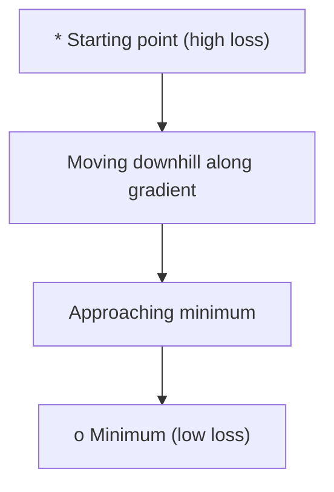
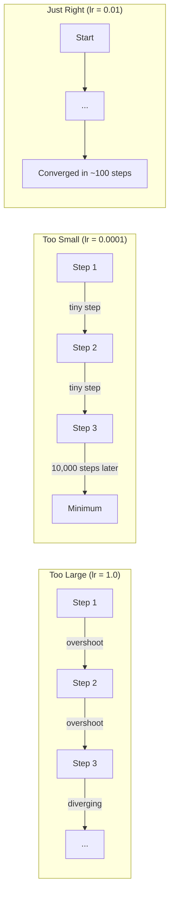
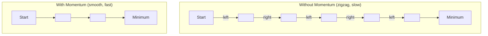
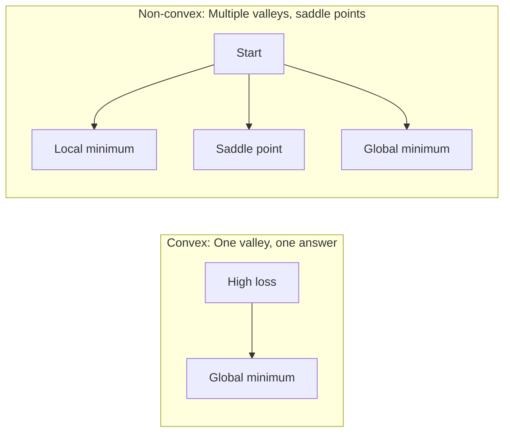
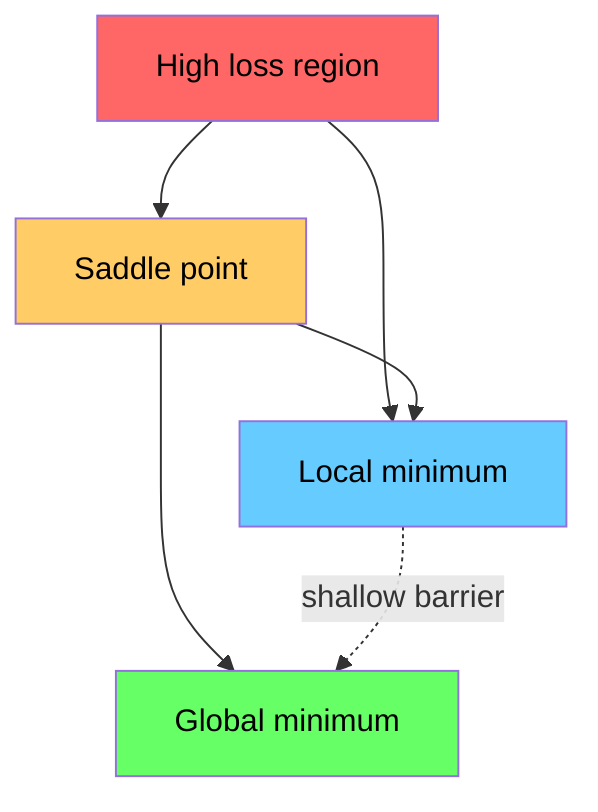

# Optimization · 优化器（把训练变成「下山」）

> Training a neural network is nothing more than finding the bottom of a valley.

**Type:** Build
**Language:** Python
**Prerequisites:** Phase 1, Lessons 04-05 (Derivatives, Gradients)
**Time:** ~75 minutes

---

## Learning Objectives · 学习目标

- 从零实现 vanilla 梯度下降、SGD with momentum、Adam
- 在 Rosenbrock 函数上比较三种优化器的收敛速度，并解释为什么 Adam 能给每个权重自适应学习率
- 区分凸与非凸损失曲面，解释高维空间中鞍点的作用
- 配置学习率调度（step decay、cosine annealing、warmup）保证训练稳定

> Implement vanilla gradient descent, SGD with momentum, and Adam from scratch
> Compare optimizer convergence on the Rosenbrock function and explain why Adam adapts per-weight learning rates
> Distinguish convex from non-convex loss landscapes and explain the role of saddle points in high dimensions
> Configure learning rate schedules (step decay, cosine annealing, warmup) for training stability

---

## The Problem · 问题在哪

你有一个损失函数（它告诉你模型有多错），你有梯度（它告诉你往哪个方向会更错）。现在你需要一个「下山策略」。

朴素做法很简单：**朝梯度的反方向走**，步长乘一个叫学习率的数，然后重复。这就是梯度下降，它能用。但"能用"是有条件的：

- 学习率**太大** → 直接跨过山谷，在两侧墙壁之间来回弹跳（甚至发散）
- 学习率**太小** → 爬向答案要几千个不必要的步
- **碰到鞍点** → 停住不动，虽然你根本没到最小值

深度学习里的每一个优化器，都是在回答同一个问题：**怎么更快、更稳地走到谷底？**

> You have a loss function. It tells you how wrong your model is. You have gradients. They tell you which direction makes the loss worse. Now you need a strategy for walking downhill.
> The naive approach is simple: move opposite the gradient. Scale the step by some number called the learning rate. Repeat. This is gradient descent, and it works. But "works" has caveats. Too large a learning rate and you overshoot the valley entirely, bouncing between walls. Too small and you crawl toward the answer over thousands of unnecessary steps. Hit a saddle point and you stop moving even though you have not found a minimum.
> Every optimizer in deep learning is an answer to the same question: how do you get to the bottom of the valley faster and more reliably?

---

## The Concept · 概念

### What optimization means · 优化是什么

优化 = 找到使某个函数最小（或最大）的输入值。在机器学习里，这个函数是**损失**，输入是**模型的权重**。**训练就是优化。**

```
minimize L(w) where:
  L = loss function
  w = model weights (could be millions of parameters)
```

> Optimization is finding the input values that minimize (or maximize) a function. In machine learning, the function is the loss. The inputs are the model's weights. Training is optimization.

---

### Gradient descent (vanilla) · 原味梯度下降

最简单的优化器：算出损失对每个权重的梯度，把每个权重往**梯度的反方向**挪一点，步长乘学习率。

```
w = w - lr * gradient
```

**整个算法就一行。**



> The simplest optimizer. Compute the gradient of the loss with respect to every weight. Move each weight in the opposite direction of its gradient. Scale the step by the learning rate.
> ```
> w = w - lr * gradient
> ```
> That is the entire algorithm. One line.

---

### Learning rate: the most important hyperparameter · 学习率：最重要的超参数

学习率控制步长，它决定收敛的一切。



**没有公式能算出正确的学习率**，只能靠实验找。常见起点：**Adam 用 0.001，SGD with momentum 用 0.01**。

> The learning rate controls step size. It determines everything about convergence.
> There is no formula for the right learning rate. You find it by experiment. Common starting points: 0.001 for Adam, 0.01 for SGD with momentum.

---

### SGD vs batch vs mini-batch · 三种批量大小

- **Batch GD**：用**整个数据集**算一次梯度才走一步 → 稳定但慢
- **SGD**：用**单个随机样本**算梯度立刻走 → 噪声大但快
- **Mini-batch**：取一小批（32/64/128/256），算梯度走一步 → **所有人实际用的都是这个**

| Variant | Batch size | Gradient quality | Speed per step | Noise |
|---------|-----------|-----------------|---------------|-------|
| Batch GD | Entire dataset | Exact | Slow | None |
| SGD | 1 sample | Very noisy | Fast | High |
| Mini-batch | 32-256 | Good estimate | Balanced | Moderate |

**SGD 和 mini-batch 里的噪声不是 bug，它是个 feature**：噪声能帮你跳出浅局部极小和鞍点。

> Vanilla gradient descent computes the gradient over the entire dataset before taking one step. This is called batch gradient descent. It is stable but slow.
> Stochastic gradient descent (SGD) computes the gradient on a single random sample and steps immediately. It is noisy but fast.
> Mini-batch gradient descent splits the difference. Compute the gradient over a small batch (32, 64, 128, 256 samples), then step. This is what everyone actually uses.
> The noise in SGD and mini-batch is not a bug. It helps escape shallow local minima and saddle points.

---

### Momentum: the ball rolling downhill · 动量：下山的球

原味梯度下降只看**当前**梯度。如果梯度来回摆（窄谷里很常见），进度很慢。动量通过把过去的梯度累积成一个**速度项**来修这个问题。

```
v = beta * v + gradient
w = w - lr * v
```

**比方**：一个滚下山的球。它不会在每个小土包上停住重来。它在一致的方向上加速，在来回震荡上被阻尼掉。



`beta`（典型 0.9）控制保留多少历史。**beta 越大** → 动量越大、路径越平滑，但**转向反应越慢**。

> Vanilla gradient descent only looks at the current gradient. If the gradient zigzags (common in narrow valleys), progress is slow. Momentum fixes this by accumulating past gradients into a velocity term.
> The analogy: a ball rolling downhill. It does not stop and restart at every bump. It builds speed in consistent directions and dampens oscillations.
> `beta` (typically 0.9) controls how much history to keep. Higher beta means more momentum, smoother paths, but slower response to direction changes.

---

### Adam: adaptive learning rates · Adam：每个权重自己的学习率

**不同的权重需要不同的学习率。**

- 一个权重**很少**拿到大梯度 → 它终于拿到时应该走大步
- 一个权重**总是在**拿大梯度 → 它应该走小步

Adam（Adaptive Moment Estimation）为**每个权重**维护两个东西：

1. **一阶矩 `m`**：梯度的滑动平均（像动量）
2. **二阶矩 `v`**：梯度平方的滑动平均（梯度的量级）

```
m = beta1 * m + (1 - beta1) * gradient
v = beta2 * v + (1 - beta2) * gradient^2

m_hat = m / (1 - beta1^t)    bias correction
v_hat = v / (1 - beta2^t)    bias correction

w = w - lr * m_hat / (sqrt(v_hat) + epsilon)
```

**关键就是那个除以 `sqrt(v_hat)`**：

- 梯度大的权重 → 除以一个大数 → **有效步长变小**
- 梯度小的权重 → 除以一个小数 → **有效步长变大**

**每个权重拿到自己的自适应学习率。**

默认超参数：`lr=0.001, beta1=0.9, beta2=0.999, epsilon=1e-8`。**这套默认值对绝大多数问题都好用。**

> Adam (Adaptive Moment Estimation) tracks two things per weight:
> 1. First moment (m): running average of gradients (like momentum)
> 2. Second moment (v): running average of squared gradients (gradient magnitude)
> The division by `sqrt(v_hat)` is the key insight. Weights with large gradients get divided by a large number (small effective step). Weights with small gradients get divided by a small number (large effective step). Each weight gets its own adaptive learning rate.
> Default hyperparameters: `lr=0.001, beta1=0.9, beta2=0.999, epsilon=1e-8`. These defaults work well for most problems.

---

### Learning rate schedules · 学习率调度

固定学习率是个折中：**早期想大步快走，后期想小步精修**。

| Schedule | Formula | Use case |
|----------|---------|----------|
| Step decay | lr = lr * factor every N epochs | Simple, manual control |
| Exponential decay | lr = lr_0 * decay^t | Smooth reduction |
| Cosine annealing | lr = lr_min + 0.5 * (lr_max - lr_min) * (1 + cos(pi * t / T)) | Transformers, modern training |
| Warmup + decay | Linear ramp up, then decay | Large models, prevents early instability |

> A fixed learning rate is a compromise. Early in training, you want large steps to make fast progress. Late in training, you want small steps to fine-tune near the minimum.

---

### Convex vs non-convex · 凸 vs 非凸

- **凸函数**只有一个极小值，梯度下降一定能找到。`f(x) = x^2` 是凸的。
- **神经网络的损失是非凸的**：一堆局部极小、鞍点、平坦区。



**反直觉的实战事实**：高维神经网络里，局部极小**几乎不是问题**——绝大多数局部极小的 loss 都和全局极小差不多接近。**真正的敌人是鞍点**（某些方向是平的、某些方向是弯的）。动量和 mini-batch 的噪声就是用来逃离鞍点的。

> In practice, local minima in high-dimensional neural networks are rarely a problem. Most local minima have loss values close to the global minimum. Saddle points (flat in some directions, curved in others) are the real obstacle. Momentum and noise from mini-batches help escape them.

---

### Loss landscape visualization · 损失地形可视化

损失是**所有权重**的函数。一个 100 万权重的模型，损失地形活在 **1,000,001 维空间**里。我们怎么画它？

**办法**：在权重空间里随机挑两个方向，沿着这两个方向切一刀，画出一个 2D 曲面。



**尖锐极小 泛化差，平坦极小 泛化好。** 这是 **SGD with momentum 在最终测试精度上常常赢过 Adam** 的一个原因：它的噪声让优化器不肯停在尖锐极小里。

```figure
gradient-descent
```

> The loss is a function of all weights. For a model with 1 million weights, the loss landscape lives in 1,000,001-dimensional space. We visualize it by picking two random directions in weight space and plotting the loss along those directions, producing a 2D surface.
> Sharp minima generalize poorly. Flat minima generalize well. This is one reason SGD with momentum often outperforms Adam on final test accuracy: its noise prevents settling into sharp minima.

---

## Build It · 动手造

### Step 1: Define a test function · 测试函数

Rosenbrock 函数是经典的优化基准。极小点在 `(1, 1)`，躲在一条**又窄又弯**的山谷里 —— **好找，但难跟**。

```
f(x, y) = (1 - x)^2 + 100 * (y - x^2)^2
```

```python
def rosenbrock(params):
    x, y = params
    return (1 - x) ** 2 + 100 * (y - x ** 2) ** 2

def rosenbrock_gradient(params):
    x, y = params
    df_dx = -2 * (1 - x) + 200 * (y - x ** 2) * (-2 * x)
    df_dy = 200 * (y - x ** 2)
    return [df_dx, df_dy]
```

> The Rosenbrock function is a classic optimization benchmark. Its minimum is at (1, 1) inside a narrow curved valley that is easy to find but hard to follow.

### Step 2: Vanilla gradient descent

```python
class GradientDescent:
    def __init__(self, lr=0.001):
        self.lr = lr

    def step(self, params, grads):
        return [p - self.lr * g for p, g in zip(params, grads)]
```

### Step 3: SGD with momentum

```python
class SGDMomentum:
    def __init__(self, lr=0.001, momentum=0.9):
        self.lr = lr
        self.momentum = momentum
        self.velocity = None

    def step(self, params, grads):
        if self.velocity is None:
            self.velocity = [0.0] * len(params)
        self.velocity = [
            self.momentum * v + g
            for v, g in zip(self.velocity, grads)
        ]
        return [p - self.lr * v for p, v in zip(params, self.velocity)]
```

### Step 4: Adam

```python
class Adam:
    def __init__(self, lr=0.001, beta1=0.9, beta2=0.999, epsilon=1e-8):
        self.lr = lr
        self.beta1 = beta1
        self.beta2 = beta2
        self.epsilon = epsilon
        self.m = None
        self.v = None
        self.t = 0

    def step(self, params, grads):
        if self.m is None:
            self.m = [0.0] * len(params)
            self.v = [0.0] * len(params)

        self.t += 1

        self.m = [
            self.beta1 * m + (1 - self.beta1) * g
            for m, g in zip(self.m, grads)
        ]
        self.v = [
            self.beta2 * v + (1 - self.beta2) * g ** 2
            for v, g in zip(self.v, grads)
        ]

        m_hat = [m / (1 - self.beta1 ** self.t) for m in self.m]
        v_hat = [v / (1 - self.beta2 ** self.t) for v in self.v]

        return [
            p - self.lr * mh / (vh ** 0.5 + self.epsilon)
            for p, mh, vh in zip(params, m_hat, v_hat)
        ]
```

### Step 5: Run and compare · 跑起来对比

```python
def optimize(optimizer, func, grad_func, start, steps=5000):
    params = list(start)
    history = [params[:]]
    for _ in range(steps):
        grads = grad_func(params)
        params = optimizer.step(params, grads)
        history.append(params[:])
    return history

start = [-1.0, 1.0]

gd_history = optimize(GradientDescent(lr=0.0005), rosenbrock, rosenbrock_gradient, start)
sgd_history = optimize(SGDMomentum(lr=0.0001, momentum=0.9), rosenbrock, rosenbrock_gradient, start)
adam_history = optimize(Adam(lr=0.01), rosenbrock, rosenbrock_gradient, start)

for name, history in [("GD", gd_history), ("SGD+M", sgd_history), ("Adam", adam_history)]:
    final = history[-1]
    loss = rosenbrock(final)
    print(f"{name:6s} -> x={final[0]:.6f}, y={final[1]:.6f}, loss={loss:.8f}")
```

> Expected output: Adam converges fastest. SGD with momentum follows a smoother path. Vanilla GD makes slow progress along the narrow valley.

---

## Use It · 实战用法

实战中用 PyTorch 或 JAX 的优化器，它们帮你处理参数组、weight decay、梯度裁剪和 GPU 加速。

```python
import torch

model = torch.nn.Linear(784, 10)

sgd = torch.optim.SGD(model.parameters(), lr=0.01, momentum=0.9)
adam = torch.optim.Adam(model.parameters(), lr=0.001)
adamw = torch.optim.AdamW(model.parameters(), lr=0.001, weight_decay=0.01)

scheduler = torch.optim.lr_scheduler.CosineAnnealingLR(adam, T_max=100)
```

**经验法则**：

- **从 Adam 开始（lr=0.001）**。绝大多数问题不用调就能跑。
- 需要**最好的最终精度**、且愿意多调 → 换 **SGD with momentum**（lr=0.01, momentum=0.9）
- 训练 **Transformer** → 用 **AdamW**（Adam + 解耦的 weight decay）
- 训练轮数超过几个 epoch 就**一定要**加学习率调度
- 训练不稳定 → **降低**学习率。训练太慢 → **提高**学习率

> Rules of thumb:
> - Start with Adam (lr=0.001). It works for most problems without tuning.
> - Switch to SGD with momentum (lr=0.01, momentum=0.9) when you need the best final accuracy and can afford more tuning.
> - Use AdamW (Adam with decoupled weight decay) for transformers.
> - Always use a learning rate schedule for training runs longer than a few epochs.
> - If training is unstable, reduce the learning rate. If training is too slow, increase it.

---

## Ship It · 交付

本课产出一个「如何选优化器」的提示词，见 `outputs/prompt-optimizer-guide.md`。

这里造的优化器类会在 **Phase 3 从零训练神经网络**时再次出现。

> This lesson produces a prompt for choosing the right optimizer. See `outputs/prompt-optimizer-guide.md`.
> The optimizer classes built here reappear in Phase 3 when we train a neural network from scratch.

---

## Exercises · 练习

1. **学习率扫描**：在 Rosenbrock 上跑原味梯度下降，学习率取 `[0.0001, 0.0005, 0.001, 0.005, 0.01]`，打印 5000 步后的最终 loss，找出**还能收敛的最大学习率**。
2. **动量对比**：SGD momentum 取 `[0.0, 0.5, 0.9, 0.99]`，记录每一步的 loss。哪个最快？哪个会过冲？
3. **鞍点逃离**：定义 `f(x, y) = x^2 - y^2`（原点是鞍点），从 `(0.01, 0.01)` 出发，比较 GD、SGD+Momentum、Adam。谁能逃出去？
4. **实现学习率衰减**：给 `GradientDescent` 加指数衰减 `lr = lr_0 * 0.999^step`，对比加与不加的收敛。

---

## Key Terms · 术语表

| Term | What people say | What it actually means |
|------|----------------|----------------------|
| Gradient descent | "Go downhill" | Update weights by subtracting the gradient scaled by the learning rate. The most basic optimizer. |
| Learning rate | "Step size" | A scalar that controls how far each update moves the weights. Too large causes divergence. Too small wastes compute. |
| Momentum | "Keep rolling" | Accumulate past gradients into a velocity vector. Dampens oscillations and accelerates movement through consistent directions. |
| SGD | "Random sampling" | Stochastic gradient descent. Compute gradient on a random subset instead of the full dataset. Almost always means mini-batch SGD in practice. |
| Mini-batch | "A chunk of data" | A small subset of training data (32-256 samples) used to estimate the gradient. Balances speed and gradient accuracy. |
| Adam | "The default optimizer" | Adaptive Moment Estimation. Tracks per-weight running averages of gradients and squared gradients to give each weight its own learning rate. |
| Bias correction | "Fix the cold start" | Adam's first and second moments are initialized to zero. Bias correction divides by (1 - beta^t) to compensate during early steps. |
| Learning rate schedule | "Change lr over time" | A function that adjusts the learning rate during training. Large steps early, small steps late. |
| Convex function | "One valley" | A function where any local minimum is the global minimum. Gradient descent always finds it. Neural network losses are not convex. |
| Saddle point | "Flat but not a minimum" | A point where the gradient is zero but it is a minimum in some directions and a maximum in others. Common in high dimensions. |
| Loss landscape | "The terrain" | The loss function plotted over weight space. Visualized by slicing along two random directions. |
| Convergence | "Getting there" | The optimizer has reached a point where further steps do not meaningfully reduce the loss. |

---

## Further Reading · 延伸阅读

- [Sebastian Ruder: An overview of gradient descent optimization algorithms](https://ruder.io/optimizing-gradient-descent/) —— 所有主流优化器的综述
- [Why Momentum Really Works (Distill)](https://distill.pub/2017/momentum/) —— 动量动态的交互可视化
- [Adam: A Method for Stochastic Optimization (Kingma & Ba, 2014)](https://arxiv.org/abs/1412.6980) —— Adam 原始论文，短且好读
- [Visualizing the Loss Landscape of Neural Nets (Li et al., 2018)](https://arxiv.org/abs/1712.09913) —— 尖锐 vs 平坦极小的那篇论文

---

## 实测数据与纠正

本节内容来自实跑 `python3 code/optimizers.py`（零依赖，`math` + 纯 Python），所有数字取自真实输出。

### 1. 三种优化器最终结果（Rosenbrock，起点 `(-1.0, 1.0)`，5000 步）

```
  Method                           x           y            Loss
  ----------------------------------------------------------
  Gradient Descent          0.798131    0.636104      0.04083385
  SGD + Momentum            0.940412    0.884127      0.00355685
  Adam                      0.999997    0.999994      0.00000000

  Target: x=1.000000, y=1.000000, loss=0.00000000
```

**纠正一个想当然的读法**：**Adam 不是"更快一点"，是快了一个数量级以上。**

| 方法 | 收敛到 loss<0.01 的步数 | 5000 步后 loss |
|---|---|---|
| Gradient Descent (lr=0.0005) | **5000 步内没到** | 0.0408 |
| SGD + Momentum (lr=0.0001) | **3866 步** | 0.00356 |
| Adam (lr=0.01) | **437 步** | **0.00000000** |

Adam **767 步**就把 loss 压到 `1.01e-11`（输出里的 `converged (< 1e-4): step 767`）。

### 2. 学习率扫描（原味 GD，5000 步）

```
        LR     Final x     Final y            Loss  Status
  ------------------------------------------------------------
    0.0001   -0.446368    0.206459      2.09718513  slow
    0.0005    0.798131    0.636104      0.04083385  slow
    0.0010    0.939826    0.883023      0.00362714  converged
    0.0050        nan         nan             inf  DIVERGED
```

**最大还能收敛的学习率就是 0.001**；`0.005` 直接 **`nan` / `inf` 发散**。

**纠正**：`lr=0.0005` 看着"慢但正常"，其实**它连 loss<0.01 都没走到**（0.0408）—— 在这个窄谷里，5000 步远远不够。**学习率小 ≠ 安全，只是"看起来没炸"，实际是把收敛推迟到你观察不到的未来。**

### 3. 动量扫描（SGD，lr=0.0001，5000 步）

```
    Beta     Final x     Final y            Loss
  ----------------------------------------------
    0.00   -0.446368    0.206459      2.09718513
    0.50    0.363386    0.129014      0.40619883
    0.90    0.940412    0.884127      0.00355685
    0.99    1.000000    1.000000      0.00000000
```

**beta=0.99 才是唯一完全收敛的**，`beta=0.0`（= 原味 GD）loss 还在 2.1。

**纠正**：文档写「`beta` 典型 0.9」是**工程默认值**，不是"0.9 最好"。**在"方向长期一致"的问题上（Rosenbrock 的窄谷就是），高动量 beta=0.99 碾压 0.9。** 但代价是**转向反应慢**——所以训练后期常会把 beta 调低。

### 4. 鞍点逃离：`f(x,y) = x² - y²`，起点 `(0.01, 0.01)`

```
  Method                           x           y        f(x,y)  Escaped?
  --------------------------------------------------------------
  Gradient Descent          0.000176    0.524849     -0.275466  no
  SGD + Momentum           -0.000000  4729020.438514  -22363634307887.484375  yes
  Adam                     -0.000000    3.033698     -9.203325  yes
```

**三个必须看出来的**：

1. **原味 GD 没逃出**（`Escaped? no`）。它被 x 方向的 `-2x` 拉住，y 方向的 `2y` 推走，结果卡在 `x≈0.000176`（还在 x=0 附近）。
2. **SGD+Momentum 逃出来了，但逃过头了**：`y = 4,729,020`，`f = -2.2e13`。**动量让它沿着 y 一路狂奔不回头**。逃出来了不等于稳定。
3. **Adam 是唯一既逃出又稳定的**：`y = 3.03`，`f = -9.2`。

**纠正**：很多人以为「SGD + Momentum 能逃鞍点」就够了 —— **能逃和逃得稳是两件事**。动量在**无下界**的鞍点方向（`x²-y²` 沿 y 无下界）会直接失控。**这正是为什么大模型训练里 Adam 更常用：它在每个方向上都有自适应的刹车。**

### 5. Adam 偏差修正（bias correction）到底做了什么

`m` 和 `v` 都初始化为 **0**，所以**第一步的估计严重偏低**。偏差修正 `m / (1 - beta1^t)` 就是把它们**拉回真实值**。

实测（梯度 `g = [1.0, 2.0]`，`beta1=0.9, beta2=0.999`，第一步）：

```
  m=[0.1, 0.2]                m_hat=[1.0, 2.0]   <- 偏差修正把 m_hat 还原成 g
  v=[0.001, 0.004]            v_hat=[1.0, 4.0]
  不加偏差修正的第一步更新量 = 3.162277
  加了偏差修正的第一步更新量 = 1.000000   <- 正好 = g/sqrt(g^2) = 1
```

**不加偏差修正，第一步的步长被夸大到 3.16 倍**（本该是 1.0）。**这就是偏差修正存在的唯一理由。**

**纠正**：「bias correction」不是可选的优化技巧 —— **少了它 Adam 前几步会乱走**。好在它只在前几十步显著（`beta1^t` 很快趋近 0），所以现代框架都默认开启。

### 6. 代码配置 ≠ 教程示例配置

`docs/en.md` 的 Use It 代码块写 `gd = GradientDescent(lr=0.0005)`，**实跑的 `code/optimizers.py` 里 `demo_comparison()` 也是 lr=0.0005**（`SGD+Momentum(lr=0.0001, momentum=0.9)`、`Adam(lr=0.01)`）。**这三组不是默认值**（默认是 GD lr=0.001 / SGD lr=0.001, mom=0.9 / Adam lr=0.001），而是**为了让对比明显故意调出来的**。

**纠正**：跑别人代码时，**一定要确认超参数是不是"演示调过"的**。直接把 `Adam(lr=0.01)` 拿到自己的模型上大概率会炸（Adam 的典型 lr 是 0.001，0.01 大 10 倍）。

### 7. ASCII 收敛图的读法

输出里那一大块 ASCII 图是 `log10(loss)` 对步数的轨迹。三行的**拐点位置**就是收敛速度：

```
  Gradient Descent:  拐点在 3000+ 步（还在爬）
  SGD + Momentum:    拐点在 ~2000 步
  Adam:              拐点在 ~500 步
```

**纠正**：**别只看最后一行的 loss 数字**。GD 的 loss 是 `0.0408` 看着"还行"，但轨迹显示它还在**线性下降**，根本没进收敛区；而 Adam 早早拐平进入 `1e-11` 平台。**收敛要看过平台，不是看过数字大小。**

---

## 三句话带走

1. **训练 = 下山；优化器 = 下山策略。** 原味 GD 只看当前梯度，动量看历史，Adam 给每个权重自适应学习率。
2. **Adam 快一个数量级**（437 步 vs 3866 步 vs 5000 步不够），但 **SGD+Momentum 在最终精度上常常赢**（平坦极小泛化好）。
3. **逃鞍点 ≠ 稳定**：动量能逃但会失控（`y=4.7e6`），Adam 既逃又稳（`y=3.03`）。
