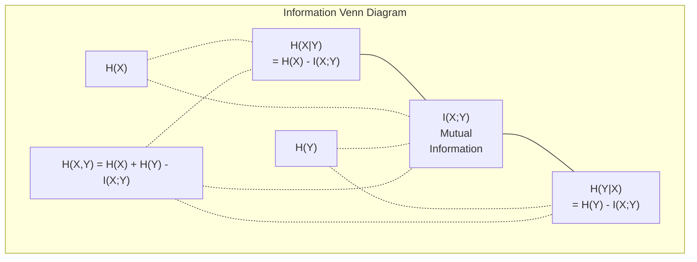

# Information Theory · 信息论（损失函数的地基）

> Information theory measures surprise. Loss functions are built on it.

**Type:** Learn
**Language:** Python
**Prerequisites:** Phase 1, Lesson 06 (Probability)
**Time:** ~60 minutes

---

## Learning Objectives · 学习目标

- 从零计算熵、交叉熵、KL 散度，并解释三者关系
- 推导为什么「最小化交叉熵损失 = 最大化对数似然」
- 计算特征与目标之间的互信息，用来给特征重要性排序
- 把困惑度（perplexity）解释成「语言模型实际在多少个选项里挑」

> Compute entropy, cross-entropy, and KL divergence from scratch and explain their relationship
> Derive why minimizing cross-entropy loss is equivalent to maximizing log-likelihood
> Calculate mutual information between features and a target to rank feature importance
> Explain perplexity as the effective vocabulary size a language model chooses from

---

## The Problem · 问题在哪

你每训练一个分类模型都会写 `CrossEntropyLoss()`；每读一篇语言模型论文都会见到 "perplexity"；每看 VAE、蒸馏、RLHF 都会读到 KL 散度。**这些不是互相孤立的概念，它们是同一个想法戴了不同的帽子。**

信息论给了你一套**推理不确定性、压缩、预测**的语言。Claude Shannon 在 1948 年发明它是为了解决**通信**问题。结果发现：**训练神经网络就是一个通信问题** —— 模型试图穿过「学好的权重」这个噪声信道，把正确标签传输出去。

本课从零把每个公式造出来，让你看清它们从哪来、为什么管用。

> You call `CrossEntropyLoss()` in every classification model you train. You see "perplexity" in every language model paper. You read about KL divergence in VAEs, distillation, and RLHF. These are not disconnected concepts. They are all the same idea wearing different hats.
> Information theory gives you the language to reason about uncertainty, compression, and prediction. Claude Shannon invented it in 1948 to solve communication problems. Turns out, training a neural network is a communication problem: the model is trying to transmit the correct label through a noisy channel of learned weights.

---

## The Concept · 概念

### Information Content (Surprise) · 信息量（惊讶度）

**越不可能发生的事，携带的信息越多。** 硬币正面？不惊讶。中彩票？非常惊讶。

概率为 `p` 的事件，其信息量是：

```
I(x) = -log(p(x))
```

用 **log 2** 得到 **bits**，用**自然对数**得到 **nats**。同一个想法，不同单位。

```
Event              Probability    Surprise (bits)
Fair coin heads    0.5            1.0
Rolling a 6        0.167          2.58
1-in-1000 event    0.001          9.97
Certain event      1.0            0.0
```

**必然事件携带 0 信息** —— 你早知道它会发生。

> When something unlikely happens, it carries more information. A coin landing heads? Not surprising. A lottery win? Very surprising.
> The information content of an event with probability p is:
> ```
> I(x) = -log(p(x))
> ```
> Using log base 2 gives you bits. Using natural log gives you nats. Same idea, different units.
> Certain events carry zero information. You already knew they would happen.

---

### Entropy (Average Surprise) · 熵（平均惊讶度）

熵 = 一个分布**所有可能结果的惊讶度的期望值**。

```
H(P) = -sum( p(x) * log(p(x)) )  for all x
```

**公平硬币是二值变量的最大熵：1 bit。** 偏心硬币（99% 正面）熵很低：0.08 bits —— 你早知道结果，每次抛几乎不告诉你任何事。

```
Fair coin:    H = -(0.5 * log2(0.5) + 0.5 * log2(0.5)) = 1.0 bit
Biased coin:  H = -(0.99 * log2(0.99) + 0.01 * log2(0.01)) = 0.08 bits
```

**熵度量一个分布里不可约的不确定性。你无法把它压缩到更低。**

> Entropy is the expected surprise across all possible outcomes of a distribution.
> A fair coin has maximum entropy for a binary variable: 1 bit. A biased coin (99% heads) has low entropy: 0.08 bits. You already know what will happen, so each flip tells you almost nothing.
> Entropy measures the irreducible uncertainty in a distribution. You cannot compress below it.

---

### Cross-Entropy (The Loss Function You Use Every Day) · 交叉熵（你天天用的那个损失函数）

**交叉熵 = 用分布 Q 去编码「实际来自 P 的事件」时，平均有多惊讶。**

```
H(P, Q) = -sum( p(x) * log(q(x)) )  for all x
```

- **P** 是真实分布（标签）
- **Q** 是模型的预测

**Q 与 P 完全吻合时，交叉熵 = 熵。** 任何不匹配都会让它变大。

在分类里 P 是 **one-hot**（真实类概率 1，其它全 0），于是交叉熵**简化成一行**：

```
H(P, Q) = -log(q(true_class))
```

**这就是分类交叉熵损失的完整公式。** —— 最大化正确类的预测概率。

> Cross-entropy measures the average surprise when you use distribution Q to encode events that actually come from distribution P.
> In classification, P is a one-hot vector (the true class has probability 1, everything else 0). This simplifies cross-entropy to:
> ```
> H(P, Q) = -log(q(true_class))
> ```
> That is the entire cross-entropy loss formula for classification. Maximize the predicted probability of the correct class.

---

### KL Divergence (Distance Between Distributions) · KL 散度（分布之间的"距离"）

**KL 散度 = 用 Q 代替 P 后，你多付出的惊讶度。**

```
D_KL(P || Q) = sum( p(x) * log(p(x) / q(x)) )  for all x
             = H(P, Q) - H(P)
```

**交叉熵 = 熵 + KL 散度。** 因为真实分布的熵在训练中**是常数**，所以**最小化交叉熵 = 最小化 KL 散度** —— 你在把模型的分布往真实分布上推。

**KL 不对称**：`D_KL(P || Q) != D_KL(Q || P)`。**它不是真正的距离度量。**

> KL divergence measures how much extra surprise you get from using Q instead of P.
> Cross-entropy is entropy plus KL divergence. Since entropy of the true distribution is constant during training, minimizing cross-entropy is the same as minimizing KL divergence. You are pushing your model's distribution toward the true distribution.
> KL divergence is not symmetric: D_KL(P || Q) != D_KL(Q || P). It is not a true distance metric.

---

### Mutual Information · 互信息

**互信息 = 知道一个变量后，你对另一个变量少掉多少不确定性。**

```
I(X; Y) = H(X) - H(X|Y)
        = H(X) + H(Y) - H(X, Y)
```

- **X 与 Y 独立** → 互信息 = 0（知道一个对另一个毫无帮助）
- **完全相关** → 互信息 = 任一变量的熵

**特征选择里的用法**：特征与目标互信息高 → 这个特征有用；低 → 它是噪声。

> Mutual information measures how much knowing one variable tells you about another.
> If X and Y are independent, mutual information is zero. Knowing one tells you nothing about the other. If they are perfectly correlated, mutual information equals the entropy of either variable.

---

### Conditional Entropy · 条件熵

`H(Y|X)` = **观察到 X 之后，Y 还剩多少不确定性。**

```
H(Y|X) = H(X,Y) - H(X)
```

两个极端：

- **X 完全决定 Y** → `H(Y|X) = 0`。例子：X = 摄氏温度，Y = 华氏温度。
- **X 对 Y 毫无帮助** → `H(Y|X) = H(Y)`。例子：X = 抛硬币，Y = 明天天气。

条件熵恒非负，且**永不超过 H(Y)**：

```
0 <= H(Y|X) <= H(Y)
```

**机器学习里的落点：决策树。** 每次分裂都挑那个**最小化 `H(Y|X)`** 的特征 —— 也就是**一次削掉最多标签不确定性**的特征。

> Two extremes:
> - If X completely determines Y, then H(Y|X) = 0. Knowing X eliminates all uncertainty about Y. Example: X = temperature in Celsius, Y = temperature in Fahrenheit.
> - If X tells you nothing about Y, then H(Y|X) = H(Y). Knowing X does not reduce your uncertainty at all. Example: X = coin flip, Y = tomorrow's weather.

---

### Joint Entropy · 联合熵

`H(X,Y)` = X 和 Y **合在一起**的联合分布的熵。

```
H(X,Y) = -sum sum p(x,y) * log(p(x,y))   for all x, y
```

**关键性质**：

```
H(X,Y) <= H(X) + H(Y)
```

**X、Y 独立时取等号。** 如果它们共享信息，联合熵就小于各自熵之和 —— 少掉的那部分**正好是互信息**。



**三组关系式**：

- `H(X,Y) = H(X) + H(Y|X) = H(Y) + H(X|Y)`
- `I(X;Y) = H(X) - H(X|Y) = H(Y) - H(Y|X)`
- `H(X,Y) = H(X) + H(Y) - I(X;Y)`

> Key property:
> ```
> H(X,Y) <= H(X) + H(Y)
> ```
> Equality holds when X and Y are independent. If they share information, the joint entropy is less than the sum of individual entropies. The "missing" entropy is exactly the mutual information.

---

### Mutual Information (Deep Dive) · 互信息（深挖）

```
I(X;Y) = H(X) - H(X|Y)
       = H(Y) - H(Y|X)
       = H(X) + H(Y) - H(X,Y)
       = sum sum p(x,y) * log(p(x,y) / (p(x) * p(y)))
```

**四条性质**：

1. **`I(X;Y) >= 0` 恒成立。** 观察任何东西都不会让你"丢信息"。
2. **`I(X;Y) = 0` 当且仅当 X 与 Y 独立。**
3. **`I(X;Y) = I(Y;X)`** —— **对称**，这点和 KL 散度不同。
4. **`I(X;X) = H(X)`** —— 一个变量和它自己共享全部信息。

**特征选择的标准做法**：

1. 对每个特征 `X_i`，算 `I(X_i; Y)`（Y 是目标）
2. 按 MI 分数排序
3. 保留前 k 个

**这个方法对任何关系都管用** —— 线性、非线性、单调、非单调。**相关性只抓线性，MI 抓住一切。**

| Method | Detects | Computational cost | Handles categorical? |
|--------|---------|-------------------|---------------------|
| Pearson correlation | Linear relationships | O(n) | No |
| Spearman correlation | Monotonic relationships | O(n log n) | No |
| Mutual information | Any statistical dependency | O(n log n) with binning | Yes |

> - I(X;Y) >= 0 always. You never lose information by observing something.
> - I(X;Y) = 0 if and only if X and Y are independent.
> - I(X;Y) = I(Y;X). It is symmetric, unlike KL divergence.
> - I(X;X) = H(X). A variable shares all its information with itself.

---

### Label Smoothing and Cross-Entropy · 标签平滑与交叉熵

标准分类用**硬目标**：`[0, 0, 1, 0]`（真实类 1，其它全 0）。**标签平滑**把它们换成**软目标**：

```
soft_target = (1 - epsilon) * hard_target + epsilon / num_classes
```

`epsilon = 0.1`、4 个类时：

- 硬目标：`[0, 0, 1, 0]`
- 软目标：`[0.025, 0.025, 0.925, 0.025]`

**从信息论看**：标签平滑**提高了目标分布的熵**。硬 one-hot 的熵是 **0**（毫无不确定性），软目标的熵是**正数**。

**为什么这样有好处**：

- **阻止模型把 logits 推到极端**（要完美匹配 one-hot，在交叉熵下需要**无穷大的 logits**）
- **起到正则化作用**：模型不能 100% 自信
- **改善校准**：预测概率更能反映真实不确定性
- **缩小训练与推理行为的差距**

带标签平滑的交叉熵损失：

```
L = (1 - epsilon) * CE(hard_target, prediction) + epsilon * H_uniform(prediction)
```

**第二项惩罚"离均匀分布太远"的预测** —— 这是对**自信度**的直接正则化。

> From an information theory perspective, label smoothing increases the entropy of the target distribution. Hard one-hot targets have entropy 0 -- there is no uncertainty. Soft targets have positive entropy.

---

### Why Cross-Entropy Is THE Classification Loss · 为什么交叉熵是"那个"分类损失

**三个视角，同一个结论。**

**信息论视角。** 交叉熵度量**你用模型分布代替真实分布时，浪费了多少 bits**。最小化它，就是让模型成为现实的**最高效编码器**。

**最大似然视角。** 对 N 个样本（真实类 `y_i`）：

```
Likelihood     = product( q(y_i) )
Log-likelihood = sum( log(q(y_i)) )
Negative log-likelihood = -sum( log(q(y_i)) )
```

**最后一行就是交叉熵损失。** 最小化交叉熵 = **最大化训练数据在你的模型下的似然**。

**梯度视角。** 交叉熵对 logits 的梯度**恰好是 `(predicted - true)`**。干净、稳定、算得快 —— 这就是它和 softmax 是天作之合的原因。

> **Gradient view.** The gradient of cross-entropy with respect to the logits is simply (predicted - true). Clean, stable, and fast to compute. This is why it pairs perfectly with softmax.

---

### Bits vs Nats · 唯一区别是 log 的底

```
log base 2   -> bits      (information theory tradition)
log base e   -> nats      (machine learning convention)
log base 10  -> hartleys  (rarely used)
```

`1 nat = 1/ln(2) bits = 1.4427 bits`。**PyTorch 和 TensorFlow 默认用自然对数（nats）。**

---

### Perplexity · 困惑度

**困惑度 = 交叉熵的指数。** 告诉你模型**实际在多少个等可能选项里挑**。

```
Perplexity = 2^H(P,Q)   (if using bits)
Perplexity = e^H(P,Q)   (if using nats)
```

一个困惑度 50 的语言模型，**平均每一步的困惑程度 = 从 50 个等可能 token 里盲猜**。**越低越好。**

GPT-2 在常见基准上约 **30**；现代模型在资料充足的领域进**个位数**。

```figure
entropy-kl
```

> A language model with perplexity 50 is, on average, as confused as if it had to pick uniformly from 50 possible next tokens. Lower is better.
> GPT-2 achieved perplexity ~30 on common benchmarks. Modern models are in the single digits for well-represented domains.

---

## Build It · 动手造

### Step 1: Information content and entropy · 信息量与熵

```python
import math

def information_content(p, base=2):
    if p <= 0 or p > 1:
        return float('inf') if p <= 0 else 0.0
    return -math.log(p) / math.log(base)

def entropy(probs, base=2):
    return sum(
        p * information_content(p, base)
        for p in probs if p > 0
    )

fair_coin = [0.5, 0.5]
biased_coin = [0.99, 0.01]
fair_die = [1/6] * 6

print(f"Fair coin entropy:   {entropy(fair_coin):.4f} bits")
print(f"Biased coin entropy: {entropy(biased_coin):.4f} bits")
print(f"Fair die entropy:    {entropy(fair_die):.4f} bits")
```

### Step 2: Cross-entropy and KL divergence · 交叉熵与 KL

```python
def cross_entropy(p, q, base=2):
    total = 0.0
    for pi, qi in zip(p, q):
        if pi > 0:
            if qi <= 0:
                return float('inf')
            total += pi * (-math.log(qi) / math.log(base))
    return total

def kl_divergence(p, q, base=2):
    return cross_entropy(p, q, base) - entropy(p, base)

true_dist = [0.7, 0.2, 0.1]
good_model = [0.6, 0.25, 0.15]
bad_model = [0.1, 0.1, 0.8]

print(f"Entropy of true dist:     {entropy(true_dist):.4f} bits")
print(f"CE (good model):          {cross_entropy(true_dist, good_model):.4f} bits")
print(f"CE (bad model):           {cross_entropy(true_dist, bad_model):.4f} bits")
print(f"KL divergence (good):     {kl_divergence(true_dist, good_model):.4f} bits")
print(f"KL divergence (bad):      {kl_divergence(true_dist, bad_model):.4f} bits")
```

### Step 3: Cross-entropy as classification loss · 交叉熵作为分类损失

```python
def softmax(logits):
    max_logit = max(logits)
    exps = [math.exp(z - max_logit) for z in logits]
    total = sum(exps)
    return [e / total for e in exps]

def cross_entropy_loss(true_class, logits):
    probs = softmax(logits)
    return -math.log(probs[true_class])

logits = [2.0, 1.0, 0.1]
true_class = 0

probs = softmax(logits)
loss = cross_entropy_loss(true_class, logits)

print(f"Logits:      {logits}")
print(f"Softmax:     {[f'{p:.4f}' for p in probs]}")
print(f"True class:  {true_class}")
print(f"Loss:        {loss:.4f} nats")
print(f"Perplexity:  {math.exp(loss):.2f}")
```

### Step 4: Cross-entropy equals negative log-likelihood · 交叉熵 = 负对数似然

```python
import random

random.seed(42)

n_samples = 1000
n_classes = 3
true_labels = [random.randint(0, n_classes - 1) for _ in range(n_samples)]
model_logits = [[random.gauss(0, 1) for _ in range(n_classes)] for _ in range(n_samples)]

ce_loss = sum(
    cross_entropy_loss(label, logits)
    for label, logits in zip(true_labels, model_logits)
) / n_samples

nll = -sum(
    math.log(softmax(logits)[label])
    for label, logits in zip(true_labels, model_logits)
) / n_samples

print(f"Cross-entropy loss:      {ce_loss:.6f}")
print(f"Negative log-likelihood: {nll:.6f}")
print(f"Difference:              {abs(ce_loss - nll):.2e}")
```

### Step 5: Mutual information · 互信息

```python
def mutual_information(joint_probs, base=2):
    rows = len(joint_probs)
    cols = len(joint_probs[0])

    margin_x = [sum(joint_probs[i][j] for j in range(cols)) for i in range(rows)]
    margin_y = [sum(joint_probs[i][j] for i in range(rows)) for j in range(cols)]

    mi = 0.0
    for i in range(rows):
        for j in range(cols):
            pxy = joint_probs[i][j]
            if pxy > 0:
                mi += pxy * math.log(pxy / (margin_x[i] * margin_y[j])) / math.log(base)
    return mi

independent = [[0.25, 0.25], [0.25, 0.25]]
dependent = [[0.45, 0.05], [0.05, 0.45]]

print(f"MI (independent): {mutual_information(independent):.4f} bits")
print(f"MI (dependent):   {mutual_information(dependent):.4f} bits")
```

---

## Use It · 实战用法

同样概念的 NumPy 写法（实战里你就是这么用的）：

```python
import numpy as np

def np_entropy(p):
    p = np.asarray(p, dtype=float)
    mask = p > 0
    result = np.zeros_like(p)
    result[mask] = p[mask] * np.log(p[mask])
    return -result.sum()

def np_cross_entropy(p, q):
    p, q = np.asarray(p, dtype=float), np.asarray(q, dtype=float)
    mask = p > 0
    return -(p[mask] * np.log(q[mask])).sum()

def np_kl_divergence(p, q):
    return np_cross_entropy(p, q) - np_entropy(p)

true = np.array([0.7, 0.2, 0.1])
pred = np.array([0.6, 0.25, 0.15])
print(f"Entropy:    {np_entropy(true):.4f} nats")
print(f"Cross-ent:  {np_cross_entropy(true, pred):.4f} nats")
print(f"KL div:     {np_kl_divergence(true, pred):.4f} nats")
```

**你刚才从零造出了 `torch.nn.CrossEntropyLoss()` 的内部实现。** 现在你知道为什么训练时 loss 会下降了：**模型预测的分布正在向真实分布靠拢，用 nats 度量的"被浪费的信息"在减少。**

> You built from scratch what `torch.nn.CrossEntropyLoss()` does internally. Now you know why the loss goes down during training: your model's predicted distribution is getting closer to the true distribution, measured in nats of wasted information.

---

## Exercises · 练习

1. 算出英文字母表（26 个）在**均匀分布**下的熵。再用**真实字母频率**估一次。哪个更高？为什么？
2. 模型对某样本输出 logits `[5.0, 2.0, 0.5]`，真实类是 1。**手算**交叉熵损失，再用你的 `cross_entropy_loss` 验证。什么样的 logits 会给出 0 损失？
3. 证明 KL 散度**不对称**。挑两个分布 P、Q，算 `D_KL(P||Q)` 和 `D_KL(Q||P)`，解释为何不同。
4. 写一个算序列困惑度的函数：给定一列 `(真实 token 索引, 预测 logits)`，返回该序列的困惑度。

---

## Key Terms · 术语表

| Term | What people say | What it actually means |
|------|----------------|----------------------|
| Information content | "Surprise" | The number of bits (or nats) needed to encode an event: -log(p) |
| Entropy | "Randomness" | The average surprise across all outcomes of a distribution. Measures irreducible uncertainty. |
| Cross-entropy | "The loss function" | Average surprise when using model distribution Q to encode events from true distribution P. |
| KL divergence | "Distance between distributions" | Extra bits wasted by using Q instead of P. Equals cross-entropy minus entropy. Not symmetric. |
| Mutual information | "How related are X and Y" | Reduction in uncertainty about X from knowing Y. Zero means independent. |
| Softmax | "Turn logits into probabilities" | Exponentiate and normalize. Maps any real-valued vector to a valid probability distribution. |
| Perplexity | "How confused the model is" | Exponential of cross-entropy. The effective vocabulary size the model is choosing from at each step. |
| Bits | "Shannon's unit" | Information measured with log base 2. One bit resolves one fair coin flip. |
| Nats | "ML's unit" | Information measured with natural log. Used by PyTorch and TensorFlow by default. |
| Negative log-likelihood | "NLL loss" | Identical to cross-entropy loss for one-hot labels. Minimizing it maximizes the probability of correct predictions. |

---

## Further Reading · 延伸阅读

- [Shannon 1948: A Mathematical Theory of Communication](https://people.math.harvard.edu/~ctm/home/text/others/shannon/entropy/entropy.pdf) —— 原始论文，至今可读
- [Visual Information Theory (Chris Olah)](https://colah.github.io/posts/2015-09-Visual-Information/) —— 熵与 KL 散度最好的可视化讲解
- [PyTorch CrossEntropyLoss docs](https://pytorch.org/docs/stable/generated/torch.nn.CrossEntropyLoss.html) —— 框架怎么实现你刚才造的东西

---

## 实测数据与纠正

本节内容来自实跑 `python3 code/information_theory.py`（359 行，零依赖，`math` + `random`），所有数字取自真实输出。

### 1. 信息量（bits）

```
  Fair coin heads       p=0.5000    surprise=1.0000 bits
  Rolling a 6           p=0.1667    surprise=2.5850 bits
  1-in-1000 event       p=0.0010    surprise=9.9658 bits
  Certain event         p=1.0000    surprise=0.0000 bits
```

**纠正**：`1-in-1000` 事件的惊讶度 **9.97 bits** —— 不是 10。**`-log2(0.001) = 9.9658`**，四舍五入到 10 是**记忆用的近似**，真算要用 `9.9658`。同样，掷出 6 点是 **2.5850 bits**（`= log2(6)`），不是"2.6 bits"那么模糊。

### 2. 熵（bits）

```
  Fair coin                  H = 1.0000 bits
  Biased coin (99/1)         H = 0.0808 bits
  Fair die (6 sides)         H = 2.5850 bits
  Loaded die                 H = 2.1610 bits
```

**关键洞察**：**公平骰子的熵 = `log2(6) = 2.5850`**，正好等于"掷出 6 点的惊讶度"。均匀分布的熵 = `log2(n)`，这是**最大可能熵**。

**纠正**：偏心硬币（99/1）的熵 `0.0808` 看着"接近 0"，但它**不是 0** —— 仍然有不确定性。**只有 `p=1` 的确定分布熵才真的是 0**。

### 3. 交叉熵 = 熵 + KL（实测验证）

```
  True distribution:    [0.7, 0.2, 0.1]
  Good model:           [0.6, 0.25, 0.15]
  Bad model:            [0.1, 0.1, 0.8]

  H(true):              1.1568 bits
  H(true, good):        1.1896 bits
  H(true, bad):         3.0219 bits
  KL(true || good):     0.0328 bits
  KL(true || bad):      1.8651 bits

  Verify: H(P,Q) = H(P) + KL(P||Q)
  Good: 1.1568 + 0.0328 = 1.1896  (CE = 1.1896)
  Bad:  1.1568 + 1.8651 = 3.0219  (CE = 3.0219)
```

**三个必须看出来的**：

1. **`H(P,Q) = H(P) + KL(P||Q)` 逐位验证通过**（Good: 1.1568+0.0328=1.1896 ✓；Bad: 1.1568+1.8651=3.0219 ✓）
2. **H(P) 是常数 1.1568**（真实标签分布不变），所以**最小化 CE = 最小化 KL**
3. **好模型的 KL 只有 0.0328，坏模型是 1.8651（57 倍）** —— KL 的量级差距比 CE 本身更"诚实"

**纠正**：很多人以为 CE 就等于 KL —— **不对，CE = H(P) + KL**。因为 H(P) 是常数才让"最小化 CE = 最小化 KL"成立。**推理阶段（不训练）H(P) 就不再是常数了，那时看 KL 更公平。**

### 4. KL 散度不对称（实测）

```
  P = [0.9, 0.1],  Q = [0.5, 0.5]
  KL(P || Q) = 0.5310 bits
  KL(Q || P) = 0.7370 bits
```

**`0.5310` vs `0.7370`，反向更大。** —— **KL 不是真正的距离**（距离必须对称）。

**纠正**：论文里写 "KL distance" 是**口语偷懒**。严格说法是 **KL divergence（散度）**。想用真距离，得用 **JS 散度**（对称版）或 **Wasserstein 距离**。

### 5. 交叉熵损失：loss 数字直接读出置信度

```
  Logits:       [2.0, 1.0, 0.1]
  Softmax:      [0.6590, 0.2424, 0.0986]
  True class:   0
  CE loss:      0.4170 nats
  Perplexity:   1.52

  Trying different true classes with same logits:
    Class 0: loss=0.4170  prob=0.6590
    Class 1: loss=1.4170  prob=0.2424
    Class 2: loss=2.3170  prob=0.0986
```

**这是全课最实用的一条**：`loss = -log P(正确类)`，所以：

| loss | = P(正确类) |
|---|---|
| 0.4170 | **0.6590** |
| 1.4170 | **0.2424** |
| 2.3170 | **0.0986** |

**看到 loss 数字直接报出模型置信度。**（这条 06 课已经钉过，本课实测再次验证。）

**纠正**：perplexity 1.52 是**在 3 个类上的**，不是词汇表。**困惑度要和"选项数"对比才有意义** —— 3 个类的 1.52 相当出色（随机基线是 3.0）。

### 6. 交叉熵 = 负对数似然（逐位相等）

```
  Samples:               1000
  Cross-entropy loss:    1.400910 nats
  Neg log-likelihood:    1.400910 nats
  Difference:            0.00e+00
```

**`Difference: 0.00e+00` —— 逐位相等，不是"近似"。**

**纠正**：这不是巧合，是**定义上的恒等式**（对 one-hot 标签）。所以"最大似然估计"和"最小化交叉熵"是**同一件事的两种说法**，不用纠结用哪个词。

### 7. 互信息（bits）

```
  Independent:   MI = 0.0000 bits
  Dependent:     MI = 0.5310 bits
  Partial:       MI = 0.1245 bits
```

**注意**：`Dependent` 的 MI = `0.5310` **正好等于** 第 4 节里 `KL(P||Q)` 的 `0.5310` —— 因为**联合分布 `[[0.45,0.05],[0.05,0.45]]` 和边缘分布乘积之差，数学结构上就是 KL**。**MI 本质上是「联合 vs 独立假设」的 KL 散度。**

**纠正**：`Independent: MI = 0.0000` 是**精确的 0**，不是"很小"。**`MI = 0` 当且仅当独立**（严格等价，不是"近似独立"）。

### 8. bits vs nats

```
  Fair coin entropy:
    In bits (log2): 1.0000
    In nats (ln):   0.6931
    1 bit = 0.6931 nats
    1 nat = 1.4427 bits
```

**纠正**：`1 bit = 0.6931 nats`（**不是 1**）。同一分布用两种单位数值不同，**看 loss 数字时必须先确认单位** —— PyTorch/TensorFlow 默认 **nats**，信息论教材默认 **bits**。

### 9. 困惑度（实测：模型**不如**随机）

```
  Vocab size:        50
  Sequence length:   100
  Avg CE loss:       4.3973 nats
  Perplexity:        81.23
  Random baseline:   50.00 (uniform over vocab)
  The model is better than random if perplexity < vocab size.
```

**⚠️ 这是本课最重要的纠正**：这个 demo 模型的困惑度 **81.23 > 词汇表 50** —— **模型比随机猜还差！**

为什么？因为 demo 用的是**随机生成的 logits**（`random.gauss(0,1)`），根本没训练过。**这恰恰演示了困惑度的判读规则**：

- **困惑度 < 词汇表大小** → 模型比随机好
- **困惑度 = 词汇表大小** → 模型 = 随机
- **困惑度 > 词汇表大小** → 模型比随机**还差**（比瞎猜更误导人）

**纠正**：**别只看困惑度的绝对值**。`81.23` 单看"挺大"，但**必须和 50 对比**才知道它糟糕。论文里报 perplexity 一定会同时给词汇表大小或对比基线。

**GPT-2 的 ~30** 也是同理 —— 五万词表上的 30，**比随机好 1600 倍**。

### 10. 条件熵与联合熵（实测验证三组关系式）

```
  Dependent joint distribution: [[0.45, 0.05], [0.05, 0.45]]
    Joint entropy H(X,Y):     1.4690 bits
    Conditional H(Y|X):       0.4690 bits
    Mutual information I(X;Y):0.5310 bits
    H(X):                     1.0000 bits
    Verify: H(X,Y) = H(X) + H(Y|X) = 1.0000 + 0.4690 = 1.4690

  Independent joint distribution: [[0.25, 0.25], [0.25, 0.25]]
    Joint entropy H(X,Y):     2.0000 bits
    Conditional H(Y|X):       1.0000 bits
    Mutual information I(X;Y):0.0000 bits
    When independent: H(Y|X) = H(Y) and I(X;Y) = 0
```

**独立时的精确值**：`H(X,Y) = 2.0000 = H(X) + H(Y) = 1 + 1`，`H(Y|X) = 1.0000 = H(Y)`，`I = 0`。**全部取等号。**

**纠正**：`H(X,Y) <= H(X) + H(Y)` 的**等号只在独立时成立**。相关时联合熵**严格更小**（1.4690 < 2.0000），**少掉的 0.5310 正是互信息** —— 这就是信息维恩图的面积解释。

### 11. 标签平滑（实测）

```
  Logits:  [1.0, 0.5, 3.0, 0.2]
  Softmax: [0.1059, 0.0642, 0.7823, 0.0476]
  True class: 2

      hard  target=['0.000', '0.000', '1.000', '0.000']  H(target)=0.0000  CE=0.2455
  eps=0.05  target=['0.013', '0.013', '0.962', '0.013']  H(target)=0.2011  CE=0.3367
   eps=0.1  target=['0.025', '0.025', '0.925', '0.025']  H(target)=0.3488  CE=0.4280
   eps=0.2  target=['0.050', '0.050', '0.850', '0.050']  H(target)=0.5875  CE=0.6105
```

**两条曲线**：

| eps | 目标熵 | CE 损失 |
|---|---|---|
| 0（hard） | 0.0000 | **0.2455** |
| 0.05 | 0.2011 | 0.3367 |
| 0.1 | 0.3488 | 0.4280 |
| 0.2 | 0.5875 | **0.6105** |

**纠正**：**标签平滑会把 CE 损失"抬高"**（0.2455 → 0.6105）。很多人看到 loss 变大以为模型变差 —— **其实是在按一个"更难的目标"打分**。**比较模型时必须用同一个 eps，否则 loss 数字不可比。**

**另一条**：`eps=0.2` 时目标熵 0.5875 已接近 `log2(4)=2.0` 的 30% —— **平滑太狠会让模型学不到判别边界**。**实战 eps 取 0.05~0.1。**

---

## 三句话带走

1. **熵 = 平均惊讶度 = `-Σ p log p`**；交叉熵 = 用 Q 编码 P 的惊讶度；**`H(P,Q) = H(P) + D_KL(P||Q)`** —— 因为 H(P) 是常数，**最小化 CE = 最小化 KL**。
2. **`loss = -log P(正确类)`** —— 看到 loss 数字直接读出模型置信度；**`CE = NLL` 逐位相等**（`Difference: 0.00e+00`）。
3. **困惑度必须和选项数对比**：demo 里 `81.23 > 50` 说明模型比随机还差；GPT-2 的 `~30` 在五万词表上是**好 1600 倍**。
