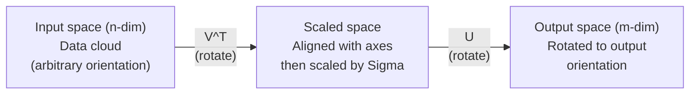
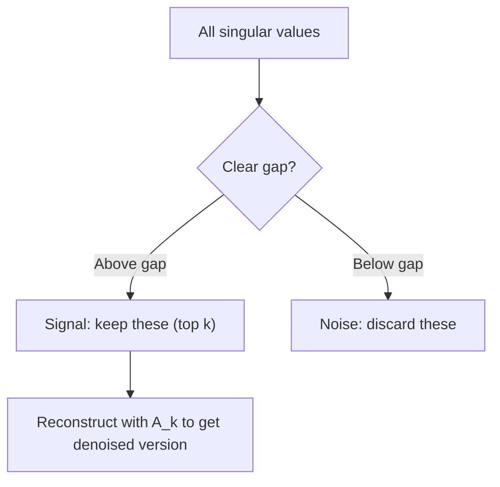

# Singular Value Decomposition · 奇异值分解（线性代数的瑞士军刀）

> SVD is the Swiss Army knife of linear algebra. Every matrix has one. Every data scientist needs one.

**Type:** Build
**Languages:** Python, Julia
**Prerequisites:** Phase 1, Lessons 01 (Linear Algebra Intuition), 02 (Vectors & Matrices Operations), 03 (Matrix Transformations)
**Time:** ~120 minutes

---

## Learning Objectives · 学习目标

- 用幂迭代（power iteration）实现 SVD，并解释 U、Sigma、V^T 各自的几何意义
- 用截断 SVD（truncated SVD）做图像压缩，度量压缩比与重建误差的取舍
- 通过 SVD 计算 Moore-Penrose 伪逆（pseudoinverse），求解超定的最小二乘系统
- 把 SVD 与 PCA、推荐系统（隐因子）以及 NLP 中的潜在语义分析（Latent Semantic Analysis）联系起来

> Implement SVD via power iteration and explain the geometric meaning of U, Sigma, and V^T
> Apply truncated SVD for image compression and measure the compression ratio vs reconstruction error
> Compute the Moore-Penrose pseudoinverse via SVD to solve overdetermined least-squares systems
> Connect SVD to PCA, recommendation systems (latent factors), and Latent Semantic Analysis in NLP

---

## The Problem · 问题在哪

你手里有一个 1000x2000 的矩阵。它可能是用户-电影评分，可能是文档-词频表，也可能是一张图像的像素值。你需要压缩它、给它去噪、挖掘其中隐藏的结构，或者用它求解一个最小二乘系统。特征分解（eigendecomposition）只对方阵有效；即便如此，它还要求矩阵拥有一组完整的线性无关特征向量。

SVD 对任何矩阵都适用。任何形状、任何秩，没有任何前提条件。它把矩阵分解成三个因子，揭示矩阵对空间所做的变换的几何本质。它是整个线性代数中最通用、也最有用的分解。

> You have a 1000x2000 matrix. Maybe it is user-movie ratings. Maybe it is a document-term frequency table. Maybe it is the pixel values of an image. You need to compress it, denoise it, find hidden structure in it, or solve a least-squares system with it. Eigendecomposition only works on square matrices. Even then, it requires the matrix to have a full set of linearly independent eigenvectors.
> SVD works on any matrix. Any shape. Any rank. No conditions. It decomposes the matrix into three factors that reveal the geometry of what the matrix does to space. It is the most general and most useful factorization in all of linear algebra.

---

## The Concept · 概念

### What SVD does geometrically · SVD 在几何上做什么

无论什么形状，每个矩阵都依次执行三个操作：旋转、缩放、再旋转。SVD 把这个分解显式地写了出来。

```
A = U * Sigma * V^T

      m x n     m x m    m x n    n x n
     (any)    (rotate)  (scale)  (rotate)
```

给定任意矩阵 A，SVD 把它分解为：
- V^T 在输入空间（n 维）中旋转向量
- Sigma 沿每个轴缩放（拉伸或压缩）
- U 把结果旋转到输出空间（m 维）中



可以这样想：你把一个矩阵交给 SVD，它会告诉你——「这个矩阵取一团球形的输入，先用 V^T 旋转，再用 Sigma 把它拉伸成一个椭球（ellipsoid），最后用 U 旋转这个椭球。」奇异值（singular value）就是椭球各条轴的长度。

> Every matrix, regardless of shape, performs three operations in sequence: rotate, scale, rotate. SVD makes this decomposition explicit. ... Think of it this way. You hand SVD a matrix. It tells you: "This matrix takes a sphere of inputs, first rotates it by V^T, then stretches it into an ellipsoid by Sigma, then rotates the ellipsoid by U." The singular values are the lengths of the ellipsoid's axes.

---

### The full decomposition · 完整的分解

对于形状为 m x n 的矩阵 A：

```
A = U * Sigma * V^T

where:
  U     is m x m, orthogonal (U^T U = I)
  Sigma is m x n, diagonal (singular values on the diagonal)
  V     is n x n, orthogonal (V^T V = I)

The singular values sigma_1 >= sigma_2 >= ... >= sigma_r > 0
where r = rank(A)
```

U 的列称为左奇异向量（left singular vector），V 的列称为右奇异向量（right singular vector），Sigma 的对角元称为奇异值。它们恒为非负，并按惯例从大到小排序。

> The columns of U are called left singular vectors. The columns of V are called right singular vectors. The diagonal entries of Sigma are called singular values. They are always non-negative and conventionally sorted in decreasing order.

---

### Left singular vectors, singular values, right singular vectors · 左奇异向量、奇异值、右奇异向量

SVD 的每个组成部分都有各自明确的几何意义。

**右奇异向量（V 的列）：** 它们构成输入空间（R^n）的一组标准正交基。它们是输入空间中被矩阵映射到输出空间中正交方向的那些方向。可以把它们看作定义域的自然坐标系。

**奇异值（Sigma 的对角元）：** 它们是缩放因子。第 i 个奇异值告诉你：矩阵沿第 i 个右奇异向量的方向把向量拉伸了多少。奇异值为零意味着矩阵把这个方向彻底压扁。

**左奇异向量（U 的列）：** 它们构成输出空间（R^m）的一组标准正交基。第 i 个左奇异向量，就是第 i 个右奇异向量（经缩放后）在输出空间中落下的方向。

三者之间的关系：

```
A * v_i = sigma_i * u_i

The matrix A takes the i-th right singular vector v_i,
scales it by sigma_i, and maps it to the i-th left singular vector u_i.
```

这给了你一幅逐坐标理解「任意矩阵在做什么」的图景。

> Each component of the SVD has a distinct geometric meaning. ... These form an orthonormal basis for the input space (R^n). ... A singular value of zero means the matrix crushes that direction entirely. ... The i-th left singular vector is the direction in output space where the i-th right singular vector lands (after scaling). ... This gives you a coordinate-by-coordinate picture of what any matrix does.

---

### Outer product form · 外积形式

SVD 可以写成一组秩 1（rank-1）矩阵的和：

```
A = sigma_1 * u_1 * v_1^T + sigma_2 * u_2 * v_2^T + ... + sigma_r * u_r * v_r^T

Each term sigma_i * u_i * v_i^T is a rank-1 matrix (an outer product).
The full matrix is the sum of r such matrices, where r is the rank.
```

这个形式是低秩近似（low-rank approximation）的基础。每一项都叠加一层结构：第一项抓住最重要的那个模式，第二项抓住次重要的，以此类推。在任何给定秩下截断这个和式，你得到的就是可能的最优近似。

```
Rank-1 approx:    A_1 = sigma_1 * u_1 * v_1^T
                  (captures the dominant pattern)

Rank-2 approx:    A_2 = sigma_1 * u_1 * v_1^T + sigma_2 * u_2 * v_2^T
                  (captures the two most important patterns)

Rank-k approx:    A_k = sum of top k terms
                  (optimal by the Eckart-Young theorem)
```

> This form is the foundation of low-rank approximation. Each term adds one layer of structure. The first term captures the single most important pattern. The second captures the next most important. And so on. Truncating this sum gives you the best possible approximation at any given rank.

---

### Relationship to eigendecomposition · 与特征分解的关系

SVD 与特征分解深度关联。A 的奇异值和奇异向量直接来自 A^T A 和 A A^T 的特征值与特征向量。

```
A^T A = V * Sigma^T * U^T * U * Sigma * V^T
      = V * Sigma^T * Sigma * V^T
      = V * D * V^T

where D = Sigma^T * Sigma is a diagonal matrix with sigma_i^2 on the diagonal.

So:
- The right singular vectors (V) are eigenvectors of A^T A
- The singular values squared (sigma_i^2) are eigenvalues of A^T A

Similarly:
A A^T = U * Sigma * V^T * V * Sigma^T * U^T
      = U * Sigma * Sigma^T * U^T

So:
- The left singular vectors (U) are eigenvectors of A A^T
- The eigenvalues of A A^T are also sigma_i^2
```

这层联系告诉你三件事：
1. 奇异值总是实数且非负（它们是半正定矩阵特征值的平方根）。
2. 你确实可以通过 A^T A 的特征分解来计算 SVD，但这会把条件数（condition number）平方，损失数值精度。专用的 SVD 算法避开了这一点。
3. 当 A 是对称半正定方阵时，SVD 和特征分解就是同一件事。

> SVD and eigendecomposition are deeply connected. The singular values and vectors of A come directly from the eigenvalues and eigenvectors of A^T A and A A^T. ... This connection tells you three things: 1. Singular values are always real and non-negative (they are square roots of eigenvalues of a positive semi-definite matrix). ... 3. When A is square and symmetric positive semi-definite, SVD and eigendecomposition are the same thing.

---

### Truncated SVD: low-rank approximation · 截断 SVD：低秩近似

Eckart-Young-Mirsky 定理指出：A 的最优秩 k 近似（无论在 Frobenius 范数还是谱范数下）只需保留前 k 个奇异值及其对应的向量即可得到：

```
A_k = U_k * Sigma_k * V_k^T

where:
  U_k     is m x k  (first k columns of U)
  Sigma_k is k x k  (top-left k x k block of Sigma)
  V_k     is n x k  (first k columns of V)

Approximation error = sigma_{k+1}  (in spectral norm)
                    = sqrt(sigma_{k+1}^2 + ... + sigma_r^2)  (in Frobenius norm)
```

这可不只是「一个不错」的近似——它可以被证明是秩 k 近似中最优的。没有任何其他秩 k 矩阵比它更接近 A。

| 分量 | 相对大小 | 秩 3 近似是否保留？ |
|------|---------|-------------------|
| sigma_1 | 最大 | 是 |
| sigma_2 | 大 | 是 |
| sigma_3 | 较大 | 是 |
| sigma_4 | 中等 | 否（误差） |
| sigma_5 | 中偏小 | 否（误差） |
| sigma_6 | 小 | 否（误差） |
| sigma_7 | 很小 | 否（误差） |
| sigma_8 | 极小 | 否（误差） |

保留前 3 个：A_3 抓住了三个最大的奇异值。误差 = 剩下的值（sigma_4 到 sigma_8）。

如果奇异值衰减得快，一个小的 k 就能抓住矩阵的大部分；如果衰减得慢，这个矩阵就没有低秩结构。

> The Eckart-Young-Mirsky theorem states that the best rank-k approximation to A (in both Frobenius and spectral norm) is obtained by keeping only the top k singular values and their corresponding vectors. ... This is not just "a good" approximation. It is provably the best possible approximation of rank k. No other rank-k matrix is closer to A. ... If singular values decay fast, a small k captures most of the matrix. If they decay slowly, the matrix has no low-rank structure.

---

### Image compression with SVD · 用 SVD 做图像压缩

灰度图像就是一个由像素强度组成的矩阵。800x600 的图像有 480,000 个值，而 SVD 让你用少得多的数值去近似它。

```
Original image: 800 x 600 = 480,000 values

SVD with rank k:
  U_k:      800 x k values
  Sigma_k:  k values
  V_k:      600 x k values
  Total:    k * (800 + 600 + 1) = k * 1401 values

  k=10:   14,010 values   (2.9% of original)
  k=50:   70,050 values  (14.6% of original)
  k=100: 140,100 values  (29.2% of original)

  The compression ratio improves as k gets smaller,
  but visual quality degrades.
```

关键洞见：自然图像的奇异值衰减很快。前几个奇异值抓住大结构（形状、梯度），后面的奇异值抓住细节数据和噪声。在秩 50 处截断，得到的图像往往看起来与原图几乎无异，而存储量省了 85%。

> A grayscale image is a matrix of pixel intensities. An 800x600 image has 480,000 values. SVD lets you approximate it with far fewer. ... The key insight: natural images have rapidly decaying singular values. The first few singular values capture the broad structure (shapes, gradients). The later ones capture fine detail and noise. Truncating at rank 50 often produces an image that looks nearly identical to the original while using 85% less storage.

---

### SVD for recommendation systems · 用 SVD 做推荐系统

Netflix Prize（Netflix 大奖赛）让这个应用名满天下。你有一个用户-电影评分矩阵，其中大多数条目是缺失的。

```
             Movie1  Movie2  Movie3  Movie4  Movie5
  User1      [  5      ?       3       ?       1  ]
  User2      [  ?      4       ?       2       ?  ]
  User3      [  3      ?       5       ?       ?  ]
  User4      [  ?      ?       ?       4       3  ]

  ? = unknown rating
```

想法是：这个评分矩阵是低秩的。用户的品味并不完全独立，存在少数几个隐因子（latent factor）——动作 vs. 剧情、老片 vs. 新片、烧脑 vs. 官能——它们解释了大部分偏好。

对（填补后的）评分矩阵做 SVD，把它分解为：
- U：隐因子空间中的用户画像
- Sigma：每个隐因子的重要程度
- V^T：隐因子空间中的电影画像

用户对某部电影的预测评分 = 他的用户画像与该电影画像的点积（以奇异值加权）。低秩近似把缺失的条目补了出来。

实践中，你会用 Simon Funk 的增量式 SVD 或 ALS（交替最小二乘，alternating least squares）这类能直接处理缺失数据的变体。但核心思想是一样的：用 SVD 做隐因子分解。

> The idea: this ratings matrix has low rank. Users do not have completely independent tastes. There are a handful of latent factors (action vs. drama, old vs. new, cerebral vs. visceral) that explain most preferences. ... A user's predicted rating for a movie is the dot product of their user profile with the movie's profile (weighted by singular values). The low-rank approximation fills in the missing entries. ... In practice, you use variants like Simon Funk's incremental SVD or ALS (alternating least squares) that handle missing data directly. But the core idea is the same: latent factor decomposition via SVD.

---

### SVD in NLP: Latent Semantic Analysis · NLP 中的 SVD：潜在语义分析

潜在语义分析（Latent Semantic Analysis, LSA），也称为潜在语义索引（Latent Semantic Indexing, LSI），把 SVD 应用到词-文档矩阵（term-document matrix）上。

```
             Doc1   Doc2   Doc3   Doc4
  "cat"      [  3      0      1      0  ]
  "dog"      [  2      0      0      1  ]
  "fish"     [  0      4      1      0  ]
  "pet"      [  1      1      1      1  ]
  "ocean"    [  0      3      0      0  ]

After SVD with rank k=2:

  Each document becomes a point in 2D "concept space."
  Each term becomes a point in the same 2D space.
  Documents about similar topics cluster together.
  Terms with similar meanings cluster together.

  "cat" and "dog" end up near each other (land pets).
  "fish" and "ocean" end up near each other (water concepts).
  Doc1 and Doc3 cluster if they share similar topics.
```

LSA 是最早一批从原始文本中成功捕捉语义相似性的方法之一。它之所以有效，是因为同义词往往出现在相似的文档里，SVD 于是把它们归入相同的潜在维度。现代词向量（Word2Vec、GloVe）可以看作这一思想的后裔。

> Latent Semantic Analysis (LSA), also called Latent Semantic Indexing (LSI), applies SVD to a term-document matrix. ... LSA was one of the first successful methods for capturing semantic similarity from raw text. It works because synonymous terms tend to appear in similar documents, so SVD groups them into the same latent dimensions. Modern word embeddings (Word2Vec, GloVe) can be seen as descendants of this idea.

---

### SVD for noise reduction · 用 SVD 去噪

含噪数据的信号集中在排在最前面的奇异值上，而噪声摊在所有奇异值上。截断就把噪声地板切掉了。

**干净信号的奇异值：**

| 分量 | 大小 | 类型 |
|------|------|------|
| sigma_1 | 很大 | 信号 |
| sigma_2 | 大 | 信号 |
| sigma_3 | 中等 | 信号 |
| sigma_4 | 接近零 | 可忽略 |
| sigma_5 | 接近零 | 可忽略 |

**含噪信号的奇异值（噪声加在所有分量上）：**

| 分量 | 大小 | 类型 |
|------|------|------|
| sigma_1 | 很大 | 信号 |
| sigma_2 | 大 | 信号 |
| sigma_3 | 中等 | 信号 |
| sigma_4 | 小 | 噪声 |
| sigma_5 | 小 | 噪声 |
| sigma_6 | 小 | 噪声 |
| sigma_7 | 小 | 噪声 |



这套方法用在信号处理、科学测量和数据清洗里。任何时候，只要矩阵被加性噪声污染了，截断 SVD 就是把信号与噪声分开的一种有原则的做法。

> Noisy data has signal concentrated in the top singular values and noise spread across all singular values. Truncating removes the noise floor. ... This is used in signal processing, scientific measurement, and data cleaning. Any time you have a matrix corrupted by additive noise, truncated SVD is a principled way to separate signal from noise.

---

### Pseudoinverse via SVD · 用 SVD 求伪逆

Moore-Penrose 伪逆（pseudoinverse）A+ 把矩阵求逆推广到了非方阵和奇异矩阵。SVD 让计算它变得轻而易举。

```
If A = U * Sigma * V^T, then:

A+ = V * Sigma+ * U^T

where Sigma+ is formed by:
  1. Transpose Sigma (swap rows and columns)
  2. Replace each non-zero diagonal entry sigma_i with 1/sigma_i
  3. Leave zeros as zeros

For A (m x n):      A+ is (n x m)
For Sigma (m x n):  Sigma+ is (n x m)
```

伪逆解决的是最小二乘问题。如果 Ax = b 没有精确解（超定系统，overdetermined system），那么 x = A+ b 就是最小二乘解（使 ||Ax - b|| 最小）。

```
Overdetermined system (more equations than unknowns):

  [1  1]         [3]
  [2  1] x   =   [5]       No exact solution exists.
  [3  1]         [6]

  x_ls = A+ b = V * Sigma+ * U^T * b

  This gives the x that minimizes the sum of squared residuals.
  Same result as the normal equations (A^T A)^(-1) A^T b,
  but numerically more stable.
```

> The Moore-Penrose pseudoinverse A+ generalizes matrix inversion to non-square and singular matrices. SVD makes computing it trivial. ... The pseudoinverse solves least-squares problems. If Ax = b has no exact solution (overdetermined system), then x = A+ b is the least-squares solution (minimizes ||Ax - b||).

---

### Numerical stability advantages · 数值稳定性优势

对 A^T A 做特征分解会把奇异值平方（A^T A 的特征值是 sigma_i^2），这同时把条件数平方，放大数值误差。

```
Example:
  A has singular values [1000, 1, 0.001]
  Condition number of A: 1000 / 0.001 = 10^6

  A^T A has eigenvalues [10^6, 1, 10^{-6}]
  Condition number of A^T A: 10^6 / 10^{-6} = 10^{12}

  Computing SVD directly: works with condition number 10^6
  Computing via A^T A:     works with condition number 10^{12}
                           (6 extra digits of precision lost)
```

现代 SVD 算法（Golub-Kahan 双对角化）直接作用于 A，从不显式构造 A^T A。这就是为什么你应该始终优先使用 `np.linalg.svd(A)`，而不是 `np.linalg.eig(A.T @ A)`。

> Computing eigendecomposition of A^T A squares the singular values (eigenvalues of A^T A are sigma_i^2). This squares the condition number, amplifying numerical errors. ... Modern SVD algorithms (Golub-Kahan bidiagonalization) work directly on A, never forming A^T A. This is why you should always prefer `np.linalg.svd(A)` over `np.linalg.eig(A.T @ A)`.

---

### Connection to PCA · 与 PCA 的联系

PCA 就是对中心化数据做 SVD。这不是类比——它们就是同一个计算。

```
Given data matrix X (n_samples x n_features), centered (mean subtracted):

Covariance matrix: C = (1/(n-1)) * X^T X

PCA finds eigenvectors of C. But:

  X = U * Sigma * V^T    (SVD of X)

  X^T X = V * Sigma^2 * V^T

  C = (1/(n-1)) * V * Sigma^2 * V^T

So the principal components are exactly the right singular vectors V.
The explained variance for each component is sigma_i^2 / (n-1).

In sklearn, PCA is implemented using SVD, not eigendecomposition.
It is faster and more numerically stable.
```

这意味着你在第 10 课学到的关于降维的一切，底层都是 SVD。PCA 是 SVD 在机器学习中最常见的应用。

```figure
svd-rank-reconstruction
```

> PCA IS SVD on centered data. This is not an analogy. It is literally the same computation. ... This means everything you learned about dimensionality reduction in Lesson 10 is SVD under the hood. PCA is the most common application of SVD in machine learning.

---

## Build It · 动手造

### Step 1: SVD from scratch using power iteration · 用幂迭代从零实现 SVD

思路：要找最大的奇异值及其向量，就对 A^T A（或 A A^T）做幂迭代；然后对矩阵做收缩（deflation），再重复求下一个奇异值。

```python
import numpy as np

def power_iteration(M, num_iters=100):
    n = M.shape[1]
    v = np.random.randn(n)
    v = v / np.linalg.norm(v)

    for _ in range(num_iters):
        Mv = M @ v
        v = Mv / np.linalg.norm(Mv)

    eigenvalue = v @ M @ v
    return eigenvalue, v

def svd_from_scratch(A, k=None):
    m, n = A.shape
    if k is None:
        k = min(m, n)

    sigmas = []
    us = []
    vs = []

    A_residual = A.copy().astype(float)

    for _ in range(k):
        AtA = A_residual.T @ A_residual
        eigenvalue, v = power_iteration(AtA, num_iters=200)

        if eigenvalue < 1e-10:
            break

        sigma = np.sqrt(eigenvalue)
        u = A_residual @ v / sigma

        sigmas.append(sigma)
        us.append(u)
        vs.append(v)

        A_residual = A_residual - sigma * np.outer(u, v)

    U = np.column_stack(us) if us else np.empty((m, 0))
    S = np.array(sigmas)
    V = np.column_stack(vs) if vs else np.empty((n, 0))

    return U, S, V
```

> The idea: to find the largest singular value and its vectors, use power iteration on A^T A (or A A^T). Then deflate the matrix and repeat for the next singular value.

---

### Step 2: Test and compare with NumPy · 与 NumPy 对比验证

```python
np.random.seed(42)
A = np.random.randn(5, 4)

U_ours, S_ours, V_ours = svd_from_scratch(A)
U_np, S_np, Vt_np = np.linalg.svd(A, full_matrices=False)

print("Our singular values:", np.round(S_ours, 4))
print("NumPy singular values:", np.round(S_np, 4))

A_reconstructed = U_ours @ np.diag(S_ours) @ V_ours.T
print(f"Reconstruction error: {np.linalg.norm(A - A_reconstructed):.8f}")
```

---

### Step 3: Image compression demo · 图像压缩演示

```python
def compress_image_svd(image_matrix, k):
    U, S, Vt = np.linalg.svd(image_matrix, full_matrices=False)
    compressed = U[:, :k] @ np.diag(S[:k]) @ Vt[:k, :]
    return compressed

image = np.random.seed(42)
rows, cols = 200, 300
image = np.random.randn(rows, cols)

for k in [1, 5, 10, 20, 50]:
    compressed = compress_image_svd(image, k)
    error = np.linalg.norm(image - compressed) / np.linalg.norm(image)
    original_size = rows * cols
    compressed_size = k * (rows + cols + 1)
    ratio = compressed_size / original_size
    print(f"k={k:>3d}  error={error:.4f}  storage={ratio:.1%}")
```

---

### Step 4: Noise reduction · 去噪

```python
np.random.seed(42)
clean = np.outer(np.sin(np.linspace(0, 4*np.pi, 100)),
                 np.cos(np.linspace(0, 2*np.pi, 80)))
noise = 0.3 * np.random.randn(100, 80)
noisy = clean + noise

U, S, Vt = np.linalg.svd(noisy, full_matrices=False)
denoised = U[:, :5] @ np.diag(S[:5]) @ Vt[:5, :]

print(f"Noisy error:    {np.linalg.norm(noisy - clean):.4f}")
print(f"Denoised error: {np.linalg.norm(denoised - clean):.4f}")
print(f"Improvement:    {(1 - np.linalg.norm(denoised - clean) / np.linalg.norm(noisy - clean)):.1%}")
```

---

### Step 5: Pseudoinverse · 伪逆

```python
A = np.array([[1, 1], [2, 1], [3, 1]], dtype=float)
b = np.array([3, 5, 6], dtype=float)

U, S, Vt = np.linalg.svd(A, full_matrices=False)
S_inv = np.diag(1.0 / S)
A_pinv = Vt.T @ S_inv @ U.T

x_svd = A_pinv @ b
x_lstsq = np.linalg.lstsq(A, b, rcond=None)[0]
x_pinv = np.linalg.pinv(A) @ b

print(f"SVD pseudoinverse solution:  {x_svd}")
print(f"np.linalg.lstsq solution:   {x_lstsq}")
print(f"np.linalg.pinv solution:    {x_pinv}")
```

---

## Use It · 实战用法

完整可运行的演示在 `code/svd.py`。运行它可以看到 SVD 在图像压缩、推荐系统、潜在语义分析和去噪上的应用。

```bash
python svd.py
```

`code/svd.jl` 里的 Julia 版本使用 Julia 原生的 `svd()` 函数和 `LinearAlgebra` 包演示同样的概念。

```bash
julia svd.jl
```

> Full working demos are in `code/svd.py`. Run it to see SVD applied to image compression, recommendation systems, latent semantic analysis, and noise reduction. ... The Julia version in `code/svd.jl` demonstrates the same concepts using Julia's native `svd()` function and `LinearAlgebra` package.

---

## Ship It · 交付

本课产出：
- `outputs/skill-svd.md` —— 一个教你何时以及如何在真实项目中应用 SVD 的 skill

> This lesson produces: `outputs/skill-svd.md` - a skill for knowing when and how to apply SVD in real projects.

---

## Exercises · 练习

1. 不使用幂迭代，从零实现完整 SVD：改为对 A^T A 做特征分解得到 V 和奇异值，再计算 U = A V Sigma^{-1}。把数值精度与你的幂迭代版本以及 NumPy 做对比。

2. 加载一张真实的灰度图像（或把一张彩色图转成灰度）。分别在秩 1、5、10、25、50、100 下压缩它。对每个秩计算压缩比和相对误差，找出图像在视觉上开始可接受的秩。

3. 搭一个迷你推荐系统：创建一个 10x8 的用户-电影评分矩阵，其中一部分条目已知。用行均值填补缺失条目，计算 SVD 并重建秩 3 近似，再用重建矩阵预测缺失评分，验证预测是否合理。

4. 构造一个包含 3 个合成主题的 100x50 文档-词矩阵，每个主题有 5 个相关词。加入噪声后做 SVD，验证前 3 个奇异值远大于其余；再把文档投影到 3 维潜在空间，检查同一主题的文档是否聚在一起。

5. 生成一个干净的秩 3 低秩矩阵（50x40），加入不同强度的高斯噪声（sigma = 0.1, 0.5, 1.0, 2.0）。对每个噪声水平，让 k 从 1 扫到 40，以对干净矩阵的重建误差为标准找出最优截断秩，并画出最优 k 如何随噪声水平变化。

---

## Key Terms · 术语表

| 术语 | 别人怎么说 | 实际意思 |
|------|-----------|---------|
| SVD | "分解任意矩阵" | 把 A 分解为 U Sigma V^T，其中 U 和 V 正交，Sigma 是对角元非负的对角矩阵。适用于任何形状的任何矩阵。 |
| Singular value | "这个分量有多重要" | Sigma 的第 i 个对角元。衡量矩阵沿第 i 个主方向拉伸多少。恒为非负，按降序排列。 |
| Left singular vector | "输出方向" | U 的一列。第 i 个右奇异向量（经 sigma_i 缩放后）映射到输出空间中的方向。 |
| Right singular vector | "输入方向" | V 的一列。输入空间中被矩阵映射到第 i 个左奇异向量（经 sigma_i 缩放后）的方向。 |
| Truncated SVD | "低秩近似" | 只保留前 k 个奇异值及其向量。可证明地给出原矩阵最优的秩 k 近似（Eckart-Young 定理）。 |
| Rank | "真实维度" | 非零奇异值的个数。告诉你矩阵实际使用了多少个独立方向。 |
| Pseudoinverse | "广义逆" | V Sigma+ U^T。把非零奇异值取倒数，零保持为零。为非方阵或奇异矩阵求解最小二乘问题。 |
| Condition number | "对误差有多敏感" | sigma_max / sigma_min。条件数大意味着输入的微小变化会引起输出的巨大变化。SVD 把它直接揭示出来。 |
| Latent factor | "隐藏变量" | SVD 发现的低秩空间中的一个维度。在推荐里可能对应题材偏好，在 NLP 里可能对应一个主题。 |
| Frobenius norm | "矩阵的整体大小" | 所有元素平方和的平方根，等于奇异值平方和的平方根。用于度量近似误差。 |
| Eckart-Young theorem | "SVD 给出最优压缩" | 对任何目标秩 k，截断 SVD 在所有可能的秩 k 矩阵中最小化近似误差。 |
| Power iteration | "找最大的特征向量" | 反复用矩阵乘一个随机向量并归一化，收敛到最大特征值对应的特征向量。是许多 SVD 算法的基本构件。 |

---

## Further Reading · 延伸阅读

- [Gilbert Strang: Linear Algebra and Its Applications, Chapter 7](https://math.mit.edu/~gs/linearalgebra/) —— 对 SVD 及其应用的系统讲解
- [3Blue1Brown: But what is the SVD?](https://www.youtube.com/watch?v=vSczTbgc8Rc) —— SVD 的几何直觉
- [We Recommend a Singular Value Decomposition](https://www.ams.org/publicoutreach/feature-column/fcarc-svd) —— 美国数学学会的通俗综述
- [Netflix Prize and Matrix Factorization](https://sifter.org/~simon/journal/20061211.html) —— Simon Funk 关于用 SVD 做推荐的原始博客
- [Latent Semantic Analysis](https://en.wikipedia.org/wiki/Latent_semantic_analysis) —— SVD 在 NLP 中的原始应用
- [Numerical Linear Algebra by Trefethen and Bau](https://people.maths.ox.ac.uk/trefethen/text.html) —— 理解 SVD 算法及其数值性质的金标准
