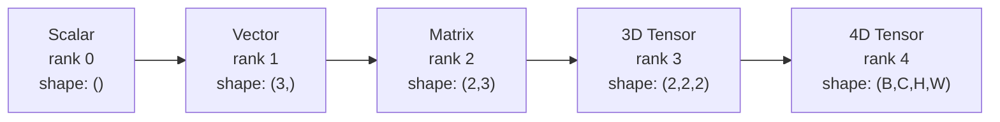
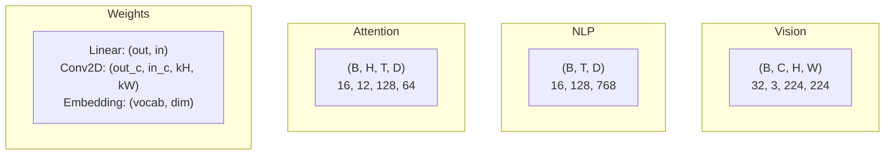
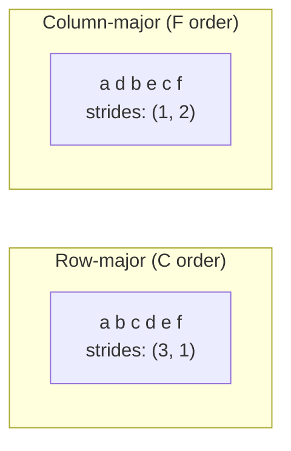
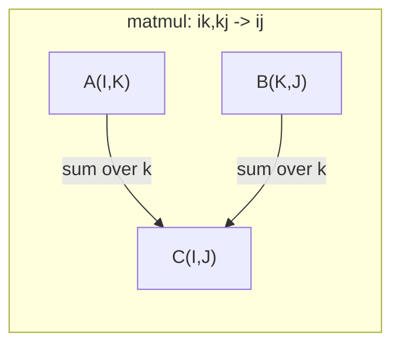

# Tensor Operations · 张量运算（数据与深度学习的通用语言）

> Tensors are the common language between data and deep learning. Every image, every sentence, every gradient flows through them.

**Type:** Build
**Language:** Python
**Prerequisites:** Phase 1, Lessons 01 (Linear Algebra Intuition), 02 (Vectors, Matrices & Operations)
**Time:** ~90 minutes

---

## Learning Objectives · 学习目标

- 从零实现一个张量（tensor）类，支持 shape、strides、reshape、transpose 和逐元素运算
- 应用广播（broadcasting）规则，在不复制数据的前提下对不同形状的张量做运算
- 会写点积、矩阵乘法、外积和批量运算的 einsum 表达式
- 能逐步追踪多头注意力（multi-head attention）中每一步的张量形状

> Implement a tensor class with shape, strides, reshape, transpose, and element-wise operations from scratch
> Apply broadcasting rules to operate on tensors of different shapes without copying data
> Write einsum expressions for dot products, matrix multiplications, outer products, and batched operations
> Trace the exact tensor shapes through every step of multi-head attention

---

## The Problem · 问题在哪

你搭了一个 transformer。前向传播看起来干干净净，一跑却报错：`RuntimeError: mat1 and mat2 shapes cannot be multiplied (32x768 and 512x768)`。你盯着形状看了半天，试了一个 transpose，这回它说 `Expected 4D input (got 3D input)`。你加了一个 unsqueeze，别的地方又坏了。

形状错误是深度学习代码里最常见的 bug。概念上并不难——每个运算都有一份形状契约（shape contract）——但它们成倍增长。一个 transformer 里串着几十个 reshape、transpose 和 broadcast，一个轴搞错，错误就连锁爆发。更糟的是，有些形状错误根本不抛异常：它们沿着错误的维度广播、或沿着错误的轴求和，悄无声息地产出垃圾。

矩阵处理的是两组事物之间的成对关系，而真实数据塞不进两个维度。一批 32 张 224x224 的 RGB 图像是一个 4 维张量：`(32, 3, 224, 224)`；12 个头的自注意力同样是 4 维：`(batch, heads, seq_len, head_dim)`。你需要一种能推广到任意维数的数据结构，并且它的各运算能在所有维度上干净地组合。这个结构就是张量（tensor）。掌握它的运算，形状错误就会变得轻而易解。

> Shape errors are the most common bug in deep learning code. They are not hard conceptually -- each operation has a shape contract -- but they multiply fast. A transformer has dozens of reshapes, transposes, and broadcasts chained together. One wrong axis and the error cascades. Worse, some shape mistakes do not throw errors at all. They silently produce garbage by broadcasting along the wrong dimension or summing over the wrong axis.
> You need a data structure that generalizes to any number of dimensions, with operations that compose cleanly across all of them. That structure is the tensor. Master its operations and shape errors become trivially debuggable.

---

## The Concept · 概念

### What a tensor is · 张量是什么

张量是具有统一数据类型的多维数字数组。维数叫**秩**（rank，或 order），每个维度叫一个**轴**（axis），**形状**（shape）是列出每个轴大小的元组。



元素总数 = 所有轴大小的乘积。形状 `(2, 3, 4)` 含有 `2 * 3 * 4 = 24` 个元素。

> A tensor is a multi-dimensional array of numbers with a uniform data type. The number of dimensions is the **rank** (or **order**). Each dimension is an **axis**. The **shape** is a tuple listing the size along each axis. ... Total elements = product of all sizes. A shape `(2, 3, 4)` holds `2 * 3 * 4 = 24` elements.

---

### Tensor shapes in deep learning · 深度学习中的张量形状

不同的数据类型按惯例映射到特定的张量形状。



PyTorch 用 NCHW（通道在前），TensorFlow 默认 NHWC（通道在后）。布局不匹配会导致悄无声息的变慢或直接报错。

> Different data types map to specific tensor shapes by convention. ... PyTorch uses NCHW (channels-first). TensorFlow defaults to NHWC (channels-last). Mismatched layouts cause silent slowdowns or errors.

---

### How memory layout works · 内存布局的原理

内存里的 2D 数组其实是一维的字节序列。**步幅**（stride）告诉你沿每个轴走一步要跳过多少个元素。



转置（transpose）不搬动数据，它交换的是步幅，使张量变得**非连续**（non-contiguous）——同一行的元素在内存里不再相邻。

> A 2D array in memory is a 1D sequence of bytes. **Strides** tell you how many elements to skip to move one step along each axis. ... Transpose does not move data. It swaps the strides, making the tensor **non-contiguous** -- the elements for a row are no longer adjacent in memory.

---

### Broadcasting rules · 广播规则

广播（broadcasting）让你在不复制数据的情况下对不同形状的张量做运算。把形状从右对齐；两个维度兼容，当它们相等或其中一个是 1；维度不足的张量在左边补 1。

```
Tensor A:     (8, 1, 6, 1)
Tensor B:        (7, 1, 5)
Padded B:     (1, 7, 1, 5)
Result:       (8, 7, 6, 5)
```

> Broadcasting lets you operate on tensors of different shapes without copying data. Align shapes from the right. Two dimensions are compatible when they are equal or one is 1. Fewer dimensions get padded with 1s on the left.

---

### Einsum: the universal tensor operation · Einsum：万能的张量运算

爱因斯坦求和（Einstein summation）给每个轴标一个字母：出现在输入但不出现在输出的轴会被求和掉，两边都出现的轴则保留。



关键模式：`i,i->`（点积）、`i,j->ij`（外积）、`ii->`（迹）、`ij->ji`（转置）、`bij,bjk->bik`（批量矩阵乘）、`bhtd,bhsd->bhts`（注意力分数）。

```figure
tensor-broadcast
```

> Einstein summation labels each axis with a letter. Axes in the input but not the output get summed. Axes in both are kept. ... Key patterns: `i,i->` (dot product), `i,j->ij` (outer product), `ii->` (trace), `ij->ji` (transpose), `bij,bjk->bik` (batch matmul), `bhtd,bhsd->bhts` (attention scores).

---

## Build It · 动手造

代码在 `code/tensors.py`，每一步都对应那里的实现。

### Step 1: Tensor storage and strides · 张量存储与步幅

张量存储一个扁平的数字列表，外加形状元数据。步幅告诉索引逻辑如何把多维索引映射到扁平位置。

```python
class Tensor:
    def __init__(self, data, shape=None):
        if isinstance(data, (list, tuple)):
            self._data, self._shape = self._flatten_nested(data)
        elif isinstance(data, np.ndarray):
            self._data = data.flatten().tolist()
            self._shape = tuple(data.shape)
        else:
            self._data = [data]
            self._shape = ()

        if shape is not None:
            total = reduce(lambda a, b: a * b, shape, 1)
            if total != len(self._data):
                raise ValueError(
                    f"Cannot reshape {len(self._data)} elements into shape {shape}"
                )
            self._shape = tuple(shape)

        self._strides = self._compute_strides(self._shape)

    @staticmethod
    def _compute_strides(shape):
        if len(shape) == 0:
            return ()
        strides = [1] * len(shape)
        for i in range(len(shape) - 2, -1, -1):
            strides[i] = strides[i + 1] * shape[i + 1]
        return tuple(strides)
```

对形状 `(3, 4)`，步幅是 `(4, 1)`——前进一行要跳 4 个元素，前进一列要跳 1 个元素。

> A tensor stores a flat list of numbers plus shape metadata. Strides tell the indexing logic how to map multi-dimensional indices to flat positions. ... For shape `(3, 4)`, strides are `(4, 1)` -- skip 4 elements to advance one row, skip 1 element to advance one column.

---

### Step 2: Reshape, squeeze, unsqueeze · Reshape、squeeze、unsqueeze

reshape 在不改变元素顺序的前提下改变形状，元素总数必须保持不变；某一维写 `-1` 表示自动推断它的大小。

```python
t = Tensor(list(range(12)), shape=(2, 6))
r = t.reshape((3, 4))
r = t.reshape((-1, 3))
```

squeeze 移除大小为 1 的轴，unsqueeze 插入一个。unsqueeze 对广播至关重要——把偏置向量 `(D,)` 加到 `(B, T, D)` 的批次上，需要先 unsqueeze 成 `(1, 1, D)`。

```python
t = Tensor(list(range(6)), shape=(1, 3, 1, 2))
s = t.squeeze()
v = Tensor([1, 2, 3])
u = v.unsqueeze(0)
```

> Reshape changes the shape without changing element order. The total number of elements must stay the same. Use `-1` for one dimension to infer its size. ... Squeeze removes axes of size 1. Unsqueeze inserts one. Unsqueezing is critical for broadcasting -- a bias vector `(D,)` added to a batch `(B, T, D)` needs unsqueezing to `(1, 1, D)`.

---

### Step 3: Transpose and permute · Transpose 与 permute

transpose 交换两个轴，permute 重排所有轴。NCHW 和 NHWC 之间就是这样转换的。

```python
mat = Tensor(list(range(6)), shape=(2, 3))
tr = mat.transpose(0, 1)

t4d = Tensor(list(range(24)), shape=(1, 2, 3, 4))
perm = t4d.permute((0, 2, 3, 1))
```

transpose 或 permute 之后，张量在内存中是非连续的。在 PyTorch 里，`view` 对非连续张量会失败——请改用 `reshape`，或先调用 `.contiguous()`。

> Transpose swaps two axes. Permute reorders all axes. This is how you convert between NCHW and NHWC. ... After transpose or permute, the tensor is non-contiguous in memory. In PyTorch, `view` fails on non-contiguous tensors -- use `reshape` or call `.contiguous()` first.

---

### Step 4: Element-wise operations and reductions · 逐元素运算与归约

逐元素运算（加、乘、减）独立作用于每个元素并保持形状不变。归约（reduction，如 sum、mean、max）把一个或多个轴压掉。

```python
a = Tensor([[1, 2], [3, 4]])
b = Tensor([[10, 20], [30, 40]])
c = a + b
d = a * 2
s = a.sum(axis=0)
```

CNN 中的全局平均池化：`(B, C, H, W).mean(axis=[2, 3])` 得到 `(B, C)`。NLP 中的序列平均池化：`(B, T, D).mean(axis=1)` 得到 `(B, D)`。

> Element-wise ops (add, multiply, subtract) apply independently to each element and preserve shape. Reductions (sum, mean, max) collapse one or more axes. ... Global average pooling in a CNN: `(B, C, H, W).mean(axis=[2, 3])` produces `(B, C)`. Sequence mean pooling in NLP: `(B, T, D).mean(axis=1)` produces `(B, D)`.

---

### Step 5: Broadcasting with NumPy · 用 NumPy 做广播

`tensors.py` 里的 `demo_broadcasting_numpy()` 函数演示了这些核心模式。

```python
activations = np.random.randn(4, 3)
bias = np.array([0.1, 0.2, 0.3])
result = activations + bias

images = np.random.randn(2, 3, 4, 4)
scale = np.array([0.5, 1.0, 1.5]).reshape(1, 3, 1, 1)
result = images * scale

a = np.array([1, 2, 3]).reshape(-1, 1)
b = np.array([10, 20, 30, 40]).reshape(1, -1)
outer = a * b
```

用广播算成对距离：把 `(M, 2)` reshape 成 `(M, 1, 2)`、`(N, 2)` reshape 成 `(1, N, 2)`，相减、平方、沿最后一轴求和、再开平方根。结果：`(M, N)`。

> The `demo_broadcasting_numpy()` function in `tensors.py` shows the core patterns. ... Pairwise distance via broadcasting: reshape `(M, 2)` to `(M, 1, 2)` and `(N, 2)` to `(1, N, 2)`, subtract, square, sum along last axis, take square root. Result: `(M, N)`.

---

### Step 6: Einsum operations · Einsum 运算

`demo_einsum()` 和 `demo_einsum_gallery()` 函数把每个常见模式都走了一遍。

```python
a = np.array([1.0, 2.0, 3.0])
b = np.array([4.0, 5.0, 6.0])
dot = np.einsum("i,i->", a, b)

A = np.array([[1, 2], [3, 4], [5, 6]], dtype=float)
B = np.array([[7, 8, 9], [10, 11, 12]], dtype=float)
matmul = np.einsum("ik,kj->ij", A, B)

batch_A = np.random.randn(4, 3, 5)
batch_B = np.random.randn(4, 5, 2)
batch_mm = np.einsum("bij,bjk->bik", batch_A, batch_B)
```

一次收缩（contraction）的计算成本是所有索引大小（保留的与求和的）的乘积。对 `bij,bjk->bik`，当 B=32、I=128、J=64、K=128 时：`32 * 128 * 64 * 128 = 33,554,432` 次乘加。

> The `demo_einsum()` and `demo_einsum_gallery()` functions walk through every common pattern. ... The computational cost of a contraction is the product of all index sizes (kept and summed). For `bij,bjk->bik` with B=32, I=128, J=64, K=128: `32 * 128 * 64 * 128 = 33,554,432` multiply-adds.

---

### Step 7: Attention mechanism via einsum · 用 einsum 实现注意力机制

`demo_attention_einsum()` 函数端到端实现了多头注意力。

```python
B, H, T, D = 2, 4, 8, 16
E = H * D

X = np.random.randn(B, T, E)
W_q = np.random.randn(E, E) * 0.02

Q = np.einsum("bte,ek->btk", X, W_q)
Q = Q.reshape(B, T, H, D).transpose(0, 2, 1, 3)

scores = np.einsum("bhtd,bhsd->bhts", Q, K) / np.sqrt(D)
weights = softmax(scores, axis=-1)
attn_output = np.einsum("bhts,bhsd->bhtd", weights, V)

concat = attn_output.transpose(0, 2, 1, 3).reshape(B, T, E)
output = np.einsum("bte,ek->btk", concat, W_o)
```

每一步都是张量运算：投影（einsum 矩阵乘）、拆头（reshape + transpose）、注意力分数（einsum 批量矩阵乘）、加权和（einsum 批量矩阵乘）、合头（transpose + reshape）、输出投影（einsum 矩阵乘）。

> The `demo_attention_einsum()` function implements multi-head attention end to end. ... Every step is a tensor operation: projection (matmul via einsum), head splitting (reshape + transpose), attention scores (batch matmul via einsum), weighted sum (batch matmul via einsum), head merging (transpose + reshape), output projection (matmul via einsum).

---

## Use It · 实战用法

### Scratch vs NumPy · 从零实现 vs NumPy

| 运算 | 从零实现（Tensor 类） | NumPy |
|---|---|---|
| 创建 | `Tensor([[1,2],[3,4]])` | `np.array([[1,2],[3,4]])` |
| Reshape | `t.reshape((3,4))` | `a.reshape(3,4)` |
| 转置 | `t.transpose(0,1)` | `a.T` 或 `a.transpose(0,1)` |
| Squeeze | `t.squeeze(0)` | `np.squeeze(a, 0)` |
| 求和 | `t.sum(axis=0)` | `a.sum(axis=0)` |
| Einsum | N/A | `np.einsum("ij,jk->ik", a, b)` |

### Scratch vs PyTorch · 从零实现 vs PyTorch

```python
import torch

t = torch.tensor([[1, 2, 3], [4, 5, 6]], dtype=torch.float32)
t.shape
t.stride()
t.is_contiguous()

t.reshape(3, 2)
t.unsqueeze(0)
t.transpose(0, 1)
t.transpose(0, 1).contiguous()

torch.einsum("ik,kj->ij", A, B)
```

PyTorch 额外提供 autograd、GPU 支持和优化过的 BLAS 内核，形状语义则完全一致。理解了从零实现的版本，PyTorch 的形状错误就变得可读了。

> PyTorch adds autograd, GPU support, and optimized BLAS kernels. The shape semantics are identical. If you understand the scratch version, PyTorch shape errors become readable.

---

### Every neural network layer as a tensor operation · 每个神经网络层都是张量运算

| 运算 | 张量形式 | Einsum |
|---|---|---|
| Linear 层 | `Y = X @ W.T + b` | `"bd,od->bo"` + bias |
| Attention QKV | `Q = X @ W_q` | `"btd,dh->bth"` |
| Attention 分数 | `Q @ K.T / sqrt(d)` | `"bhtd,bhsd->bhts"` |
| Attention 输出 | `softmax(scores) @ V` | `"bhts,bhsd->bhtd"` |
| Batch norm | `(X - mu) / sigma * gamma` | element-wise + broadcast |
| Softmax | `exp(x) / sum(exp(x))` | element-wise + reduction |

---

## Ship It · 交付

本课产出两个可复用的提示词：

1. **`outputs/prompt-tensor-shapes.md`** —— 一个系统化调试张量形状不匹配的提示词。包含每种常见运算（matmul、broadcast、cat、Linear、Conv2d、BatchNorm、softmax）的决策表，以及一份修复速查表。

2. **`outputs/prompt-tensor-debugger.md`** —— 当形状错误卡住你时，可以粘贴进任何 AI 助手的逐步调试提示词。把报错信息和你的张量形状喂给它，拿回确切的修法。

> This lesson produces two reusable prompts: **`outputs/prompt-tensor-shapes.md`** -- A systematic prompt for debugging tensor shape mismatches. Includes decision tables for every common operation (matmul, broadcast, cat, Linear, Conv2d, BatchNorm, softmax) and a fix lookup table. ... **`outputs/prompt-tensor-debugger.md`** -- A step-by-step debugging prompt you paste into any AI assistant when a shape error is blocking you. Feed it the error message and your tensor shapes, get back the exact fix.

---

## Exercises · 练习

1. **简单——reshape 往返。** 取一个形状 `(2, 3, 4)` 的张量，依次 reshape 成 `(6, 4)`、`(24,)`，再变回 `(2, 3, 4)`。每一步都打印扁平数据，验证元素顺序未被改变。

2. **中等——实现广播。** 给 `Tensor` 类扩展一个 `broadcast_to(shape)` 方法，把大小为 1 的维度扩展到与目标形状匹配。然后修改 `_elementwise_op`，让它在运算前自动广播。用 `(3, 1)` 和 `(1, 4)` 得到 `(3, 4)` 来测试。

3. **困难——从零造 einsum。** 实现一个基础的 `einsum(subscripts, *tensors)` 函数，至少支持：点积（`i,i->`）、矩阵乘（`ij,jk->ik`）、外积（`i,j->ij`）和转置（`ij->ji`）。解析下标字符串、找出被收缩的索引、对所有索引组合循环。把你的结果与 `np.einsum` 对比。

4. **困难——注意力形状追踪器。** 写一个函数，输入 `batch_size`、`seq_len`、`embed_dim` 和 `num_heads`，打印多头注意力每一步的精确形状：输入、Q/K/V 投影、拆头、注意力分数、softmax 权重、加权和、合头、输出投影。与 `demo_attention_einsum()` 的输出对照验证。

---

## Key Terms · 术语表

| 术语 | 别人怎么说 | 实际意思 |
|---|---|---|
| Tensor | "维度更多的矩阵" | 具有统一类型、且定义了 shape、strides 和运算的多维数组 |
| Rank | "维数的个数" | 轴的个数。矩阵的 rank 是 2，而不是它的矩阵秩（matrix rank） |
| Shape | "张量的大小" | 列出每个轴大小的元组。`(2, 3)` 表示 2 行 3 列 |
| Stride | "内存怎么排" | 沿每个轴前进一格要跳过的元素数 |
| Broadcasting | "形状不同也能算" | 一套严格的规则：从右对齐，维度必须相等或其中之一为 1 |
| Contiguous | "张量是规整的" | 元素在内存中按逻辑布局顺序连续存储，没有空洞或重排 |
| Einsum | "matmul 的高级写法" | 一种通用记法，一行表达任意张量收缩、外积、迹或转置 |
| View | "和 reshape 一样" | 共享同一内存缓冲、但 shape/stride 元数据不同的张量。对非连续数据会失败 |
| Contraction | "对一个索引求和" | 一般化的运算：张量之间共享的索引被相乘并求和，产生更低秩的结果 |
| NCHW / NHWC | "PyTorch vs TensorFlow 格式" | 图像张量的内存布局约定。NCHW 把通道放在空间维之前，NHWC 放在其后 |

---

## Further Reading · 延伸阅读

- [NumPy Broadcasting](https://numpy.org/doc/stable/user/basics.broadcasting.html) —— 广播的权威规则与可视化示例
- [PyTorch Tensor Views](https://pytorch.org/docs/stable/tensor_view.html) —— view 何时可用、何时会拷贝
- [einops](https://github.com/arogozhnikov/einops) —— 让张量变形变得可读且安全的库
- [The Illustrated Transformer](https://jalammar.github.io/illustrated-transformer/) —— 可视化流经注意力机制的张量形状
- [Einstein Summation in NumPy](https://numpy.org/doc/stable/reference/generated/numpy.einsum.html) —— 完整的 einsum 文档与示例
