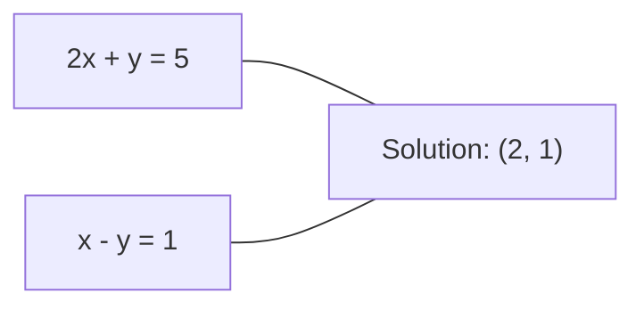
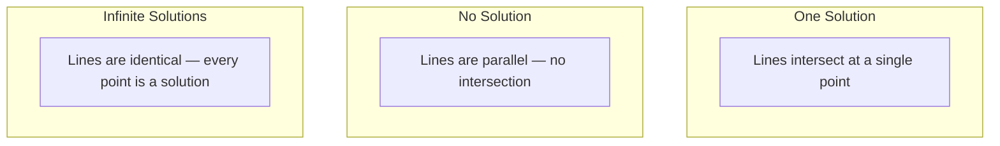

# Linear Systems · 线性系统

> 求解 Ax = b 是数学中最古老的问题，而它至今仍在驱动你的神经网络。
> Solving Ax = b is the oldest problem in mathematics that still runs your neural network.

**Type:** Build
**Language:** Python
**Prerequisites:** Phase 1, Lessons 01 (Linear Algebra Intuition), 02 (Vectors & Matrices), 03 (Matrix Transformations)
**Time:** ~120 minutes

## Learning Objectives · 学习目标

- 用带部分主元选取（partial pivoting）的高斯消元（Gaussian elimination）加回代（back substitution）求解 Ax = b
- 用 LU、QR、Cholesky 分解对矩阵做分解，并解释各自适用的时机
- 推导最小二乘（least squares）的正规方程（normal equations），并把它们与线性回归和岭回归（ridge regression）联系起来
- 用条件数（condition number）诊断病态（ill-conditioned）系统，并用正则化使其稳定

> Solve Ax = b using Gaussian elimination with partial pivoting and back substitution
> Factor matrices with LU, QR, and Cholesky decompositions and explain when each is appropriate
> Derive the normal equations for least squares and connect them to linear and ridge regression
> Diagnose ill-conditioned systems using the condition number and apply regularization to stabilize them

## The Problem · 问题在哪

每次训练线性回归（linear regression），你都在求解一个线性系统（linear system）。每次计算最小二乘拟合，你都在求解一个线性系统。神经网络的每一层计算 `y = Wx + b`，都是在求一个线性系统等式的一侧。加正则化时，你修改的是这个系统；用高斯过程（Gaussian processes）时，你分解的是一个矩阵；为了马氏距离（Mahalanobis distance）对协方差矩阵求逆时，你求解的仍是一个线性系统。

方程 Ax = b 无处不在。A 是由已知系数组成的矩阵，b 是由已知输出组成的向量，x 是你想求的未知数向量。在线性回归里，A 是数据矩阵，b 是目标向量，x 是权重向量。整个模型归结为一句话：找到 x，使 Ax 尽可能接近 b。

本课从零构建求解这个方程的每一个主要方法。你会理解为什么有些方法快、有些方法稳定，为什么有些只对方形系统有效而另一些能处理超定（overdetermined）系统，以及为什么矩阵的条件数决定你的答案究竟有没有意义。

> Every time you train a linear regression, you solve a linear system. Every time a neural network layer computes `y = Wx + b`, it is evaluating one side of a linear system. ... The equation Ax = b appears everywhere. ... In linear regression, A is your data matrix, b is your target vector, and x is the weight vector. The entire model reduces to: find x such that Ax is as close to b as possible.

## The Concept

### What Ax = b means geometrically · Ax = b 的几何意义

线性方程组有几何解释。每个方程定义一个超平面（hyperplane）。解就是所有超平面相交的点（或点集）。

```
2x + y = 5          Two lines in 2D.
x - y  = 1          They intersect at x=2, y=1.
```



三种情况都可能发生：



用矩阵的语言说：「唯一解」意味着 A 可逆；「无解」意味着系统不相容（inconsistent）；「无穷多解」意味着 A 有零空间（null space）。大多数机器学习问题都属于「没有精确解」一类，因为方程（数据点）比未知数（参数）多。这正是最小二乘登场的时刻。

> Each equation defines a hyperplane. The solution is the point (or set of points) where all hyperplanes intersect. ... In matrix form, "one solution" means A is invertible. ... Most ML problems fall in the "no exact solution" category because you have more equations (data points) than unknowns (parameters). That is where least squares comes in.

### Column picture vs row picture · 列图像 vs 行图像

读 Ax = b 有两种方式。

**行图像（row picture）。** A 的每一行定义一个方程，每个方程是一个超平面，解是它们全部相交之处。

**列图像（column picture）。** A 的每一列是一个向量，问题变成：A 各列的什么线性组合能产生 b？

```
A = | 2  1 |    b = | 5 |
    | 1 -1 |        | 1 |

Row picture: solve 2x + y = 5 and x - y = 1 simultaneously.

Column picture: find x1, x2 such that:
  x1 * [2, 1] + x2 * [1, -1] = [5, 1]
  2 * [2, 1] + 1 * [1, -1] = [4+1, 2-1] = [5, 1]   check.
```

列图像更本质。如果 b 落在 A 的列空间（column space）里，系统有解；如果没有，你就去找列空间中离 b 最近的点。那个最近的点就是最小二乘解。

> There are two ways to read Ax = b. ... The column picture is more fundamental. If b lies in the column space of A, the system has a solution. If b does not, you find the closest point in the column space. That closest point is the least-squares solution.

### Gaussian elimination · 高斯消元

高斯消元把 Ax = b 变换成上三角系统 Ux = c，然后用回代求解。它是最直接的方法。

算法：

```
1. For each column k (the pivot column):
   a. Find the largest entry in column k at or below row k (partial pivoting).
   b. Swap that row with row k.
   c. For each row i below k:
      - Compute multiplier m = A[i][k] / A[k][k]
      - Subtract m times row k from row i.
2. Back substitute: solve from the last equation upward.
```

例：

```
Original:
| 2  1  1 | 8 |       R2 = R2 - (2)R1     | 2  1   1 |  8 |
| 4  3  3 |20 |  -->  R3 = R3 - (1)R1 --> | 0  1   1 |  4 |
| 2  3  1 |12 |                            | 0  2   0 |  4 |

                       R3 = R3 - (2)R2     | 2  1   1 |  8 |
                                       --> | 0  1   1 |  4 |
                                           | 0  0  -2 | -4 |

Back substitute:
  -2 * x3 = -4    -->  x3 = 2
  x2 + 2  = 4     -->  x2 = 2
  2*x1 + 2 + 2 = 8 --> x1 = 2
```

高斯消元的代价是 O(n^3) 次运算。对一个 1000x1000 的系统，那大约是十亿次浮点运算。很快，但如果你要用同一个 A 求解多个系统，还有改进空间。

> Gaussian elimination transforms Ax = b into an upper triangular system Ux = c that you solve by back substitution. It is the most direct method. ... Gaussian elimination costs O(n^3) operations. For a 1000x1000 system, that is about a billion floating-point operations. Fast, but you can do better if you need to solve multiple systems with the same A.

### Partial pivoting: why it matters · 部分主元：为什么它重要

没有主元选取，高斯消元可能失败或产出垃圾。主元为零时你会除以零；主元太小时你会放大舍入误差。

```
Bad pivot:                       With partial pivoting:
| 0.001  1 | 1.001 |            Swap rows first:
| 1      1 | 2     |            | 1      1 | 2     |
                                 | 0.001  1 | 1.001 |
m = 1/0.001 = 1000              m = 0.001/1 = 0.001
R2 = R2 - 1000*R1               R2 = R2 - 0.001*R1
| 0.001  1     | 1.001   |      | 1      1     | 2     |
| 0     -999   | -999.0  |      | 0      0.999 | 0.999 |

x2 = 1.000 (correct)            x2 = 1.000 (correct)
x1 = (1.001 - 1)/0.001          x1 = (2 - 1)/1 = 1.000 (correct)
   = 0.001/0.001 = 1.000        Stable because the multiplier is small.
```

在精度有限的浮点运算里，不选主元的版本可能丢失有效数字。部分主元选取总是选可用的最大主元，把误差放大压到最低。

> Without pivoting, Gaussian elimination can fail or produce garbage. If a pivot element is zero, you divide by zero. If it is small, you amplify rounding errors. ... In floating-point arithmetic with limited precision, the unpivoted version can lose significant digits. Partial pivoting always selects the largest available pivot to minimize error amplification.

### LU decomposition · LU 分解

LU 分解把 A 分解为下三角矩阵 L 和上三角矩阵 U：A = LU。L 存储高斯消元产生的乘数，U 是消元的结果。

```
A = L @ U

| 2  1  1 |   | 1  0  0 |   | 2  1   1 |
| 4  3  3 | = | 2  1  0 | @ | 0  1   1 |
| 2  3  1 |   | 1  2  1 |   | 0  0  -2 |
```

为什么要分解而不直接消元？因为一旦有了 L 和 U，对任何新的 b 求解 Ax = b 只需 O(n^2)：

```
Ax = b
LUx = b
Let y = Ux:
  Ly = b    (forward substitution, O(n^2))
  Ux = y    (back substitution, O(n^2))
```

O(n^3) 的代价在分解时只付一次，之后的每次求解都是 O(n^2)。如果你要用同一个 A、不同的 b 求解 1000 个系统，LU 相比逐个消元在总工作量上省了约 1000/3 倍。

使用部分主元选取时，你得到的是 PA = LU，其中 P 是记录行交换的置换矩阵（permutation matrix）。

> LU decomposition factors A into a lower triangular matrix L and an upper triangular matrix U: A = LU. The L matrix stores the multipliers from Gaussian elimination. The U matrix is the result of elimination. ... The O(n^3) cost is paid once during factorization. Every subsequent solve is O(n^2). ... With partial pivoting, you get PA = LU where P is a permutation matrix recording the row swaps.

### QR decomposition · QR 分解

QR 分解把 A 分解为正交矩阵（orthogonal matrix）Q 和上三角矩阵 R：A = QR。

正交矩阵满足 Q^T Q = I，它的列是标准正交（orthonormal）向量，乘以 Q 保持长度与角度不变。

```
A = Q @ R

Q has orthonormal columns: Q^T Q = I
R is upper triangular

To solve Ax = b:
  QRx = b
  Rx = Q^T b    (just multiply by Q^T, no inversion needed)
  Back substitute to get x.
```

求解最小二乘问题时，QR 在数值上比 LU 更稳定。Gram-Schmidt 过程逐列构造 Q：

```
Given columns a1, a2, ... of A:

q1 = a1 / ||a1||

q2 = a2 - (a2 . q1) * q1        (subtract projection onto q1)
q2 = q2 / ||q2||                (normalize)

q3 = a3 - (a3 . q1) * q1 - (a3 . q2) * q2
q3 = q3 / ||q3||

R[i][j] = qi . aj    for i <= j
```

每一步都去掉沿之前所有 q 向量的分量，只留下新的正交方向。

> QR decomposition factors A into an orthogonal matrix Q and an upper triangular matrix R: A = QR. ... QR is numerically more stable than LU for solving least-squares problems. The Gram-Schmidt process builds Q column by column. ... Each step removes the component along all previous q vectors, leaving only the new orthogonal direction.

### Cholesky decomposition · Cholesky 分解

当 A 对称（A = A^T）且正定（所有特征值为正）时，可以把它分解为 A = L L^T，其中 L 是下三角矩阵。这就是 Cholesky 分解。

```
A = L @ L^T

| 4  2 |   | 2  0 |   | 2  1 |
| 2  5 | = | 1  2 | @ | 0  2 |

L[i][i] = sqrt(A[i][i] - sum(L[i][k]^2 for k < i))
L[i][j] = (A[i][j] - sum(L[i][k]*L[j][k] for k < j)) / L[j][j]    for i > j
```

Cholesky 的速度是 LU 的两倍，存储只需一半。它只适用于对称正定矩阵，但这类矩阵频频出现：

- 协方差矩阵是对称半正定的（加正则化后正定）。
- 高斯过程的核矩阵（kernel matrix）是对称正定的。
- 凸函数在极小点处的 Hessian 是对称正定的。
- A^T A 总是对称半正定。

在高斯过程中，你用 Cholesky 分解核矩阵 K，然后求解 K alpha = y 得到预测均值。Cholesky 因子还给出边缘似然（marginal likelihood）所需的对数行列式：log det(K) = 2 * sum(log(diag(L)))。

> Cholesky is twice as fast as LU and requires half the storage. It only works for symmetric positive definite matrices, but those show up constantly. ... In Gaussian processes, you factor the kernel matrix K with Cholesky, then solve K alpha = y to get the predictive mean. The Cholesky factor also gives you the log-determinant for the marginal likelihood: log det(K) = 2 * sum(log(diag(L))).

### Least squares: when Ax = b has no exact solution · 最小二乘：Ax = b 没有精确解时

如果 A 是 m x n 且 m > n（方程多于未知数），系统是超定的（overdetermined），没有精确解。此时转而最小化平方误差：

```
minimize ||Ax - b||^2

This is the sum of squared residuals:
  sum((A[i,:] @ x - b[i])^2 for i in range(m))
```

最小化子满足正规方程（normal equations）：

```
A^T A x = A^T b
```

推导：展开 ||Ax - b||^2 = (Ax - b)^T (Ax - b) = x^T A^T A x - 2 x^T A^T b + b^T b，对 x 求梯度并令其为零：2 A^T A x - 2 A^T b = 0。

```
Original system (overdetermined, 4 equations, 2 unknowns):
| 1  1 |         | 3 |
| 1  2 | x     = | 5 |       No exact x satisfies all 4 equations.
| 1  3 |         | 6 |
| 1  4 |         | 8 |

Normal equations:
A^T A = | 4  10 |    A^T b = | 22 |
        | 10 30 |            | 63 |

Solve: x = [1.5, 1.7]

This is linear regression. x[0] is the intercept, x[1] is the slope.
```

> If A is m x n with m > n (more equations than unknowns), the system is overdetermined. There is no exact solution. Instead, you minimize the squared error. ... The minimizer satisfies the normal equations.

### Normal equations = linear regression · 正规方程 = 线性回归

这层联系是精确的。在线性回归里，数据矩阵 X 每行一个样本、每列一个特征；目标向量 y 每个样本一个条目。权重向量 w 满足：

```
X^T X w = X^T y
w = (X^T X)^(-1) X^T y
```

这就是线性回归的闭式解（closed-form solution）。每次调用 `sklearn.linear_model.LinearRegression.fit()` 计算的都是它（或经由 QR 或 SVD 的等价形式）。

给矩阵加一个正则项 lambda * I，就得到岭回归（ridge regression）：

```
(X^T X + lambda * I) w = X^T y
w = (X^T X + lambda * I)^(-1) X^T y
```

正则化让矩阵的条件更好（更容易精确求逆），并把权重向零收缩以防过拟合。当 lambda > 0 时，矩阵 X^T X + lambda * I 总是对称正定，因此可以用 Cholesky 求解。

> The connection is exact. In linear regression, your data matrix X has one row per sample and one column per feature. Your target vector y has one entry per sample. ... This is the closed-form solution to linear regression. ... Add a regularization term lambda * I to the matrix and you get ridge regression. ... The matrix X^T X + lambda * I is always symmetric positive definite when lambda > 0, so you can use Cholesky to solve it.

### Pseudoinverse (Moore-Penrose) · 伪逆（Moore-Penrose）

伪逆 A+ 把矩阵求逆推广到非方阵和奇异矩阵。对任意矩阵 A：

```
x = A+ b

where A+ = V Sigma+ U^T    (computed via SVD)
```

Sigma+ 的做法是：取每个非零奇异值的倒数，再把结果转置。如果 A = U Sigma V^T，则 A+ = V Sigma+ U^T。

```
A = U Sigma V^T        (SVD)

Sigma = | 5  0 |       Sigma+ = | 1/5  0  0 |
        | 0  2 |                | 0  1/2  0 |
        | 0  0 |

A+ = V Sigma+ U^T
```

伪逆给出最小范数的最小二乘解。如果系统：
- 有唯一解：A+ b 给出它。
- 无解：A+ b 给出最小二乘解。
- 有无穷多解：A+ b 给出其中 ||x|| 最小的那个。

NumPy 的 `np.linalg.lstsq` 和 `np.linalg.pinv` 内部都使用 SVD。

> The pseudoinverse A+ generalizes matrix inversion to non-square and singular matrices. ... The pseudoinverse gives the minimum-norm least-squares solution. ... NumPy's `np.linalg.lstsq` and `np.linalg.pinv` both use the SVD internally.

### Condition number · 条件数

条件数衡量解对输入微小变化的敏感程度。对矩阵 A，条件数为：

```
kappa(A) = ||A|| * ||A^(-1)|| = sigma_max / sigma_min
```

其中 sigma_max 与 sigma_min 分别是最大和最小奇异值。

```
Well-conditioned (kappa ~ 1):        Ill-conditioned (kappa ~ 10^15):
Small change in b -->                Small change in b -->
small change in x                    huge change in x

| 2  0 |   kappa = 2/1 = 2          | 1   1          |   kappa ~ 10^15
| 0  1 |   safe to solve            | 1   1+10^(-15) |   solution is garbage
```

经验法则：

- kappa < 100：安全，解是精确的。
- kappa ~ 10^k：浮点运算会损失约 k 位有效数字。
- kappa ~ 10^16（float64）：解毫无意义，矩阵实际上已是奇异的。

在机器学习里，特征近乎共线（collinear）时就会出现病态。正则化（加 lambda * I）把条件数从 sigma_max / sigma_min 改善到 (sigma_max + lambda) / (sigma_min + lambda)。

> The condition number measures how sensitive the solution is to small changes in the input. ... kappa ~ 10^k: you lose about k digits of precision from your floating-point arithmetic. ... In ML, ill-conditioning happens when features are nearly collinear. Regularization (adding lambda * I) improves the condition number from sigma_max / sigma_min to (sigma_max + lambda) / (sigma_min + lambda).

### Iterative methods: conjugate gradient · 迭代方法：共轭梯度

对非常大的稀疏系统（数百万未知数），LU 或 Cholesky 这类直接法的代价太高。迭代方法通过在多次迭代中不断改进一个猜测来逼近解。

共轭梯度（conjugate gradient，CG）在 A 对称正定时求解 Ax = b。在精确算术下它至多 n 次迭代就能找到精确解；当 A 的特征值聚集时，实际收敛通常快得多。

```
Algorithm sketch:
  x0 = initial guess (often zero)
  r0 = b - A x0           (residual)
  p0 = r0                 (search direction)

  For k = 0, 1, 2, ...:
    alpha = (rk . rk) / (pk . A pk)
    x_{k+1} = xk + alpha * pk
    r_{k+1} = rk - alpha * A pk
    beta = (r_{k+1} . r_{k+1}) / (rk . rk)
    p_{k+1} = r_{k+1} + beta * pk
    if ||r_{k+1}|| < tolerance: stop
```

CG 的用武之地：

- 大规模优化（Newton-CG 方法）
- 求解 PDE 的离散化
- 核矩阵大到无法分解的核方法
- 为其他迭代求解器做预条件（preconditioning）

收敛速度取决于条件数：条件越好收敛越快，这是正则化有帮助的又一个理由。

> For very large sparse systems (millions of unknowns), direct methods like LU or Cholesky are too expensive. Iterative methods approximate the solution by improving a guess over many iterations. ... Conjugate gradient (CG) solves Ax = b when A is symmetric positive definite. ... The convergence rate depends on the condition number. Better conditioned systems converge faster, which is another reason regularization helps.

### The full picture: which method when · 全景：什么场景用什么方法

| 方法 | 要求 | 代价 | 适用场景 |
|--------|-------------|------|----------|
| 高斯消元 | 方阵、非奇异 A | O(n^3) | 方形系统的一次性求解 |
| LU 分解 | 方阵、非奇异 A | O(n^3) 分解 + O(n^2) 求解 | 用同一个 A 多次求解 |
| QR 分解 | 任意 A（m >= n） | O(mn^2) | 最小二乘，数值稳定 |
| Cholesky | 对称正定 A | O(n^3/3) | 协方差矩阵、高斯过程、岭回归 |
| 正规方程 | 超定（m > n） | O(mn^2 + n^3) | 线性回归（n 较小） |
| SVD / 伪逆 | 任意 A | O(mn^2) | 秩亏系统、最小范数解 |
| 共轭梯度 | 对称正定、稀疏 A | O(n * k * nnz) | 大型稀疏系统，k = 迭代次数 |

### Connection to ML · 与机器学习的联系

本课的每个方法都出现在生产级机器学习里：

**线性回归。** 闭式解求解正规方程 X^T X w = X^T y，实现方式是 Cholesky（n 小时）、QR（在乎数值稳定性时）或 SVD（矩阵可能秩亏时）。

**岭回归。** 给 X^T X 加上 lambda * I。正则化系统 (X^T X + lambda * I) w = X^T y 总是能用 Cholesky 求解，因为 lambda > 0 时 X^T X + lambda * I 对称正定。

**高斯过程。** 预测均值要求解 K alpha = y，其中 K 是核矩阵；对 K 做 Cholesky 分解是标准做法。对数边缘似然用到 log det(K) = 2 sum(log(diag(L)))。

**神经网络初始化。** 正交初始化用 QR 分解生成列标准正交的权重矩阵，防止深层网络里的信号坍缩。

**预条件。** 大规模优化器用不完全 Cholesky 或不完全 LU 作为共轭梯度求解器的预条件子。

**特征工程。** X^T X 的条件数告诉你特征是否共线。kappa 太大就删特征或加正则化。

```figure
linear-system-conditioning
```

> Every method in this lesson appears in production ML. ... The closed-form solution solves the normal equations X^T X w = X^T y. ... The condition number of X^T X tells you if your features are collinear. If kappa is large, drop features or add regularization.

## Build It · 动手造

### Step 1: Gaussian elimination with partial pivoting

```python
import numpy as np

def gaussian_elimination(A, b):
    n = len(b)
    Ab = np.hstack([A.astype(float), b.reshape(-1, 1).astype(float)])

    for k in range(n):
        max_row = k + np.argmax(np.abs(Ab[k:, k]))
        Ab[[k, max_row]] = Ab[[max_row, k]]

        if abs(Ab[k, k]) < 1e-12:
            raise ValueError(f"Matrix is singular or nearly singular at pivot {k}")

        for i in range(k + 1, n):
            m = Ab[i, k] / Ab[k, k]
            Ab[i, k:] -= m * Ab[k, k:]

    x = np.zeros(n)
    for i in range(n - 1, -1, -1):
        x[i] = (Ab[i, -1] - Ab[i, i+1:n] @ x[i+1:n]) / Ab[i, i]

    return x
```

### Step 2: LU decomposition

```python
def lu_decompose(A):
    n = A.shape[0]
    L = np.eye(n)
    U = A.astype(float).copy()
    P = np.eye(n)

    for k in range(n):
        max_row = k + np.argmax(np.abs(U[k:, k]))
        if max_row != k:
            U[[k, max_row]] = U[[max_row, k]]
            P[[k, max_row]] = P[[max_row, k]]
            if k > 0:
                L[[k, max_row], :k] = L[[max_row, k], :k]

        for i in range(k + 1, n):
            L[i, k] = U[i, k] / U[k, k]
            U[i, k:] -= L[i, k] * U[k, k:]

    return P, L, U

def lu_solve(P, L, U, b):
    n = len(b)
    Pb = P @ b.astype(float)

    y = np.zeros(n)
    for i in range(n):
        y[i] = Pb[i] - L[i, :i] @ y[:i]

    x = np.zeros(n)
    for i in range(n - 1, -1, -1):
        x[i] = (y[i] - U[i, i+1:] @ x[i+1:]) / U[i, i]

    return x
```

### Step 3: Cholesky decomposition

```python
def cholesky(A):
    n = A.shape[0]
    L = np.zeros_like(A, dtype=float)

    for i in range(n):
        for j in range(i + 1):
            s = A[i, j] - L[i, :j] @ L[j, :j]
            if i == j:
                if s <= 0:
                    raise ValueError("Matrix is not positive definite")
                L[i, j] = np.sqrt(s)
            else:
                L[i, j] = s / L[j, j]

    return L
```

### Step 4: Least squares via normal equations

```python
def least_squares_normal(A, b):
    AtA = A.T @ A
    Atb = A.T @ b
    return gaussian_elimination(AtA, Atb)

def ridge_regression(A, b, lam):
    n = A.shape[1]
    AtA = A.T @ A + lam * np.eye(n)
    Atb = A.T @ b
    L = cholesky(AtA)
    y = np.zeros(n)
    for i in range(n):
        y[i] = (Atb[i] - L[i, :i] @ y[:i]) / L[i, i]
    x = np.zeros(n)
    for i in range(n - 1, -1, -1):
        x[i] = (y[i] - L.T[i, i+1:] @ x[i+1:]) / L.T[i, i]
    return x
```

### Step 5: Condition number

```python
def condition_number(A):
    U, S, Vt = np.linalg.svd(A)
    return S[0] / S[-1]
```

## Use It · 实战用法

把各部件拼起来，在真实数据上做线性回归和岭回归：

```python
np.random.seed(42)
X_raw = np.random.randn(100, 3)
w_true = np.array([2.0, -1.0, 0.5])
y = X_raw @ w_true + np.random.randn(100) * 0.1

X = np.column_stack([np.ones(100), X_raw])

w_ols = least_squares_normal(X, y)
print(f"OLS weights (ours):    {w_ols}")

w_np = np.linalg.lstsq(X, y, rcond=None)[0]
print(f"OLS weights (numpy):   {w_np}")
print(f"Max difference: {np.max(np.abs(w_ols - w_np)):.2e}")

w_ridge = ridge_regression(X, y, lam=1.0)
print(f"Ridge weights (ours):  {w_ridge}")

from sklearn.linear_model import Ridge
ridge_sk = Ridge(alpha=1.0, fit_intercept=False)
ridge_sk.fit(X, y)
print(f"Ridge weights (sklearn): {ridge_sk.coef_}")
```

> Putting the pieces together for linear regression and ridge regression on real data:

## Ship It · 交付

本课产出：

- `code/linear_systems.py`，包含从零实现的高斯消元、LU 分解、Cholesky 分解、最小二乘和岭回归
- 一个可运行的演示，证明正规方程与 sklearn 的 LinearRegression 给出相同的权重

> This lesson produces:
> - `code/linear_systems.py` containing from-scratch implementations of Gaussian elimination, LU decomposition, Cholesky decomposition, least squares, and ridge regression
> - A working demonstration that normal equations and sklearn's LinearRegression produce the same weights

## Exercises · 练习

1. 用你的高斯消元、你的 LU 求解器和 `np.linalg.solve` 求解系统 `[[1,2,3],[4,5,6],[7,8,10]] x = [6, 15, 27]`，验证三者给出相同的答案（在浮点容差之内）。

2. 生成 50x5 的随机矩阵 X 与目标 y = X @ w_true + noise，分别用正规方程、QR（经 `np.linalg.qr`）、SVD（经 `np.linalg.svd`）和 `np.linalg.lstsq` 求 w，比较四个解。测量 X^T X 的条件数，并解释它如何影响你信任哪一种方法。

3. 让两列几乎相同，构造一个接近奇异的矩阵（例如 column 2 = column 1 + 1e-10 * noise）。计算它的条件数；分别在不加正则化与加正则化（加 0.01 * I）的情况下求解 Ax = b，比较两者的解与残差，并解释为什么正则化有帮助。

4. 在 100x100 的随机对称正定矩阵上实现共轭梯度算法，数一数收敛到容差 1e-8 需要多少次迭代，并与理论上限 n 次迭代比较。

5. 在规模为 10、50、200、500 的对称正定矩阵上，为你的 Cholesky 求解器、LU 求解器和 `np.linalg.solve` 计时，画出结果，验证 Cholesky 大约比 LU 快 2 倍。

## Key Terms · 术语表

| 术语 | 人们怎么说 | 它实际的意思 |
|------|----------------|----------------------|
| 线性系统 | 「解出 x」 | 线性方程组 Ax = b。求 x 就是找到在变换 A 下产生输出 b 的输入。 |
| 高斯消元 | 「行约简」 | 用行操作系统地把对角线以下的元素变成零，得到一个可用回代求解的上三角系统。O(n^3)。 |
| 部分主元选取 | 「为稳定交换行」 | 在第 k 列消元之前，把该列绝对值最大的行交换到主元位置。避免除以很小的数。 |
| LU 分解 | 「分解成三角形」 | 写 A = LU，其中 L 是下三角（存储乘数），U 是上三角（消元后的矩阵）。把 O(n^3) 的代价摊到多次求解上。 |
| QR 分解 | 「正交分解」 | 写 A = QR，其中 Q 的列标准正交，R 是上三角。求解最小二乘时比 LU 更稳定。 |
| Cholesky 分解 | 「矩阵的平方根」 | 对对称正定的 A，写 A = LL^T。代价是 LU 的一半。用于协方差矩阵、核矩阵和岭回归。 |
| 最小二乘 | 「无法精确时的最佳拟合」 | 当系统超定（方程多于未知数）时，最小化残差平方和 ||Ax - b||^2。 |
| 正规方程 | 「微积分捷径」 | A^T A x = A^T b。令 ||Ax - b||^2 的梯度为零。这就是线性回归的闭式解。 |
| 伪逆 | 「非方阵的求逆」 | 经 SVD 得到 A+ = V Sigma+ U^T。对任意矩阵（方阵或长方形、奇异或非奇异）给出最小范数的最小二乘解。 |
| 条件数 | 「这个答案有多可信」 | kappa = sigma_max / sigma_min。衡量对输入扰动的敏感度。大约损失 log10(kappa) 位精度。 |
| 岭回归 | 「正则化最小二乘」 | 求解 (X^T X + lambda I) w = X^T y。加 lambda I 改善条件数并把权重向零收缩，防止过拟合。 |
| 共轭梯度 | 「大矩阵的迭代 Ax=b」 | 对称正定系统的迭代求解器。至多 n 步收敛。适用于分解代价太高的大型稀疏系统。 |
| 超定系统 | 「数据比参数多」 | m x n 系统中 m > n。不存在精确解，最小二乘找到最佳近似。这就是每一个回归问题。 |
| 回代 | 「从下往上解」 | 给定上三角系统，先解最后一个方程，再向后代入。O(n^2)。 |
| 前代 | 「从上往下解」 | 给定下三角系统，先解第一个方程，再向前代入。O(n^2)。用于 LU 求解的 L 步骤。 |

## Further Reading · 延伸阅读

- [MIT 18.06: Linear Algebra](https://ocw.mit.edu/courses/18-06-linear-algebra-spring-2010/)（Gilbert Strang）—— 关于线性系统与矩阵分解的权威课程
- [Numerical Linear Algebra](https://people.maths.ox.ac.uk/trefethen/text.html)（Trefethen & Bau）—— 理解数值稳定性、条件数以及算法为何失败的标准参考
- [Matrix Computations](https://www.press.jhu.edu/books/title/10678/matrix-computations)（Golub & Van Loan）—— 覆盖所有矩阵算法的百科全书式参考
- [3Blue1Brown: Inverse Matrices](https://www.3blue1brown.com/lessons/inverse-matrices) —— 从几何直观理解求解 Ax = b 意味着什么
