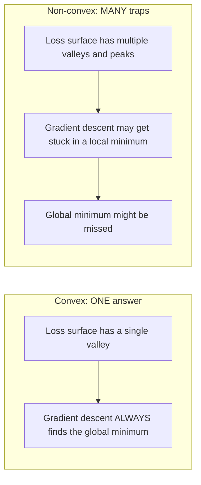
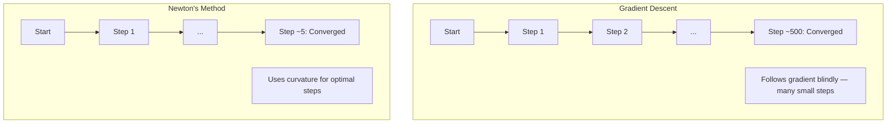
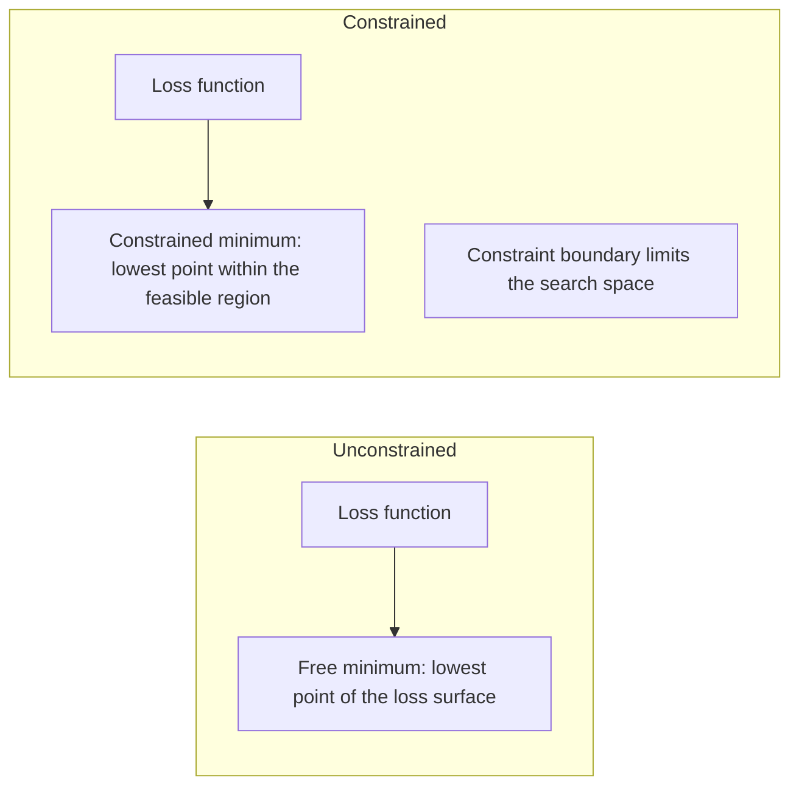
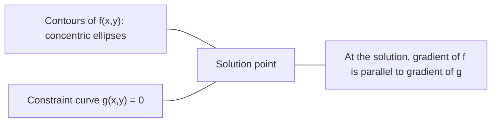

# Convex Optimization · 凸优化

> 凸问题只有一个山谷，神经网络有几百万个。分清这两者至关重要。
> Convex problems have one valley. Neural networks have millions. Knowing the difference matters.

**Type:** Build
**Language:** Python
**Prerequisites:** Phase 1, Lessons 04 (Calculus for ML), 08 (Optimization)
**Time:** ~90 minutes

## Learning Objectives · 学习目标

- 用定义、二阶导数和 Hessian 判据检验一个函数是否为凸
- 实现牛顿法（Newton's method），并将其二次收敛速度与梯度下降作比较
- 用拉格朗日乘子（Lagrange multipliers）求解约束优化问题，并解读 KKT 条件
- 解释为什么神经网络的损失地形是非凸的，而 SGD 仍能找到好解

> Test whether a function is convex using the definition, second derivative, and Hessian criteria
> Implement Newton's method and compare its quadratic convergence against gradient descent
> Solve constrained optimization problems using Lagrange multipliers and interpret KKT conditions
> Explain why neural network loss landscapes are non-convex yet SGD still finds good solutions

## The Problem · 问题在哪

第 08 课教了你梯度下降、动量和 Adam。这些优化器能在任何曲面上往下走，但不附带任何保证。在非凸地形上，梯度下降可能落进糟糕的局部极小、卡在鞍点上，或者永远振荡。你照样用了它，因为神经网络是非凸的，别无选择。

但机器学习里的很多问题是凸的：线性回归、逻辑回归（logistic regression）、SVM、LASSO、岭回归。对这些问题，存在更强的工具：带数学保证的优化。凸问题恰好只有一个山谷。任何往下走的算法都会到达全局最小。不需要随机重启，不需要学习率调度，不需要祈祷。

理解凸性能做三件事。第一，它告诉你问题何时容易（凸）、何时难（非凸）。第二，它给你更快的工具，比如凸问题上的牛顿法。第三，它解释了贯穿机器学习的概念：作为约束的正则化、SVM 里的对偶性（duality），以及深度学习为什么在违反了凸性给你的每一条好性质的情况下仍然有效。

> Lesson 08 taught you gradient descent, momentum, and Adam. Those optimizers walk downhill on any surface. But they come with no guarantees. ... But many problems in machine learning are convex. ... A convex problem has exactly one valley. Any algorithm that walks downhill will reach the global minimum.

## The Concept

### Convex sets · 凸集

如果一个集合 S 中任意两点的连线段也完全落在 S 内，则 S 是凸集（convex set）。

| 凸集 | 非凸 |
|---|---|
| **矩形**：内部任意两点都能用一条留在集合内的线段连接 | **星形/月牙形**：两个内部点之间的连线可能穿出集合 |
| **三角形**：所有内部点都满足同样的性质 | **甜甜圈/圆环**：中间的洞使某些线段离开集合 |
| 任意两点之间的线段都留在集合内 | 某些点对之间的线段会跑出集合 |

形式化检验：对 S 中任意点 x、y 和区间 [0, 1] 中任意 t，点 tx + (1-t)y 也在 S 中。

凸集的例子：

- 一条直线、一个平面、整个 R^n
- 一个球（圆、球面、超球面）
- 半空间（halfspace）：{x : a^T x <= b}
- 任意多个凸集的交集

非凸集的例子：

- 甜甜圈（圆环）
- 两个不相交圆的并集
- 任何带「凹陷」或「洞」的集合

> A set S is convex if for any two points in S, the line segment between them also lies entirely in S. ... Formal test: for any points x, y in S and any t in [0, 1], the point tx + (1-t)y is also in S.

### Convex functions · 凸函数

如果函数 f 的定义域是凸集，且对定义域中任意两点 x、y 和区间 [0, 1] 中任意 t 满足：

```
f(tx + (1-t)y) <= t*f(x) + (1-t)*f(y)
```

几何上：图上任意两点之间的线段位于图的上方或与图重合。

| 性质 | 凸函数 | 非凸函数 |
|---|---|---|
| **线段检验** | 图上任意两点的连线位于曲线**上方或与之重合** | 图上某些点之间的连线会**低于**曲线 |
| **形状** | 单个向上弯曲的碗/山谷 | 多峰多谷，弯曲方向混杂 |
| **局部极小** | 每个局部极小都是全局极小 | 可能存在高度不同的多个局部极小 |

常见的凸函数：

- f(x) = x^2（抛物线）
- f(x) = |x|（绝对值）
- f(x) = e^x（指数）
- f(x) = max(0, x)（ReLU，虽然是分段线性）
- f(x) = -log(x)，x > 0（负对数）
- 任何线性函数 f(x) = a^T x + b（既凸又凹）

> A function f is convex if its domain is a convex set and for any two points x, y in its domain and any t in [0, 1]: f(tx + (1-t)y) <= t*f(x) + (1-t)*f(y). ... Geometrically: the line segment between any two points on the graph lies above or on the graph.

### Testing for convexity · 检验凸性

三个实用检验，从最容易到最严格。

**检验 1：二阶导数检验（1D）。** 如果对所有 x 都有 f''(x) >= 0，则 f 是凸的。

- f(x) = x^2：f''(x) = 2 >= 0。凸。
- f(x) = x^3：f''(x) = 6x，x < 0 时为负。不凸。
- f(x) = e^x：f''(x) = e^x > 0。凸。

**检验 2：Hessian 检验（多元）。** 如果 Hessian 矩阵 H(x) 对所有 x 都半正定（positive semidefinite），则 f 是凸的。Hessian 是由二阶偏导数组成的矩阵。

**检验 3：定义检验。** 直接验证不等式 f(tx + (1-t)y) <= t*f(x) + (1-t)*f(y)。对难以求导的函数有用。

> Three practical tests, from easiest to most rigorous. ... Test 1: Second derivative test (1D). If f''(x) >= 0 for all x, then f is convex. ... If the Hessian matrix H(x) is positive semidefinite for all x, then f is convex. The Hessian is the matrix of second partial derivatives. ... Check the inequality f(tx + (1-t)y) <= t*f(x) + (1-t)*f(y) directly.

### Why convexity matters · 凸性为什么重要

凸优化的中心定理：

**对凸函数，每个局部极小都是全局极小。**

这意味着梯度下降不可能被困住。任何下坡路径都通向同一个答案。算法保证收敛到最优解。



推论：

- 不需要随机重启
- 不需要精巧的学习率调度
- 可以给出收敛性证明（速率取决于函数性质）
- 解是唯一的（平坦区域除外）

> The central theorem of convex optimization: For a convex function, every local minimum is a global minimum. ... This means gradient descent cannot get trapped. Any downhill path leads to the same answer. The algorithm is guaranteed to converge to the optimal solution.

### Convex vs non-convex in ML · 机器学习中的凸与非凸

| 问题 | 凸？ | 原因 |
|---------|---------|-----|
| 线性回归（MSE） | 是 | 损失对权重是二次的 |
| 逻辑回归 | 是 | 对数损失对权重是凸的 |
| SVM（hinge 损失） | 是 | 线性函数的最大值 |
| LASSO（L1 回归） | 是 | 凸函数之和仍是凸的 |
| 岭回归（L2） | 是 | 二次 + 二次 = 凸 |
| 神经网络（任意损失） | 否 | 非线性激活造成非凸地形 |
| k-means 聚类 | 否 | 离散的分配步骤 |
| 矩阵分解 | 否 | 未知数的乘积 |

带凸损失的线性模型是凸问题。一旦加上带非线性激活的隐藏层，凸性就被打破。

> Linear models with convex losses are convex. The moment you add hidden layers with nonlinear activations, convexity breaks.

### The Hessian matrix · Hessian 矩阵

函数 f: R^n -> R 的 Hessian H 是由二阶偏导数组成的 n x n 矩阵。

```
H[i][j] = d^2 f / (dx_i dx_j)
```

对 f(x, y) = x^2 + 3xy + y^2：

```
df/dx = 2x + 3y       d^2f/dx^2 = 2      d^2f/dxdy = 3
df/dy = 3x + 2y       d^2f/dydx = 3      d^2f/dy^2 = 2

H = [ 2  3 ]
    [ 3  2 ]
```

Hessian 告诉你曲率的信息：

- 特征值全为正：函数在每个方向都向上弯（该点处是凸的）
- 特征值全为负：在每个方向都向下弯（凹，是局部最大）
- 符号混杂：鞍点（一些方向向上弯，另一些方向向下弯）
- 零特征值：在该方向上是平的（退化）

要判断凸性，Hessian 必须处处半正定（所有特征值 >= 0），而不是只在某一点。

> The Hessian tells you about curvature. ... For convexity, the Hessian must be positive semidefinite (all eigenvalues >= 0) everywhere, not just at one point.

### Newton's method · 牛顿法

梯度下降使用一阶信息（梯度）。牛顿法使用二阶信息（Hessian）。它在当前点拟合一个二次近似，然后直接跳到那个二次函数的最小点。

```
Update rule:
  x_new = x - H^(-1) * gradient

Compare to gradient descent:
  x_new = x - lr * gradient
```

牛顿法用逆 Hessian 代替标量学习率，根据局部曲率自动调整步长和方向。



优点：

- 极小点附近二次收敛（误差每步被平方）
- 无需调学习率
- 尺度不变（无论问题如何参数化都有效）

缺点：

- 计算 Hessian 需要 O(n^2) 内存，求逆需要 O(n^3)
- 对一个有 100 万权重的神经网络，那就是 10^12 个条目和 10^18 次运算
- 对深度学习不实用

> Gradient descent uses first-order information (the gradient). Newton's method uses second-order information (the Hessian). It fits a quadratic approximation at the current point and jumps directly to the minimum of that quadratic. ... Newton's method replaces the scalar learning rate with the inverse Hessian. This automatically adjusts the step size and direction based on local curvature.

### Constrained optimization · 约束优化

无约束优化：在所有 x 上最小化 f(x)。
约束优化：在约束条件下最小化 f(x)。

真实问题都带约束。你想最小化成本，但预算有限；你想最小化误差，但模型复杂度有上界。



> Unconstrained optimization: minimize f(x) over all x. Constrained optimization: minimize f(x) subject to constraints. ... Real problems have constraints. You want to minimize cost but your budget is limited. You want to minimize error but your model complexity is bounded.

### Lagrange multipliers · 拉格朗日乘子

拉格朗日乘子法把约束问题转化为无约束问题。

问题：在 g(x) = 0 的约束下最小化 f(x)。

解法：引入一个新变量（拉格朗日乘子 lambda），求解无约束问题：

```
L(x, lambda) = f(x) + lambda * g(x)
```

在解处，L 的梯度为零：

```
dL/dx = df/dx + lambda * dg/dx = 0
dL/dlambda = g(x) = 0
```

几何直觉：在约束极小点处，f 的梯度必须与约束 g 的梯度平行。如果不平行，你就能沿约束面移动并进一步减小 f。



例：在 x + y = 1 的约束下最小化 f(x,y) = x^2 + y^2。

```
L = x^2 + y^2 + lambda(x + y - 1)

dL/dx = 2x + lambda = 0  =>  x = -lambda/2
dL/dy = 2y + lambda = 0  =>  y = -lambda/2
dL/dlambda = x + y - 1 = 0

From first two: x = y
Substituting: 2x = 1, so x = y = 0.5, lambda = -1
```

直线 x + y = 1 上离原点最近的点是 (0.5, 0.5)。

> The method of Lagrange multipliers converts a constrained problem into an unconstrained one. ... Geometric intuition: at the constrained minimum, the gradient of f must be parallel to the gradient of the constraint g. If they were not parallel, you could move along the constraint surface and reduce f further. ... The closest point on the line x + y = 1 to the origin is (0.5, 0.5).

### KKT conditions · KKT 条件

Karush-Kuhn-Tucker 条件把拉格朗日乘子推广到不等式约束。

问题：在 g_i(x) <= 0（i = 1, ..., m）的约束下最小化 f(x)。

KKT 条件（最优性的必要条件）：

```
1. Stationarity:    df/dx + sum(lambda_i * dg_i/dx) = 0
2. Primal feasibility:  g_i(x) <= 0  for all i
3. Dual feasibility:    lambda_i >= 0  for all i
4. Complementary slackness:  lambda_i * g_i(x) = 0  for all i
```

互补松弛（complementary slackness）是关键洞见：要么约束是激活的（g_i = 0，解位于边界上），要么乘子为零（约束不起作用）。不影响解的约束，其 lambda = 0。

KKT 条件是 SVM 的核心。支持向量（support vectors）正是约束激活的那些数据点（lambda > 0）。其余所有数据点的 lambda = 0，不影响决策边界。

> The Karush-Kuhn-Tucker conditions extend Lagrange multipliers to inequality constraints. ... Complementary slackness is the key insight: either the constraint is active (g_i = 0, the solution sits on the boundary) or the multiplier is zero (the constraint does not matter). ... KKT conditions are central to SVMs. The support vectors are the data points where the constraint is active (lambda > 0). All other data points have lambda = 0 and do not affect the decision boundary.

### Regularization as constrained optimization · 作为约束优化的正则化

L1 和 L2 正则化不是随意的技巧。它们是化了妆的约束优化问题。

**L2 正则化（Ridge）：**

```
minimize  Loss(w)  subject to  ||w||^2 <= t

Equivalent unconstrained form:
minimize  Loss(w) + lambda * ||w||^2
```

约束 ||w||^2 <= t 定义一个球（2D 是圆，3D 是球面）。解是损失等高线第一次碰到这个球的地方。

**L1 正则化（LASSO）：**

```
minimize  Loss(w)  subject to  ||w||_1 <= t

Equivalent unconstrained form:
minimize  Loss(w) + lambda * ||w||_1
```

约束 ||w||_1 <= t 定义一个菱形（2D 中旋转了 45 度的正方形）。

| 性质 | L2 约束（圆） | L1 约束（菱形） |
|---|---|---|
| **约束形状** | 圆（高维是球） | 菱形（2D 中旋转的正方形） |
| **损失等高线的接触点** | 光滑边界——圆上任意一点 | 角——与坐标轴对齐 |
| **解的行为** | 权重小但非零 | 某些权重恰好为零（稀疏） |
| **结果** | 权重收缩 | 特征选择 |

这解释了为什么 L1 产生稀疏模型（特征选择），而 L2 只收缩权重。菱形有与坐标轴对齐的角，损失等高线更容易碰到角，从而把一个或多个权重恰好压成零。

> L1 and L2 regularization are not arbitrary tricks. They are constrained optimization problems in disguise. ... This explains why L1 produces sparse models (feature selection) while L2 only shrinks weights. The diamond has corners aligned with axes. Loss contours are more likely to touch a corner, setting one or more weights exactly to zero.

### Duality · 对偶性

每个约束优化问题（原始问题，primal）都有一个伴随问题（对偶问题，dual）。对凸问题，原始与对偶有相同的最优值。这就是强对偶（strong duality）。

拉格朗日对偶函数：

```
Primal: minimize f(x) subject to g(x) <= 0
Lagrangian: L(x, lambda) = f(x) + lambda * g(x)
Dual function: d(lambda) = min_x L(x, lambda)
Dual problem: maximize d(lambda) subject to lambda >= 0
```

对偶性为什么重要：

- 对偶问题有时比原始问题更容易求解
- SVM 以对偶形式求解，问题只依赖数据点之间的点积（从而启用核技巧，kernel trick）
- 对偶给出原始最优值的下界，可用于检验解的质量

具体到 SVM：

```
Primal: find w, b that maximize the margin 2/||w|| subject to
        y_i(w^T x_i + b) >= 1 for all i

Dual:   maximize sum(alpha_i) - 0.5 * sum_ij(alpha_i * alpha_j * y_i * y_j * x_i^T x_j)
        subject to alpha_i >= 0 and sum(alpha_i * y_i) = 0

The dual only involves dot products x_i^T x_j.
Replace x_i^T x_j with K(x_i, x_j) to get the kernel trick.
```

> Every constrained optimization problem (the primal) has a companion problem (the dual). For convex problems, the primal and dual have the same optimal value. This is strong duality. ... SVMs are solved in their dual form, where the problem depends on dot products between data points (enabling the kernel trick). ... The dual provides a lower bound on the primal optimum, useful for checking solution quality.

### Why deep learning works despite non-convexity · 非凸之下深度学习为何仍然有效

神经网络的损失函数极度非凸。按每一条经典判据，优化它们都该失败。然而随机梯度下降可靠地找到好解。有几个因素可以解释这一点。

**大多数局部极小已经足够好。** 在高维空间里，随机临界点（梯度为零的点）绝大多数是鞍点，而不是局部极小。仅有的少数局部极小，其损失值往往接近全局极小。当参数空间有数百万维时，掉进糟糕局部极小的概率极低。

**真正的障碍是鞍点，不是局部极小。** 在有 n 个参数的函数里，鞍点混杂着正负曲率方向。对高维中的随机临界点，n 个特征值全为正（即局部极小）的概率大约是 2^(-n)。几乎所有临界点都是鞍点。SGD 的噪声有助于逃离它们。

**过参数化（overparameterization）让地形变平滑。** 参数多于训练样本的网络拥有更平滑、更连通的损失曲面。更宽的网络有更少的糟糕局部极小。这违反直觉，但经验上一再成立。

**损失地形结构：**

| 性质 | 低维空间 | 高维空间 |
|---|---|---|
| **地形** | 许多孤立的峰与谷 | 平滑连通的山谷 |
| **极小值** | 许多孤立的局部极小 | 糟糕的局部极少；多数接近最优 |
| **导航** | 难找全局极小 | 许多路径通向好解 |
| **临界点** | 局部极小与鞍点混杂 | 绝大多数是鞍点，不是局部极小 |

**随机噪声充当隐式正则化。** mini-batch SGD 带来的噪声防止落进尖锐极小。尖锐极小过拟合；平坦极小有泛化能力。噪声把优化引向损失地形的平坦区域。

> Neural network loss functions are wildly non-convex. By every classical measure, optimizing them should fail. Yet stochastic gradient descent finds good solutions reliably. ... In high-dimensional spaces, random critical points (where the gradient is zero) are overwhelmingly saddle points, not local minima. ... SGD's noise helps escape them. ... Networks with more parameters than training examples have smoother, more connected loss surfaces. ... Sharp minima overfit; flat minima generalize.

### Second-order methods in practice · 实践中的二阶方法

纯牛顿法对大模型不实用。几种近似让二阶信息变得可用。

**L-BFGS（Limited-memory BFGS）：** 用最近 m 次梯度差近似逆 Hessian，内存开销是 O(mn) 而非 O(n^2)。对最多约 10,000 个参数的问题效果好。用于经典机器学习（逻辑回归、CRF），不用于深度学习。

**自然梯度（Natural gradient）：** 用 Fisher 信息矩阵（对数似然的期望 Hessian）代替标准 Hessian，从而考虑概率分布的几何。K-FAC（Kronecker-Factored Approximate Curvature）把 Fisher 矩阵近似为 Kronecker 积，使其在神经网络上实用。

**Hessian-free 优化：** 用共轭梯度求解 Hx = g，从头到尾不显式构造 H。只需要 Hessian-向量积，而它可以经自动微分在 O(n) 时间内算出。

**对角近似：** Adam 的二阶矩就是 Hessian 对角线的一种对角近似。AdaHessian 在此基础上用 Hutchinson 估计器引入真实的 Hessian 对角元素。

| 方法 | 内存 | 每步代价 | 何时使用 |
|--------|--------|--------------|-------------|
| 梯度下降 | O(n) | O(n) | 基线、大模型 |
| 牛顿法 | O(n^2) | O(n^3) | 小型凸问题 |
| L-BFGS | O(mn) | O(mn) | 中型凸问题 |
| Adam | O(n) | O(n) | 深度学习默认 |
| K-FAC | O(n) | 每层 O(n) | 研究、大 batch 训练 |

```figure
convex-vs-nonconvex
```

> Pure Newton's method is impractical for large models. Several approximations make second-order information usable. ... L-BFGS (Limited-memory BFGS): Approximates the inverse Hessian using the last m gradient differences. Requires O(mn) memory instead of O(n^2). ... Adam's second moment is a diagonal approximation of the Hessian's diagonal.

## Build It · 动手造

### Step 1: Convexity checker · 步骤 1：凸性检验器

构建一个函数：通过采样点并检查定义，经验性地测试凸性。

```python
import random
import math

def check_convexity(f, dim, bounds=(-5, 5), samples=1000):
    violations = 0
    for _ in range(samples):
        x = [random.uniform(*bounds) for _ in range(dim)]
        y = [random.uniform(*bounds) for _ in range(dim)]
        t = random.uniform(0, 1)
        mid = [t * xi + (1 - t) * yi for xi, yi in zip(x, y)]
        lhs = f(mid)
        rhs = t * f(x) + (1 - t) * f(y)
        if lhs > rhs + 1e-10:
            violations += 1
    return violations == 0, violations
```

> Build a function that tests convexity empirically by sampling points and checking the definition.

### Step 2: Newton's method for 2D · 步骤 2：二维牛顿法

用显式 Hessian 实现牛顿法，并与梯度下降比较收敛速度。

```python
def newtons_method(f, grad_f, hessian_f, x0, steps=50, tol=1e-12):
    x = list(x0)
    history = [x[:]]
    for _ in range(steps):
        g = grad_f(x)
        H = hessian_f(x)
        det = H[0][0] * H[1][1] - H[0][1] * H[1][0]
        if abs(det) < 1e-15:
            break
        H_inv = [
            [H[1][1] / det, -H[0][1] / det],
            [-H[1][0] / det, H[0][0] / det],
        ]
        dx = [
            H_inv[0][0] * g[0] + H_inv[0][1] * g[1],
            H_inv[1][0] * g[0] + H_inv[1][1] * g[1],
        ]
        x = [x[0] - dx[0], x[1] - dx[1]]
        history.append(x[:])
        if sum(gi ** 2 for gi in g) < tol:
            break
    return history
```

> Implement Newton's method using an explicit Hessian. Compare convergence speed against gradient descent.

### Step 3: Lagrange multiplier solver · 步骤 3：拉格朗日乘子求解器

在拉格朗日函数上运行梯度下降，求解约束优化。

```python
def lagrange_solve(f_grad, g_val, g_grad, x0, lr=0.01,
                   lr_lambda=0.01, steps=5000):
    x = list(x0)
    lam = 0.0
    history = []
    for _ in range(steps):
        fg = f_grad(x)
        gv = g_val(x)
        gg = g_grad(x)
        x = [
            xi - lr * (fgi + lam * ggi)
            for xi, fgi, ggi in zip(x, fg, gg)
        ]
        lam = lam + lr_lambda * gv
        history.append((x[:], lam, gv))
    return history
```

> Solve constrained optimization using gradient descent on the Lagrangian.

### Step 4: Compare first-order vs second-order · 步骤 4：一阶 vs 二阶对比

在同一个二次函数上运行梯度下降和牛顿法，数一数各自收敛需要的步数。

```python
def quadratic(x):
    return 5 * x[0] ** 2 + x[1] ** 2

def quadratic_grad(x):
    return [10 * x[0], 2 * x[1]]

def quadratic_hessian(x):
    return [[10, 0], [0, 2]]
```

牛顿法 1 步就收敛（对二次函数它是精确的）。梯度下降要几百步，因为 Hessian 的特征值相差 5 倍，形成一个被拉长的山谷。

> Newton's method will converge in 1 step (it is exact for quadratics). Gradient descent will take hundreds of steps because the eigenvalues of the Hessian differ by a factor of 5, creating an elongated valley.

## Use It · 实战用法

在选择机器学习模型和求解器时，凸性分析直接派上用场。

对凸问题（逻辑回归、SVM、LASSO）：

- 使用专用求解器（liblinear、CVXPY、`scipy.optimize.minimize` 且 method='L-BFGS-B'）
- 期待唯一的全局解
- 二阶方法实用且快

对非凸问题（神经网络）：

- 使用一阶方法（SGD、Adam）
- 接受解依赖初始化和随机性的事实
- 把过参数化、噪声和学习率调度当作隐式正则化
- 不要浪费时间搜索全局极小。一个好的局部极小就足够了。

```python
from scipy.optimize import minimize

result = minimize(
    fun=lambda w: sum((y - X @ w) ** 2) + 0.1 * sum(w ** 2),
    x0=np.zeros(d),
    method='L-BFGS-B',
    jac=lambda w: -2 * X.T @ (y - X @ w) + 0.2 * w,
)
```

对 SVM，对偶形式让你能用核技巧：

```python
from sklearn.svm import SVC

svm = SVC(kernel='rbf', C=1.0)
svm.fit(X_train, y_train)
print(f"Support vectors: {svm.n_support_}")
```

> Convexity analysis applies directly when choosing ML models and solvers. ... Do not waste time searching for the global minimum. A good local minimum is sufficient. ... For SVMs, the dual formulation lets you use the kernel trick:

## Exercises · 练习

1. **凸性画廊。** 用检验器测试这些函数的凸性：f(x) = x^4、f(x) = sin(x)、f(x,y) = x^2 + y^2、f(x,y) = x*y、f(x) = max(x, 0)。解释每个结果为什么合理。

2. **牛顿 vs 梯度下降竞赛。** 在 f(x,y) = 50*x^2 + y^2 上从起点 (10, 10) 运行两种方法。各自需要多少步才能让损失 < 1e-10？当条件数（Hessian 最大与最小特征值之比）增大时，梯度下降会发生什么？

3. **拉格朗日乘子的几何。** 在 x + 2y = 4 的约束下最小化 f(x,y) = (x-3)^2 + (y-3)^2。在解处验证 f 的梯度与 g 的梯度平行。

4. **正则化约束。** 实现 L1 约束优化：在 |x| + |y| <= 1 的约束下最小化 (x-3)^2 + (y-2)^2。证明解有一个坐标恰好为零（来自菱形约束的稀疏性）。

5. **Hessian 特征值分析。** 计算 Rosenbrock 函数在 (1,1) 和 (-1,1) 处的 Hessian，并计算两点的特征值。这些特征值告诉你极小点处与远离极小处的曲率有何不同？

## Key Terms · 术语表

| 术语 | 含义 |
|------|---------------|
| 凸集 | 集合内任意两点之间的线段都留在集合内 |
| 凸函数 | 图上任意两点的连线都位于图上方或与图重合。等价地，Hessian 处处半正定 |
| 局部极小 | 比附近所有点都低的点。对凸函数，每个局部极小都是全局极小 |
| 全局极小 | 函数在整个定义域上的最低点 |
| Hessian 矩阵 | 所有二阶偏导数组成的矩阵，编码曲率信息 |
| 半正定（positive semidefinite） | 特征值全部非负的矩阵，是「二阶导数 >= 0」的多维版本 |
| 条件数 | Hessian 最大与最小特征值之比。条件数大意味着山谷被拉长、梯度下降变慢 |
| 牛顿法 | 使用逆 Hessian 决定步长与方向的二阶优化器。极小点附近二次收敛 |
| 拉格朗日乘子 | 为了把约束优化问题转化为无约束问题而引入的变量 |
| KKT 条件 | 带不等式约束时最优性的必要条件。是拉格朗日乘子的推广 |
| 互补松弛 | 在解处，约束要么激活、要么其乘子为零。绝不同时非零 |
| 对偶性 | 每个约束问题都有一个伴随的对偶问题。凸问题两者最优值相同 |
| 强对偶 | 原始与对偶最优值相等。对满足 Slater 条件的凸问题成立 |
| L-BFGS | 近似二阶方法，存储最近 m 次梯度差而不是完整 Hessian |
| 鞍点 | 梯度为零，但在一些方向是极小、另一些方向是极大的点 |
| 过参数化 | 参数多于训练样本。让损失地形更平滑，减少糟糕的局部极小 |

## Further Reading · 延伸阅读

- [Boyd & Vandenberghe: Convex Optimization](https://web.stanford.edu/~boyd/cvxbook/) —— 标准教材，可在线免费阅读
- [Bottou, Curtis, Nocedal: Optimization Methods for Large-Scale Machine Learning (2018)](https://arxiv.org/abs/1606.04838) —— 连接凸优化理论与深度学习实践
- [Choromanska et al.: The Loss Surfaces of Multilayer Networks (2015)](https://arxiv.org/abs/1412.0233) —— 为什么非凸的神经网络地形没有看上去那么糟
- [Nocedal & Wright: Numerical Optimization](https://link.springer.com/book/10.1007/978-0-387-40065-5) —— 牛顿法、L-BFGS 与约束优化的全面参考
