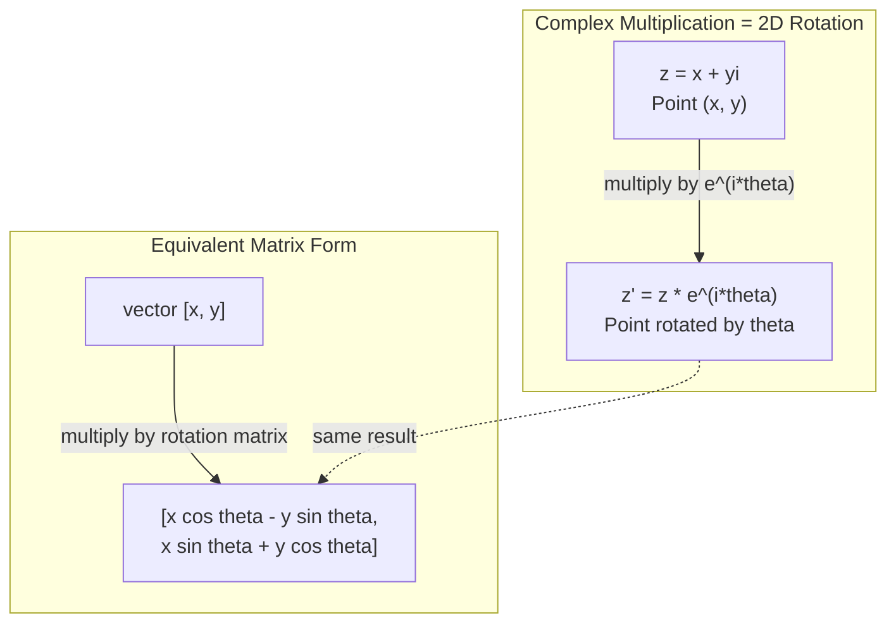
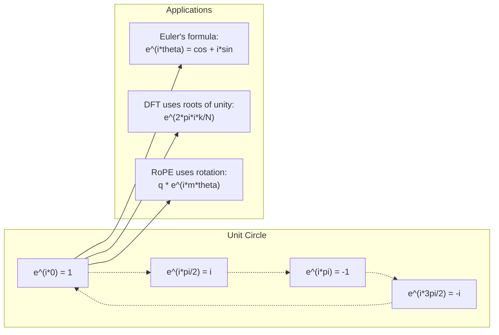

# Complex Numbers for AI · 复数：旋转与频率的语言

> The square root of -1 is not imaginary. It is the key to rotations, frequencies, and half of signal processing.

**Type:** Learn
**Language:** Python
**Prerequisites:** Phase 1, Lessons 01-04 (linear algebra, calculus)
**Time:** ~60 minutes

## Learning Objectives · 学习目标

- 用直角形式（rectangular form）与极坐标形式（polar form）完成复数运算（加、乘、除、共轭）
- 应用欧拉公式（Euler's formula）在复指数与三角函数之间来回转换
- 用复数单位根（roots of unity）从零实现离散傅里叶变换（DFT）
- 解释复数旋转如何支撑 Transformer 中的 RoPE 与正弦位置编码

> Perform complex arithmetic (add, multiply, divide, conjugate) in both rectangular and polar form
> Apply Euler's formula to convert between complex exponentials and trigonometric functions
> Implement the Discrete Fourier Transform using complex roots of unity
> Explain how complex rotations underlie RoPE and sinusoidal positional encodings in transformers

## The Problem · 问题在哪

你翻开一篇讲傅里叶变换（Fourier transform）的论文，满眼都是 `i`。你去看 Transformer 的位置编码，看到的是不同频率的 `sin` 和 `cos` —— 它们正是复指数的实部与虚部。你读量子计算的资料，发现一切都写在复向量空间里。

复数（complex number）看起来很抽象：一个建立在「-1 的平方根」上的数系，像是个数学把戏。但它不是把戏。它是描述旋转与振荡的自然语言。凡是会旋转、振动、振荡的东西，复数都是最合适的工具。

不理解复数，你就理解不了离散傅里叶变换（Discrete Fourier Transform），理解不了 FFT，理解不了现代语言模型里 RoPE（Rotary Position Embedding，旋转位置编码）是怎么工作的，也理解不了原始 Transformer 论文里的正弦位置编码为什么选了那些频率。

本课从零构建复数运算，把它和几何联系起来，并精确指出复数在机器学习里出现的位置。

> You open a paper on Fourier transforms and there is `i` everywhere. You look at transformer positional encodings and see `sin` and `cos` at different frequencies -- the real and imaginary parts of complex exponentials. You read about quantum computing and find everything expressed in complex vector spaces.
> Complex numbers seem abstract. A number system built on the square root of -1 feels like a mathematical trick. But it is not a trick. It is the natural language of rotations and oscillations. Every time something spins, vibrates, or oscillates, complex numbers are the right tool.
> Without understanding complex numbers, you cannot understand the Discrete Fourier Transform. You cannot understand FFT. You cannot understand how RoPE (Rotary Position Embedding) works in modern language models. You cannot understand why sinusoidal positional encodings in the original Transformer paper use the frequencies they do.
> This lesson builds complex arithmetic from scratch, connects it to geometry, and shows you exactly where complex numbers appear in machine learning.

## The Concept · 概念

### What is a complex number? · 什么是复数

复数由两部分组成：实部（real part）和虚部（imaginary part）。

```
z = a + bi

where:
  a is the real part
  b is the imaginary part
  i is the imaginary unit, defined by i^2 = -1
```

就这么简单。你把数轴扩展成一个平面：实数排在一条轴上，虚数排在另一条轴上，每个复数就是这个平面上的一个点。

> A complex number has two parts: a real part and an imaginary part.
> That is it. You extend the number line into a plane. The real numbers sit on one axis. The imaginary numbers sit on the other. Every complex number is a point in this plane.

### Complex arithmetic · 复数运算

**加法。** 实部加实部，虚部加虚部。

```
(a + bi) + (c + di) = (a + c) + (b + d)i

Example: (3 + 2i) + (1 + 4i) = 4 + 6i
```

**乘法。** 用分配律展开，记住 i^2 = -1。

```
(a + bi)(c + di) = ac + adi + bci + bdi^2
                 = ac + adi + bci - bd
                 = (ac - bd) + (ad + bc)i

Example: (3 + 2i)(1 + 4i) = 3 + 12i + 2i + 8i^2
                            = 3 + 14i - 8
                            = -5 + 14i
```

**共轭（conjugate）。** 把虚部的符号翻转。

```
conjugate of (a + bi) = a - bi
```

复数与其共轭的乘积总是实数：

```
(a + bi)(a - bi) = a^2 + b^2
```

**除法。** 分子分母同乘以分母的共轭。

```
(a + bi) / (c + di) = (a + bi)(c - di) / (c^2 + d^2)
```

这样就把分母里的虚部消掉了，得到一个干净的复数。

> Addition. Add the real parts together, add the imaginary parts together.
> Multiplication. Use the distributive law and remember that i^2 = -1.
> Conjugate. Flip the sign of the imaginary part.
> The product of a complex number and its conjugate is always real:
> Division. Multiply numerator and denominator by the conjugate of the denominator.
> This eliminates the imaginary part from the denominator, giving you a clean complex number.

### The complex plane · 复平面

复平面（complex plane）把每个复数映射成二维平面上的一个点：横轴是实轴（real axis），纵轴是虚轴（imaginary axis）。

```
z = 3 + 2i  corresponds to the point (3, 2)
z = -1 + 0i corresponds to the point (-1, 0) on the real axis
z = 0 + 4i  corresponds to the point (0, 4) on the imaginary axis
```

复数既是一个点，也是一个从原点出发的向量。正是这种双重身份让复数在几何里如此好用。

> The complex plane maps every complex number to a 2D point. The horizontal axis is the real axis, the vertical axis is the imaginary axis.
> A complex number is simultaneously a point and a vector from the origin. This dual interpretation is what makes complex numbers useful for geometry.

### Polar form · 极坐标形式

平面上的任何一点都可以用它到原点的距离、以及它相对正实轴的角度来描述。

```
z = r * (cos(theta) + i*sin(theta))

where:
  r = |z| = sqrt(a^2 + b^2)     (magnitude, or modulus)
  theta = atan2(b, a)             (phase, or argument)
```

直角形式（a + bi）适合做加法；极坐标形式（r, theta）适合做乘法。

**极坐标下的乘法。** 模长相乘，辐角相加。

```
z1 = r1 * e^(i*theta1)
z2 = r2 * e^(i*theta2)

z1 * z2 = (r1 * r2) * e^(i*(theta1 + theta2))
```

这就是复数天生适合旋转的原因：乘以一个模长为 1 的复数，就是一次纯旋转。

> Any point in the plane can be described by its distance from the origin and its angle from the positive real axis.
> Rectangular form (a + bi) is good for addition. Polar form (r, theta) is good for multiplication.
> Multiplication in polar form. Multiply the magnitudes, add the angles.
> This is why complex numbers are perfect for rotations. Multiplying by a complex number with magnitude 1 is a pure rotation.

### Euler's formula · 欧拉公式

连接复指数与三角学的桥梁：

```
e^(i*theta) = cos(theta) + i*sin(theta)
```

这是本课最重要的公式。当 theta = pi 时：

```
e^(i*pi) = cos(pi) + i*sin(pi) = -1 + 0i = -1

Therefore: e^(i*pi) + 1 = 0
```

五个最基本的常数（e、i、pi、1、0）被一个等式联系在一起。

> The bridge between complex exponentials and trigonometry:
> This is the most important formula in this lesson. When theta = pi:
> Five fundamental constants (e, i, pi, 1, 0) linked in one equation.

### Why Euler's formula matters for ML · 欧拉公式对 ML 为什么重要

欧拉公式说的是：随着 theta 变化，`e^(i*theta)` 会沿单位圆描出一圈。theta = 0 时在 (1, 0)；theta = pi/2 时在 (0, 1)；theta = pi 时在 (-1, 0)；theta = 3*pi/2 时在 (0, -1)。转满一圈是 theta = 2*pi。

也就是说，复指数就是旋转。而旋转在信号处理和 ML 里无处不在。

> Euler's formula says that `e^(i*theta)` traces the unit circle as theta varies. At theta = 0, you are at (1, 0). At theta = pi/2, you are at (0, 1). At theta = pi, you are at (-1, 0). At theta = 3*pi/2, you are at (0, -1). A full rotation is theta = 2*pi.
> This means complex exponentials ARE rotations. And rotations are everywhere in signal processing and ML.

### Connection to 2D rotations · 与二维旋转的联系

把复数 (x + yi) 乘以 e^(i*theta)，就是把点 (x, y) 绕原点旋转角度 theta。

```
Rotation via complex multiplication:
  (x + yi) * (cos(theta) + i*sin(theta))
  = (x*cos(theta) - y*sin(theta)) + (x*sin(theta) + y*cos(theta))i

Rotation via matrix multiplication:
  [cos(theta)  -sin(theta)] [x]   [x*cos(theta) - y*sin(theta)]
  [sin(theta)   cos(theta)] [y] = [x*sin(theta) + y*cos(theta)]
```

两种做法结果完全相同。复数乘法就是二维旋转，旋转矩阵只是把复数乘法写成了矩阵记号。



> Multiplying the complex number (x + yi) by e^(i*theta) rotates the point (x, y) by angle theta around the origin.
> They produce identical results. Complex multiplication IS 2D rotation. The rotation matrix is just complex multiplication written in matrix notation.

### Phasors and rotating signals · 相量与旋转信号

复指数 e^(i*omega*t) 是一个以角频率 omega 绕单位圆旋转的点。随着 t 增大，这个点沿圆周画出轨迹。

这个旋转点的实部是 cos(omega*t)，虚部是 sin(omega*t)。正弦信号就是旋转复数的「影子」。

```
e^(i*omega*t) = cos(omega*t) + i*sin(omega*t)

Real part:      cos(omega*t)    -- a cosine wave
Imaginary part: sin(omega*t)    -- a sine wave
```

这就是相量（phasor）表示。你不再追踪一条上下抖动的正弦波，而是追踪一支平稳旋转的箭头：相移变成角度偏移，幅度变化变成模长变化，信号相加变成向量相加。

> A complex exponential e^(i*omega*t) is a point rotating around the unit circle at angular frequency omega. As t increases, the point traces the circle.
> The real part of this rotating point is cos(omega*t). The imaginary part is sin(omega*t). A sinusoidal signal is the shadow of a rotating complex number.
> This is the phasor representation. Instead of tracking a wiggly sine wave, you track a smoothly rotating arrow. Phase shifts become angle offsets. Amplitude changes become magnitude changes. Addition of signals becomes vector addition.

### Roots of unity · 单位根

N 次单位根（N-th roots of unity）是单位圆上等距分布的 N 个点：

```
w_k = e^(2*pi*i*k/N)    for k = 0, 1, 2, ..., N-1
```

N = 4 时，四个根是 1、i、-1、-i（四个罗盘方位点）。
N = 8 时，是四个方位点加上四个对角点。

单位根是离散傅里叶变换的地基：DFT 把信号分解到这 N 个等距频率上的分量。

> The N-th roots of unity are N points equally spaced on the unit circle:
> For N = 4, the roots are: 1, i, -1, -i (the four compass points).
> For N = 8, you get the four compass points plus the four diagonals.
> Roots of unity are the foundation of the Discrete Fourier Transform. The DFT decomposes a signal into components at these N equally-spaced frequencies.

### Connection to the DFT · 与 DFT 的联系

信号 x[0], x[1], ..., x[N-1] 的离散傅里叶变换是：

```
X[k] = sum_{n=0}^{N-1} x[n] * e^(-2*pi*i*k*n/N)
```

每个 X[k] 度量的是信号与第 k 个单位根（频率为 k 的复正弦）的相关程度。DFT 把信号拆成 N 个旋转相量，并告诉你每个相量的幅度和相位。

> The Discrete Fourier Transform of a signal x[0], x[1], ..., x[N-1] is:
> Each X[k] measures how much the signal correlates with the k-th root of unity -- a complex sinusoid at frequency k. The DFT breaks a signal into N rotating phasors and tells you the amplitude and phase of each one.

### Why i is not imaginary · 为什么 i 并不「虚」

「虚数（imaginary）」这个词是个历史意外：笛卡尔当年用它表达的是不屑。但 i 并不比负数更「虚」—— 人们当初也曾拒绝负数。负数回答的是「3 减 5 等于多少？」，虚数单位回答的是「什么数的平方等于 -1？」

更有用的说法：i 是一个 90 度旋转算子。实数乘一次 i，旋转 90 度到虚轴；再乘一次 i（即 i^2），又转 90 度 —— 这时指向负实轴方向。这就是 i^2 = -1 的由来。它一点也不神秘：两个四分之一转拼成一个半转。

这就是复数在工程里无处不在的原因。凡是旋转的东西 —— 电磁波、量子态、信号振荡、位置编码 —— 都天然适合用复数描述。

> The word "imaginary" is a historical accident. Descartes used it dismissively. But i is no more imaginary than negative numbers were when people first rejected them. Negative numbers answer "what do you subtract 5 from 3 to get?" The imaginary unit answers "what do you square to get -1?"
> More usefully: i is a 90-degree rotation operator. Multiply a real number by i once, you rotate 90 degrees to the imaginary axis. Multiply by i again (i^2), you rotate another 90 degrees -- now you are pointing in the negative real direction. That is why i^2 = -1. It is not mysterious. It is a half-turn built from two quarter-turns.
> This is why complex numbers are everywhere in engineering. Anything that rotates -- electromagnetic waves, quantum states, signal oscillations, positional encodings -- is naturally described by complex numbers.

### Complex exponentials vs trigonometric functions · 复指数 vs 三角函数

在欧拉公式之前，工程师把信号写成 A*cos(omega*t + phi) —— 幅度 A、频率 omega、相位 phi。能用，但算起来很痛苦：要把两个不同相位的余弦相加，得靠三角恒等式。

换成复指数，同一个信号就是 A*e^(i*(omega*t + phi))。两个信号相加就是两个复数相加；乘法（调制）就是模长相乘、辐角相加；相移变成角度加法；频移变成乘以一个相量。

整个信号处理领域转向复指数记号，就是因为数学上更干净。「真实信号」永远只是复表示的实部；虚部作为「记账」一路带着走，让所有代数推导自然成立。

> Before Euler's formula, engineers wrote signals as A*cos(omega*t + phi) -- amplitude A, frequency omega, phase phi. This works but makes arithmetic painful. Adding two cosines with different phases requires trigonometric identities.
> With complex exponentials, the same signal is A*e^(i*(omega*t + phi)). Adding two signals is just adding two complex numbers. Multiplying (modulating) is just multiplying magnitudes and adding angles. Phase shifts become angle additions. Frequency shifts become multiplications by phasors.
> The entire field of signal processing switched to complex exponential notation because the math is cleaner. The "real signal" is always just the real part of the complex representation. The imaginary part is carried along as bookkeeping, making all the algebra work out naturally.

### Connection to transformers · 与 Transformer 的联系

**正弦位置编码**（原始 Transformer 论文）：

```
PE(pos, 2i) = sin(pos / 10000^(2i/d))
PE(pos, 2i+1) = cos(pos / 10000^(2i/d))
```

这些 sin/cos 对正是不同频率复指数的实部与虚部。每个频率为位置编码提供一种不同的「分辨率」：低频变化慢（粗粒度位置），高频变化快（细粒度位置）。合在一起，每个位置拿到一个独一无二的「频率指纹」。

**RoPE（Rotary Position Embedding，旋转位置编码）**更进一步：它显式地把 query 和 key 向量乘上复旋转。两个 token 之间的相对位置变成一个旋转角。注意力用这些旋转后的向量计算，模型因此通过复数乘法对相对位置敏感。

| Operation | Algebraic Form | Geometric Meaning |
|-----------|---------------|-------------------|
| 加法（Addition） | (a+c) + (b+d)i | 平面上的向量加法 |
| 乘法（Multiplication） | (ac-bd) + (ad+bc)i | 旋转并缩放 |
| 共轭（Conjugate） | a - bi | 沿实轴翻转 |
| 模（Magnitude） | sqrt(a^2 + b^2) | 到原点的距离 |
| 相位（Phase） | atan2(b, a) | 相对正实轴的角度 |
| 除法（Division） | 乘以共轭 | 反向旋转并重新缩放 |
| 幂（Power） | r^n * e^(i*n*theta) | 旋转 n 次，缩放 r^n 倍 |



```figure
roots-of-unity
```

> Sinusoidal positional encodings (original Transformer paper):
> The sin and cos pairs are the real and imaginary parts of complex exponentials at different frequencies. Each frequency provides a different "resolution" for encoding position. Low frequencies change slowly (coarse position). High frequencies change quickly (fine position). Together they give each position a unique frequency fingerprint.
> RoPE (Rotary Position Embedding) takes this further. It explicitly multiplies query and key vectors by complex rotation matrices. The relative position between two tokens becomes a rotation angle. Attention is computed using these rotated vectors, making the model sensitive to relative position through complex multiplication.

## Build It · 动手造

### Step 1: Complex class · 第 1 步：Complex 类

构建一个支持四则运算、模长、相位以及直角/极坐标形式互换的 Complex 复数类。

```python
import math

class Complex:
    def __init__(self, real, imag=0.0):
        self.real = real
        self.imag = imag

    def __add__(self, other):
        return Complex(self.real + other.real, self.imag + other.imag)

    def __mul__(self, other):
        r = self.real * other.real - self.imag * other.imag
        i = self.real * other.imag + self.imag * other.real
        return Complex(r, i)

    def __truediv__(self, other):
        denom = other.real ** 2 + other.imag ** 2
        r = (self.real * other.real + self.imag * other.imag) / denom
        i = (self.imag * other.real - self.real * other.imag) / denom
        return Complex(r, i)

    def magnitude(self):
        return math.sqrt(self.real ** 2 + self.imag ** 2)

    def phase(self):
        return math.atan2(self.imag, self.real)

    def conjugate(self):
        return Complex(self.real, -self.imag)
```

> Build a Complex number class that supports arithmetic, magnitude, phase, and conversion between rectangular and polar forms.

### Step 2: Polar conversion and Euler's formula · 第 2 步：极坐标转换与欧拉公式

```python
def to_polar(z):
    return z.magnitude(), z.phase()

def from_polar(r, theta):
    return Complex(r * math.cos(theta), r * math.sin(theta))

def euler(theta):
    return Complex(math.cos(theta), math.sin(theta))
```

验证：`euler(theta).magnitude()` 应恒等于 1.0；`euler(0)` 应得到 (1, 0)；`euler(pi)` 应得到 (-1, 0)。

> Verify: `euler(theta).magnitude()` should always be 1.0. `euler(0)` should give (1, 0). `euler(pi)` should give (-1, 0).

### Step 3: Rotation · 第 3 步：旋转

把点 (x, y) 旋转角度 theta，就是一次复数乘法：

```python
point = Complex(3, 4)
rotated = point * euler(math.pi / 4)
```

模长不变，只有角度变了。

> Rotating a point (x, y) by angle theta is one complex multiplication:
> The magnitude stays the same. Only the angle changes.

### Step 4: DFT from complex arithmetic · 第 4 步：从复数运算到 DFT

```python
def dft(signal):
    N = len(signal)
    result = []
    for k in range(N):
        total = Complex(0, 0)
        for n in range(N):
            angle = -2 * math.pi * k * n / N
            total = total + Complex(signal[n], 0) * euler(angle)
        result.append(total)
    return result
```

这就是 O(N^2) 的 DFT：每个输出 X[k] 都是信号样本与单位根乘积之和。

> This is the O(N^2) DFT. Each output X[k] is the sum of the signal samples multiplied by roots of unity.

### Step 5: Inverse DFT · 第 5 步：逆 DFT

逆 DFT 从频谱重建原始信号。与正变换相比只有两处改动：指数符号翻转、结果除以 N。

```python
def idft(spectrum):
    N = len(spectrum)
    result = []
    for n in range(N):
        total = Complex(0, 0)
        for k in range(N):
            angle = 2 * math.pi * k * n / N
            total = total + spectrum[k] * euler(angle)
        result.append(Complex(total.real / N, total.imag / N))
    return result
```

这给出完美重建：先 DFT 再 IDFT，就能以机器精度恢复原始信号，不丢失任何信息。

> The inverse DFT reconstructs the original signal from its spectrum. The only changes from the forward DFT: flip the sign in the exponent and divide by N.
> This gives you perfect reconstruction. Apply DFT, then IDFT, and you get back the original signal to machine precision. No information is lost.

### Step 6: Roots of unity · 第 6 步：单位根

```python
def roots_of_unity(N):
    return [euler(2 * math.pi * k / N) for k in range(N)]
```

验证两条性质：
- 每个根的模长都恰好为 1。
- 全部 N 个根之和为零（对称性使其互相抵消）。

正是这两条性质让 DFT 可逆。单位根构成频域的一组正交基。

> Verify two properties:
> - Every root has magnitude exactly 1.
> - The sum of all N roots is zero (they cancel out by symmetry).
> These properties are what make the DFT invertible. The roots of unity form an orthogonal basis for the frequency domain.

## Use It · 实战用法

Python 内置复数支持，字面量 `j` 表示虚数单位。

```python
z = 3 + 2j
w = 1 + 4j

print(z + w)
print(z * w)
print(abs(z))

import cmath
print(cmath.phase(z))
print(cmath.exp(1j * cmath.pi))
```

数组场景下，numpy 原生支持复数：

```python
import numpy as np

z = np.array([1+2j, 3+4j, 5+6j])
print(np.abs(z))
print(np.angle(z))
print(np.conj(z))
print(np.real(z))
print(np.imag(z))

signal = np.sin(2 * np.pi * 5 * np.linspace(0, 1, 128))
spectrum = np.fft.fft(signal)
freqs = np.fft.fftfreq(128, d=1/128)
```

> Python has built-in complex number support. The literal `j` represents the imaginary unit.
> For arrays, numpy handles complex numbers natively:

## Ship It · 交付

运行 `code/complex_numbers.py` 生成 `outputs/skill-complex-arithmetic.md`。

> Run `code/complex_numbers.py` to generate `outputs/skill-complex-arithmetic.md`.

## Exercises · 练习

1. **手算复数运算。** 计算 (2 + 3i) * (4 - i) 并用代码验证。再计算 (5 + 2i) / (1 - 3i)。把两个结果画到复平面上，确认乘法确实对第一个数做了旋转和缩放。

2. **旋转序列。** 从点 (1, 0) 出发，连续乘 e^(i*pi/6) 十二次。验证 12 次乘法后回到 (1, 0)。打印每一步的坐标，确认它们描出一个正十二边形。

3. **已知信号的 DFT。** 构造一个信号：sin(2*pi*3*t) 与 0.5*sin(2*pi*7*t) 之和，采样 32 个点。跑你的 DFT，验证幅度谱在频率 3 和 7 处有峰，且频率 7 的峰高是频率 3 峰高的一半。

4. **单位根可视化。** 计算 8 次单位根。验证其和为零；验证任意根乘以本原根 e^(2*pi*i/8) 就得到下一个根。

5. **旋转矩阵等价性。** 取 10 个随机角度和 10 个随机点，验证复数乘法与 2x2 旋转矩阵乘向量给出相同结果，打印最大数值差。

## Key Terms · 术语表

| Term | What it means |
|------|---------------|
| 复数（Complex number） | 形如 a + bi 的数：a 是实部，b 是虚部，且 i^2 = -1 |
| 虚数单位（Imaginary unit） | 数 i，定义为 i^2 = -1。哲学意义上并不「虚」—— 它是一个旋转算子 |
| 复平面（Complex plane） | x 轴为实轴、y 轴为虚轴的二维平面，也叫 Argand 平面 |
| 模（Magnitude/modulus） | 到原点的距离：sqrt(a^2 + b^2)，记作 \|z\| |
| 相位（Phase/argument） | 相对正实轴的角度：atan2(b, a)，记作 arg(z) |
| 共轭（Conjugate） | 沿实轴的镜像：a + bi 的共轭是 a - bi |
| 极坐标形式（Polar form） | 把 z 写成 r * e^(i*theta) 而不是 a + bi。让乘法变容易 |
| 欧拉公式（Euler's formula） | e^(i*theta) = cos(theta) + i*sin(theta)。连接指数与三角学 |
| 相量（Phasor） | 代表正弦信号的旋转复数 e^(i*omega*t) |
| 单位根（Roots of unity） | e^(2*pi*i*k/N)（k 取 0 到 N-1）这 N 个复数。单位圆上等距的 N 个点 |
| DFT | 离散傅里叶变换（Discrete Fourier Transform）。用单位根把信号分解成复正弦分量 |
| RoPE | 旋转位置编码（Rotary Position Embedding）。在 Transformer 注意力中用复数乘法编码相对位置 |

## Further Reading · 延伸阅读

- [Visual Introduction to Euler's Formula](https://betterexplained.com/articles/intuitive-understanding-of-eulers-formula/) —— 不堆符号、直击几何直觉的欧拉公式入门
- [Su et al.: RoFormer (2021)](https://arxiv.org/abs/2104.09864) —— 提出用复数旋转做旋转位置编码（RoPE）的论文
- [Vaswani et al.: Attention Is All You Need (2017)](https://arxiv.org/abs/1706.03762) —— 原始 Transformer 论文，含正弦位置编码
- [3Blue1Brown: Euler's formula with introductory group theory](https://www.youtube.com/watch?v=mvmuCPvRoWQ) —— 为什么 e^(i*pi) = -1 的可视化讲解
- [Needham: Visual Complex Analysis](https://global.oup.com/academic/product/visual-complex-analysis-9780198534464) —— 复数最好的可视化教材，充满几何洞见
- [Strang: Introduction to Linear Algebra, Ch. 10](https://math.mit.edu/~gs/linearalgebra/) —— 线性代数与特征值视角下的复数
