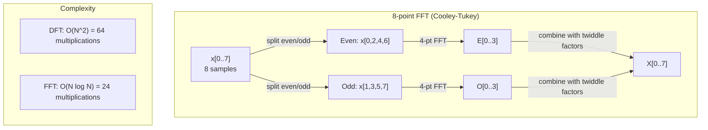
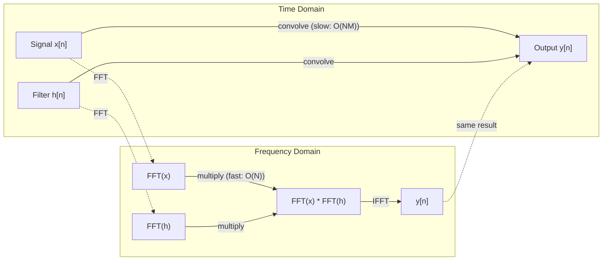

# The Fourier Transform · 傅里叶变换（把信号拆成正弦波）

> Every signal is a sum of sine waves. The Fourier transform tells you which ones.

**Type:** Build
**Language:** Python
**Prerequisites:** Phase 1, Lessons 01-04, 19 (complex numbers)
**Time:** ~90 minutes

## Learning Objectives · 学习目标

- 从零实现 DFT，并用 O(N log N) 的 Cooley-Tukey FFT 验证结果
- 解读频率系数：从信号中提取幅度、相位和功率谱
- 应用卷积定理（convolution theorem），用 FFT 乘法完成卷积
- 把傅里叶频率分解与 Transformer 位置编码、CNN 卷积层联系起来

> Implement the DFT from scratch and verify it against the O(N log N) Cooley-Tukey FFT
> Interpret frequency coefficients: extract amplitude, phase, and power spectrum from a signal
> Apply the convolution theorem to perform convolution via FFT multiplication
> Connect Fourier frequency decomposition to transformer positional encodings and CNN convolution layers

## The Problem · 问题在哪

一段录音是随时间变化的压强测量序列；一只股票的价格是按天的数值序列；一张图像是空间上的像素强度网格。它们都是时域（time domain，或空域）里的数据：你看到的是值随某个索引的变化。

但很多模式在时域里是看不见的。这段音频是纯音还是和弦？这只股票有没有周周期？这张图有没有重复纹理？这些是关于频率内容（frequency content）的问题，而时域把它们藏了起来。

傅里叶变换（Fourier transform）把数据从时域搬进频域（frequency domain）：它把信号分解成不同频率的正弦波，每个正弦波有幅度（amplitude，有多强）和相位（phase，从哪开始），傅里叶变换把两者都告诉你。

这件事对 ML 重要，是因为频域思维无处不在：卷积神经网络做的卷积就是频域里的乘法；Transformer 位置编码用频率分解表示位置；音频模型（语音识别、音乐生成）处理的是频谱图（spectrogram）—— 声音的频率表示；时间序列模型寻找周期模式。理解傅里叶变换，你就有了与这一切打交道所需的语言。

> An audio recording is a sequence of pressure measurements over time. A stock price is a sequence of values over days. An image is a grid of pixel intensities over space. All of these are data in the time domain (or space domain). You see values changing over some index.
> But many patterns are invisible in the time domain. Is this audio signal a pure tone or a chord? Does this stock price have a weekly cycle? Does this image have a repeating texture? These questions are about frequency content, and the time domain hides it.
> The Fourier transform converts data from the time domain to the frequency domain. It takes a signal and decomposes it into sine waves of different frequencies. Each sine wave has an amplitude (how strong it is) and a phase (where it starts). The Fourier transform tells you both.
> This matters for ML because frequency-domain thinking appears everywhere. Convolutional neural networks perform convolution, which is multiplication in the frequency domain. Transformer positional encodings use frequency decomposition to represent position. Audio models (speech recognition, music generation) operate on spectrograms -- frequency representations of sound. Time series models look for periodic patterns. Understanding the Fourier transform gives you the vocabulary to work with all of these.

## The Concept · 概念

### The DFT definition · DFT 的定义

给定 N 个样本 x[0], x[1], ..., x[N-1]，离散傅里叶变换（Discrete Fourier Transform）产出 N 个频率系数 X[0], X[1], ..., X[N-1]：

```
X[k] = sum_{n=0}^{N-1} x[n] * e^(-2*pi*i*k*n/N)

for k = 0, 1, ..., N-1
```

每个 X[k] 都是复数：它的模 |X[k]| 告诉你频率 k 的幅度，它的相位角 angle(X[k]) 告诉你这个频率的相位偏移。

关键洞察：`e^(-2*pi*i*k*n/N)` 是频率 k 处的旋转相量。DFT 计算的是信号与 N 个等距频率各自的相关性：信号在频率 k 上有能量，相关性就大；没有，就接近零。

> Given N samples x[0], x[1], ..., x[N-1], the Discrete Fourier Transform produces N frequency coefficients X[0], X[1], ..., X[N-1]:
> Each X[k] is a complex number. Its magnitude |X[k]| tells you the amplitude of frequency k. Its phase angle(X[k]) tells you the phase offset of that frequency.
> The key insight: `e^(-2*pi*i*k*n/N)` is a rotating phasor at frequency k. The DFT computes the correlation between the signal and each of N equally-spaced frequencies. If the signal contains energy at frequency k, the correlation is large. If not, it is near zero.

### What each coefficient means · 每个系数的含义

**X[0]：直流分量（DC component）。** 它是所有样本之和 —— 与均值成正比，代表信号的常数（零频）偏移。

```
X[0] = sum_{n=0}^{N-1} x[n] * e^0 = sum of all samples
```

**X[k]（1 <= k <= N/2）：正频率。** X[k] 代表每 N 个样本 k 个周期的频率。k 越大频率越高（振荡越快）。

**X[N/2]：奈奎斯特频率（Nyquist frequency）。** 这是 N 个样本能表示的最高频率。超过它就会出现混叠（aliasing）—— 高频伪装成低频。

**X[k]（N/2 < k < N）：负频率。** 对实值信号有 X[N-k] = conj(X[k])，负频率是正频率的镜像。这就是为什么有用的信息都在前 N/2 + 1 个系数里。

> X[0]: the DC component. This is the sum of all samples -- proportional to the mean. It represents the constant (zero-frequency) offset of the signal.
> X[k] for 1 <= k <= N/2: positive frequencies. X[k] represents frequency k cycles per N samples. Higher k means higher frequency (faster oscillation).
> X[N/2]: the Nyquist frequency. The highest frequency you can represent with N samples. Above this, you get aliasing -- high frequencies masquerading as low ones.
> X[k] for N/2 < k < N: negative frequencies. For real-valued signals, X[N-k] = conj(X[k]). The negative frequencies are mirror images of the positive ones. This is why the useful information is in the first N/2 + 1 coefficients.

### Inverse DFT · 逆 DFT

逆 DFT 从频率系数重建原始信号：

```
x[n] = (1/N) * sum_{k=0}^{N-1} X[k] * e^(2*pi*i*k*n/N)

for n = 0, 1, ..., N-1
```

与正变换相比只有两处不同：指数符号变成正的（不是负的），多了一个 1/N 的归一化因子。

逆 DFT 是完美重建，不丢失任何信息：从时域到频域再回来，零误差。DFT 是一次基变换（change of basis）—— 用另一套坐标系重新表达同样的信息。

> The inverse DFT reconstructs the original signal from its frequency coefficients:
> The only differences from the forward DFT: the sign in the exponent is positive (not negative), and there is a 1/N normalization factor.
> The inverse DFT is perfect reconstruction. No information is lost. You can go from time domain to frequency domain and back without any error. The DFT is a change of basis -- it re-expresses the same information in a different coordinate system.

### The FFT: making it fast · FFT：把它变快

按上面的定义，DFT 是 O(N^2)：N 个输出系数各要对 N 个输入样本求和。N = 100 万时，就是 10^12 次运算。

快速傅里叶变换（FFT）用 O(N log N) 算出同样的结果：N = 100 万时大约 2000 万次运算，而不是一万亿。频率分析因此才变得实用。

Cooley-Tukey 算法（最常见的 FFT）用分治（divide and conquer）：

1. 把信号按偶数下标和奇数下标拆成两半。
2. 递归计算每一半的 DFT。
3. 用「旋转因子（twiddle factors）」e^(-2*pi*i*k/N) 把两个半长 DFT 合并起来。

```
X[k] = E[k] + e^(-2*pi*i*k/N) * O[k]          for k = 0, ..., N/2 - 1
X[k + N/2] = E[k] - e^(-2*pi*i*k/N) * O[k]    for k = 0, ..., N/2 - 1

where E = DFT of even-indexed samples
      O = DFT of odd-indexed samples
```

对称性保证了每层递归只做 O(N) 的工作，而递归共 log2(N) 层。总计：O(N log N)。



FFT 要求信号长度是 2 的幂。实践中把信号零填充（zero-pad）到下一个 2 的幂。

> The Fast Fourier Transform (FFT) computes the same result in O(N log N). For N = 1 million, that is about 20 million operations instead of a trillion. This is what makes frequency analysis practical.
> The Cooley-Tukey algorithm (the most common FFT) works by divide and conquer:
> The symmetry means each level of recursion does O(N) work, and there are log2(N) levels. Total: O(N log N).
> The FFT requires the signal length to be a power of 2. In practice, signals are zero-padded to the next power of 2.

### Spectral analysis · 谱分析

**功率谱（power spectrum）**是 |X[k]|^2 —— 每个频率系数的模平方，显示每个频率上有多大的能量。

**相位谱（phase spectrum）**是 angle(X[k]) —— 每个频率的相位偏移。对多数分析任务，你只关心功率谱、忽略相位。

```
Power at frequency k:  P[k] = |X[k]|^2 = X[k].real^2 + X[k].imag^2
Phase at frequency k:  phi[k] = atan2(X[k].imag, X[k].real)
```

> The **power spectrum** is |X[k]|^2 -- the squared magnitude of each frequency coefficient. It shows how much energy is at each frequency.
> The **phase spectrum** is angle(X[k]) -- the phase offset of each frequency. For most analysis tasks, you care about the power spectrum and ignore the phase.

### Frequency resolution · 频率分辨率

DFT 的频率分辨率取决于样本数 N 和采样率 fs。

```
Frequency of bin k:      f_k = k * fs / N
Frequency resolution:    delta_f = fs / N
Maximum frequency:       f_max = fs / 2  (Nyquist)
```

要分辨靠得近的两个频率，需要更多样本；要捕捉高频，需要更高的采样率。

> The frequency resolution of the DFT depends on the number of samples N and the sampling rate fs.
> To resolve two frequencies that are close together, you need more samples. To capture high frequencies, you need a higher sampling rate.

### The convolution theorem · 卷积定理

这是信号处理里最重要的结论之一，也与 CNN 直接相关。

**时域卷积等于频域逐点相乘。**

```
x * h = IFFT(FFT(x) . FFT(h))

where * is convolution and . is element-wise multiplication
```

为什么重要：

- 两个长度为 N 和 M 的信号直接卷积需要 O(N*M) 次运算。
- 基于 FFT 的卷积只要 O(N log N)：两边变换、相乘、变换回来。
- 核（kernel）很大时，FFT 卷积快得多。
- 大感受野（receptive field）的卷积层里发生的正是这件事。

注意：DFT 算出的是循环卷积（circular convolution，信号会绕回）。要线性卷积（不绕回），先把两个信号零填充到长度 N + M - 1 再计算。



> **Convolution in the time domain equals pointwise multiplication in the frequency domain.**
> Direct convolution of two signals of length N and M takes O(N*M) operations.
> FFT-based convolution takes O(N log N): transform both, multiply, transform back.
> For large kernels, FFT convolution is dramatically faster.
> This is exactly what happens in convolutional layers with large receptive fields.
> Note: the DFT computes circular convolution (the signal wraps around). For linear convolution (no wraparound), zero-pad both signals to length N + M - 1 before computing.

### Windowing · 加窗

DFT 假设信号是周期的 —— 它把 N 个样本当成无限重复信号的一个周期。如果信号首尾取值不同，边界处就会出现不连续，表现为虚假的高频成分。这叫频谱泄漏（spectral leakage）。

加窗（windowing）通过在计算 DFT 之前把信号两端渐变到零来减少泄漏。

常用窗函数：

| Window | Shape | Main lobe width | Side lobe level | Use case |
|--------|-------|----------------|-----------------|----------|
| 矩形窗（Rectangular） | 平坦（不加窗） | 最窄 | 最高（-13 dB） | 信号在 N 个样本内恰好完整周期时 |
| Hann 窗 | 升余弦 | 中等 | 低（-31 dB） | 通用谱分析 |
| Hamming 窗 | 改进余弦 | 中等 | 更低（-42 dB） | 音频处理、语音分析 |
| Blackman 窗 | 三重余弦 | 宽 | 极低（-58 dB） | 旁瓣抑制很关键时 |

```
Hann window:    w[n] = 0.5 * (1 - cos(2*pi*n / (N-1)))
Hamming window: w[n] = 0.54 - 0.46 * cos(2*pi*n / (N-1))
```

把窗与信号逐点相乘后再做 DFT：`X = DFT(x * w)`。

> The DFT assumes the signal is periodic -- it treats the N samples as one period of an infinitely repeating signal. If the signal does not start and end at the same value, this creates a discontinuity at the boundary, which shows up as spurious high-frequency content. This is called spectral leakage.
> Windowing reduces leakage by tapering the signal to zero at both ends before computing the DFT.
> Apply the window by multiplying it element-wise with the signal before the DFT: `X = DFT(x * w)`.

### DFT properties · DFT 的性质

| Property | Time Domain | Frequency Domain |
|----------|-------------|-----------------|
| 线性（Linearity） | a*x + b*y | a*X + b*Y |
| 时移（Time shift） | x[n - k] | X[f] * e^(-2*pi*i*f*k/N) |
| 频移（Frequency shift） | x[n] * e^(2*pi*i*f0*n/N) | X[f - f0] |
| 卷积（Convolution） | x * h | X * H（逐点） |
| 乘法（Multiplication） | x * h（逐点） | X * H（循环卷积，乘 1/N） |
| 帕塞瓦尔定理（Parseval's theorem） | sum \|x[n]\|^2 | (1/N) * sum \|X[k]\|^2 |
| 共轭对称（实输入）（Conjugate symmetry (real input)） | x[n] 为实数 | X[k] = conj(X[N-k]) |

帕塞瓦尔定理（Parseval's theorem）说：总能量在两个域里相同。能量在变换中守恒。

> Parseval's theorem says the total energy is the same in both domains. Energy is conserved through the transform.

### Connection to positional encodings · 与位置编码的联系

原始 Transformer 使用正弦位置编码：

```
PE(pos, 2i)   = sin(pos / 10000^(2i/d_model))
PE(pos, 2i+1) = cos(pos / 10000^(2i/d_model))
```

每对维度 (2i, 2i+1) 以不同频率振荡，频率从高（维度 0,1）到低（最后的维度）几何排布。这让每个位置在所有频段上都有独一无二的模式 —— 就像傅里叶系数唯一确定一个信号。

它提供了三条关键性质：

- **唯一性：** 没有两个位置的编码相同。
- **取值有界：** sin 和 cos 永远在 [-1, 1] 内。
- **相对位置：** 位置 p+k 的编码可以表示为位置 p 编码的线性函数，模型可以学会关注相对位置。

> Each dimension pair (2i, 2i+1) oscillates at a different frequency. The frequencies are geometrically spaced from high (dimension 0,1) to low (last dimensions). This gives each position a unique pattern across all frequency bands -- similar to how Fourier coefficients uniquely identify a signal.
> The key properties this provides:
> - **Uniqueness:** No two positions have the same encoding.
> - **Bounded values:** sin and cos are always in [-1, 1].
> - **Relative position:** The encoding of position p+k can be expressed as a linear function of the encoding at position p. The model can learn to attend to relative positions.

### Connection to CNNs · 与 CNN 的联系

卷积层把学到的滤波器（kernel）在信号或图像上滑动作用于输入，数学上就是卷积运算。

由卷积定理，它等价于：
1. 对输入做 FFT
2. 对核做 FFT
3. 在频域相乘
4. 对结果做 IFFT

标准 CNN 实现用的是直接卷积（对 3x3 小核更快）。但核很大或做全局卷积时，基于 FFT 的方法明显更快。一些架构（如 FNet）干脆用 FFT 取代注意力，以 O(N log N) 代替 O(N^2) 的复杂度拿到有竞争力的精度。

> A convolution layer applies a learned filter (kernel) to the input by sliding it across the signal or image. Mathematically, this is the convolution operation.
> Standard CNN implementations use direct convolution (faster for small 3x3 kernels). But for large kernels or global convolution, FFT-based approaches are significantly faster. Some architectures (like FNet) replace attention entirely with FFT, achieving competitive accuracy with O(N log N) instead of O(N^2) complexity.

### Spectrograms and the Short-Time Fourier Transform · 频谱图与短时傅里叶变换

一次 FFT 给你整段信号的频率内容，却不告诉你这些频率何时出现。一个啁啾（chirp，频率随时间上升的信号）和一个和弦（所有频率同时存在）可以有相同的幅度谱。

短时傅里叶变换（Short-Time Fourier Transform，STFT）的做法是：对信号的重叠窗口分别计算 FFT，得到频谱图（spectrogram）—— 一张一轴是时间、另一轴是频率的二维图，每个点的强度表示该时刻该频率上的能量。

```
STFT procedure:
1. Choose a window size (e.g., 1024 samples)
2. Choose a hop size (e.g., 256 samples -- 75% overlap)
3. For each window position:
   a. Extract the windowed segment
   b. Apply a Hann/Hamming window
   c. Compute FFT
   d. Store the magnitude spectrum as one column of the spectrogram
```

频谱图是音频 ML 模型的标准输入表示。语音识别模型（Whisper、DeepSpeech）处理的是梅尔频谱图（mel-spectrogram）—— 把频率映射到梅尔刻度（mel scale，更符合人耳音高感知）上的频谱图。

> A single FFT gives you the frequency content of the entire signal, but tells you nothing about when those frequencies occur. A chirp (a signal whose frequency increases over time) and a chord (all frequencies present simultaneously) can have the same magnitude spectrum.
> The Short-Time Fourier Transform (STFT) solves this by computing FFTs on overlapping windows of the signal. The result is a spectrogram: a 2D representation with time on one axis and frequency on the other. The intensity at each point shows the energy at that frequency at that time.
> Spectrograms are the standard input representation for audio ML models. Speech recognition models (Whisper, DeepSpeech) operate on mel-spectrograms -- spectrograms with frequencies mapped to the mel scale, which better matches human pitch perception.

### Aliasing · 混叠

如果信号包含高于 fs/2（奈奎斯特频率）的频率，以采样率 fs 采样就会产生混叠（aliasing）副本：90 Hz 的信号以 100 Hz 采样，看起来和 10 Hz 的信号一模一样，仅凭样本无法区分。

```
Example:
  True signal: 90 Hz sine wave
  Sampling rate: 100 Hz
  Apparent frequency: 100 - 90 = 10 Hz

  The samples from the 90 Hz signal at 100 Hz sampling rate
  are identical to the samples from a 10 Hz signal.
  No amount of math can recover the original 90 Hz.
```

这就是为什么模数转换器要内置抗混叠滤波器（anti-aliasing filter），在采样前滤掉奈奎斯特以上的频率。在 ML 里，对特征图降采样而没做合适的低通滤波时也会出现混叠 —— 一些架构用抗混叠池化层来解决这个问题。

> If a signal contains frequencies above fs/2 (the Nyquist frequency), sampling at rate fs will create aliased copies. A 90 Hz signal sampled at 100 Hz looks identical to a 10 Hz signal. There is no way to distinguish them from the samples alone.
> This is why analog-to-digital converters include anti-aliasing filters that remove frequencies above Nyquist before sampling. In ML, aliasing appears when downsampling feature maps without proper low-pass filtering -- some architectures address this with anti-aliased pooling layers.

### Zero-padding does not increase resolution · 零填充不提升分辨率

一个常见误解：FFT 前先对信号零填充能提升频率分辨率。不能。零填充只是在既有频率仓（frequency bin）之间插值，让谱看起来更平滑，但它无法揭示原始样本里不存在的频率细节。

真正的频率分辨率只取决于观测时长 T = N / fs。要分辨相距 delta_f 的两个频率，至少需要 T = 1 / delta_f 秒的数据。零填充再多也改变不了这个根本极限。

> A common misconception: zero-padding a signal before FFT improves frequency resolution. It does not. Zero-padding interpolates between existing frequency bins, giving you a smoother-looking spectrum. But it cannot reveal frequency detail that was not present in the original samples.
> True frequency resolution depends only on the observation time T = N / fs. To resolve two frequencies separated by delta_f, you need at least T = 1 / delta_f seconds of data. No amount of zero-padding changes this fundamental limit.

```figure
fourier-synthesis
```

## Build It · 动手造

### Step 1: DFT from scratch · 第 1 步：从零写 DFT

O(N^2) 的 DFT 直接从定义出发。

```python
import math

class Complex:
    ...

def dft(x):
    N = len(x)
    result = []
    for k in range(N):
        total = Complex(0, 0)
        for n in range(N):
            angle = -2 * math.pi * k * n / N
            w = Complex(math.cos(angle), math.sin(angle))
            xn = x[n] if isinstance(x[n], Complex) else Complex(x[n])
            total = total + xn * w
        result.append(total)
    return result
```

> The O(N^2) DFT follows directly from the definition.

### Step 2: Inverse DFT · 第 2 步：逆 DFT

同样的结构，指数取正，再除以 N。

```python
def idft(X):
    N = len(X)
    result = []
    for n in range(N):
        total = Complex(0, 0)
        for k in range(N):
            angle = 2 * math.pi * k * n / N
            w = Complex(math.cos(angle), math.sin(angle))
            total = total + X[k] * w
        result.append(Complex(total.real / N, total.imag / N))
    return result
```

> Same structure, positive exponent, divide by N.

### Step 3: FFT (Cooley-Tukey) · 第 3 步：FFT（Cooley-Tukey）

递归 FFT 要求长度是 2 的幂：按偶/奇下标拆分，递归，再用旋转因子合并。

```python
def fft(x):
    N = len(x)
    if N <= 1:
        return [x[0] if isinstance(x[0], Complex) else Complex(x[0])]
    if N % 2 != 0:
        return dft(x)

    even = fft([x[i] for i in range(0, N, 2)])
    odd = fft([x[i] for i in range(1, N, 2)])

    result = [Complex(0)] * N
    for k in range(N // 2):
        angle = -2 * math.pi * k / N
        twiddle = Complex(math.cos(angle), math.sin(angle))
        t = twiddle * odd[k]
        result[k] = even[k] + t
        result[k + N // 2] = even[k] - t
    return result
```

> The recursive FFT requires power-of-2 length. Split into even and odd, recurse, combine with twiddle factors.

### Step 4: Spectral analysis helpers · 第 4 步：谱分析工具函数

```python
def power_spectrum(X):
    return [xk.real ** 2 + xk.imag ** 2 for xk in X]

def convolve_fft(x, h):
    N = len(x) + len(h) - 1
    padded_N = 1
    while padded_N < N:
        padded_N *= 2

    x_padded = x + [0.0] * (padded_N - len(x))
    h_padded = h + [0.0] * (padded_N - len(h))

    X = fft(x_padded)
    H = fft(h_padded)

    Y = [xk * hk for xk, hk in zip(X, H)]

    y = idft(Y)
    return [y[n].real for n in range(N)]
```

## Use It · 实战用法

真实工程里用 numpy 的 FFT，它背后是高度优化的 C 库。

```python
import numpy as np

signal = np.sin(2 * np.pi * 5 * np.arange(256) / 256)
spectrum = np.fft.fft(signal)
freqs = np.fft.fftfreq(256, d=1/256)

power = np.abs(spectrum) ** 2

positive_freqs = freqs[:len(freqs)//2]
positive_power = power[:len(power)//2]
```

加窗和更高级的谱分析：

```python
from scipy.signal import windows, stft

window = windows.hann(256)
windowed = signal * window
spectrum = np.fft.fft(windowed)
```

卷积：

```python
from scipy.signal import fftconvolve

result = fftconvolve(signal, kernel, mode='full')
```

频谱图：

```python
from scipy.signal import stft

frequencies, times, Zxx = stft(signal, fs=sample_rate, nperseg=256)
spectrogram = np.abs(Zxx) ** 2
```

频谱图矩阵的形状是 (n_frequencies, n_time_frames)，每一列是一个时间窗的功率谱。音频 ML 模型吃进去的就是这个。

> For real work, use numpy's FFT which is backed by highly optimized C libraries.
> The spectrogram matrix has shape (n_frequencies, n_time_frames). Each column is the power spectrum at one time window. This is what audio ML models consume as input.

## Ship It · 交付

运行 `code/fourier.py` 生成 `outputs/prompt-spectral-analyzer.md`。

> Run `code/fourier.py` to generate `outputs/prompt-spectral-analyzer.md`.

## Exercises · 练习

1. **纯音识别。** 构造一个未知频率（1 到 50 Hz 之间）的单正弦信号，以 128 Hz 采样 1 秒。用你的 DFT 找出这个频率，验证答案正确。再加入标准差 0.5 的高斯噪声重做一遍：噪声对频谱有什么影响？

2. **FFT vs DFT 验证。** 生成长度 64 的随机信号，分别计算 DFT（O(N^2)）和 FFT，验证所有系数误差在 1e-10 以内。在长度 256、512、1024、2048 的信号上给两个函数计时，画出 DFT 时间与 FFT 时间之比。

3. **用例子证明卷积定理。** 取信号 x = [1, 2, 3, 4, 0, 0, 0, 0] 和滤波器 h = [1, 1, 1, 0, 0, 0, 0, 0]。先用嵌套循环直接算它们的循环卷积，再用 FFT（变换、相乘、逆变换）算一遍，验证结果一致。然后适当零填充，做线性卷积。

4. **加窗的效果。** 构造 10 Hz 和 12 Hz（非常接近）两个正弦波之和的信号，以 128 Hz 采样 1 秒。分别在不加窗、加 Hann 窗、加 Hamming 窗三种情况下计算功率谱。哪种窗最容易分辨两个峰？为什么？

5. **位置编码分析。** 生成 d_model = 128、max_pos = 512 的正弦位置编码。对每一对位置 (p1, p2) 计算它们编码的内积，证明内积只依赖 |p1 - p2| 而与绝对位置无关。距离增大时，内积会发生什么？

## Key Terms · 术语表

| Term | What it means |
|------|---------------|
| DFT（离散傅里叶变换） | 把 N 个时域样本变成 N 个频域系数。每个系数是信号与该频率复正弦的相关性 |
| FFT（快速傅里叶变换） | O(N log N) 计算 DFT 的算法。Cooley-Tukey 算法递归拆分偶/奇下标 |
| 逆 DFT（Inverse DFT） | 从频率系数重建时域信号。公式与 DFT 相同：指数符号翻转并乘 1/N |
| 频率仓（Frequency bin） | DFT 输出的每个下标 k 代表频率 k*fs/N Hz。「bin」就是离散频率槽位 |
| 直流分量（DC component） | X[0]，零频系数，与信号均值成正比 |
| 奈奎斯特频率（Nyquist frequency） | fs/2，采样率 fs 下能表示的最高频率。超过它的频率会混叠 |
| 功率谱（Power spectrum） | \|X[k]\|^2，每个频率系数的模平方。显示能量在频率上的分布 |
| 相位谱（Phase spectrum） | angle(X[k])，每个频率分量的相位偏移。分析中常被忽略 |
| 频谱泄漏（Spectral leakage） | 把非周期信号当周期处理造成的虚假频率成分。加窗可减少 |
| 窗函数（Window function） | DFT 前施加的渐变函数（Hann、Hamming、Blackman），用于减少频谱泄漏 |
| 旋转因子（Twiddle factor） | FFT 蝶形运算中合并子 DFT 所用的复指数 e^(-2*pi*i*k/N) |
| 卷积定理（Convolution theorem） | 时域卷积等于频域逐点相乘。信号处理与 CNN 的基石 |
| 循环卷积（Circular convolution） | 信号绕回的卷积。DFT 天然计算的就是它 |
| 线性卷积（Linear convolution） | 不绕回的标准卷积。DFT 前零填充即可得到 |
| 帕塞瓦尔定理（Parseval's theorem） | 总能量在傅里叶变换中守恒。sum \|x[n]\|^2 = (1/N) sum \|X[k]\|^2 |
| 混叠（Aliasing） | 采样率不足时，奈奎斯特以上的频率伪装成更低频率的现象 |

## Further Reading · 延伸阅读

- [Cooley & Tukey: An Algorithm for the Machine Calculation of Complex Fourier Series (1965)](https://www.ams.org/journals/mcom/1965-19-090/S0025-5718-1965-0178586-1/) —— 改变了计算史的原始 FFT 论文
- [3Blue1Brown: But what is the Fourier Transform?](https://www.youtube.com/watch?v=spUNpyF58BY) —— 最好的傅里叶变换可视化入门
- [Lee-Thorp et al.: FNet: Mixing Tokens with Fourier Transforms (2021)](https://arxiv.org/abs/2105.03824) —— 在 Transformer 里用 FFT 取代自注意力
- [Smith: The Scientist and Engineer's Guide to Digital Signal Processing](http://www.dspguide.com/) —— 免费在线教科书，深入覆盖 FFT、加窗与谱分析
- [Vaswani et al.: Attention Is All You Need (2017)](https://arxiv.org/abs/1706.03762) —— 由傅里叶频率分解导出的正弦位置编码
- [Radford et al.: Whisper (2022)](https://arxiv.org/abs/2212.04356) —— 用梅尔频谱图作输入表示的语音识别
