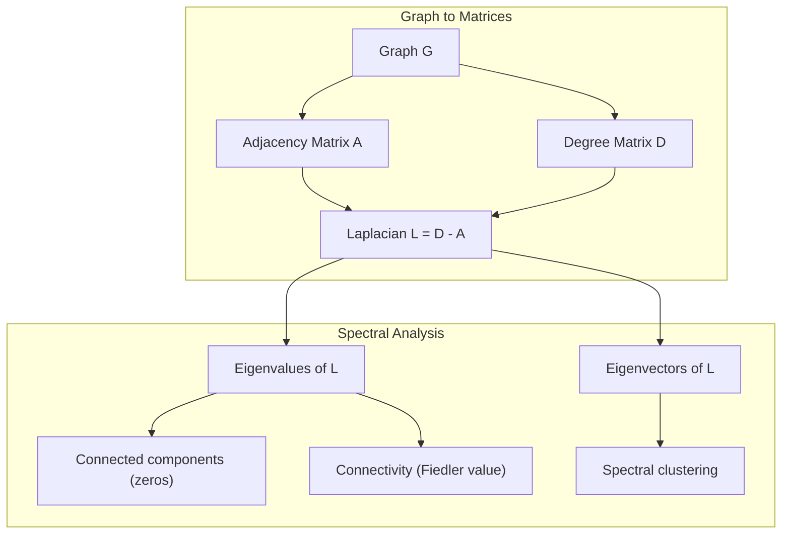
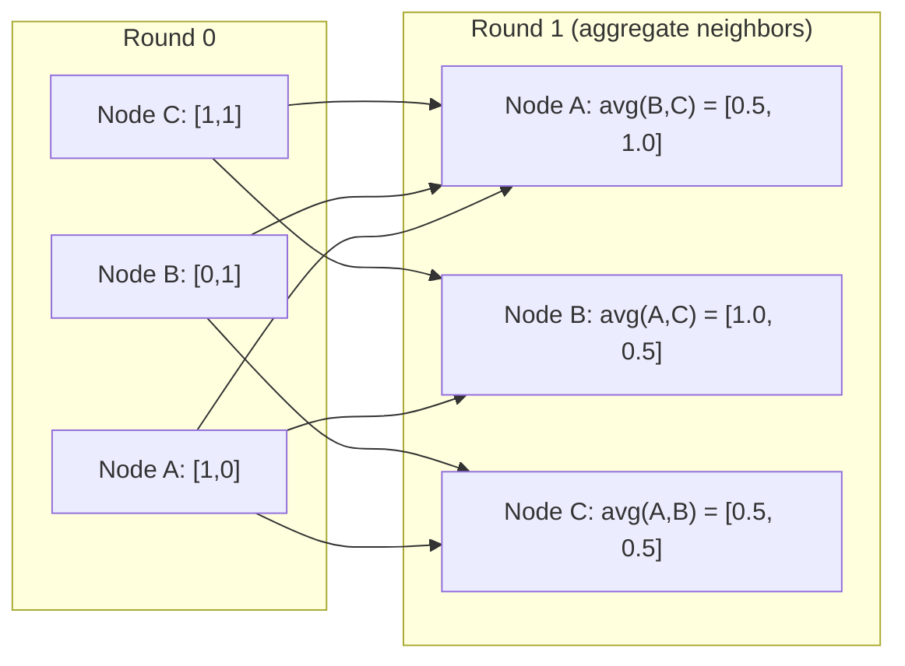

# Graph Theory for Machine Learning · 图论（关系数据结构）

> Graphs are the data structure of relationships. If your data has connections, you need graph theory.

**Type:** Build
**Language:** Python
**Prerequisites:** Phase 1, Lessons 01-03 (linear algebra, matrices)
**Time:** ~90 minutes

## Learning Objectives · 学习目标

- 构建支持邻接矩阵/邻接表两种表示的图类，并实现 BFS 与 DFS 遍历
- 计算图拉普拉斯矩阵（graph Laplacian），用其特征值检测连通分量并对节点聚类
- 把一轮 GNN 风格的消息传递（message passing）实现为归一化邻接矩阵乘法
- 应用谱聚类（spectral clustering），用 Fiedler 向量切分图

> Build a graph class with adjacency matrix/list representations and implement BFS and DFS traversals
> Compute the graph Laplacian and use its eigenvalues to detect connected components and cluster nodes
> Implement one round of GNN-style message passing as a normalized adjacency matrix multiplication
> Apply spectral clustering to partition a graph using the Fiedler vector

## The Problem · 问题在哪

社交网络、分子、知识库、引文网络、路网 —— 全都是图（graph）。传统 ML 把数据当扁平表格：每行独立，每个特征一列。但当「连接的结构」本身重要时，表格就失效了。

想想社交网络：你想预测一个用户会买什么商品。他自己的购买历史重要，但他朋友们的历史更重要。连接承载着信号。

再想想分子：你想预测它能否结合某个蛋白。原子固然重要，但真正关键的是原子之间如何成键。结构就是数据。

图神经网络（Graph Neural Networks，GNN）是深度学习里增长最快的方向，支撑着药物发现、社交推荐、欺诈检测和知识图谱推理。每个 GNN 都建立在同一块地基上：基础图论（graph theory）。

你需要四样东西：
1. 把图表示成矩阵的方法（这样才能对它们做乘法）
2. 探索图结构的遍历算法
3. 拉普拉斯矩阵（Laplacian）—— 谱图理论中最重要的那个矩阵
4. 消息传递（message passing）—— 让 GNN 成立的那个运算

> Social networks, molecules, knowledge bases, citation networks, road maps -- all are graphs. Traditional ML treats data as flat tables. Each row is independent. Each feature is a column. But when the structure of connections matters, tables fail.
> Consider a social network. You want to predict what product a user will buy. Their purchase history matters. But their friends' purchase history matters more. The connections carry signal.
> Or consider a molecule. You want to predict if it binds to a protein. The atoms matter, but what really matters is how atoms are bonded to each other. The structure is the data.
> Graph Neural Networks (GNNs) are the fastest-growing area in deep learning. They power drug discovery, social recommendation, fraud detection, and knowledge graph reasoning. Every GNN builds on the same foundation: basic graph theory.
> You need four things:
> 1. A way to represent graphs as matrices (so you can multiply them)
> 2. Traversal algorithms to explore graph structure
> 3. The Laplacian -- the single most important matrix in spectral graph theory
> 4. Message passing -- the operation that makes GNNs work

## The Concept · 概念

### Graphs: Nodes and Edges · 图：节点与边

图 G = (V, E) 由顶点（节点）集合 V 和边集合 E 组成，每条边连接两个节点。

**有向 vs 无向。** 无向图（undirected graph）里，边 (u, v) 表示 u 连着 v 且 v 也连着 u。有向图（directed graph，digraph）里，边 (u, v) 表示 u 指向 v，反过来不一定成立。

**带权 vs 不带权。** 无权图（unweighted graph）里，边要么存在要么不存在。带权图（weighted graph）里每条边有一个数值权重 —— 一段距离、一个代价、一种强度。

| Graph type | Example |
|-----------|---------|
| 无向、无权 | Facebook 好友网络 |
| 有向、无权 | Twitter 关注网络 |
| 无向、带权 | 路网（距离） |
| 有向、带权 | 网页链接（PageRank 分数） |

> A graph G = (V, E) consists of vertices (nodes) V and edges E. Each edge connects two nodes.
> Directed vs undirected. In an undirected graph, edge (u, v) means u connects to v AND v connects to u. In a directed graph (digraph), edge (u, v) means u points to v, but not necessarily the reverse.
> Weighted vs unweighted. In an unweighted graph, edges either exist or they don't. In a weighted graph, each edge has a numerical weight -- a distance, a cost, a strength.

### The Adjacency Matrix · 邻接矩阵

邻接矩阵（adjacency matrix）A 是核心表示。对 n 个节点的图：

```
A[i][j] = 1    if there is an edge from node i to node j
A[i][j] = 0    otherwise
```

无向图的 A 是对称的：A[i][j] = A[j][i]。带权图的 A[i][j] 等于边 (i, j) 的权重。

**例子 —— 三角形：**

```
Nodes: 0, 1, 2
Edges: (0,1), (1,2), (0,2)

A = [[0, 1, 1],
     [1, 0, 1],
     [1, 1, 0]]
```

邻接矩阵是所有 GNN 的输入。对 A 做的矩阵运算，对应着对图做的运算。

> The adjacency matrix A is the core representation. For a graph with n nodes:
> For undirected graphs, A is symmetric: A[i][j] = A[j][i]. For weighted graphs, A[i][j] = weight of edge (i, j).
> The adjacency matrix is the input to every GNN. Matrix operations on A correspond to operations on the graph.

### Degree · 度

节点的度（degree）是与它相连的边数。有向图区分入度（in-degree，进来的边）和出度（out-degree，出去的边）。

度矩阵 D 是对角阵：

```
D[i][i] = degree of node i
D[i][j] = 0    for i != j
```

三角形例子里 D = diag(2, 2, 2)，因为每个节点都连着另外两个。

度反映节点重要性：高度数 = 枢纽（hub）节点。网络的度分布揭示其结构：社交网络服从幂律（少数枢纽、大量叶子节点），随机图的度服从泊松分布。

> The degree of a node is the number of edges connected to it. For directed graphs, you have in-degree (edges coming in) and out-degree (edges going out).
> Degree tells you about node importance. High degree = hub node. The degree distribution of a network reveals its structure. Social networks follow power laws (few hubs, many leaf nodes). Random graphs have Poisson-distributed degrees.

### BFS and DFS · BFS 与 DFS

两个最基本的图遍历（traversal）算法。你两个都需要。

**广度优先搜索（Breadth-First Search，BFS）：** 先访问所有邻居，再访问邻居的邻居。用队列（FIFO）。

```
BFS from node 0:
  Visit 0
  Queue: [1, 2]        (neighbors of 0)
  Visit 1
  Queue: [2, 3]        (add neighbors of 1)
  Visit 2
  Queue: [3]           (neighbors of 2 already visited)
  Visit 3
  Queue: []            (done)
```

BFS 在无权图里找最短路径：起点到任意节点的距离，等于该节点第一次被发现时所在的 BFS 层级。社交网络里的跳数距离用的就是 BFS。

**深度优先搜索（Depth-First Search，DFS）：** 一条路走到底再回溯。用栈（LIFO）或递归。

```
DFS from node 0:
  Visit 0
  Stack: [1, 2]        (neighbors of 0)
  Visit 2               (pop from stack)
  Stack: [1, 3]         (add neighbors of 2)
  Visit 3               (pop from stack)
  Stack: [1]
  Visit 1               (pop from stack)
  Stack: []             (done)
```

DFS 的用武之地：
- 找连通分量（从未访问节点出发跑 DFS）
- 检测环（DFS 树里的回边）
- 拓扑排序（DFS 完成顺序的逆序）

| Algorithm | Data structure | Finds | Use case |
|-----------|---------------|-------|----------|
| BFS | 队列 | 最短路径 | 社交网络距离、知识图谱遍历 |
| DFS | 栈 | 分量、环 | 连通性、拓扑排序 |

> The two fundamental graph traversal algorithms. You need both.
> Breadth-First Search (BFS): Explore all neighbors first, then neighbors' neighbors. Uses a queue (FIFO).
> BFS finds shortest paths in unweighted graphs. The distance from the start to any node equals the BFS level at which that node is first discovered. This is why BFS is used for hop-count distances in social networks.
> Depth-First Search (DFS): Go as deep as possible before backtracking. Uses a stack (LIFO) or recursion.
> DFS is useful for:
> - Finding connected components (run DFS from unvisited nodes)
> - Cycle detection (back edges in DFS tree)
> - Topological sorting (reverse DFS finish order)

### The Graph Laplacian · 图拉普拉斯矩阵

L = D - A。谱图理论（spectral graph theory）中最重要的矩阵。

三角形例子里：

```
D = [[2, 0, 0],    A = [[0, 1, 1],    L = [[2, -1, -1],
     [0, 2, 0],         [1, 0, 1],         [-1, 2, -1],
     [0, 0, 2]]         [1, 1, 0]]         [-1, -1,  2]]
```

拉普拉斯矩阵有几条了不起的性质：

1. **L 是半正定的。** 所有特征值 >= 0。

2. **零特征值的个数等于连通分量的个数。** 连通图恰好有一个零特征值；有 3 个不相连分量的图有三个零特征值。

3. **最小非零特征值（Fiedler 值）度量连通性。** Fiedler 值大，说明图连得紧；Fiedler 值小，说明图有薄弱点 —— 一个瓶颈（bottleneck）。

4. **Fiedler 值对应的特征向量（Fiedler 向量）指出最佳切分。** 取值为正的节点进一组，为负的进另一组。这就是谱聚类（spectral clustering）。



> L = D - A. The most important matrix in spectral graph theory.
> The Laplacian has remarkable properties:
> 1. **L is positive semi-definite.** All eigenvalues are >= 0.
> 2. **The number of zero eigenvalues equals the number of connected components.** A connected graph has exactly one zero eigenvalue. A graph with 3 disconnected components has three zero eigenvalues.
> 3. **The smallest non-zero eigenvalue (Fiedler value) measures connectivity.** A large Fiedler value means the graph is well-connected. A small Fiedler value means the graph has a weak point -- a bottleneck.
> 4. **The eigenvector of the Fiedler value (Fiedler vector) reveals the best split.** Nodes with positive values go in one group, nodes with negative values go in the other. This is spectral clustering.

### Spectral Properties · 谱性质

邻接矩阵和拉普拉斯矩阵的特征值，不用任何遍历就能揭示结构性质。

**谱聚类（spectral clustering）**的做法：
1. 计算拉普拉斯矩阵 L
2. 求 L 的 k 个最小特征向量（跳过第一个，连通图下它是全 1 向量）
3. 把这些特征向量当作每个节点的新坐标
4. 在这些坐标上跑 k-means

为什么有效？L 的特征向量编码了图上「最平滑」的函数：连接紧密的节点拿到相近的特征向量值，被瓶颈隔开的节点拿到不同的值。特征向量天然把簇分开。

**与随机游走的联系。** 归一化拉普拉斯矩阵与图上的随机游走（random walk）相关：随机游走的平稳分布与节点度成正比；混合时间（游走收敛多快）取决于谱隙（spectral gap）。

> The eigenvalues of the adjacency matrix and Laplacian reveal structural properties without any traversal.
> Spectral clustering works like this:
> Why does this work? The eigenvectors of L encode the "smoothest" functions on the graph. Nodes that are well-connected get similar eigenvector values. Nodes separated by a bottleneck get different values. The eigenvectors naturally separate clusters.
> Random walk connection. The normalized Laplacian relates to random walks on the graph. The stationary distribution of a random walk is proportional to node degree. The mixing time (how fast the walk converges) depends on the spectral gap.

### Message Passing · 消息传递

图神经网络的核心运算：每个节点从邻居收集消息、聚合（aggregate）它们、并更新自己的状态。

```
h_v^(k+1) = UPDATE(h_v^(k), AGGREGATE({h_u^(k) : u in neighbors(v)}))
```

最简形式下，AGGREGATE = 求平均，UPDATE = 线性变换 + 激活：

```
h_v^(k+1) = sigma(W * mean({h_u^(k) : u in neighbors(v)}))
```

这是化装成矩阵乘法的运算。设 H 是所有节点特征组成的矩阵，A 是邻接矩阵：

```
H^(k+1) = sigma(A_norm * H^(k) * W)
```

其中 A_norm 是归一化邻接矩阵（每行和为 1）。

一轮消息传递让每个节点「看见」自己的直接邻居；两轮让它看见邻居的邻居；K 轮让每个节点拿到 K 跳（K-hop）邻域内的信息。



> The core operation of Graph Neural Networks. Each node collects messages from its neighbors, aggregates them, and updates its own state.
> In the simplest form, AGGREGATE = mean, and UPDATE = linear transform + activation:
> This is matrix multiplication in disguise. If H is the matrix of all node features and A is the adjacency matrix:
> One round of message passing lets each node "see" its immediate neighbors. Two rounds let it see neighbors of neighbors. K rounds give each node information from its K-hop neighborhood.

### Concepts and ML Applications · 概念与 ML 应用

| Concept | ML Application |
|---------|---------------|
| 邻接矩阵（Adjacency matrix） | GNN 输入表示 |
| 图拉普拉斯（Graph Laplacian） | 谱聚类、社区发现 |
| BFS/DFS | 知识图谱遍历、寻路 |
| 度分布（Degree distribution） | 节点重要性、特征工程 |
| 消息传递（Message passing） | GNN 层（GCN、GAT、GraphSAGE） |
| L 的特征值（Eigenvalues of L） | 社区发现、图划分 |
| 谱聚类（Spectral clustering） | 无监督节点分组 |
| PageRank | 节点重要性、网页搜索 |

```figure
graph-degree-distribution
```

## Build It · 动手造

### Step 1: Graph class from scratch · 第 1 步：从零写 Graph 类

```python
class Graph:
    def __init__(self, n_nodes, directed=False):
        self.n = n_nodes
        self.directed = directed
        self.adj = {i: {} for i in range(n_nodes)}

    def add_edge(self, u, v, weight=1.0):
        self.adj[u][v] = weight
        if not self.directed:
            self.adj[v][u] = weight

    def neighbors(self, node):
        return list(self.adj[node].keys())

    def degree(self, node):
        return len(self.adj[node])

    def adjacency_matrix(self):
        import numpy as np
        A = np.zeros((self.n, self.n))
        for u in range(self.n):
            for v, w in self.adj[u].items():
                A[u][v] = w
        return A

    def degree_matrix(self):
        import numpy as np
        D = np.zeros((self.n, self.n))
        for i in range(self.n):
            D[i][i] = self.degree(i)
        return D

    def laplacian(self):
        return self.degree_matrix() - self.adjacency_matrix()
```

邻接表（`self.adj`）高效地存储邻居；转邻接矩阵那步用 numpy，因为后面所有谱运算都需要它。

> The adjacency list (`self.adj`) stores neighbors efficiently. The adjacency matrix conversion uses numpy because all the spectral operations need it.

### Step 2: BFS and DFS · 第 2 步：BFS 与 DFS

```python
from collections import deque

def bfs(graph, start):
    visited = set()
    order = []
    distances = {}
    queue = deque([(start, 0)])
    visited.add(start)
    while queue:
        node, dist = queue.popleft()
        order.append(node)
        distances[node] = dist
        for neighbor in graph.neighbors(node):
            if neighbor not in visited:
                visited.add(neighbor)
                queue.append((neighbor, dist + 1))
    return order, distances


def dfs(graph, start):
    visited = set()
    order = []
    stack = [start]
    while stack:
        node = stack.pop()
        if node in visited:
            continue
        visited.add(node)
        order.append(node)
        for neighbor in reversed(graph.neighbors(node)):
            if neighbor not in visited:
                stack.append(neighbor)
    return order
```

BFS 用 deque（双端队列）实现 O(1) 的 popleft；DFS 把列表当栈用。两者都恰好访问每个节点一次 —— O(V + E) 时间。

> BFS uses a deque (double-ended queue) for O(1) popleft. DFS uses a list as a stack. Both visit every node exactly once -- O(V + E) time.

### Step 3: Connected components and Laplacian eigenvalues · 第 3 步：连通分量与拉普拉斯特征值

```python
def connected_components(graph):
    visited = set()
    components = []
    for node in range(graph.n):
        if node not in visited:
            order, _ = bfs(graph, node)
            visited.update(order)
            components.append(order)
    return components


def laplacian_eigenvalues(graph):
    import numpy as np
    L = graph.laplacian()
    eigenvalues = np.linalg.eigvalsh(L)
    return eigenvalues
```

`eigvalsh` 用于对称矩阵 —— 无向图的拉普拉斯矩阵总是对称的。它按升序返回特征值；数一数零的个数，就得到连通分量数。

> `eigvalsh` is for symmetric matrices -- the Laplacian is always symmetric for undirected graphs. It returns eigenvalues in ascending order. Count the zeros to find the number of connected components.

### Step 4: Spectral clustering · 第 4 步：谱聚类

```python
def spectral_clustering(graph, k=2):
    import numpy as np
    L = graph.laplacian()
    eigenvalues, eigenvectors = np.linalg.eigh(L)
    features = eigenvectors[:, 1:k+1]

    labels = np.zeros(graph.n, dtype=int)
    for i in range(graph.n):
        if features[i, 0] >= 0:
            labels[i] = 0
        else:
            labels[i] = 1
    return labels
```

k=2 时，Fiedler 向量的正负号把图切成两簇。k>2 时，对前 k 个特征向量（排除平凡的全 1 特征向量）跑 k-means。

> For k=2, the sign of the Fiedler vector splits the graph into two clusters. For k>2, you would run k-means on the first k eigenvectors (excluding the trivial all-ones eigenvector).

### Step 5: Message passing · 第 5 步：消息传递

```python
def message_passing(graph, features, weight_matrix):
    import numpy as np
    A = graph.adjacency_matrix()
    row_sums = A.sum(axis=1, keepdims=True)
    row_sums[row_sums == 0] = 1
    A_norm = A / row_sums
    aggregated = A_norm @ features
    output = aggregated @ weight_matrix
    return output
```

这就是一轮 GNN 消息传递：每个节点的新特征是它邻居特征的加权平均，再经权重矩阵变换。堆叠多轮，信息就能传得更远。

> This is one round of GNN message passing. Each node's new features are the weighted average of its neighbors' features, transformed by the weight matrix. Stack multiple rounds to propagate information further.

## Use It · 实战用法

有了 networkx 和 numpy，同样的操作每个都是一行：

```python
import networkx as nx
import numpy as np

G = nx.karate_club_graph()

A = nx.adjacency_matrix(G).toarray()
L = nx.laplacian_matrix(G).toarray()

eigenvalues = np.linalg.eigvalsh(L.astype(float))
print(f"Smallest eigenvalues: {eigenvalues[:5]}")
print(f"Connected components: {nx.number_connected_components(G)}")

communities = nx.community.greedy_modularity_communities(G)
print(f"Communities found: {len(communities)}")

pr = nx.pagerank(G)
top_nodes = sorted(pr.items(), key=lambda x: x[1], reverse=True)[:5]
print(f"Top 5 PageRank nodes: {top_nodes}")
```

networkx 用优化过的 C 后端处理任意规模的图。生产环境用它；用你手写的实现去理解它在做什么。

> With networkx and numpy, the same operations are one-liners:
> networkx handles graphs of any size with optimized C backends. Use it in production. Use your from-scratch implementation to understand what it does.

### numpy spectral analysis · 用 numpy 做谱分析

```python
import numpy as np

A = np.array([
    [0, 1, 1, 0, 0],
    [1, 0, 1, 0, 0],
    [1, 1, 0, 1, 0],
    [0, 0, 1, 0, 1],
    [0, 0, 0, 1, 0]
])

D = np.diag(A.sum(axis=1))
L = D - A

eigenvalues, eigenvectors = np.linalg.eigh(L)
print(f"Eigenvalues: {np.round(eigenvalues, 4)}")
print(f"Fiedler value: {eigenvalues[1]:.4f}")
print(f"Fiedler vector: {np.round(eigenvectors[:, 1], 4)}")

fiedler = eigenvectors[:, 1]
group_a = np.where(fiedler >= 0)[0]
group_b = np.where(fiedler < 0)[0]
print(f"Cluster A: {group_a}")
print(f"Cluster B: {group_b}")
```

Fiedler 向量承包了全部重活：正分量归一簇，负分量归另一簇。不需要任何迭代优化 —— 一次特征分解就够。

> The Fiedler vector does the heavy lifting. Positive entries in one cluster, negative in the other. No iterative optimization needed -- just one eigendecomposition.

## Ship It · 交付

本课产出：
- `outputs/skill-graph-analysis.md` —— 一份分析图结构数据的技能参考

> This lesson produces:
> - `outputs/skill-graph-analysis.md` -- a skill reference for analyzing graph-structured data

## Connections · 与机器学习的连接

| Concept | Where it shows up |
|---------|------------------|
| 邻接矩阵（Adjacency matrix） | GCN、GAT、GraphSAGE 的输入 |
| 拉普拉斯矩阵（Laplacian） | 谱聚类、ChebNet 滤波器 |
| BFS | 知识图谱遍历、最短路径查询 |
| 消息传递（Message passing） | 每个 GNN 层、神经消息传递 |
| 谱隙（Spectral gap） | 图连通性、随机游走混合时间 |
| 度分布（Degree distribution） | 幂律网络、节点特征工程 |
| 连通分量（Connected components） | 预处理、处理非连通图 |
| PageRank | 节点重要性排序、注意力初始化 |

GNN 值得单独一提。GCN（Kipf & Welling, 2017）的图卷积使用加了自环（self-loop）的邻接矩阵 A_hat = A + I：

```text
H^(l+1) = sigma(D_hat^(-1/2) * A_hat * D_hat^(-1/2) * H^(l) * W^(l))
```

其中 A_hat = A + I（邻接矩阵加自环），D_hat 是 A_hat 的度矩阵。自环保证每个节点在聚合时也带上自己的特征。这正是带对称归一化的消息传递：D_hat^(-1/2) * A_hat * D_hat^(-1/2) 就是归一化邻接矩阵。拉普拉斯矩阵之所以出现，是因为这种归一化与 L_sym = I - D^(-1/2) * A * D^(-1/2) 相关。理解了拉普拉斯矩阵，就理解了 GCN 为什么有效。

> GNNs deserve special mention. The graph convolution operation in GCN (Kipf & Welling, 2017) uses the adjacency matrix with added self-loops, A_hat = A + I:
> where A_hat = A + I (adjacency plus self-loops) and D_hat is the degree matrix of A_hat. The self-loops ensure each node includes its own features during aggregation. This is exactly message passing with symmetric normalization. D_hat^(-1/2) * A_hat * D_hat^(-1/2) is the normalized adjacency matrix. The Laplacian shows up because this normalization is related to L_sym = I - D^(-1/2) * A * D^(-1/2). Understanding the Laplacian means understanding why GCNs work.

## Exercises · 练习

1. **从零实现 PageRank。** 分数从均匀值出发。每一步：对指向 v 的所有 u，score(v) = (1-d)/n + d * sum(score(u)/out_degree(u))。取 d=0.85，迭代到收敛（变化 < 1e-6），在一个小网页图上测试。

2. **用谱聚类找社区。** 构造一个有两个明显分开的簇的图（例如两个团（clique）用一条边相连）。跑谱聚类，验证它找到了正确的切分。继续增加跨簇边会发生什么？

3. **实现 Dijkstra 算法**，求带权图的最短路径。在同一个图上把权重全设成一样，与 BFS 的结果对比。

4. **搭一个两层消息传递网络。** 用不同的权重矩阵做两轮消息传递。证明两轮之后，每个节点都拿到了 2 跳邻域内的信息。

5. **分析一个真实世界的图。** 用 Karate Club 图（34 节点、78 边）。计算度分布、拉普拉斯特征值和谱聚类，把谱聚类结果与已知的真实划分对比。

## Key Terms · 术语表

| Term | What people say | What it actually means |
|------|----------------|----------------------|
| 图（Graph） | 「节点和边」 | 编码成对关系的数学结构 G=(V,E) |
| 邻接矩阵（Adjacency matrix） | 「连接表」 | n x n 矩阵，节点 i 与 j 相连时 A[i][j] = 1 |
| 度（Degree） | 「一个节点连得多紧」 | 与节点相连的边数 |
| 拉普拉斯矩阵（Laplacian） | 「D 减 A」 | L = D - A，其特征值揭示图结构 |
| Fiedler 值（Fiedler value） | 「代数连通度」 | L 的最小非零特征值，度量图连得多紧 |
| BFS | 「一层一层搜」 | 先访问所有邻居再深入的遍历，能找最短路径 |
| DFS | 「先走到底」 | 沿一条路走到头再回溯的遍历 |
| 消息传递（Message passing） | 「节点跟邻居说话」 | 每个节点聚合来自邻居的信息，GNN 的核心 |
| 谱聚类（Spectral clustering） | 「按特征向量聚类」 | 用拉普拉斯矩阵的特征向量划分图 |
| 连通分量（Connected component） | 「单独一块」 | 任意节点都能到达其他所有节点的极大子图 |

## Further Reading · 延伸阅读

- **Kipf & Welling (2017)** -- "Semi-Supervised Classification with Graph Convolutional Networks." 开创现代 GNN 的论文：证明谱图卷积可以简化成消息传递。
- **Spielman (2012)** -- "Spectral Graph Theory" 讲义。拉普拉斯矩阵、谱隙与图划分的权威入门。
- **Hamilton (2020)** -- "Graph Representation Learning." 从基础到应用完整覆盖 GNN 的书。
- **Bronstein et al. (2021)** -- "Geometric Deep Learning: Grids, Groups, Graphs, Geodesics, and Gauges." 统一框架论文。
- **Veličković et al. (2018)** -- "Graph Attention Networks." 用注意力机制扩展消息传递。
