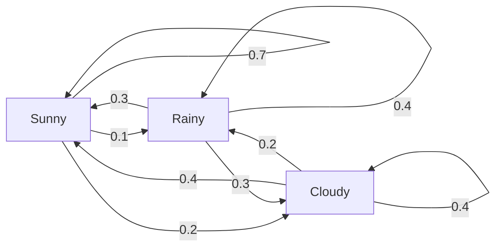
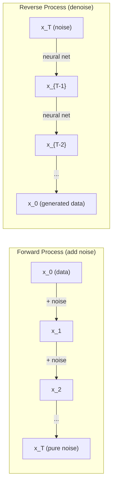

# Stochastic Processes · 随机过程

> 带结构的随机性。随机游走、马尔可夫链与扩散模型背后的数学。

> Randomness with structure. The math behind random walks, Markov chains, and diffusion models.

**Type:** Learn
**Language:** Python
**Prerequisites:** Phase 1, Lessons 06-07 (probability, Bayes)
**Time:** ~75 minutes

---

## Learning Objectives · 学习目标

- 模拟一维和二维随机游走（random walk），并验证位移的 sqrt(n) 缩放规律
- 构建一个马尔可夫链（Markov chain）模拟器，并通过特征分解计算它的平稳分布（stationary distribution）
- 实现 Metropolis-Hastings MCMC 和 Langevin 动力学（Langevin dynamics），从目标分布中采样
- 把前向扩散过程与布朗运动（Brownian motion）联系起来，解释反向过程如何生成数据

> Simulate 1D and 2D random walks and verify the sqrt(n) scaling of displacement
> Build a Markov chain simulator and compute its stationary distribution via eigendecomposition
> Implement Metropolis-Hastings MCMC and Langevin dynamics for sampling from target distributions
> Connect the forward diffusion process to Brownian motion and explain how the reverse process generates data

---

## The Problem · 问题在哪

许多 AI 系统都涉及随时间演化的随机性。不是静态的随机 —— 而是结构化的、按序列展开的随机：每一步都取决于它之前发生了什么。

语言模型一次生成一个 token。每个 token 都依赖前面的上下文。模型输出一个概率分布，从中采样，然后继续前进。这就是一个随机过程（stochastic process）。

扩散模型（diffusion model）一步一步给图像加噪声，直到它变成纯粹的雪花。然后它把过程倒过来，一步一步去噪，直到一张新的图像浮现。前向过程是一条马尔可夫链。反向过程是一条学出来的、倒着运行的马尔可夫链。

强化学习智能体在环境中采取动作。每个动作以某种概率把系统带到一个新状态。智能体在一个随机世界里执行一个随机策略。这整套东西就是一个马尔可夫决策过程（Markov decision process）。

MCMC 采样 —— 贝叶斯推断的支柱 —— 构造一条马尔可夫链，让它的平稳分布恰好是你要采样的那个后验分布。

以上全部建立在四个基础概念之上：
1. 随机游走（random walk）—— 最简单的随机过程
2. 马尔可夫链（Markov chain）—— 带转移矩阵的结构化随机
3. Langevin 动力学 —— 带噪声的梯度下降
4. Metropolis-Hastings —— 从任意分布中采样

> Many AI systems involve randomness that evolves over time. Not static randomness -- structured, sequential randomness where each step depends on what came before. ... Language models generate tokens one at a time. Each token depends on the previous context. The model outputs a probability distribution, samples from it, and moves on. That is a stochastic process. ... The forward process is a Markov chain. The reverse process is a learned Markov chain running backward. ... The agent follows a random policy in a random world. The whole thing is a Markov decision process. ... MCMC sampling -- the backbone of Bayesian inference -- constructs a Markov chain whose stationary distribution is the posterior you want to sample from. All of these build on four foundational ideas.

---

## The Concept · 概念

### Random Walks · 随机游走

从位置 0 出发。每一步抛一次均匀硬币。正面：向右走（+1）。反面：向左走（-1）。

n 步之后，你的位置是 n 个随机 ±1 值的和。期望位置是 0（这条游走是无偏的）。但离原点的期望距离按 sqrt(n) 增长。

这很反直觉。游走是公平的 —— 两个方向都没有漂移。但随着时间推移，它离出发点越走越远。n 步之后的标准差是 sqrt(n)。

```
Step 0:  Position = 0
Step 1:  Position = +1 or -1
Step 2:  Position = +2, 0, or -2
...
Step 100: Expected distance from origin ~ 10 (sqrt(100))
Step 10000: Expected distance from origin ~ 100 (sqrt(10000))
```

**在二维（2D）里**，游走以相等的概率向上、下、左、右移动。同样的 sqrt(n) 缩放规律也适用于离原点的距离。路径会画出一种类似分形的图案。

**为什么是 sqrt(n)？** 每一步以相等概率取 +1 或 -1。n 步之后，位置 S_n = X_1 + X_2 + ... + X_n，其中每个 X_i 是 ±1。每一步的方差是 1，且各步相互独立，所以 Var(S_n) = n。标准差 = sqrt(n)。由中心极限定理（central limit theorem），S_n / sqrt(n) 收敛到标准正态分布。

这个 sqrt(n) 缩放在机器学习里无处不在。SGD 噪声按 1/sqrt(batch_size) 缩放。嵌入维度按 sqrt(d) 缩放。平方根就是「独立随机相加」的签名。

**与布朗运动（Brownian motion）的联系。** 取一条步长为 1/sqrt(n)、单位时间内走 n 步的随机游走。当 n 趋于无穷，这条游走收敛到布朗运动 B(t) —— 一个连续时间过程，其中 B(t) 服从均值为 0、方差为 t 的正态分布。

布朗运动是扩散的数学基础。它刻画流体中粒子的随机抖动、股票价格的波动，以及 —— 最关键的 —— 扩散模型中的噪声过程。

**赌徒破产（Gambler's ruin）。** 一个随机游走者从位置 k 出发，在 0 和 N 处各有一个吸收壁。它在碰到 0 之前先到达 N 的概率是多少？对公平游走：P(reach N) = k/N。答案出奇地简洁优雅。它还联系着鞅（martingale）理论 —— 公平随机游走就是一个鞅（期望的未来值 = 当前值）。

> Start at position 0. At each step, flip a fair coin. Heads: move right (+1). Tails: move left (-1). ... After n steps, your position is the sum of n random +/-1 values. The expected position is 0 (the walk is unbiased). But the expected distance from the origin grows as sqrt(n). ... By the central limit theorem, S_n / sqrt(n) converges to a standard normal distribution. ... As n goes to infinity, the walk converges to Brownian motion B(t) -- a continuous-time process where B(t) is normally distributed with mean 0 and variance t. ... For a fair walk: P(reach N) = k/N.

---

### Markov Chains · 马尔可夫链

马尔可夫链（Markov chain）是一个按固定概率在状态之间转移的系统。关键性质：下一个状态只取决于当前状态，与历史无关。

```
P(X_{t+1} = j | X_t = i, X_{t-1} = ...) = P(X_{t+1} = j | X_t = i)
```

这就是马尔可夫性（Markov property）。它意味着你可以用一个转移矩阵（transition matrix）P 描述整个动力学：

```
P[i][j] = probability of going from state i to state j
```

P 的每一行之和为 1（你总得去某个地方）。

**例子 —— 天气：**

```
States: Sunny (0), Rainy (1), Cloudy (2)

P = [[0.7, 0.1, 0.2],    (if sunny: 70% sunny, 10% rainy, 20% cloudy)
     [0.3, 0.4, 0.3],    (if rainy: 30% sunny, 40% rainy, 30% cloudy)
     [0.4, 0.2, 0.4]]    (if cloudy: 40% sunny, 20% rainy, 40% cloudy)
```

从任意状态出发。经过很多次转移之后，状态的分布收敛到平稳分布（stationary distribution）pi，满足 pi * P = pi。这就是 P 的特征值 1 对应的左特征向量。

对这条天气链，平稳分布是 [0.55, 0.18, 0.27] —— 长期来看，无论从哪个状态出发，都有 55% 的时间是晴天。



**计算平稳分布。** 有两种方法：

1. **幂法（power method）**：把任意初始分布反复乘以 P。迭代足够多次后，它就会收敛。
2. **特征值法（eigenvalue method）**：找 P 的特征值 1 对应的左特征向量。也就是 P^T 的特征值 1 对应的特征向量。

两种方法都要求链满足收敛条件。

**收敛条件。** 一条马尔可夫链收敛到唯一平稳分布，需要满足：
- **不可约（irreducible）**：从每个状态出发都能到达其他所有状态
- **非周期（aperiodic）**：链不会以固定周期循环

你在机器学习里遇到的大多数链都同时满足这两个条件。

**吸收态（absorbing states）。** 如果一旦进入某个状态就永远无法离开（P[i][i] = 1），这个状态就是吸收态。吸收马尔可夫链刻画带有终态的过程 —— 一局会结束的游戏、一个会流失的客户、一段命中 end-of-text token 的 token 序列。

**混合时间（mixing time）。** 链要走多少步才会「接近」平稳分布？形式化地说，就是到平稳的总变差距离（total variation distance）降到某个阈值以下所需的步数。混合快 = 需要的步数少。P 的谱隙（spectral gap，即 1 减去第二大特征值）控制混合时间。谱隙越大 = 混合越快。

> A Markov chain is a system that transitions between states according to fixed probabilities. The key property: the next state depends only on the current state, not on the history. ... Each row of P sums to 1 (you must go somewhere). ... Start in any state. After many transitions, the distribution of states converges to the stationary distribution pi, where pi * P = pi. This is the left eigenvector of P with eigenvalue 1. ... A state is absorbing if once you enter it, you never leave (P[i][i] = 1). ... The spectral gap of P (1 minus the second-largest eigenvalue) controls the mixing time. Larger gap = faster mixing.

---

### Connection to Language Models · 与语言模型的联系

语言模型中的 token 生成近似是一个马尔可夫过程。给定当前上下文，模型输出一个关于下一个 token 的分布。温度（temperature）控制分布的尖锐程度：

```
P(token_i) = exp(logit_i / temperature) / sum(exp(logit_j / temperature))
```

- Temperature = 1.0：标准分布
- Temperature < 1.0：更尖（更确定）
- Temperature > 1.0：更平（更随机）
- Temperature -> 0：argmax（贪心）

Top-k 采样截断到概率最高的 k 个 token。Top-p（nucleus）采样截断到累积概率超过 p 的最小 token 集合。两者都是在修改马尔可夫转移概率。

> Token generation in a language model is approximately a Markov process. Given the current context, the model outputs a distribution over the next token. Temperature controls the sharpness. ... Top-k sampling truncates to the k highest-probability tokens. Top-p (nucleus) sampling truncates to the smallest set of tokens whose cumulative probability exceeds p. Both modify the Markov transition probabilities.

---

### Brownian Motion · 布朗运动

随机游走的连续时间极限。位置 B(t) 有三条性质：
1. B(0) = 0
2. B(t) - B(s) 服从均值为 0、方差为 t - s 的正态分布（当 t > s）
3. 不重叠区间上的增量相互独立

布朗运动连续但处处不可微 —— 它在每一个尺度上都在抖动。它的路径在平面内的分形维数是 2。

在离散模拟中，你这样近似布朗运动：

```
B(t + dt) = B(t) + sqrt(dt) * z,    where z ~ N(0, 1)
```

sqrt(dt) 这个缩放很重要。它来自应用于随机游走的中心极限定理。

> The continuous-time limit of the random walk. Position B(t) has three properties. ... Brownian motion is continuous but nowhere differentiable -- it jiggles at every scale. The path has fractal dimension 2 in the plane. ... The sqrt(dt) scaling is important. It comes from the central limit theorem applied to random walks.

---

### Langevin Dynamics · Langevin 动力学

梯度下降找函数的最小值。Langevin 动力学找与 exp(-U(x)/T) 成正比的概率分布，其中 U 是能量函数，T 是温度。

```
x_{t+1} = x_t - dt * gradient(U(x_t)) + sqrt(2 * T * dt) * z_t
```

两个力作用在粒子上：
1. **梯度力**（-dt * gradient(U)）：把它推向低能量区（像梯度下降）
2. **随机力**（sqrt(2*T*dt) * z）：朝随机方向推（探索）

温度 T = 0 时，这就是纯梯度下降。温度很高时，它几乎就是随机游走。在合适的温度下，粒子会探索整个能量地形，并把更多时间花在低能量区域。

**与扩散模型的联系。** 扩散模型的前向过程是：

```
x_t = sqrt(alpha_t) * x_{t-1} + sqrt(1 - alpha_t) * noise
```

这是一条逐渐把数据与噪声混合的马尔可夫链。步数够多之后，x_T 就是纯高斯噪声。

反向过程 —— 从噪声回到数据 —— 也是一条马尔可夫链，但它的转移概率是由神经网络学出来的。网络学习预测每一步加入的噪声，然后把它减掉。



> Gradient descent finds the minimum of a function. Langevin dynamics finds the probability distribution proportional to exp(-U(x)/T), where U is an energy function and T is temperature. ... At temperature T = 0, this is pure gradient descent. At high temperature, it is nearly a random walk. At the right temperature, the particle explores the energy landscape and spends more time in low-energy regions. ... The reverse process -- going from noise back to data -- is also a Markov chain, but its transition probabilities are learned by a neural network. The network learns to predict the noise that was added at each step, then subtracts it.

---

### MCMC: Markov Chain Monte Carlo · MCMC：马尔可夫链蒙特卡洛

有时你需要从一个分布 p(x) 采样：你能（差一个常数地）计算它，却无法直接从它采样。贝叶斯后验就是经典例子 —— 你知道似然乘以先验，但归一化常数算不出来。

**Metropolis-Hastings** 构造一条平稳分布恰为 p(x) 的马尔可夫链：

1. 从某个位置 x 出发
2. 从提议分布 Q(x'|x) 提议一个新位置 x'
3. 计算接受率：a = p(x') * Q(x|x') / (p(x) * Q(x'|x))
4. 以 min(1, a) 的概率接受 x'。否则停在 x。
5. 重复。

如果 Q 是对称的（例如 Q(x'|x) = Q(x|x') = N(x, sigma^2)），比值简化为 a = p(x') / p(x)。你只需要概率的比值 —— 归一化常数相互抵消。

在温和的条件下，这条链保证收敛到 p(x)。但如果提议步长太小（退化成随机游走）或太大（拒绝率过高），收敛会很慢。调校提议分布就是 MCMC 的手艺活。

**它为什么有效。** 接受率保证了细致平衡（detailed balance）：处于 x 并移动到 x' 的概率，等于处于 x' 并移动到 x 的概率。细致平衡意味着 p(x) 就是这条链的平稳分布。所以步数够多之后，样本就来自 p(x)。

**实践要点：**
- **Burn-in（预烧期）**：丢弃最前面的 N 个样本。链需要时间从起点走到平稳分布。
- **Thinning（抽稀）**：每 k 个样本保留 1 个，以降低自相关。
- **多条链（Multiple chains）**：从不同起点跑若干条链。如果它们收敛到同一个分布，就有了收敛的证据。
- **接受率（Acceptance rate）**：对 d 维高斯提议，最优接受率约为 23%（Roberts & Rosenthal, 2001）。太高说明链几乎没挪动。太低说明它把一切都拒了。

> Sometimes you need to sample from a distribution p(x) that you can evaluate (up to a constant) but cannot sample from directly. Bayesian posteriors are the classic example -- you know the likelihood times the prior, but the normalizing constant is intractable. ... If Q is symmetric (e.g., Q(x'|x) = Q(x|x') = N(x, sigma^2)), the ratio simplifies to a = p(x') / p(x). You only need the ratio of probabilities -- the normalizing constant cancels. ... The acceptance ratio ensures detailed balance: the probability of being at x and moving to x' equals the probability of being at x' and moving to x. Detailed balance implies that p(x) is the stationary distribution of the chain. So after enough steps, the samples come from p(x). ... for Gaussian proposals in d dimensions, the optimal acceptance rate is about 23% (Roberts & Rosenthal, 2001).

---

### Stochastic Processes in AI · AI 中的随机过程

| 过程 | AI 应用 |
|---------|---------------|
| 随机游走（Random walk） | 强化学习中的探索、Node2Vec 嵌入 |
| 马尔可夫链（Markov chain） | 文本生成、MCMC 采样 |
| 布朗运动（Brownian motion） | 扩散模型（前向过程） |
| Langevin 动力学（Langevin dynamics） | 基于分数（score-based）的生成模型、SGLD |
| 马尔可夫决策过程（Markov decision process） | 强化学习 |
| Metropolis-Hastings | 贝叶斯推断、后验采样 |

```figure
random-walk-diffusion
```

---

## Build It · 动手造

### Step 1: Random walk simulator · 随机游走模拟器

```python
import numpy as np

def random_walk_1d(n_steps, seed=None):
    rng = np.random.RandomState(seed)
    steps = rng.choice([-1, 1], size=n_steps)
    positions = np.concatenate([[0], np.cumsum(steps)])
    return positions


def random_walk_2d(n_steps, seed=None):
    rng = np.random.RandomState(seed)
    directions = rng.choice(4, size=n_steps)
    dx = np.zeros(n_steps)
    dy = np.zeros(n_steps)
    dx[directions == 0] = 1   # right
    dx[directions == 1] = -1  # left
    dy[directions == 2] = 1   # up
    dy[directions == 3] = -1  # down
    x = np.concatenate([[0], np.cumsum(dx)])
    y = np.concatenate([[0], np.cumsum(dy)])
    return x, y
```

一维游走存储累积和。每一步是 +1 或 -1。n 步之后，位置就是它们的和。方差随 n 线性增长，所以标准差按 sqrt(n) 增长。

> The 1D walk stores cumulative sums. Each step is +1 or -1. After n steps, the position is the sum. The variance grows linearly with n, so the standard deviation grows as sqrt(n).

### Step 2: Markov chain · 马尔可夫链

```python
class MarkovChain:
    def __init__(self, transition_matrix, state_names=None):
        self.P = np.array(transition_matrix, dtype=float)
        self.n_states = len(self.P)
        self.state_names = state_names or [str(i) for i in range(self.n_states)]

    def step(self, current_state, rng=None):
        if rng is None:
            rng = np.random.RandomState()
        probs = self.P[current_state]
        return rng.choice(self.n_states, p=probs)

    def simulate(self, start_state, n_steps, seed=None):
        rng = np.random.RandomState(seed)
        states = [start_state]
        current = start_state
        for _ in range(n_steps):
            current = self.step(current, rng)
            states.append(current)
        return states

    def stationary_distribution(self):
        eigenvalues, eigenvectors = np.linalg.eig(self.P.T)
        idx = np.argmin(np.abs(eigenvalues - 1.0))
        stationary = np.real(eigenvectors[:, idx])
        stationary = stationary / stationary.sum()
        return np.abs(stationary)
```

平稳分布是 P 的特征值 1 对应的左特征向量。我们通过计算 P^T 的特征向量来求它（转置会把左特征向量变成右特征向量）。

> The stationary distribution is the left eigenvector of P with eigenvalue 1. We find it by computing eigenvectors of P^T (transposing turns left eigenvectors into right eigenvectors).

### Step 3: Langevin dynamics · Langevin 动力学

```python
def langevin_dynamics(grad_U, x0, dt, temperature, n_steps, seed=None):
    rng = np.random.RandomState(seed)
    x = np.array(x0, dtype=float)
    trajectory = [x.copy()]
    for _ in range(n_steps):
        noise = rng.randn(*x.shape)
        x = x - dt * grad_U(x) + np.sqrt(2 * temperature * dt) * noise
        trajectory.append(x.copy())
    return np.array(trajectory)
```

梯度把 x 推向低能量。噪声防止它卡在原地。到达平衡时，样本的分布与 exp(-U(x)/temperature) 成正比。

> The gradient pushes x toward low energy. The noise prevents it from getting stuck. At equilibrium, the distribution of samples is proportional to exp(-U(x)/temperature).

### Step 4: Metropolis-Hastings · Metropolis-Hastings

```python
def metropolis_hastings(target_log_prob, proposal_std, x0, n_samples, seed=None):
    rng = np.random.RandomState(seed)
    x = np.array(x0, dtype=float)
    samples = [x.copy()]
    accepted = 0
    for _ in range(n_samples - 1):
        x_proposed = x + rng.randn(*x.shape) * proposal_std
        log_ratio = target_log_prob(x_proposed) - target_log_prob(x)
        if np.log(rng.rand()) < log_ratio:
            x = x_proposed
            accepted += 1
        samples.append(x.copy())
    acceptance_rate = accepted / (n_samples - 1)
    return np.array(samples), acceptance_rate
```

该算法提议一个新点，检查它是否概率更高（或按与比值成比例的概率接受），然后重复。要让混合良好，接受率应在 23-50% 左右。

> The algorithm proposes a new point, checks if it has higher probability (or accepts with probability proportional to the ratio), and repeats. The acceptance rate should be around 23-50% for good mixing.

---

## Use It · 实战用法

实践中，这些算法你会直接用成熟的库。但理解其内部机制对调试和调参至关重要。

```python
import numpy as np

rng = np.random.RandomState(42)
walk = np.cumsum(rng.choice([-1, 1], size=10000))
print(f"Final position: {walk[-1]}")
print(f"Expected distance: {np.sqrt(10000):.1f}")
print(f"Actual distance: {abs(walk[-1])}")
```

> In practice, you use established libraries for these algorithms. But understanding the mechanics matters for debugging and tuning.

### numpy for transition matrices · 用 numpy 处理转移矩阵

```python
import numpy as np

P = np.array([[0.7, 0.1, 0.2],
              [0.3, 0.4, 0.3],
              [0.4, 0.2, 0.4]])

distribution = np.array([1.0, 0.0, 0.0])
for _ in range(100):
    distribution = distribution @ P

print(f"Stationary distribution: {np.round(distribution, 4)}")
```

把初始分布反复乘以 P。迭代足够多次后，无论你从哪里出发，它都会收敛到平稳分布。这就是求主左特征向量的幂法。

> Multiply the initial distribution by P repeatedly. After enough iterations, it converges to the stationary distribution regardless of where you started. This is the power method for finding the dominant left eigenvector.

### Connections to real frameworks · 与真实框架的联系

- **PyTorch 扩散（diffusion）：** Hugging Face `diffusers` 里的 `DDPMScheduler` 实现了前向和反向马尔可夫链
- **NumPyro / PyMC：** 用 MCMC（NUTS 采样器，它改进了 Metropolis-Hastings）做贝叶斯推断
- **Gymnasium（RL）：** 环境的 step 函数定义了一个马尔可夫决策过程

> - **PyTorch diffusion:** The `DDPMScheduler` in Hugging Face `diffusers` implements the forward and reverse Markov chains
> - **NumPyro / PyMC:** Use MCMC (NUTS sampler, which improves on Metropolis-Hastings) for Bayesian inference
> - **Gymnasium (RL):** The environment step function defines a Markov decision process

### Verifying Markov chain convergence · 验证马尔可夫链收敛

```python
import numpy as np

P = np.array([[0.9, 0.1], [0.3, 0.7]])

eigenvalues = np.linalg.eigvals(P)
spectral_gap = 1 - sorted(np.abs(eigenvalues))[-2]
print(f"Eigenvalues: {eigenvalues}")
print(f"Spectral gap: {spectral_gap:.4f}")
print(f"Approximate mixing time: {1/spectral_gap:.1f} steps")
```

谱隙告诉你链遗忘初始状态有多快。谱隙 0.2 意味着大约 5 步就能混合均匀。谱隙 0.01 意味着大约 100 步。跑长时间模拟之前一定要先检查它 —— 混合慢的链纯粹是在浪费算力。

> The spectral gap tells you how fast the chain forgets its initial state. A gap of 0.2 means roughly 5 steps to mix. A gap of 0.01 means roughly 100 steps. Always check this before running long simulations -- a slowly mixing chain wastes compute.

---

## Ship It · 交付

本课产出：
- `outputs/prompt-stochastic-process-advisor.md` —— 一个帮你判断给定问题适用于哪种随机过程框架的提示词

> This lesson produces:
> - `outputs/prompt-stochastic-process-advisor.md` -- a prompt that helps identify which stochastic process framework applies to a given problem

---

## Connections · 联系

| 概念 | 出现在哪里 |
|---------|------------------|
| 随机游走（Random walk） | Node2Vec 图嵌入、强化学习中的探索 |
| 马尔可夫链（Markov chain） | LLM 的 token 生成、MCMC 采样 |
| 布朗运动（Brownian motion） | DDPM 的前向扩散过程、基于 SDE 的模型 |
| Langevin 动力学（Langevin dynamics） | 基于分数的生成模型、随机梯度 Langevin 动力学（SGLD） |
| 平稳分布（Stationary distribution） | MCMC 的收敛目标、PageRank |
| Metropolis-Hastings | 贝叶斯后验采样、模拟退火 |
| 温度（Temperature） | LLM 采样、强化学习中的 Boltzmann 探索、模拟退火 |
| 混合时间（Mixing time） | MCMC 的收敛速度、谱隙分析 |
| 吸收态（Absorbing state） | 序列结束（end-of-sequence）token、强化学习中的终态 |
| 细致平衡（Detailed balance） | MCMC 采样器的正确性保证 |

扩散模型值得特别关注。DDPM（Ho et al., 2020）定义了一条前向马尔可夫链：

```
q(x_t | x_{t-1}) = N(x_t; sqrt(1-beta_t) * x_{t-1}, beta_t * I)
```

其中 beta_t 是噪声调度（noise schedule）。T 步之后，x_T 近似服从 N(0, I)。反向过程由一个预测噪声的神经网络参数化：

```
p_theta(x_{t-1} | x_t) = N(x_{t-1}; mu_theta(x_t, t), sigma_t^2 * I)
```

生成的每一步都是一条学出来的马尔可夫链中的一步。理解马尔可夫链，就是理解扩散模型如何以及为什么能生成数据。

SGLD（Stochastic Gradient Langevin Dynamics，随机梯度 Langevin 动力学）把 mini-batch 梯度下降与 Langevin 噪声结合起来。你不用计算完整梯度，而是使用随机估计并加上经过校准的噪声。随着学习率衰减，SGLD 会从优化过渡到采样 —— 你免费得到近似的贝叶斯后验样本。这是从神经网络获得不确定性估计的最简单方法之一。

贯穿所有这些联系的关键洞见：随机过程不只是理论工具。它们就是现代 AI 系统内部的计算机制。当你调 LLM 的温度时，你是在调节一条马尔可夫链。当你训练扩散模型时，你是在学习反转一个类似布朗运动的过程。当你跑贝叶斯推断时，你是在构造一条收敛到后验的链。

> Diffusion models deserve special attention. DDPM (Ho et al., 2020) defines a forward Markov chain. ... Every step of generation is a step in a learned Markov chain. Understanding Markov chains means understanding how and why diffusion models generate data. ... As learning rate decays, SGLD transitions from optimization to sampling -- you get approximate Bayesian posterior samples for free. This is one of the simplest ways to get uncertainty estimates from a neural network. ... The key insight across all these connections: stochastic processes are not just theoretical tools. They are the computational mechanisms inside modern AI systems.

---

## Exercises · 练习

1. **模拟 1000 条 10000 步的随机游走。** 画出最终位置的分布。验证它近似为均值 0、标准差 sqrt(10000) = 100 的高斯分布。

2. **用马尔可夫链构建一个文本生成器。** 在一个小语料上训练：对每个词，统计它转移到下一个词的次数。构建转移矩阵。通过从链中采样生成新句子。

3. **用 Metropolis-Hastings 实现模拟退火（simulated annealing）。** 从高温开始（几乎接受一切）逐渐降温（只接受改进）。用它找一个有很多局部极小的函数的最小值。

4. **比较不同温度下的 Langevin 动力学。** 从双阱势 U(x) = (x^2 - 1)^2 采样。低温时，样本聚在一个阱里。高温时，样本散布在两个阱上。找出链能在两阱之间来回混合的临界温度。

5. **实现前向扩散过程。** 从一维信号（例如正弦波）开始。用线性噪声调度在 100 步内逐步加噪。展示信号如何退化成纯噪声。然后实现一个简单的去噪器把过程反过来（哪怕只是一个只会减去估计噪声的朴素去噪器）。

---

## Key Terms · 术语表

| 术语 | 大家怎么说 | 实际含义 |
|------|----------------|----------------------|
| Random walk（随机游走） | 「掷硬币式移动」 | 每一步位置都以随机增量变化的过程 |
| Markov property（马尔可夫性） | 「无记忆」 | 未来只取决于当前状态，与历史无关 |
| Transition matrix（转移矩阵） | 「概率表」 | P[i][j] = 从状态 i 转移到状态 j 的概率 |
| Stationary distribution（平稳分布） | 「长期平均」 | 满足 pi*P = pi 的分布 pi —— 链的平衡态 |
| Brownian motion（布朗运动） | 「随机抖动」 | 随机游走的连续时间极限，B(t) ~ N(0, t) |
| Langevin dynamics（Langevin 动力学） | 「带噪声的梯度下降」 | 结合确定性梯度与随机扰动的更新规则 |
| MCMC | 「朝目标走过去」 | 构造一条平稳分布恰是你想要的分布的马尔可夫链 |
| Metropolis-Hastings | 「提议然后接受/拒绝」 | 用接受率保证收敛的 MCMC 算法 |
| Temperature（温度） | 「随机性旋钮」 | 控制探索与利用之间权衡的参数 |
| Diffusion process（扩散过程） | 「噪声进，噪声出」 | 前向：逐渐加噪。反向：逐渐去噪。以此生成数据。 |

---

## Further Reading · 延伸阅读

- **Ho, Jain, Abbeel (2020)** —— "Denoising Diffusion Probabilistic Models"。掀起扩散模型革命的 DDPM 论文，对前向与反向马尔可夫链给出了清晰的推导。
- **Song & Ermon (2019)** —— "Generative Modeling by Estimating Gradients of the Data Distribution"。基于分数的方法，用 Langevin 动力学做采样。
- **Roberts & Rosenthal (2004)** —— "General state space Markov chains and MCMC algorithms"。MCMC 何时有效、为何有效的理论。
- **Norris (1997)** —— "Markov Chains"。标准教材。覆盖收敛性、平稳分布与命中时间。
- **Welling & Teh (2011)** —— "Bayesian Learning via Stochastic Gradient Langevin Dynamics"。把 SGD 与 Langevin 动力学结合，实现可扩展的贝叶斯推断。
