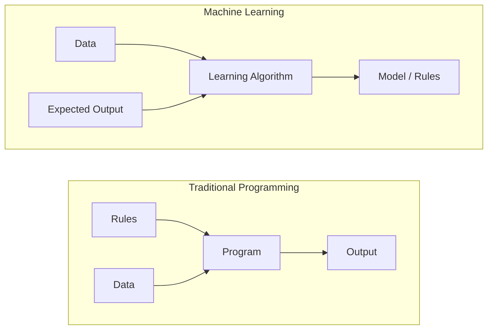
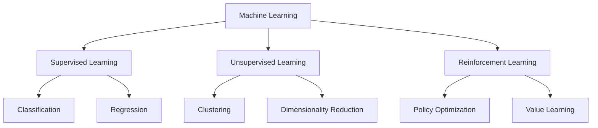
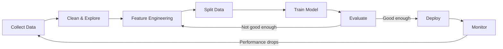
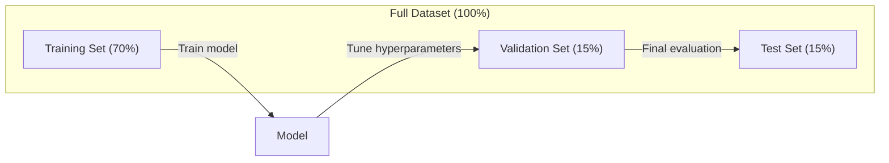
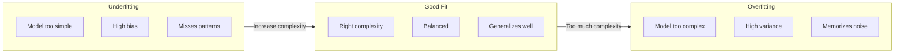
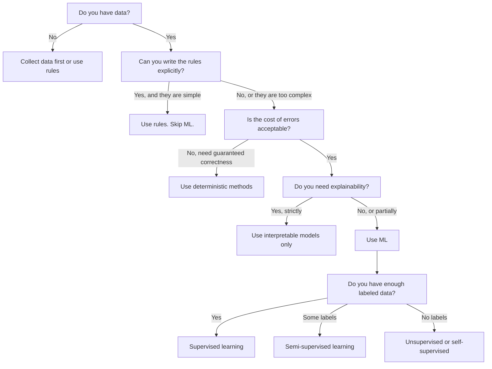

# What Is Machine Learning · 什么是机器学习

> 机器学习是教计算机从数据中找规律，而不是靠人手写规则。

> Machine learning is teaching computers to find patterns in data instead of writing rules by hand.

**Type:** Learn
**Languages:** Python
**Prerequisites:** Phase 1 (Math Foundations)
**Time:** ~45 minutes

---

## Learning Objectives · 学习目标

- 解释监督学习、无监督学习和强化学习的区别，并判断给定问题属于哪一类
- 从零实现一个最近质心分类器（nearest centroid classifier），并与随机基线对比评估
- 区分分类（classification）与回归（regression）任务，并为每种任务选择合适的损失函数
- 评估一个业务问题适合用机器学习解决，还是用确定性规则解决更好

> Explain the difference between supervised, unsupervised, and reinforcement learning and identify which type applies to a given problem
> Implement a nearest centroid classifier from scratch and evaluate it against a random baseline
> Distinguish between classification and regression tasks and select the appropriate loss function for each
> Evaluate whether a given business problem is suitable for ML or better solved with deterministic rules

---

## The Problem · 问题在哪

你想做一个垃圾邮件过滤器。传统做法：坐下来写几百条规则。「如果邮件包含 'FREE MONEY'，标记为垃圾邮件。如果感叹号超过 3 个，标记为垃圾邮件。」你花几周写规则。然后发垃圾邮件的人换了措辞。你的规则失效了。你写更多规则。这个循环永无止境。

机器学习把这一切反转过来。你不再写规则，而是给计算机几千封带标签的邮件（「垃圾邮件」或「非垃圾邮件」），让它自己琢磨出规则。计算机会找到你根本想不到的模式。当发件人改变策略时，你只需要在新数据上重新训练，而不是重写代码。

这次从「编写规则」到「从数据学习」的转变，就是机器学习的核心。每一个推荐引擎、语音助手、自动驾驶汽车和语言模型，都是这样工作的。

> The traditional approach: sit down and write hundreds of rules. ... Machine learning flips this. Instead of writing rules, you give the computer thousands of labeled emails ("spam" or "not spam") and let it figure out the rules on its own. The computer finds patterns you never would have thought of. ... This shift from "programming rules" to "learning from data" is the core of machine learning. Every recommendation engine, voice assistant, self-driving car, and language model works this way.

---

## The Concept · 概念

### Learning From Data, Not Rules · 从数据中学习，而不是学习规则

传统编程和机器学习解决问题的方向正好相反。



传统编程：你写规则。程序把规则应用到数据上，产出输出。

机器学习：你提供数据和期望输出。算法自己发现规则。

训练出来的那个「模型」就是规则本身，只不过被编码成了数字（权重、参数）。它从见过的样本中泛化，对从未见过的数据做出预测。

> Traditional programming and machine learning solve problems in opposite directions. ... Traditional programming: you write the rules. The program applies them to data to produce output. ... Machine learning: you provide data and expected outputs. The algorithm discovers the rules. ... The "model" that comes out of training IS the rules, encoded as numbers (weights, parameters). It generalizes from examples it has seen to make predictions on data it has never seen.

---

### The Three Types of Machine Learning · 机器学习的三大类型



**监督学习（Supervised Learning）**：你手里有输入-输出对。模型学习把输入映射到输出。
- 「这是一万张标注了猫或狗的照片。学会区分它们。」
- 「这是房子特征和价格。学会预测价格。」

**无监督学习（Unsupervised Learning）**：你只有输入。没有标签。模型自己找结构。
- 「这是一万条顾客购买历史。找出自然的分组。」
- 「这是一千维的数据点。在保留结构的前提下降到二维。」

**强化学习（Reinforcement Learning）**：一个智能体（agent）在环境中采取动作，并获得奖励或惩罚。它学习一个策略（policy）来最大化总奖励。
- 「玩这个游戏。赢 +1，输 -1。自己琢磨出策略。」
- 「控制这只机械臂。抓起物体 +1，每浪费一秒 -0.01。」

实际工作中你要构建的东西，大部分用的是监督学习。无监督学习常用于预处理和探索。强化学习支撑着游戏 AI、机器人技术，以及语言模型的 RLHF。

> **Supervised Learning**: You have input-output pairs. The model learns to map inputs to outputs. ... **Unsupervised Learning**: You have inputs only. No labels. The model finds structure on its own. ... **Reinforcement Learning**: An agent takes actions in an environment and receives rewards or penalties. It learns a strategy (policy) to maximize total reward. ... Most of what you will build in practice uses supervised learning. Unsupervised learning is common for preprocessing and exploration. Reinforcement learning powers game AI, robotics, and RLHF for language models.

---

### Beyond the Big Three · 三大类型之外

上面三个类别界限分明，但现实世界的机器学习常常模糊这些界线。

**半监督学习（Semi-supervised learning）** 使用一小部分带标签的数据和一大批无标签数据。你可能只有 100 张带标签的医学影像，却有 100,000 张无标签的。常用技术包括：

- **标签传播（Label propagation）**：构建一张图，把相似的数据点连起来。标签沿着图从带标签的节点扩散到无标签的邻居。
- **伪标签（Pseudo-labeling）**：先在带标签数据上训练模型，用它给无标签数据打标签，然后在全部数据上重新训练。模型自举（bootstrap）出自己的训练集。
- **一致性正则（Consistency regularization）**：模型对一个输入和它轻微扰动后的版本，应该给出相同的预测。即使没有标签，这也行得通。

**自监督学习（Self-supervised learning）** 从数据本身制造监督信号。完全不需要人工标注。模型利用数据的结构给自己创造预测任务。

- **掩码语言建模（Masked language modeling，BERT）**：遮住句子中 15% 的词，训练模型预测被遮住的词。「标签」来自原始文本。
- **对比学习（Contrastive learning，SimCLR）**：取一张图，生成两个增强版本。训练模型识别它们来自同一张图，同时把它们与其他图的增强版本区分开。
- **下一个 token 预测（Next-token prediction，GPT）**：给定之前所有词，预测下一个词。每一篇文本文档都变成一个训练样本。

这些并不是三大类型之外的独立类别。它们是组合监督与无监督思想的策略。自监督学习在技术上属于监督学习（模型在预测某个东西），只不过标签是自动生成的，不是人工打的。

> **Semi-supervised learning** uses a small set of labeled data and a large set of unlabeled data. You might have 100 labeled medical images and 100,000 unlabeled ones. ... **Self-supervised learning** creates supervision from the data itself. No human labels needed at all. The model creates its own prediction task from the structure of the data. ... These are not separate categories from the big three. They are strategies that combine supervised and unsupervised ideas. Self-supervised learning is technically supervised (the model predicts something), but the labels are generated automatically, not by humans.

---

### Classification vs Regression · 分类 vs 回归

这是监督学习的两大主要任务。

| 维度 | 分类（Classification） | 回归（Regression） |
|--------|---------------|------------|
| 输出 | 离散类别 | 连续数值 |
| 例子 | 「这封邮件是不是垃圾邮件？」 | 「房价会是多少？」 |
| 输出空间 | {cat, dog, bird} | 任意实数 |
| 损失函数 | 交叉熵、准确率 | 均方误差（MSE）、MAE |
| 决策 | 类别之间的边界 | 拟合数据的一条曲线 |

分类回答「是哪一类？」回归回答「是多少？」

有些问题两种框架都行。预测股票涨还是跌是分类。预测精确价格是回归。

> These are the two main supervised learning tasks. ... Classification answers "which category?" Regression answers "how much?" ... Some problems can be framed either way. Predicting if a stock goes up or down is classification. Predicting the exact price is regression.

---

### The ML Workflow · 机器学习工作流

无论用什么算法，每个机器学习项目都遵循同一条流水线。



**收集数据（Collect Data）**：获取原始数据。数据几乎总是越多越好，但质量比数量更重要。

**清洗与探索（Clean & Explore）**：处理缺失值、去重、可视化分布、发现异常。这一步常常占总项目时长的 60-80%。

**特征工程（Feature Engineering）**：把原始数据转换成模型能用的特征。把日期转成星期几。对数值列做归一化。对类别变量做编码。好特征比花哨的算法更重要。

**切分数据（Split Data）**：划分成训练集、验证集和测试集。模型在训练数据上学习，你在验证数据上调超参数，最后在测试数据上报告最终性能。

**训练模型（Train Model）**：把训练数据喂给算法。算法调整内部参数，使损失函数最小。

**评估（Evaluate）**：在验证/测试数据上度量性能。如果性能不可接受，回头尝试不同的特征、算法或超参数。

**部署（Deploy）**：把模型投入生产环境，对新数据做预测。

**监控（Monitor）**：持续追踪性能。数据分布会变（数据漂移，data drift），模型会退化。性能下降时，重新训练。

> Every machine learning project follows the same pipeline, regardless of the algorithm. ... **Clean & Explore**: Handle missing values, remove duplicates, visualize distributions, spot anomalies. This step often takes 60-80% of total project time. ... **Feature Engineering**: ... Good features matter more than fancy algorithms. ... **Split Data**: Divide into training, validation, and test sets. ... **Monitor**: Track performance over time. Data distributions change (data drift), and models degrade. When performance drops, retrain.

---

### Training, Validation, and Test Splits · 训练集、验证集与测试集

这是初学者最容易搞错的概念。你必须在一个模型在训练期间从未见过的数据上评估它。否则你度量的是记忆，不是学习。



| 划分 | 用途 | 何时使用 | 典型比例 |
|-------|---------|-----------|-------------|
| 训练集（Training） | 模型从这部分数据学习 | 训练期间 | 60-80% |
| 验证集（Validation） | 调超参数、比较模型 | 每轮训练之后 | 10-20% |
| 测试集（Test） | 最终的无偏性能估计 | 只用一次，最后 | 10-20% |

测试集是神圣不可侵犯的。你只能看它一次。如果你不断根据测试集表现调整模型，你实际上就是在测试集上训练，你报告的数字就毫无意义。

对小型数据集，使用 k 折交叉验证（k-fold cross-validation）：把数据切成 k 份，在 k-1 份上训练，在剩下的 1 份上验证，轮换进行，最后平均结果。

> This is the most important concept beginners get wrong. You must evaluate your model on data it has never seen during training. Otherwise you are measuring memorization, not learning. ... The test set is sacred. You look at it exactly once. If you keep adjusting your model based on test performance, you are effectively training on the test set and your reported numbers are meaningless. ... For small datasets, use k-fold cross-validation: split data into k parts, train on k-1 parts, validate on the remaining part, rotate, and average results.

---

### Overfitting vs Underfitting · 过拟合 vs 欠拟合



**欠拟合（Underfitting）**：模型太简单，捕捉不到数据中的模式。就像用一条直线去拟合一段弯曲的关系。训练误差高。测试误差高。

**过拟合（Overfitting）**：模型太复杂，把训练数据连同它的噪声一起背了下来。就像一条弯弯曲曲、穿过每个训练点、但在新数据上一败涂地的曲线。训练误差低。测试误差高。

**拟合良好（Good fit）**：模型捕捉到真正的模式，又没有背下噪声。训练误差和测试误差都相当低。

过拟合的迹象：
- 训练准确率远高于验证准确率
- 模型在训练数据上表现好，在新数据上表现差
- 增加更多训练数据能提升性能（说明模型之前是在背数据，不是在学习）

过拟合的解法：
- 获取更多训练数据
- 降低模型复杂度（更少参数、更简单的架构）
- 正则化（regularization，给大权重加惩罚）
- Dropout（训练时随机把神经元置零）
- 早停（early stopping，当验证误差开始上升就停止训练）

欠拟合的解法：
- 用更复杂的模型
- 增加更多特征
- 减小正则化
- 训练更久

> **Underfitting**: The model is too simple to capture the patterns in the data. ... Training error is high. Test error is high. ... **Overfitting**: The model is too complex and memorizes the training data, including its noise. ... Training error is low. Test error is high. ... **Good fit**: The model captures real patterns without memorizing noise. Training error and test error are both reasonably low. ... Signs of overfitting: Training accuracy is much higher than validation accuracy.

---

### The Bias-Variance Tradeoff · 偏差-方差权衡

这是过拟合与欠拟合背后的数学框架。

**偏差（Bias）**：来自模型错误假设的误差。当真实关系是非线性的，线性模型就有高偏差。高偏差导致欠拟合。

**方差（Variance）**：来自对训练数据微小波动的敏感性的误差。高方差模型在不同数据子集上训练，会给出差别很大的预测。高方差导致过拟合。

| 模型复杂度 | 偏差 | 方差 | 结果 |
|-----------------|------|----------|--------|
| 过低（用线性模型拟合弯曲数据） | 高 | 低 | 欠拟合 |
| 恰到好处 | 中 | 中 | 泛化良好 |
| 过高（用 20 次多项式拟合 10 个点） | 低 | 高 | 过拟合 |

Total error = Bias^2 + Variance + Irreducible noise

你无法降低不可约噪声（它是数据本身的随机性）。你要找的是 bias^2 + variance 最小的那个甜点位。

> **Bias**: Error from wrong assumptions in the model. A linear model has high bias when the true relationship is nonlinear. High bias leads to underfitting. ... **Variance**: Error from sensitivity to small fluctuations in the training data. ... High variance leads to overfitting. ... You cannot reduce irreducible noise (it is randomness in the data itself). You want to find the sweet spot where bias^2 + variance is minimized.

---

### No Free Lunch Theorem · 没有免费午餐定理

不存在一个对所有问题都表现最好的算法。在一类问题上表现好的算法，在另一类问题上会表现差。这就是数据科学家要尝试多种算法并比较结果的原因。

实践中，算法选择取决于：
- 你有多少数据
- 有多少特征
- 关系是线性还是非线性
- 你是否需要可解释性
- 你能负担多少算力

> There is no single algorithm that works best for every problem. An algorithm that performs well on one class of problems will perform poorly on another. This is why data scientists try multiple algorithms and compare results. ... In practice, the choice depends on: How much data you have. How many features there are. Whether the relationship is linear or nonlinear. Whether you need interpretability. How much compute you can afford.

---

### When NOT to Use Machine Learning · 什么时候不该用机器学习

机器学习很强大，但并不总是正确的工具。在伸手拿模型之前，先问自己是否真的需要它。

**以下情况不要用机器学习：**

- **规则简单且定义清晰。** 税额计算、排序算法、单位换算。如果几条 if 语句就能写出逻辑，模型只会平添复杂度而没有收益。
- **你没有数据或数据极少。** 机器学习需要样本才能学习。只有 10 个数据点，你训练不出任何有意义的东西。先去收集数据。
- **犯错的代价是灾难性的，而且你需要保证正确性。** 医疗剂量计算、核反应堆控制、密码学校验。机器学习模型是概率性的。它们有时会错。如果「偶尔出错」不可接受，就用确定性方法。
- **一张查找表或一条启发式规则就能解决问题。** 如果一个简单的阈值或查表能覆盖 99% 的情况，加上机器学习只会增加维护成本而没有实质改进。
- **你解释不了决策，而场景又要求可解释性。** 受监管的行业（信贷、保险、刑事司法）有时要求每个决策都可完全解释。有些机器学习模型是可解释的（线性回归、小决策树）。大多数不是。
- **问题变化得比你的重训速度还快。** 如果规则每天变，而重训要一周，模型永远过时。

用这个决策流程图：



```figure
f3-learning-boundary
```

> ML is powerful but not always the right tool. Before reaching for a model, ask whether you actually need one. ... **Rules are simple and well-defined.** Tax calculation, sorting algorithms, unit conversions. If you can write the logic in a few if-statements, a model adds complexity for no benefit. ... **You have no data or very little data.** ML needs examples to learn from. ... **The cost of being wrong is catastrophic and you need guaranteed correctness.** ... ML models are probabilistic. They will sometimes be wrong. If "sometimes wrong" is unacceptable, use deterministic methods. ... **The problem changes faster than you can retrain.** If the rules change daily and retraining takes a week, the model is always stale.

---

## Build It · 动手造

`code/ml_intro.py` 里的代码从零实现了一个最近质心分类器（nearest centroid classifier），这是最简单的机器学习算法。它演示了核心思想：先从数据中学习，再对新数据做预测。

> The code in `code/ml_intro.py` implements a nearest centroid classifier from scratch, the simplest possible ML algorithm. It demonstrates the core idea: learn from data, then predict on new data.

### Step 1: Nearest Centroid Classifier from Scratch · 从零实现最近质心分类器

最近质心分类器计算训练数据中每个类别的中心（均值）。预测时，它把每个新点分配给中心离它最近的那个类别。

```python
class NearestCentroid:
    def fit(self, X, y):
        self.classes = np.unique(y)
        self.centroids = np.array([
            X[y == c].mean(axis=0) for c in self.classes
        ])

    def predict(self, X):
        distances = np.array([
            np.sqrt(((X - c) ** 2).sum(axis=1))
            for c in self.centroids
        ])
        return self.classes[distances.argmin(axis=0)]
```

这就是整个算法。Fit 计算两个均值。Predict 计算距离。没有梯度下降，没有迭代，没有超参数。

> The nearest centroid classifier computes the center (mean) of each class in the training data. To predict, it assigns each new point to the class whose center is closest. ... That is the entire algorithm. Fit computes two means. Predict computes distances. No gradient descent, no iteration, no hyperparameters.

### Step 2: Train on Synthetic Data · 在合成数据上训练

我们生成一个二维分类数据集，其中两个类别有轻微重叠。质心分类器会在两个类别中心之间画出一条线性决策边界。

```python
rng = np.random.RandomState(42)
X_class0 = rng.randn(100, 2) + np.array([1.0, 1.0])
X_class1 = rng.randn(100, 2) + np.array([-1.0, -1.0])
X = np.vstack([X_class0, X_class1])
y = np.array([0] * 100 + [1] * 100)
```

> We generate a 2D classification dataset with two classes that overlap slightly. The centroid classifier draws a linear decision boundary between the class centers.

### Step 3: Compare Against a Baseline · 与基线对比

每个机器学习模型都应该和一个平凡的基线（baseline）比较。这里的基线随机预测一个类别。如果你的机器学习模型连随机猜都赢不了，那一定出了问题。

```python
baseline_preds = rng.choice([0, 1], size=len(y_test))
baseline_acc = np.mean(baseline_preds == y_test)
```

在这个干净的数据集上，质心分类器应该能拿到 90% 以上的准确率。随机基线大约是 50%。

> Every ML model should be compared against a trivial baseline. Here, the baseline predicts a random class. If your ML model does not beat random guessing, something is wrong. ... The centroid classifier should get around 90%+ accuracy on this clean dataset. Random baseline gets around 50%.

### Why This Matters · 为什么这很重要

最近质心分类器简单到了极点。它没有超参数，没有迭代，没有梯度下降。但它抓住了机器学习的基本范式：

1. 从训练数据中**学习**（learn）一个表示（representation）（质心）
2. 用这个表示对新数据做**预测**（predict）（最近距离）
3. 对照基线做**评估**（evaluate）（随机猜测）

从逻辑回归到 transformer，每一个机器学习算法都遵循这三步范式。表示变得越来越复杂，但工作流始终没变。

> The nearest centroid classifier is trivially simple. It has no hyperparameters, no iteration, no gradient descent. Yet it captures the fundamental ML pattern. ... **Learn** a representation from training data (the centroids). ... **Predict** on new data using that representation (nearest distance). ... **Evaluate** against a baseline (random guessing). ... Every ML algorithm, from logistic regression to transformers, follows this same three-step pattern. The representation gets more complex, but the workflow stays the same.

### Step 4: What the Centroid Classifier Cannot Do · 质心分类器做不到的事

最近质心分类器假设每个类别构成单独的一团。它画出的是线性决策边界。它在以下情况会失败：

- 类别有多个簇（例如数字「1」有好几种不同的写法）
- 决策边界是非线性的（例如一个类别包裹住另一个类别）
- 各特征的量纲差异极大（距离会被最大尺度的特征主导）

这些局限正是你后面要学的每一个算法的动机。K 近邻（K-nearest neighbors）能处理多个簇。决策树能处理非线性边界。特征缩放能修复量纲问题。每一课都建立在前一课的局限之上。

> The nearest centroid classifier assumes each class forms a single blob. It draws linear decision boundaries. It fails when. ... These limitations motivate every other algorithm you will learn. K-nearest neighbors handles multiple clusters. Decision trees handle nonlinear boundaries. Feature scaling fixes the scale problem. Each lesson builds on the limitations of the previous one.

---

## Use It · 实战用法

sklearn 提供了 `NearestCentroid` 和合成数据生成器：

```python
from sklearn.neighbors import NearestCentroid
from sklearn.datasets import make_classification
from sklearn.model_selection import train_test_split

X, y = make_classification(
    n_samples=500, n_features=2, n_redundant=0,
    n_clusters_per_class=1, random_state=42
)
X_train, X_test, y_train, y_test = train_test_split(X, y, test_size=0.3)

clf = NearestCentroid()
clf.fit(X_train, y_train)
print(f"Accuracy: {clf.score(X_test, y_test):.3f}")
```

> sklearn provides `NearestCentroid` and synthetic data generators.

---

## 实测（2026-10-15 本机真跑）

> 命令：`.venv/bin/python code/ml_intro.py`（66 行输出，EXIT=0）。数字全部来自这次真跑，可复现。

### 实测 1 · 最近质心 + 双基线

300 样本 2 特征 2 类（train 210 / test 90），质心：类 0 [1.037, 1.009]、类 1 [-0.977, -1.105]。最近质心 train 0.919 / test **0.967**；随机基线 0.467；多数类基线 **0.433**——比随机还低！本数据类别略不均衡（约 43:57），"多数类"恰是少数。教训：**报基线要同时报随机 + 多数类两个**，单看一个会误判难度。

### 实测 2 · 间距扫描：数据决定上限

两类中心间距 0.5/1.0/1.5/2.0/3.0/5.0 → test acc 0.644/0.756/0.867/0.967/0.989/1.000。间距越大，重叠越少，**连最简单的模型都能到满分**。模型再好也救不了严重重叠的数据——"数据质量 > 模型复杂度"的实证。

### 实测 3 · 维度扫描：合成数据的反直觉

固定间距，特征数 2/5/10/20/50 → test 0.933/0.992/1.000/1.000/1.000。**维度越高越好**——与"维度灾难"的直觉相反！原因：这份合成数据的每个特征都带信号；真实数据大量特征是纯噪声，维度灾难才会显现。结论要带边界条件：**curse of dimensionality 前提是特征多为噪声**。

### 实测 4 · 三分类

三个质心成三角（[1.928, 0.031] / [-0.825, 1.684] / [-1.009, -1.826]），test acc **0.989** vs 随机基线 0.344（≈1/3）。最近质心天然支持多分类：算离哪个质心最近就归哪类，无需改造。

## Ship It · 交付

本课产出 `outputs/prompt-ml-problem-framer.md` —— 一个把模糊的业务问题转化为具体机器学习任务的提示词。给它一段问题描述（「我们想降低客户流失率」或「预测下季度的需求」），它会识别学习类型、定义预测目标、列出候选特征、选定成功指标、建立基线，并标出数据泄漏或类别不平衡之类的坑。在任何机器学习项目开工时用它，避免造出错误的东西。

> This lesson produces `outputs/prompt-ml-problem-framer.md` -- a prompt that turns vague business problems into concrete ML tasks. Give it a problem description ("we want to reduce churn" or "predict demand for next quarter") and it identifies the learning type, defines the prediction target, lists candidate features, picks a success metric, establishes a baseline, and flags pitfalls like data leakage or class imbalance. Use it at the start of any ML project to avoid building the wrong thing.

---

## Key Terms · 术语表

| 术语 | 大家怎么说 | 实际含义 |
|------|----------------|----------------------|
| Model（模型） | 「那个 AI」 | 一个带可学习参数的数学函数，把输入映射到输出 |
| Training（训练） | 「教 AI」 | 运行优化算法调整模型参数，使预测逼近已知输出 |
| Feature（特征） | 「一列输入」 | 数据的一个可测量属性，模型用它来做预测 |
| Label（标签） | 「答案」 | 训练样本的已知输出，用来计算误差信号 |
| Hyperparameter（超参数） | 「你来调的设置」 | 训练前设定的参数，控制学习过程（学习率、层数） |
| Loss function（损失函数） | 「模型有多错」 | 度量预测输出与真实输出差距的函数，训练的目标就是把它最小化 |
| Overfitting（过拟合） | 「把考试背下来了」 | 模型学到的是训练数据特有的噪声而非普遍规律，所以在新数据上失败 |
| Underfitting（欠拟合） | 「什么都没学会」 | 模型太简单，捕捉不到数据里真正的模式 |
| Generalization（泛化） | 「在新数据上也行」 | 模型在没有训练过的数据上做出准确预测的能力 |
| Cross-validation（交叉验证） | 「换不同的块来测」 | 反复把数据切成训练/测试折并平均结果，得到更稳健的性能估计 |
| Regularization（正则化） | 「把权重压小」 | 给损失函数加惩罚项，抑制过于复杂的模型 |
| Data drift（数据漂移） | 「世界变了」 | 流入数据的统计分布随时间偏移，导致模型性能退化 |

---

## Exercises · 练习

1. 任选一个数据集（例如 Iris、Titanic）。按 70/15/15 切分成训练/验证/测试集。解释为什么不应该在测试集上调超参数。
2. 列出三个现实世界的问题。对每一个，判断它是分类、回归还是聚类，以及它是监督的还是无监督的。
3. 一个模型在训练数据上拿到 99% 准确率，但在测试数据上只有 60%。诊断问题所在，并列出你会尝试的三种修复方法。

---

## Further Reading · 延伸阅读

- [An Introduction to Statistical Learning](https://www.statlearning.com/) - 免费教材，覆盖全部经典机器学习方法，配有实操例子
- [Google's Machine Learning Crash Course](https://developers.google.com/machine-learning/crash-course) - 机器学习概念的简明可视化入门
- [Scikit-learn User Guide](https://scikit-learn.org/stable/user_guide.html) - 在 Python 中实现机器学习的实用参考
