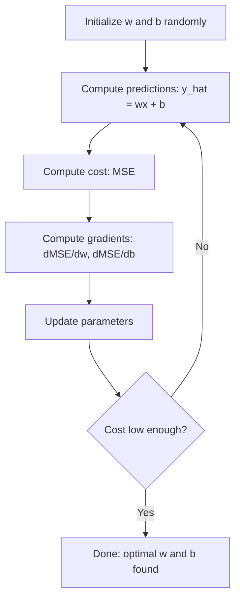

# Linear Regression · 线性回归

> 线性回归（linear regression）画出穿过你数据的最优直线。它是机器学习里的「hello world」。

> Linear regression draws the best straight line through your data. It is the "hello world" of machine learning.

**Type:** Build
**Languages:** Python
**Prerequisites:** Phase 1 (Linear Algebra, Calculus, Optimization), Phase 2 Lesson 1
**Time:** ~90 minutes

## Learning Objectives · 学习目标

- 推导均方误差（mean squared error，MSE）的梯度下降更新规则，并从零实现线性回归
- 比较梯度下降（gradient descent）与正规方程（normal equation）在计算复杂度和适用场景上的差异
- 构建带特征标准化的多元线性回归模型，并解读学到的权重
- 解释岭回归（Ridge regression，L2 正则化）如何通过惩罚大权重防止过拟合（overfitting）

> Derive the gradient descent update rules for mean squared error and implement linear regression from scratch
> Compare gradient descent and the normal equation in terms of computational complexity and when to use each
> Build a multiple linear regression model with feature standardization and interpret the learned weights
> Explain how Ridge regression (L2 regularization) prevents overfitting by penalizing large weights

## The Problem · 问题在哪

你手上有数据：房屋面积和它们的售价。你想在给定面积的情况下预测一套新房的价格。你可以在散点图上目测，但你需要的是一个公式。你需要一条最能拟合数据的直线，这样代入任意面积就能得到价格预测。

线性回归给你的就是这条线。更重要的是，它引入了完整的机器学习训练循环：定义模型、定义代价函数（cost function）、优化参数。每个机器学习算法都遵循同一个模式。用这里最简单的例子把它吃透，你就能在所有地方认出它。

这不只是用来解简单问题的。线性回归在生产系统中被用于需求预测、A/B 测试分析、金融建模，并且是所有回归（regression）任务的基线。

> You have data: house sizes and their sale prices. You want to predict the price of a new house given its size. You could eyeball it on a scatter plot, but you need a formula. ... Linear regression gives you that line. More importantly, it introduces the entire ML training loop: define a model, define a cost function, optimize the parameters. Every ML algorithm follows this same pattern. Master it here with the simplest case, and you will recognize it everywhere. ... Linear regression is used in production systems for demand forecasting, A/B test analysis, financial modeling, and as a baseline for every regression task.

## The Concept · 概念

### The Model · 模型

线性回归假设输入（x）和输出（y）之间存在线性关系：

```
y = wx + b
```

- `w`（weight，权重/斜率）：x 每增加 1，y 变化多少
- `b`（bias，偏置/截距）：x = 0 时 y 的值

有多个输入（特征，feature）时，模型扩展为：

```
y = w1*x1 + w2*x2 + ... + wn*xn + b
```

或者写成向量形式：`y = w^T * x + b`

目标：找到 w 和 b 的值，使预测出的 y 在所有训练样本上都尽可能接近真实的 y。

> Linear regression assumes a linear relationship between input (x) and output (y). ... The goal: find the values of w and b that make the predicted y as close as possible to the actual y across all training examples.

### The Cost Function (Mean Squared Error) · 代价函数（均方误差）

怎么衡量「尽可能接近」？你需要一个单独的数字来刻画预测有多错。最常见的选择是均方误差（MSE）：

```
MSE = (1/n) * sum((y_predicted - y_actual)^2)
```

为什么取平方？两个原因。第一，它对大错误的惩罚远重于小错误（误差 10 的糟糕程度是误差 1 的 100 倍，而不是 10 倍）。第二，平方函数处处光滑、可导，这让优化变得直接。

代价函数张成一个曲面。对单个权重 w 和偏置 b 来说，MSE 曲面看起来像一个碗（凸抛物面）。碗底就是 MSE 最小的地方。训练就是找到那个碗底。

> How do you measure "as close as possible"? You need a single number that captures how wrong your predictions are. The most common choice is Mean Squared Error (MSE). ... Why squared? Two reasons. First, it penalizes large errors more than small errors (an error of 10 is 100x worse than an error of 1, not 10x). Second, the squared function is smooth and differentiable everywhere, which makes optimization straightforward. ... The bottom of the bowl is where MSE is minimized. Training means finding that bottom.

### Gradient Descent · 梯度下降

梯度下降通过一步步往山下走来找到碗底。



梯度告诉你两件事：每个参数该往哪个方向挪，以及挪多少。

对 y_hat = wx + b 的 MSE 来说：

```
dMSE/dw = (2/n) * sum((y_hat - y) * x)
dMSE/db = (2/n) * sum(y_hat - y)
```

更新规则：

```
w = w - learning_rate * dMSE/dw
b = b - learning_rate * dMSE/db
```

学习率（learning rate）控制步长。太大：你会跨过最小值并发散。太小：训练遥遥无期。典型的起始值：0.01、0.001 或 0.0001。

> Gradient descent finds the bottom of the bowl by taking steps downhill. ... The gradients tell you two things: which direction to move each parameter, and how much to move. ... The learning rate controls step size. Too large: you overshoot the minimum and diverge. Too small: training takes forever. Typical starting values: 0.01, 0.001, or 0.0001.

### The Normal Equation (Closed-Form Solution) · 正规方程（闭式解）

对线性回归来说，有一个不经任何迭代、直接给出最优权重的公式：

```
w = (X^T * X)^(-1) * X^T * y
```

它通过一次矩阵求逆一步解出 w。对小数据集完美可用。对大数据集（数百万行或数千个特征），更推荐梯度下降，因为矩阵求逆的代价对特征数是 O(n^3)。

> For linear regression specifically, there is a direct formula that gives the optimal weights without any iteration. ... This inverts a matrix to solve for w in one step. It works perfectly for small datasets. For large datasets (millions of rows or thousands of features), gradient descent is preferred because matrix inversion is O(n^3) in the number of features.

### Multiple Linear Regression · 多元线性回归

有多个特征时，模型变成：

```
y = w1*x1 + w2*x2 + ... + wn*xn + b
```

一切照旧：MSE 是代价函数，梯度下降同时更新所有权重。唯一的区别是你拟合的是一个超平面（hyperplane）而不是一条直线。

特征缩放（feature scaling）在这里很关键。如果一个特征范围是 0 到 1，另一个是 0 到 1,000,000，梯度下降会很挣扎，因为代价曲面会被拉长。训练前先标准化特征（减去均值，除以标准差）。

> Everything works the same: MSE is the cost function, gradient descent updates all weights simultaneously. The only difference is that you are fitting a hyperplane instead of a line. ... Feature scaling matters here. ... Standardize features (subtract mean, divide by standard deviation) before training.

### Polynomial Regression · 多项式回归

如果关系不是线性的怎么办？你仍然可以用线性回归——只要构造多项式特征（polynomial features）：

```
y = w1*x + w2*x^2 + w3*x^3 + b
```

这仍然是「线性」回归，因为模型对权重（w1, w2, w3）是线性的。你只是使用了 x 的非线性特征。

更高次的多项式能拟合更复杂的曲线，但有过拟合风险。10 次多项式会穿过 10 个点数据集中的每一个点，但在新数据上预测很差。

> What if the relationship is not linear? You can still use linear regression by creating polynomial features. ... This is still "linear" regression because the model is linear in the weights (w1, w2, w3). ... Higher-degree polynomials can fit more complex curves but risk overfitting. A degree-10 polynomial will pass through every point in a 10-point dataset but predict poorly on new data.

### R-Squared Score · R 方分数

MSE 告诉你有多错，但这个数字依赖于 y 的量纲。R 方（R-squared，R^2）给出一个与量纲无关的度量：

```
R^2 = 1 - (sum of squared residuals) / (sum of squared deviations from mean)
    = 1 - SS_res / SS_tot
```

- R^2 = 1.0：完美预测
- R^2 = 0.0：模型并不比每次都预测均值更好
- R^2 < 0.0：模型比预测均值还差

> MSE tells you how wrong you are, but the number depends on the scale of y. R-squared (R^2) gives a scale-independent measure.

### Regularization Preview (Ridge Regression) · 正则化预览（岭回归）

特征很多时，模型可能通过给出很大的权重来过拟合。岭回归（Ridge regression，L2 正则化）加入了一个惩罚项：

```
Cost = MSE + lambda * sum(w_i^2)
```

惩罚项抑制大权重。超参数 lambda 控制权衡：lambda 越高，权重越小，正则化越强。后面的课会深入讲它。现在你只需要知道它存在，以及它为什么有用。

> When you have many features, the model can overfit by assigning large weights. Ridge regression (L2 regularization) adds a penalty. ... The penalty term discourages large weights. The hyperparameter lambda controls the tradeoff: higher lambda means smaller weights and more regularization. This is covered in depth in a later lesson. For now, know that it exists and why it helps.

```figure
linear-regression-fit
```

## Build It · 动手造

### Step 1: Generate sample data · 生成样本数据

```python
import random
import math

random.seed(42)

TRUE_W = 3.0
TRUE_B = 7.0
N_SAMPLES = 100

X = [random.uniform(0, 10) for _ in range(N_SAMPLES)]
y = [TRUE_W * x + TRUE_B + random.gauss(0, 2.0) for x in X]

print(f"Generated {N_SAMPLES} samples")
print(f"True relationship: y = {TRUE_W}x + {TRUE_B} (+ noise)")
print(f"First 5 points: {[(round(X[i], 2), round(y[i], 2)) for i in range(5)]}")
```

### Step 2: Linear regression from scratch with gradient descent · 从零用梯度下降实现线性回归

```python
class LinearRegression:
    def __init__(self, learning_rate=0.01):
        self.w = 0.0
        self.b = 0.0
        self.lr = learning_rate
        self.cost_history = []

    def predict(self, X):
        return [self.w * x + self.b for x in X]

    def compute_cost(self, X, y):
        predictions = self.predict(X)
        n = len(y)
        cost = sum((pred - actual) ** 2 for pred, actual in zip(predictions, y)) / n
        return cost

    def compute_gradients(self, X, y):
        predictions = self.predict(X)
        n = len(y)
        dw = (2 / n) * sum((pred - actual) * x for pred, actual, x in zip(predictions, y, X))
        db = (2 / n) * sum(pred - actual for pred, actual in zip(predictions, y))
        return dw, db

    def fit(self, X, y, epochs=1000, print_every=200):
        for epoch in range(epochs):
            dw, db = self.compute_gradients(X, y)
            self.w -= self.lr * dw
            self.b -= self.lr * db
            cost = self.compute_cost(X, y)
            self.cost_history.append(cost)
            if epoch % print_every == 0:
                print(f"  Epoch {epoch:4d} | Cost: {cost:.4f} | w: {self.w:.4f} | b: {self.b:.4f}")
        return self

    def r_squared(self, X, y):
        predictions = self.predict(X)
        y_mean = sum(y) / len(y)
        ss_res = sum((actual - pred) ** 2 for actual, pred in zip(y, predictions))
        ss_tot = sum((actual - y_mean) ** 2 for actual in y)
        return 1 - (ss_res / ss_tot)


print("=== Training Linear Regression (Gradient Descent) ===")
model = LinearRegression(learning_rate=0.005)
model.fit(X, y, epochs=1000, print_every=200)
print(f"\nLearned: y = {model.w:.4f}x + {model.b:.4f}")
print(f"True:    y = {TRUE_W}x + {TRUE_B}")
print(f"R-squared: {model.r_squared(X, y):.4f}")
```

### Step 3: Normal equation (closed-form solution) · 正规方程（闭式解）

```python
class LinearRegressionNormal:
    def __init__(self):
        self.w = 0.0
        self.b = 0.0

    def fit(self, X, y):
        n = len(X)
        x_mean = sum(X) / n
        y_mean = sum(y) / n
        numerator = sum((X[i] - x_mean) * (y[i] - y_mean) for i in range(n))
        denominator = sum((X[i] - x_mean) ** 2 for i in range(n))
        self.w = numerator / denominator
        self.b = y_mean - self.w * x_mean
        return self

    def predict(self, X):
        return [self.w * x + self.b for x in X]

    def r_squared(self, X, y):
        predictions = self.predict(X)
        y_mean = sum(y) / len(y)
        ss_res = sum((actual - pred) ** 2 for actual, pred in zip(y, predictions))
        ss_tot = sum((actual - y_mean) ** 2 for actual in y)
        return 1 - (ss_res / ss_tot)


print("\n=== Normal Equation (Closed-Form) ===")
model_normal = LinearRegressionNormal()
model_normal.fit(X, y)
print(f"Learned: y = {model_normal.w:.4f}x + {model_normal.b:.4f}")
print(f"R-squared: {model_normal.r_squared(X, y):.4f}")
```

### Step 4: Multiple linear regression · 多元线性回归

```python
class MultipleLinearRegression:
    def __init__(self, n_features, learning_rate=0.01):
        self.weights = [0.0] * n_features
        self.bias = 0.0
        self.lr = learning_rate
        self.cost_history = []

    def predict_single(self, x):
        return sum(w * xi for w, xi in zip(self.weights, x)) + self.bias

    def predict(self, X):
        return [self.predict_single(x) for x in X]

    def compute_cost(self, X, y):
        predictions = self.predict(X)
        n = len(y)
        return sum((pred - actual) ** 2 for pred, actual in zip(predictions, y)) / n

    def fit(self, X, y, epochs=1000, print_every=200):
        n = len(y)
        n_features = len(X[0])
        for epoch in range(epochs):
            predictions = self.predict(X)
            errors = [pred - actual for pred, actual in zip(predictions, y)]
            for j in range(n_features):
                grad = (2 / n) * sum(errors[i] * X[i][j] for i in range(n))
                self.weights[j] -= self.lr * grad
            grad_b = (2 / n) * sum(errors)
            self.bias -= self.lr * grad_b
            cost = self.compute_cost(X, y)
            self.cost_history.append(cost)
            if epoch % print_every == 0:
                print(f"  Epoch {epoch:4d} | Cost: {cost:.4f}")
        return self

    def r_squared(self, X, y):
        predictions = self.predict(X)
        y_mean = sum(y) / len(y)
        ss_res = sum((actual - pred) ** 2 for actual, pred in zip(y, predictions))
        ss_tot = sum((actual - y_mean) ** 2 for actual in y)
        return 1 - (ss_res / ss_tot)


random.seed(42)
N = 100
X_multi = []
y_multi = []
for _ in range(N):
    size = random.uniform(500, 3000)
    bedrooms = random.randint(1, 5)
    age = random.uniform(0, 50)
    price = 50 * size + 10000 * bedrooms - 1000 * age + 50000 + random.gauss(0, 20000)
    X_multi.append([size, bedrooms, age])
    y_multi.append(price)


def standardize(X):
    n_features = len(X[0])
    means = [sum(X[i][j] for i in range(len(X))) / len(X) for j in range(n_features)]
    stds = []
    for j in range(n_features):
        variance = sum((X[i][j] - means[j]) ** 2 for i in range(len(X))) / len(X)
        stds.append(variance ** 0.5)
    X_scaled = []
    for i in range(len(X)):
        row = [(X[i][j] - means[j]) / stds[j] if stds[j] > 0 else 0 for j in range(n_features)]
        X_scaled.append(row)
    return X_scaled, means, stds


y_mean_val = sum(y_multi) / len(y_multi)
y_std_val = (sum((yi - y_mean_val) ** 2 for yi in y_multi) / len(y_multi)) ** 0.5
y_scaled = [(yi - y_mean_val) / y_std_val for yi in y_multi]

X_scaled, x_means, x_stds = standardize(X_multi)

print("\n=== Multiple Linear Regression (3 features) ===")
print("Features: house size, bedrooms, age")
multi_model = MultipleLinearRegression(n_features=3, learning_rate=0.01)
multi_model.fit(X_scaled, y_scaled, epochs=1000, print_every=200)

print(f"\nWeights (standardized): {[round(w, 4) for w in multi_model.weights]}")
print(f"Bias (standardized): {multi_model.bias:.4f}")
print(f"R-squared: {multi_model.r_squared(X_scaled, y_scaled):.4f}")
```

### Step 5: Polynomial regression · 多项式回归

```python
class PolynomialRegression:
    def __init__(self, degree, learning_rate=0.01):
        self.degree = degree
        self.weights = [0.0] * degree
        self.bias = 0.0
        self.lr = learning_rate

    def make_features(self, X):
        return [[x ** (d + 1) for d in range(self.degree)] for x in X]

    def predict(self, X):
        features = self.make_features(X)
        return [sum(w * f for w, f in zip(self.weights, row)) + self.bias for row in features]

    def fit(self, X, y, epochs=1000, print_every=200):
        features = self.make_features(X)
        n = len(y)
        for epoch in range(epochs):
            predictions = [sum(w * f for w, f in zip(self.weights, row)) + self.bias for row in features]
            errors = [pred - actual for pred, actual in zip(predictions, y)]
            for j in range(self.degree):
                grad = (2 / n) * sum(errors[i] * features[i][j] for i in range(n))
                self.weights[j] -= self.lr * grad
            grad_b = (2 / n) * sum(errors)
            self.bias -= self.lr * grad_b
            if epoch % print_every == 0:
                cost = sum(e ** 2 for e in errors) / n
                print(f"  Epoch {epoch:4d} | Cost: {cost:.6f}")
        return self

    def r_squared(self, X, y):
        predictions = self.predict(X)
        y_mean = sum(y) / len(y)
        ss_res = sum((actual - pred) ** 2 for actual, pred in zip(y, predictions))
        ss_tot = sum((actual - y_mean) ** 2 for actual in y)
        return 1 - (ss_res / ss_tot)


random.seed(42)
X_poly = [x / 10.0 for x in range(0, 50)]
y_poly = [0.5 * x ** 2 - 2 * x + 3 + random.gauss(0, 1.0) for x in X_poly]

x_max = max(abs(x) for x in X_poly)
X_poly_norm = [x / x_max for x in X_poly]
y_poly_mean = sum(y_poly) / len(y_poly)
y_poly_std = (sum((yi - y_poly_mean) ** 2 for yi in y_poly) / len(y_poly)) ** 0.5
y_poly_norm = [(yi - y_poly_mean) / y_poly_std for yi in y_poly]

print("\n=== Polynomial Regression (degree 2 vs degree 5) ===")
print("True relationship: y = 0.5x^2 - 2x + 3")

print("\nDegree 2:")
poly2 = PolynomialRegression(degree=2, learning_rate=0.1)
poly2.fit(X_poly_norm, y_poly_norm, epochs=2000, print_every=500)
print(f"  R-squared: {poly2.r_squared(X_poly_norm, y_poly_norm):.4f}")

print("\nDegree 5:")
poly5 = PolynomialRegression(degree=5, learning_rate=0.1)
poly5.fit(X_poly_norm, y_poly_norm, epochs=2000, print_every=500)
print(f"  R-squared: {poly5.r_squared(X_poly_norm, y_poly_norm):.4f}")

print("\nDegree 2 fits the true curve well. Degree 5 fits training data slightly better")
print("but risks overfitting on new data.")
```

### Step 6: Ridge regression (L2 regularization) · 岭回归（L2 正则化）

```python
class RidgeRegression:
    def __init__(self, n_features, learning_rate=0.01, alpha=1.0):
        self.weights = [0.0] * n_features
        self.bias = 0.0
        self.lr = learning_rate
        self.alpha = alpha

    def predict_single(self, x):
        return sum(w * xi for w, xi in zip(self.weights, x)) + self.bias

    def predict(self, X):
        return [self.predict_single(x) for x in X]

    def fit(self, X, y, epochs=1000, print_every=200):
        n = len(y)
        n_features = len(X[0])
        for epoch in range(epochs):
            predictions = self.predict(X)
            errors = [pred - actual for pred, actual in zip(predictions, y)]
            mse = sum(e ** 2 for e in errors) / n
            reg_term = self.alpha * sum(w ** 2 for w in self.weights)
            cost = mse + reg_term
            for j in range(n_features):
                grad = (2 / n) * sum(errors[i] * X[i][j] for i in range(n))
                grad += 2 * self.alpha * self.weights[j]
                self.weights[j] -= self.lr * grad
            grad_b = (2 / n) * sum(errors)
            self.bias -= self.lr * grad_b
            if epoch % print_every == 0:
                print(f"  Epoch {epoch:4d} | Cost: {cost:.4f} | L2 penalty: {reg_term:.4f}")
        return self


print("\n=== Ridge Regression (L2 Regularization) ===")
print("Same data as multiple regression, with alpha=0.1")
ridge = RidgeRegression(n_features=3, learning_rate=0.01, alpha=0.1)
ridge.fit(X_scaled, y_scaled, epochs=1000, print_every=200)
print(f"\nRidge weights: {[round(w, 4) for w in ridge.weights]}")
print(f"Plain weights: {[round(w, 4) for w in multi_model.weights]}")
print("Ridge weights are smaller (shrunk toward zero) due to the L2 penalty.")
```

## Use It · 实战用法

现在用 scikit-learn 做同样的事——这才是你实际在生产中会用的东西。

```python
from sklearn.linear_model import LinearRegression as SklearnLR
from sklearn.linear_model import Ridge
from sklearn.preprocessing import PolynomialFeatures, StandardScaler
from sklearn.model_selection import train_test_split
from sklearn.metrics import mean_squared_error, r2_score
import numpy as np

np.random.seed(42)
X_sk = np.random.uniform(0, 10, (100, 1))
y_sk = 3.0 * X_sk.squeeze() + 7.0 + np.random.normal(0, 2.0, 100)

X_train, X_test, y_train, y_test = train_test_split(X_sk, y_sk, test_size=0.2, random_state=42)

lr = SklearnLR()
lr.fit(X_train, y_train)
y_pred = lr.predict(X_test)

print("=== Scikit-learn Linear Regression ===")
print(f"Coefficient (w): {lr.coef_[0]:.4f}")
print(f"Intercept (b): {lr.intercept_:.4f}")
print(f"R-squared (test): {r2_score(y_test, y_pred):.4f}")
print(f"MSE (test): {mean_squared_error(y_test, y_pred):.4f}")

poly = PolynomialFeatures(degree=2, include_bias=False)
X_poly_sk = poly.fit_transform(X_train)
X_poly_test = poly.transform(X_test)

lr_poly = SklearnLR()
lr_poly.fit(X_poly_sk, y_train)
print(f"\nPolynomial degree 2 R-squared: {r2_score(y_test, lr_poly.predict(X_poly_test)):.4f}")

scaler = StandardScaler()
X_train_scaled = scaler.fit_transform(X_train)
X_test_scaled = scaler.transform(X_test)

ridge = Ridge(alpha=1.0)
ridge.fit(X_train_scaled, y_train)
print(f"Ridge R-squared: {r2_score(y_test, ridge.predict(X_test_scaled)):.4f}")
print(f"Ridge coefficient: {ridge.coef_[0]:.4f}")
```

你从零写的实现和 scikit-learn 给出同样的结果。区别在于：scikit-learn 处理了边界情况、数值稳定性和性能优化。生产用库，从零版本用来理解背后发生了什么。

> Now the same thing with scikit-learn, which is what you will actually use in production. ... Your from-scratch implementation and scikit-learn produce the same results. The difference: scikit-learn handles edge cases, numerical stability, and performance optimizations. Use the library for production. Use the from-scratch version to understand what is happening.

## Ship It · 交付

本课产出：

> This lesson produces:
> - `outputs/skill-regression.md` - a skill for choosing the right regression approach based on the problem

## Exercises · 练习

1. 实现批量梯度下降（batch gradient descent）、随机梯度下降（SGD）和小批量梯度下降（mini-batch gradient descent）。在同一数据集上比较收敛速度。哪个收敛最快？哪个的代价曲线最平滑？
2. 用三次函数（y = ax^3 + bx^2 + cx + d + noise）生成数据。拟合 1 次、3 次和 10 次多项式。比较训练 R^2 和测试 R^2。到多少次时过拟合变得明显？
3. 实现 Lasso 回归（L1 正则化：penalty = alpha * sum(|w_i|)）。在多特征房价数据上训练。对比哪些权重变成零，与 Ridge 比较。为什么 L1 产生稀疏解而 L2 不会？

> 1. Implement batch gradient descent, stochastic gradient descent (SGD), and mini-batch gradient descent. Compare convergence speed on the same dataset. Which converges fastest? Which has the smoothest cost curve?
> 2. Generate data from a cubic function (y = ax^3 + bx^2 + cx + d + noise). Fit polynomials of degree 1, 3, and 10. Compare training R^2 and test R^2. At what degree does overfitting become obvious?
> 3. Implement Lasso regression (L1 regularization: penalty = alpha * sum(|w_i|)). Train on the multi-feature housing data. Compare which weights go to zero vs Ridge. Why does L1 produce sparse solutions while L2 does not?

## Key Terms · 术语表

| 术语 | 人们常说的是 | 它实际的意思是 |
|------|----------------|----------------------|
| Linear regression | 「画一条穿过数据的线」 | 找到使 wx+b 与真实 y 之间平方差之和最小的权重 w 和偏置 b |
| Cost function | 「模型有多差」 | 把模型参数映射为一个衡量预测误差的数字的函数，优化就是要最小化它 |
| Mean squared error | 「误差平方的平均」 | (1/n) * sum of (predicted - actual)^2，对大错误的惩罚不成比例地更重 |
| Gradient descent | 「往山下走」 | 利用偏导数，沿降低代价函数的方向迭代调整参数 |
| Learning rate | 「步长」 | 控制梯度下降每一步参数变化幅度的标量 |
| Normal equation | 「直接解出来」 | 闭式解 w = (X^T X)^-1 X^T y，无需迭代直接给出最优权重 |
| R-squared | 「拟合有多好」 | 模型解释的 y 方差比例，取值从负无穷到 1.0 |
| Feature scaling | 「让特征可比较」 | 把特征变换到相近的范围（如零均值、单位方差），让梯度下降收敛更快 |
| Regularization | 「惩罚复杂度」 | 在代价函数中加入收缩权重的项，防止过拟合 |
| Ridge regression | 「L2 正则化」 | 在 MSE 上加 lambda * sum(w_i^2) 惩罚项的线性回归 |
| Polynomial regression | 「用线性数学拟合曲线」 | 在多项式特征（x, x^2, x^3, ...）上做线性回归，对权重仍然是线性的 |
| Overfitting | 「背下了训练数据」 | 用的模型太复杂，把训练数据里的噪声都拟合了，在新数据上失效 |

## Further Reading · 延伸阅读

- [An Introduction to Statistical Learning (ISLR)](https://www.statlearning.com/) —— 免费 PDF，第 3 章和第 6 章用实用的 R 例子讲线性回归和正则化
- [The Elements of Statistical Learning (ESL)](https://hastie.su.domains/ElemStatLearn/) —— 免费 PDF，ISLR 更数学化的姊妹篇，对 ridge 和 lasso 的处理更深
- [Stanford CS229 Lecture Notes on Linear Regression](https://cs229.stanford.edu/main_notes.pdf) —— Andrew Ng 的讲义，从第一性原理推导正规方程和梯度下降
- [scikit-learn LinearRegression documentation](https://scikit-learn.org/stable/modules/linear_model.html) —— LinearRegression、Ridge、Lasso、ElasticNet 的实用参考，含代码示例
