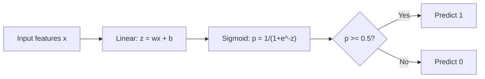
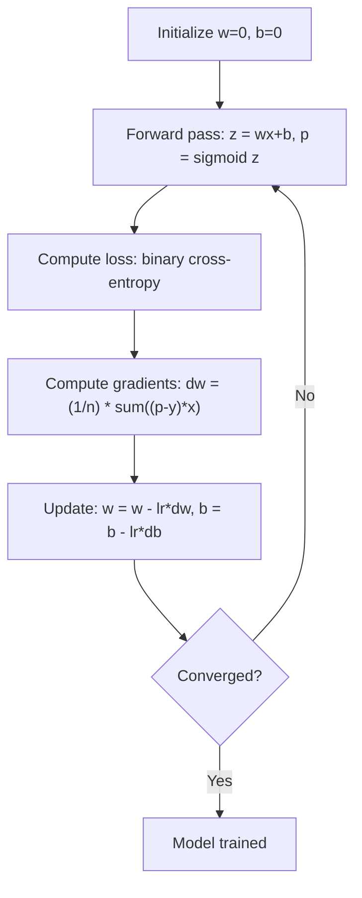

# Logistic Regression · 逻辑回归

> 逻辑回归（logistic regression）把一条直线弯成 S 形曲线，用概率回答「是或否」的问题。

> Logistic regression bends a straight line into an S-curve to answer yes-or-no questions with probabilities.

**Type:** Build
**Languages:** Python
**Prerequisites:** Phase 2 Lesson 1-2 (What Is ML, Linear Regression)
**Time:** ~90 minutes

## Learning Objectives · 学习目标

- 使用 sigmoid 函数和二元交叉熵（binary cross-entropy）损失，从零实现逻辑回归
- 计算并解释二元分类的精确率（precision）、召回率（recall）、F1 分数和混淆矩阵（confusion matrix）
- 解释为什么 MSE 不适用于分类，以及为什么二元交叉熵能产生凸的代价曲面
- 构建用于多分类的 softmax 回归模型，并评估阈值调节的权衡

> Implement logistic regression from scratch using the sigmoid function and binary cross-entropy loss
> Compute and interpret precision, recall, F1 score, and the confusion matrix for binary classification
> Explain why MSE fails for classification and why binary cross-entropy produces a convex cost surface
> Build a softmax regression model for multi-class classification and evaluate threshold tuning tradeoffs

## The Problem · 问题在哪

你想根据肿瘤的大小预测它是恶性还是良性。你试了线性回归。它输出 0.3、1.7、-0.5 这样的数字。这些是什么意思？1.7 是「非常恶性」吗？-0.5 是「非常良性」吗？线性回归输出的是无界的数字。分类需要的是 0 到 1 之间的有界概率，以及一个明确的决定：是，还是否。

逻辑回归解决了这个问题。它取同样的线性组合（wx + b），把它送进 sigmoid 函数，后者把任何数字压进 (0, 1) 区间。输出是一个概率。你设一个阈值（通常 0.5），然后做决定。

这是实践中使用最广泛的算法之一。尽管名字里带「回归」，逻辑回归是分类算法，不是回归算法。这个名字来自它使用的 logistic（sigmoid）函数。

> You want to predict whether a tumor is malignant or benign given its size. ... Linear regression outputs unbounded numbers. Classification needs bounded probabilities between 0 and 1, and a clear decision: yes or no. ... Logistic regression solves this. It takes the same linear combination (wx + b) and passes it through the sigmoid function, which squashes any number into the range (0, 1). The output is a probability. You set a threshold (usually 0.5) and make a decision. ... Despite its name, logistic regression is a classification algorithm, not a regression algorithm.

## The Concept · 概念

### Why Linear Regression Fails for Classification · 为什么线性回归做不好分类

想象根据学习时长预测通过/不通过（1/0）。线性回归对数据拟合一条直线：

```
hours:  1   2   3   4   5   6   7   8   9   10
actual: 0   0   0   0   1   1   1   1   1   1
```

线性拟合可能给出第 1 小时 -0.2、第 10 小时 1.3 这样的预测。这些值不是概率：它们低于 0 也高于 1。更糟的是，一个离群点（一个学了 50 小时的人）就能把整条线拖偏，改变所有人的预测。

分类需要一个这样的函数：

- 输出 0 到 1 之间的值（概率）
- 形成陡峭的过渡（一条决策边界）
- 不被远离边界的离群点扭曲

> A linear fit might produce predictions like -0.2 at hour 1 and 1.3 at hour 10. These values are not probabilities. They go below 0 and above 1. Worse, a single outlier (someone who studied 50 hours) would drag the entire line, changing predictions for everyone.
> Classification needs a function that:
> - Outputs values between 0 and 1 (probabilities)
> - Creates a sharp transition (a decision boundary)
> - Is not distorted by outliers far from the boundary

### The Sigmoid Function · Sigmoid 函数

sigmoid 函数做的正是这件事：

```
sigmoid(z) = 1 / (1 + e^(-z))
```

性质：

- 当 z 很大且为正时，sigmoid(z) 趋近 1
- 当 z 很大且为负时，sigmoid(z) 趋近 0
- 当 z = 0 时，sigmoid(z) = 0.5
- 输出永远在 0 和 1 之间
- 函数处处光滑、可导

它的导数有一个方便的形式：sigmoid'(z) = sigmoid(z) * (1 - sigmoid(z))。这让梯度计算很高效。

> The sigmoid function does exactly this. ... When z is large and positive, sigmoid(z) approaches 1. When z is large and negative, sigmoid(z) approaches 0. When z = 0, sigmoid(z) = 0.5. The output is always between 0 and 1. The function is smooth and differentiable everywhere.
> The derivative has a convenient form: sigmoid'(z) = sigmoid(z) * (1 - sigmoid(z)). This makes gradient computation efficient.

### Logistic Regression = Linear Model + Sigmoid · 逻辑回归 = 线性模型 + Sigmoid

模型先计算 z = wx + b（和线性回归一样），再套上 sigmoid：



输出 p 被解释为 P(y=1 | x)，即输入属于类别 1 的概率。决策边界在 wx + b = 0 处，那里 sigmoid 恰好输出 0.5。

> The model computes z = wx + b (same as linear regression), then applies sigmoid. ... The output p is interpreted as P(y=1 | x), the probability that the input belongs to class 1. The decision boundary is where wx + b = 0, which makes sigmoid output exactly 0.5.

### Binary Cross-Entropy Loss · 二元交叉熵损失

逻辑回归不能用 MSE。MSE 配上 sigmoid 会产生带大量局部极小的非凸代价曲面。要用的是二元交叉熵（binary cross-entropy，对数损失 log loss）：

```
Loss = -(1/n) * sum(y * log(p) + (1-y) * log(1-p))
```

为什么它有效：

- 当 y=1 且 p 接近 1：log(1) = 0，损失接近 0（预测对，代价低）
- 当 y=1 且 p 接近 0：log(0) 趋向负无穷，损失巨大（预测错，代价高）
- 当 y=0 且 p 接近 0：log(1) = 0，损失接近 0（预测对，代价低）
- 当 y=0 且 p 接近 1：log(0) 趋向负无穷，损失巨大（预测错，代价高）

这个损失函数对逻辑回归是凸的，保证只有一个全局最小值。

> You cannot use MSE for logistic regression. MSE with a sigmoid creates a non-convex cost surface with many local minima. Instead, use binary cross-entropy (log loss). ... When y=1 and p is close to 1: log(1) = 0, so loss is near 0 (correct, low cost). When y=1 and p is close to 0: log(0) approaches negative infinity, so loss is huge (wrong, high cost). ... This loss function is convex for logistic regression, guaranteeing a single global minimum.

### Gradient Descent for Logistic Regression · 逻辑回归的梯度下降

二元交叉熵配 sigmoid 的梯度有一个干净的形式：

```
dL/dw = (1/n) * sum((p - y) * x)
dL/db = (1/n) * sum(p - y)
```

它们和线性回归的梯度看起来一模一样。区别只是 p = sigmoid(wx + b) 而不是 p = wx + b。sigmoid 引入了非线性，但梯度更新规则保持不变。



> The gradients for binary cross-entropy with sigmoid have a clean form. ... These look identical to the linear regression gradients. The difference is that p = sigmoid(wx + b) instead of p = wx + b. The sigmoid introduces the nonlinearity, but the gradient update rule stays the same.

### The Decision Boundary · 决策边界

对二维输入（两个特征），决策边界是这条线：

```
w1*x1 + w2*x2 + b = 0
```

一侧的点被分为 1，另一侧的点被分为 0。逻辑回归永远产生线性的决策边界。如果你需要弯曲的边界，要么加多项式特征，要么换非线性模型。

> Points on one side get classified as 1, points on the other side as 0. Logistic regression always produces a linear decision boundary. If you need a curved boundary, you either add polynomial features or use a nonlinear model.

### Multi-Class Classification with Softmax · 用 Softmax 做多分类

二元逻辑回归处理两个类别。有 k 个类别时，用 softmax 函数：

```
softmax(z_i) = e^(z_i) / sum(e^(z_j) for all j)
```

每个类别有自己的权重向量。模型为每个类别算一个分数 z_i，然后 softmax 把分数转换为和为 1 的概率。预测的类别是概率最高的那个。

损失函数变成类别交叉熵（categorical cross-entropy）：

```
Loss = -(1/n) * sum(sum(y_k * log(p_k)))
```

其中 y_k 对真实类别为 1，对其他所有类别为 0（独热编码，one-hot encoding）。

> Binary logistic regression handles two classes. For k classes, use the softmax function. ... Each class has its own weight vector. The model computes a score z_i for each class, then softmax converts scores to probabilities that sum to 1. The predicted class is the one with the highest probability. ... where y_k is 1 for the true class and 0 for all others (one-hot encoding).

### Evaluation Metrics · 评估指标

只看准确率（accuracy）是不够的。对一个 95% 负样本、5% 正样本的数据集，永远预测「负」的模型能得到 95% 的准确率，但毫无用处。

**混淆矩阵（confusion matrix）**：

| | 预测为正 | 预测为负 |
|---|---|---|
| 实际为正 | 真正例（True Positive，TP） | 假负例（False Negative，FN） |
| 实际为负 | 假正例（False Positive，FP） | 真负例（True Negative，TN） |

**精确率（precision）**：所有预测为正的里面，有多少真的是正？

```
Precision = TP / (TP + FP)
```

**召回率（recall，敏感度 sensitivity）**：所有真实的正样本里，我们抓到了多少？

```
Recall = TP / (TP + FN)
```

**F1 分数**：精确率和召回率的调和平均。在两个指标之间取平衡。

```
F1 = 2 * (Precision * Recall) / (Precision + Recall)
```

什么时候优先哪个：

- **精确率**：假正例代价高时（垃圾邮件过滤器，你不想拦掉合法邮件）
- **召回率**：假负例代价高时（癌症筛查，你不想漏掉肿瘤）
- **F1**：当你需要一个单一的平衡指标时

> Accuracy alone is not enough. For a dataset with 95% negative and 5% positive, a model that always predicts negative gets 95% accuracy but is useless.
> Precision: Of all predicted positives, how many are actually positive? Recall (Sensitivity): Of all actual positives, how many did we catch? F1 Score: Harmonic mean of precision and recall. Balances both metrics.
> Precision: when false positives are costly (spam filter, you do not want to block legitimate email). Recall: when false negatives are costly (cancer screening, you do not want to miss a tumor). F1: when you need a single balanced metric.

```figure
logistic-sigmoid
```

## Build It · 动手造

### Step 1: Sigmoid function and data generation · Sigmoid 函数与数据生成

```python
import random
import math

def sigmoid(z):
    z = max(-500, min(500, z))
    return 1.0 / (1.0 + math.exp(-z))


random.seed(42)
N = 200
X = []
y = []

for _ in range(N // 2):
    X.append([random.gauss(2, 1), random.gauss(2, 1)])
    y.append(0)

for _ in range(N // 2):
    X.append([random.gauss(5, 1), random.gauss(5, 1)])
    y.append(1)

combined = list(zip(X, y))
random.shuffle(combined)
X, y = zip(*combined)
X = list(X)
y = list(y)

print(f"Generated {N} samples (2 classes, 2 features)")
print(f"Class 0 center: (2, 2), Class 1 center: (5, 5)")
print(f"First 5 samples:")
for i in range(5):
    print(f"  Features: [{X[i][0]:.2f}, {X[i][1]:.2f}], Label: {y[i]}")
```

### Step 2: Logistic regression from scratch · 从零实现逻辑回归

```python
class LogisticRegression:
    def __init__(self, n_features, learning_rate=0.01):
        self.weights = [0.0] * n_features
        self.bias = 0.0
        self.lr = learning_rate
        self.loss_history = []

    def predict_proba(self, x):
        z = sum(w * xi for w, xi in zip(self.weights, x)) + self.bias
        return sigmoid(z)

    def predict(self, x, threshold=0.5):
        return 1 if self.predict_proba(x) >= threshold else 0

    def compute_loss(self, X, y):
        n = len(y)
        total = 0.0
        for i in range(n):
            p = self.predict_proba(X[i])
            p = max(1e-15, min(1 - 1e-15, p))
            total += y[i] * math.log(p) + (1 - y[i]) * math.log(1 - p)
        return -total / n

    def fit(self, X, y, epochs=1000, print_every=200):
        n = len(y)
        n_features = len(X[0])
        for epoch in range(epochs):
            dw = [0.0] * n_features
            db = 0.0
            for i in range(n):
                p = self.predict_proba(X[i])
                error = p - y[i]
                for j in range(n_features):
                    dw[j] += error * X[i][j]
                db += error
            for j in range(n_features):
                self.weights[j] -= self.lr * (dw[j] / n)
            self.bias -= self.lr * (db / n)
            loss = self.compute_loss(X, y)
            self.loss_history.append(loss)
            if epoch % print_every == 0:
                print(f"  Epoch {epoch:4d} | Loss: {loss:.4f} | w: [{self.weights[0]:.3f}, {self.weights[1]:.3f}] | b: {self.bias:.3f}")
        return self

    def accuracy(self, X, y):
        correct = sum(1 for i in range(len(y)) if self.predict(X[i]) == y[i])
        return correct / len(y)


split = int(0.8 * N)
X_train, X_test = X[:split], X[split:]
y_train, y_test = y[:split], y[split:]

print("\n=== Training Logistic Regression ===")
model = LogisticRegression(n_features=2, learning_rate=0.1)
model.fit(X_train, y_train, epochs=1000, print_every=200)

print(f"\nTrain accuracy: {model.accuracy(X_train, y_train):.4f}")
print(f"Test accuracy:  {model.accuracy(X_test, y_test):.4f}")
print(f"Weights: [{model.weights[0]:.4f}, {model.weights[1]:.4f}]")
print(f"Bias: {model.bias:.4f}")
```

### Step 3: Confusion matrix and metrics from scratch · 从零实现混淆矩阵与指标

```python
class ClassificationMetrics:
    def __init__(self, y_true, y_pred):
        self.tp = sum(1 for t, p in zip(y_true, y_pred) if t == 1 and p == 1)
        self.tn = sum(1 for t, p in zip(y_true, y_pred) if t == 0 and p == 0)
        self.fp = sum(1 for t, p in zip(y_true, y_pred) if t == 0 and p == 1)
        self.fn = sum(1 for t, p in zip(y_true, y_pred) if t == 1 and p == 0)

    def accuracy(self):
        total = self.tp + self.tn + self.fp + self.fn
        return (self.tp + self.tn) / total if total > 0 else 0

    def precision(self):
        denom = self.tp + self.fp
        return self.tp / denom if denom > 0 else 0

    def recall(self):
        denom = self.tp + self.fn
        return self.tp / denom if denom > 0 else 0

    def f1(self):
        p = self.precision()
        r = self.recall()
        return 2 * p * r / (p + r) if (p + r) > 0 else 0

    def print_confusion_matrix(self):
        print(f"\n  Confusion Matrix:")
        print(f"                  Predicted")
        print(f"                  Pos   Neg")
        print(f"  Actual Pos     {self.tp:4d}  {self.fn:4d}")
        print(f"  Actual Neg     {self.fp:4d}  {self.tn:4d}")

    def print_report(self):
        self.print_confusion_matrix()
        print(f"\n  Accuracy:  {self.accuracy():.4f}")
        print(f"  Precision: {self.precision():.4f}")
        print(f"  Recall:    {self.recall():.4f}")
        print(f"  F1 Score:  {self.f1():.4f}")


y_pred_test = [model.predict(x) for x in X_test]
print("\n=== Classification Report (Test Set) ===")
metrics = ClassificationMetrics(y_test, y_pred_test)
metrics.print_report()
```

### Step 4: Decision boundary analysis · 决策边界分析

```python
print("\n=== Decision Boundary ===")
w1, w2 = model.weights
b = model.bias
print(f"Decision boundary: {w1:.4f}*x1 + {w2:.4f}*x2 + {b:.4f} = 0")
if abs(w2) > 1e-10:
    print(f"Solved for x2:     x2 = {-w1/w2:.4f}*x1 + {-b/w2:.4f}")

print("\nSample predictions near the boundary:")
test_points = [
    [3.0, 3.0],
    [3.5, 3.5],
    [4.0, 4.0],
    [2.5, 2.5],
    [5.0, 5.0],
]
for point in test_points:
    prob = model.predict_proba(point)
    pred = model.predict(point)
    print(f"  [{point[0]}, {point[1]}] -> prob={prob:.4f}, class={pred}")
```

### Step 5: Multi-class with softmax · 用 softmax 做多分类

```python
class SoftmaxRegression:
    def __init__(self, n_features, n_classes, learning_rate=0.01):
        self.n_features = n_features
        self.n_classes = n_classes
        self.lr = learning_rate
        self.weights = [[0.0] * n_features for _ in range(n_classes)]
        self.biases = [0.0] * n_classes

    def softmax(self, scores):
        max_score = max(scores)
        exp_scores = [math.exp(s - max_score) for s in scores]
        total = sum(exp_scores)
        return [e / total for e in exp_scores]

    def predict_proba(self, x):
        scores = [
            sum(self.weights[k][j] * x[j] for j in range(self.n_features)) + self.biases[k]
            for k in range(self.n_classes)
        ]
        return self.softmax(scores)

    def predict(self, x):
        probs = self.predict_proba(x)
        return probs.index(max(probs))

    def fit(self, X, y, epochs=1000, print_every=200):
        n = len(y)
        for epoch in range(epochs):
            grad_w = [[0.0] * self.n_features for _ in range(self.n_classes)]
            grad_b = [0.0] * self.n_classes
            total_loss = 0.0
            for i in range(n):
                probs = self.predict_proba(X[i])
                for k in range(self.n_classes):
                    target = 1.0 if y[i] == k else 0.0
                    error = probs[k] - target
                    for j in range(self.n_features):
                        grad_w[k][j] += error * X[i][j]
                    grad_b[k] += error
                true_prob = max(probs[y[i]], 1e-15)
                total_loss -= math.log(true_prob)
            for k in range(self.n_classes):
                for j in range(self.n_features):
                    self.weights[k][j] -= self.lr * (grad_w[k][j] / n)
                self.biases[k] -= self.lr * (grad_b[k] / n)
            if epoch % print_every == 0:
                print(f"  Epoch {epoch:4d} | Loss: {total_loss / n:.4f}")
        return self

    def accuracy(self, X, y):
        correct = sum(1 for i in range(len(y)) if self.predict(X[i]) == y[i])
        return correct / len(y)


random.seed(42)
X_3class = []
y_3class = []

centers = [(1, 1), (5, 1), (3, 5)]
for label, (cx, cy) in enumerate(centers):
    for _ in range(50):
        X_3class.append([random.gauss(cx, 0.8), random.gauss(cy, 0.8)])
        y_3class.append(label)

combined = list(zip(X_3class, y_3class))
random.shuffle(combined)
X_3class, y_3class = zip(*combined)
X_3class = list(X_3class)
y_3class = list(y_3class)

split_3 = int(0.8 * len(X_3class))
X_train_3 = X_3class[:split_3]
y_train_3 = y_3class[:split_3]
X_test_3 = X_3class[split_3:]
y_test_3 = y_3class[split_3:]

print("\n=== Multi-class Softmax Regression (3 classes) ===")
softmax_model = SoftmaxRegression(n_features=2, n_classes=3, learning_rate=0.1)
softmax_model.fit(X_train_3, y_train_3, epochs=1000, print_every=200)
print(f"\nTrain accuracy: {softmax_model.accuracy(X_train_3, y_train_3):.4f}")
print(f"Test accuracy:  {softmax_model.accuracy(X_test_3, y_test_3):.4f}")

print("\nSample predictions:")
for i in range(5):
    probs = softmax_model.predict_proba(X_test_3[i])
    pred = softmax_model.predict(X_test_3[i])
    print(f"  True: {y_test_3[i]}, Predicted: {pred}, Probs: [{', '.join(f'{p:.3f}' for p in probs)}]")
```

### Step 6: Threshold tuning · 阈值调节

```python
print("\n=== Threshold Tuning ===")
print("Default threshold: 0.5. Adjusting the threshold trades precision for recall.\n")

thresholds = [0.3, 0.4, 0.5, 0.6, 0.7]
print(f"{'Threshold':>10} {'Accuracy':>10} {'Precision':>10} {'Recall':>10} {'F1':>10}")
print("-" * 52)

for t in thresholds:
    y_pred_t = [1 if model.predict_proba(x) >= t else 0 for x in X_test]
    m = ClassificationMetrics(y_test, y_pred_t)
    print(f"{t:>10.1f} {m.accuracy():>10.4f} {m.precision():>10.4f} {m.recall():>10.4f} {m.f1():>10.4f}")
```

## Use It · 实战用法

现在用 scikit-learn 做同样的事。

```python
from sklearn.linear_model import LogisticRegression as SklearnLR
from sklearn.metrics import accuracy_score, precision_score, recall_score, f1_score
from sklearn.metrics import confusion_matrix, classification_report
from sklearn.model_selection import train_test_split
from sklearn.preprocessing import StandardScaler
import numpy as np

np.random.seed(42)
X_0 = np.random.randn(100, 2) + [2, 2]
X_1 = np.random.randn(100, 2) + [5, 5]
X_sk = np.vstack([X_0, X_1])
y_sk = np.array([0] * 100 + [1] * 100)

X_tr, X_te, y_tr, y_te = train_test_split(X_sk, y_sk, test_size=0.2, random_state=42)

scaler = StandardScaler()
X_tr_sc = scaler.fit_transform(X_tr)
X_te_sc = scaler.transform(X_te)

lr = SklearnLR()
lr.fit(X_tr_sc, y_tr)
y_pred = lr.predict(X_te_sc)

print("=== Scikit-learn Logistic Regression ===")
print(f"Accuracy:  {accuracy_score(y_te, y_pred):.4f}")
print(f"Precision: {precision_score(y_te, y_pred):.4f}")
print(f"Recall:    {recall_score(y_te, y_pred):.4f}")
print(f"F1:        {f1_score(y_te, y_pred):.4f}")
print(f"\nConfusion Matrix:\n{confusion_matrix(y_te, y_pred)}")
print(f"\nClassification Report:\n{classification_report(y_te, y_pred)}")
```

你从零写的实现给出同样的决策边界和指标。scikit-learn 额外提供求解器选项（liblinear、lbfgs、saga）、自动正则化、多分类策略（one-vs-rest、multinomial）和数值稳定性优化。

> Now the same thing with scikit-learn. ... Your from-scratch implementation produces the same decision boundary and metrics. Scikit-learn adds solver options (liblinear, lbfgs, saga), automatic regularization, multi-class strategies (one-vs-rest, multinomial), and numerical stability optimizations.

## Ship It · 交付

本课产出：

> This lesson produces:
> - `code/logistic_regression.py` - logistic regression from scratch with metrics

## Exercises · 练习

1. 生成一个不线性可分（linearly separable）的数据集（比如两个同心圆）。训练逻辑回归并观察它失败。然后加入多项式特征（x1^2, x2^2, x1*x2）再训练一次。展示准确率得到提升。
2. 为三分类 softmax 模型实现多分类混淆矩阵。计算每个类别的精确率和召回率。哪个类最难分？
3. 从零构建 ROC 曲线。对 0 到 1 之间的 100 个阈值，计算真正例率和假正例率。用梯形法则计算 AUC（曲线下面积）。

> 1. Generate a dataset that is NOT linearly separable (e.g., two concentric circles). Train logistic regression and observe its failure. Then add polynomial features (x1^2, x2^2, x1*x2) and train again. Show that the accuracy improves.
> 2. Implement a multi-class confusion matrix for the 3-class softmax model. Compute per-class precision and recall. Which class is hardest to classify?
> 3. Build an ROC curve from scratch. For 100 threshold values from 0 to 1, compute the true positive rate and false positive rate. Calculate the AUC (area under the curve) using the trapezoidal rule.

## Key Terms · 术语表

| 术语 | 人们常说的是 | 它实际的意思是 |
|------|----------------|----------------------|
| Logistic regression | 「做分类的回归」 | 线性模型后接 sigmoid 函数，输出类别概率 |
| Sigmoid function | 「那条 S 形曲线」 | 函数 1/(1+e^(-z))，把任意实数映射到 (0, 1) 区间 |
| Binary cross-entropy | 「对数损失」 | 损失函数 -[y*log(p) + (1-y)*log(1-p)]，对自信满满的错误预测惩罚极重 |
| Decision boundary | 「分界线」 | 模型输出概率恰好等于 0.5 的曲面，分开两个预测类别 |
| Softmax | 「多分类版 sigmoid」 | 把分数向量转换为和为 1 的概率的函数 |
| Precision | 「选出来的里面有多少是对的」 | TP / (TP + FP)，预测为正的样本中真正为正的比例 |
| Recall | 「对的里面有多少被选出来了」 | TP / (TP + FN)，真实正样本中被模型正确识别的比例 |
| F1 score | 「平衡的准确率」 | 精确率和召回率的调和平均：2*P*R / (P+R) |
| Confusion matrix | 「错误明细表」 | 展示每个类别对 TP、TN、FP、FN 计数的表格 |
| Threshold | 「切分点」 | 概率超过该值时模型预测为类别 1（默认 0.5，可调） |
| One-hot encoding | 「类别的二进制列」 | 把类别 k 表示成一个在第 k 位为 1、其余为 0 的向量 |
| Categorical cross-entropy | 「多分类对数损失」 | 用独热编码标签把二元交叉熵扩展到 k 个类别 |
