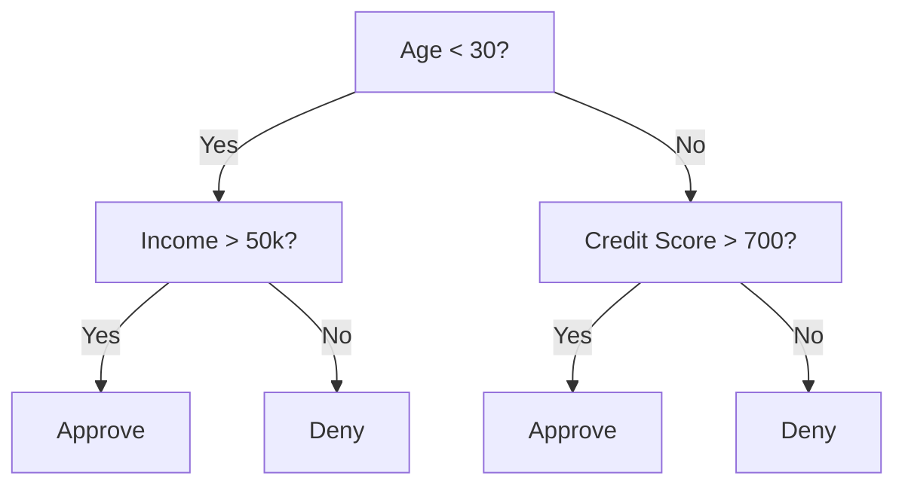
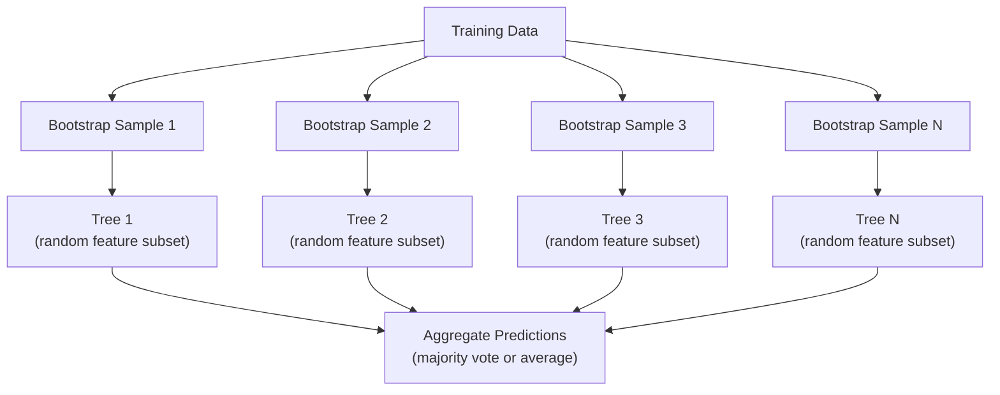

# Decision Trees and Random Forests · 决策树与随机森林

> 决策树（decision tree）就是一张流程图。但一片森林是机器学习里最强大的工具之一。

> A decision tree is just a flowchart. But a forest of them is one of the most powerful tools in ML.

**Type:** Build
**Language:** Python
**Prerequisites:** Phase 1 (Lessons 09 Information Theory, 06 Probability)
**Time:** ~90 minutes

## Learning Objectives · 学习目标

- 实现 Gini 不纯度、熵（entropy）和信息增益（information gain）的计算，找出最优的决策树分裂
- 带预剪枝控制（最大深度、最小样本数）从零构建决策树分类器
- 用自助采样（bootstrap sampling）和特征随机化构建随机森林（random forest），并解释它为什么能降低方差
- 比较 MDI 特征重要性与置换重要性（permutation importance），识别 MDI 何时有偏

> Implement Gini impurity, entropy, and information gain calculations to find optimal decision tree splits
> Build a decision tree classifier from scratch with pre-pruning controls (max depth, min samples)
> Construct a random forest using bootstrap sampling and feature randomization, and explain why it reduces variance
> Compare MDI feature importance with permutation importance and identify when MDI is biased

## The Problem · 问题在哪

你拿到的是表格数据。行是样本，列是特征，还有一列你想预测的目标。你可以直接上神经网络。但对表格数据，树模型（决策树、随机森林、梯度提升树）稳定地胜过深度学习。Kaggle 的结构化数据比赛被 XGBoost 和 LightGBM 统治，而不是 transformer。

为什么？树不需要预处理就能处理混合特征类型（数值和类别）。不需要特征工程就能处理非线性关系。它们可解释：你可以看着这棵树，精确看到预测是怎么做出来的。而对许多树取平均的随机森林，在中等规模数据集上非常抗过拟合。

本课用递归分裂从零构建决策树，然后在上面构建随机森林。你会实现分裂准则（Gini 不纯度、熵、信息增益）背后的数学，并理解为什么弱学习器的集成会变成强学习器。

> You have tabular data. Rows are samples, columns are features, and there is a target column you want to predict. ... For tabular data, tree-based models (decision trees, random forests, gradient boosted trees) consistently outperform deep learning. Kaggle competitions on structured data are dominated by XGBoost and LightGBM, not transformers.
> Why? Trees handle mixed feature types (numeric and categorical) without preprocessing. They handle nonlinear relationships without feature engineering. They are interpretable: you can look at the tree and see exactly why a prediction was made. And random forests, which average many trees, are highly resistant to overfitting on moderate-sized datasets.
> This lesson builds decision trees from scratch using recursive splitting, then builds a random forest on top. You will implement the math behind split criteria (Gini impurity, entropy, information gain) and understand why an ensemble of weak learners becomes a strong one.

## The Concept · 概念

### What a decision tree does · 决策树做什么

决策树通过问一连串是非问题，把特征空间切分成一个个矩形区域。



每个内部节点把某个特征和阈值做比较。每个叶节点做出预测。要分类一个新数据点，从根出发沿分支走，直到到达一个叶子。

树自顶向下构建：在每个节点上选出最能分开数据的特征和阈值。「最」由分裂准则（split criterion）定义。

> A decision tree partitions the feature space into rectangular regions by asking a sequence of yes/no questions.
> Each internal node tests a feature against a threshold. Each leaf node makes a prediction. To classify a new data point, you start at the root and follow the branches until you reach a leaf.
> The tree is built top-down by choosing, at each node, the feature and threshold that best separate the data. "Best" is defined by a split criterion.

### Split criteria: measuring impurity · 分裂准则：度量不纯度

在每个节点上，我们有一组样本。我们想切开它们，让得到的子节点尽可能「纯」，也就是每个子节点主要包含一个类别。

**Gini 不纯度（Gini impurity）**度量的是：如果按该节点的类别分布给一个随机抽取的样本贴标签，它被分错的概率。

```
Gini(S) = 1 - sum(p_k^2)

where p_k is the proportion of class k in set S.
```

纯节点（全是一个类别）Gini = 0。50/50 的二分类 Gini = 0.5。越低越好。

```
Example: 6 cats, 4 dogs

Gini = 1 - (0.6^2 + 0.4^2) = 1 - (0.36 + 0.16) = 0.48
```

**熵（entropy）**度量节点中的信息量（混乱度）。Phase 1 第 09 课讲过。

```
Entropy(S) = -sum(p_k * log2(p_k))
```

纯节点熵 = 0。50/50 的二分类熵 = 1.0。越低越好。

```
Example: 6 cats, 4 dogs

Entropy = -(0.6 * log2(0.6) + 0.4 * log2(0.4))
        = -(0.6 * -0.737 + 0.4 * -1.322)
        = 0.442 + 0.529
        = 0.971 bits
```

**信息增益（information gain）**是分裂之后不纯度（熵或 Gini）的下降量。

```
IG(S, feature, threshold) = Impurity(S) - weighted_avg(Impurity(S_left), Impurity(S_right))

where the weights are the proportions of samples in each child.
```

每个节点上的贪心算法：尝试每个特征和每个可能的阈值，选出信息增益最大的（特征，阈值）组合。

> **Gini impurity** measures the probability that a randomly chosen sample would be misclassified if it were labeled according to the class distribution at that node.
> For a pure node (all one class), Gini = 0. For a binary split with 50/50 classes, Gini = 0.5. Lower is better.
> **Entropy** measures the information content (disorder) in a node.
> For a pure node, entropy = 0. For a 50/50 binary split, entropy = 1.0. Lower is better.
> **Information gain** is the reduction in impurity (entropy or Gini) after a split.
> The greedy algorithm at each node: try every feature and every possible threshold. Pick the (feature, threshold) pair that maximizes information gain.

### How splitting works · 分裂怎么进行

对当前节点有 n 个特征、m 个样本的数据集：

1. 对每个特征 j（j = 1 到 n）：
   - 按特征 j 对样本排序
   - 尝试相邻不同值之间的每个中点作为阈值
   - 为每个阈值计算信息增益
2. 选出信息增益最高的特征和阈值
3. 把数据分成左（feature <= threshold）和右（feature > threshold）两份
4. 对每个子节点递归

这种贪心方法不保证全局最优的树。找最优树是 NP-hard 问题。但贪心分裂在实践中效果很好。

> For a dataset with n features and m samples at the current node:
> 1. For each feature j (j = 1 to n):
>    - Sort the samples by feature j
>    - Try every midpoint between consecutive distinct values as a threshold
>    - Compute the information gain for each threshold
> 2. Select the feature and threshold with the highest information gain
> 3. Split the data into left (feature <= threshold) and right (feature > threshold)
> 4. Recurse on each child
> This greedy approach does not guarantee the globally optimal tree. Finding the optimal tree is NP-hard. But greedy splitting works well in practice.

### Stopping conditions · 停止条件

没有停止条件，树会长到每个叶子都纯（每个叶子一个样本）。这会完美背下训练数据，泛化一塌糊涂。

**预剪枝（pre-pruning）**在树完全长成之前停下它：

- 最大深度：树达到设定深度就停止分裂
- 每叶最小样本数：节点样本少于 k 就停止
- 最小信息增益：最好的分裂对不纯度的改善小于阈值就停止
- 最大叶节点数：限制叶节点总数

**后剪枝（post-pruning）**先长满整棵树，再修剪回来：

- 代价复杂度剪枝（scikit-learn 使用的）：加一个与叶节点数成正比的惩罚。惩罚越大，树越小
- 错误率降低剪枝：如果验证误差不增加，就移除子树

预剪枝更简单更快。后剪枝常常产出更好的树，因为它不会过早停下那些可能引出有用后续分裂的分裂。

> Without stopping conditions, the tree grows until every leaf is pure (one sample per leaf). This perfectly memorizes the training data and generalizes terribly.
> **Pre-pruning** stops the tree before it fully grows: maximum depth, minimum samples per leaf, minimum information gain, maximum leaf nodes.
> **Post-pruning** grows the full tree, then trims it back: cost-complexity pruning (used by scikit-learn) and reduced error pruning.
> Pre-pruning is simpler and faster. Post-pruning often produces better trees because it does not prematurely stop splits that might lead to useful further splits.

### Decision trees for regression · 用于回归的决策树

回归时，叶子的预测是该叶子中目标值的均值。分裂准则也变了：

**方差缩减（variance reduction）**取代信息增益：

```
VR(S, feature, threshold) = Var(S) - weighted_avg(Var(S_left), Var(S_right))
```

选方差缩减最多的分裂。树把输入空间切成一块块区域，在每个区域里预测一个常数（均值）。

> For regression, the leaf prediction is the mean of the target values in that leaf. The split criterion changes too.
> **Variance reduction** replaces information gain. ... Pick the split that reduces variance the most. The tree partitions the input space into regions, and predicts a constant (the mean) in each region.

### Random forests: the power of ensembles · 随机森林：集成的力量

单棵决策树方差很高。数据的小小变化就能产生完全不同的树。随机森林通过对许多树取平均来修这个问题。



两处随机性让树彼此不同：

**Bagging（bootstrap aggregating，自助聚合）**：每棵树在一个自助样本（bootstrap sample，从训练数据有放回随机抽取的样本）上训练。每个自助样本大约包含原始样本的 63%（其余是袋外样本 out-of-bag，可用于验证）。

**特征随机化（feature randomization）**：每次分裂只考虑随机的一个特征子集。分类的默认值是 sqrt(n_features)，回归是 n_features/3。这防止所有树都在同一个主导特征上分裂。

关键洞察：对许多互不相关的树取平均，能降低方差而不增加偏差。单棵树可能平庸，但集成很强。

> A single decision tree is high variance. Small changes in the data can produce completely different trees. Random forests fix this by averaging many trees.
> Two sources of randomness make the trees diverse:
> **Bagging (bootstrap aggregating):** Each tree is trained on a bootstrap sample, a random sample with replacement from the training data. About 63% of the original samples appear in each bootstrap (the rest are out-of-bag samples that can be used for validation).
> **Feature randomization:** At each split, only a random subset of features is considered. For classification, the default is sqrt(n_features). For regression, n_features/3. This prevents all trees from splitting on the same dominant feature.
> The key insight: averaging many decorrelated trees reduces variance without increasing bias. Each individual tree may be mediocre. The ensemble is strong.

### Feature importance · 特征重要性

随机森林天然提供特征重要性分数。最常见的方法：

**不纯度平均下降（MDI, Mean Decrease in Impurity）**：对每个特征，把它在所有树、所有用到它的节点上带来的不纯度下降加总。在越早的分裂中带来越大不纯度下降的特征越重要。

```
importance(feature_j) = sum over all nodes where feature_j is used:
    (n_samples_at_node / n_total_samples) * impurity_decrease
```

它很快（训练时顺带算出），但对高基数（high-cardinality）特征和可选分裂点多的特征有偏。

**置换重要性（permutation importance）**是另一种选择：打乱一个特征的值，测量模型准确率掉多少。更可靠但更慢。

> **Mean Decrease in Impurity (MDI):** For each feature, sum the total reduction in impurity across all trees and all nodes where that feature is used. Features that produce bigger impurity reductions at earlier splits are more important.
> This is fast (computed during training) but biased toward high-cardinality features and features with many possible split points.
> **Permutation importance** is the alternative: shuffle one feature's values and measure how much the model's accuracy drops. More reliable but slower.

### When trees beat neural networks · 树什么时候赢过神经网络

在表格数据上，树和森林压过神经网络。几个原因：

| 因素 | 树模型 | 神经网络 |
|--------|-------|----------------|
| 混合类型（数值 + 类别） | 原生支持 | 需要编码 |
| 小数据集（< 10k 行） | 表现好 | 过拟合 |
| 特征交互 | 通过分裂发现 | 需要设计架构 |
| 可解释性 | 完全透明 | 黑盒 |
| 训练时间 | 分钟级 | 小时级 |
| 超参数敏感度 | 低 | 高 |

数据具有空间或序列结构（图像、文本、音频）时，神经网络赢。对扁平的特征表，树是默认选择。

> Trees and forests dominate neural networks on tabular data. Several reasons.
> Neural networks win when the data has spatial or sequential structure (images, text, audio). For flat tables of features, trees are the default.

```figure
decision-tree-depth
```

## Build It · 动手造

### Step 1: Gini impurity and entropy · Gini 不纯度与熵

从零实现两种分裂准则，并验证它们对「哪些分裂好」的判断一致。

```python
import math

def gini_impurity(labels):
    n = len(labels)
    if n == 0:
        return 0.0
    counts = {}
    for label in labels:
        counts[label] = counts.get(label, 0) + 1
    return 1.0 - sum((c / n) ** 2 for c in counts.values())

def entropy(labels):
    n = len(labels)
    if n == 0:
        return 0.0
    counts = {}
    for label in labels:
        counts[label] = counts.get(label, 0) + 1
    return -sum(
        (c / n) * math.log2(c / n) for c in counts.values() if c > 0
    )
```

> Build both split criteria from scratch and verify they agree on which splits are good.

### Step 2: Find the best split · 找最优分裂

尝试每个特征和每个阈值，返回信息增益最高的那个。

```python
def information_gain(parent_labels, left_labels, right_labels, criterion="gini"):
    measure = gini_impurity if criterion == "gini" else entropy
    n = len(parent_labels)
    n_left = len(left_labels)
    n_right = len(right_labels)
    if n_left == 0 or n_right == 0:
        return 0.0
    parent_impurity = measure(parent_labels)
    child_impurity = (
        (n_left / n) * measure(left_labels) +
        (n_right / n) * measure(right_labels)
    )
    return parent_impurity - child_impurity
```

> Try every feature and every threshold. Return the one with the highest information gain.

### Step 3: Build the DecisionTree class · 构建 DecisionTree 类

递归分裂、预测和特征重要性追踪。`_build` 是树的心脏：节点纯了或撞上预剪枝限制就停，否则取最优分裂并递归进两个子节点。

```python
import random

class DecisionTree:
    def __init__(self, max_depth=None, min_samples_split=2,
                 min_samples_leaf=1, criterion="gini",
                 max_features=None):
        self.max_depth = max_depth
        self.min_samples_split = min_samples_split
        self.min_samples_leaf = min_samples_leaf
        self.criterion = criterion
        self.max_features = max_features
        self.tree = None
        self.feature_importances_ = None

    def fit(self, X, y):
        self.n_features = len(X[0])
        self.feature_importances_ = [0.0] * self.n_features
        self.n_samples = len(X)
        self.tree = self._build(X, y, depth=0)
        total = sum(self.feature_importances_)
        if total > 0:
            self.feature_importances_ = [
                fi / total for fi in self.feature_importances_
            ]

    def predict(self, X):
        return [self._predict_one(x, self.tree) for x in X]

    def _build(self, X, y, depth):
        if len(set(y)) == 1:
            return {"leaf": True, "value": y[0]}

        if self.max_depth is not None and depth >= self.max_depth:
            return self._make_leaf(y)

        if len(y) < self.min_samples_split:
            return self._make_leaf(y)

        best_feature, best_threshold, best_gain = self._best_split(X, y)

        if best_feature is None or best_gain <= 0:
            return self._make_leaf(y)

        left_X, left_y, right_X, right_y = self._split_data(
            X, y, best_feature, best_threshold
        )

        if len(left_y) < self.min_samples_leaf or len(right_y) < self.min_samples_leaf:
            return self._make_leaf(y)

        weight = len(y) / self.n_samples
        self.feature_importances_[best_feature] += weight * best_gain

        return {
            "leaf": False,
            "feature": best_feature,
            "threshold": best_threshold,
            "left": self._build(left_X, left_y, depth + 1),
            "right": self._build(right_X, right_y, depth + 1),
        }

    def _make_leaf(self, y):
        counts = {}
        for label in y:
            counts[label] = counts.get(label, 0) + 1
        return {"leaf": True, "value": max(counts, key=counts.get)}

    def _best_split(self, X, y):
        best_feature = None
        best_threshold = None
        best_gain = -1.0

        if self.max_features == "sqrt":
            k = max(1, int(math.sqrt(self.n_features)))
            feature_indices = random.sample(range(self.n_features), k)
        elif isinstance(self.max_features, int):
            if self.max_features < 1:
                raise ValueError("max_features must be at least 1 when given as an integer")
            k = min(self.max_features, self.n_features)
            feature_indices = random.sample(range(self.n_features), k)
        else:
            feature_indices = list(range(self.n_features))

        for feature_idx in feature_indices:
            values = sorted(set(X[i][feature_idx] for i in range(len(X))))
            if len(values) <= 1:
                continue

            for i in range(len(values) - 1):
                threshold = (values[i] + values[i + 1]) / 2.0
                left_y = [y[j] for j in range(len(X)) if X[j][feature_idx] <= threshold]
                right_y = [y[j] for j in range(len(X)) if X[j][feature_idx] > threshold]

                if len(left_y) < self.min_samples_leaf or len(right_y) < self.min_samples_leaf:
                    continue

                gain = information_gain(y, left_y, right_y, self.criterion)
                if gain > best_gain:
                    best_gain = gain
                    best_feature = feature_idx
                    best_threshold = threshold

        return best_feature, best_threshold, best_gain

    def _split_data(self, X, y, feature, threshold):
        left_X, left_y, right_X, right_y = [], [], [], []
        for i in range(len(X)):
            if X[i][feature] <= threshold:
                left_X.append(X[i])
                left_y.append(y[i])
            else:
                right_X.append(X[i])
                right_y.append(y[i])
        return left_X, left_y, right_X, right_y

    def _predict_one(self, x, node):
        if node["leaf"]:
            return node["value"]
        if x[node["feature"]] <= node["threshold"]:
            return self._predict_one(x, node["left"])
        return self._predict_one(x, node["right"])
```

> Recursive splitting, prediction, and feature importance tracking. `_build` is the heart of the tree: it stops when a node is pure or hits a pre-pruning limit, otherwise it takes the best split and recurses into both children.

### Step 4: Build the RandomForest class · 构建 RandomForest 类

自助采样、特征随机化和多数投票。

```python
class RandomForest:
    def __init__(self, n_trees=100, max_depth=None,
                 min_samples_split=2, max_features="sqrt",
                 criterion="gini"):
        self.n_trees = n_trees
        self.max_depth = max_depth
        self.min_samples_split = min_samples_split
        self.max_features = max_features
        self.criterion = criterion
        self.trees = []

    def fit(self, X, y):
        n = len(X)
        for _ in range(self.n_trees):
            indices = [random.randint(0, n - 1) for _ in range(n)]
            X_boot = [X[i] for i in indices]
            y_boot = [y[i] for i in indices]
            tree = DecisionTree(
                max_depth=self.max_depth,
                min_samples_split=self.min_samples_split,
                max_features=self.max_features,
                criterion=self.criterion,
            )
            tree.fit(X_boot, y_boot)
            self.trees.append(tree)

    def predict(self, X):
        all_preds = [tree.predict(X) for tree in self.trees]
        predictions = []
        for i in range(len(X)):
            votes = {}
            for preds in all_preds:
                v = preds[i]
                votes[v] = votes.get(v, 0) + 1
            predictions.append(max(votes, key=votes.get))
        return predictions
```

> Bootstrap sampling, feature randomization, and majority voting. See `code/trees.py` for the complete implementation with all helper methods.

## Use It · 实战用法

用 scikit-learn，训练随机森林只要三行：

```python
from sklearn.ensemble import RandomForestClassifier
from sklearn.datasets import load_iris
from sklearn.model_selection import train_test_split

X, y = load_iris(return_X_y=True)
X_train, X_test, y_train, y_test = train_test_split(X, y, random_state=42)

rf = RandomForestClassifier(n_estimators=100, random_state=42)
rf.fit(X_train, y_train)
print(f"Accuracy: {rf.score(X_test, y_test):.4f}")
print(f"Feature importances: {rf.feature_importances_}")
```

实践中，梯度提升树（XGBoost、LightGBM、CatBoost）常常比随机森林更强，因为它们按顺序建树，每棵树都在修正前一棵的错误。但随机森林更难配错，而且几乎不需要调超参数。

> With scikit-learn, training a random forest is three lines. ... In practice, gradient boosted trees (XGBoost, LightGBM, CatBoost) are often stronger than random forests because they build trees sequentially, with each tree correcting the errors of the previous ones. But random forests are harder to misconfigure and require almost no hyperparameter tuning.

### 实测（2026-10-14 本机真跑）

> 以下数据由 `.venv/bin/python code/trees.py` 实跑得到（EXIT=0），并与公式手工验算对拍。

**实测 1 · Gini vs Entropy 数值表**

| 分布 | Gini | Entropy |
|---|---|---|
| Pure node [A,A,A,A] | 0.0000 | −0.0000 |
| Balanced [A,A,B,B] | 0.5000 | 1.0000 |
| Imbalanced [A,A,A,B] | 0.3750 | 0.8113 |
| Three classes [A,A,B,C] | 0.6250 | 1.5000 |
| Uniform 4-class | 0.7500 | 2.0000 |

手工验算 [A,A,A,B]：Gini = 1 − (0.75² + 0.25²) = 1 − 0.625 = **0.375** ✓；Entropy = −(0.75·log₂0.75 + 0.25·log₂0.25) = **0.8113** ✓。二者判据一致：纯节点 = 0，均衡 = 最大值（二类 0.5/1.0，四类 0.75/2.0）。注意纯节点 Entropy 打印 **−0.0000（负零）**——与 1/02 的 A@A⁻¹ 负零同一个坑，判等要用 `allclose`。

**实测 2 · 信息增益手工验算（10 样本：4 cat / 3 dog / 3 bird）**

Parent Gini = 1 − (0.16+0.09+0.09) = **0.66** ✓，Parent Entropy = **1.5710** ✓。

| 分裂 | IG(Gini) | IG(Entropy) |
|---|---|---|
| Feature A: [cat,cat,cat,dog] \| [cat,dog,dog,bird,bird,bird] | 0.1433 | 0.3710 |
| Feature B: [cat,cat,cat,cat] \| [dog,dog,dog,bird,bird,bird] | **0.3600** | **0.9710** |
| Feature C: [cat,cat,dog,bird] \| [cat,cat,dog,dog,bird,bird] | 0.0100 | 0.0200 |

Feature B 验算：左子纯（Gini 0），右子 1−(0.25+0.25)=0.5，加权 = 0.6×0.5 = 0.3，IG = 0.66 − 0.3 = **0.36** ✓；Entropy 同法 1.571 − 0.6 = **0.971** ✓。Feature C 两侧几乎一样杂，IG≈0.01——**没分开的分裂等于白切**。

**实测 3 · 深度扫描：欠拟合 → 过拟合**（200 样本 3 类，train 160 / test 40）

| Max Depth | Train Acc | Test Acc |
|---|---|---|
| 1 | 0.5312 | 0.4750 |
| 2 | 0.6750 | 0.6250 |
| 3 | 0.8438 | **0.8250** |
| 5 | 0.9563 | 0.8250 |
| 10 | 1.0000 | 0.8500 |
| None | 1.0000 | 0.8500 |

训练集 1.0 而测试集 0.85 的差距就是过拟合的形状。max_depth=3 的树结构可完整打印（根分裂 Feature 0 <= −1.1527）——**树的可解释性就是这种"能逐句读出来"**。

**实测 4 · Gini vs Entropy 几乎不分家**：depth=3 → 0.8250 vs 0.8000（差 0.025）；depth=5 → 0.8250 vs 0.8500；depth=10 → 0.8500 vs 0.9000。实测与课文结论一致：二者给出几乎相同的树，Gini 略快（省 log 计算）。

**实测 5 · 森林规模扫描**（300 样本，train 240 / test 60）+ **纠正**

| N Trees | Train Acc | Test Acc |
|---|---|---|
| 1 | 0.9292 | 0.8667 |
| 3 | 0.9042 | 0.8333 |
| 5 | 0.9458 | 0.9500 |
| 10 | 0.9625 | 0.9500 |
| 25 | 0.9708 | 0.9333 |
| 50 | 0.9708 | **0.8833** |
| 100 | 0.9708 | 0.9500 |

**纠正**：课文写 "Test accuracy plateaus but does not decrease"，但本实测 25 → 50 棵时从 0.9333 掉到 0.8833。原因：测试集只有 60 个样本，1 个样本 = 1.67% 准确率，抖动完全正常。**趋势论断（"只升不降"）在小测试集上不要轻信**——同 1/06「20 样本不下结论」的教训。

**实测 6 · MDI 特征重要性**（目标 = feature_0 + feature_1 > 0；特征 2/3 是纯噪声）

| Feature | Importance |
|---|---|
| important_2 | 0.4807 |
| important_1 | 0.4348 |
| noise_2 | 0.0491 |
| noise_1 | 0.0354 |

森林正确指认了重要特征；但注意**噪声特征仍拿到 0.05/0.035 的非零重要性**——正是 MDI 偏置 + 重要性在相关特征间分摊的现场证据。

**实测 7 · 回归树 = 分段常数**（y = sin(x)·x + noise，train 160 / test 40）

| Max Depth | Train MSE | Test MSE |
|---|---|---|
| 1 | 0.3259 | 0.3543 |
| 3 | 0.0681 | **0.0709** |
| 5 | 0.0293 | 0.0433 |
| 10 | **0.0031** | **0.0599** |

depth=10 训练 MSE 0.0031（几乎完美）而测试 0.0599 **反而变差**——标准过拟合签名。Random Forest（50 棵 depth=5）测试 MSE **0.0410**，比任何单树都低——平均分段常数把台阶抹成了缓坡。

**实测 8 · 稳定性实验的实测纠正**（5 个略不同的数据子集）

- 5 棵单树：0.975 / 0.925 / 0.925 / 0.925 / 0.950 → mean **0.9400**，std **0.0200**
- 5 个森林：0.975 / 0.950 / 0.950 / 1.000 / 0.950 → mean **0.9650**，std **0.0200**

**纠正**：课文结论 "Forests are more stable (lower variance)" 在本次实验里**没有体现**——两组 std 精确相等（0.0200），森林赢的是**均值**（0.965 vs 0.940）和整体区间上移（0.925–0.975 vs 0.950–1.000），不是稳定性。n=5 的实验太小，证明不了方差论断（1/06 教训重现）；理论上森林降方差成立，但要实证需要几十次重复实验。

**实测 9 · 代码事实**：森林每棵树 bootstrap 重采样（`RandomForest.fit`，trees.py:237-246）；分裂时只随机抽 `max_features="sqrt"` 个特征候选（trees.py:158-160，RF 默认值 trees.py:227）。**两层随机 = bagging（样本随机）+ 特征随机**——去任何一层，树都会扎堆选同一个强特征，平均就失效了。

## Ship It · 交付

本课产出 `outputs/prompt-tree-interpreter.md` —— 一个为业务相关方解读决策树分裂的提示词。把训练好的树的结构（深度、特征、分裂阈值、准确率）喂给它，它会把模型翻译成大白话规则、给特征重要性排序、标记过拟合或数据泄漏，并推荐下一步。任何需要向不读代码的人解释树模型的时候，都可以用它。

> This lesson produces `outputs/prompt-tree-interpreter.md` -- a prompt that interprets decision tree splits for business stakeholders. Feed it a trained tree's structure (depth, features, split thresholds, accuracy) and it translates the model into plain-language rules, ranks feature importance, flags overfitting or leakage, and recommends next steps. Use it any time you need to explain a tree-based model to someone who does not read code.

## Exercises · 练习

1. 在一个三分类的二维数据集上训练单棵决策树。手动追踪分裂并画出矩形决策边界。比较 max_depth=2 和 max_depth=10 时的边界。

2. 为回归树实现方差缩减分裂。对 200 个点生成 y = sin(x) + noise，并拟合你的回归树。把树的分段常数预测画在真实曲线上对比。

3. 构建分别含 1、5、10、50、200 棵树的随机森林。画出训练准确率和测试准确率随树数的变化。观察测试准确率会进入平台但不会下降（森林抗过拟合）。

4. 在 5 个不同数据集上比较 Gini 不纯度与熵这两种分裂准则。测量准确率和树的深度。多数情况下，两者的结果几乎完全一样。解释为什么。

5. 实现置换重要性。在一个「某个特征是随机噪声但基数很高」的数据集上，把它与 MDI 重要性做比较。MDI 会给噪声特征排很高的位次，置换重要性不会。

> 1. Train a single decision tree on a 2D dataset with 3 classes. Manually trace the splits and draw the rectangular decision boundaries. Compare the boundaries at max_depth=2 vs max_depth=10.
> 2. Implement variance reduction splitting for regression trees. Generate y = sin(x) + noise for 200 points and fit your regression tree. Plot the tree's piecewise-constant predictions against the true curve.
> 3. Build a random forest with 1, 5, 10, 50, and 200 trees. Plot training accuracy and test accuracy vs number of trees. Observe that test accuracy plateaus but does not decrease (forests resist overfitting).
> 4. Compare Gini impurity vs entropy as split criteria on 5 different datasets. Measure accuracy and tree depth. In most cases, they produce nearly identical results. Explain why.
> 5. Implement permutation importance. Compare it with MDI importance on a dataset where one feature is random noise but has high cardinality. MDI will rank the noise feature highly. Permutation importance will not.

## Key Terms · 术语表

| 术语 | 人们常说的是 | 它实际的意思是 |
|------|----------------|----------------------|
| Decision tree | 「做预测的流程图」 | 通过学习一串 if/else 分裂，把特征空间切分成矩形区域的模型 |
| Gini impurity | 「节点有多混」 | 在节点上随机抽一个样本被分错的概率。0 = 纯，二分类时 0.5 = 最大不纯度 |
| Entropy | 「节点的混乱度」 | 节点处的信息量。0 = 纯，二分类时 1.0 = 最大不确定性。来自信息论 |
| Information gain | 「分裂有多好」 | 分裂后不纯度的下降量。贪心选择分裂的准则 |
| Pre-pruning | 「提前停树」 | 通过设最大深度、最小样本数或最小增益阈值，提前停止树的生长 |
| Post-pruning | 「长完再修剪」 | 先长满整棵树，再移除不能提升验证表现的子树 |
| Bagging | 「在随机子集上训练」 | Bootstrap aggregating。每个模型在不同的有放回随机样本上训练 |
| Random forest | 「一堆树」 | 决策树的集成，每棵树在自助样本上训练，每次分裂用随机特征子集 |
| Feature importance (MDI) | 「哪些特征重要」 | 每个特征贡献的不纯度下降总量，在所有树和节点上加总 |
| Permutation importance | 「打乱了看掉多少」 | 随机打乱一个特征的值后准确率的下降。对噪声特征比 MDI 更可靠 |
| Variance reduction | 「回归版的信息增益」 | 信息增益在回归树上的对应物。选目标方差缩减最多的分裂 |
| Bootstrap sample | 「有重复的随机样本」 | 从原始数据集有放回抽取的随机样本。大小相同，但带重复 |

## Further Reading · 延伸阅读

- [Breiman: Random Forests (2001)](https://link.springer.com/article/10.1023/A:1010933404324) - 随机森林原始论文
- [Grinsztajn et al.: Why do tree-based models still outperform deep learning on tabular data? (2022)](https://arxiv.org/abs/2207.08815) - 树模型 vs 神经网络在表格任务上的严格比较
- [scikit-learn Decision Trees documentation](https://scikit-learn.org/stable/modules/tree.html) - 带可视化工具的实用指南
- [XGBoost: A Scalable Tree Boosting System (Chen & Guestrin, 2016)](https://arxiv.org/abs/1603.02754) - 统治 Kaggle 的梯度提升论文
