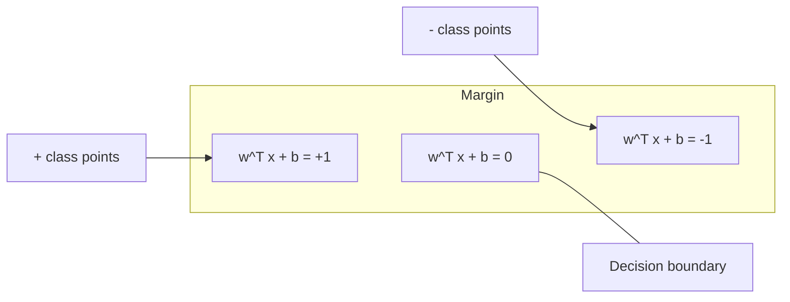
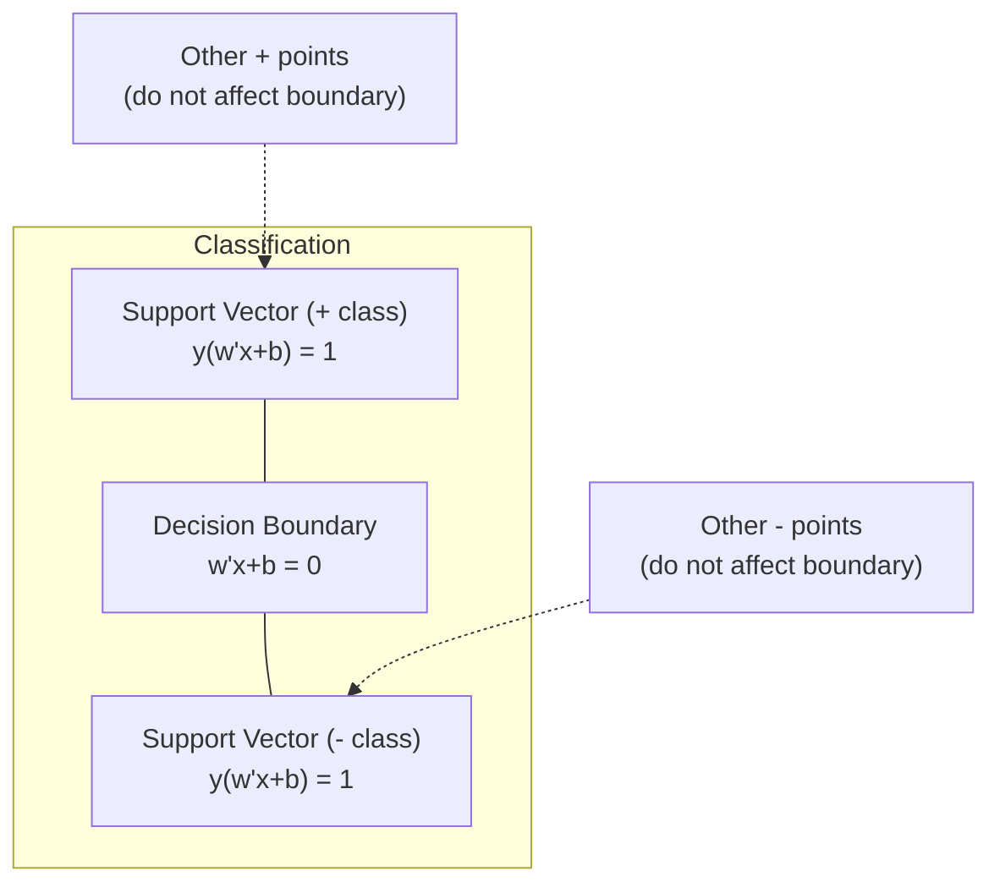
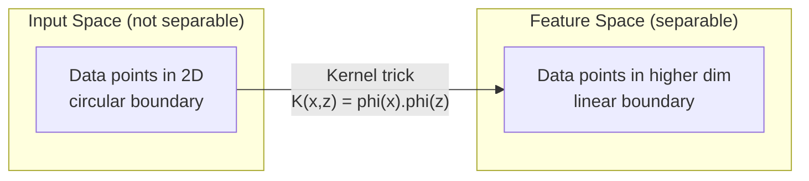

# Support Vector Machines · 支持向量机（在两类之间找出最宽的「街道」）

> Find the widest street between two classes. That is the entire idea.

**类型:** Build
**语言:** Python
**前置课程:** Phase 1（Lessons 08 优化、14 范数与距离、18 凸优化）
**时间:** ~90 分钟

## Learning Objectives · 学习目标

- 用 hinge loss（合页损失）加梯度下降求解原始形式（primal），从零实现线性 SVM
- 解释最大间隔（maximum margin）原理，并从训练好的模型中识别支持向量（support vectors）
- 比较线性核、多项式核和 RBF 核，解释核技巧（kernel trick）如何避免显式的高维映射
- 评估 C 参数在「间隔宽度 vs 分类错误」之间的权衡

> Implement a linear SVM from scratch using hinge loss and gradient descent on the primal formulation
> Explain the maximum margin principle and identify support vectors from a trained model
> Compare linear, polynomial, and RBF kernels and explain how the kernel trick avoids explicit high-dimensional mapping
> Evaluate the tradeoff controlled by the C parameter between margin width and classification errors

## The Problem · 问题在哪

你有一批两类数据点，需要画一条线（或者说超平面，hyperplane）把它们分开。可行的线有无穷多条。该选哪一条？

选间隔最大的那条。间隔（margin）是决策边界到两侧最近数据点之间的距离。间隔越宽，分类器越自信，对未见数据的泛化也越好。

这个直觉引出了支持向量机（SVM）——机器学习中数学上最优雅的算法之一。在深度学习兴起之前，SVM 一直是主流分类方法；而今天，它仍然是小数据集、高维数据、以及「需要一个有原理、可理解、带理论保证的模型」这类问题的最佳选择。

SVM 与 Phase 1 直接相连：它的优化问题是凸的（第 18 课），间隔用范数来度量（第 14 课），而核技巧利用点积在不真正进入高维空间的情况下处理非线性边界。

> You have two classes of data points and need to draw a line (or hyperplane) separating them. Infinitely many lines could work. Which one should you pick? ... The one with the biggest margin. The margin is the distance between the decision boundary and the nearest data points on each side. A wider margin means the classifier is more confident and generalizes better to unseen data. ... SVMs were the dominant classification method before deep learning and remain the best choice for small datasets, high-dimensional data, and problems where you need a principled, well-understood model with theoretical guarantees. ... SVMs connect directly to Phase 1: the optimization is convex (Lesson 18), the margin is measured with norms (Lesson 14), and the kernel trick exploits dot products to handle nonlinear boundaries without ever computing in the high-dimensional space.

## The Concept · 概念

### The maximum margin classifier · 最大间隔分类器

给定线性可分、标签 y_i 取自 {-1, +1} 的数据和特征向量 x_i，我们想要一个超平面 w^T x + b = 0 把两类分开。

点 x_i 到超平面的距离是：

```
distance = |w^T x_i + b| / ||w||
```

对一个被正确分类的点：y_i * (w^T x_i + b) > 0。间隔是超平面到两侧最近点距离的两倍。



优化问题：

```
maximize    2 / ||w||     (the margin width)
subject to  y_i * (w^T x_i + b) >= 1  for all i
```

等价形式（最小化 ||w||^2 更容易优化）：

```
minimize    (1/2) ||w||^2
subject to  y_i * (w^T x_i + b) >= 1  for all i
```

这是一个凸二次规划（convex quadratic program），有唯一的全局解。恰好落在间隔边界上（即 y_i * (w^T x_i + b) = 1）的那些数据点就是支持向量（support vectors）。只有它们决定决策边界：移动或删掉任何非支持向量的点，边界都不会改变。

> Given linearly separable data with labels y_i in {-1, +1} and feature vectors x_i, we want a hyperplane w^T x + b = 0 that separates the classes. ... This is a convex quadratic program. It has a unique global solution. The data points that sit exactly on the margin boundaries (where y_i * (w^T x_i + b) = 1) are the support vectors. They are the only points that determine the decision boundary. Move or remove any non-support-vector point, and the boundary does not change.

### Support vectors: the critical few · 支持向量：关键的极少数



大多数训练点都无关紧要，只有支持向量才重要。这就是 SVM 在预测时省内存的原因：你只需要存储支持向量，不需要存整个训练集。

支持向量的数量还给出泛化误差的一个界。相对于数据集规模，支持向量越少，泛化越好。

> Most training points are irrelevant. Only the support vectors matter. This is why SVMs are memory-efficient at prediction time: you only need to store the support vectors, not the entire training set. ... The number of support vectors also gives a bound on generalization error. Fewer support vectors relative to the dataset size means better generalization.

### Soft margin: handling noise with the C parameter · 软间隔：用 C 参数处理噪声

真实数据很少能被完美分开。有些点可能落在边界错误的一侧，或者落进间隔内部。软间隔（soft margin）形式通过引入松弛变量（slack variables）允许这种违反。

```
minimize    (1/2) ||w||^2 + C * sum(xi_i)
subject to  y_i * (w^T x_i + b) >= 1 - xi_i
            xi_i >= 0  for all i
```

松弛变量 xi_i 度量第 i 个点违反间隔的程度。C 控制两者的权衡：

| C 取值 | 行为 |
|---------|----------|
| 大 C | 对违反惩罚很重。间隔窄，错分少。过拟合 |
| 小 C | 允许更多违反。间隔宽，错分多。欠拟合 |

C 就是反着看的正则化强度：大 C = 弱正则化，小 C = 强正则化。

> Real data is rarely perfectly separable. Some points may be on the wrong side of the boundary, or inside the margin. The soft margin formulation allows violations by introducing slack variables. ... The slack variable xi_i measures how much point i violates the margin. C controls the trade-off ... C is the regularization strength, inverted. Large C = less regularization. Small C = more regularization.

### Hinge loss: the SVM loss function · Hinge loss：SVM 的损失函数

软间隔 SVM 可以改写成无约束优化：

```
minimize    (1/2) ||w||^2 + C * sum(max(0, 1 - y_i * (w^T x_i + b)))
```

max(0, 1 - y_i * f(x_i)) 这一项就是 hinge loss（合页损失）。当点被正确分类且超出间隔时，它为零；当点落在间隔内或被错分时，它线性增长。

```
Hinge loss for a single point:

loss
  |
  | \
  |  \
  |   \
  |    \
  |     \_______________
  |
  +-----|-----|-------->  y * f(x)
       0     1

Zero loss when y*f(x) >= 1 (correctly classified, outside margin).
Linear penalty when y*f(x) < 1.
```

与逻辑回归的 logistic loss 对比：

```
Hinge:     max(0, 1 - y*f(x))          Hard cutoff at margin
Logistic:  log(1 + exp(-y*f(x)))        Smooth, never exactly zero
```

Hinge loss 产生稀疏解（只有支持向量有非零贡献），logistic loss 则用到所有数据点。这让 SVM 在预测时更省内存。

> The term max(0, 1 - y_i * f(x_i)) is the hinge loss. It is zero when the point is correctly classified and beyond the margin. It is linear when the point is inside the margin or misclassified. ... Hinge loss produces sparse solutions (only support vectors have nonzero contribution). Logistic loss uses all data points. This makes SVMs more memory-efficient at prediction time.

### Training a linear SVM with gradient descent · 用梯度下降训练线性 SVM

你可以直接对 hinge loss 加 L2 正则化做梯度下降来训练线性 SVM，完全不用解带约束的二次规划：

```
L(w, b) = (lambda/2) * ||w||^2 + (1/n) * sum(max(0, 1 - y_i * (w^T x_i + b)))

Gradient with respect to w:
  If y_i * (w^T x_i + b) >= 1:  dL/dw = lambda * w
  If y_i * (w^T x_i + b) < 1:   dL/dw = lambda * w - y_i * x_i

Gradient with respect to b:
  If y_i * (w^T x_i + b) >= 1:  dL/db = 0
  If y_i * (w^T x_i + b) < 1:   dL/db = -y_i
```

这叫原始形式（primal formulation）。每个 epoch 的开销是 O(n * d)，n 是样本数，d 是特征数。对大型、稀疏、高维的数据（比如文本分类），这非常快。

> You can train a linear SVM using gradient descent on the hinge loss plus L2 regularization, without solving the constrained QP ... This is called the primal formulation. It runs in O(n * d) per epoch, where n is the number of samples and d is the number of features. For large, sparse, high-dimensional data (text classification), this is fast.

### The dual formulation and the kernel trick · 对偶形式与核技巧

SVM 问题的拉格朗日对偶（见 Phase 1 第 18 课的 KKT 条件）是：

```
maximize    sum(alpha_i) - (1/2) * sum_ij(alpha_i * alpha_j * y_i * y_j * (x_i . x_j))
subject to  0 <= alpha_i <= C
            sum(alpha_i * y_i) = 0
```

对偶形式只涉及数据点之间的点积 x_i . x_j。这就是关键洞察：把每个点积替换成核函数 K(x_i, x_j)，SVM 就能学出非线性边界，而完全不用显式计算那个高维变换。

```
Linear kernel:      K(x, z) = x . z
Polynomial kernel:  K(x, z) = (x . z + c)^d
RBF (Gaussian):     K(x, z) = exp(-gamma * ||x - z||^2)
```

RBF 核把数据映射进一个无穷维空间。输入空间里相近的点，核值接近 1；相距很远的点，核值接近 0。它能学出任意光滑的决策边界。



核技巧在高维空间里计算点积，却从不需要真的去那个空间。对 D 维数据上次数为 d 的多项式核，显式特征空间有 O(D^d) 维，而 K(x, z) 只需 O(D) 时间就能算出。

> The dual only involves dot products x_i . x_j between data points. This is the key insight. Replace every dot product with a kernel function K(x_i, x_j) and the SVM can learn nonlinear boundaries without ever computing the transformation explicitly. ... The RBF kernel maps data into an infinite-dimensional space. Points that are close in input space have kernel value near 1. Points that are far apart have kernel value near 0. It can learn any smooth decision boundary. ... The kernel trick computes the dot product in the high-dimensional space without ever going there. For the polynomial kernel of degree d in D dimensions, the explicit feature space has O(D^d) dimensions. But K(x, z) is computed in O(D) time.

### SVM for regression (SVR) · 支持向量回归（SVR）

支持向量回归（Support Vector Regression，SVR）在数据周围拟合一条宽度为 epsilon 的「管道」。管道内的点损失为零，管道外的点按线性惩罚。

```
minimize    (1/2) ||w||^2 + C * sum(xi_i + xi_i*)
subject to  y_i - (w^T x_i + b) <= epsilon + xi_i
            (w^T x_i + b) - y_i <= epsilon + xi_i*
            xi_i, xi_i* >= 0
```

epsilon 参数控制管道宽度。管道越宽 = 支持向量越少 = 拟合越平滑；管道越窄 = 支持向量越多 = 拟合越紧。

> Support Vector Regression fits a tube of width epsilon around the data. Points inside the tube have zero loss. Points outside the tube are penalized linearly. ... The epsilon parameter controls the tube width. Wider tube = fewer support vectors = smoother fit. Narrower tube = more support vectors = tighter fit.

### Why SVMs lost to deep learning (and when they still win) · SVM 为什么输给深度学习（以及何时仍能赢）

从 1990 年代末到 2010 年代初，SVM 统治着机器学习。深度学习超越它的原因有几个：

| 因素 | SVM | 深度学习 |
|--------|------|---------------|
| 特征工程 | 需要人工 | 自动学习特征 |
| 可扩展性 | 核方法为 O(n^2) 到 O(n^3) | SGD 下每轮 O(n) |
| 图像/文本/音频 | 需要手工特征 | 从原始数据学习 |
| 大数据集（>100k） | 慢 | 扩展性好 |
| GPU 加速 | 收益有限 | 大幅提速 |

SVM 在以下场景仍然占优：
- 小数据集（几百到几千个样本）
- 高维稀疏数据（TF-IDF 特征的文本）
- 需要数学保证（间隔界）时
- 训练时间必须极短时（线性 SVM 非常快）
- 有清晰间隔结构的二分类
- 异常检测（one-class SVM）

```figure
svm-margin
```

> SVMs dominated ML from the late 1990s through the early 2010s. Deep learning surpassed them for several reasons ... SVMs still win in these situations: Small datasets (hundreds to low thousands of samples) ... High-dimensional sparse data (text with TF-IDF features) ... When you need mathematical guarantees (margin bounds) ... Anomaly detection (one-class SVM)

## Build It · 动手造

### Step 1: Hinge loss and gradient · 第 1 步：Hinge loss 与梯度

地基部分：计算一个 batch 的 hinge loss 及其梯度。

```python
def hinge_loss(X, y, w, b):
    n = len(X)
    total_loss = 0.0
    for i in range(n):
        margin = y[i] * (dot(w, X[i]) + b)
        total_loss += max(0.0, 1.0 - margin)
    return total_loss / n
```

> The foundation. Compute hinge loss for a batch and its gradient.

### Step 2: Linear SVM via gradient descent · 第 2 步：梯度下降训练线性 SVM

通过最小化带正则的 hinge loss 来训练。不需要 QP 求解器。

```python
class LinearSVM:
    def __init__(self, lr=0.001, lambda_param=0.01, n_epochs=1000):
        self.lr = lr
        self.lambda_param = lambda_param
        self.n_epochs = n_epochs
        self.w = None
        self.b = 0.0

    def fit(self, X, y):
        n_features = len(X[0])
        self.w = [0.0] * n_features
        self.b = 0.0

        for epoch in range(self.n_epochs):
            for i in range(len(X)):
                margin = y[i] * (dot(self.w, X[i]) + self.b)
                if margin >= 1:
                    self.w = [wj - self.lr * self.lambda_param * wj
                              for wj in self.w]
                else:
                    self.w = [wj - self.lr * (self.lambda_param * wj - y[i] * X[i][j])
                              for j, wj in enumerate(self.w)]
                    self.b -= self.lr * (-y[i])

    def predict(self, X):
        return [1 if dot(self.w, x) + self.b >= 0 else -1 for x in X]
```

> Train by minimizing regularized hinge loss. No QP solver needed.

### Step 3: Kernel functions · 第 3 步：核函数

实现线性核、多项式核和 RBF 核。

```python
def linear_kernel(x, z):
    return dot(x, z)

def polynomial_kernel(x, z, degree=3, c=1.0):
    return (dot(x, z) + c) ** degree

def rbf_kernel(x, z, gamma=0.5):
    diff = [xi - zi for xi, zi in zip(x, z)]
    return math.exp(-gamma * dot(diff, diff))
```

> Implement linear, polynomial, and RBF kernels.

### Step 4: Margin and support vector identification · 第 4 步：间隔与支持向量识别

训练完成后，找出哪些点是支持向量，并计算间隔宽度。

```python
def find_support_vectors(X, y, w, b, tol=1e-3):
    support_vectors = []
    for i in range(len(X)):
        margin = y[i] * (dot(w, X[i]) + b)
        if abs(margin - 1.0) < tol:
            support_vectors.append(i)
    return support_vectors
```

完整实现与全部演示见 `code/svm.py`。

> After training, identify which points are support vectors and compute the margin width. ... See `code/svm.py` for the complete implementation with all demos.

## Use It · 实战用法

用 scikit-learn：

```python
from sklearn.svm import SVC, LinearSVC, SVR
from sklearn.preprocessing import StandardScaler
from sklearn.pipeline import Pipeline

clf = Pipeline([
    ("scaler", StandardScaler()),
    ("svm", SVC(kernel="rbf", C=1.0, gamma="scale")),
])
clf.fit(X_train, y_train)
print(f"Accuracy: {clf.score(X_test, y_test):.4f}")
print(f"Support vectors: {clf['svm'].n_support_}")
```

重要：训练 SVM 之前一定要先做特征缩放（feature scaling）。SVM 对特征的量级很敏感，因为间隔取决于 ||w||，未缩放的特征会扭曲几何结构。

> Important: always scale your features before training an SVM. SVMs are sensitive to feature magnitudes because the margin depends on ||w||, and unscaled features distort the geometry.

对大数据集，用 `LinearSVC`（原始形式，每轮 O(n)）而不是 `SVC`（对偶形式，O(n^2) 到 O(n^3)）：

```python
from sklearn.svm import LinearSVC

clf = Pipeline([
    ("scaler", StandardScaler()),
    ("svm", LinearSVC(C=1.0, max_iter=10000)),
])
```

> For large datasets, use `LinearSVC` (primal formulation, O(n) per epoch) instead of `SVC` (dual formulation, O(n^2) to O(n^3)):

## Exercises · 练习

1. 生成一个 2D 线性可分数据集。训练你的 LinearSVM 并找出支持向量。验证支持向量正是离决策边界最近的那些点。

2. 在一个带噪声的数据集上把 C 从 0.001 变到 1000。画出每个 C 值的决策边界。观察从宽间隔（欠拟合）到窄间隔（过拟合）的转变。

3. 构造一个类别边界为圆形（非线性）的数据集。展示线性 SVM 会失败。计算 RBF 核矩阵，展示两类在核诱导的特征空间中变得可分。

4. 在同一数据集上比较 hinge loss 与 logistic loss。分别训练线性 SVM 和逻辑回归，数一数每个模型的决策边界由多少训练点决定（支持向量 vs 全部点）。

5. 实现 SVR（epsilon-不敏感损失）。用它拟合 y = sin(x) + noise。画出预测周围的 epsilon 管道，并高亮支持向量（管道外的点）。

> Generate a 2D linearly separable dataset. Train your LinearSVM and identify the support vectors. Verify that the support vectors are the points closest to the decision boundary.
> Vary C from 0.001 to 1000 on a noisy dataset. Plot the decision boundary for each C value. Observe the transition from wide margin (underfitting) to narrow margin (overfitting).
> Create a dataset where class boundaries are circular (not linear). Show that a linear SVM fails. Compute the RBF kernel matrix and show that the classes become separable in the kernel-induced feature space.
> Compare hinge loss vs logistic loss on the same dataset. Train a linear SVM and logistic regression. Count how many training points contribute to each model's decision boundary (support vectors vs all points).
> Implement SVR (epsilon-insensitive loss). Fit it to y = sin(x) + noise. Plot the epsilon tube around the predictions and highlight the support vectors (points outside the tube).

## Key Terms · 术语表

| 术语 | 实际含义 |
|------|----------------------|
| 支持向量（support vectors） | 离决策边界最近的训练点。唯一决定超平面的点 |
| 间隔（margin） | 决策边界与最近支持向量之间的距离。SVM 最大化这个量 |
| 合页损失（hinge loss） | max(0, 1 - y*f(x))。正确分类且在间隔外时为零，否则线性惩罚 |
| C 参数 | 间隔宽度与分类错误之间的权衡。大 C = 窄间隔，小 C = 宽间隔 |
| 软间隔（soft margin） | 通过松弛变量允许违反间隔的 SVM 形式。处理不可分数据 |
| 核技巧（kernel trick） | 在高维特征空间中计算点积，而不显式映射到该空间 |
| 线性核（linear kernel） | K(x, z) = x . z。等价于标准点积。用于线性可分数据 |
| RBF 核 | K(x, z) = exp(-gamma * \|\|x-z\|\|^2)。映射到无穷维。能学任意光滑边界 |
| 多项式核（polynomial kernel） | K(x, z) = (x . z + c)^d。映射到多项式组合的特征空间 |
| 对偶形式（dual formulation） | SVM 问题的一种重述，只依赖数据点之间的点积。让核方法成为可能 |
| SVR | Support Vector Regression（支持向量回归）。在数据周围拟合一条 epsilon 管道。管内点损失为零 |
| 松弛变量（slack variables） | xi_i：度量一个点违反间隔的程度。正确分类且在间隔外的点取值为零 |
| 最大间隔（maximum margin） | 选择使到两类最近点距离最大化的超平面这一原则 |

## Further Reading · 延伸阅读

- [Vapnik: The Nature of Statistical Learning Theory (1995)](https://link.springer.com/book/10.1007/978-1-4757-3264-1) —— SVM 与统计学习的奠基之作
- [Cortes & Vapnik: Support-vector networks (1995)](https://link.springer.com/article/10.1007/BF00994018) —— SVM 原始论文
- [Platt: Sequential Minimal Optimization (1998)](https://www.microsoft.com/en-us/research/publication/sequential-minimal-optimization-a-fast-algorithm-for-training-support-vector-machines/) —— 让 SVM 训练变得实用的 SMO 算法
- [scikit-learn SVM documentation](https://scikit-learn.org/stable/modules/svm.html) —— 含实现细节的实战指南
- [LIBSVM: A Library for Support Vector Machines](https://www.csie.ntu.edu.tw/~cjlin/libsvm/) —— 大多数 SVM 实现背后的 C++ 库
