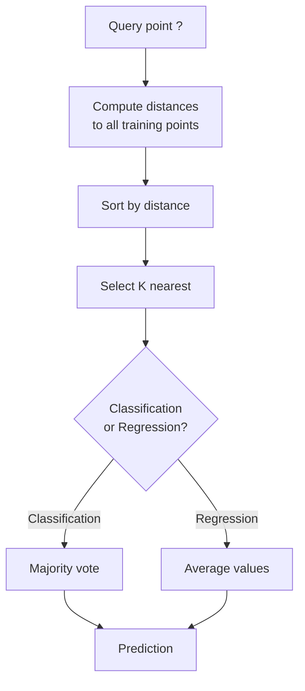
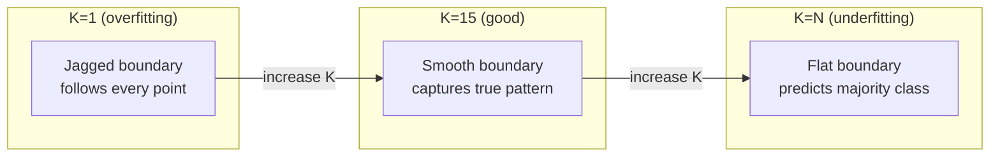
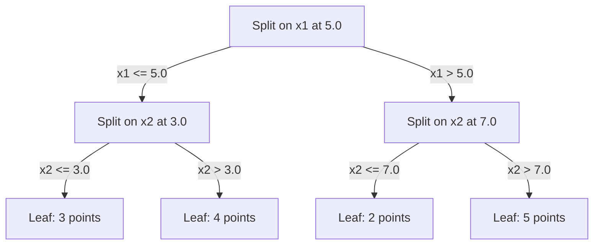

# K-Nearest Neighbors and Distances · K 近邻与距离（存下一切，看邻居投票）

> Store everything. Predict by looking at your neighbors. The simplest algorithm that actually works.

**类型:** Build
**语言:** Python
**前置课程:** Phase 1（Lesson 14 范数与距离）
**时间:** ~90 分钟

## Learning Objectives · 学习目标

- 从零实现 KNN 分类与回归，K 可配置并支持距离加权投票
- 比较 L1、L2、余弦（cosine）与 Minkowski 距离度量，学会针对给定数据类型选择合适的度量
- 解释维度灾难（curse of dimensionality），演示 KNN 在高维空间中为何退化
- 构建 KD-tree 做高效最近邻搜索，并分析它何时优于暴力搜索

> Implement KNN classification and regression from scratch with configurable K and distance-weighted voting
> Compare L1, L2, cosine, and Minkowski distance metrics and select the appropriate one for a given data type
> Explain the curse of dimensionality and demonstrate why KNN degrades in high-dimensional spaces
> Build a KD-tree for efficient nearest neighbor search and analyze when it outperforms brute-force

## The Problem · 问题在哪

你有一个数据集。新来一个数据点，你要对它做分类或预测它的值。你不用像线性回归或 SVM 那样从数据中学参数——只要找到离新点最近的 K 个训练点，让它们投票就行。

这就是 K 近邻（K-nearest neighbors，KNN）。没有训练阶段，没有要学的参数，没有要最小化的损失函数。你把整个训练集存下来，预测的时候现算距离。

它简单得让人怀疑能不能用。但 KNN 在很多问题上出奇地能打，尤其在中小规模数据集上；而且深入理解它会带出一批根本性概念：距离度量的选择（连接 Phase 1 第 14 课）、维度灾难（curse of dimensionality），以及懒惰学习（lazy learning）与急切学习（eager learning）的区别。

KNN 在现代 AI 里无处不在，只是换了个名字。向量数据库（vector database）做的就是对 embedding 的 KNN 搜索；检索增强生成（RAG）找的是最近的 K 个文档块；推荐系统找相似的用户或物品。算法是同一个，变的只是规模和数据结构。

> You have a dataset. A new data point arrives. You need to classify it or predict its value. Instead of learning parameters from the data (like linear regression or SVMs), you just find the K training points closest to the new point and let them vote. ... This is K-nearest neighbors. There is no training phase. No parameters to learn. No loss function to minimize. You store the entire training set and compute distances at prediction time. ... KNN also shows up everywhere in modern AI, just under different names. Vector databases do KNN search over embeddings. Retrieval-augmented generation (RAG) finds the K nearest document chunks. Recommendation systems find similar users or items. The algorithm is the same. The scale and the data structures are different.

## The Concept · 概念

### How KNN works · KNN 怎么工作

给定带标签的数据点和一个新的查询点：

1. 计算查询点到数据集中每个点的距离
2. 按距离排序
3. 取最近的 K 个点
4. 分类任务：K 个邻居多数投票
5. 回归任务：K 个邻居值的（加权）平均



这就是全部算法。没有拟合，没有梯度下降，没有 epoch。

> Given a dataset of labeled points and a new query point:
> 1. Compute the distance from the query to every point in the dataset
> 2. Sort by distance
> 3. Take the K closest points
> 4. For classification: majority vote among the K neighbors
> 5. For regression: average (or weighted average) of the K neighbors' values
> That is the entire algorithm. No fitting. No gradient descent. No epochs.

### Choosing K · 选择 K

K 是唯一的超参数，它控制偏差-方差权衡：

| K | 行为 |
|---|----------|
| K = 1 | 决策边界贴着每个点走。训练误差为零。高方差。过拟合 |
| 小 K（3-5） | 对局部结构敏感，能抓住复杂边界 |
| 大 K | 边界更平滑，对噪声更鲁棒，可能欠拟合 |
| K = N | 对每个点都预测多数类。偏差最大 |

常见起点：N 个点的数据集取 K = sqrt(N)。二分类用奇数 K 避免平票。



> K is the single hyperparameter. It controls the bias-variance trade-off ... A common starting point is K = sqrt(N) for a dataset of N points. Use odd K for binary classification to avoid ties.

### Distance metrics · 距离度量

距离函数定义了什么叫「近」。不同的度量给出不同的邻居、不同的预测。

**L2（欧氏距离，Euclidean）** 是默认选择：直线距离。

```
d(a, b) = sqrt(sum((a_i - b_i)^2))
```

它对特征尺度敏感。把 L2 用于 KNN 之前，一定要先标准化特征。

**L1（曼哈顿距离，Manhattan）** 把绝对差求和。因为它不对差值取平方，所以比 L2 对离群点更鲁棒。

```
d(a, b) = sum(|a_i - b_i|)
```

**余弦距离（cosine distance）** 度量向量之间的夹角，忽略幅度。文本和 embedding 数据的必备品。

```
d(a, b) = 1 - (a . b) / (||a|| * ||b||)
```

**Minkowski 距离** 用参数 p 把 L1 和 L2 统一起来。

```
d(a, b) = (sum(|a_i - b_i|^p))^(1/p)

p=1: Manhattan
p=2: Euclidean
p->inf: Chebyshev (max absolute difference)
```

用哪个度量取决于数据：

| 数据类型 | 最佳度量 | 原因 |
|-----------|------------|-----|
| 数值特征、尺度相近 | L2（欧氏） | 默认选择，适合空间数据 |
| 数值特征、有离群点 | L1（曼哈顿） | 鲁棒，不会放大大差异 |
| 文本 embedding | 余弦 | 幅度是噪声，方向才是语义 |
| 高维稀疏 | 余弦或 L1 | L2 深受维度灾难之害 |
| 混合类型 | 自定义距离 | 按特征类型组合多种度量 |

> The distance function defines what "near" means. Different metrics produce different neighbors, different predictions. ... **L2 (Euclidean)** is the default. Straight-line distance ... Sensitive to feature scale. Always standardize features before using L2 with KNN. ... **Cosine distance** measures the angle between vectors, ignoring magnitude. Essential for text and embedding data. ... **L1 (Manhattan)** sums absolute differences. More robust to outliers than L2 because it does not square the differences.

### Weighted KNN · 加权 KNN

标准 KNN 给 K 个邻居同等的权重。但距离 0.1 的邻居理应比距离 5.0 的邻居更有话语权。

**距离加权 KNN（distance-weighted KNN）** 按距离的倒数给每个邻居加权：

```
weight_i = 1 / (distance_i + epsilon)

For classification: weighted vote
For regression:     weighted average = sum(w_i * y_i) / sum(w_i)
```

epsilon 的作用是防止查询点与某个训练点完全重合时除以零。

加权 KNN 对 K 的选择不那么敏感，因为远处的邻居不管怎样贡献都很小。

> Standard KNN gives equal weight to all K neighbors. But a neighbor at distance 0.1 should matter more than one at distance 5.0. ... **Distance-weighted KNN** weights each neighbor inversely by distance ... The epsilon prevents division by zero when a query point exactly matches a training point. ... Weighted KNN is less sensitive to the choice of K because distant neighbors contribute very little regardless.

### The curse of dimensionality · 维度灾难

KNN 在高维空间中性能退化。这不是含糊的担忧，而是数学事实。

**问题 1：距离趋同。** 随着维度升高，最大距离与最小距离之比趋近 1。所有点与查询点变得一样「远」。

```
In d dimensions, for random uniform points:

d=2:    max_dist / min_dist = varies widely
d=100:  max_dist / min_dist ~ 1.01
d=1000: max_dist / min_dist ~ 1.001

When all distances are nearly equal, "nearest" is meaningless.
```

**问题 2：体积爆炸。** 要在固定比例的数据中捕获 K 个邻居，你必须把搜索半径扩大到覆盖特征空间大得多的比例。高维中的「邻域」会吞掉大部分空间。

**问题 3：角落主导。** 在 d 维单位超立方体中，大部分体积集中在角落附近而不是中心。随着 d 增大，立方体的内切球所包含的体积比例趋近于零。

实际结论：KNN 在大约 20-50 个特征以内工作良好。超过之后，你要么先降维（PCA、UMAP、t-SNE）再做 KNN，要么使用能利用数据内在低维结构的树形搜索结构。

> KNN performance degrades in high dimensions. This is not a vague concern. It is a mathematical fact. ... **Problem 1: distances converge.** As dimensionality increases, the ratio of the maximum distance to the minimum distance approaches 1. All points become equally "far" from the query. ... **Problem 2: volume explodes.** ... **Problem 3: corners dominate.** ... Practical consequence: KNN works well up to about 20-50 features. Beyond that, you need dimensionality reduction (PCA, UMAP, t-SNE) before applying KNN, or you need to use tree-based search structures that exploit the data's intrinsic lower dimensionality.

### KD-trees: fast nearest neighbor search · KD-tree：快速最近邻搜索

暴力 KNN 要计算查询点到每个训练点的距离，每次查询 O(n * d)。对大数据集来说太慢了。

KD-tree 沿特征轴递归地划分空间。每一层在中位数处沿某个维度切一刀。



查找最近邻时，先沿树走到包含查询点的叶子，然后回溯——只有当相邻分区可能藏有更近的点时才去检查它们。

平均查询时间：低维时 O(log n)。但 KD-tree 在高维（d > 20）会退化到 O(n)，因为回溯能剪掉的分支越来越少。

> Brute-force KNN computes the distance from the query to every training point. That is O(n * d) per query. For large datasets, this is too slow. ... A KD-tree recursively partitions the space along feature axes. At each level, it splits along one dimension at the median value. ... Average query time: O(log n) for low dimensions. But KD-trees degrade to O(n) in high dimensions (d > 20) because the backtracking eliminates fewer and fewer branches.

### Ball trees: better for moderate dimensions · Ball tree：中等维度下更好的选择

Ball tree 用嵌套的超球体（而不是轴对齐的盒子）来划分数据。每个节点定义一个球（中心 + 半径），包含该子树中的所有点。

相对 KD-tree 的优势：
- 在中等维度（约 50 以内）下表现更好
- 能处理非轴对齐的结构
- 更紧的边界体积意味着搜索时能剪掉更多分支

KD-tree 和 ball tree 都是精确算法。真正的大规模搜索（百万级点、上百维）用的是近似最近邻方法（HNSW、IVF、乘积量化）。这些内容在 Phase 1 第 14 课有讲。

> Ball trees partition data into nested hyperspheres instead of axis-aligned boxes. Each node defines a ball (center + radius) that contains all points in that subtree. ... Both KD-trees and ball trees are exact algorithms. For truly large-scale search (millions of points, hundreds of dimensions), approximate nearest neighbor methods (HNSW, IVF, product quantization) are used instead. These are covered in Phase 1 Lesson 14.

### Lazy learning vs eager learning · 懒惰学习 vs 急切学习

KNN 是懒惰学习器（lazy learner）：训练时什么都不做，预测时做全部工作。其他大多数算法（线性回归、SVM、神经网络）是急切学习器（eager learner）：训练时重计算出一个紧凑的模型，之后预测飞快。

| 维度 | 懒惰（KNN） | 急切（SVM、神经网络） |
|--------|------------|------------------------|
| 训练时间 | O(1)，只存数据 | O(n * epochs) |
| 预测时间 | 每次查询 O(n * d) | O(d) 或 O(参数量) |
| 预测时内存 | 存整个训练集 | 只存模型参数 |
| 适应新数据 | 即刻加入数据点 | 重新训练模型 |
| 决策边界 | 隐式、现算 | 显式、训练后固定 |

懒惰学习适合这些场景：
- 数据集频繁变化（增删点无需重新训练）
- 查询次数非常少
- 想要零训练时间
- 数据集小到暴力搜索也足够快

> KNN is a lazy learner: it does no work at training time and all work at prediction time. Most other algorithms (linear regression, SVMs, neural networks) are eager learners: they do heavy computation at training time to build a compact model, then predictions are fast. ... Lazy learning is ideal when: The dataset changes frequently (add/remove points without retraining) ... You need predictions for very few queries ... You want zero training time ...

### KNN for regression · KNN 回归

KNN 做回归时不搞多数投票，而是对 K 个邻居的目标值取平均。

```
prediction = (1/K) * sum(y_i for i in K nearest neighbors)

Or with distance weighting:
prediction = sum(w_i * y_i) / sum(w_i)
where w_i = 1 / distance_i
```

KNN 回归产生分段常数（加权时为分段平滑）的预测。它无法外推到训练数据的范围之外：如果训练目标全在 0 到 100 之间，KNN 永远预测不出 200。

```figure
knn-smoothness
```

> Instead of majority voting, KNN for regression averages the target values of the K neighbors. ... KNN regression produces piecewise-constant (or piecewise-smooth with weighting) predictions. It cannot extrapolate beyond the range of the training data. If the training targets are all between 0 and 100, KNN will never predict 200.

## Build It · 动手造

### Step 1: Distance functions · 第 1 步：距离函数

实现 L1、L2、余弦和 Minkowski 距离。它们直接对应 Phase 1 第 14 课的内容。

```python
import math

def l2_distance(a, b):
    return math.sqrt(sum((ai - bi) ** 2 for ai, bi in zip(a, b)))

def l1_distance(a, b):
    return sum(abs(ai - bi) for ai, bi in zip(a, b))

def cosine_distance(a, b):
    dot_val = sum(ai * bi for ai, bi in zip(a, b))
    norm_a = math.sqrt(sum(ai ** 2 for ai in a))
    norm_b = math.sqrt(sum(bi ** 2 for bi in b))
    if norm_a == 0 or norm_b == 0:
        return 1.0
    return 1.0 - dot_val / (norm_a * norm_b)

def minkowski_distance(a, b, p=2):
    if p == float('inf'):
        return max(abs(ai - bi) for ai, bi in zip(a, b))
    return sum(abs(ai - bi) ** p for ai, bi in zip(a, b)) ** (1 / p)
```

> Implement L1, L2, cosine, and Minkowski distances. These connect directly to Phase 1 Lesson 14.

### Step 2: KNN classifier and regressor · 第 2 步：KNN 分类器与回归器

构建完整的 KNN：K 和距离度量可配置，并支持可选的距离加权。

```python
class KNN:
    def __init__(self, k=5, distance_fn=l2_distance, weighted=False,
                 task="classification"):
        self.k = k
        self.distance_fn = distance_fn
        self.weighted = weighted
        self.task = task
        self.X_train = None
        self.y_train = None

    def fit(self, X, y):
        self.X_train = X
        self.y_train = y

    def predict(self, X):
        return [self._predict_one(x) for x in X]
```

> Build the full KNN with configurable K, distance metric, and optional distance weighting.

### Step 3: KD-tree for efficient search · 第 3 步：用 KD-tree 做高效搜索

从零构建一棵 KD-tree，按每个维度的中位数递归切分。

```python
class KDTree:
    def __init__(self, X, indices=None, depth=0):
        # Recursively partition the data
        self.axis = depth % len(X[0])
        # Split on median of the current axis
        ...

    def query(self, point, k=1):
        # Traverse to leaf, then backtrack
        ...
```

完整实现、全部辅助方法与演示见 `code/knn.py`。

> Build a KD-tree from scratch that recursively splits on the median of each dimension. ... See `code/knn.py` for the complete implementation with all helper methods and demos.

### Step 4: Feature scaling · 第 4 步：特征缩放

KNN 必须做特征缩放，因为距离对特征量级敏感。一个取值 0 到 1000 的特征会压过一个取值 0 到 1 的特征。

```python
def standardize(X):
    n = len(X)
    d = len(X[0])
    means = [sum(X[i][j] for i in range(n)) / n for j in range(d)]
    stds = [
        max(1e-10, (sum((X[i][j] - means[j]) ** 2 for i in range(n)) / n) ** 0.5)
        for j in range(d)
    ]
    return [[((X[i][j] - means[j]) / stds[j]) for j in range(d)] for i in range(n)], means, stds
```

> KNN requires feature scaling because distances are sensitive to feature magnitudes. A feature ranging from 0 to 1000 will dominate a feature ranging from 0 to 1.

## Use It · 实战用法

用 scikit-learn：

```python
from sklearn.neighbors import KNeighborsClassifier
from sklearn.preprocessing import StandardScaler
from sklearn.pipeline import Pipeline

clf = Pipeline([
    ("scaler", StandardScaler()),
    ("knn", KNeighborsClassifier(n_neighbors=5, metric="euclidean")),
])
clf.fit(X_train, y_train)
print(f"Accuracy: {clf.score(X_test, y_test):.4f}")
```

当数据集足够大、维度足够低时，scikit-learn 会自动改用 KD-tree 或 ball tree；对高维数据则回退到暴力搜索。这个行为可以用 `algorithm` 参数控制。

> Scikit-learn automatically uses KD-trees or ball trees when the dataset is large enough and the dimensionality is low enough. For high-dimensional data, it falls back to brute force. You can control this with the `algorithm` parameter.

大规模最近邻搜索（百万级向量）用 FAISS、Annoy 或向量数据库：

```python
import faiss

index = faiss.IndexFlatL2(dimension)
index.add(embeddings)
distances, indices = index.search(query_vectors, k=5)
```

> For large-scale nearest neighbor search (millions of vectors), use FAISS, Annoy, or a vector database:

## Exercises · 练习

1. 在一个 3 类的 2D 数据集上实现 KNN 分类。画出 K=1、K=5、K=15 和 K=N 的决策边界。观察从过拟合到欠拟合的转变。

2. 在 2、5、10、50、100、500 维下各生成 1000 个随机点。对每个维度，计算最大成对距离与最小成对距离之比。画出比值随维度变化的曲线，把维度灾难可视化出来。

3. 在一个文本分类问题上（用 TF-IDF 向量）比较 L1、L2 和余弦距离下的 KNN。哪个度量准确率最高？为什么余弦在文本上往往获胜？

4. 实现 KD-tree，并在 2D、10D、50D 的 1k、10k、100k 点数据集上测量其与暴力搜索的查询耗时。在多少维时 KD-tree 不再比暴力搜索快？

5. 为 y = sin(x) + noise 构建一个加权 KNN 回归器。在 K=3、10、30 下与不加权 KNN 对比。展示加权能产生更平滑的预测，尤其是大 K 时。

> Implement KNN classification on a 2D dataset with 3 classes. Plot the decision boundary for K=1, K=5, K=15, and K=N. Observe the transition from overfitting to underfitting.
> Generate 1000 random points in 2, 5, 10, 50, 100, and 500 dimensions. For each dimensionality, compute the ratio of the maximum pairwise distance to the minimum pairwise distance. Plot the ratio vs dimensionality to visualize the curse of dimensionality.
> Compare L1, L2, and cosine distance for KNN on a text classification problem (use TF-IDF vectors). Which metric gives the best accuracy? Why does cosine tend to win for text?
> Implement a KD-tree and measure query time vs brute force for datasets of 1k, 10k, and 100k points in 2D, 10D, and 50D. At what dimensionality does the KD-tree stop being faster than brute force?
> Build a weighted KNN regressor for y = sin(x) + noise. Compare it with unweighted KNN for K=3, 10, 30. Show that weighting produces smoother predictions, especially for large K.

## Key Terms · 术语表

| 术语 | 实际含义 |
|------|----------------------|
| K 近邻（K-nearest neighbors） | 非参数算法：找到离查询点最近的 K 个训练点来做预测 |
| 懒惰学习（lazy learning） | 训练时不做任何计算，全部工作发生在预测时。KNN 是典型代表 |
| 急切学习（eager learning） | 训练时重计算出一个紧凑的模型。大多数机器学习算法都是急切的 |
| 维度灾难（curse of dimensionality） | 高维下距离趋同、邻域膨胀到覆盖大部分空间，使 KNN 失效 |
| KD-tree | 沿特征轴递归划分空间的二叉树。低维时查询为 O(log n) |
| Ball tree | 嵌套超球体组成的树。中等维度（约 50 以内）下比 KD-tree 更好用 |
| 加权 KNN（weighted KNN） | 邻居按距离倒数加权。越近的邻居对预测的影响越大 |
| 特征缩放（feature scaling） | 把特征归一到可比的范围。KNN 这类基于距离的方法的必备前提 |
| 多数投票（majority vote） | 数一数 K 个邻居中哪个类最多，以此完成分类 |
| 暴力搜索（brute force search） | 计算到每个训练点的距离。每次查询 O(n*d)。精确但对大 n 太慢 |
| 近似最近邻（approximate nearest neighbor） | HNSW、LSH、IVF 等算法，比精确搜索快得多地找到近似最近的点 |
| Voronoi 图（Voronoi diagram） | 每个区域包含离某个训练点比离其他任何点都近的点的空间划分。K=1 的 KNN 产生 Voronoi 边界 |

## Further Reading · 延伸阅读

- [Cover & Hart: Nearest Neighbor Pattern Classification (1967)](https://ieeexplore.ieee.org/document/1053964) —— KNN 的奠基论文，证明其错误率至多为贝叶斯最优的两倍
- [Friedman, Bentley, Finkel: An Algorithm for Finding Best Matches in Logarithmic Expected Time (1977)](https://dl.acm.org/doi/10.1145/355744.355745) —— KD-tree 的原始论文
- [Beyer et al.: When Is "Nearest Neighbor" Meaningful? (1999)](https://link.springer.com/chapter/10.1007/3-540-49257-7_15) —— 最近邻维度灾难的形式化分析
- [scikit-learn Nearest Neighbors documentation](https://scikit-learn.org/stable/modules/neighbors.html) —— 含算法选择的实战指南
- [FAISS: A Library for Efficient Similarity Search](https://github.com/facebookresearch/faiss) —— Meta 的十亿级近似最近邻搜索库
