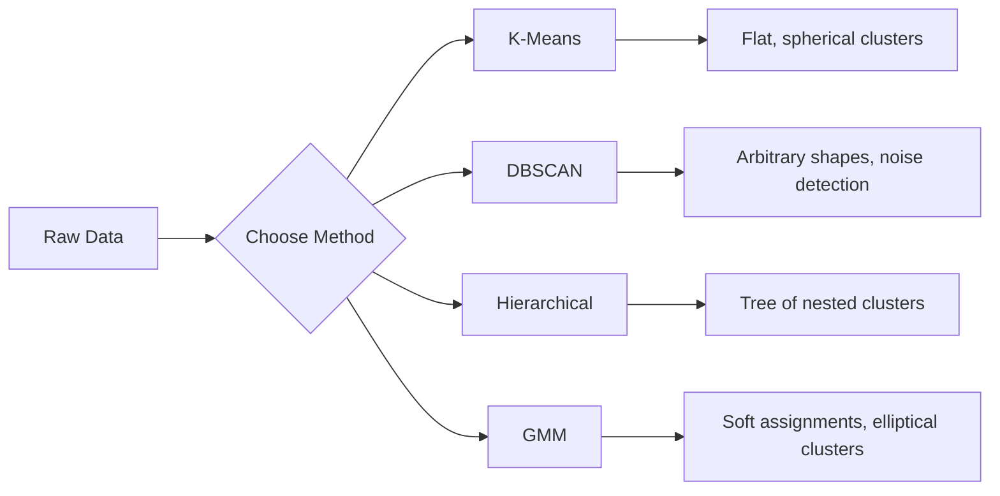

# Unsupervised Learning · 无监督学习（没有标签，自己找结构）

> No labels, no teacher. The algorithm finds structure on its own.

**类型:** Build
**语言:** Python
**前置课程:** Phase 1（范数与距离、概率与分布），Phase 2 第 1-6 课
**时间:** ~90 分钟

## Learning Objectives · 学习目标

- 从零实现 K-Means、DBSCAN 和高斯混合模型（GMM），并比较它们的聚类行为
- 用轮廓系数（silhouette score）和肘部法（elbow method）评估聚类质量，选出最优 K
- 解释 DBSCAN 何时优于 K-Means，识别哪种算法能处理非球形簇和离群点
- 用聚类方法构建异常检测流水线，标记偏离正常模式的点

> Implement K-Means, DBSCAN, and Gaussian Mixture Models from scratch and compare their clustering behavior
> Evaluate cluster quality using the silhouette score and the elbow method to select the optimal K
> Explain when DBSCAN outperforms K-Means and identify which algorithm handles non-spherical clusters and outliers
> Build an anomaly detection pipeline using clustering methods to flag points that deviate from normal patterns

## The Problem · 问题在哪

到目前为止，每节机器学习课都默认数据带标签：「这是输入，这是正确输出。」现实世界里标签很贵。医院有几百万份病人记录，但没人逐条标注病种。电商网站有几百万条用户会话，但没人手工划分客户群。安全团队有网络日志，但没人标记每一条异常。

无监督学习（unsupervised learning）在不被告知要找什么的情况下发现模式。它把相似的数据点归成一组，挖掘隐藏结构，让异常浮出水面。如果说监督学习是对着带答案的教科书学习，无监督学习就是盯着原始数据，直到模式自己显形。

代价是：没有标签，你就无法直接度量「对」还是「错」。你需要另一套工具来判断算法找到的结构到底有没有意义。

> Every ML lesson so far has assumed labeled data: "here is an input, here is the correct output." In the real world, labels are expensive. A hospital has millions of patient records but no one has manually tagged each one with a disease category. ... Unsupervised learning finds patterns without being told what to look for. It groups similar data points, discovers hidden structures, and surfaces anomalies. ... The catch: without labels, you cannot directly measure "right" or "wrong." You need different tools to evaluate whether the structure your algorithm found is meaningful.

## The Concept · 概念

### Clustering: Grouping Similar Things Together · 聚类：把相似的东西归到一起

聚类把每个数据点分到一个组（簇，cluster），使得同一组内的点彼此之间比与其它组的点更相似。永恒的问题是：「相似」到底指什么？



> Clustering assigns each data point to a group (cluster) so that points within the same group are more similar to each other than to points in other groups. The question is always: what does "similar" mean?

### K-Means: The Workhorse · K-Means：主力干将

K-Means 把数据精确划分成 K 个簇。每个簇有一个质心（centroid，重心），每个点都属于离它最近的质心。

Lloyd 算法：

1. 随机选 K 个点作为初始质心
2. 把每个数据点分配给最近的质心
3. 把每个质心重算为其所辖点的均值
4. 重复第 2-3 步，直到分配不再变化

目标函数（inertia，惯性）度量每个点到其所属质心的平方距离总和。K-Means 最小化它，但只能找到局部极小。不同的初始化会给出不同的结果。

> K-Means partitions data into exactly K clusters. Each cluster has a centroid (its center of mass), and every point belongs to the nearest centroid. ... The objective function (inertia) measures the total squared distance from each point to its assigned centroid. K-Means minimizes this, but only finds a local minimum. Different initializations can give different results.

### Choosing K · 选择 K

两种标准方法：

**肘部法（elbow method）：** 对 K = 1, 2, 3, ..., n 分别跑 K-Means，画 inertia 对 K 的曲线，寻找「肘部」——继续增加簇数也无法显著降低 inertia 的位置。

**轮廓系数（silhouette score）：** 对每个点，度量它与自身簇的相似度（a）对比它与最近其它簇的相似度（b）。轮廓系数为 (b - a) / max(a, b)，范围从 -1（分错簇）到 +1（聚类良好）。对所有点取平均得到全局分数。

> Two standard methods: **Elbow method:** Run K-Means for K = 1, 2, 3, ..., n. Plot inertia vs K. Look for the "elbow" where adding more clusters stops reducing inertia significantly. ... **Silhouette score:** For each point, measure how similar it is to its own cluster (a) versus the nearest other cluster (b). The silhouette coefficient is (b - a) / max(a, b), ranging from -1 (wrong cluster) to +1 (well-clustered). Average across all points for a global score.

### DBSCAN: Density-Based Clustering · DBSCAN：基于密度的聚类

K-Means 假设簇是球形的，而且要求你预先指定 K。DBSCAN 两个假设都不做：它把簇找成由稀疏区域分隔开的稠密区域。

两个参数：
- **eps**：邻域半径
- **min_samples**：形成稠密区域所需的最少点数

三种类型的点：
- **核心点（core point）**：eps 距离内至少有 min_samples 个点
- **边界点（border point）**：在某核心点的 eps 范围内，但自己不是核心点
- **噪声点（noise point）**：既非核心也非边界。它们就是离群点。

DBSCAN 把彼此都在 eps 范围内的核心点连成同一个簇。边界点加入邻近核心点所在的簇。噪声点不属于任何簇。

优点：能找到任意形状的簇、自动确定簇的数量、能识别离群点。弱点：对密度不一的簇很吃力。

> K-Means assumes clusters are spherical and requires you to pick K upfront. DBSCAN makes neither assumption. It finds clusters as dense regions separated by sparse regions. ... DBSCAN connects core points that are within eps of each other into the same cluster. Border points join the cluster of a nearby core point. Noise points belong to no cluster. ... Strengths: finds clusters of any shape, automatically determines the number of clusters, identifies outliers. Weakness: struggles with clusters of varying densities.

### Hierarchical Clustering · 层次聚类

构建一棵嵌套簇的树（树状图，dendrogram）。

凝聚式（agglomerative，自底向上）：
1. 每个点自成一簇
2. 合并距离最近的两个簇
3. 重复直到只剩一个簇
4. 在想要的高度切开树状图，得到 K 个簇

簇与簇之间的「远近」可以这样度量：
- **单链接（single linkage）**：两簇间任意两点距离的最小值
- **全链接（complete linkage）**：任意两点距离的最大值
- **平均链接（average linkage）**：所有点对的平均距离
- **Ward 法**：使总簇内方差增量最小的那种合并

> Builds a tree (dendrogram) of nested clusters. Agglomerative (bottom-up): Start with each point as its own cluster ... Merge the two closest clusters ... The "closeness" between clusters can be measured as: Single linkage: minimum distance between any two points in the two clusters ... Ward's method: the merge that causes the smallest increase in total within-cluster variance

### Gaussian Mixture Models (GMM) · 高斯混合模型（GMM）

K-Means 给出硬分配：每个点恰好属于一个簇。GMM 给出软分配：每个点以一定概率属于每个簇。

GMM 假设数据由 K 个高斯分布混合生成，每个高斯有自己的均值和协方差。期望最大化算法（Expectation-Maximization，EM）在以下两步之间交替：

- **E 步**：计算每个点属于每个高斯的概率
- **M 步**：更新每个高斯的均值、协方差和混合权重，使数据的似然最大化

GMM 能建模椭圆形的簇（不像 K-Means 只能球形），并且天然能处理相互重叠的簇。

> K-Means gives hard assignments: each point belongs to exactly one cluster. GMM gives soft assignments: each point has a probability of belonging to each cluster. ... GMM assumes the data is generated from a mixture of K Gaussian distributions, each with its own mean and covariance. The Expectation-Maximization (EM) algorithm alternates between ... GMM can model elliptical clusters (not just spherical like K-Means) and naturally handles overlapping clusters.

### When to Use Which · 何时用哪个

| 方法 | 最适合 | 何时避免 |
|--------|----------|------------|
| K-Means | 大数据集、球形簇、K 已知 | 形状不规则、存在离群点 |
| DBSCAN | K 未知、任意形状、离群点检测 | 密度不一、维度非常高 |
| 层次聚类 | 小数据集、需要树状图、K 未知 | 大数据集（O(n^2) 内存） |
| GMM | 簇相互重叠、需要软分配 | 超大数据集、维度过多 |

### Anomaly Detection with Clustering · 用聚类做异常检测

聚类天然支持异常检测：
- **K-Means**：离任何质心都很远的点是异常
- **DBSCAN**：噪声点按定义就是异常
- **GMM**：在所有高斯下概率都很低的点是异常

```figure
kmeans-step
```

> Clustering naturally supports anomaly detection:
> K-Means: points far from any centroid are anomalies
> DBSCAN: noise points are anomalies by definition
> GMM: points with low probability under all Gaussians are anomalies

## Build It · 动手造

### Step 1: K-Means from scratch · 第 1 步：从零实现 K-Means

```python
import math
import random


def euclidean_distance(a, b):
    return math.sqrt(sum((ai - bi) ** 2 for ai, bi in zip(a, b)))


def kmeans(data, k, max_iterations=100, seed=42):
    random.seed(seed)
    n_features = len(data[0])

    centroids = random.sample(data, k)

    for iteration in range(max_iterations):
        clusters = [[] for _ in range(k)]
        assignments = []

        for point in data:
            distances = [euclidean_distance(point, c) for c in centroids]
            nearest = distances.index(min(distances))
            clusters[nearest].append(point)
            assignments.append(nearest)

        new_centroids = []
        for cluster in clusters:
            if len(cluster) == 0:
                new_centroids.append(random.choice(data))
                continue
            centroid = [
                sum(point[j] for point in cluster) / len(cluster)
                for j in range(n_features)
            ]
            new_centroids.append(centroid)

        if all(
            euclidean_distance(old, new) < 1e-6
            for old, new in zip(centroids, new_centroids)
        ):
            print(f"  Converged at iteration {iteration + 1}")
            break

        centroids = new_centroids

    return assignments, centroids
```

### Step 2: Elbow method and silhouette score · 第 2 步：肘部法与轮廓系数

```python
def compute_inertia(data, assignments, centroids):
    total = 0.0
    for point, cluster_id in zip(data, assignments):
        total += euclidean_distance(point, centroids[cluster_id]) ** 2
    return total


def silhouette_score(data, assignments):
    n = len(data)
    if n < 2:
        return 0.0

    clusters = {}
    for i, c in enumerate(assignments):
        clusters.setdefault(c, []).append(i)

    if len(clusters) < 2:
        return 0.0

    scores = []
    for i in range(n):
        own_cluster = assignments[i]
        own_members = [j for j in clusters[own_cluster] if j != i]

        if len(own_members) == 0:
            scores.append(0.0)
            continue

        a = sum(euclidean_distance(data[i], data[j]) for j in own_members) / len(own_members)

        b = float("inf")
        for cluster_id, members in clusters.items():
            if cluster_id == own_cluster:
                continue
            avg_dist = sum(euclidean_distance(data[i], data[j]) for j in members) / len(members)
            b = min(b, avg_dist)

        if max(a, b) == 0:
            scores.append(0.0)
        else:
            scores.append((b - a) / max(a, b))

    return sum(scores) / len(scores)


def find_best_k(data, max_k=10):
    print("Elbow method:")
    inertias = []
    for k in range(1, max_k + 1):
        assignments, centroids = kmeans(data, k)
        inertia = compute_inertia(data, assignments, centroids)
        inertias.append(inertia)
        print(f"  K={k}: inertia={inertia:.2f}")

    print("\nSilhouette scores:")
    for k in range(2, max_k + 1):
        assignments, centroids = kmeans(data, k)
        score = silhouette_score(data, assignments)
        print(f"  K={k}: silhouette={score:.4f}")

    return inertias
```

### Step 3: DBSCAN from scratch · 第 3 步：从零实现 DBSCAN

```python
def dbscan(data, eps, min_samples):
    n = len(data)
    labels = [-1] * n
    cluster_id = 0

    def region_query(point_idx):
        neighbors = []
        for i in range(n):
            if euclidean_distance(data[point_idx], data[i]) <= eps:
                neighbors.append(i)
        return neighbors

    visited = [False] * n

    for i in range(n):
        if visited[i]:
            continue
        visited[i] = True

        neighbors = region_query(i)

        if len(neighbors) < min_samples:
            labels[i] = -1
            continue

        labels[i] = cluster_id
        seed_set = list(neighbors)
        seed_set.remove(i)

        j = 0
        while j < len(seed_set):
            q = seed_set[j]

            if not visited[q]:
                visited[q] = True
                q_neighbors = region_query(q)
                if len(q_neighbors) >= min_samples:
                    for nb in q_neighbors:
                        if nb not in seed_set:
                            seed_set.append(nb)

            if labels[q] == -1:
                labels[q] = cluster_id

            j += 1

        cluster_id += 1

    return labels
```

### Step 4: Gaussian Mixture Model (EM algorithm) · 第 4 步：高斯混合模型（EM 算法）

```python
def gmm(data, k, max_iterations=100, seed=42):
    random.seed(seed)
    n = len(data)
    d = len(data[0])

    indices = random.sample(range(n), k)
    means = [list(data[i]) for i in indices]
    variances = [1.0] * k
    weights = [1.0 / k] * k

    def gaussian_pdf(x, mean, variance):
        d = len(x)
        coeff = 1.0 / ((2 * math.pi * variance) ** (d / 2))
        exponent = -sum((xi - mi) ** 2 for xi, mi in zip(x, mean)) / (2 * variance)
        return coeff * math.exp(max(exponent, -500))

    for iteration in range(max_iterations):
        responsibilities = []
        for i in range(n):
            probs = []
            for j in range(k):
                probs.append(weights[j] * gaussian_pdf(data[i], means[j], variances[j]))
            total = sum(probs)
            if total == 0:
                total = 1e-300
            responsibilities.append([p / total for p in probs])

        old_means = [list(m) for m in means]

        for j in range(k):
            r_sum = sum(responsibilities[i][j] for i in range(n))
            if r_sum < 1e-10:
                continue

            weights[j] = r_sum / n

            for dim in range(d):
                means[j][dim] = sum(
                    responsibilities[i][j] * data[i][dim] for i in range(n)
                ) / r_sum

            variances[j] = sum(
                responsibilities[i][j]
                * sum((data[i][dim] - means[j][dim]) ** 2 for dim in range(d))
                for i in range(n)
            ) / (r_sum * d)
            variances[j] = max(variances[j], 1e-6)

        shift = sum(
            euclidean_distance(old_means[j], means[j]) for j in range(k)
        )
        if shift < 1e-6:
            print(f"  GMM converged at iteration {iteration + 1}")
            break

    assignments = []
    for i in range(n):
        assignments.append(responsibilities[i].index(max(responsibilities[i])))

    return assignments, means, weights, responsibilities
```

### Step 5: Generate test data and run everything · 第 5 步：生成测试数据并跑通全部

```python
def make_blobs(centers, n_per_cluster=50, spread=0.5, seed=42):
    random.seed(seed)
    data = []
    true_labels = []
    for label, (cx, cy) in enumerate(centers):
        for _ in range(n_per_cluster):
            x = cx + random.gauss(0, spread)
            y = cy + random.gauss(0, spread)
            data.append([x, y])
            true_labels.append(label)
    return data, true_labels


def make_moons(n_samples=200, noise=0.1, seed=42):
    random.seed(seed)
    data = []
    labels = []
    n_half = n_samples // 2
    for i in range(n_half):
        angle = math.pi * i / n_half
        x = math.cos(angle) + random.gauss(0, noise)
        y = math.sin(angle) + random.gauss(0, noise)
        data.append([x, y])
        labels.append(0)
    for i in range(n_half):
        angle = math.pi * i / n_half
        x = 1 - math.cos(angle) + random.gauss(0, noise)
        y = 1 - math.sin(angle) - 0.5 + random.gauss(0, noise)
        data.append([x, y])
        labels.append(1)
    return data, labels


if __name__ == "__main__":
    centers = [[2, 2], [8, 3], [5, 8]]
    data, true_labels = make_blobs(centers, n_per_cluster=50, spread=0.8)

    print("=== K-Means on 3 blobs ===")
    assignments, centroids = kmeans(data, k=3)
    print(f"  Centroids: {[[round(c, 2) for c in cent] for cent in centroids]}")
    sil = silhouette_score(data, assignments)
    print(f"  Silhouette score: {sil:.4f}")

    print("\n=== Elbow Method ===")
    find_best_k(data, max_k=6)

    print("\n=== DBSCAN on 3 blobs ===")
    db_labels = dbscan(data, eps=1.5, min_samples=5)
    n_clusters = len(set(db_labels) - {-1})
    n_noise = db_labels.count(-1)
    print(f"  Found {n_clusters} clusters, {n_noise} noise points")

    print("\n=== GMM on 3 blobs ===")
    gmm_assignments, gmm_means, gmm_weights, _ = gmm(data, k=3)
    print(f"  Means: {[[round(m, 2) for m in mean] for mean in gmm_means]}")
    print(f"  Weights: {[round(w, 3) for w in gmm_weights]}")
    gmm_sil = silhouette_score(data, gmm_assignments)
    print(f"  Silhouette score: {gmm_sil:.4f}")

    print("\n=== DBSCAN on moons (non-spherical clusters) ===")
    moon_data, moon_labels = make_moons(n_samples=200, noise=0.1)
    moon_db = dbscan(moon_data, eps=0.3, min_samples=5)
    n_moon_clusters = len(set(moon_db) - {-1})
    n_moon_noise = moon_db.count(-1)
    print(f"  Found {n_moon_clusters} clusters, {n_moon_noise} noise points")

    print("\n=== K-Means on moons (will fail to separate) ===")
    moon_km, moon_centroids = kmeans(moon_data, k=2)
    moon_sil = silhouette_score(moon_data, moon_km)
    print(f"  Silhouette score: {moon_sil:.4f}")
    print("  K-Means splits moons poorly because they are not spherical")

    print("\n=== Anomaly detection with DBSCAN ===")
    anomaly_data = list(data)
    anomaly_data.append([20.0, 20.0])
    anomaly_data.append([-5.0, -5.0])
    anomaly_data.append([15.0, 0.0])
    anomaly_labels = dbscan(anomaly_data, eps=1.5, min_samples=5)
    anomalies = [
        anomaly_data[i]
        for i in range(len(anomaly_labels))
        if anomaly_labels[i] == -1
    ]
    print(f"  Detected {len(anomalies)} anomalies")
    for a in anomalies[-3:]:
        print(f"    Point {[round(v, 2) for v in a]}")
```

## Use It · 实战用法

用 scikit-learn 的话，同样的算法一行搞定：

```python
from sklearn.cluster import KMeans, DBSCAN, AgglomerativeClustering
from sklearn.mixture import GaussianMixture
from sklearn.metrics import silhouette_score as sklearn_silhouette

km = KMeans(n_clusters=3, random_state=42).fit(data)
db = DBSCAN(eps=1.5, min_samples=5).fit(data)
agg = AgglomerativeClustering(n_clusters=3).fit(data)
gmm_model = GaussianMixture(n_components=3, random_state=42).fit(data)
```

从零实现的版本让你看清这些库到底在算什么：K-Means 在「分配」与「重算」之间迭代；DBSCAN 从稠密的种子生长出簇；GMM 在期望与最大化之间交替。库版本加了数值稳定性、更聪明的初始化（K-Means++）和 GPU 加速，但核心逻辑一模一样。

> With scikit-learn, the same algorithms are one-liners ... The from-scratch versions show you exactly what these libraries compute. K-Means iterates between assigning and recomputing. DBSCAN grows clusters from dense seeds. GMM alternates between expectation and maximization. The library versions add numerical stability, smarter initialization (K-Means++), and GPU acceleration, but the core logic is the same.

## Ship It · 交付

本课产出了可用的 K-Means、DBSCAN 和 GMM 从零实现。这些聚类代码可以作为更高级无监督方法的基础复用。

> This lesson produces working implementations of K-Means, DBSCAN, and GMM from scratch. The clustering code can be reused as a foundation for more advanced unsupervised methods.

## Exercises · 练习

1. 实现 K-Means++ 初始化：不是完全随机选质心，而是第一个随机选，之后每个新质心按「与最近已有质心距离的平方」成比例的概率选取。比较它和随机初始化的收敛速度。

2. 在代码中加入层次凝聚聚类。实现 Ward 链接，并产出树状图（用嵌套的合并列表表示）。在不同高度切开，与 K-Means 的结果对比。

3. 构建一个简单的异常检测流水线：在同一份数据上跑 DBSCAN 和 GMM，标记两种方法都认定为离群点的数据（DBSCAN 的噪声点、GMM 的低概率点）。度量两者的一致程度，并讨论它们何时会不一致。

> Implement K-Means++ initialization: instead of picking random centroids, pick the first randomly and each subsequent centroid with probability proportional to its squared distance from the nearest existing centroid. Compare convergence speed to random initialization.
> Add hierarchical agglomerative clustering to the code. Implement Ward's linkage and produce a dendrogram (as a nested list of merges). Cut it at different levels and compare to K-Means results.
> Build a simple anomaly detection pipeline: run DBSCAN and GMM on the same data, flag points that both methods agree are outliers (noise in DBSCAN, low probability in GMM). Measure the overlap and discuss when the methods disagree.

## Key Terms · 术语表

| 术语 | 大家怎么说 | 实际含义 |
|------|----------------|----------------------|
| 聚类（Clustering） | 「把相似的东西归堆」 | 按某种距离度量，把数据划成组内相似度高于组间相似度的子集 |
| 质心（Centroid） | 「簇的中心」 | 分到某簇的所有点的均值；K-Means 用它作为簇的代表 |
| 惯性（Inertia） | 「簇有多紧」 | 每个点到其所属质心的平方距离之和；越小越紧 |
| 轮廓系数（Silhouette score） | 「簇分得有多开」 | 对每个点算 (b - a) / max(a, b)，a 是簇内平均距离，b 是到最近其它簇的平均距离 |
| 核心点（Core point） | 「稠密区域里的点」 | DBSCAN 中 eps 距离内至少有 min_samples 个邻居的点 |
| EM 算法 | 「软 K-Means」 | 期望最大化：迭代地计算隶属概率（E 步）并更新分布参数（M 步） |
| 树状图（Dendrogram） | 「簇的树」 | 展示层次聚类中簇的合并顺序与合并距离的树图 |
| 异常（Anomaly） | 「离群点」 | 不符合预期模式的数据点；DBSCAN 判为噪声、GMM 判为低概率 |

## Further Reading · 延伸阅读

- [Stanford CS229 - Unsupervised Learning](https://cs229.stanford.edu/notes2022fall/main_notes.pdf) —— Andrew Ng 关于聚类与 EM 的讲义
- [scikit-learn Clustering Guide](https://scikit-learn.org/stable/modules/clustering.html) —— 所有聚类算法的实战对比，附可视化示例
- [DBSCAN original paper (Ester et al., 1996)](https://www.aaai.org/Papers/KDD/1996/KDD96-037.pdf) —— 提出基于密度聚类的原始论文
