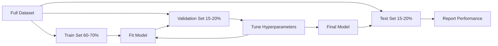

# Model Evaluation · 模型评估

> 模型有多好，取决于你用什么样的方式去度量它。

> A model is only as good as the way you measure it.

**Type:** Build
**Languages:** Python
**Prerequisites:** Phase 1（概率与分布、面向机器学习的统计学）、Phase 2 第 1-8 课
**Time:** ~90 分钟

## Learning Objectives · 学习目标

- 从零实现 K 折（K-fold）与分层 K 折（stratified K-fold）交叉验证，并解释为什么数据不平衡时分层至关重要
- 从零计算 precision、recall、F1、AUC-ROC 以及回归指标（MSE、RMSE、MAE、R-squared）
- 通过解读学习曲线（learning curves），诊断模型的问题是高偏差（high bias）还是高方差（high variance）
- 识别常见的评估错误，包括数据泄漏（data leakage）、指标选择不当和测试集污染

> Implement K-fold and stratified K-fold cross-validation from scratch and explain why stratification matters for imbalanced data
> Compute precision, recall, F1, AUC-ROC, and regression metrics (MSE, RMSE, MAE, R-squared) from scratch
> Interpret learning curves to diagnose whether a model suffers from high bias or high variance
> Identify common evaluation mistakes including data leakage, wrong metric selection, and test set contamination

## The Problem · 问题在哪

你训练了一个模型。它在你的数据上拿到了 95% 的准确率（accuracy）。它算好吗？

可能好，也可能不好。如果你的数据里有 95% 属于同一个类别，那么一个永远预测该类别的模型也能拿到 95% 的准确率，却完全没用。如果你在训练所用的同一份数据上做评估，95% 这个数字毫无意义，因为模型只是把答案背了下来。如果你的数据集带有时间属性，而你在切分前做了随机打乱，那么模型可能正在用未来的数据预测过去。

机器学习项目最容易出问题的地方就是模型评估（model evaluation）。指标选错，坏模型会被看成好模型。切分出错，模型就能作弊。对比方式不对，你会挑中更差的那个模型。把评估做对不是可选项——它决定了模型是能在生产环境里真正干活，还是一碰到真实数据就翻车。

> Model evaluation is where most ML projects go wrong. The wrong metric makes a bad model look good. The wrong split lets a model cheat. The wrong comparison makes you pick the worse model. Getting evaluation right is not optional. It is the difference between a model that works in production and one that fails the moment it sees real data.

## The Concept · 概念

### Train, Validation, Test · 训练集、验证集、测试集



三份切分，三种用途：

- **训练集（training set）**：模型从这份数据中学习。训练过程中它会见到这些样本。
- **验证集（validation set）**：用来调超参数（hyperparameters）、在多个模型之间做选择。模型从不在这些数据上训练，但你的决策会受到它的影响。
- **测试集（test set）**：只在最后动一次，用来报告最终性能。如果你看了测试集表现又回头改模型，它就不再是测试集了——它已经变成了第二个验证集。

测试集是你「留出（hold-out）」的保证：报告出来的性能，反映的正是模型在真正没见过的数据上会有怎样的表现。

> **Training set**: the model learns from this data. It sees these examples during training.
> **Validation set**: used to tune hyperparameters and select between models. The model never trains on this data, but your decisions are influenced by it.
> **Test set**: touched exactly once, at the very end, to report final performance. If you look at test performance and then go back to change your model, it is no longer a test set. It has become a second validation set.
> The test set is your hold-out guarantee that the reported performance reflects how the model will do on truly unseen data.

### K-Fold Cross-Validation · K 折交叉验证

数据集很小时，只做一次训练/验证切分既浪费数据，得到的估计也充满噪声。K 折交叉验证（K-fold cross-validation）让所有数据既用于训练也用于验证：

```mermaid
flowchart TB
    subgraph Fold1["Fold 1"]
        direction LR
        V1["Val"] --- T1a["Train"] --- T1b["Train"] --- T1c["Train"] --- T1d["Train"]
    end
    subgraph Fold2["Fold 2"]
        direction LR
        T2a["Train"] --- V2["Val"] --- T2b["Train"] --- T2c["Train"] --- T2d["Train"]
    end
    subgraph Fold3["Fold 3"]
        direction LR
        T3a["Train"] --- T3b["Train"] --- V3["Val"] --- T3c["Train"] --- T3d["Train"]
    end
    subgraph Fold4["Fold 4"]
        direction LR
        T4a["Train"] --- T4b["Train"] --- T4c["Train"] --- V4["Val"] --- T4d["Train"]
    end
    subgraph Fold5["Fold 5"]
        direction LR
        T5a["Train"] --- T5b["Train"] --- T5c["Train"] --- T5d["Train"] --- V5["Val"]
    end
    Fold1 --> R["Average scores"]
    Fold2 --> R
    Fold3 --> R
    Fold4 --> R
    Fold5 --> R
```



1. 把数据切成 K 个大小相同的折（fold）
2. 每一轮用其中 K-1 折做训练，在剩下的 1 折上做验证
3. 对 K 个验证得分取平均

K=5 或 K=10 是标准选择。每个数据点恰好被用于验证一次。平均得分比任何单次切分都是更稳定的估计。

**分层 K 折（stratified K-fold）**：在每一折中保持类别分布不变。如果你的数据集是 70% 的 A 类和 30% 的 B 类，每一折也会保持大致相同的比例。这对不平衡数据（imbalanced data）尤其重要——随机切分可能把所有少数类样本都塞进同一折里。

> With small datasets, a single train/validation split wastes data and gives noisy estimates. K=5 or K=10 are standard choices. Every data point gets used for validation exactly once. The average score is a more stable estimate than any single split. **Stratified K-fold**: preserves the class distribution in each fold.

### Classification Metrics · 分类指标

**混淆矩阵（confusion matrix）**：一切的基础。以二分类（binary classification）为例：

|  | 预测为正 | 预测为负 |
|--|---|---|
| 实际为正 | True Positive (TP) | False Negative (FN) |
| 实际为负 | False Positive (FP) | True Negative (TN) |

所有其他指标都由这个矩阵推导出来：

- **准确率（Accuracy）** = (TP + TN) / (TP + TN + FP + FN)。预测正确的比例。类别不平衡时会产生误导。
- **精确率（Precision）** = TP / (TP + FP)。所有被预测为正的样本里，有多少真的为正？适用于假正例（false positive）代价高的场景（比如垃圾邮件过滤器把正常邮件误判成垃圾邮件）。
- **召回率（Recall，又称 sensitivity）** = TP / (TP + FN)。所有真实的正样本里，我们抓住了多少？适用于假负例（false negative）代价高的场景（比如癌症筛查漏掉肿瘤）。
- **F1 分数（F1 score）** = 2 * precision * recall / (precision + recall)。精确率与召回率的调和平均。当两者谁都不明显占优时，用它来平衡。
- **AUC-ROC**：ROC 曲线（Receiver Operating Characteristic curve）下的面积。在多个分类阈值下画出真正例率（true positive rate）对假正例率（false positive rate）的曲线。AUC = 0.5 等于随机猜，AUC = 1.0 是完美区分。它与阈值无关：衡量的是模型把正样本排在负样本前面的能力，与你最终选哪个截断点无关。

> **Confusion matrix**: the foundation. From this matrix, all other metrics follow. **Precision** = TP / (TP + FP). Use when false positives are costly (e.g., spam filter marking real email as spam). **Recall** (sensitivity) = TP / (TP + FN). Use when false negatives are costly (e.g., cancer screening missing a tumor). AUC = 0.5 means random guessing, AUC = 1.0 means perfect separation.

### Regression Metrics · 回归指标

- **MSE**（均方误差，Mean Squared Error）= mean((y_true - y_pred)^2)。对大误差按平方惩罚。对离群值（outlier）敏感。
- **RMSE**（均方根误差，Root Mean Squared Error）= sqrt(MSE)。与目标变量同单位，比 MSE 更容易解释。
- **MAE**（平均绝对误差，Mean Absolute Error）= mean(|y_true - y_pred|)。对所有误差一视同仁地线性处理。比 MSE 对离群值更稳健。
- **R²（R-squared）** = 1 - SS_res / SS_tot，其中 SS_res = sum((y_true - y_pred)^2)，SS_tot = sum((y_true - y_mean)^2)。模型解释掉的方差比例。R^2 = 1.0 是完美。R^2 = 0.0 意味着模型并不比「永远预测均值」更好。如果模型比均值还差，R^2 可以是负数。

> **MSE** (Mean Squared Error) = mean((y_true - y_pred)^2). Penalizes large errors quadratically. Sensitive to outliers. **RMSE** (Root Mean Squared Error) = sqrt(MSE). Same units as the target variable. **MAE** (Mean Absolute Error) = mean(|y_true - y_pred|). R^2 = 1.0 is perfect. R^2 = 0.0 means the model is no better than always predicting the mean. R^2 can be negative if the model is worse than the mean.

### Learning Curves · 学习曲线

把训练得分和验证得分画成训练集大小的函数：

- **高偏差（high bias，欠拟合 underfitting）**：两条曲线都收敛到一个很低的得分。加更多数据没有用，你需要一个更复杂的模型。
- **高方差（high variance，过拟合 overfitting）**：训练得分很高，但验证得分低得多，两者之间的缺口很大。加更多数据应该会有帮助。

> Plot training and validation scores as a function of training set size. **High bias (underfitting)**: both curves converge to a low score. Adding more data will not help. You need a more complex model. **High variance (overfitting)**: training score is high but validation score is much lower. The gap between them is large. Adding more data should help.

### Validation Curves · 验证曲线

把训练得分和验证得分画成某个超参数的函数：

- 复杂度低时：两个得分都低（欠拟合）
- 复杂度合适时：两个得分都高，而且彼此接近
- 复杂度高时：训练得分依旧很高，验证得分却往下掉（过拟合）

最优超参数值就是验证得分达到峰值的地方。

> Plot training and validation scores as a function of a hyperparameter. At low complexity: both scores are low (underfitting). At the right complexity: both scores are high and close together. At high complexity: training score stays high but validation score drops (overfitting). The optimal hyperparameter value is where the validation score peaks.

### Common Evaluation Mistakes · 常见评估错误

**数据泄漏（data leakage）**：测试集里的信息泄漏进了训练过程。例子：切分之前在全量数据上拟合缩放器（scaler）、时间序列预测里混入未来数据、使用由目标变量推导出来的特征。永远先切分，再做预处理。

**类别不平衡（class imbalance）**：99% 的交易是正常的，1% 是欺诈。一个永远预测「正常」的模型也能拿到 99% 的准确率。应该改用 precision、recall、F1 或 AUC-ROC。

**指标选错**：该优化 recall 的场景（医疗诊断）却去优化 accuracy；数据里离群值很重时却还在优化 RMSE（这种时候该用 MAE）。

**不做分层切分（stratified split）**：数据不平衡时，随机切分可能让验证折里的少数类样本寥寥无几，导致估计不稳定。

**测试得太频繁**：每看一次测试集表现并据此调整一次，你就向测试集过拟合了一次。测试集是一次性的。

```figure
precision-recall-threshold
```

> **Data leakage**: information from the test set leaks into training. Always split first, then preprocess. **Class imbalance**: A model that always predicts "legitimate" gets 99% accuracy. Use precision, recall, F1, or AUC-ROC instead. **Testing too often**: every time you look at test performance and adjust, you overfit to the test set. The test set is single-use.

## Build It · 动手造

### Step 1: Train/validation/test split · 训练/验证/测试划分

```python
import random
import math


def train_val_test_split(X, y, train_ratio=0.6, val_ratio=0.2, seed=42):
    random.seed(seed)
    n = len(X)
    indices = list(range(n))
    random.shuffle(indices)

    train_end = int(n * train_ratio)
    val_end = int(n * (train_ratio + val_ratio))

    train_idx = indices[:train_end]
    val_idx = indices[train_end:val_end]
    test_idx = indices[val_end:]

    X_train = [X[i] for i in train_idx]
    y_train = [y[i] for i in train_idx]
    X_val = [X[i] for i in val_idx]
    y_val = [y[i] for i in val_idx]
    X_test = [X[i] for i in test_idx]
    y_test = [y[i] for i in test_idx]

    return X_train, y_train, X_val, y_val, X_test, y_test
```

### Step 2: K-fold and stratified K-fold cross-validation · K 折与分层 K 折交叉验证

```python
def kfold_split(n, k=5, seed=42):
    random.seed(seed)
    indices = list(range(n))
    random.shuffle(indices)

    fold_size = n // k
    folds = []

    for i in range(k):
        start = i * fold_size
        end = start + fold_size if i < k - 1 else n
        val_idx = indices[start:end]
        train_idx = indices[:start] + indices[end:]
        folds.append((train_idx, val_idx))

    return folds


def stratified_kfold_split(y, k=5, seed=42):
    random.seed(seed)

    class_indices = {}
    for i, label in enumerate(y):
        class_indices.setdefault(label, []).append(i)

    for label in class_indices:
        random.shuffle(class_indices[label])

    folds = [{"train": [], "val": []} for _ in range(k)]

    for label, indices in class_indices.items():
        fold_size = len(indices) // k
        for i in range(k):
            start = i * fold_size
            end = start + fold_size if i < k - 1 else len(indices)
            val_part = indices[start:end]
            train_part = indices[:start] + indices[end:]
            folds[i]["val"].extend(val_part)
            folds[i]["train"].extend(train_part)

    return [(f["train"], f["val"]) for f in folds]


def cross_validate(X, y, model_fn, k=5, metric_fn=None, stratified=False):
    n = len(X)

    if stratified:
        folds = stratified_kfold_split(y, k)
    else:
        folds = kfold_split(n, k)

    scores = []
    for train_idx, val_idx in folds:
        X_train = [X[i] for i in train_idx]
        y_train = [y[i] for i in train_idx]
        X_val = [X[i] for i in val_idx]
        y_val = [y[i] for i in val_idx]

        model = model_fn()
        model.fit(X_train, y_train)
        predictions = [model.predict(x) for x in X_val]

        if metric_fn:
            score = metric_fn(y_val, predictions)
        else:
            score = sum(1 for yt, yp in zip(y_val, predictions) if yt == yp) / len(y_val)
        scores.append(score)

    return scores
```

### Step 3: Confusion matrix and classification metrics · 混淆矩阵与分类指标

```python
def confusion_matrix(y_true, y_pred):
    tp = sum(1 for yt, yp in zip(y_true, y_pred) if yt == 1 and yp == 1)
    tn = sum(1 for yt, yp in zip(y_true, y_pred) if yt == 0 and yp == 0)
    fp = sum(1 for yt, yp in zip(y_true, y_pred) if yt == 0 and yp == 1)
    fn = sum(1 for yt, yp in zip(y_true, y_pred) if yt == 1 and yp == 0)
    return tp, tn, fp, fn


def accuracy(y_true, y_pred):
    tp, tn, fp, fn = confusion_matrix(y_true, y_pred)
    total = tp + tn + fp + fn
    return (tp + tn) / total if total > 0 else 0.0


def precision(y_true, y_pred):
    tp, tn, fp, fn = confusion_matrix(y_true, y_pred)
    return tp / (tp + fp) if (tp + fp) > 0 else 0.0


def recall(y_true, y_pred):
    tp, tn, fp, fn = confusion_matrix(y_true, y_pred)
    return tp / (tp + fn) if (tp + fn) > 0 else 0.0


def f1_score(y_true, y_pred):
    p = precision(y_true, y_pred)
    r = recall(y_true, y_pred)
    return 2 * p * r / (p + r) if (p + r) > 0 else 0.0


def roc_curve(y_true, y_scores):
    thresholds = sorted(set(y_scores), reverse=True)
    tpr_list = []
    fpr_list = []

    total_positives = sum(y_true)
    total_negatives = len(y_true) - total_positives

    for threshold in thresholds:
        y_pred = [1 if s >= threshold else 0 for s in y_scores]
        tp = sum(1 for yt, yp in zip(y_true, y_pred) if yt == 1 and yp == 1)
        fp = sum(1 for yt, yp in zip(y_true, y_pred) if yt == 0 and yp == 1)

        tpr = tp / total_positives if total_positives > 0 else 0.0
        fpr = fp / total_negatives if total_negatives > 0 else 0.0

        tpr_list.append(tpr)
        fpr_list.append(fpr)

    return fpr_list, tpr_list, thresholds


def auc_roc(y_true, y_scores):
    fpr_list, tpr_list, _ = roc_curve(y_true, y_scores)

    pairs = sorted(zip(fpr_list, tpr_list))
    fpr_sorted = [p[0] for p in pairs]
    tpr_sorted = [p[1] for p in pairs]

    area = 0.0
    for i in range(1, len(fpr_sorted)):
        width = fpr_sorted[i] - fpr_sorted[i - 1]
        height = (tpr_sorted[i] + tpr_sorted[i - 1]) / 2
        area += width * height

    return area
```

### Step 4: Regression metrics · 回归指标

```python
def mse(y_true, y_pred):
    n = len(y_true)
    return sum((yt - yp) ** 2 for yt, yp in zip(y_true, y_pred)) / n


def rmse(y_true, y_pred):
    return math.sqrt(mse(y_true, y_pred))


def mae(y_true, y_pred):
    n = len(y_true)
    return sum(abs(yt - yp) for yt, yp in zip(y_true, y_pred)) / n


def r_squared(y_true, y_pred):
    mean_y = sum(y_true) / len(y_true)
    ss_res = sum((yt - yp) ** 2 for yt, yp in zip(y_true, y_pred))
    ss_tot = sum((yt - mean_y) ** 2 for yt in y_true)
    if ss_tot == 0:
        return 0.0
    return 1.0 - ss_res / ss_tot
```

### Step 5: Learning curves · 学习曲线

```python
def learning_curve(X, y, model_fn, metric_fn, train_sizes=None, val_ratio=0.2, seed=42):
    random.seed(seed)
    n = len(X)
    indices = list(range(n))
    random.shuffle(indices)

    val_size = int(n * val_ratio)
    val_idx = indices[:val_size]
    pool_idx = indices[val_size:]

    X_val = [X[i] for i in val_idx]
    y_val = [y[i] for i in val_idx]

    if train_sizes is None:
        train_sizes = [int(len(pool_idx) * r) for r in [0.1, 0.2, 0.4, 0.6, 0.8, 1.0]]

    train_scores = []
    val_scores = []

    for size in train_sizes:
        subset = pool_idx[:size]
        X_train = [X[i] for i in subset]
        y_train = [y[i] for i in subset]

        model = model_fn()
        model.fit(X_train, y_train)

        train_pred = [model.predict(x) for x in X_train]
        val_pred = [model.predict(x) for x in X_val]

        train_scores.append(metric_fn(y_train, train_pred))
        val_scores.append(metric_fn(y_val, val_pred))

    return train_sizes, train_scores, val_scores
```

### Step 6: A simple classifier for testing, plus the full demo · 用于测试的简易分类器与完整演示

```python
class SimpleLogistic:
    def __init__(self, lr=0.1, epochs=100):
        self.lr = lr
        self.epochs = epochs
        self.weights = None
        self.bias = 0.0

    def sigmoid(self, z):
        z = max(-500, min(500, z))
        return 1.0 / (1.0 + math.exp(-z))

    def fit(self, X, y):
        n_features = len(X[0])
        self.weights = [0.0] * n_features
        self.bias = 0.0

        for _ in range(self.epochs):
            for xi, yi in zip(X, y):
                z = sum(w * x for w, x in zip(self.weights, xi)) + self.bias
                pred = self.sigmoid(z)
                error = yi - pred
                for j in range(n_features):
                    self.weights[j] += self.lr * error * xi[j]
                self.bias += self.lr * error

    def predict_proba(self, x):
        z = sum(w * xi for w, xi in zip(self.weights, x)) + self.bias
        return self.sigmoid(z)

    def predict(self, x):
        return 1 if self.predict_proba(x) >= 0.5 else 0


class SimpleLinearRegression:
    def __init__(self, lr=0.001, epochs=200):
        self.lr = lr
        self.epochs = epochs
        self.weights = None
        self.bias = 0.0

    def fit(self, X, y):
        n_features = len(X[0])
        self.weights = [0.0] * n_features
        self.bias = 0.0
        n = len(X)

        for _ in range(self.epochs):
            for xi, yi in zip(X, y):
                pred = sum(w * x for w, x in zip(self.weights, xi)) + self.bias
                error = yi - pred
                for j in range(n_features):
                    self.weights[j] += self.lr * error * xi[j] / n
                self.bias += self.lr * error / n

    def predict(self, x):
        return sum(w * xi for w, xi in zip(self.weights, x)) + self.bias


def standardize(values):
    n = len(values)
    mean = sum(values) / n
    var = sum((v - mean) ** 2 for v in values) / n
    std = math.sqrt(var) if var > 0 else 1.0
    return [(v - mean) / std for v in values], mean, std


def make_classification_data(n=300, seed=42):
    random.seed(seed)
    X = []
    y = []
    for _ in range(n):
        x1 = random.gauss(0, 1)
        x2 = random.gauss(0, 1)
        label = 1 if (x1 + x2 + random.gauss(0, 0.5)) > 0 else 0
        X.append([x1, x2])
        y.append(label)
    return X, y


def make_regression_data(n=200, seed=42):
    random.seed(seed)
    X = []
    y = []
    for _ in range(n):
        x1 = random.uniform(0, 10)
        x2 = random.uniform(0, 5)
        target = 3 * x1 + 2 * x2 + random.gauss(0, 2)
        X.append([x1, x2])
        y.append(target)
    return X, y


def make_imbalanced_data(n=300, minority_ratio=0.05, seed=42):
    random.seed(seed)
    X = []
    y = []
    for _ in range(n):
        if random.random() < minority_ratio:
            x1 = random.gauss(3, 0.5)
            x2 = random.gauss(3, 0.5)
            label = 1
        else:
            x1 = random.gauss(0, 1)
            x2 = random.gauss(0, 1)
            label = 0
        X.append([x1, x2])
        y.append(label)
    return X, y


if __name__ == "__main__":
    X_clf, y_clf = make_classification_data(300)

    print("=== Train/Validation/Test Split ===")
    X_train, y_train, X_val, y_val, X_test, y_test = train_val_test_split(X_clf, y_clf)
    print(f"  Train: {len(X_train)}, Val: {len(X_val)}, Test: {len(X_test)}")
    print(f"  Train class distribution: {sum(y_train)}/{len(y_train)} positive")
    print(f"  Val class distribution: {sum(y_val)}/{len(y_val)} positive")

    model = SimpleLogistic(lr=0.1, epochs=200)
    model.fit(X_train, y_train)

    print("\n=== Classification Metrics ===")
    y_pred = [model.predict(x) for x in X_test]
    tp, tn, fp, fn = confusion_matrix(y_test, y_pred)
    print(f"  Confusion matrix: TP={tp}, TN={tn}, FP={fp}, FN={fn}")
    print(f"  Accuracy:  {accuracy(y_test, y_pred):.4f}")
    print(f"  Precision: {precision(y_test, y_pred):.4f}")
    print(f"  Recall:    {recall(y_test, y_pred):.4f}")
    print(f"  F1 Score:  {f1_score(y_test, y_pred):.4f}")

    y_scores = [model.predict_proba(x) for x in X_test]
    auc = auc_roc(y_test, y_scores)
    print(f"  AUC-ROC:   {auc:.4f}")

    print("\n=== K-Fold Cross-Validation (K=5) ===")
    cv_scores = cross_validate(
        X_clf, y_clf,
        model_fn=lambda: SimpleLogistic(lr=0.1, epochs=200),
        k=5,
        metric_fn=accuracy,
    )
    mean_cv = sum(cv_scores) / len(cv_scores)
    std_cv = math.sqrt(sum((s - mean_cv) ** 2 for s in cv_scores) / len(cv_scores))
    print(f"  Fold scores: {[round(s, 4) for s in cv_scores]}")
    print(f"  Mean: {mean_cv:.4f} (+/- {std_cv:.4f})")

    print("\n=== Stratified K-Fold Cross-Validation (K=5) ===")
    strat_scores = cross_validate(
        X_clf, y_clf,
        model_fn=lambda: SimpleLogistic(lr=0.1, epochs=200),
        k=5,
        metric_fn=accuracy,
        stratified=True,
    )
    strat_mean = sum(strat_scores) / len(strat_scores)
    strat_std = math.sqrt(sum((s - strat_mean) ** 2 for s in strat_scores) / len(strat_scores))
    print(f"  Fold scores: {[round(s, 4) for s in strat_scores]}")
    print(f"  Mean: {strat_mean:.4f} (+/- {strat_std:.4f})")

    print("\n=== Imbalanced Data: Why Accuracy Lies ===")
    X_imb, y_imb = make_imbalanced_data(300, minority_ratio=0.05)
    positives = sum(y_imb)
    print(f"  Class distribution: {positives} positive, {len(y_imb) - positives} negative ({positives/len(y_imb)*100:.1f}% positive)")

    always_negative = [0] * len(y_imb)
    print(f"  Always-negative baseline:")
    print(f"    Accuracy:  {accuracy(y_imb, always_negative):.4f}")
    print(f"    Precision: {precision(y_imb, always_negative):.4f}")
    print(f"    Recall:    {recall(y_imb, always_negative):.4f}")
    print(f"    F1 Score:  {f1_score(y_imb, always_negative):.4f}")

    X_tr_i, y_tr_i, X_v_i, y_v_i, X_te_i, y_te_i = train_val_test_split(X_imb, y_imb)
    model_imb = SimpleLogistic(lr=0.5, epochs=500)
    model_imb.fit(X_tr_i, y_tr_i)
    y_pred_imb = [model_imb.predict(x) for x in X_te_i]
    print(f"\n  Trained model on imbalanced data:")
    print(f"    Accuracy:  {accuracy(y_te_i, y_pred_imb):.4f}")
    print(f"    Precision: {precision(y_te_i, y_pred_imb):.4f}")
    print(f"    Recall:    {recall(y_te_i, y_pred_imb):.4f}")
    print(f"    F1 Score:  {f1_score(y_te_i, y_pred_imb):.4f}")

    print("\n=== Regression Metrics ===")
    X_reg, y_reg = make_regression_data(200)

    col0 = [x[0] for x in X_reg]
    col1 = [x[1] for x in X_reg]
    col0_s, m0, s0 = standardize(col0)
    col1_s, m1, s1 = standardize(col1)
    X_reg_scaled = [[col0_s[i], col1_s[i]] for i in range(len(X_reg))]

    X_tr_r, y_tr_r, X_v_r, y_v_r, X_te_r, y_te_r = train_val_test_split(X_reg_scaled, y_reg)
    reg_model = SimpleLinearRegression(lr=0.01, epochs=500)
    reg_model.fit(X_tr_r, y_tr_r)
    y_pred_r = [reg_model.predict(x) for x in X_te_r]

    print(f"  MSE:       {mse(y_te_r, y_pred_r):.4f}")
    print(f"  RMSE:      {rmse(y_te_r, y_pred_r):.4f}")
    print(f"  MAE:       {mae(y_te_r, y_pred_r):.4f}")
    print(f"  R-squared: {r_squared(y_te_r, y_pred_r):.4f}")

    mean_baseline = [sum(y_tr_r) / len(y_tr_r)] * len(y_te_r)
    print(f"\n  Mean baseline:")
    print(f"    MSE:       {mse(y_te_r, mean_baseline):.4f}")
    print(f"    R-squared: {r_squared(y_te_r, mean_baseline):.4f}")

    print("\n=== Learning Curve ===")
    sizes, train_sc, val_sc = learning_curve(
        X_clf, y_clf,
        model_fn=lambda: SimpleLogistic(lr=0.1, epochs=200),
        metric_fn=accuracy,
    )
    print(f"  {'Size':>6} {'Train':>8} {'Val':>8}")
    for s, tr, va in zip(sizes, train_sc, val_sc):
        print(f"  {s:>6} {tr:>8.4f} {va:>8.4f}")

    print("\n=== Statistical Model Comparison ===")
    model_a_scores = cross_validate(
        X_clf, y_clf,
        model_fn=lambda: SimpleLogistic(lr=0.1, epochs=100),
        k=5, metric_fn=accuracy,
    )
    model_b_scores = cross_validate(
        X_clf, y_clf,
        model_fn=lambda: SimpleLogistic(lr=0.1, epochs=500),
        k=5, metric_fn=accuracy,
    )
    diffs = [a - b for a, b in zip(model_a_scores, model_b_scores)]
    mean_diff = sum(diffs) / len(diffs)
    std_diff = math.sqrt(sum((d - mean_diff) ** 2 for d in diffs) / len(diffs))
    t_stat = mean_diff / (std_diff / math.sqrt(len(diffs))) if std_diff > 0 else 0.0
    print(f"  Model A (100 epochs) mean: {sum(model_a_scores)/len(model_a_scores):.4f}")
    print(f"  Model B (500 epochs) mean: {sum(model_b_scores)/len(model_b_scores):.4f}")
    print(f"  Mean difference: {mean_diff:.4f}")
    print(f"  Paired t-statistic: {t_stat:.4f}")
    print(f"  (|t| > 2.78 for significance at p<0.05 with df=4)")
```

## Use It · 实战用法

用 scikit-learn 的话，评估直接内建在工作流里：

```python
from sklearn.model_selection import cross_val_score, StratifiedKFold, learning_curve
from sklearn.metrics import (
    accuracy_score, precision_score, recall_score, f1_score,
    roc_auc_score, confusion_matrix, mean_squared_error, r2_score,
)
from sklearn.linear_model import LogisticRegression

model = LogisticRegression()
scores = cross_val_score(model, X, y, cv=StratifiedKFold(5), scoring="f1")
```

从零实现的版本让你看清交叉验证到底在做什么（没有魔法，只有 for 循环和索引操作）、每个指标是怎么算出来的（不过是在数 TP/FP/TN/FN）、以及分层为什么重要（在每一折里保持类别比例）。库版本则额外提供并行加速、更多打分选项，以及与 pipeline 的集成。

> With scikit-learn, evaluation is built into the workflow.
> The from-scratch versions show exactly what cross-validation does (no magic, just for-loops and index tracking), how each metric is computed (just counting TP/FP/TN/FN), and why stratification matters (preserving class ratios in each fold). The library versions add parallelism, more scoring options, and integration with pipelines.

## Ship It · 交付

本课产出：

- `outputs/skill-evaluation.md` —— 一份覆盖分类与回归模型评估策略的技能（skill）

> This lesson produces:
> - `outputs/skill-evaluation.md` - a skill covering evaluation strategy for classification and regression models

## Exercises · 练习

1. 实现 precision-recall 曲线：在不同阈值下画出 precision 对 recall 的曲线。计算平均精确率（average precision，即 PR 曲线下面积）。在不平衡数据集上把 PR 曲线与 ROC 曲线做比较，解释各自在什么情况下信息量更大。
2. 搭一个嵌套交叉验证（nested cross-validation）循环：外层循环评估模型性能，内层循环调超参数。用它来公平地比较两个模型，同时不让验证数据泄漏进评估。
3. 实现用于模型比较的置换检验（permutation test）：打乱标签、重新训练、测量性能。重复 100 次以构建零分布（null distribution）。计算观测到的模型性能相对于这个分布的 p 值。

> Implement precision-recall curves: plot precision vs recall at different thresholds. ... Compare the PR curve to the ROC curve on an imbalanced dataset and explain when each is more informative.
> Build a nested cross-validation loop: the outer loop evaluates model performance, the inner loop tunes hyperparameters. Use it to compare two models fairly without leaking validation data into the evaluation.
> Implement a permutation test for model comparison: shuffle the labels, retrain, and measure performance. ... Compute the p-value for the observed model performance against this distribution.

## Key Terms · 术语表

| Term 术语 | 人们常说的 | 实际含义 |
|------|----------------|----------------------|
| Overfitting（过拟合） | 「把训练数据背下来」 | 模型捕捉到了训练数据中的噪声：训练集上表现很好，在未见过的数据上表现很差 |
| Cross-validation（交叉验证） | 「在不同的子集上测试」 | 系统地轮换用哪部分数据做验证，再对所有轮次的结果取平均 |
| Precision（精确率） | 「预测为正的里面有多少真的是正」 | TP / (TP + FP)：正预测中真正为正的比例 |
| Recall（召回率） | 「真实的正样本里我们找到了多少」 | TP / (TP + FN)：真实正样本中被正确识别出来的比例 |
| AUC-ROC | 「模型区分类别的能力有多强」 | 在所有阈值下真正例率对假正例率曲线下的面积，取值从 0.5（随机猜）到 1.0（完美） |
| R-squared（R²） | 「解释了多少方差」 | 1 -（残差平方和 / 总平方和）：模型捕捉到的目标方差比例 |
| Data leakage（数据泄漏） | 「模型作弊了」 | 训练时用到了预测时拿不到的信息，导致评估结果过于乐观 |
| Learning curve（学习曲线） | 「数据变多时性能怎么变」 | 训练与验证得分对训练集大小的曲线，用来暴露欠拟合或过拟合 |
| Stratified split（分层切分） | 「保持类别比例均衡」 | 切分数据时让每个子集中各类别的比例与全量数据一致 |

## Further Reading · 延伸阅读

- [scikit-learn Model Selection Guide](https://scikit-learn.org/stable/model_selection.html) —— 交叉验证、指标与超参数调优的综合参考
- [Beyond Accuracy: Precision and Recall (Google ML Crash Course)](https://developers.google.com/machine-learning/crash-course/classification/precision-and-recall) —— 讲解清晰，配有交互式示例
- [A Survey of Cross-Validation Procedures (Arlot & Celisse, 2010)](https://projecteuclid.org/journals/statistics-surveys/volume-4/issue-none/A-survey-of-cross-validation-procedures-for-model-selection/10.1214/09-SS054.full) —— 严谨地讨论了各种交叉验证策略何时有效、为何有效
