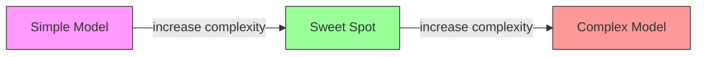
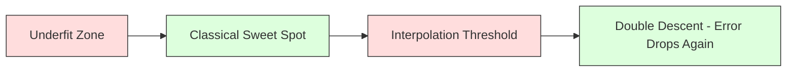
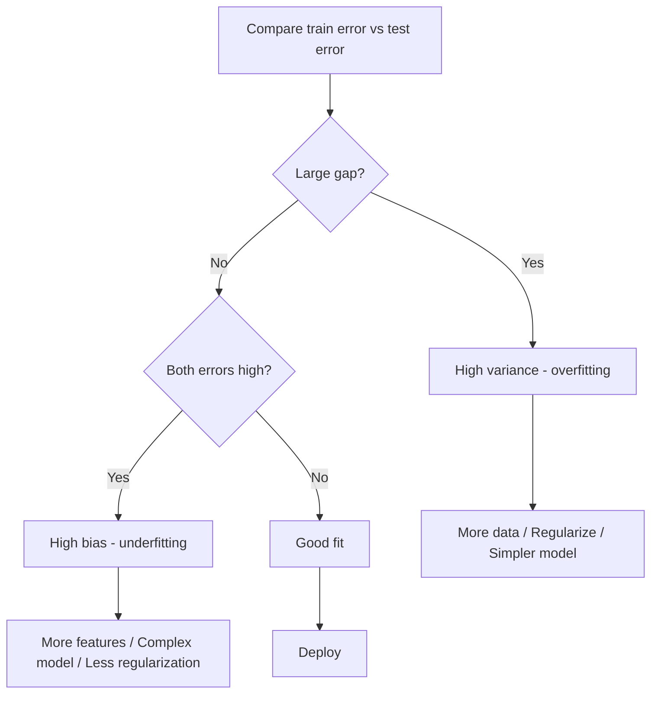
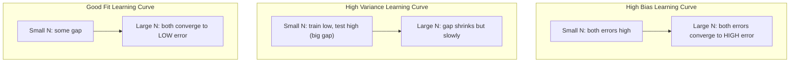
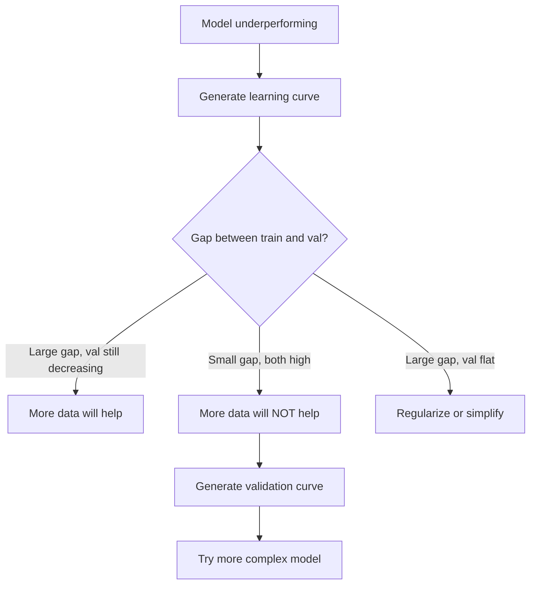

# Bias-Variance Tradeoff · 偏差-方差权衡

> 模型的每一分误差都来自三个来源之一：偏差（bias）、方差（variance）或噪声（noise）。你只能控制前两个。

> Every model error comes from one of three sources: bias, variance, or noise. You can only control the first two.

**Type:** Learn
**Language:** Python
**Prerequisites:** Phase 2, Lessons 01-09 (ML basics, regression, classification, evaluation)
**Time:** ~75 minutes

## Learning Objectives · 学习目标

- 推导期望预测误差的偏差-方差分解（bias-variance decomposition），并解释不可约噪声（irreducible noise）的角色
- 利用训练误差与测试误差的模式，诊断模型的问题是高偏差还是高方差
- 解释正则化技术（L1、L2、dropout、early stopping）如何用偏差换方差
- 实现实验，把模型复杂度逐渐增大时偏差-方差权衡的变化可视化

> Derive the bias-variance decomposition of expected prediction error and explain the role of irreducible noise
> Diagnose whether a model suffers from high bias or high variance using training and test error patterns
> Explain how regularization techniques (L1, L2, dropout, early stopping) trade bias for variance
> Implement experiments that visualize the bias-variance tradeoff across models of increasing complexity

## The Problem · 问题在哪

你训练了一个模型，它在测试数据上有一些误差。这些误差从哪来？

如果模型太简单（在弯曲的数据集上做线性回归），它会持续错过真实模式。这就是偏差（bias）。如果模型太复杂（用 15 个数据点拟合 20 次多项式），它会把训练数据拟合得完美无缺，但在新数据上给出天差地别的预测。这就是方差（variance）。

固定的模型容量下，你不可能同时把两者都压到最小：压低偏差，方差就上升；压低方差，偏差就上升。理解这个权衡是机器学习里最有用的一项诊断技能。它告诉你该把模型变复杂还是变简单、该收集更多数据还是造更好的特征、该加强还是减弱正则化。

> You trained a model. It has some error on test data. Where does that error come from?
> If your model is too simple (linear regression on a curved dataset), it will consistently miss the true pattern. That is bias. If your model is too complex (degree-20 polynomial on 15 data points), it will fit the training data perfectly but give wildly different predictions on new data. That is variance.
> You cannot minimize both at the same time for a fixed model capacity. Push bias down and variance goes up. Push variance down and bias goes up. Understanding this tradeoff is the single most useful diagnostic skill in machine learning. It tells you whether to make your model more complex or less complex, whether to get more data or engineer better features, whether to regularize more or less.

## The Concept · 概念

### Bias: Systematic Error · 偏差：系统性误差

偏差衡量模型的平均预测离真实值有多远。如果你从同一分布抽出许多不同的训练集、分别训练同一个模型、再把预测取平均，偏差就是这个平均值与真值之间的差距。

高偏差意味着模型太僵硬，抓不住真实模式。用一条直线去拟合抛物线，无论给多少数据都追不上那条曲线。这就是欠拟合（underfitting）。

```
High bias (underfitting):
  Model always predicts roughly the same wrong thing.
  Training error: HIGH
  Test error: HIGH
  Gap between them: SMALL
```

> Bias measures how far off your model's average prediction is from the true value. If you trained the same model on many different training sets drawn from the same distribution and averaged the predictions, bias is the gap between that average and the truth.
> High bias means the model is too rigid to capture the real pattern. A straight line fit to a parabola will always miss the curve, no matter how much data you give it. This is underfitting.

### Variance: Sensitivity to Training Data · 方差：对训练数据的敏感度

方差衡量换不同数据子集训练时，预测会变多少。如果训练集的微小变动会导致模型的巨大变动，方差就高。

高方差意味着模型在拟合训练数据里的噪声，而不是底层信号。20 次多项式会精确穿过每一个训练点，但在点与点之间剧烈震荡。这就是过拟合（overfitting）。

```
High variance (overfitting):
  Model fits training data perfectly but fails on new data.
  Training error: LOW
  Test error: HIGH
  Gap between them: LARGE
```

> Variance measures how much your predictions change when you train on different subsets of data. If small changes in the training set cause large changes in the model, variance is high.
> High variance means the model is fitting noise in the training data, not the underlying signal. A degree-20 polynomial will thread through every training point but oscillate wildly between them. This is overfitting.

### The Decomposition · 误差分解

对任意点 x，平方损失下的期望预测误差可以精确分解为：

```
Expected Error = Bias^2 + Variance + Irreducible Noise

where:
  Bias^2   = (E[f_hat(x)] - f(x))^2
  Variance = E[(f_hat(x) - E[f_hat(x)])^2]
  Noise    = E[(y - f(x))^2]             (sigma^2)
```

- `f(x)` 是真实函数
- `f_hat(x)` 是模型的预测
- `E[...]` 是对不同训练集取的期望
- `y` 是观测到的标签（真实函数加噪声）

噪声项不可约。在含噪数据上，任何模型都不可能做得好于 sigma^2。你的任务是在 bias^2 与 variance 之间找到正确的平衡。

> For any point x, the expected prediction error under squared loss decomposes exactly:
> The noise term is irreducible. No model can do better than sigma^2 on noisy data. Your job is to find the right balance between bias^2 and variance.

### Model Complexity vs Error · 模型复杂度 vs 误差



经典的 U 形曲线：

| 复杂度 | 偏差 | 方差 | 总误差 |
|--------|------|------|--------|
| 过低 | 高 | 低 | 高（欠拟合）|
| 恰好 | 中等 | 中等 | 最低 |
| 过高 | 低 | 高 | 高（过拟合）|

> The classic U-shaped curve:

### Regularization as Bias-Variance Control · 正则化即偏差-方差控制

正则化（regularization）故意增大偏差来换取方差下降。它约束模型，让它没法去追噪声。

- **L2（Ridge，岭回归）：** 把所有权重向零收缩。保留所有特征，但削弱它们的影响。
- **L1（Lasso，套索回归）：** 把一部分权重精确压到零。起到特征选择的作用。
- **Dropout：** 训练时随机停用神经元。迫使模型建立冗余表示。
- **Early stopping（早停）：** 在模型完全拟合训练数据之前停止训练。

正则化强度（lambda、dropout 率、epoch 数）直接控制你在偏差-方差曲线上的位置。正则化越强，偏差越大，方差越小。

> Regularization deliberately increases bias to reduce variance. It constrains the model so it cannot chase noise.
> The regularization strength (lambda, dropout rate, number of epochs) directly controls where you sit on the bias-variance curve. More regularization means more bias, less variance.

### Double Descent: The Modern Perspective · 双下降：现代视角

经典理论说：过了甜蜜点之后，复杂度再增加只会更糟。但 2019 年以来的研究发现了意料之外的现象：如果把模型容量一路增加到远超插值阈值（interpolation threshold，即模型参数多到足以完美拟合训练数据的临界点），测试误差会再次下降。



这种「双下降」（double descent）现象解释了为什么大规模过参数化（overparameterized）神经网络——参数远多于训练样本——仍然泛化良好。经典的偏差-方差权衡并没有错，只是它对现代机制的解释并不完整。

关于双下降的关键观察：
- 线性模型、决策树和神经网络中都会出现
- 在插值区域，更多数据反而可能有害（sample-wise double descent）
- 更多训练 epoch 也会引发它（epoch-wise double descent）
- 正则化能压平峰值，但无法消除它

为什么会这样？在插值阈值处，模型的容量刚好够拟合所有训练点。它被迫接受一个非常特定的、穿过每个点的解，数据的微小扰动就会让拟合结果大幅改变——方差正是在这里达到峰值。过了阈值，能完美拟合数据的解有很多个，而学习算法（比如带隐式正则化的梯度下降）倾向于从中挑选最简单的那个。正是这种对简单解的隐式偏置，让过参数化模型得以泛化。

| 区间 | 参数 vs 样本 | 行为 |
|------|-------------|------|
| 欠参数化 | p << n | 经典权衡适用 |
| 插值阈值 | p ~ n | 方差达到峰值，测试误差飙升 |
| 过参数化 | p >> n | 隐式正则化生效，测试误差下降 |

落到实用层面：如果你在用神经网络或大型树集成，不要停在插值阈值附近。要么远远低于它（配合显式正则化），要么远远超过它。最糟糕的位置就是正好卡在阈值上。

> Classical theory says: after the sweet spot, more complexity always hurts. But research since 2019 has shown something unexpected. If you keep increasing model capacity far past the interpolation threshold (where the model has enough parameters to perfectly fit training data), test error can decrease again.
> This "double descent" phenomenon explains why massively overparameterized neural networks (with far more parameters than training examples) still generalize well. The classical bias-variance tradeoff is not wrong, but it is incomplete for the modern regime.
> At the interpolation threshold, the model has just enough capacity to fit all training points. ... This is where variance peaks. ... This implicit bias toward simple solutions is why overparameterized models generalize.
> Either stay well below it (with explicit regularization) or go well past it. The worst place to be is right at the threshold.

### Diagnosing Your Model · 诊断你的模型



| 症状 | 诊断 | 解决办法 |
|------|------|----------|
| 训练误差高，测试误差高 | 偏差 | 更多特征、更复杂的模型、更弱的正则化 |
| 训练误差低，测试误差高 | 方差 | 更多数据、正则化、更简单的模型、dropout |
| 训练误差低，测试误差低 | 拟合良好 | 直接上线 |
| 训练误差在降，测试误差在升 | 正在过拟合 | 早停（early stopping）|

### Practical Strategies · 实战策略

**偏差是问题时：**
- 增加多项式特征或交互特征
- 换更灵活的模型（用树集成代替线性模型）
- 减弱正则化强度
- 训练更久（如果尚未收敛）

**方差是问题时：**
- 收集更多训练数据
- 使用 bagging（随机森林）
- 加强正则化（更大的 lambda、更多 dropout）
- 特征选择（去掉噪声特征）
- 用交叉验证及早发现它

> **When bias is the problem:** Add polynomial or interaction features ... Use a more flexible model (tree ensemble instead of linear) ... Reduce regularization strength ... Train longer (if not yet converged)
> **When variance is the problem:** Get more training data ... Use bagging (random forests) ... Increase regularization (higher lambda, more dropout) ... Feature selection (remove noisy features) ... Use cross-validation to detect it early

### Ensemble Methods and Variance Reduction · 集成方法与方差削减

集成方法（ensemble methods）是对抗方差最实用的工具。

**Bagging（Bootstrap Aggregating，自助聚合）** 在训练数据的不同 bootstrap 样本上训练多个模型，然后平均它们的预测。单个模型方差很高，但平均之后方差低得多。随机森林（random forest）就是把 bagging 用在决策树上。

数学上它为什么有效：把 N 个相互独立、方差各为 sigma^2 的预测取平均，平均值的方差是 sigma^2 / N。模型之间并非真正独立（它们看到的数据相似），所以削减达不到 1/N，但依然可观。

**Boosting** 通过串行构建模型来降低偏差：每个新模型都专注于集成到此为止犯过的错误。代表是 gradient boosting 和 AdaBoost。Boosting 加的模型太多会过拟合，所以需要早停或正则化来控制。

| 方法 | 主要作用 | 偏差变化 | 方差变化 |
|------|----------|----------|----------|
| Bagging | 降低方差 | 不变 | 下降 |
| Boosting | 降低偏差 | 下降 | 可能上升 |
| Stacking | 两者都降 | 取决于 meta-learner | 取决于基模型 |
| Dropout | 隐式 bagging | 略微上升 | 下降 |

**实用法则：** 基模型方差高（深树、高次多项式）就用 bagging；基模型偏差高（浅树桩、简单线性模型）就用 boosting。

> Ensemble methods are the most practical tool for fighting variance.
> Why it works mathematically: if you average N independent predictions, each with variance sigma^2, the variance of the average is sigma^2 / N.
> **Practical rule:** if your base model has high variance (deep trees, high-degree polynomials), use bagging. If your base model has high bias (shallow stumps, simple linear models), use boosting.

### Learning Curves · 学习曲线

学习曲线（learning curves）把训练误差和验证误差画成训练集大小的函数。它是你手头最实用的诊断工具。与单次 train/test 对比不同，学习曲线展示模型的轨迹，并告诉你更多数据到底有没有用。



怎么读：

| 场景 | 训练误差 | 验证误差 | 差距 | 含义 | 该做什么 |
|------|----------|----------|------|------|----------|
| 高偏差 | 高 | 高 | 小 | 模型抓不住模式 | 更多特征、更复杂的模型、更弱的正则化 |
| 高方差 | 低 | 高 | 大 | 模型在背训练数据 | 更多数据、正则化、更简单的模型 |
| 拟合良好 | 中等 | 中等 | 小 | 模型泛化良好 | 直接上线 |
| 高方差，仍在改善 | 低 | 随数据增多而下降 | 收窄中 | 数据能解决的方差问题 | 收集更多数据 |
| 高偏差，已走平 | 高 | 高且走平 | 小且平 | 加数据没有用 | 换模型架构 |

关键洞见：如果两条曲线都已走平、差距很小但两个误差都高，加数据没有用，你需要更好的模型。如果差距很大且仍在收窄，加数据会有用。

> Learning curves plot training and validation error as a function of training set size. They are the most practical diagnostic tool you have. Unlike a single train/test comparison, learning curves show you the trajectory of your model and tell you whether more data will help.
> The critical insight: if both curves have plateaued and the gap is small but both errors are high, more data is useless. You need a better model. If the gap is large and still shrinking, more data will help.

### How to Generate Learning Curves · 如何生成学习曲线

两种做法：

**做法一：变训练集大小，固定模型。** 固定模型和超参数，在越来越大的训练子集上训练，测量每个规模下的训练误差与验证误差。这是标准学习曲线。

**做法二：变模型复杂度，固定数据。** 固定数据，扫一个复杂度参数（多项式次数、树深、层数），测量每个复杂度下的训练误差与验证误差。这是验证曲线（validation curve），它直接展示偏差-方差权衡。

两种做法互补。第一种告诉你加数据有没有用，第二种告诉你换模型有没有用。在做下一步决定之前，两个都跑一遍。



```figure
bias-variance
```

> **Approach 1: Vary training set size, fixed model.** ... **Approach 2: Vary model complexity, fixed data.** ...
> Both approaches complement each other. The first tells you if more data will help. The second tells you if a different model will help. Run both before making decisions about your next step.

## Build It · 动手造

`code/bias_variance.py` 中的代码会运行完整的偏差-方差分解实验。下面把做法一步一步讲清楚。

> The code in `code/bias_variance.py` runs the full bias-variance decomposition experiment. Here is the approach, step by step.

### Step 1: Generate Synthetic Data from a Known Function · 从已知函数生成合成数据

我们使用 `f(x) = sin(1.5x) + 0.5x` 加高斯噪声。知道真实函数，才能算出精确的偏差和方差。

```python
def true_function(x):
    return np.sin(1.5 * x) + 0.5 * x

def generate_data(n_samples=30, noise_std=0.5, x_range=(-3, 3), seed=None):
    rng = np.random.RandomState(seed)
    x = rng.uniform(x_range[0], x_range[1], n_samples)
    y = true_function(x) + rng.normal(0, noise_std, n_samples)
    return x, y
```

> We use `f(x) = sin(1.5x) + 0.5x` with Gaussian noise. Knowing the true function lets us compute exact bias and variance.

### Step 2: Bootstrap Sampling and Polynomial Fitting · Bootstrap 采样与多项式拟合

对每个多项式次数，我们抽取许多个 bootstrap 训练集、拟合多项式，并在固定的测试网格上记录预测。这样每个测试点上都得到一个预测的分布。

```python
def fit_polynomial(x_train, y_train, degree, lam=0.0):
    X = np.column_stack([x_train ** d for d in range(degree + 1)])
    if lam > 0:
        penalty = lam * np.eye(X.shape[1])
        penalty[0, 0] = 0
        w = np.linalg.solve(X.T @ X + penalty, X.T @ y_train)
    else:
        w = np.linalg.lstsq(X, y_train, rcond=None)[0]
    return w
```

我们拟合了 200 个不同的 bootstrap 样本。每个 bootstrap 样本抽自同一个底层分布，但包含的点各不相同。

> For each polynomial degree, we draw many bootstrap training sets, fit the polynomial, and record predictions on a fixed test grid. This gives us a distribution of predictions at each test point.
> We fit on 200 different bootstrap samples. Each bootstrap sample is drawn from the same underlying distribution but contains different points.

### Step 3: Computing Bias^2, Variance Decomposition · 计算 Bias^2 与方差分解

每个测试点上有 200 组预测，就可以直接按定义计算分解：

```python
mean_pred = predictions.mean(axis=0)
bias_sq = np.mean((mean_pred - y_true) ** 2)
variance = np.mean(predictions.var(axis=0))
total_error = np.mean(np.mean((predictions - y_true) ** 2, axis=1))
```

- `mean_pred` 是从 bootstrap 样本估计出的 E[f_hat(x)]
- `bias_sq` 是平均预测与真值之间的平方差距
- `variance` 是预测在 bootstrap 样本间的平均离散程度
- `total_error` 应约等于 bias^2 + variance + noise

> With 200 sets of predictions at each test point, we can compute the decomposition directly from the definition:
> `total_error` should approximately equal bias^2 + variance + noise

### Step 4: Learning Curves · 学习曲线

学习曲线在固定模型复杂度的前提下扫训练集大小。它展示你的模型是数据受限还是容量受限。

```python
def demo_learning_curves():
    sizes = [10, 15, 20, 30, 50, 75, 100, 150, 200, 300]
    degree = 5

    for n in sizes:
        train_errors = []
        test_errors = []
        for seed in range(50):
            x_train, y_train = generate_data(n_samples=n, seed=seed * 100)
            w = fit_polynomial(x_train, y_train, degree)
            train_pred = predict_polynomial(x_train, w)
            train_mse = np.mean((train_pred - y_train) ** 2)
            test_pred = predict_polynomial(x_test, w)
            test_mse = np.mean((test_pred - y_test) ** 2)
            train_errors.append(train_mse)
            test_errors.append(test_mse)
        # Average over runs gives the learning curve point
```

高方差模型（小数据上的 5 次多项式）你会看到：
- 训练误差起步很低，随着数据变多（记忆变难）而上升
- 测试误差起步很高，随着模型获得更多信号而下降
- 差距随数据增多而收窄

高偏差模型（1 次多项式）则两条误差很快收敛到同一个高值，加数据没有帮助。

> Learning curves sweep training set size while holding model complexity fixed. They show whether your model is data-limited or capacity-limited.
> For a high-variance model (degree 5 with small data), you see: Training error starts low and increases as more data makes memorization harder ... Test error starts high and decreases as the model gets more signal ... The gap shrinks with more data
> For a high-bias model (degree 1), both errors converge quickly to the same high value and more data does not help.

### Step 5: Regularization Sweep · 正则化扫描

代码里还有 `demo_regularization_sweep()`：固定一个高次多项式（15 次），把 Ridge 正则化强度从 0.001 扫到 100。它从另一个角度展示偏差-方差权衡：不变模型复杂度，改约束强度。

```python
def demo_regularization_sweep():
    alphas = [0.001, 0.005, 0.01, 0.05, 0.1, 0.5, 1.0, 5.0, 10.0, 50.0, 100.0]
    for alpha in alphas:
        results = bias_variance_decomposition([15], lam=alpha)
        r = results[15]
        print(f"alpha={alpha:.3f}  bias={r['bias_sq']:.4f}  var={r['variance']:.4f}")
```

alpha 小时，15 次多项式几乎不受约束，方差占主导，因为模型在追每个 bootstrap 样本里的噪声。alpha 大时，惩罚强到模型实际上退化成一个近似常数函数，偏差占主导。最优 alpha 落在两个极端之间。

这和扫多项式次数时是同一条 U 形曲线，只是把离散旋钮换成了连续旋钮。实战中，正则化是控制这个权衡的首选方式：它允许细粒度控制，而且不用改动特征集。

> The code also includes `demo_regularization_sweep()`, which fixes a high-degree polynomial (degree 15) and sweeps Ridge regularization strength from 0.001 to 100. This shows the bias-variance tradeoff from a different angle: instead of varying model complexity, we vary the constraint strength.
> At low alpha, the degree-15 polynomial is nearly unconstrained. Variance dominates because the model chases noise in each bootstrap sample. At high alpha, the penalty is so strong that the model effectively becomes a near-constant function. Bias dominates. The optimal alpha sits between these extremes.
> In practice, regularization is the preferred way to control the tradeoff because it allows fine-grained control without changing the feature set.

## Use It · 实战用法

sklearn 提供 `learning_curve` 和 `validation_curve`，不用手写 bootstrap 循环就能把这些诊断自动化。

> sklearn provides `learning_curve` and `validation_curve` to automate these diagnostics without writing bootstrap loops.

### Validation Curve: Sweep Model Complexity · 验证曲线：扫模型复杂度

```python
from sklearn.model_selection import validation_curve
from sklearn.pipeline import make_pipeline
from sklearn.preprocessing import PolynomialFeatures
from sklearn.linear_model import Ridge

degrees = list(range(1, 16))
train_scores_all = []
val_scores_all = []

for d in degrees:
    pipe = make_pipeline(PolynomialFeatures(d), Ridge(alpha=0.01))
    train_scores, val_scores = validation_curve(
        pipe, X, y, param_name="polynomialfeatures__degree",
        param_range=[d], cv=5, scoring="neg_mean_squared_error"
    )
    train_scores_all.append(-train_scores.mean())
    val_scores_all.append(-val_scores.mean())
```

这条曲线直接给出偏差-方差权衡：验证分数相对训练分数最差的地方，方差占主导；两者都差的地方，偏差占主导。

> This gives you the bias-variance tradeoff curve directly. Where the validation score is worst relative to train score, variance dominates. Where both are bad, bias dominates.

### Learning Curve: Sweep Training Set Size · 学习曲线：扫训练集大小

```python
from sklearn.model_selection import learning_curve

pipe = make_pipeline(PolynomialFeatures(5), Ridge(alpha=0.01))
train_sizes, train_scores, val_scores = learning_curve(
    pipe, X, y, train_sizes=np.linspace(0.1, 1.0, 10),
    cv=5, scoring="neg_mean_squared_error"
)
train_mse = -train_scores.mean(axis=1)
val_mse = -val_scores.mean(axis=1)
```

把 `train_mse` 和 `val_mse` 对着 `train_sizes` 画出来。曲线的形状会告诉你关于模型的一切。

> Plot `train_mse` and `val_mse` against `train_sizes`. The shape tells you everything about your model.

### Cross-Validation with Regularization Sweep · 交叉验证与正则化扫描

```python
from sklearn.model_selection import cross_val_score

alphas = [0.001, 0.01, 0.1, 1.0, 10.0, 100.0]
for alpha in alphas:
    pipe = make_pipeline(PolynomialFeatures(10), Ridge(alpha=alpha))
    scores = cross_val_score(pipe, X, y, cv=5, scoring="neg_mean_squared_error")
    print(f"alpha={alpha:>7.3f}  MSE={-scores.mean():.4f} +/- {scores.std():.4f}")
```

这是在固定模型复杂度下扫正则化强度。你会看到同一条偏差-方差权衡：alpha 低是高方差，alpha 高是高偏差。

> This sweeps regularization strength for a fixed model complexity. You will see the same bias-variance tradeoff: low alpha means high variance, high alpha means high bias.

### Putting It All Together: A Complete Diagnostic Workflow · 串起来：完整的诊断流程

实战中，按顺序跑这些诊断：

1. 训练模型，计算训练误差和测试误差。
2. 两者都高：偏差问题。直接跳到第 4 步。
3. 训练低但测试高：方差问题。画学习曲线看更多数据是否有用；没用就正则化。
4. 画验证曲线，扫主复杂度参数，找到甜蜜点。
5. 在甜蜜点画学习曲线。差距仍然很大，就需要更多数据或正则化。
6. 用 `cross_val_score` 尝试不同 alpha 的 Ridge/Lasso，选交叉验证误差最低的 alpha。

对多数表格数据集，这套流程只要 10-15 分钟算力，却能省掉好几个小时的瞎猜。

> In practice, you run these diagnostics in sequence:
> This takes 10-15 minutes of compute for most tabular datasets and saves hours of guessing.

## Ship It · 交付

本课产出：`outputs/prompt-model-diagnostics.md`

> This lesson produces: `outputs/prompt-model-diagnostics.md`

## Exercises · 练习

1. 把 `noise_std=0`（无噪声）代入分解实验。不可约误差项会怎样？最优复杂度会改变吗？

2. 把训练集大小从 30 增加到 300。方差分量会受到什么影响？最优多项式次数会移动吗？

3. 给实验加上 L2 正则化（Ridge 回归）。固定一个高次多项式（15 次），把 lambda 从 0 扫到 100，画出 bias^2 和方差随 lambda 变化的曲线。

4. 把真实函数从多项式改成 `sin(x)`。偏差-方差分解会如何变化？还存在明确的最优次数吗？

5. 实现一个简单的 bootstrap 聚合（bagging）包装器：在 bootstrap 样本上训练 10 个模型并平均预测。证明它能降低方差而几乎不增加偏差。

## Key Terms · 术语表

| 术语 | 大家怎么说 | 实际含义 |
|------|-----------|----------|
| Bias（偏差）| "模型太简单" | 错误假设导致的系统性误差。平均模型预测与真值之间的差距。 |
| Variance（方差）| "模型在过拟合" | 对训练数据敏感带来的误差。换不同训练集时预测变化多大。 |
| Irreducible error（不可约误差）| "数据里的噪声" | 真实数据生成过程中的随机性带来的误差。任何模型都无法消除。 |
| Underfitting（欠拟合）| "没学够" | 模型偏差高。连训练数据上的真实模式都错过。 |
| Overfitting（过拟合）| "把数据背下来了" | 模型方差高。拟合了训练数据中无法泛化的噪声。 |
| Regularization（正则化）| "给模型加约束" | 添加惩罚项来降低模型复杂度，用偏差换更低的方差。 |
| Double descent（双下降）| "参数多了反而好" | 当模型容量远超插值阈值时，测试误差再次下降。 |
| Model complexity（模型复杂度）| "模型有多灵活" | 模型拟合任意模式的能力。由架构、特征或正则化控制。 |

## Further Reading · 延伸阅读

- [Hastie, Tibshirani, Friedman: Elements of Statistical Learning, Ch. 7](https://hastie.su.domains/ElemStatLearn/) —— 偏差-方差分解的权威论述
- [Belkin et al., Reconciling modern machine learning practice and the bias-variance trade-off (2019)](https://arxiv.org/abs/1812.11118) —— 双下降论文
- [Nakkiran et al., Deep Double Descent (2019)](https://arxiv.org/abs/1912.02292) —— epoch-wise 与 sample-wise 双下降
- [Scott Fortmann-Roe: Understanding the Bias-Variance Tradeoff](http://scott.fortmann-roe.com/docs/BiasVariance.html) —— 清晰的可视化讲解
