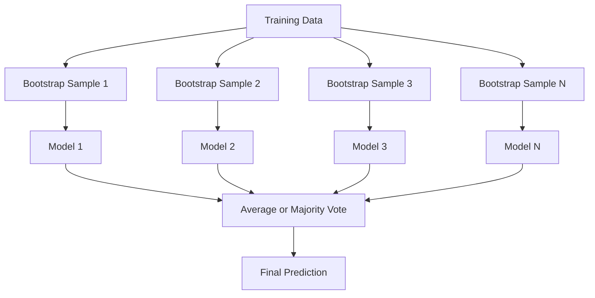
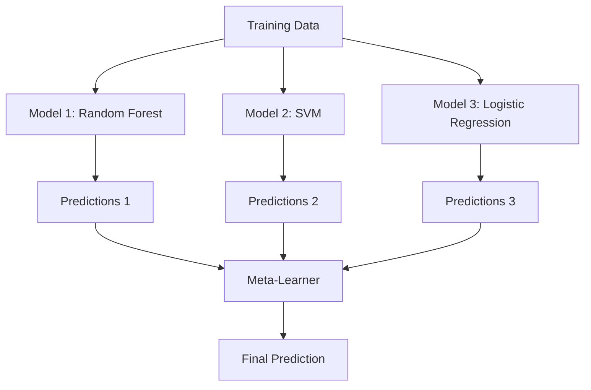

# Ensemble Methods · 集成方法

> 一群弱学习器，只要组合得当，就能变成强学习器。这不是比喻，是定理。

> A group of weak learners, combined correctly, becomes a strong learner. This is not a metaphor. It is a theorem.

**Type:** Build
**Language:** Python
**Prerequisites:** Phase 2, Lesson 10 (Bias-Variance Tradeoff)
**Time:** ~120 minutes

## Learning Objectives · 学习目标

- 从零实现 AdaBoost 和 gradient boosting，解释 boosting 如何通过串行方式降低偏差
- 搭建一个 bagging 集成，演示对去相关（decorrelated）模型取平均如何在不增加偏差的情况下降低方差
- 从各方法针对的误差分量角度比较 bagging、boosting 和 stacking
- 评估集成的多样性（diversity），解释为什么多数投票的准确率会随独立弱学习器数量提升

> Implement AdaBoost and gradient boosting from scratch and explain how boosting sequentially reduces bias
> Build a bagging ensemble and demonstrate how averaging decorrelated models reduces variance without increasing bias
> Compare bagging, boosting, and stacking in terms of what error component each method targets
> Evaluate ensemble diversity and explain why majority voting accuracy improves with more independent weak learners

## The Problem · 问题在哪

单棵决策树训练快、可解释性好，但会过拟合。单个线性模型在复杂边界上欠拟合。你可以花几天时间打磨完美的模型架构，也可以把一堆不完美的模型组合起来，得到比其中任何一个单独拿出来都好的东西。

集成方法（ensemble methods）做的正是这件事。它们是在表格数据上赢下 Kaggle 比赛最可靠的技术，驱动着大多数生产级 ML 系统，还把偏差-方差权衡演示得淋漓尽致。Bagging 降方差，boosting 降偏差，stacking 学习该在哪些输入上信任哪些模型。

> A single decision tree is fast to train and easy to interpret, but it overfits. A single linear model underfits on complex boundaries. You could spend days engineering the perfect model architecture. Or you could combine a bunch of imperfect models and get something better than any of them individually.
> Ensemble methods do exactly this. They are the most reliable technique for winning Kaggle competitions on tabular data, they power most production ML systems, and they illustrate the bias-variance tradeoff in action. Bagging reduces variance. Boosting reduces bias. Stacking learns which models to trust on which inputs.

## The Concept · 概念

### Why Ensembles Work · 集成为什么有效

假设你有 N 个相互独立的分类器，每个准确率为 p > 0.5。多数投票的准确率为：

```
P(majority correct) = sum over k > N/2 of C(N,k) * p^k * (1-p)^(N-k)
```

21 个准确率各为 60% 的分类器，多数投票的准确率约为 74%；101 个分类器时升到 84%。当模型犯的错各不相同时，误差会相互抵消。

关键要求是**多样性（diversity）**。如果所有模型都犯同样的错，组合起来毫无帮助。集成之所以有效，是因为它通过以下方式产生多样的模型：

- 不同的训练子集（bagging）
- 不同的特征子集（随机森林）
- 串行的误差纠正（boosting）
- 不同的模型家族（stacking）

> Suppose you have N independent classifiers, each with accuracy p > 0.5. The majority vote has accuracy:
> For 21 classifiers each with 60% accuracy, majority vote accuracy is about 74%. With 101 classifiers, it rises to 84%. The errors cancel out when the models make different mistakes.
> The key requirement is **diversity**. If all models make the same errors, combining them helps nothing.

### Bagging (Bootstrap Aggregating) · Bagging（自助聚合）

Bagging 通过让每个模型在不同的 bootstrap 样本上训练来制造多样性。



Bootstrap 样本是从原始数据**有放回**抽取的，大小与原数据相同。每个 bootstrap 里大约出现 63.2% 的不重复样本，剩下的 36.8%（out-of-bag 样本）免费充当验证集。

Bagging 降低方差而几乎不增加偏差。每棵树都对它自己的 bootstrap 样本过拟合，但每棵树过拟合的方式各不相同，取平均就把噪声抵消掉了。

**随机森林（Random Forests）** 是带了一个额外机关的 bagging：每次分裂只考虑一个随机的特征子集，这迫使树之间更加多样。候选特征数的典型取值：分类用 `sqrt(n_features)`，回归用 `n_features / 3`。

> Bagging creates diversity by training each model on a different bootstrap sample of the training data.
> A bootstrap sample is drawn with replacement from the original data, same size as the original. About 63.2% of unique samples appear in each bootstrap. The remaining 36.8% (out-of-bag samples) provide a free validation set.
> Bagging reduces variance without increasing bias much. Each individual tree overfits to its bootstrap sample, but the overfitting is different for each tree, so averaging cancels out the noise.
> **Random Forests** are bagging with an extra twist: at each split, only a random subset of features is considered.

### Boosting (Sequential Error Correction) · Boosting（串行误差纠正）

Boosting 串行地训练模型。每个新模型都专注于之前的模型搞错的样本。


Boosting 降低偏差。每个新模型都在纠正集成到此为止的系统性错误。最终预测是所有模型的加权和，越好的模型权重越高。

代价是：轮数跑太多时 boosting 会过拟合，因为它一直在拟合更难的样本，而其中一些可能只是噪声。

> Boosting trains models sequentially. Each new model focuses on the examples that previous models got wrong.
> Boosting reduces bias. Each new model corrects the systematic errors of the ensemble so far. The final prediction is a weighted sum of all models, where better models get higher weights.
> The tradeoff: boosting can overfit if you run too many rounds, because it keeps fitting harder examples, some of which may be noise.

### AdaBoost · AdaBoost

AdaBoost（Adaptive Boosting）是第一个实用的 boosting 算法。它可以搭配任何基学习器，典型的是决策树桩（decision stump，深度为 1 的树）。

算法如下：

```
1. Initialize sample weights: w_i = 1/N for all i

2. For t = 1 to T:
   a. Train weak learner h_t on weighted data
   b. Compute weighted error:
      err_t = sum(w_i * I(h_t(x_i) != y_i)) / sum(w_i)
   c. Compute model weight:
      alpha_t = 0.5 * ln((1 - err_t) / err_t)
   d. Update sample weights:
      w_i = w_i * exp(-alpha_t * y_i * h_t(x_i))
   e. Normalize weights to sum to 1

3. Final prediction: H(x) = sign(sum(alpha_t * h_t(x)))
```

误差越低的模型拿到越高的 alpha。被错分的样本拿到更高的权重，这样下一个模型就会聚焦在它们身上。

> AdaBoost (Adaptive Boosting) was the first practical boosting algorithm. It works with any base learner, typically decision stumps (depth-1 trees).
> Models with lower error get higher alpha. Misclassified samples get higher weights so the next model focuses on them.

### Gradient Boosting · 梯度提升

Gradient boosting 把 boosting 推广到任意损失函数。它不再重新加权样本，而是让每个新模型去拟合当前集成的残差（residuals，即损失的负梯度）。

```
1. Initialize: F_0(x) = argmin_c sum(L(y_i, c))

2. For t = 1 to T:
   a. Compute pseudo-residuals:
      r_i = -dL(y_i, F_{t-1}(x_i)) / dF_{t-1}(x_i)
   b. Fit a tree h_t to the residuals r_i
   c. Find optimal step size:
      gamma_t = argmin_gamma sum(L(y_i, F_{t-1}(x_i) + gamma * h_t(x_i)))
   d. Update:
      F_t(x) = F_{t-1}(x) + learning_rate * gamma_t * h_t(x)

3. Final prediction: F_T(x)
```

平方损失下，伪残差（pseudo-residuals）就是真实残差：`r_i = y_i - F_{t-1}(x_i)`。每棵树就是在字面意义上拟合上一个集成的误差。

学习率（shrinkage，收缩）控制每棵树贡献多少。学习率越小，需要的树越多，但泛化越好。典型取值：0.01 到 0.3。

> Gradient boosting generalizes boosting to arbitrary loss functions. Instead of reweighting samples, it fits each new model to the residuals (negative gradient of the loss) of the current ensemble.
> For squared error loss, the pseudo-residuals are just the actual residuals: `r_i = y_i - F_{t-1}(x_i)`. Each tree literally fits the errors of the previous ensemble.
> Smaller learning rates require more trees but generalize better. Typical values: 0.01 to 0.3.

### XGBoost: Why It Dominates Tabular Data · XGBoost：为什么它统治表格数据

XGBoost（eXtreme Gradient Boosting）是加了一堆工程优化的 gradient boosting，这些优化让它快、准、抗过拟合：

- **正则化目标函数：** 叶子权重上的 L1 和 L2 惩罚，防止单棵树过度自信
- **二阶近似：** 同时利用损失的一阶和二阶导数，分裂决策质量更高
- **稀疏感知分裂：** 原生处理缺失值，在每个分裂处为缺失数据学出最佳方向
- **列子采样：** 像随机森林一样，每次分裂时对特征采样以制造多样性
- **加权分位数草图（weighted quantile sketch）：** 在分布式数据上高效找出连续特征的分裂点
- **缓存友好的块结构：** 内存布局按 CPU cache line 优化

表格数据上，XGBoost（及其后继者 LightGBM）持续胜过神经网络，而且短期内不会改变。如果你的数据能摆成行和列组成的表，就从 gradient boosting 起步。

> XGBoost (eXtreme Gradient Boosting) is gradient boosting with engineering optimizations that make it fast, accurate, and resistant to overfitting:
> For tabular data, XGBoost (and its successor LightGBM) consistently outperforms neural networks. This is not changing anytime soon. If your data fits in a table with rows and columns, start with gradient boosting.

### Stacking (Meta-Learning) · Stacking（元学习）

Stacking 把多个基模型的预测当作特征，喂给一个元学习器（meta-learner）。



元学习器学习在哪些输入上信任哪个基模型。如果随机森林在某些区域更强、SVM 在另一些区域更强，元学习器会学会相应地分流。

为避免数据泄漏（data leakage），基模型的预测必须通过训练集上的交叉验证生成。绝不能在同一份数据上既训练基模型又生成元特征。

> Stacking uses the predictions of multiple base models as features for a meta-learner.
> The meta-learner learns which base model to trust for which inputs. If the random forest is better at certain regions and the SVM at others, the meta-learner will learn to route accordingly.
> To avoid data leakage, base model predictions must be generated via cross-validation on the training set. You never train base models and generate meta-features on the same data.

### Voting · 投票

最简单的集成：直接组合预测。

- **Hard voting（硬投票）：** 对类别标签做多数投票。
- **Soft voting（软投票）：** 平均预测概率，取平均概率最高的类。通常更好，因为它利用了置信度信息。

```figure
f3-ensemble-average
```

> The simplest ensemble. Just combine predictions directly.
> **Hard voting:** Majority vote on class labels. **Soft voting:** Average predicted probabilities, pick the class with highest average probability. Usually better because it uses confidence information.

## Build It · 动手造

### Step 1: Decision Stump (Base Learner) · 决策树桩（基学习器）

`code/ensembles.py` 里的代码从零实现了全部内容。我们从决策树桩开始：只有一次分裂的树。

```python
class DecisionStump:
    def __init__(self):
        self.feature_idx = None
        self.threshold = None
        self.polarity = 1
        self.alpha = None

    def fit(self, X, y, weights):
        n_samples, n_features = X.shape
        best_error = float("inf")

        for f in range(n_features):
            thresholds = np.unique(X[:, f])
            for thresh in thresholds:
                for polarity in [1, -1]:
                    pred = np.ones(n_samples)
                    pred[polarity * X[:, f] < polarity * thresh] = -1
                    error = np.sum(weights[pred != y])
                    if error < best_error:
                        best_error = error
                        self.feature_idx = f
                        self.threshold = thresh
                        self.polarity = polarity

    def predict(self, X):
        n = X.shape[0]
        pred = np.ones(n)
        idx = self.polarity * X[:, self.feature_idx] < self.polarity * self.threshold
        pred[idx] = -1
        return pred
```

> The code in `code/ensembles.py` implements everything from scratch. We start with a decision stump: a tree with a single split.

### Step 2: AdaBoost from Scratch · 从零实现 AdaBoost

```python
class AdaBoostScratch:
    def __init__(self, n_estimators=50):
        self.n_estimators = n_estimators
        self.stumps = []
        self.alphas = []

    def fit(self, X, y):
        n = X.shape[0]
        weights = np.full(n, 1 / n)

        for _ in range(self.n_estimators):
            stump = DecisionStump()
            stump.fit(X, y, weights)
            pred = stump.predict(X)

            err = np.sum(weights[pred != y])
            err = np.clip(err, 1e-10, 1 - 1e-10)

            alpha = 0.5 * np.log((1 - err) / err)
            weights *= np.exp(-alpha * y * pred)
            weights /= weights.sum()

            stump.alpha = alpha
            self.stumps.append(stump)
            self.alphas.append(alpha)

    def predict(self, X):
        total = sum(a * s.predict(X) for a, s in zip(self.alphas, self.stumps))
        return np.sign(total)
```

### Step 3: Gradient Boosting from Scratch · 从零实现 Gradient Boosting

```python
class GradientBoostingScratch:
    def __init__(self, n_estimators=100, learning_rate=0.1, max_depth=3):
        self.n_estimators = n_estimators
        self.lr = learning_rate
        self.max_depth = max_depth
        self.trees = []
        self.initial_pred = None

    def fit(self, X, y):
        self.initial_pred = np.mean(y)
        current_pred = np.full(len(y), self.initial_pred)

        for _ in range(self.n_estimators):
            residuals = y - current_pred
            tree = SimpleRegressionTree(max_depth=self.max_depth)
            tree.fit(X, residuals)
            update = tree.predict(X)
            current_pred += self.lr * update
            self.trees.append(tree)

    def predict(self, X):
        pred = np.full(X.shape[0], self.initial_pred)
        for tree in self.trees:
            pred += self.lr * tree.predict(X)
        return pred
```

### Step 4: Compare against sklearn · 与 sklearn 对比

代码会验证我们从零实现的版本能达到与 sklearn 的 `AdaBoostClassifier` 和 `GradientBoostingClassifier` 相近的准确率，并把所有方法放在一起对比。

> The code verifies that our from-scratch implementations produce similar accuracy to sklearn's `AdaBoostClassifier` and `GradientBoostingClassifier`, and compares all methods side by side.

## Use It · 实战用法

### When to Use Each Method · 各方法什么时候用

| 方法 | 降低什么 | 最适合 | 注意事项 |
|------|----------|--------|----------|
| Bagging / Random Forest | 方差 | 噪声数据、特征很多 | 对偏差没有帮助 |
| AdaBoost | 偏差 | 干净数据、简单基学习器 | 对离群点和噪声敏感 |
| Gradient Boosting | 偏差 | 表格数据、比赛 | 训练慢、不调参容易过拟合 |
| XGBoost / LightGBM | 两者 | 生产级表格 ML | 超参数很多 |
| Stacking | 两者 | 榨取最后 1-2% 的准确率 | 复杂、meta-learner 有过拟合风险 |
| Voting | 方差 | 快速组合多样的模型 | 只有模型足够多样时才有帮助 |

### The Production Stack for Tabular Data · 表格数据的生产栈

对大多数表格预测问题，按这个顺序试：

1. **LightGBM 或 XGBoost**，默认参数
2. 调 n_estimators、learning_rate、max_depth、min_child_weight
3. 需要最后 0.5% 的性能时，用 3-5 个多样的模型搭一个 stacking 集成
4. 全程使用交叉验证

尽管研究不断尝试，表格数据上的神经网络几乎总是输给 gradient boosting。TabNet、NODE 和类似架构偶尔能打平，但很少能赢过调好参的 XGBoost。

> For most tabular prediction problems, this is the order to try:
> Neural networks on tabular data are almost always worse than gradient boosting, despite continued research attempts. TabNet, NODE, and similar architectures occasionally match but rarely beat a well-tuned XGBoost.

## Ship It · 交付

本课产出 `outputs/prompt-ensemble-selector.md` —— 一个帮你为给定数据集挑对集成方法的提示词。描述你的数据（规模、特征类型、噪声水平、类别均衡）和要解决的问题，提示词会带你过一遍决策清单，推荐一个方法，给出起步超参数，并提醒该方法常见的坑。同时产出 `outputs/skill-ensemble-builder.md`，内含完整的选型指南。

> This lesson produces `outputs/prompt-ensemble-selector.md` -- a prompt that helps you pick the right ensemble method for a given dataset. Describe your data (size, feature types, noise level, class balance) and the problem you are solving. The prompt walks through a decision checklist, recommends a method, suggests starting hyperparameters, and warns about common mistakes for that method. Also produces `outputs/skill-ensemble-builder.md` with the full selection guide.

## Exercises · 练习

1. 修改 AdaBoost 实现，记录每一轮之后的训练准确率。画出准确率与估计器数量的关系曲线。它在多少轮收敛？

2. 给回归树加上随机特征子采样，从零实现一个随机森林。用 `max_features=sqrt(n_features)` 训练 100 棵树并平均预测。与单棵树比较方差削减效果。

3. 在 gradient boosting 实现中加入早停（early stopping）：每轮之后跟踪验证损失，连续 10 轮无改善就停止。它实际需要多少棵树？

4. 用三个基模型（逻辑回归、决策树、k 近邻）加一个逻辑回归元学习器，搭建一个 stacking 集成。用 5 折交叉验证生成元特征。与每个基模型单独的表现比较。

5. 用默认参数在同一个数据集上跑 XGBoost。比较它与从零实现的 gradient boosting 的准确率，并给两者计时。速度差多大？

## Key Terms · 术语表

| 术语 | 大家怎么说 | 实际含义 |
|------|-----------|----------|
| Bagging | "在随机子集上训练" | Bootstrap aggregating：在 bootstrap 样本上训练模型，平均预测以降低方差 |
| Boosting | "专注难样本" | 串行训练模型，每个新模型纠正此前集成的错误，以降低偏差 |
| AdaBoost | "重新加权数据" | 通过样本权重更新做 boosting；被错分的点在下一个学习器那里拿到更高权重 |
| Gradient boosting | "拟合残差" | 让每个新模型去拟合损失函数的负梯度，以此实现 boosting |
| XGBoost | "Kaggle 神器" | 带正则化、二阶优化和系统级提速技巧的 gradient boosting |
| Stacking | "模型上叠模型" | 把基模型的预测当作元学习器的输入特征 |
| Random forest | "很多随机化的树" | 决策树上的 bagging，每次分裂再加随机特征子采样来制造多样性 |
| Ensemble diversity | "要犯不一样的错" | 模型的误差必须互不相关，集成才能胜过单个模型 |
| Out-of-bag error | "免费验证" | 没进 bootstrap 抽样的样本（约 36.8%）充当验证集，不需要单独留出 |

## Further Reading · 延伸阅读

- [Schapire & Freund: Boosting: Foundations and Algorithms](https://mitpress.mit.edu/9780262526036/) —— AdaBoost 两位发明者写的书
- [Friedman: Greedy Function Approximation: A Gradient Boosting Machine (2001)](https://doi.org/10.1214/aos/1013203451) —— gradient boosting 原始论文
- [Chen & Guestrin: XGBoost (2016)](https://arxiv.org/abs/1603.02754) —— XGBoost 论文
- [Wolpert: Stacked Generalization (1992)](https://www.sciencedirect.com/science/article/abs/pii/S0893608005800231) —— stacking 原始论文
- [scikit-learn Ensemble Methods](https://scikit-learn.org/stable/modules/ensemble.html) —— 实用参考
