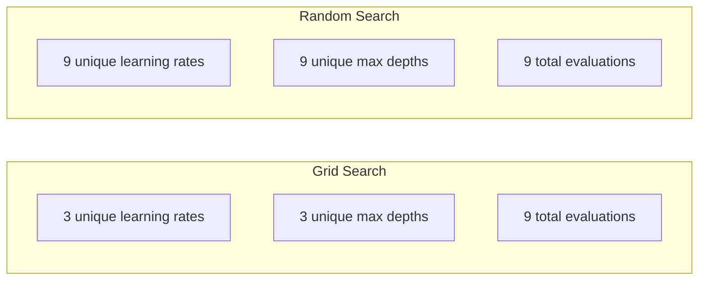
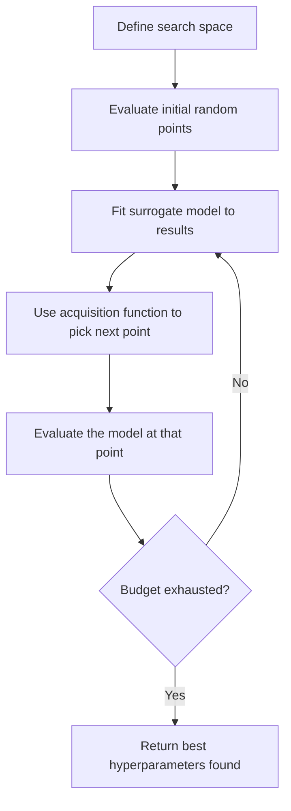
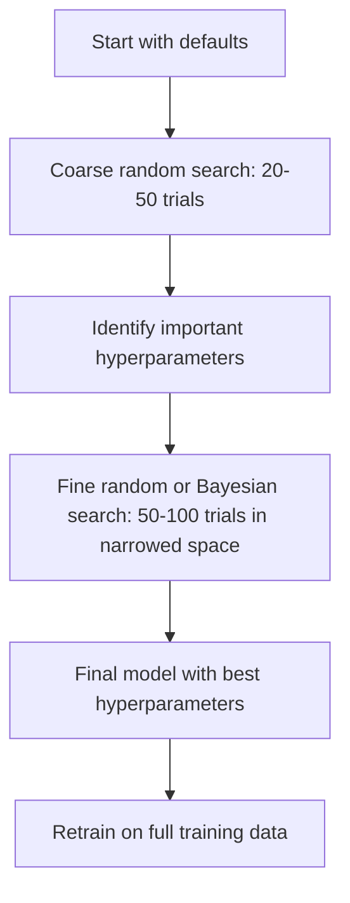
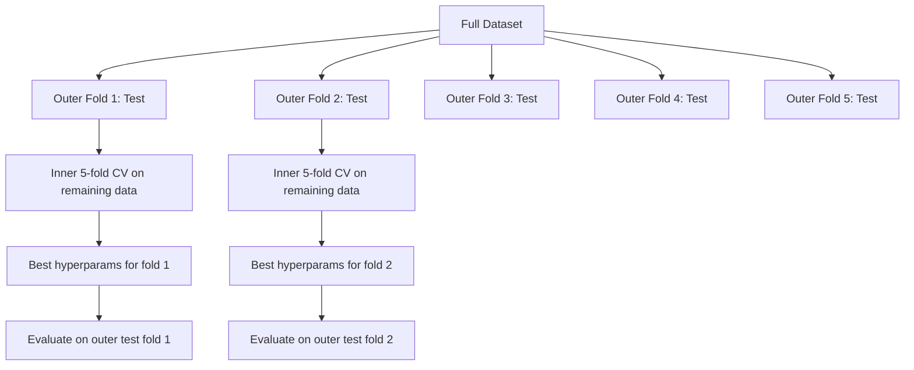

# Hyperparameter Tuning · 超参数调优

> 超参数（hyperparameter）是训练开始之前就要拧好的旋钮。拧得好不好，决定了模型是平庸还是出色。

> Hyperparameters are the knobs you turn before training starts. Turning them well is the difference between a mediocre model and a great one.

**Type:** Build
**Language:** Python
**Prerequisites:** Phase 2, Lesson 11 (Ensemble Methods)
**Time:** ~90 minutes

## Learning Objectives · 学习目标

- 从零实现网格搜索（grid search）、随机搜索（random search）和贝叶斯优化（Bayesian optimization），比较它们的样本效率
- 解释为什么当大多数超参数的有效维度很低时，随机搜索会胜过网格搜索
- 用代理模型（surrogate model）加采集函数（acquisition function）搭建一个引导搜索的贝叶斯优化循环
- 设计一套超参数调优策略，通过正规的交叉验证避免对验证集过拟合

> Implement grid search, random search, and Bayesian optimization from scratch and compare their sample efficiency
> Explain why random search outperforms grid search when most hyperparameters have low effective dimensionality
> Build a Bayesian optimization loop using a surrogate model and acquisition function to guide the search
> Design a hyperparameter tuning strategy that avoids overfitting the validation set through proper cross-validation

## The Problem · 问题在哪

你的 gradient boosting 模型有学习率、树的数量、最大深度、叶节点最小样本数、子采样比例和列采样比例——一共六个超参数。如果每个取 5 个合理值，网格就有 5^6 = 15,625 种组合。每组训练要 10 秒，全试一遍需要 43 小时的算力。

网格搜索是最直观的做法，也是大规模下最糟糕的做法。随机搜索用更少的算力做得更好。贝叶斯优化还能从历史评估中学习，做得更好。知道该用哪种策略、哪些超参数真正要紧，能省下好几天被白白浪费的 GPU 时间。

> Your gradient boosting model has a learning rate, number of trees, max depth, min samples per leaf, subsample ratio, and column sample ratio. That is six hyperparameters. If each has 5 reasonable values, the grid has 5^6 = 15,625 combinations. Training each takes 10 seconds. That is 43 hours of compute to try them all.
> Grid search is the obvious approach and the worst one at scale. Random search does better with less compute. Bayesian optimization does even better by learning from past evaluations. Knowing which strategy to use, and which hyperparameters actually matter, saves days of wasted GPU time.

## The Concept · 概念

### Parameters vs Hyperparameters · 参数 vs 超参数

参数（parameter）在训练过程中学到（权重、偏置、分裂阈值）；超参数在训练开始前设定，控制学习如何发生。

| 超参数 | 控制什么 | 典型范围 |
|--------|----------|----------|
| 学习率（learning rate）| 每次更新的步长 | 0.001 to 1.0 |
| 树的数量 / epoch 数 | 训练多久 | 10 to 10,000 |
| 最大深度（max depth）| 模型复杂度 | 1 to 30 |
| 正则化（lambda）| 过拟合防护 | 0.0001 to 100 |
| 批大小（batch size）| 梯度估计的噪声 | 16 to 512 |
| Dropout 率 | 被丢弃的神经元比例 | 0.0 to 0.5 |

> Parameters are learned during training (weights, biases, split thresholds). Hyperparameters are set before training starts and control how learning happens.

### Grid Search · 网格搜索

网格搜索评估指定值的每一种组合。它穷举且易懂，但成本随超参数数量指数增长。

```
Grid for 2 hyperparameters:

  learning_rate: [0.01, 0.1, 1.0]
  max_depth:     [3, 5, 7]

  Evaluations: 3 x 3 = 9 combinations

  (0.01, 3)  (0.01, 5)  (0.01, 7)
  (0.1,  3)  (0.1,  5)  (0.1,  7)
  (1.0,  3)  (1.0,  5)  (1.0,  7)
```

网格搜索有一个根本缺陷：如果一个超参数要紧而另一个不要紧，大多数评估都被浪费了。9 次评估里，要紧的那个参数只探到 3 个不同的取值。

> Grid search evaluates every combination of specified values. It is exhaustive and easy to understand, but scales exponentially with the number of hyperparameters.
> Grid search has a fundamental flaw: if one hyperparameter matters and the other does not, most evaluations are wasted. You get only 3 unique values of the important parameter from 9 evaluations.

### Random Search · 随机搜索

随机搜索从分布中采样超参数，而不是走网格。同样 9 次评估的预算，每个超参数能探到 9 个不同的取值。



随机为什么赢网格（Bergstra & Bengio, 2012）：

- 大多数超参数的有效维度（effective dimensionality）很低。6 个超参数里通常只有 1-2 个对给定问题真正要紧。
- 网格搜索把评估浪费在不重要的维度上。
- 同样的预算，随机搜索对重要维度覆盖得更密。
- 60 次随机试验，就有 95% 的概率找到距最优值 5% 以内的点（前提是搜索空间里存在这样的点）。

> Random search samples hyperparameters from distributions instead of a grid. With the same budget of 9 evaluations, you get 9 unique values of each hyperparameter.
> Most hyperparameters have low effective dimensionality. Only 1-2 of 6 hyperparameters usually matter for a given problem.
> Random search covers the important dimensions more densely for the same budget.
> At 60 random trials, you have a 95% chance of finding a point within 5% of the optimum (if one exists in the search space).

### Bayesian Optimization · 贝叶斯优化

随机搜索无视结果。它学不到「学习率太大会发散」或「深度 3 稳定好过深度 10」这类规律。贝叶斯优化利用过去的评估来决定下一步去哪里搜。



两个关键组件：

**代理模型（surrogate model）：** 一个评估代价很低的模型（通常是高斯过程），用来近似昂贵的目标函数。它在搜索空间的任意一点都同时给出预测值和不确定性估计。

**采集函数（acquisition function）：** 决定下一步在哪里评估，在利用（exploitation，在已知的好点附近搜）和探索（exploration，在不确定性高的地方搜）之间做权衡。常见选择：

- **Expected Improvement（EI，期望改进）：** 在这一点上，我们期望比当前最优改进多少？
- **Upper Confidence Bound（UCB，置信上界）：** 预测值加上不确定性的某个倍数。UCB 高意味着要么有戏，要么还没探过。
- **Probability of Improvement（PI，改进概率）：** 这一点胜过当前最优的概率有多大？

贝叶斯优化通常用比随机搜索少 2-5 倍的评估找到更好的超参数。拟合代理模型的开销与训练真实模型相比可以忽略不计。

> Random search ignores results. It does not learn that high learning rates cause divergence or that depth 3 consistently outperforms depth 10. Bayesian optimization uses past evaluations to decide where to search next.
> **Surrogate model:** A cheap-to-evaluate model (usually a Gaussian process) that approximates the expensive objective function. It gives both a prediction and an uncertainty estimate at any point in the search space.
> **Acquisition function:** Decides where to evaluate next by balancing exploitation (search near known good points) and exploration (search where uncertainty is high).
> Bayesian optimization typically finds better hyperparameters than random search with 2-5x fewer evaluations.

### Early Stopping · 早停

不是每次训练都要跑完。如果某个配置 10 个 epoch 之后明显很差，停掉它，继续下一个。这就是超参数搜索语境下的早停（early stopping）。

策略：
- **基于耐心（patience-based）：** 验证损失连续 N 个 epoch 无改善就停
- **中位数剪枝（median pruning）：** 试验的中间结果比同一步已完成试验的中位数还差就停
- **Hyperband：** 给大量配置分配小预算，然后逐步给其中最好的加预算

Hyperband 特别有效。它先用每配置 1 个 epoch 跑 81 个配置，留下前三分之一给 3 个 epoch，再留前三分之一，以此类推。这比所有配置都跑满预算要快 10-50 倍地找到好配置。

> Not every training run needs to finish. If a configuration is clearly bad after 10 epochs, stop it and move on. This is early stopping in the context of hyperparameter search.
> Hyperband is particularly effective. It starts 81 configurations with 1 epoch each, keeps the top third, gives them 3 epochs, keeps the top third, and so on. This finds good configurations 10-50x faster than evaluating all configs for the full budget.

### Learning Rate Schedulers · 学习率调度器

学习率几乎总是最重要的超参数。与其让它固定不变，不如让调度器（scheduler）在训练过程中调整它。

| 调度器 | 公式 | 何时用 |
|--------|------|--------|
| Step decay | 每 N 个 epoch 乘以 0.1 | 经典 CNN 训练 |
| Cosine annealing | lr * 0.5 * (1 + cos(pi * t / T)) | 现代默认 |
| Warmup + decay | 先线性升再余弦降 | Transformer |
| One-cycle | 一个周期内先升后降 | 快速收敛 |
| Reduce on plateau | 指标停滞就按因子降低 | 安全默认 |

> The learning rate is almost always the most important hyperparameter. Rather than keeping it fixed, schedulers adjust it during training.

### Hyperparameter Importance · 超参数重要性

超参数并非同等重要。对随机森林（Probst et al., 2019）和 gradient boosting 的研究显示出一致的模式：

**高重要性：**
- 学习率（永远第一个调）
- 估计器数量 / epoch 数（用早停代替调参）
- 正则化强度

**中重要性：**
- 最大深度 / 层数
- 叶节点最小样本数 / weight decay
- 子采样比例

**低重要性：**
- max features（随机森林）
- 激活函数的具体选择
- 批大小（合理范围内）

先调重要的，其余保持默认。

> Not all hyperparameters matter equally. Research on random forests (Probst et al., 2019) and gradient boosting shows consistent patterns:
> Tune the important ones first, leave the rest at defaults.

### Practical Strategy · 实战策略



具体流程：

1. **从库的默认值开始。** 它们是资深从业者选定的，往往已经走完了 80% 的路。
2. **粗粒度随机搜索。** 宽范围，20-50 次试验。用早停快速杀死差的任务。
3. **分析结果。** 哪些超参数与性能相关？收窄搜索空间。
4. **细粒度搜索。** 在收窄后的空间里做贝叶斯优化或聚焦的随机搜索，50-100 次试验。
5. **用找到的最优超参数，在全部训练数据上重训。**

> The concrete workflow:
> **Start with library defaults.** They are chosen by experienced practitioners and are often 80% of the way there.
> **Coarse random search.** Wide ranges, 20-50 trials. Use early stopping to kill bad runs fast.
> **Analyze results.** Which hyperparameters correlate with performance? Narrow the search space.
> **Fine search.** Bayesian optimization or focused random search in the narrowed space. 50-100 trials.

### Cross-Validation Integration · 与交叉验证结合

只在单个验证划分上调超参数是有风险的。最优超参数可能过拟合了那一份特定的验证折。嵌套交叉验证（nested cross-validation）用两层循环解决这个问题：

- **外层循环**（评估）：把数据分成 train+val 与 test，报告无偏的性能。
- **内层循环**（调参）：把 train+val 分成 train 与 val，寻找最优超参数。



每个外层折独立找到它自己的最优超参数。外层分数是泛化性能的无偏估计。

用 sklearn：

```python
from sklearn.model_selection import cross_val_score, GridSearchCV
from sklearn.ensemble import GradientBoostingRegressor

inner_cv = GridSearchCV(
    GradientBoostingRegressor(),
    param_grid={
        "learning_rate": [0.01, 0.05, 0.1],
        "max_depth": [2, 3, 5],
        "n_estimators": [50, 100, 200],
    },
    cv=5,
    scoring="neg_mean_squared_error",
)

outer_scores = cross_val_score(
    inner_cv, X, y, cv=5, scoring="neg_mean_squared_error"
)

print(f"Nested CV MSE: {-outer_scores.mean():.4f} +/- {outer_scores.std():.4f}")
```

这很昂贵（5 个外层折 x 5 个内层折 x 27 个网格点 = 675 次模型拟合），但它给你一个可信的性能估计。在论文里报告最终结果、或决策风险很高时用它。

> Tuning hyperparameters on a single validation split is risky. The best hyperparameters might overfit to the specific validation fold. Nested cross-validation solves this by using two loops:
> Each outer fold finds its own best hyperparameters independently. The outer scores are an unbiased estimate of generalization performance.
> This is expensive (5 outer folds x 5 inner folds x 27 grid points = 675 model fits), but it gives you a trustworthy performance estimate.

### Practical Tips · 实战提示

**从学习率开始。** 对梯度类方法，它永远是最重要的超参数。学习率不对，其他一切都无关紧要。先把其他超参数固定在默认值，单独扫学习率。

**学习率和正则化用 log-uniform 分布搜。** 0.001 与 0.01 之间的差距，和 0.1 与 1.0 之间的差距一样重要。线性搜索会把预算浪费在大数值端。

**用早停代替调 n_estimators。** 对 boosting 和神经网络，把 n_estimators 或 epoch 数设高，让早停决定何时停。这直接从搜索空间里去掉一个超参数。

**预算分配。** 把 60% 的调参预算花在最要紧的 2 个超参数上，剩下的 40% 给其他所有。前 2 个解释了大部分性能波动。

**尺度很重要。** 永远不要按 log 尺度搜批大小（16、32、64 这样就好）；永远按 log 尺度搜学习率。让搜索分布匹配超参数影响模型的方式。

| 模型类型 | 最重要的超参数 | 推荐搜索 | 预算 |
|----------|----------------|----------|------|
| Random Forest | n_estimators, max_depth, min_samples_leaf | 随机搜索，50 次试验 | 低（训练快）|
| Gradient Boosting | learning_rate, n_estimators, max_depth | 贝叶斯，100 次试验 + 早停 | 中 |
| Neural Network | learning_rate, weight_decay, batch_size | 贝叶斯或随机，100+ 次试验 | 高（训练慢）|
| SVM | C, gamma（RBF 核）| log 尺度网格，25-50 次试验 | 低（2 个参数）|
| Lasso/Ridge | alpha | log 尺度 1D 搜索，20 次试验 | 极低 |
| XGBoost | learning_rate, max_depth, subsample, colsample | 贝叶斯，100-200 次试验 + 早停 | 中 |

**拿不准时：** 用随机搜索，试验次数取超参数数量的 2 倍（比如 6 个超参数 = 至少 12 次试验）。你会惊讶于 50 次试验的随机搜索有多少次能赢过精心设计的网格搜索。

```figure
k-fold-cv
```

> **Start with the learning rate.** It is always the most important hyperparameter for gradient-based methods. A bad learning rate makes everything else irrelevant.
> **Use log-uniform distributions for learning rate and regularization.**
> **When in doubt:** random search with 2x the number of hyperparameters as trials (e.g., 6 hyperparameters = 12+ trials minimum). You will be surprised how often random search with 50 trials beats carefully designed grid search.

## Build It · 动手造

### Step 1: Grid Search from Scratch · 从零实现网格搜索

`code/tuning.py` 里的代码从零实现了网格搜索、随机搜索和一个简单的贝叶斯优化器。

```python
def grid_search(model_fn, param_grid, X_train, y_train, X_val, y_val):
    keys = list(param_grid.keys())
    values = list(param_grid.values())
    best_score = -float("inf")
    best_params = None
    n_evals = 0

    for combo in itertools.product(*values):
        params = dict(zip(keys, combo))
        model = model_fn(**params)
        model.fit(X_train, y_train)
        score = evaluate(model, X_val, y_val)
        n_evals += 1

        if score > best_score:
            best_score = score
            best_params = params

    return best_params, best_score, n_evals
```

> The code in `code/tuning.py` implements grid search, random search, and a simple Bayesian optimizer from scratch.

### Step 2: Random Search from Scratch · 从零实现随机搜索

```python
def random_search(model_fn, param_distributions, X_train, y_train,
                  X_val, y_val, n_iter=50, seed=42):
    rng = np.random.RandomState(seed)
    best_score = -float("inf")
    best_params = None

    for _ in range(n_iter):
        params = {k: sample(v, rng) for k, v in param_distributions.items()}
        model = model_fn(**params)
        model.fit(X_train, y_train)
        score = evaluate(model, X_val, y_val)

        if score > best_score:
            best_score = score
            best_params = params

    return best_params, best_score, n_iter
```

### Step 3: Bayesian Optimization (Simplified) · 贝叶斯优化（简化版）

核心思想：对已观测的（超参数，分数）对拟合一个高斯过程，再用采集函数决定下一步看哪里。

```python
class SimpleBayesianOptimizer:
    def __init__(self, search_space, n_initial=5):
        self.search_space = search_space
        self.n_initial = n_initial
        self.X_observed = []
        self.y_observed = []

    def _kernel(self, x1, x2, length_scale=1.0):
        dists = np.sum((x1[:, None, :] - x2[None, :, :]) ** 2, axis=2)
        return np.exp(-0.5 * dists / length_scale ** 2)

    def _fit_gp(self, X_new):
        X_obs = np.array(self.X_observed)
        y_obs = np.array(self.y_observed)
        y_mean = y_obs.mean()
        y_centered = y_obs - y_mean

        K = self._kernel(X_obs, X_obs) + 1e-4 * np.eye(len(X_obs))
        K_star = self._kernel(X_new, X_obs)

        L = np.linalg.cholesky(K)
        alpha = np.linalg.solve(L.T, np.linalg.solve(L, y_centered))
        mu = K_star @ alpha + y_mean

        v = np.linalg.solve(L, K_star.T)
        var = 1.0 - np.sum(v ** 2, axis=0)
        var = np.maximum(var, 1e-6)

        return mu, var

    def _expected_improvement(self, mu, var, best_y):
        sigma = np.sqrt(var)
        z = (mu - best_y) / (sigma + 1e-10)
        ei = sigma * (z * norm_cdf(z) + norm_pdf(z))
        return ei

    def suggest(self):
        if len(self.X_observed) < self.n_initial:
            return sample_random(self.search_space)

        candidates = [sample_random(self.search_space) for _ in range(500)]
        X_cand = np.array([to_vector(c) for c in candidates])
        mu, var = self._fit_gp(X_cand)
        ei = self._expected_improvement(mu, var, max(self.y_observed))
        return candidates[np.argmax(ei)]

    def observe(self, params, score):
        self.X_observed.append(to_vector(params))
        self.y_observed.append(score)
```

GP 代理模型在每个候选点给出两样东西：预测分数（mu）和不确定性（var）。Expected Improvement 权衡这两者：它偏爱模型预测高分的点 **或者** 不确定性高的点。早期大多数点的不确定性都很高，优化器于是以探索为主；后期它聚焦到最有希望的区域。

> The core idea: fit a Gaussian process to observed (hyperparameter, score) pairs, then use an acquisition function to decide where to look next.
> The GP surrogate gives two things at each candidate point: a predicted score (mu) and an uncertainty (var). Expected Improvement balances these: it favors points where the model predicts high scores OR where uncertainty is high. Early on, most points have high uncertainty so the optimizer explores. Later, it focuses on the most promising region.

### Step 4: Compare All Methods · 三种方法对比

在同一个合成目标上把三种方法都跑一遍并比较。这个对比使用一个简化的包装器，直接以目标函数调用各优化器（不训练模型），所以 API 与上面基于模型的实现不同：

```python
def synthetic_objective(params):
    lr = params["learning_rate"]
    depth = params["max_depth"]
    return -(np.log10(lr) + 2) ** 2 - (depth - 4) ** 2 + 10

param_grid = {
    "learning_rate": [0.001, 0.01, 0.1, 1.0],
    "max_depth": [2, 3, 4, 5, 6, 7, 8],
}

grid_best = None
grid_score = -float("inf")
grid_history = []
for combo in itertools.product(*param_grid.values()):
    params = dict(zip(param_grid.keys(), combo))
    score = synthetic_objective(params)
    grid_history.append((params, score))
    if score > grid_score:
        grid_score = score
        grid_best = params

param_dist = {
    "learning_rate": ("log_float", 0.001, 1.0),
    "max_depth": ("int", 2, 8),
}

rand_best = None
rand_score = -float("inf")
rand_history = []
rng = np.random.RandomState(42)
for _ in range(28):
    params = {k: sample(v, rng) for k, v in param_dist.items()}
    score = synthetic_objective(params)
    rand_history.append((params, score))
    if score > rand_score:
        rand_score = score
        rand_best = params

optimizer = SimpleBayesianOptimizer(param_dist, n_initial=5)
bayes_history = []
for _ in range(28):
    params = optimizer.suggest()
    score = synthetic_objective(params)
    optimizer.observe(params, score)
    bayes_history.append((params, score))
bayes_score = max(s for _, s in bayes_history)

print(f"{'Method':<20} {'Best Score':>12} {'Evaluations':>12}")
print("-" * 50)
print(f"{'Grid Search':<20} {grid_score:>12.4f} {len(grid_history):>12}")
print(f"{'Random Search':<20} {rand_score:>12.4f} {len(rand_history):>12}")
print(f"{'Bayesian Opt':<20} {bayes_score:>12.4f} {len(bayes_history):>12}")
```

同样的预算下，贝叶斯优化通常最快找到最好的分数，因为它不在明显差的区域浪费评估。随机搜索比网格搜索覆盖更广。网格搜索只有在你超参数很少、且负担得起穷举时才会赢。

> Run all three methods on the same synthetic objective and compare.
> With the same budget, Bayesian optimization usually finds the best score fastest because it does not waste evaluations in clearly bad regions. Random search covers more ground than grid search. Grid search only wins when you have very few hyperparameters and can afford to be exhaustive.

## Use It · 实战用法

### Optuna in Practice · Optuna 实战

Optuna 是认真做超参数调优时的推荐库。它开箱即支持剪枝、分布式搜索和可视化。

```python
import optuna

def objective(trial):
    lr = trial.suggest_float("learning_rate", 1e-4, 1e-1, log=True)
    n_est = trial.suggest_int("n_estimators", 50, 500)
    max_depth = trial.suggest_int("max_depth", 2, 10)

    model = GradientBoostingRegressor(
        learning_rate=lr,
        n_estimators=n_est,
        max_depth=max_depth,
    )
    model.fit(X_train, y_train)
    return mean_squared_error(y_val, model.predict(X_val))

study = optuna.create_study(direction="minimize")
study.optimize(objective, n_trials=100)

print(f"Best params: {study.best_params}")
print(f"Best MSE: {study.best_value:.4f}")
```

Optuna 的关键特性：
- `suggest_float(..., log=True)`：适合按 log 尺度搜索的参数（学习率、正则化）
- `suggest_int`：整数参数
- `suggest_categorical`：离散选项
- 内置 MedianPruner，用于早停差试验
- `study.trials_dataframe()`：用于分析

> Optuna is the recommended library for serious hyperparameter tuning. It supports pruning, distributed search, and visualization out of the box.

### Optuna with Pruning · Optuna 剪枝

剪枝（pruning）提前终止没希望的试验，省下大量算力。模式如下：

```python
import optuna
from sklearn.model_selection import cross_val_score

def objective(trial):
    params = {
        "learning_rate": trial.suggest_float("lr", 1e-4, 0.5, log=True),
        "max_depth": trial.suggest_int("max_depth", 2, 10),
        "n_estimators": trial.suggest_int("n_estimators", 50, 500),
        "subsample": trial.suggest_float("subsample", 0.5, 1.0),
    }

    model = GradientBoostingRegressor(**params)
    scores = cross_val_score(model, X_train, y_train, cv=3,
                             scoring="neg_mean_squared_error")
    mean_score = -scores.mean()

    trial.report(mean_score, step=0)
    if trial.should_prune():
        raise optuna.TrialPruned()

    return mean_score

pruner = optuna.pruners.MedianPruner(n_startup_trials=10, n_warmup_steps=5)
study = optuna.create_study(direction="minimize", pruner=pruner)
study.optimize(objective, n_trials=200)
```

`MedianPruner` 会在试验的中间值比同一步所有已完成试验的中位数还差时停掉它。剪枝需要调用 `trial.report()` 上报中间指标、调用 `trial.should_prune()` 检查该试验是否该停。`n_startup_trials=10` 保证剪枝启动前至少 10 个试验完整跑完。这一般能省下 40-60% 的总算力。

> Pruning stops unpromising trials early, saving massive compute. Here is the pattern:
> The `MedianPruner` stops a trial if its intermediate value is worse than the median of all completed trials at the same step. Pruning requires calling `trial.report()` to report intermediate metrics and `trial.should_prune()` to check whether the trial should be stopped. The `n_startup_trials=10` ensures at least 10 trials complete fully before pruning kicks in. This typically saves 40-60% of total compute.

### sklearn's Built-in Tuners · sklearn 内置调参器

快速实验可以用 sklearn 提供的 `GridSearchCV`、`RandomizedSearchCV` 和 `HalvingRandomSearchCV`：

```python
from sklearn.model_selection import RandomizedSearchCV
from scipy.stats import loguniform, randint

param_dist = {
    "learning_rate": loguniform(1e-4, 0.5),
    "max_depth": randint(2, 10),
    "n_estimators": randint(50, 500),
}

search = RandomizedSearchCV(
    GradientBoostingRegressor(),
    param_dist,
    n_iter=100,
    cv=5,
    scoring="neg_mean_squared_error",
    random_state=42,
    n_jobs=-1,
)
search.fit(X_train, y_train)
print(f"Best params: {search.best_params_}")
print(f"Best CV MSE: {-search.best_score_:.4f}")
```

学习率和正则化用 scipy 的 `loguniform`；整数超参数用 `randint`。`n_jobs=-1` 这个开关会在所有 CPU 核上并行。

> Use `loguniform` from scipy for learning rate and regularization. Use `randint` for integer hyperparameters. The `n_jobs=-1` flag parallelizes across all CPU cores.

### Common Mistakes in Hyperparameter Tuning · 调参常见错误

**预处理造成的数据泄漏。** 如果在交叉验证之前对整个数据集拟合 scaler，验证折的信息就泄漏进了训练。永远把预处理放进 `Pipeline`，让它只在训练折上拟合。

**对验证集过拟合。** 跑几千次试验，实际上就是在验证集上训练。最终性能估计要用嵌套交叉验证，或者留出一个调参期间绝不触碰的独立测试集。

**搜索范围太窄。** 如果最优值卡在搜索空间的边界上，说明你搜得还不够宽，最优值可能在你的范围之外。永远检查最优参数是否贴边。

**忽略交互效应。** Boosting 里学习率和估计器数量强烈交互：学习率低就需要更多估计器。分开调不如一起调。

**迭代式模型不用早停。** 对 gradient boosting 和神经网络，把 n_estimators 或 epoch 数设高，用早停。这严格优于把迭代次数当作超参数来调。

> **Data leakage through preprocessing.** If you fit a scaler on the full dataset before cross-validation, information from the validation fold leaks into training.
> **Overfitting to the validation set.** Running thousands of trials effectively trains on the validation set.
> **Searching too narrow a range.** If your best value is at the boundary of your search space, you have not searched widely enough.
> **Ignoring interaction effects.** Learning rate and number of estimators interact strongly in boosting.

## Exercises · 练习

1. 用同样的总预算（比如 50 次评估）跑网格搜索和随机搜索，比较找到的最优分数。换 10 个不同的种子重复实验。随机搜索多少次获胜？

2. 从零实现 Hyperband：81 个配置起步，每个只训 1 个 epoch。每轮保留前 1/3 并把它们的预算翻三倍。比较总算力（所有配置的所有 epoch 之和）与 81 个配置全跑满预算的开销。

3. 给第 11 课的 gradient boosting 实现加一个学习率调度器（cosine annealing）。与固定学习率相比有帮助吗？

4. 用 Optuna 在真实数据集（比如 sklearn 的乳腺癌数据集）上调 RandomForestClassifier。用 `optuna.visualization.plot_param_importances(study)` 看哪些超参数最要紧。结果与本课的重要性排序一致吗？

5. 实现一个简单的采集函数（Expected Improvement），演示探索与利用。画出代理模型的均值和不确定性，并标出 EI 下一步选择评估的位置。

## Key Terms · 术语表

| 术语 | 大家怎么说 | 实际含义 |
|------|-----------|----------|
| Hyperparameter（超参数）| "你自己选的设置" | 训练前设定的值，控制学习过程本身，不从数据中学到 |
| Grid search（网格搜索）| "每个组合都试" | 在指定参数网格上穷举搜索。成本指数级。 |
| Random search（随机搜索）| "随机采样就行" | 从分布中采样超参数。对重要维度的覆盖优于网格搜索。 |
| Bayesian optimization（贝叶斯优化）| "聪明地搜" | 用目标的代理模型决定下一步在哪里评估，在探索与利用之间权衡 |
| Surrogate model（代理模型）| "便宜的近似" | 从已观测的评估出发，近似昂贵目标函数的模型（通常是高斯过程） |
| Acquisition function（采集函数）| "下一步看哪" | 在期望改进与不确定性之间权衡，给候选点打分。EI 和 UCB 是常见选择。 |
| Early stopping（早停）| "别浪费时间" | 验证性能停止改善时提前终止训练 |
| Hyperband | "配置的淘汰赛" | 自适应资源分配：大量配置从小预算起步，留下最好的并增加其预算 |
| Learning rate scheduler（学习率调度器）| "训练中改学习率" | 在训练过程中调整学习率的函数，以获得更好的收敛 |

## Further Reading · 延伸阅读

- [Bergstra & Bengio: Random Search for Hyper-Parameter Optimization (2012)](https://jmlr.org/papers/v13/bergstra12a.html) —— 证明随机赢网格的那篇论文
- [Snoek et al., Practical Bayesian Optimization of Machine Learning Algorithms (2012)](https://arxiv.org/abs/1206.2944) —— 面向 ML 的贝叶斯优化
- [Li et al., Hyperband: A Novel Bandit-Based Approach (2018)](https://jmlr.org/papers/v18/16-558.html) —— Hyperband 论文
- [Optuna: A Next-generation Hyperparameter Optimization Framework](https://arxiv.org/abs/1907.10902) —— Optuna 论文
- [Probst et al., Tunability: Importance of Hyperparameters (2019)](https://jmlr.org/papers/v20/18-444.html) —— 哪些超参数真正要紧
