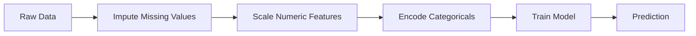
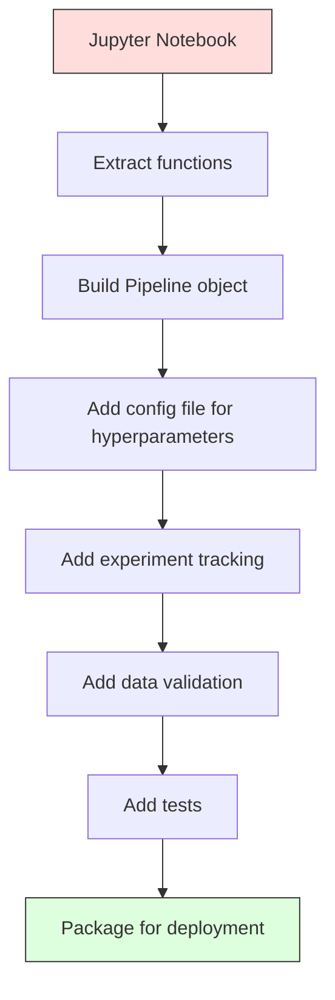

# ML Pipelines · 机器学习管道

> 模型不是产品，管道才是。管道是从原始数据到上线预测的全部链路，每一步都必须可复现。
>
> A model is not a product. A pipeline is. The pipeline is everything from raw data to deployed prediction, and every step must be reproducible.

**Type:** Build
**Language:** Python
**Prerequisites:** Phase 2, Lesson 12 (Hyperparameter Tuning)
**Time:** ~120 minutes

## Learning Objectives · 学习目标

- 从零实现一个机器学习管道（ML pipeline），把缺失值填充、缩放、编码和模型训练串成一个可复现的单一对象
- 识别数据泄漏（data leakage）场景，并解释管道如何通过只在训练数据上拟合变换器（transformer）来防止泄漏
- 构建一个 ColumnTransformer，对数值特征和类别特征分别施加不同的预处理
- 实现管道的序列化，并证明同一个已拟合的管道在训练与生产环境中产生完全一致的结果

> Build an ML pipeline from scratch that chains imputation, scaling, encoding, and model training into a single reproducible object
> Identify data leakage scenarios and explain how pipelines prevent them by fitting transformers only on training data
> Construct a ColumnTransformer that applies different preprocessing to numeric and categorical features
> Implement pipeline serialization and demonstrate that the same fitted pipeline produces identical results in training and production

## The Problem · 问题在哪

你有一个 notebook：加载数据、用中位数填缺失值、缩放特征、训练模型、打印准确率。它能跑，于是你把它交付上线。

一个月后，有人重新训练模型，结果却不一样。中位数是在包含测试数据的全量数据集上算出来的（数据泄漏）。缩放参数没有被保存，推理时用的是另一套统计量。特征工程代码在训练与服务两条路径之间靠复制粘贴，两份副本逐渐分叉。某个类别列在生产环境里出现了一个编码器从未见过的新取值。

这些都不是假设——它们正是机器学习系统在生产环境失败的最常见原因。管道把每一个变换步骤打包进一个单一的、有序的、可复现的对象，把上面所有问题一并解决。

> You have a notebook that loads data, fills missing values with the median, scales features, trains a model, and prints accuracy. It works. You ship it.
> A month later, someone retrains the model and gets different results. The median was computed on the full dataset including test data (data leakage). The scaling parameters were not saved, so inference uses different statistics. The feature engineering code was copy-pasted between training and serving, and the copies diverged. A categorical column gained a new value in production that the encoder has never seen.
> These are not hypothetical. They are the most common reasons ML systems fail in production. Pipelines solve all of them by packaging every transformation step into a single, ordered, reproducible object.

## The Concept · 概念

### What a Pipeline Is · 什么是管道

管道（pipeline）是一串有序的数据变换，后面接一个模型。每一步把上一步的输出当作自己的输入。整条管道只在训练数据上拟合一次。推理时，同一个已拟合的管道对新数据做变换并给出预测。



管道保证：
- 变换只在训练数据上拟合（无泄漏）
- 推理时施加的是同一套变换
- 整个对象可以序列化，作为一个 artifact 部署
- 交叉验证（cross-validation）按折逐折施加管道，防止隐蔽的泄漏

> A pipeline is an ordered sequence of data transformations followed by a model. Each step takes the output of the previous step as input. The entire pipeline is fitted once on training data. At inference time, the same fitted pipeline transforms new data and produces predictions.
> The pipeline guarantees: transformations are fitted only on training data (no leakage); the same transformations are applied at inference time; the entire object can be serialized and deployed as one artifact; cross-validation applies the pipeline per fold, preventing subtle leakage.

### Data Leakage: The Silent Killer · 数据泄漏：沉默的杀手

数据泄漏发生在测试集或未来数据的信息污染训练的时候。管道能防住最常见的几种形式。

**泄漏（错误）：**
```python
X = df.drop("target", axis=1)
y = df["target"]

scaler = StandardScaler()
X_scaled = scaler.fit_transform(X)

X_train, X_test = X_scaled[:800], X_scaled[800:]
y_train, y_test = y[:800], y[800:]
```

缩放器看到了测试数据：均值和标准差里混进了测试样本。这会虚高准确率估计。

**正确：**
```python
X_train, X_test = X[:800], X[800:]

scaler = StandardScaler()
X_train_scaled = scaler.fit_transform(X_train)
X_test_scaled = scaler.transform(X_test)
```

用了管道，你根本不需要操心这件事——管道会自动处理。

> Data leakage happens when information from the test set or future data contaminates training. Pipelines prevent the most common forms.
> The scaler saw test data. The mean and standard deviation include test samples. This inflates accuracy estimates.
> With a pipeline, you do not need to think about this. The pipeline handles it automatically.

### sklearn Pipeline · sklearn 管道

sklearn 的 `Pipeline` 把若干变换器和一个估计器（estimator）串起来，对外暴露 `.fit()`、`.predict()` 和 `.score()`，按顺序施加所有步骤。

```python
from sklearn.pipeline import Pipeline
from sklearn.preprocessing import StandardScaler
from sklearn.linear_model import LogisticRegression

pipe = Pipeline([
    ("scaler", StandardScaler()),
    ("model", LogisticRegression()),
])

pipe.fit(X_train, y_train)
predictions = pipe.predict(X_test)
```

当你调用 `pipe.fit(X_train, y_train)` 时：
1. 缩放器对 X_train 调用 `fit_transform`
2. 模型对缩放后的 X_train 调用 `fit`

当你调用 `pipe.predict(X_test)` 时：
1. 缩放器对 X_test 调用 `transform`（不是 fit_transform）
2. 模型对缩放后的 X_test 调用 `predict`

拟合过程中缩放器从未见过测试数据。这就是全部要点。

> sklearn's `Pipeline` chains transformers and an estimator. It exposes `.fit()`, `.predict()`, and `.score()` that apply all steps in order.
> When you call `pipe.fit(X_train, y_train)`: the scaler calls `fit_transform` on X_train, then the model calls `fit` on the scaled X_train. When you call `pipe.predict(X_test)`: the scaler calls `transform` (not fit_transform) on X_test, then the model calls `predict` on the scaled X_test.
> The scaler never sees test data during fitting. This is the whole point.

### ColumnTransformer: Different Pipelines for Different Columns · ColumnTransformer：不同列走不同管道

真实数据集同时含有数值列和类别列，需要不同的预处理。`ColumnTransformer` 就是干这个的。

```python
from sklearn.compose import ColumnTransformer
from sklearn.preprocessing import StandardScaler, OneHotEncoder
from sklearn.impute import SimpleImputer

numeric_pipe = Pipeline([
    ("impute", SimpleImputer(strategy="median")),
    ("scale", StandardScaler()),
])

categorical_pipe = Pipeline([
    ("impute", SimpleImputer(strategy="most_frequent")),
    ("encode", OneHotEncoder(handle_unknown="ignore")),
])

preprocessor = ColumnTransformer([
    ("num", numeric_pipe, ["age", "income", "score"]),
    ("cat", categorical_pipe, ["city", "gender", "plan"]),
])

full_pipeline = Pipeline([
    ("preprocess", preprocessor),
    ("model", GradientBoostingClassifier()),
])
```

OneHotEncoder 里的 `handle_unknown="ignore"` 对生产环境至关重要：出现新类别（一个模型从没见过的城市）时，它产出全零向量而不是直接崩溃。

> Real datasets have numeric and categorical columns that need different preprocessing. `ColumnTransformer` handles this.
> The `handle_unknown="ignore"` in OneHotEncoder is critical for production. When a new category appears (a city the model has never seen), it produces a zero vector instead of crashing.

### Experiment Tracking · 实验跟踪

管道让训练可复现，但你还需要跨实验记录发生过什么：用了哪些超参数、哪个版本的数据集、指标是多少、跑的是哪份代码。

**MLflow** 是最常见的开源方案：

```python
import mlflow

with mlflow.start_run():
    mlflow.log_param("max_depth", 5)
    mlflow.log_param("n_estimators", 100)
    mlflow.log_param("learning_rate", 0.1)

    pipe.fit(X_train, y_train)
    accuracy = pipe.score(X_test, y_test)

    mlflow.log_metric("accuracy", accuracy)
    mlflow.sklearn.log_model(pipe, "model")
```

每次运行都会记录参数、指标、artifact 和完整模型。你可以对比各次运行、复现任何一个实验、部署任何一个版本的模型。

**Weights & Biases（wandb）** 用托管仪表盘提供同样的功能：

```python
import wandb

wandb.init(project="my-pipeline")
wandb.config.update({"max_depth": 5, "n_estimators": 100})

pipe.fit(X_train, y_train)
accuracy = pipe.score(X_test, y_test)

wandb.log({"accuracy": accuracy})
```

> A pipeline makes training reproducible, but you also need to track what happened across experiments: which hyperparameters were used, which dataset version, what the metrics were, which code was running.
> **MLflow** is the most common open-source solution. Every run is recorded with parameters, metrics, artifacts, and the full model. You can compare runs, reproduce any experiment, and deploy any model version.
> **Weights & Biases (wandb)** provides the same functionality with a hosted dashboard.

### Model Versioning · 模型版本管理

做完实验跟踪，你还要管理模型版本：生产上跑的是哪个模型？staging 上是哪个？上周用的又是哪个？

MLflow 的 Model Registry 提供：
- **版本跟踪：** 每个保存的模型都有一个版本号
- **阶段流转：** "Staging"、"Production"、"Archived"
- **审批流程：** 模型必须被显式晋升到 production
- **回滚：** 立即切回上一个版本

> After experiment tracking, you need to manage model versions. Which model is in production? Which is staging? Which was last week's?
> MLflow's Model Registry provides: **Version tracking:** every saved model gets a version number. **Stage transitions:** "Staging", "Production", "Archived". **Approval workflow:** models must be explicitly promoted to production. **Rollback:** switch back to a previous version instantly.

### Data Versioning with DVC · 用 DVC 做数据版本管理

代码用 git 管版本。数据也应该管版本，但 git 处理不了大文件。DVC（Data Version Control）解决这个问题。

```
dvc init
dvc add data/training.csv
git add data/training.csv.dvc data/.gitignore
git commit -m "Track training data"
dvc push
```

DVC 把实际数据存进远端存储（S3、GCS、Azure），只在 git 里保留一个记录哈希的小 `.dvc` 文件。当你 checkout 某个 git commit 时，`dvc checkout` 会把当时用的那份数据原样恢复出来。

这意味着每个 git commit 同时钉住了代码和数据。完全可复现。

> Code is versioned with git. Data should be versioned too, but git cannot handle large files. DVC (Data Version Control) solves this.
> DVC stores the actual data in remote storage (S3, GCS, Azure) and keeps a small `.dvc` file in git that records the hash. When you checkout a git commit, `dvc checkout` restores the exact data that was used.
> This means every git commit pins both the code and the data. Full reproducibility.

### Reproducible Experiments · 可复现的实验

一个可复现的实验需要四样东西：

1. **固定随机种子：** 给 numpy、random 和框架（torch、sklearn）设置种子
2. **锁定依赖：** requirements.txt 或 poetry.lock，精确到版本
3. **数据有版本：** DVC 或同类工具
4. **配置文件：** 所有超参数放进配置，不要硬编码

```python
import numpy as np
import random

def set_seed(seed=42):
    random.seed(seed)
    np.random.seed(seed)
    try:
        import torch
        torch.manual_seed(seed)
        torch.cuda.manual_seed_all(seed)
        torch.backends.cudnn.deterministic = True
    except ImportError:
        pass
```

> A reproducible experiment requires four things:
> 1. **Fixed random seeds:** Set seeds for numpy, random, and the framework (torch, sklearn)
> 2. **Pinned dependencies:** requirements.txt or poetry.lock with exact versions
> 3. **Versioned data:** DVC or similar
> 4. **Config files:** All hyperparameters in a config, not hardcoded

### From Notebook to Production Pipeline · 从 Notebook 到生产管道



典型的演进路径：

1. **Notebook 探索：** 快速实验、可视化、特征灵感
2. **抽取函数：** 把预处理、特征工程、评估挪进模块
3. **构建 Pipeline：** 把变换串成 sklearn Pipeline 或自定义类
4. **配置管理：** 把所有超参数挪进 YAML/JSON 配置
5. **实验跟踪：** 接入 MLflow 或 wandb 日志
6. **数据验证：** 训练前检查 schema、分布和缺失值模式
7. **测试：** 变换器做单元测试，完整管道做集成测试
8. **部署：** 序列化管道，包一层 API（FastAPI、Flask），再容器化

> 1. **Notebook exploration:** Quick experiments, visualizations, feature ideas ... 4. **Config management:** Move all hyperparameters into a YAML/JSON config ... 8. **Deployment:** Serialize the pipeline, wrap in an API (FastAPI, Flask), containerize

### Common Pipeline Mistakes · 常见管道错误

| 错误 | 为什么糟糕 | 怎么修 |
|------|-----------|-------|
| 切分之前在全量数据上拟合 | 数据泄漏 | 用 Pipeline 配合 cross_val_score |
| 特征工程在管道之外进行 | 训练与服务时的变换不一致 | 把所有变换放进 Pipeline |
| 不处理未知类别 | 新取值让生产环境崩溃 | OneHotEncoder(handle_unknown="ignore") |
| 硬编码列名 | schema 一变就坏 | 从配置读取列名列表 |
| 没有数据验证 | 坏数据悄悄产生错误预测 | 预测前加 schema 检查 |
| 训练/服务偏斜（training/serving skew） | 生产中模型看到的特征不同 | 训练与服务共用同一个 Pipeline 对象 |

```figure
f3-pipeline-flow
```

> Fitting on full data before splitting | Data leakage | Use Pipeline with cross_val_score
> Training/serving skew | Model sees different features in prod | One Pipeline object for both

## Build It · 动手造

`code/pipeline.py` 中的代码从零搭起一条完整的 ML 管道：

> The code in `code/pipeline.py` builds a complete ML pipeline from scratch:

### Step 1: Custom Transformer · 第 1 步：自定义变换器

```python
class CustomTransformer:
    def __init__(self):
        self.means = None
        self.stds = None

    def fit(self, X):
        self.means = np.mean(X, axis=0)
        self.stds = np.std(X, axis=0)
        self.stds[self.stds == 0] = 1.0
        return self

    def transform(self, X):
        return (X - self.means) / self.stds

    def fit_transform(self, X):
        return self.fit(X).transform(X)
```

### Step 2: Pipeline from Scratch · 第 2 步：从零实现管道

```python
class PipelineFromScratch:
    def __init__(self, steps):
        self.steps = steps

    def fit(self, X, y=None):
        X_current = X.copy()
        for name, step in self.steps[:-1]:
            X_current = step.fit_transform(X_current)
        name, model = self.steps[-1]
        model.fit(X_current, y)
        return self

    def predict(self, X):
        X_current = X.copy()
        for name, step in self.steps[:-1]:
            X_current = step.transform(X_current)
        name, model = self.steps[-1]
        return model.predict(X_current)
```

### Step 3: Cross-Validation with Pipeline · 第 3 步：用管道做交叉验证

这部分代码演示「管道 + 交叉验证」如何防止数据泄漏：缩放器在每一折各自的训练数据上单独拟合。

> The code demonstrates how cross-validation with a pipeline prevents data leakage: the scaler is fit separately on each fold's training data.

### Step 4: Full Production Pipeline with sklearn · 第 4 步：sklearn 完整生产管道

一条完整的管道：`ColumnTransformer` 加多条预处理路径加一个模型，用规范的交叉验证训练，并记录实验日志。

> A complete pipeline with `ColumnTransformer`, multiple preprocessing paths, and a model, trained with proper cross-validation and experiment logging.

## Ship It · 交付

本课产出：
- `outputs/prompt-ml-pipeline.md` —— 一个用于构建和调试 ML 管道的技能（skill）
- `code/pipeline.py` —— 一条从零实现、一路贯通到 sklearn 的完整管道

> This lesson produces:
> - `outputs/prompt-ml-pipeline.md` -- a skill for building and debugging ML pipelines
> - `code/pipeline.py` -- a complete pipeline from scratch through sklearn

## Exercises · 练习

1. 搭一条能处理「3 个数值列 + 2 个类别列」数据集的管道。用 `ColumnTransformer` 对数值列施加中位数填充 + 缩放，对类别列施加最频值填充 + 独热编码（one-hot encoding）。用 5 折交叉验证训练。

2. 故意制造数据泄漏：切分之前先在全量数据集上拟合缩放器。对比泄漏版的交叉验证分数和干净管道版的交叉验证分数。差距有多大？

3. 用 `joblib.dump` 序列化你的管道，在另一个脚本里加载并跑预测。验证预测结果完全一致。

4. 给管道加一个自定义变换器，为最重要的两个数值列构造二次多项式特征（degree 2）。它应该放在管道里的什么位置？

5. 给管道接上 MLflow 跟踪。用不同超参数跑 5 次实验。用 MLflow UI（`mlflow ui`）对比各次运行，挑出最好的模型。

> Build a pipeline that handles a dataset with 3 numeric columns and 2 categorical columns. Use `ColumnTransformer` to apply median imputation + scaling to numerics and most-frequent imputation + one-hot encoding to categoricals. Train with 5-fold cross-validation.
> ...
> Deliberately introduce data leakage: fit the scaler on the full dataset before splitting. Compare the cross-validation score (leaky) to the pipeline cross-validation score (clean). How large is the difference?

## Key Terms · 术语表

| 术语 | 人们常说 | 实际含义 |
|------|---------|---------|
| Pipeline | "一串变换 + 模型" | 一串有序的已拟合变换器加一个模型，作为整体施加以防泄漏 |
| Data leakage | "测试集信息漏进了训练" | 用训练集之外的信息构建模型，虚高性能估计 |
| ColumnTransformer | "不同列不同预处理" | 对不同的列子集施加不同的管道，再合并结果 |
| Experiment tracking | "把每次运行记录下来" | 为每次训练运行记录参数、指标、artifact 和代码版本 |
| MLflow | "跟踪并部署模型" | 覆盖实验跟踪、模型注册（model registry）与部署的开源平台 |
| DVC | "数据的 git" | 面向大型数据文件的版本控制系统：git 存哈希，远端存储存数据 |
| Model registry | "模型版本目录" | 用阶段标签（staging、production、archived）跟踪模型版本的系统 |
| Training/serving skew | "notebook 里明明是好的" | 训练与推理时数据处理方式的差异，导致无声的错误 |
| Reproducibility | "同样的代码，同样的结果" | 从相同的代码、数据与配置得到完全一致结果的能力 |

> Pipeline | "Chain of transforms + model" | An ordered sequence of fitted transformers and a model, applied as one unit to prevent leakage
> Training/serving skew | "It worked in the notebook" | Differences between how data is processed during training versus inference, causing silent errors

## Further Reading · 延伸阅读

- [scikit-learn Pipeline docs](https://scikit-learn.org/stable/modules/compose.html) —— 官方 pipeline 参考文档
- [MLflow documentation](https://mlflow.org/docs/latest/index.html) —— 实验跟踪与模型注册
- [DVC documentation](https://dvc.org/doc) —— 数据版本管理
- [Sculley et al., Hidden Technical Debt in Machine Learning Systems (2015)](https://papers.nips.cc/paper/2015/hash/86df7dcfd896fcaf2674f757a2463eba-Abstract.html) —— 论 ML 系统复杂性的奠基论文
- [Google ML Best Practices: Rules of ML](https://developers.google.com/machine-learning/guides/rules-of-ml) —— 实用的生产级 ML 建议
