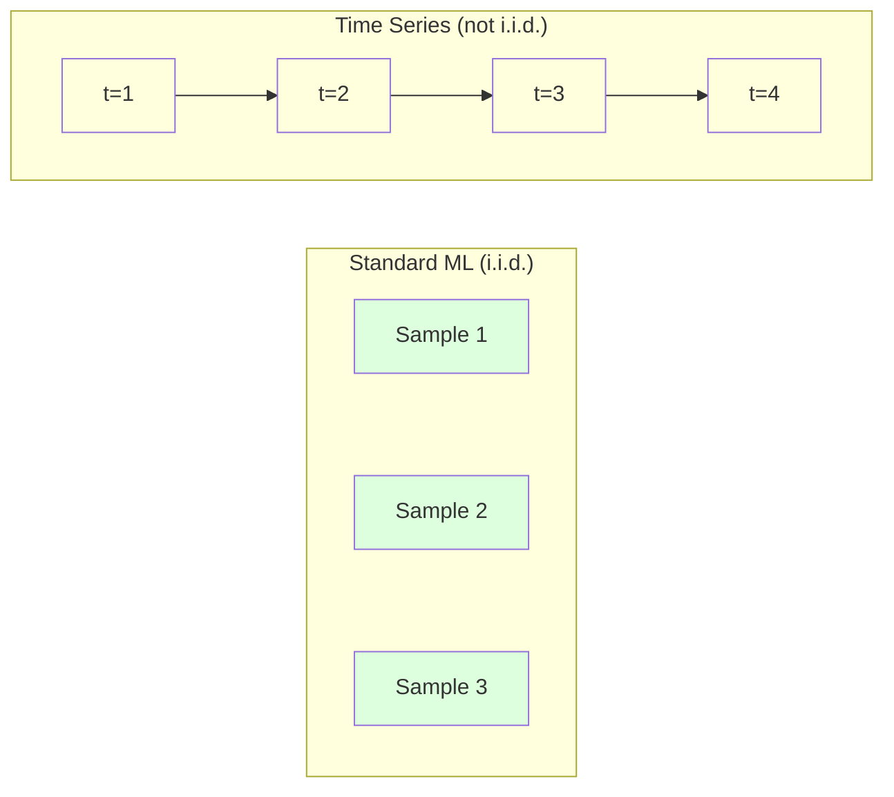
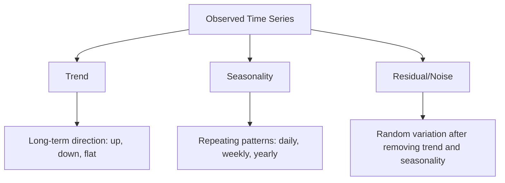
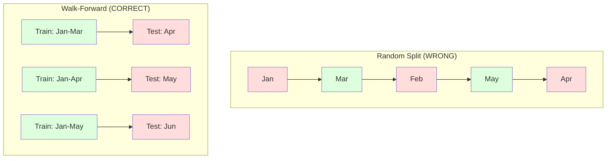

# Time Series Fundamentals · 时间序列基础

> 过往表现确实能预测未来结果——前提是你先检验了平稳性。
>
> Past performance does predict future results -- if you check for stationarity first.

**Type:** Build
**Language:** Python
**Prerequisites:** Phase 2, Lessons 01-09
**Time:** ~90 minutes

## Learning Objectives · 学习目标

- 把时间序列（time series）分解为趋势（trend）、季节性（seasonality）和残差（residual）成分，并检验平稳性（stationarity）
- 实现滞后特征（lag features）和滚动统计量（rolling statistics），把时间序列转化为监督学习问题
- 构建走前验证（walk-forward validation）框架，防止未来数据泄漏进训练
- 解释为什么随机 train/test 切分对时间序列无效，并展示它与规范时间切分之间的性能差距

> Decompose a time series into trend, seasonality, and residual components and test for stationarity
> Implement lag features and rolling statistics to convert a time series into a supervised learning problem
> Build a walk-forward validation framework that prevents future data from leaking into training
> Explain why random train/test splits are invalid for time series and demonstrate the performance gap versus proper temporal splits

## The Problem · 问题在哪

你手里是按时间排序的数据：每日销售额、每小时气温、每分钟 CPU 使用率、每周股价。你想预测下一个值、下一周、下一个季度。

你伸手去拿标准 ML 工具箱：随机 train/test 切分、交叉验证、特征矩阵进、预测出。每一步都是错的。

时间序列打破了标准 ML 所依赖的假设。样本不独立——今天的气温取决于昨天。随机切分把未来信息泄漏进过去。回测里表现出色的特征，上了生产就失灵，因为它们依赖会随时间漂移的模式。

一个用随机交叉验证能得到 95% 准确率的模型，换成规范的时间评估可能只剩 55%。这个差别不是技术细节——它是「纸上能跑的模型」和「生产能用的模型」之间的差别。

本课讲基本功：时间数据特殊在哪、如何诚实地评估模型、以及如何把时间序列变成标准 ML 模型能消化的特征。

> You have data ordered by time. Daily sales, hourly temperature, per-minute CPU usage, weekly stock prices. You want to predict the next value, the next week, the next quarter.
> You reach for your standard ML toolkit: random train/test split, cross-validation, feature matrix in, prediction out. Every step is wrong.
> Time series breaks the assumptions that standard ML relies on. Samples are not independent -- today's temperature depends on yesterday's. Random splits leak future information into the past. Features that look great in backtest fail in production because they rely on patterns that shift over time.
> A model that gets 95% accuracy with random cross-validation might get 55% with proper time-based evaluation. The difference is not a technicality. It is the difference between a model that works on paper and one that works in production.
> This lesson covers the fundamentals: what makes time data different, how to evaluate models honestly, and how to turn a time series into features that standard ML models can consume.

## The Concept · 概念

### What Makes Time Series Different · 时间序列特殊在哪

标准 ML 假设 i.i.d.——独立同分布（independent and identically distributed）：每个样本从同一个分布中独立抽取。时间序列两条都违反：

- **不独立。** 今天的股价取决于昨天。这周的销量与上周相关。
- **不同分布。** 分布随时间漂移。十二月的销量和三月长得不一样。

这些违反不是小事。它们改变你构建特征的方式、评估模型的方式，以及哪些算法可用。



标准 ML 里样本可以互换，打乱顺序毫无影响。时间序列里顺序就是一切，打乱即毁掉信号。

> Standard ML assumes i.i.d. -- independent and identically distributed. Each sample is drawn from the same distribution, independently of other samples. Time series violates both:
> - **Not independent.** Today's stock price depends on yesterday's. This week's sales correlate with last week's.
> - **Not identically distributed.** The distribution shifts over time. Sales in December look different from sales in March.
> These violations are not minor. They change how you build features, how you evaluate models, and which algorithms work.
> In standard ML, samples are interchangeable. Shuffling them changes nothing. In time series, order is everything. Shuffling destroys the signal.

### Components of a Time Series · 时间序列的组成

每条时间序列都是下面几者的叠加：



- **趋势（Trend）**：长期方向。收入每年增长 10%。全球气温上升。
- **季节性（Seasonality）**：固定间隔的重复模式。零售在十二月冲高。空调使用在七月见顶。
- **残差（Residual）**：去掉趋势和季节性之后剩下的东西。如果残差看起来像白噪声，说明分解抓住了信号。

> Every time series is a combination of:
> - **Trend**: The long-term direction. Revenue growing 10% per year. Global temperature rising.
> - **Seasonality**: Repeating patterns at fixed intervals. Retail sales spike in December. Air conditioning usage peaks in July.
> - **Residual**: Whatever is left after removing trend and seasonality. If the residual looks like white noise, the decomposition captured the signal.

### Stationarity · 平稳性

如果一条时间序列的统计性质（均值、方差、自相关）不随时间改变，它就是平稳的（stationary）。大多数预测方法都假设平稳性。

**为什么重要：** 非平稳序列的均值在漂移。用一月数据训练的模型学到的是另一个均值，到二月它会系统性出错。

**怎么检查：** 在窗口上计算滚动均值和滚动标准差。如果它们漂移，序列非平稳。

**怎么修：** 差分（differencing）。不建模原始值，改建模相邻值之间的变化：

```
diff[t] = value[t] - value[t-1]
```

如果一轮差分还不够平稳，再来一轮（二阶差分）。大多数真实序列最多两轮就够。

**例子：**

原始序列:  [100, 102, 106, 112, 120]
一阶差分:  [2, 4, 6, 8]（仍在上升）
二阶差分:  [2, 2, 2]（恒定——平稳）

原始序列有二次趋势。一阶差分把它变成线性趋势，二阶差分把它变平。实践中很少需要超过两轮。

**正式检验：** 增广迪基-福勒检验（Augmented Dickey-Fuller，ADF）是平稳性的标准统计检验，原假设是「序列非平稳」。p 值低于 0.05 即可拒绝原假设、认定平稳。我们不从零实现 ADF（它需要渐近分布表），但代码里的滚动统计量方法提供了一个实用的可视化检查。

> A time series is stationary if its statistical properties (mean, variance, autocorrelation) do not change over time. Most forecasting methods assume stationarity.
> **Why it matters:** A non-stationary series has a mean that drifts. A model trained on data from January has learned a different mean than what February will show. It will be systematically wrong.
> **How to check:** Compute rolling mean and rolling standard deviation over windows. If they drift, the series is non-stationary.
> **How to fix:** Differencing. Instead of modeling the raw values, model the change between consecutive values. If one round of differencing does not make the series stationary, apply it again (second-order differencing). Most real-world series need at most two rounds.
> The original series had a quadratic trend. First differencing turned it into a linear trend. Second differencing made it flat. In practice, you rarely need more than two rounds.
> **Formal test:** The Augmented Dickey-Fuller (ADF) test is the standard statistical test for stationarity. The null hypothesis is "the series is non-stationary." A p-value below 0.05 means you can reject the null and conclude stationarity.

### Autocorrelation · 自相关

自相关（autocorrelation）衡量 t 时刻的值与 t-k 时刻（k 步之前）的值有多相关。自相关函数（ACF）把每个滞后 k 上的相关性画出来。

**ACF 能告诉你：**
- 序列的记忆有多远。如果 ACF 在滞后 5 之后降到零，5 步以前的值就不相干了。
- 存不存在季节性。如果月度数据的 ACF 在滞后 12 处冲高，就有一年一度的季节性。
- 该构造多少个滞后特征。用到 ACF 变得可忽略为止的滞后。

**PACF（偏自相关函数）** 剔除间接相关。如果今天与 3 天前相关只是因为两者都与昨天相关，那么滞后 3 的 PACF 为零，而 ACF 不为零。

> Autocorrelation measures how much a value at time t correlates with the value at time t-k (k steps in the past). The autocorrelation function (ACF) plots this correlation for each lag k.
> **ACF tells you:** How far back the series remembers. If ACF drops to zero after lag 5, values more than 5 steps ago are irrelevant. Whether seasonality exists. If ACF spikes at lag 12 (monthly data), there is yearly seasonality. How many lag features to create. Use lags up to where ACF becomes negligible.
> **PACF (Partial Autocorrelation Function)** removes indirect correlations. If today correlates with 3 days ago only because both correlate with yesterday, PACF at lag 3 will be zero while ACF at lag 3 will not.

### Lag Features: Turning Time Series into Supervised Learning · 滞后特征：把时间序列变成监督学习

标准 ML 模型需要特征矩阵 X 和目标 y。时间序列只给你一列值。中间的桥就是滞后特征（lag features）。

取序列 [10, 12, 14, 13, 15]，构造 lag-1 和 lag-2 特征：

| lag_2 | lag_1 | target |
|-------|-------|--------|
| 10    | 12    | 14     |
| 12    | 14    | 13     |
| 14    | 13    | 15     |

现在你手里是一个标准的回归问题。任何 ML 模型（线性回归、随机森林、梯度提升）都能从滞后值预测目标。

还能工程化出更多特征：
- **滚动统计量：** 最近 k 个值上的均值、标准差、最小、最大
- **日历特征：** 星期几、月份、is_holiday、is_weekend
- **差分值：** 相对上一步的变化
- **扩展统计量：** 累计均值、累计和
- **比值特征：** 当前值 / 滚动均值（离近期平均有多远）
- **交互特征：** lag_1 * day_of_week（星期几对动量的影响）

**要多少个滞后？** 看自相关函数。ACF 显著到滞后 10，就至少用 10 个滞后。有周季节性，就带上 lag 7（可能再加 14）。滞后越多，模型看到的历史越多，但特征也越多，过拟合风险随之上升。

**目标对齐陷阱。** 构造滞后特征时，目标必须是 t 时刻的值，所有特征只能用 t-1 或更早的值。不小心把 t 时刻的值当成了特征，你就得到了一个完美预测器——以及一个完全没用的模型。这是时间序列特征工程里最常见的 bug。

> Standard ML models need a feature matrix X and a target y. Time series gives you a single column of values. The bridge is lag features.
> Take the series [10, 12, 14, 13, 15] and create lag-1 and lag-2 features.
> Now you have a standard regression problem. Any ML model (linear regression, random forest, gradient boosting) can predict the target from the lags.
> **How many lags?** Use the autocorrelation function. If ACF is significant up to lag 10, use at least 10 lags. If there is weekly seasonality, include lag 7 (and possibly 14). More lags give the model more history but also more features to fit, increasing the risk of overfitting.
> **The target alignment trap.** When creating lag features, the target must be the value at time t, and all features must use values at time t-1 or earlier. If you accidentally include the value at time t as a feature, you have a perfect predictor -- and a completely useless model. This is the most common bug in time series feature engineering.

### Walk-Forward Validation · 走前验证

这是本课最重要的概念。标准 k 折交叉验证随机把样本分进训练集和测试集。对时间序列，这会泄漏未来信息。



走前验证（walk-forward validation）：
1. 用截至 t 时刻的数据训练
2. 在 t+1 时刻预测（多步则为 t+1 到 t+k）
3. 窗口向前滑动
4. 重复

每个测试折只包含晚于全部训练数据的数据。没有未来泄漏。这给你一个诚实的估计：模型部署后会表现如何。

**扩展窗口（expanding window）** 用全部历史数据训练（窗口越滚越大）。**滑动窗口（sliding window）** 用固定大小的训练窗口（窗口向前滑）。相信旧数据仍然相关就用扩展窗口；世界在变、旧数据有害就用滑动窗口。

> This is the most important concept in this lesson. Standard k-fold cross-validation randomly assigns samples to train and test. For time series, this leaks future information.
> Walk-forward validation: 1. Train on data up to time t. 2. Predict at time t+1 (or t+1 to t+k for multi-step). 3. Slide the window forward. 4. Repeat.
> Each test fold only contains data that comes after all training data. No future leakage. This gives you an honest estimate of how the model will perform when deployed.
> **Expanding window** uses all historical data for training (window grows). **Sliding window** uses a fixed-size training window (window slides). Use expanding when you believe older data is still relevant. Use sliding when the world changes and old data hurts.

### ARIMA Intuition · ARIMA 直觉

ARIMA 是经典时间序列模型，由三个部件组成：

- **AR（自回归）：** 用过去的值预测。AR(p) 用最近 p 个值。
- **I（差分整合）：** 差分以获得平稳性。I(d) 做 d 轮差分。
- **MA（移动平均）：** 用过去的预测误差预测。MA(q) 用最近 q 个误差。

ARIMA(p, d, q) 把三者合在一起。p、d、q 依据 ACF/PACF 分析或自动搜索（auto-ARIMA）来选。

我们不会从零实现 ARIMA——它需要的数值优化超出本课范围。关键洞察是理解每个部件做什么，这样你才能解读 ARIMA 的结果、知道什么时候用它。

> ARIMA is the classical time series model. It has three components:
> - **AR (Autoregressive):** Predict from past values. AR(p) uses the last p values.
> - **I (Integrated):** Differencing to achieve stationarity. I(d) applies d rounds of differencing.
> - **MA (Moving Average):** Predict from past forecast errors. MA(q) uses the last q errors.
> ARIMA(p, d, q) combines all three. You choose p, d, q based on ACF/PACF analysis or automated search (auto-ARIMA).
> We will not implement ARIMA from scratch ... The key insight is understanding what each component does so you can interpret ARIMA results and know when to use it.

### When to Use What · 何时用什么

| 方法 | 最适合 | 处理季节性 | 处理外部特征 |
|------|--------|-----------|-------------|
| 滞后特征 + ML | 带大量外部特征的表格数据 | 靠日历特征 | 支持 |
| ARIMA | 单条单变量序列、短期预测 | SARIMA 变体 | 不支持（有限支持用 ARIMAX） |
| 指数平滑 | 简单趋势 + 季节性 | 支持（Holt-Winters） | 不支持 |
| Prophet | 业务预测、节假日 | 支持（Fourier 项） | 有限 |
| 神经网络（LSTM、Transformer） | 长序列、多条序列 | 学习得到 | 支持 |

对大多数实际问题，「滞后特征 + 梯度提升」是最强的起点：它天然支持外部特征、不要求平稳性、而且容易调试。

> Lag features + ML | Tabular with many external features | With calendar features | Yes
> ARIMA | Single univariate series, short-term | SARIMA variant | No (ARIMAX for limited)
> For most practical problems, lag features + gradient boosting is the strongest starting point. It handles external features naturally, does not require stationarity, and is easy to debug.

### Forecasting Horizons and Strategies · 预测步长与策略

单步预测往前预测一个时间步。多步预测往前预测多步。共有三种策略：

**递归式（recursive / iterated）：** 先预测一步，把预测值当作下一步的输入。简单，但误差会累积——每次预测都用上一次的预测，错误会复利式放大。

**直接式（direct）：** 为每个步长单独训练一个模型。Model-1 预测 t+1，Model-5 预测 t+5。没有误差累积，但每个模型的训练样本更少，而且模型之间不共享信息。

**多输出（multi-output）：** 训练一个同时输出所有步长的模型。跨步长共享信息，但要求模型支持多输出（或自定义损失函数）。

对大多数实际问题：短步长（1-5 步）先用递归，更长的步长用直接。

> Single-step forecasting predicts one time step ahead. Multi-step forecasting predicts multiple steps. There are three strategies:
> **Recursive (iterated):** Predict one step ahead, use the prediction as input for the next step. Simple but errors accumulate -- each prediction uses the previous prediction, so mistakes compound.
> **Direct:** Train a separate model for each horizon. Model-1 predicts t+1, Model-5 predicts t+5. No error accumulation, but each model has fewer training samples and they do not share information.
> **Multi-output:** Train one model that outputs all horizons simultaneously. Shares information across horizons but requires a model that supports multiple outputs (or a custom loss function).
> For most practical problems, start with recursive for short horizons (1-5 steps) and direct for longer horizons.

### Common Mistakes in Time Series · 时间序列常见错误

| 错误 | 为什么会发生 | 怎么修 |
|------|-------------|--------|
| 随机 train/test 切分 | 标准 ML 养成的习惯 | 用走前验证或按时间切分 |
| 用到未来特征 | t 时刻的特征被误加进来 | 审计每个特征的时间对齐 |
| 对季节性过拟合 | 模型背下了日历模式 | 测试集里留出完整的季节周期 |
| 忽略量级变化 | 收入翻倍但模式没变 | 建模百分比变化而非绝对值 |
| 滞后特征太多 | 「历史越多越好」 | 用 ACF 确定相关滞后 |
| 不做差分 | 「模型自己会想明白」 | 树模型能吃下趋势；线性模型需要平稳性 |

```figure
f3-series-decompose
```

> Random train/test split | Habit from standard ML | Use walk-forward or temporal split
> Using future features | Feature at time t included by mistake | Audit every feature for temporal alignment

## Build It · 动手造

`code/time_series.py` 从零实现核心构件。

> The code in `code/time_series.py` implements the core building blocks from scratch.

### Lag Feature Creator · 滞后特征构造器

```python
def make_lag_features(series, n_lags):
    n = len(series)
    X = np.full((n, n_lags), np.nan)
    for lag in range(1, n_lags + 1):
        X[lag:, lag - 1] = series[:-lag]
    valid = ~np.isnan(X).any(axis=1)
    return X[valid], series[valid]
```

它把一维序列变成特征矩阵：每行以最近 `n_lags` 个值为特征，以当前值为目标。

> This converts a 1D series into a feature matrix where each row has the last `n_lags` values as features, and the current value as the target.

### Walk-Forward Cross-Validation · 走前交叉验证

```python
def walk_forward_split(n_samples, n_splits=5, min_train=50):
    assert min_train < n_samples, "min_train must be less than n_samples"
    step = max(1, (n_samples - min_train) // n_splits)
    for i in range(n_splits):
        train_end = min_train + i * step
        test_end = min(train_end + step, n_samples)
        if train_end >= n_samples:
            break
        yield slice(0, train_end), slice(train_end, test_end)
```

每个切分保证训练数据严格早于测试数据。训练窗口随折数扩大。

> Each split ensures training data comes strictly before test data. The training window expands with each fold.

### Simple Autoregressive Model · 简单自回归模型

纯 AR 模型就是滞后特征上的线性回归：

```python
class SimpleAR:
    def __init__(self, n_lags=5):
        self.n_lags = n_lags
        self.weights = None
        self.bias = None

    def fit(self, series):
        X, y = make_lag_features(series, self.n_lags)
        # Solve via normal equations
        X_b = np.column_stack([np.ones(len(X)), X])
        theta = np.linalg.lstsq(X_b, y, rcond=None)[0]
        self.bias = theta[0]
        self.weights = theta[1:]
        return self
```

概念上它和第 02 课的线性回归一模一样，只不过用在了同一变量带时间滞后的版本上。

> A pure AR model is just linear regression on lag features.
> This is conceptually identical to linear regression from Lesson 02, but applied to time-lagged versions of the same variable.

### Stationarity Check · 平稳性检查

代码计算滚动统计量，从视觉和数值两个角度评估平稳性：

```python
def check_stationarity(series, window=50):
    rolling_mean = np.array([
        series[max(0, i - window):i].mean()
        for i in range(1, len(series) + 1)
    ])
    rolling_std = np.array([
        series[max(0, i - window):i].std()
        for i in range(1, len(series) + 1)
    ])
    return rolling_mean, rolling_std
```

滚动均值漂移或滚动标准差变化，就说明序列非平稳。做差分，再查一遍。

代码还通过比较序列的前半段和后半段来检查平稳性：如果均值差超过半个标准差，或方差比超过 2 倍，序列就被标记为非平稳。

> The code computes rolling statistics to visually and numerically assess stationarity.
> If the rolling mean drifts or the rolling std changes, the series is non-stationary. Apply differencing and check again.
> The code also checks stationarity by comparing the first half and second half of the series. If the means differ by more than half a standard deviation or the variance ratio exceeds 2x, the series is flagged as non-stationary.

### Autocorrelation · 自相关

```python
def autocorrelation(series, max_lag=20):
    n = len(series)
    mean = series.mean()
    var = series.var()
    acf = np.zeros(max_lag + 1)
    for k in range(max_lag + 1):
        cov = np.mean((series[:n-k] - mean) * (series[k:] - mean))
        acf[k] = cov / var if var > 0 else 0
    return acf
```

## Use It · 实战用法

用 sklearn 时，滞后特征可以直接配任何回归器：

```python
from sklearn.linear_model import Ridge
from sklearn.ensemble import GradientBoostingRegressor

X, y = make_lag_features(series, n_lags=10)

for train_idx, test_idx in walk_forward_split(len(X)):
    model = Ridge(alpha=1.0)
    model.fit(X[train_idx], y[train_idx])
    predictions = model.predict(X[test_idx])
```

ARIMA 用 statsmodels：

```python
from statsmodels.tsa.arima.model import ARIMA

model = ARIMA(train_series, order=(5, 1, 2))
fitted = model.fit()
forecast = fitted.forecast(steps=30)
```

`time_series.py` 中的代码两种方法都演示，并用走前验证对它们做比较。

> With sklearn, you use lag features directly with any regressor.
> For ARIMA, use statsmodels.
> The code in `time_series.py` demonstrates both approaches and compares them using walk-forward validation.

### sklearn TimeSeriesSplit

sklearn 提供了实现走前验证的 `TimeSeriesSplit`：

```python
from sklearn.model_selection import TimeSeriesSplit

tscv = TimeSeriesSplit(n_splits=5)
for train_index, test_index in tscv.split(X):
    X_train, X_test = X[train_index], X[test_index]
    y_train, y_test = y[train_index], y[test_index]
    model.fit(X_train, y_train)
    score = model.score(X_test, y_test)
```

它等价于我们从零写的 `walk_forward_split`，只是接进了 sklearn 的交叉验证框架。可以配合 `cross_val_score` 使用：

```python
from sklearn.model_selection import cross_val_score

scores = cross_val_score(model, X, y, cv=TimeSeriesSplit(n_splits=5))
print(f"Mean score: {scores.mean():.4f} +/- {scores.std():.4f}")
```

> sklearn provides `TimeSeriesSplit` which implements walk-forward validation.
> This is equivalent to our from-scratch `walk_forward_split` but integrated into sklearn's cross-validation framework. You can use it with `cross_val_score`.

### Evaluation Metrics · 评估指标

时间序列预测使用回归指标，但要带着时间上下文来解读：

- **MAE（平均绝对误差）：** |y_true - y_pred| 的平均。用原始单位、容易解释。「预测平均偏差 3.2 度。」
- **RMSE（均方根误差）：** 均方误差开根号。比 MAE 更重罚大误差。大错误比许多小错误更糟时用它。
- **MAPE（平均绝对百分比误差）：** |error / true_value| * 100 的平均。与量纲无关，适合跨序列比较。但真实值为零时无定义。
- **朴素基线对比：** 永远要和简单基线比。季节朴素基线直接用上一个周期（昨天、上周）的值当预测。你的模型赢不了朴素基线，就一定有问题。

> Time series forecasting uses regression metrics, but with time-aware context:
> - **MAE (Mean Absolute Error):** Average of |y_true - y_pred|. Easy to interpret in original units. "On average, predictions are off by 3.2 degrees."
> - **RMSE (Root Mean Squared Error):** Square root of mean squared error. Penalizes large errors more than MAE. Use when big errors are worse than many small errors.
> - **MAPE (Mean Absolute Percentage Error):** Average of |error / true_value| * 100. Scale-independent, useful for comparing across different series. But undefined when true values are zero.
> - **Naive baseline comparison:** Always compare against simple baselines. The seasonal naive baseline predicts the value from one period ago (yesterday, last week). If your model cannot beat naive, something is wrong.

### Rolling Features · 滚动特征

代码演示在滞后特征之上加滚动统计量（7 天和 14 天窗口的均值、标准差、最小、最大）。它们向模型提供近期趋势和波动性信息，这是单靠滞后特征捕捉不到的。

比如滚动均值在上升，暗示上行趋势；滚动标准差在增大，暗示波动加剧。这类模式树模型能学，线性模型学不了。

> The code demonstrates adding rolling statistics (mean, std, min, max over windows of 7 and 14 days) to lag features. These give the model information about recent trends and volatility that lag features alone do not capture.
> For example, if the rolling mean is rising, it suggests an upward trend. If the rolling std is increasing, it suggests growing volatility. These are the kinds of patterns that tree-based models can learn from but linear models cannot.

## Ship It · 交付

本课产出：
- `outputs/prompt-time-series-advisor.md` —— 一个帮你框定时间序列问题的提示词（prompt）
- `code/time_series.py` —— 滞后特征、走前验证、AR 模型、平稳性检查

> This lesson produces:
> - `outputs/prompt-time-series-advisor.md` -- a prompt for framing time series problems
> - `code/time_series.py` -- lag features, walk-forward validation, AR model, stationarity checks

### Baselines You Must Beat · 必须打败的基线

建模之前，先立基线：

1. **上一个值（持续性，persistence）。** 预测明天等于今天。对很多序列来说，这个基线出奇地难打败。
2. **季节朴素。** 预测今天等于上周（或去年）同一天。赢不了它，说明模型除了季节性之外什么有用模式都没学到。
3. **移动平均。** 预测最近 k 个值的平均。能平滑噪声，抓不住突变。

如果你的花哨 ML 模型输给了季节朴素基线，那你有个 bug。最常见的是：特征里泄漏了未来、评估方法不对，或者这条序列真的是随机的、不可预测的。

> Before building any model, establish baselines:
> 1. **Last value (persistence).** Predict that tomorrow will be the same as today. For many series, this is surprisingly hard to beat.
> 2. **Seasonal naive.** Predict that today will be the same as the same day last week (or last year). If your model cannot beat this, it has not learned any useful pattern beyond seasonality.
> 3. **Moving average.** Predict the average of the last k values. Smooths noise but cannot capture sudden changes.
> If your fancy ML model loses to the seasonal naive baseline, you have a bug. Most commonly: future leakage in features, wrong evaluation method, or the series is truly random and unpredictable.

### Practical Tips · 实战建议

1. **先画图。** 任何建模之前，先把原始序列画出来。看趋势、季节性、离群点、结构突变（行为的突然改变）。30 秒的目视往往胜过一小时的自动分析。

2. **先差分，后建模。** 序列有明显趋势，就先差分再造滞后特征。树模型能吃下趋势，线性模型不能，而且差分从不坏事。

3. **至少留出一个完整的季节周期。** 有周季节性，测试集就要至少一整周；月季节性就至少一整月。否则你无法评估模型有没有抓住季节模式。

4. **在生产中持续监控。** 世界在变，时间序列模型会随时间退化。按滚动方式跟踪预测误差；误差开始上升，就用近期数据重新训练。

5. **小心机制切换（regime change）。** 用疫情前数据训练的模型预测不了疫情后的行为。把已知机制切换的指标加进特征，或使用会遗忘旧数据的滑动窗口。

6. **对偏斜序列做对数变换。** 收入、价格、计数常常右偏。取对数能稳定方差、把乘性模式变成加性模式——线性模型就能处理了。在对数空间里预测，再指数化回原单位。

> 1. **Start with plotting.** Before any modeling, plot the raw series. Look for trends, seasonality, outliers, structural breaks (sudden changes in behavior). A 30-second visual inspection often tells you more than an hour of automated analysis.
> ...
> 4. **Monitor in production.** Time series models degrade over time as the world changes. Track prediction errors on a rolling basis. When errors start increasing, retrain the model on recent data.
> ...
> 6. **Log-transform skewed series.** Revenue, prices, and counts are often right-skewed. Taking the log stabilizes variance and makes multiplicative patterns additive, which linear models can handle. Forecast in log space, then exponentiate to get back to original units.

## Exercises · 练习

1. **平稳性实验。** 生成一条带线性趋势的序列，用滚动统计量检查平稳性，做一阶差分，再查一遍。二次趋势需要差分几轮？

2. **滞后选择。** 在一条季节性序列（period=7）上计算 ACF。哪些滞后的自相关最高？只用这些滞后（不用连续滞后）构造滞后特征。与使用 lag 1 到 7 相比准确率提高了吗？

3. **走前切分 vs 随机切分。** 在滞后特征上训练 Ridge 回归，分别用随机 80/20 切分和走前验证评估。随机切分高估了多少性能？

4. **特征工程。** 在滞后特征之外加滚动均值（window=7）、滚动标准差（window=7）和星期几特征。用走前验证对比加与不加这些特征的准确率。

5. **多步预测。** 把 AR 模型改成一次预测 5 步而不是 1 步。比较两种策略：(a) 递归——预测一步，把预测当作下一步的输入；(b) 直接——为每个步长训练单独的模型。哪个更准？

> **Walk-forward vs random split.** Train a Ridge regression on lag features. Evaluate with random 80/20 split and with walk-forward validation. How much does the random split overestimate performance?
> ...
> **Multi-step forecasting.** Modify the AR model to predict 5 steps ahead instead of 1. Compare two strategies: (a) predict one step, use the prediction as input for the next step (recursive), and (b) train separate models for each horizon (direct). Which is more accurate?

## Key Terms · 术语表

| 术语 | 人们常说 | 实际含义 |
|------|---------|---------|
| Stationarity | "统计性质不随时间改变" | 均值、方差和自相关结构随时间保持恒定的序列 |
| Differencing | "相邻值相减" | 计算 y[t] - y[t-1]，以去除趋势、获得平稳性 |
| Autocorrelation (ACF) | "序列和自己的相关性" | 时间序列与其滞后副本之间的相关，是滞后阶数的函数 |
| Partial autocorrelation (PACF) | "只看直接相关" | 剔除所有更短滞后影响之后，滞后 k 处的自相关 |
| Lag features | "把过去的值当输入" | 用 y[t-1], y[t-2], ..., y[t-k] 作为特征来预测 y[t] |
| Walk-forward validation | "尊重时间的交叉验证" | 训练数据在时间上始终早于测试数据的评估方式 |
| ARIMA | "经典时间序列模型" | AutoRegressive Integrated Moving Average：结合过去值（AR）、差分（I）和过去误差（MA） |
| Seasonality | "日历驱动的重复模式" | 时间序列中与日历周期（日、周、年）绑定的规律可预测循环 |
| Trend | "长期方向" | 序列水平随时间的持续上升或下降 |
| Expanding window | "用全部历史" | 训练集随折数增长的走前验证 |
| Sliding window | "固定大小的历史" | 训练集是固定长度窗口并向前滑动的走前验证 |

> Stationarity | "The stats don't change over time" | A series whose mean, variance, and autocorrelation structure are constant over time
> Walk-forward validation | "Time-respecting cross-validation" | Evaluation where training data always precedes test data chronologically
> ARIMA | "The classic time series model" | AutoRegressive Integrated Moving Average: combines past values (AR), differencing (I), and past errors (MA)

## Further Reading · 延伸阅读

- [Hyndman and Athanasopoulos, Forecasting: Principles and Practice (3rd ed.)](https://otexts.com/fpp3/) —— 时间序列预测最好的免费教材
- [scikit-learn Time Series Split](https://scikit-learn.org/stable/modules/generated/sklearn.model_selection.TimeSeriesSplit.html) —— sklearn 的走前切分器
- [statsmodels ARIMA docs](https://www.statsmodels.org/stable/generated/statsmodels.tsa.arima.model.ARIMA.html) —— 带诊断的 ARIMA 实现
- [Makridakis et al., The M5 Competition (2022)](https://www.sciencedirect.com/science/article/pii/S0169207021001874) —— 大规模预测竞赛：ML 方法 vs 统计方法
