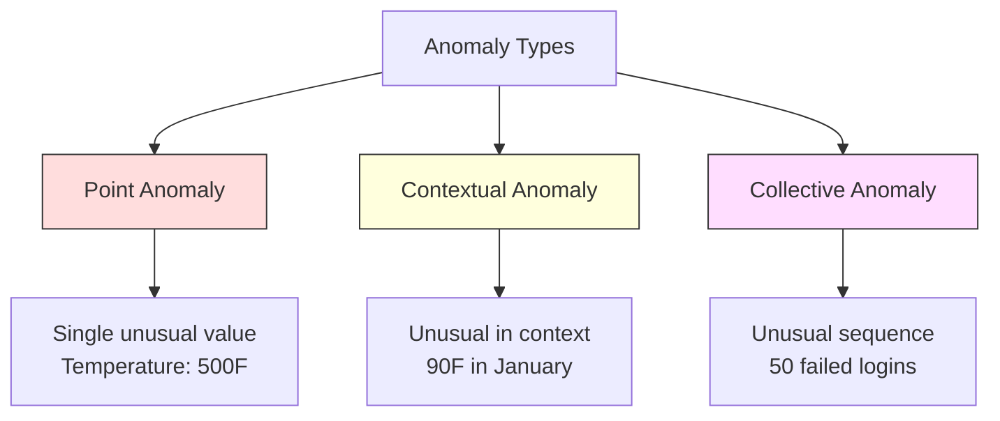
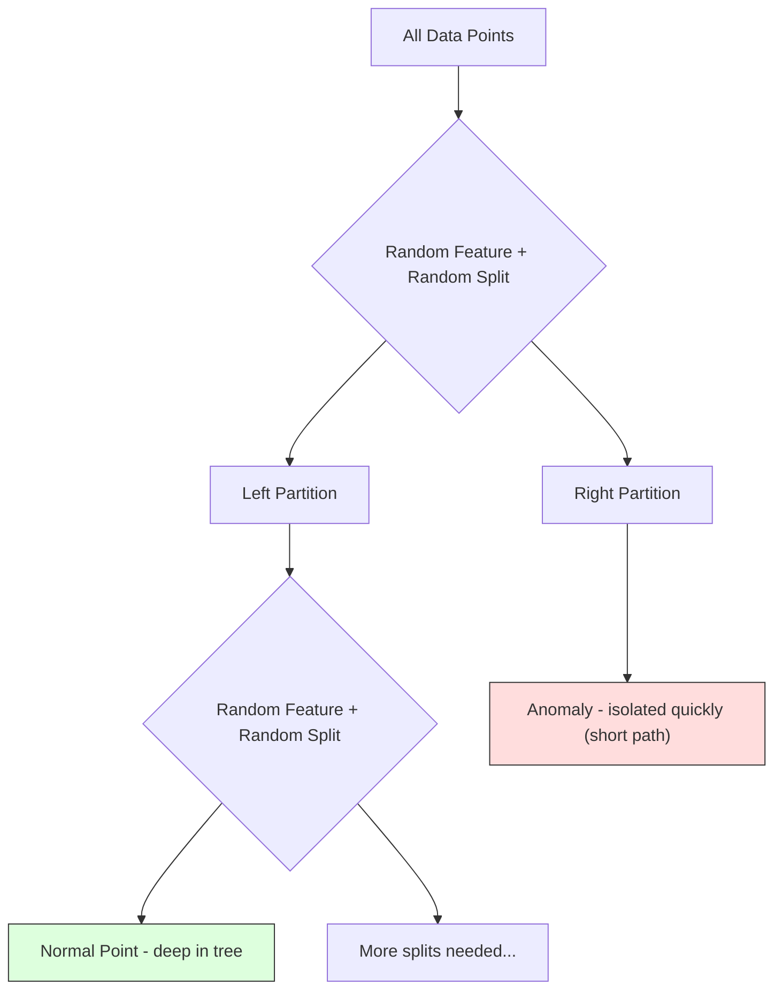
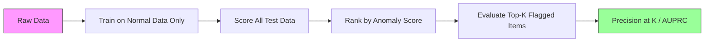

# Anomaly Detection · 异常检测（学会「正常」，才能认出异类）

> Normal is easy to define. Abnormal is whatever doesn't fit.

**Type:** Build
**Language:** Python
**Prerequisites:** Phase 2, Lessons 01-09
**Time:** ~75 minutes

## Learning Objectives · 学习目标

- 从零实现 Z-score、IQR、Isolation Forest 三种异常检测方法
- 区分点异常（point anomaly）、上下文异常（contextual anomaly）、集体异常（collective anomaly），并为每种类型选择合适的检测方法
- 解释为什么异常检测被建模为「学习正常数据」，而不是「分类异常」
- 比较无监督异常检测与有监督分类，评估对新型异常的覆盖率与精确率之间的取舍

> Implement Z-score, IQR, and Isolation Forest anomaly detection methods from scratch
> Distinguish between point, contextual, and collective anomalies and select the appropriate detection method for each
> Explain why anomaly detection is framed as modeling normal data rather than classifying anomalies
> Compare unsupervised anomaly detection with supervised classification and evaluate the tradeoff between novel anomaly coverage and precision

## The Problem · 问题在哪

一张信用卡下午 2 点在纽约消费，2:05 又出现在东京。一个工厂传感器读到 150 度，而正常范围是 80-120。一台服务器每秒收到 50,000 个请求，而日均只有 200。

这些就是异常（anomaly）。找出它们很重要。欺诈每年造成数十亿损失，设备故障带来停机，网络入侵泄露数据。

难点在于：你几乎拿不到带标签的异常样本。欺诈只占交易的 0.1%，设备故障一年只发生几次。你没法训练一个标准分类器，因为「异常」这一类里几乎没有可供学习的样本。而且就算有一些标签，你见过的异常也不是你会遇到的所有类型——明天的欺诈手法和今天的不一样。

异常检测（anomaly detection）把问题反转：不学什么是异常，而学什么是正常。任何偏离正常的东西都可疑。这样做不需要标签，能适应新型异常，也能扩展到海量数据集。

> A credit card is used in New York at 2pm, then in Tokyo at 2:05pm. A factory sensor reads 150 degrees when the normal range is 80-120. A server sends 50,000 requests per second when the daily average is 200.
> These are anomalies. Finding them matters. Fraud costs billions. Equipment failures cost downtime. Network intrusions cost data.
> The challenge: you rarely have labeled examples of anomalies. ... You cannot train a standard classifier because there is almost nothing in the "anomaly" class to learn from. ... Even if you have some labels, the anomalies you have seen are not the only types you will encounter. Tomorrow's fraud scheme looks different from today's.
> Anomaly detection flips the problem. Instead of learning what is abnormal, learn what is normal. Anything that deviates from normal is suspicious. This works without labels, adapts to new types of anomalies, and scales to massive datasets.

## The Concept · 概念

### Types of Anomalies · 异常的类型

异常并不是千篇一律的：

- **点异常（point anomaly）。** 无论上下文如何都不寻常的单个数据点。500 度的温度读数；一个平时只花 50 美元的账户突然刷出 50,000 美元。
- **上下文异常（contextual anomaly）。** 在给定上下文下不寻常的数据点。90 度的气温在夏天正常，在冬天就是异常。数值相同，上下文不同。
- **集体异常（collective anomaly）。** 作为一组来看不寻常的数据点序列，即使每个单独的点可能都正常。5 次登录失败是正常的，连续 50 次就是暴力破解攻击。

大多数方法检测的是点异常。上下文异常需要时间或位置特征。集体异常需要能感知序列的方法。



> Not all anomalies are the same:
> - **Point anomalies.** A single data point that is unusual regardless of context. A temperature reading of 500 degrees. A transaction of $50,000 from an account that normally spends $50.
> - **Contextual anomalies.** A data point that is unusual given its context. A temperature of 90 degrees is normal in summer, anomalous in winter. Same value, different context.
> - **Collective anomalies.** A sequence of data points that is unusual as a group, even though each individual point might be normal. Five login failures is normal. Fifty in a row is a brute-force attack.
> Most methods detect point anomalies. Contextual anomalies need time or location features. Collective anomalies need sequence-aware methods.

### The Unsupervised Framing · 无监督式框架

标准分类任务里，两个类别都有标签。而在异常检测中，你通常处于以下三种情况之一：

1. **完全无监督（fully unsupervised）。** 完全没有标签。把检测器拟合在全部数据上，指望异常足够稀少，不至于污染「正常」模型。
2. **半监督（semi-supervised）。** 你有一份只含正常数据的干净数据集。在干净集上拟合，然后给其余所有数据打分。可能的话，这是最强的设定。
3. **弱监督（weakly supervised）。** 你有少量带标签的异常。把它们用于评估而不是训练。先做无监督训练，再在带标签子集上度量 precision/recall。

关键洞察：异常检测和分类有本质区别。你建模的是正常数据的分布，而不是两个类别之间的决策边界。

> In standard classification, you have labels for both classes. In anomaly detection, you typically have one of three situations:
> 1. **Fully unsupervised.** No labels at all. You fit the detector on all data and hope anomalies are rare enough not to corrupt the "normal" model.
> 2. **Semi-supervised.** You have a clean dataset of normal data only. You fit on this clean set and score everything else. This is the strongest setup when possible.
> 3. **Weakly supervised.** You have a few labeled anomalies. Use them for evaluation, not training. Train unsupervised, then measure precision/recall on the labeled subset.
> The key insight: anomaly detection is fundamentally different from classification. You are modeling the distribution of normal data, not the decision boundary between two classes.

### Supervised vs Unsupervised: The Tradeoff · 有监督 vs 无监督：取舍

如果你确实有带标签的异常，该拿来训练（有监督分类），还是只用于评估（无监督检测）？

**有监督（当作分类问题处理）：**
- 能抓住你以前见过的那些确切的异常类型
- 对已知异常类型精确率更高
- 完全漏掉新型异常
- 新异常类型出现时需要重新训练
- 需要足够的异常样本（往往太少）

**无监督（建模正常，标记偏离）：**
- 能抓住任何对正常的偏离，包括新型异常
- 不需要带标签的异常
- 假阳性率更高（不寻常不等于有问题）
- 对分布漂移更稳健

实战中最好的系统是两者结合：无监督检测负责广覆盖，有监督模型负责已知的高优先级异常类型，模糊个案交给人来审。

> If you do have labeled anomalies, should you use them for training (supervised classification) or for evaluation only (unsupervised detection)?
> **Supervised (treat as classification):**
> - Catches the exact types of anomalies you have seen before
> - Higher precision on known anomaly types
> - Misses novel anomaly types entirely
> - Requires retraining when new anomaly types emerge
> - Needs enough anomaly examples (often too few)
> **Unsupervised (model normal, flag deviations):**
> - Catches any deviation from normal, including novel types
> - Does not require labeled anomalies
> - Higher false positive rate (not everything unusual is bad)
> - More robust to distribution shift
> In practice, the best systems combine both: unsupervised detection for broad coverage, supervised models for known high-priority anomaly types, and human review for ambiguous cases.

### Z-Score Method · Z-score 方法

最简单的方法。计算每个特征的均值和标准差，把离均值超过 k 个标准差的点标记为异常。

```text
z_score = (x - mean) / std
anomaly if |z_score| > threshold
```

默认阈值是 3.0（对高斯分布，99.7% 的正常数据落在 3 个标准差以内）。

**优点：** 简单、快、可解释（「这个值偏离正常 4.5 个标准差」）。

**缺点：** 假设数据服从正态分布。对训练数据里的离群点敏感（离群点会拉偏均值、抬高标准差，反而让自己更难被检测）。在多峰分布上失效。

**适用场景：** 数据大致呈钟形分布的单特征监控。服务器响应时间、制造公差、基线稳定的传感器读数。

**失效场景：** 多簇数据（两个办公地点基线温度不同）、偏态数据（1000 美元的交易罕见但不算异常）、训练集里本身带离群点的数据。

> The simplest approach. Compute the mean and standard deviation of each feature. Flag any point more than k standard deviations from the mean.
> The default threshold is 3.0 (99.7% of normal data falls within 3 standard deviations for a Gaussian distribution).
> **Strengths:** Simple. Fast. Interpretable ("this value is 4.5 standard deviations from normal").
> **Weaknesses:** Assumes data is normally distributed. Sensitive to outliers in the training data (the outliers shift the mean and inflate the std, making them harder to detect). Fails on multimodal distributions.
> **When it works well:** Single-feature monitoring where data is roughly bell-shaped. Server response times, manufacturing tolerances, sensor readings with stable baselines.
> **When it fails:** Multi-cluster data (two office locations with different baseline temperatures), skewed data (transaction amounts where $1000 is rare but not anomalous), data with outliers in the training set.

### IQR Method · IQR 方法

比 Z-score 更稳健。用四分位距（interquartile range, IQR）代替均值和标准差。

```
Q1 = 25th percentile
Q3 = 75th percentile
IQR = Q3 - Q1
lower_bound = Q1 - factor * IQR
upper_bound = Q3 + factor * IQR
anomaly if x < lower_bound or x > upper_bound
```

默认系数是 1.5。

**优点：** 对离群点稳健（分位数不受极端值影响）。适用于偏态分布。不做正态性假设。

**缺点：** 只能单变量（对每个特征独立应用）。无法检测「只有把特征放在一起看才异常」的情况——某个点每个特征单独看都正常，但在联合空间里是异常。

**实战提示：** IQR 的 1.5 系数对应箱线图（box plot）的须（whiskers）。落在须外的点是潜在离群点。把 1.5 换成 3.0 会让检测器更保守（标记更少，误报更少）。系数取多少取决于你对误报的容忍度。

> More robust than Z-score. Uses the interquartile range instead of mean and standard deviation.
> The default factor is 1.5.
> **Strengths:** Robust to outliers (percentiles are not affected by extreme values). Works on skewed distributions. No normality assumption.
> **Weaknesses:** Univariate only (applies per feature independently). Cannot detect anomalies that are unusual only when features are considered together (a point might be normal in each feature individually but anomalous in the joint space).
> **Practical note:** The 1.5 factor in IQR corresponds to the whiskers in a box plot. Points outside the whiskers are potential outliers. Using 3.0 instead of 1.5 makes the detector more conservative (fewer flags, fewer false positives). The right factor depends on your tolerance for false alarms.

### Isolation Forest · Isolation Forest（隔离森林）

核心洞察：异常又少又不一样。在对数据随机切分时，异常更容易被隔离——把它们和其余数据分开所需的随机切分次数更少。



**工作原理：**
1. 构建很多棵随机树（一片 isolation forest）
2. 在每个节点，随机挑一个特征，并在该特征的最小值和最大值之间随机取一个切分值
3. 持续切分，直到每个点都被隔离（独占一个叶子）
4. 异常在所有树上的平均路径长度更短

**为什么有效：** 正常点住在密集区域，需要很多次随机切分才能把它和邻居分开。异常点住在稀疏区域，一两次随机切分就够了。

异常分数基于所有树上的平均路径长度，再按随机二叉搜索树的期望路径长度归一化：

```
score(x) = 2^(-average_path_length(x) / c(n))
```

其中 `c(n)` 是 n 个样本对应的期望路径长度。分数接近 1 是异常，接近 0.5 是正常，接近 0 是「非常正常」（深埋在密集簇里）。

**优点：** 无分布假设。适用于高维。扩展性好（每棵树只用一个子样本，对样本量是亚线性的）。能处理混合特征类型。

**缺点：** 对密集区域里的异常无能为力（掩蔽效应，masking effect）。当大量特征无关时，随机切分的效率会下降。

**关键超参数：**
- `n_estimators`：树的数量。100 通常就够了。树越多分数越稳定，但计算更慢。
- `max_samples`：每棵树的样本数。原论文默认 256。取值越小，单棵树越不准，但多样性更高。正是子采样让 Isolation Forest 快——每棵树只看数据的一小部分。
- `contamination`：预期的异常比例。只用于设定阈值，不影响分数本身。

> The key insight: anomalies are few and different. In a random partitioning of the data, anomalies are easier to isolate -- they need fewer random splits to be separated from the rest.
> **How it works:**
> 1. Build many random trees (an isolation forest)
> 2. At each node, pick a random feature and a random split value between the feature's min and max
> 3. Keep splitting until every point is isolated (in its own leaf)
> 4. Anomalies have shorter average path lengths across all trees
> **Why it works:** Normal points live in dense regions. Many random splits are needed to isolate one from its neighbors. Anomalies live in sparse regions. One or two random splits are enough to isolate them.
> The anomaly score is based on the average path length across all trees, normalized by the expected path length of a random binary search tree:
> Where `c(n)` is the expected path length for n samples. Score near 1 means anomaly. Score near 0.5 means normal. Score near 0 means very normal (deep in dense clusters).
> **Strengths:** No distribution assumptions. Works in high dimensions. Scales well (sublinear in sample size because each tree uses a subsample). Handles mixed feature types.
> **Weaknesses:** Struggles with anomalies in dense regions (masking effect). Random splitting is less effective when many features are irrelevant.
> **Key hyperparameters:**
> - `n_estimators`: Number of trees. 100 is usually enough. More trees give more stable scores but slower computation.
> - `max_samples`: Number of samples per tree. 256 is the default in the original paper. Smaller values make individual trees less accurate but increase diversity. The subsampling is what makes Isolation Forest fast -- each tree sees a small fraction of the data.
> - `contamination`: Expected fraction of anomalies. Used only for setting the threshold. Does not affect the scores themselves.

### Local Outlier Factor (LOF) · 局部离群因子（LOF）

LOF 把一个点周围的局部密度和它邻居周围的密度做比较。处在稀疏区域、却被密集区域包围的点就是异常。

**工作原理：**
1. 对每个点，找出它的 k 个最近邻
2. 计算局部可达密度（邻域有多密）
3. 把每个点的密度和它邻居们的密度做比较
4. 如果一个点的密度远低于它的邻居，它就是离群点

**LOF 分数：**
- LOF 接近 1.0 表示和邻居密度相近（正常）
- LOF 大于 1.0 表示密度低于邻居（可能异常）
- LOF 远大于 1.0（比如 2.0 以上）表示密度显著更低（很可能是异常）

「局部」二字是关键。想象一个有两簇的数据集：一个 1000 个点的密集簇和一个 50 个点的稀疏簇。稀疏簇边缘的一个点在全局上并不罕见——它有 50 个邻居。但如果它的直接邻居比它更密，它在局部就是不寻常的。LOF 捕捉到的正是这种全局方法会漏掉的细微差别。

**优点：** 能检测局部异常（在自家邻域里不寻常的点，即使全局看不罕见）。适用于密度不同的簇。

**缺点：** 大数据集上慢（朴素实现是 O(n^2)）。对 k 的选择敏感。在很高维度上效果差（维度灾难影响距离计算）。

> LOF compares the local density around a point to the density around its neighbors. A point in a sparse region surrounded by dense regions is anomalous.
> **How it works:**
> 1. For each point, find its k nearest neighbors
> 2. Compute the local reachability density (how dense is the neighborhood)
> 3. Compare each point's density to its neighbors' densities
> 4. If a point has much lower density than its neighbors, it is an outlier
> **LOF score:**
> - LOF close to 1.0 means similar density as neighbors (normal)
> - LOF greater than 1.0 means lower density than neighbors (potentially anomalous)
> - LOF much greater than 1.0 (e.g., 2.0+) means significantly lower density (likely anomaly)
> The "local" part is critical. Consider a dataset with two clusters: a dense cluster of 1000 points and a sparse cluster of 50 points. A point on the edge of the sparse cluster is not globally unusual -- it has 50 neighbors. But it is locally unusual if its immediate neighbors are denser than it is. LOF captures this nuance that global methods miss.
> **Strengths:** Detects local anomalies (points that are unusual in their neighborhood, even if they are not globally unusual). Works on clusters of different densities.
> **Weaknesses:** Slow on large datasets (O(n^2) for naive implementation). Sensitive to the choice of k. Does not work well in very high dimensions (curse of dimensionality affects distance calculations).

### Comparison · 方法对比

| 方法 | 假设 | 速度 | 高维表现 | 能否检测局部异常 |
|------|------|------|----------|------------------|
| Z-score | 正态分布 | 非常快 | 能（按特征） | 不能 |
| IQR | 无（按特征） | 非常快 | 能（按特征） | 不能 |
| Isolation Forest | 无 | 快 | 能 | 部分能 |
| LOF | 距离有意义 | 慢 | 差 | 能 |

### Evaluation Challenges · 评估的难点

评估异常检测器比评估分类器更难：

- **极端的类别不均衡（class imbalance）。** 异常只占 0.1% 时，把所有点都预测成「正常」也能拿到 99.9% 的准确率。准确率毫无用处。
- **AUROC 有误导性。** 不均衡很严重时，即使模型在实际使用的阈值下漏掉大多数异常，AUROC 看起来也可能不错。
- **更好的指标：** Precision@k（被标记的前 k 项里有多少是真异常）、AUPRC（精确率-召回率曲线下面积）、以及固定假阳性率下的召回率。



> Evaluating anomaly detectors is harder than evaluating classifiers:
> - **Extreme class imbalance.** With 0.1% anomalies, predicting "normal" for everything gives 99.9% accuracy. Accuracy is useless.
> - **AUROC is misleading.** With heavy imbalance, AUROC can look good even when the model misses most anomalies at practical thresholds.
> - **Better metrics:** Precision@k (of the top k flagged items, how many are real anomalies), AUPRC (area under precision-recall curve), and recall at a fixed false positive rate.

### Anomaly Detection Pipeline · 异常检测流水线

实战中，异常检测遵循这样的工作流：

1. **收集基线数据。** 最好是一段你确定没有（或极少）异常的时期。
2. **特征工程。** 原始特征加上派生特征（滚动统计、时间特征、比值）。
3. **训练检测器。** 在基线数据上拟合。模型学到「正常」长什么样。
4. **给新数据打分。** 每条新观测都会得到一个异常分数。
5. **选择阈值。** 选定分数截断点。这是业务决策：阈值越高，误报越少，但漏掉的异常越多。
6. **告警与排查。** 被标记的点交给人来审或触发自动响应。
7. **收集反馈。** 记录被标记的项是真异常还是误报。用这些数据评估检测器并随时间调整阈值。

这条流水线永远不会「完工」。数据分布会漂移，新的异常类型会出现，阈值需要调整。把异常检测当作一个持续运转的系统，而不是一次性模型。

```figure
f3-anomaly-fence
```

> In practice, anomaly detection follows this workflow:
> 1. **Collect baseline data.** Ideally, a period where you know there are no (or very few) anomalies.
> 2. **Feature engineering.** Raw features plus derived features (rolling statistics, time features, ratios).
> 3. **Train the detector.** Fit on the baseline data. The model learns what "normal" looks like.
> 4. **Score new data.** Each new observation gets an anomaly score.
> 5. **Threshold selection.** Choose the score cutoff. This is a business decision: higher threshold means fewer false alarms but more missed anomalies.
> 6. **Alert and investigate.** Flagged points go to human review or automated response.
> 7. **Feedback collection.** Record whether flagged items were true anomalies or false alarms. Use this data to evaluate the detector and tune the threshold over time.
> The pipeline is never "done." Data distributions shift, new anomaly types emerge, and thresholds need adjustment. Treat anomaly detection as a living system, not a one-time model.

## Build It · 动手造

`code/anomaly_detection.py` 里的代码从零实现了 Z-score、IQR 和 Isolation Forest。

> The code in `code/anomaly_detection.py` implements Z-score, IQR, and Isolation Forest from scratch.

### Z-Score Detector · Z-score 检测器

```python
def zscore_detect(X, threshold=3.0):
    mean = X.mean(axis=0)
    std = X.std(axis=0)
    std[std == 0] = 1.0
    z = np.abs((X - mean) / std)
    return z.max(axis=1) > threshold
```

简单且已向量化。任何一个特征超过阈值，就把该点标记为异常。

> Simple and vectorized. Flags a point if any feature exceeds the threshold.

### IQR Detector · IQR 检测器

```python
def iqr_detect(X, factor=1.5):
    q1 = np.percentile(X, 25, axis=0)
    q3 = np.percentile(X, 75, axis=0)
    iqr = q3 - q1
    iqr[iqr == 0] = 1.0
    lower = q1 - factor * iqr
    upper = q3 + factor * iqr
    outside = (X < lower) | (X > upper)
    return outside.any(axis=1)
```

### Isolation Forest from Scratch · 从零实现 Isolation Forest

从零实现会构建对特征空间随机切分的隔离树（isolation tree）：

```python
class IsolationTree:
    def __init__(self, max_depth):
        self.max_depth = max_depth

    def fit(self, X, depth=0):
        n, p = X.shape
        if depth >= self.max_depth or n <= 1:
            self.is_leaf = True
            self.size = n
            return self
        self.is_leaf = False
        self.feature = np.random.randint(p)
        x_min = X[:, self.feature].min()
        x_max = X[:, self.feature].max()
        if x_min == x_max:
            self.is_leaf = True
            self.size = n
            return self
        self.threshold = np.random.uniform(x_min, x_max)
        left_mask = X[:, self.feature] < self.threshold
        self.left = IsolationTree(self.max_depth).fit(X[left_mask], depth + 1)
        self.right = IsolationTree(self.max_depth).fit(X[~left_mask], depth + 1)
        return self
```

隔离一个点所需的路径长度决定了它的异常分数。路径越短，越异常。

`IsolationForest` 类把多棵树包在一起：

```python
class IsolationForest:
    def __init__(self, n_estimators=100, max_samples=256, seed=42):
        self.n_estimators = n_estimators
        self.max_samples = max_samples

    def fit(self, X):
        sample_size = min(self.max_samples, X.shape[0])
        max_depth = int(np.ceil(np.log2(sample_size)))
        for _ in range(self.n_estimators):
            idx = rng.choice(X.shape[0], size=sample_size, replace=False)
            tree = IsolationTree(max_depth=max_depth)
            tree.fit(X[idx])
            self.trees.append(tree)

    def anomaly_score(self, X):
        avg_path = average path length across all trees
        scores = 2.0 ** (-avg_path / c(max_samples))
        return scores
```

归一化因子 `c(n)` 是在含 n 个元素的二叉搜索树中一次不成功搜索的期望路径长度，等于 `2 * H(n-1) - 2*(n-1)/n`，其中 `H` 是调和数。这个归一化保证分数在不同规模的数据集之间可比。

> The from-scratch implementation builds isolation trees that randomly partition the feature space:
> The path length to isolate a point determines its anomaly score. Shorter paths mean more anomalous.
> The `IsolationForest` class wraps multiple trees:
> The normalization factor `c(n)` is the expected path length of an unsuccessful search in a binary search tree with n elements. It equals `2 * H(n-1) - 2*(n-1)/n` where `H` is the harmonic number. This normalization ensures scores are comparable across datasets of different sizes.

### Demo Scenarios · 演示场景

代码会生成多个测试场景：

1. **单簇加离群点。** 一个 2D 高斯簇，异常注入在远离中心的位置。所有方法在这里都应该有效。
2. **多峰数据。** 三个大小和密度不同的簇。簇与簇之间的点是异常。Z-score 会很挣扎，因为每个特征的取值范围都很宽。
3. **高维数据。** 50 个特征，但异常只在其中 5 个上不同。检验各方法能否在特征子集里找到异常。

每个演示都用 precision、recall、F1 和 Precision@k 对比所有方法。

> The code generates multiple test scenarios:
> 1. **Single cluster with outliers.** A 2D Gaussian cluster with anomalies injected far from the center. All methods should work here.
> 2. **Multimodal data.** Three clusters of different sizes and densities. Points between clusters are anomalous. Z-score struggles because the per-feature ranges are wide.
> 3. **High-dimensional data.** 50 features, but anomalies differ in only 5 of them. Tests whether methods can find anomalies in a subset of features.
> Each demo compares all methods using precision, recall, F1, and Precision@k.

## Use It · 实战用法

用 sklearn（调库实现，不是从零写）：

```python
from sklearn.ensemble import IsolationForest
from sklearn.neighbors import LocalOutlierFactor

iso = IsolationForest(n_estimators=100, contamination=0.05, random_state=42)
iso.fit(X_train)
predictions = iso.predict(X_test)

lof = LocalOutlierFactor(n_neighbors=20, contamination=0.05, novelty=True)
lof.fit(X_train)
predictions = lof.predict(X_test)
```

注意 `contamination` 设定的是预期的异常比例。设准很重要——太低会漏掉异常，太高会制造误报。

`anomaly_detection.py` 里的代码会在同一份数据上把从零实现和 sklearn 做对比。

> With sklearn (using library implementations, not from-scratch):
> Note `contamination` sets the expected fraction of anomalies. Setting it correctly matters -- too low misses anomalies, too high creates false alarms.
> The code in `anomaly_detection.py` compares from-scratch implementations against sklearn on the same data.

### sklearn Contamination Parameter · sklearn 的 contamination 参数

sklearn 里的 `contamination` 参数决定把连续异常分数转成二进制预测时所用的阈值。它不改变底层分数。

```python
iso_5 = IsolationForest(contamination=0.05)
iso_10 = IsolationForest(contamination=0.10)
```

两者产生完全相同的异常分数。但 `iso_5` 标记前 5%，`iso_10` 标记前 10%。如果你不知道真实异常率（通常不知道），把 contamination 设成 "auto"，直接用原始分数，再根据假阳性与假阴性的成本权衡自定阈值。

> The `contamination` parameter in sklearn determines the threshold for converting continuous anomaly scores into binary predictions. It does not change the underlying scores.
> Both produce the same anomaly scores. But `iso_5` flags the top 5% while `iso_10` flags the top 10%. If you do not know the true anomaly rate (you usually do not), set contamination to "auto" and work with the raw scores directly. Set your own threshold based on the cost tradeoff between false positives and false negatives.

### One-Class SVM · One-Class SVM（单类 SVM）

另一个值得了解的无监督异常检测器。One-Class SVM 在高维特征空间中（借助核技巧）围绕正常数据拟合一条边界。

```python
from sklearn.svm import OneClassSVM

oc_svm = OneClassSVM(kernel="rbf", gamma="auto", nu=0.05)
oc_svm.fit(X_train)
predictions = oc_svm.predict(X_test)
```

`nu` 参数近似异常的比例。One-Class SVM 在中小数据集上效果好，但无法扩展到非常大的数据（核矩阵按平方增长）。

> Another unsupervised anomaly detector worth knowing. One-Class SVM fits a boundary around normal data in a high-dimensional feature space (using the kernel trick).
> The `nu` parameter approximates the fraction of anomalies. One-Class SVM works well on small to medium datasets but does not scale to very large data (the kernel matrix grows quadratically).

### Autoencoder Approach (Preview) · 自编码器思路（预告）

自编码器（autoencoder）是学习压缩并重建数据的神经网络。在正常数据上训练。测试时，异常会有很高的重建误差，因为网络只学过重建正常模式。

这在 Phase 3（深度学习）会讲到，但原理是一样的：建模正常，标记偏离。

> Autoencoders are neural networks that learn to compress and reconstruct data. Train on normal data. At test time, anomalies have high reconstruction error because the network learned to reconstruct normal patterns only.
> This is covered in Phase 3 (Deep Learning), but the principle is the same: model what is normal, flag what deviates.

### Ensemble Anomaly Detection · 集成异常检测

正如集成方法能改进分类（Lesson 11），组合多个异常检测器也能改进检测。最简单的做法：

1. 跑多个检测器（Z-score、IQR、Isolation Forest、LOF）
2. 把每个检测器的分数归一化到 [0, 1]
3. 对归一化后的分数取平均
4. 在平均分数上超过阈值的点标记出来

这能减少误报，因为不同方法的失效模式不同。被四种方法同时标记的点几乎可以肯定是异常；只被一种方法标记的点可能只是那个方法的怪癖。

更精细的集成会按每个检测器估计出的可靠性来加权（如果有带已知异常的验证集，就在上面测量）。

> Just as ensemble methods improve classification (Lesson 11), combining multiple anomaly detectors improves detection. The simplest approach:
> 1. Run multiple detectors (Z-score, IQR, Isolation Forest, LOF)
> 2. Normalize each detector's scores to [0, 1]
> 3. Average the normalized scores
> 4. Flag points above the threshold on the average score
> This reduces false positives because different methods have different failure modes. A point flagged by all four methods is almost certainly anomalous. A point flagged by only one might be a quirk of that method.
> More sophisticated ensembles weight each detector by its estimated reliability (measured on a validation set with known anomalies, if available).

### Production Considerations · 生产环境注意事项

1. **阈值漂移。** 数据分布漂移之后，固定阈值就过时了。监控异常分数的分布，定期调整。
2. **告警疲劳。** 误报太多，运维就不看了。从高阈值起步（告警少而可靠），等信任建立后再降低。
3. **集成方法。** 生产中组合多个检测器，只有多个方法都认为异常才标记。这能显著减少误报。
4. **特征工程。** 光用原始特征往往不够。加上滚动统计、比值、距上次事件的时间、领域特定特征。好的特征集比选哪个检测器更重要。
5. **反馈闭环。** 运维排查被标记项并确认或驳回之后，把结果喂回系统。随时间积累带标签数据，用于评估和改进检测器。

> 1. **Threshold drift.** As data distribution shifts, a fixed threshold becomes outdated. Monitor the distribution of anomaly scores and adjust periodically.
> 2. **Alert fatigue.** Too many false alarms and operators stop paying attention. Start with a high threshold (fewer, more reliable alerts) and lower it as trust builds.
> 3. **Ensemble approach.** In production, combine multiple detectors. Flag a point only if multiple methods agree it is anomalous. This reduces false positives significantly.
> 4. **Feature engineering.** Raw features are rarely enough. Add rolling statistics, ratios, time-since-last-event, and domain-specific features. A good feature set matters more than the choice of detector.
> 5. **Feedback loop.** When operators investigate flagged items and confirm or dismiss them, feed this back into the system. Accumulate labeled data over time to evaluate and improve the detector.

## Ship It · 交付

本课产出：
- `outputs/skill-anomaly-detector.md` —— 用于选择合适检测器的决策技能
- `code/anomaly_detection.py` —— 从零实现的 Z-score、IQR 和 Isolation Forest，附 sklearn 对比

> This lesson produces:
> - `outputs/skill-anomaly-detector.md` -- a decision skill for choosing the right detector
> - `code/anomaly_detection.py` -- Z-score, IQR, and Isolation Forest from scratch, with sklearn comparison

### Choosing a Threshold · 选阈值

异常分数是连续的，你需要一个阈值来做二元决策。这是业务决策，不是技术决策。

设想两个场景：
- **反欺诈。** 漏掉欺诈代价高昂（拒付、客户信任）。误报只花人工分析师 5 分钟去核实。把阈值设低，多抓欺诈，接受更多误报。
- **设备维护。** 一次误报意味着一次 5 万美元的不必要停机；一次漏掉的故障意味着 50 万美元的维修。把阈值设在两类成本的平衡点上。

两种情况下，最优阈值都取决于假阳性与假阴性的成本比。画出不同阈值下的 precision 和 recall，叠加成本函数，选成本最小的点。

> The anomaly score is continuous. You need a threshold to make binary decisions. This is a business decision, not a technical one.
> Consider two scenarios:
> - **Fraud detection.** Missing fraud is expensive (chargebacks, customer trust). False alarms cost a human analyst 5 minutes to investigate. Set the threshold low to catch more fraud, accept more false alarms.
> - **Equipment maintenance.** A false alarm means an unnecessary shutdown costing $50,000. A missed failure means a $500,000 repair. Set the threshold to balance these costs.
> In both cases, the optimal threshold depends on the cost ratio between false positives and false negatives. Plot precision and recall at different thresholds, overlay the cost function, and pick the minimum-cost point.

### Scaling to Production · 规模化到生产

生产环境的实时异常检测：

1. **批量训练，在线打分。** 定期（每天、每周）在近期的正常数据上训练模型。每条新观测到来时立即打分。
2. **特征计算必须对齐。** 如果训练时用了 30 天的滚动统计，那么给一条新观测算特征也需要 30 天历史。把所需的历史缓存好。
3. **监控分数分布。** 跟踪异常分数分布随时间的变化。如果中位数分数持续走高，要么是数据在变，要么是模型过时了。
4. **可解释性。** 标记异常时要说清原因。Z-score：「特征 X 高出正常 4.2 个标准差。」Isolation Forest：「这个点平均 3.1 次切分就被隔离了（正常点需要 8.5 次）。」

> For real-time anomaly detection in production:
> 1. **Batch training, online scoring.** Train the model periodically (daily, weekly) on recent normal data. Score each new observation as it arrives.
> 2. **Feature computation must match.** If you trained with rolling statistics over 30 days, you need 30 days of history to compute features for a new observation. Buffer the required history.
> 3. **Score distribution monitoring.** Track the distribution of anomaly scores over time. If the median score drifts upward, either the data is changing or the model is stale.
> 4. **Explainability.** When you flag an anomaly, say why. Z-score: "Feature X is 4.2 standard deviations above normal." Isolation Forest: "This point was isolated in 3.1 splits on average (normal points take 8.5)."

## Exercises · 练习

1. **阈值调优。** 用 1.0 到 5.0、步长 0.5 的阈值跑 Z-score 检测器，画出每个阈值下的 precision 和 recall。你的数据的最佳平衡点在哪？

2. **多元异常。** 构造 2D 数据：每个特征单独看都正常，但组合起来异常（比如远离主簇对角线的点）。证明按特征做的 Z-score 会漏掉它们，而 Isolation Forest 能抓住。

3. **从零写 LOF。** 用 k 近邻实现 Local Outlier Factor，在同一份数据上和 sklearn 的 LocalOutlierFactor 对比。分别取 k=10 和 k=50——k 的选择对结果有什么影响？

4. **流式异常检测。** 改造 Z-score 检测器让它在流式场景下工作：新点到来时更新运行中的均值和方差（Welford 在线算法）。在同一份数据上和批量 Z-score 对比。

5. **真实数据评估。** 找一个带已知异常的数据集（比如 Kaggle 上的信用卡欺诈数据）。用 precision@100、precision@500 和 AUPRC 评估全部四种方法。哪个方法效果最好？为什么？

> 1. **Threshold tuning.** Run the Z-score detector with thresholds from 1.0 to 5.0 in steps of 0.5. Plot precision and recall at each threshold. Where is the sweet spot for your data?
> 2. **Multivariate anomalies.** Create 2D data where each feature individually looks normal, but the combination is anomalous (e.g., points far from the main cluster diagonal). Show that Z-score per feature misses these but Isolation Forest catches them.
> 3. **LOF from scratch.** Implement Local Outlier Factor using k-nearest neighbors. Compare against sklearn's LocalOutlierFactor on the same data. Use k=10 and k=50 -- how does the choice of k affect results?
> 4. **Streaming anomaly detection.** Modify the Z-score detector to work in a streaming setting: update the running mean and variance as new points arrive (Welford's online algorithm). Compare to batch Z-score on the same data.
> 5. **Real-world evaluation.** Take a dataset with known anomalies (credit card fraud from Kaggle, for example). Evaluate all four methods using precision@100, precision@500, and AUPRC. Which method works best? Why?

## Key Terms · 术语表

| 术语 | 大家怎么说 | 实际含义 |
|------|----------------|----------------------|
| Anomaly（异常） | "离群点、不寻常的值" | 明显偏离正常数据预期模式的数据点 |
| Point anomaly（点异常） | "单个奇怪的值" | 无论上下文如何都不寻常的单个观测 |
| Contextual anomaly（上下文异常） | "值正常，场景不对" | 在给定上下文（时间、地点等）下不寻常、换个上下文可能正常的观测 |
| Isolation Forest（隔离森林） | "随机切分找离群点" | 一个随机树的集成，异常点比正常点用更少的切分就能被隔离 |
| Local Outlier Factor（局部离群因子） | "和邻居比密度" | 把局部密度远低于邻居密度的点标记出来的方法 |
| Z-score | "离均值几个标准差" | (x - mean) / std，以标准差为单位衡量一个点离中心有多远 |
| IQR（四分位距） | "四分位距" | Q3 - Q1，衡量数据中间 50% 的散布程度，用于稳健的离群点检测 |
| Contamination（污染率） | "异常的预期比例" | 一个超参数，告诉检测器应该把多大比例的数据标记为异常 |
| Precision@k | "前 k 个标记里有几个是真的" | 只在被标记的前 k 个最可疑点上计算的精确率，对不均衡的异常检测很有用 |
| AUPRC | "精确率-召回率曲线下面积" | 在所有阈值上汇总精确率-召回率表现的指标，对不均衡数据比 AUROC 更可靠 |

## Further Reading · 延伸阅读

- [Liu et al., Isolation Forest (2008)](https://cs.nju.edu.cn/zhouzh/zhouzh.files/publication/icdm08b.pdf) —— Isolation Forest 原始论文
- [Breunig et al., LOF: Identifying Density-Based Local Outliers (2000)](https://dl.acm.org/doi/10.1145/342009.335388) —— LOF 原始论文
- [scikit-learn Outlier Detection docs](https://scikit-learn.org/stable/modules/outlier_detection.html) —— sklearn 全部异常检测器的总览
- [Chandola et al., Anomaly Detection: A Survey (2009)](https://dl.acm.org/doi/10.1145/1541880.1541882) —— 异常检测方法的全面综述
- [Goldstein and Uchida, A Comparative Evaluation of Unsupervised Anomaly Detection Algorithms (2016)](https://journals.plos.org/plosone/article?id=10.1371/journal.pone.0152173) —— 10 种方法在真实数据集上的实证对比
