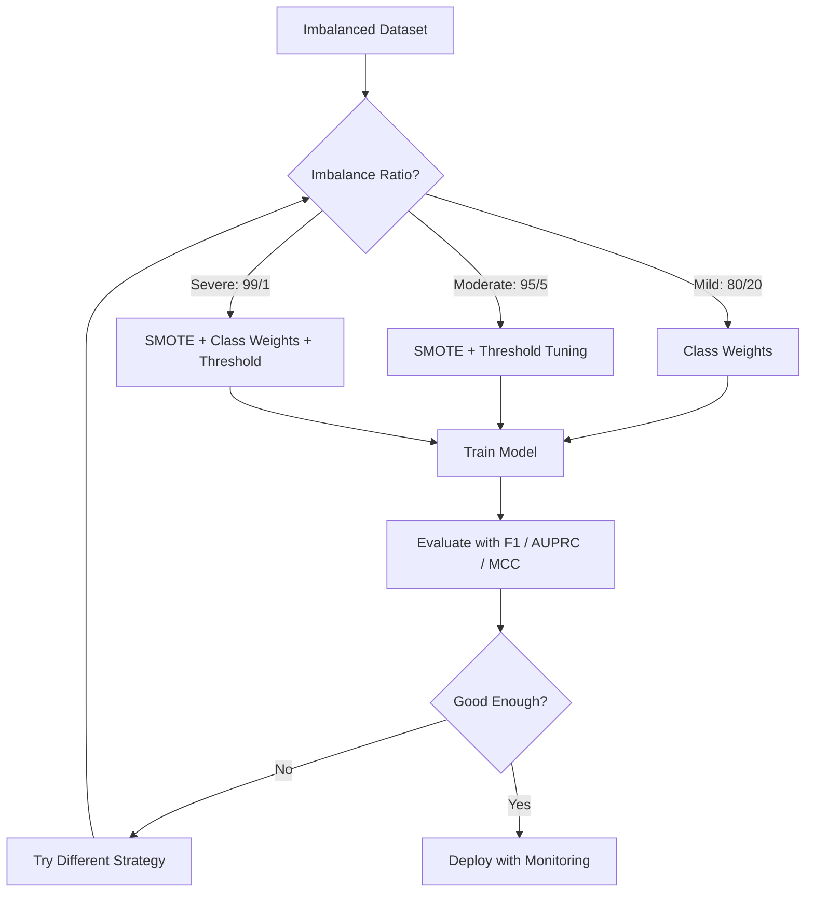
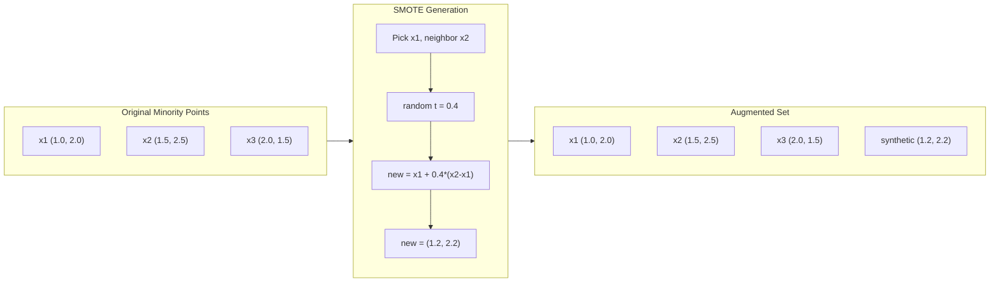
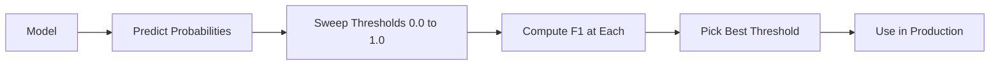
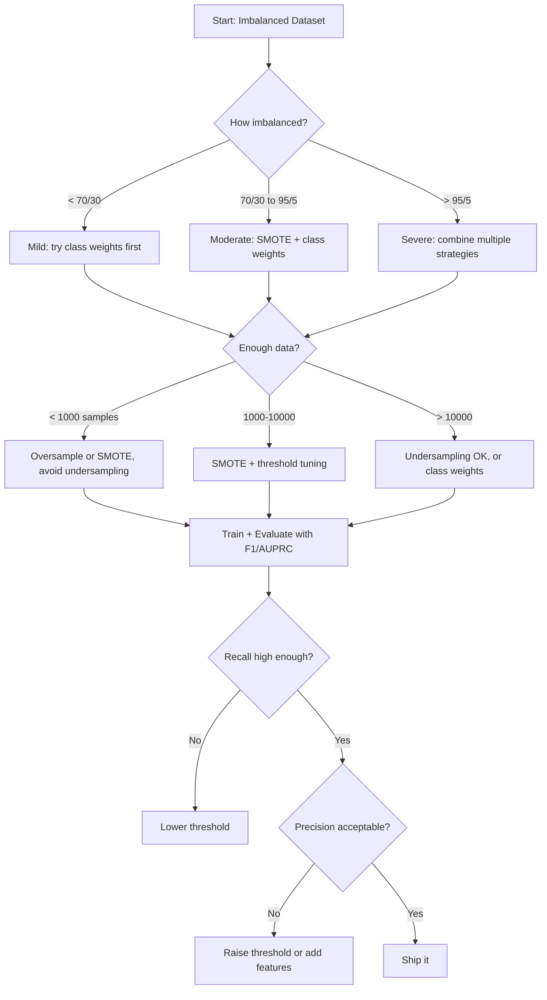

# Handling Imbalanced Data · 处理类别不均衡（当 99% 的数据都「正常」）

> When 99% of your data is "normal," accuracy is a lie.

**Type:** Build
**Language:** Python
**Prerequisites:** Phase 2, Lessons 01-09 (especially evaluation metrics)
**Time:** ~90 minutes

## Learning Objectives · 学习目标

- 从零实现 SMOTE，并解释合成过采样与随机复制有什么不同
- 用 F1、AUPRC 和马修斯相关系数（MCC）而不是准确率来评估不均衡分类器
- 比较类别权重、阈值调优和重采样策略，针对给定的不均衡比例选出正确方法
- 搭建一条完整的不均衡数据处理流水线，把 SMOTE、类别权重和阈值优化组合起来

> Implement SMOTE from scratch and explain how synthetic oversampling differs from random duplication
> Evaluate imbalanced classifiers using F1, AUPRC, and Matthews Correlation Coefficient instead of accuracy
> Compare class weighting, threshold tuning, and resampling strategies and select the right approach for a given imbalance ratio
> Build a complete imbalanced data pipeline that combines SMOTE, class weights, and threshold optimization

## The Problem · 问题在哪

你建了一个欺诈检测模型，准确率 99.9%。你开始庆祝。然后你发现它把每一笔交易都预测成「不是欺诈」。

这不是 bug。当只有 0.1% 的交易是欺诈时，这就是理性做法。模型学到的是：永远猜多数类能让整体误差最小。它在技术上完全正确，也完全没用。

凡是分类真正要紧的地方都会发生这种事。疾病诊断：阳性率 1%。网络入侵：攻击占 0.01%。制造缺陷：次品率 0.5%。垃圾邮件过滤：20% 是垃圾邮件。流失预测：5% 会流失。少数类越要紧，它往往越稀少。

准确率失效，是因为它把所有正确预测一视同仁。正确放行一笔正常交易和正确抓住一笔欺诈，都只算 1 个百分点的准确率。但抓住欺诈才是这个模型存在的全部理由。我们需要指标、技术和训练策略，强迫模型关注那个稀有却重要的类。

> You build a fraud detection model. It gets 99.9% accuracy. You celebrate. Then you realize it predicts "not fraud" for every single transaction.
> This is not a bug. It is the rational thing to do when only 0.1% of transactions are fraudulent. The model learns that always guessing the majority class minimizes overall error. It is technically correct and completely useless.
> This happens everywhere real classification matters. Disease diagnosis: 1% positive rate. Network intrusion: 0.01% attacks. Manufacturing defects: 0.5% defective. Spam filtering: 20% spam. Churn prediction: 5% churners. The more consequential the minority class, the rarer it tends to be.
> Accuracy fails because it treats all correct predictions equally. Correctly labeling a legitimate transaction and correctly catching fraud both count as one point of accuracy. But catching fraud is the entire reason the model exists. We need metrics, techniques, and training strategies that force the model to pay attention to the rare but important class.

## The Concept · 概念

### Why Accuracy Fails · 准确率为什么失效

考虑一个 1000 个样本的数据集：990 个负样本，10 个正样本。一个永远预测负类的模型：

|  | 预测为正 | 预测为负 |
|--|---|---|
| 实际为正 | 0 (TP) | 10 (FN) |
| 实际为负 | 0 (FP) | 990 (TN) |

Accuracy = (0 + 990) / 1000 = 99.0%

模型抓住的欺诈是零。疾病是零。次品是零。但准确率说 99%。这就是准确率在不均衡问题上的危险之处。

> Consider a dataset with 1000 samples: 990 negative, 10 positive. A model that always predicts negative:
> Accuracy = (0 + 990) / 1000 = 99.0%
> The model catches zero fraud. Zero disease. Zero defects. But accuracy says 99%. This is why accuracy is dangerous for imbalanced problems.

### Better Metrics · 更好的指标

**精确率（Precision）** = TP / (TP + FP)。所有被标成正的里面，有多少真是正的？高精确率意味着很少误报。

**召回率（Recall）** = TP / (TP + FN)。所有真正的正样本里，我们抓住了多少？高召回率意味着很少漏报。

**F1 分数** = 2 * precision * recall / (precision + recall)。调和平均数。比算术平均更重罚精确率和召回率之间的极端失衡。

**F-beta 分数** = (1 + beta^2) * precision * recall / (beta^2 * precision + recall)。beta > 1 时召回率更重要；beta < 1 时精确率更重要。欺诈检测常用 F2（漏掉欺诈比误报更糟）。

**AUPRC**（精确率-召回率曲线下面积，Area Under Precision-Recall Curve）。类似 AUC-ROC，但对不均衡数据更有信息量。随机分类器的 AUPRC 等于正类占比（不是 ROC 的 0.5）。这让改进更容易被看出来。

**马修斯相关系数（Matthews Correlation Coefficient）** = (TP * TN - FP * FN) / sqrt((TP+FP)(TP+FN)(TN+FP)(TN+FN))。取值范围 -1 到 +1。只有模型在两个类上都表现好才会给高分。即使两类规模相差悬殊，它也保持平衡。

对上面那个「永远预测负类」的模型：precision = 0/0（无定义，通常记为 0），recall = 0/10 = 0，F1 = 0，MCC = 0。这些指标正确地判定该模型一文不值。

> **Precision** = TP / (TP + FP). Of everything flagged as positive, how many actually are? High precision means few false alarms.
> **Recall** = TP / (TP + FN). Of everything actually positive, how many did we catch? High recall means few missed positives.
> **F1 Score** = 2 * precision * recall / (precision + recall). The harmonic mean. Penalizes extreme imbalance between precision and recall more than the arithmetic mean would.
> **F-beta Score** = (1 + beta^2) * precision * recall / (beta^2 * precision + recall). When beta > 1, recall matters more. When beta < 1, precision matters more. F2 is common in fraud detection (missing fraud is worse than a false alarm).
> **AUPRC** (Area Under Precision-Recall Curve). Like AUC-ROC but more informative for imbalanced data. A random classifier has AUPRC equal to the positive class rate (not 0.5 like ROC). This makes improvements easier to see.
> **Matthews Correlation Coefficient** = (TP * TN - FP * FN) / sqrt((TP+FP)(TP+FN)(TN+FP)(TN+FN)). Ranges from -1 to +1. Only gives a high score when the model does well on both classes. Balanced even when classes are very different sizes.
> For the "always predict negative" model above: precision = 0/0 (undefined, often set to 0), recall = 0/10 = 0, F1 = 0, MCC = 0. These metrics correctly identify the model as worthless.

### The Imbalanced Data Pipeline · 不均衡数据处理流水线



### SMOTE: Synthetic Minority Oversampling Technique · SMOTE：合成少数类过采样技术

随机过采样（random oversampling）复制已有的少数类样本。有效，但有过拟合风险，因为模型会反复看到完全相同的点。

SMOTE 生成新的合成少数类样本——合理，但不是副本。算法：

1. 对每个少数类样本 x，在其他少数类样本中找它的 k 个最近邻
2. 随机挑一个邻居
3. 在 x 和该邻居之间的线段上生成一个新样本

公式：`new_sample = x + random(0, 1) * (neighbor - x)`

这是在真实少数类点之间做插值，在同一片特征空间区域里造出新样本，而不是照抄已有数据。



> Random oversampling duplicates existing minority samples. This works but risks overfitting because the model sees identical points repeatedly.
> SMOTE creates new synthetic minority samples that are plausible but not copies. The algorithm:
> 1. For each minority sample x, find its k nearest neighbors among other minority samples
> 2. Pick one neighbor at random
> 3. Create a new sample on the line segment between x and that neighbor
> The formula: `new_sample = x + random(0, 1) * (neighbor - x)`
> This interpolates between real minority points, creating samples in the same region of feature space without just copying existing data.

### Sampling Strategies Compared · 采样策略对比

**随机过采样（Random Oversampling）**：复制少数类样本，直到数量和多数类一致。
- 优点：简单，无信息损失
- 缺点：完全重复的样本导致过拟合，训练时间增加

**随机欠采样（Random Undersampling）**：删掉部分多数类样本，直到数量和少数类一致。
- 优点：训练快，简单
- 缺点：扔掉了可能有用的多数类数据，方差更高

**SMOTE**：通过插值生成合成少数类样本。
- 优点：生成新的数据点，比随机过采样更不容易过拟合
- 缺点：可能在决策边界附近制造噪声样本，不考虑多数类的分布

| 策略 | 改动的数据 | 风险 | 何时使用 |
|------|-------------|------|-------------|
| 过采样 | 复制少数类 | 过拟合 | 小数据集，中度不均衡 |
| 欠采样 | 删除多数类 | 信息损失 | 大数据集，想训练快 |
| SMOTE | 新增合成少数类 | 边界噪声 | 中度不均衡，少数类样本足以做 k-NN |

> **Random Oversampling**: duplicate minority samples to match majority count.
> - Pros: simple, no information loss
> - Cons: exact duplicates cause overfitting, increases training time
> **Random Undersampling**: remove majority samples to match minority count.
> - Pros: fast training, simple
> - Cons: throws away potentially useful majority data, higher variance
> **SMOTE**: create synthetic minority samples via interpolation.
> - Pros: generates new data points, reduces overfitting compared to random oversampling
> - Cons: can create noisy samples near the decision boundary, does not account for majority class distribution

### Class Weights · 类别权重

不改数据，改模型看待错误的方式。给少数类的错分指定更高的权重。

对一个 950 负、50 正的二元问题：
- 负类权重 = n_samples / (2 * n_negative) = 1000 / (2 * 950) = 0.526
- 正类权重 = n_samples / (2 * n_positive) = 1000 / (2 * 50) = 10.0

正类的权重是负类的 19 倍。错分一个正样本的代价等于错分 19 个负样本。模型被迫关注少数类。

在逻辑回归里，这会修改损失函数：

```
weighted_loss = -sum(w_i * [y_i * log(p_i) + (1-y_i) * log(1-p_i)])
```

其中 w_i 取决于样本 i 的类别。

类别权重在期望意义上数学等价于过采样，但不制造新数据点。这让它们更快，也避免了样本复制带来的过拟合风险。

> Instead of changing the data, change how the model treats errors. Assign higher weight to misclassifying the minority class.
> For a binary problem with 950 negative and 50 positive samples:
> - Weight for negative class = n_samples / (2 * n_negative) = 1000 / (2 * 950) = 0.526
> - Weight for positive class = n_samples / (2 * n_positive) = 1000 / (2 * 50) = 10.0
> The positive class gets 19x the weight. Misclassifying one positive sample costs as much as misclassifying 19 negative samples. The model is forced to pay attention to the minority class.
> In logistic regression, this modifies the loss function:
> where w_i depends on the class of sample i.
> Class weights are mathematically equivalent to oversampling in expectation, but without creating new data points. This makes them faster and avoids the overfitting risk of duplicated samples.

### Threshold Tuning · 阈值调优

大多数分类器输出一个概率。默认阈值是 0.5：P(positive) >= 0.5 就预测为正。但 0.5 是拍脑袋定的。类别不均衡时，最优阈值通常低得多。

流程：
1. 训练一个模型
2. 在验证集上拿到预测概率
3. 从 0.0 到 1.0 扫描阈值
4. 在每个阈值上计算 F1（或你选定的指标）
5. 选出让指标最大的阈值



模型可能给一笔欺诈交易输出 P(fraud) = 0.15。阈值 0.5 时它被判成不是欺诈；阈值 0.10 时它被正确抓住。概率校准得好不好不重要，排序才重要——只要欺诈的概率高于非欺诈，就存在一个能把它们分开的阈值。

> Most classifiers output a probability. The default threshold is 0.5: if P(positive) >= 0.5, predict positive. But 0.5 is arbitrary. When classes are imbalanced, the optimal threshold is usually much lower.
> The process:
> 1. Train a model
> 2. Get predicted probabilities on the validation set
> 3. Sweep thresholds from 0.0 to 1.0
> 4. Compute F1 (or your chosen metric) at each threshold
> 5. Pick the threshold that maximizes your metric
> A model might output P(fraud) = 0.15 for a fraudulent transaction. At threshold 0.5, this is classified as not fraud. At threshold 0.10, it is correctly caught. The probability calibration matters less than the ranking -- as long as fraud gets higher probabilities than non-fraud, there exists a threshold that separates them.

### Cost-Sensitive Learning · 代价敏感学习

类别权重的推广。不用统一代价，而是给不同的错分指定不同的代价：

| | 预测为正 | 预测为负 |
|--|---|---|
| 实际为正 | 0 (正确) | C_FN = 100 |
| 实际为负 | C_FP = 1 | 0 (正确) |

漏掉一笔欺诈交易（FN）的代价比一次误报（FP）高 100 倍。模型优化的是总代价，不是错误个数。

当你能估计真实世界的成本时，这是最有原则的做法。漏诊癌症的代价和一次导致额外活检的误报完全不同。把这些代价显式写出来，才能逼出正确的权衡。

> Generalization of class weights. Instead of uniform costs, assign specific misclassification costs:
> Missing a fraudulent transaction (FN) costs 100x more than a false alarm (FP). The model optimizes for total cost, not total error count.
> This is the most principled approach when you can estimate real-world costs. A missed cancer diagnosis has a very different cost than a false alarm that leads to an extra biopsy. Making these costs explicit forces the right tradeoffs.

### Decision Flowchart · 决策流程图



```figure
class-imbalance
```

## Build It · 动手造

### Step 1: Generate an imbalanced dataset · 生成不均衡数据集

```python
import numpy as np


def make_imbalanced_data(n_majority=950, n_minority=50, seed=42):
    rng = np.random.RandomState(seed)

    X_maj = rng.randn(n_majority, 2) * 1.0 + np.array([0.0, 0.0])
    X_min = rng.randn(n_minority, 2) * 0.8 + np.array([2.5, 2.5])

    X = np.vstack([X_maj, X_min])
    y = np.concatenate([np.zeros(n_majority), np.ones(n_minority)])

    shuffle_idx = rng.permutation(len(y))
    return X[shuffle_idx], y[shuffle_idx]
```

### Step 2: SMOTE from scratch · 从零实现 SMOTE

```python
def euclidean_distance(a, b):
    return np.sqrt(np.sum((a - b) ** 2))


def find_k_neighbors(X, idx, k):
    distances = []
    for i in range(len(X)):
        if i == idx:
            continue
        d = euclidean_distance(X[idx], X[i])
        distances.append((i, d))
    distances.sort(key=lambda x: x[1])
    return [d[0] for d in distances[:k]]


def smote(X_minority, k=5, n_synthetic=100, seed=42):
    rng = np.random.RandomState(seed)
    n_samples = len(X_minority)
    k = min(k, n_samples - 1)
    synthetic = []

    for _ in range(n_synthetic):
        idx = rng.randint(0, n_samples)
        neighbors = find_k_neighbors(X_minority, idx, k)
        neighbor_idx = neighbors[rng.randint(0, len(neighbors))]
        t = rng.random()
        new_point = X_minority[idx] + t * (X_minority[neighbor_idx] - X_minority[idx])
        synthetic.append(new_point)

    return np.array(synthetic)
```

### Step 3: Random oversampling and undersampling · 随机过采样与欠采样

```python
def random_oversample(X, y, seed=42):
    rng = np.random.RandomState(seed)
    classes, counts = np.unique(y, return_counts=True)
    max_count = counts.max()

    X_resampled = list(X)
    y_resampled = list(y)

    for cls, count in zip(classes, counts):
        if count < max_count:
            cls_indices = np.where(y == cls)[0]
            n_needed = max_count - count
            chosen = rng.choice(cls_indices, size=n_needed, replace=True)
            X_resampled.extend(X[chosen])
            y_resampled.extend(y[chosen])

    X_out = np.array(X_resampled)
    y_out = np.array(y_resampled)
    shuffle = rng.permutation(len(y_out))
    return X_out[shuffle], y_out[shuffle]


def random_undersample(X, y, seed=42):
    rng = np.random.RandomState(seed)
    classes, counts = np.unique(y, return_counts=True)
    min_count = counts.min()

    X_resampled = []
    y_resampled = []

    for cls in classes:
        cls_indices = np.where(y == cls)[0]
        chosen = rng.choice(cls_indices, size=min_count, replace=False)
        X_resampled.extend(X[chosen])
        y_resampled.extend(y[chosen])

    X_out = np.array(X_resampled)
    y_out = np.array(y_resampled)
    shuffle = rng.permutation(len(y_out))
    return X_out[shuffle], y_out[shuffle]
```

### Step 4: Logistic regression with class weights · 带类别权重的逻辑回归

```python
def sigmoid(z):
    return 1.0 / (1.0 + np.exp(-np.clip(z, -500, 500)))


def logistic_regression_weighted(X, y, weights, lr=0.01, epochs=200):
    n_samples, n_features = X.shape
    w = np.zeros(n_features)
    b = 0.0

    for _ in range(epochs):
        z = X @ w + b
        pred = sigmoid(z)
        error = pred - y
        weighted_error = error * weights

        gradient_w = (X.T @ weighted_error) / n_samples
        gradient_b = np.mean(weighted_error)

        w -= lr * gradient_w
        b -= lr * gradient_b

    return w, b


def compute_class_weights(y):
    classes, counts = np.unique(y, return_counts=True)
    n_samples = len(y)
    n_classes = len(classes)
    weight_map = {}
    for cls, count in zip(classes, counts):
        weight_map[cls] = n_samples / (n_classes * count)
    return np.array([weight_map[yi] for yi in y])
```

### Step 5: Threshold tuning · 阈值调优

```python
def find_optimal_threshold(y_true, y_probs, metric="f1"):
    best_threshold = 0.5
    best_score = -1.0

    for threshold in np.arange(0.05, 0.96, 0.01):
        y_pred = (y_probs >= threshold).astype(int)
        tp = np.sum((y_pred == 1) & (y_true == 1))
        fp = np.sum((y_pred == 1) & (y_true == 0))
        fn = np.sum((y_pred == 0) & (y_true == 1))

        if metric == "f1":
            precision = tp / (tp + fp) if (tp + fp) > 0 else 0.0
            recall = tp / (tp + fn) if (tp + fn) > 0 else 0.0
            score = 2 * precision * recall / (precision + recall) if (precision + recall) > 0 else 0.0
        elif metric == "recall":
            score = tp / (tp + fn) if (tp + fn) > 0 else 0.0
        elif metric == "precision":
            score = tp / (tp + fp) if (tp + fp) > 0 else 0.0

        if score > best_score:
            best_score = score
            best_threshold = threshold

    return best_threshold, best_score
```

### Step 6: Evaluation functions · 评估函数

```python
def confusion_matrix_values(y_true, y_pred):
    tp = np.sum((y_pred == 1) & (y_true == 1))
    tn = np.sum((y_pred == 0) & (y_true == 0))
    fp = np.sum((y_pred == 1) & (y_true == 0))
    fn = np.sum((y_pred == 0) & (y_true == 1))
    return tp, tn, fp, fn


def compute_metrics(y_true, y_pred):
    tp, tn, fp, fn = confusion_matrix_values(y_true, y_pred)
    accuracy = (tp + tn) / (tp + tn + fp + fn)
    precision = tp / (tp + fp) if (tp + fp) > 0 else 0.0
    recall = tp / (tp + fn) if (tp + fn) > 0 else 0.0
    f1 = 2 * precision * recall / (precision + recall) if (precision + recall) > 0 else 0.0

    denom = np.sqrt(float((tp + fp) * (tp + fn) * (tn + fp) * (tn + fn)))
    mcc = (tp * tn - fp * fn) / denom if denom > 0 else 0.0

    return {
        "accuracy": accuracy,
        "precision": precision,
        "recall": recall,
        "f1": f1,
        "mcc": mcc,
    }
```

### Step 7: Compare all approaches · 对比所有方法

```python
X, y = make_imbalanced_data(950, 50, seed=42)
split = int(0.8 * len(y))
X_train, X_test = X[:split], X[split:]
y_train, y_test = y[:split], y[split:]

# Baseline: no treatment
w_base, b_base = logistic_regression_weighted(
    X_train, y_train, np.ones(len(y_train)), lr=0.1, epochs=300
)
probs_base = sigmoid(X_test @ w_base + b_base)
preds_base = (probs_base >= 0.5).astype(int)

# Oversampled
X_over, y_over = random_oversample(X_train, y_train)
w_over, b_over = logistic_regression_weighted(
    X_over, y_over, np.ones(len(y_over)), lr=0.1, epochs=300
)
preds_over = (sigmoid(X_test @ w_over + b_over) >= 0.5).astype(int)

# SMOTE
minority_mask = y_train == 1
X_minority = X_train[minority_mask]
synthetic = smote(X_minority, k=5, n_synthetic=len(y_train) - 2 * int(minority_mask.sum()))
X_smote = np.vstack([X_train, synthetic])
y_smote = np.concatenate([y_train, np.ones(len(synthetic))])
w_sm, b_sm = logistic_regression_weighted(
    X_smote, y_smote, np.ones(len(y_smote)), lr=0.1, epochs=300
)
preds_smote = (sigmoid(X_test @ w_sm + b_sm) >= 0.5).astype(int)

# Class weights
sample_weights = compute_class_weights(y_train)
w_cw, b_cw = logistic_regression_weighted(
    X_train, y_train, sample_weights, lr=0.1, epochs=300
)
probs_cw = sigmoid(X_test @ w_cw + b_cw)
preds_cw = (probs_cw >= 0.5).astype(int)

# Threshold tuning (tune on held-out validation set, not test set)
probs_val = sigmoid(X_val @ w_cw + b_cw)
best_thresh, best_f1 = find_optimal_threshold(y_val, probs_val, metric="f1")
preds_thresh = (probs_cw >= best_thresh).astype(int)
```

代码文件把以上全部放进单个脚本运行并打印结果。

> The code file runs all of this in a single script and prints results.

## Use It · 实战用法

用 scikit-learn 和 imbalanced-learn，这些技术都是一行调用：

```python
from sklearn.linear_model import LogisticRegression
from sklearn.metrics import classification_report, f1_score
from sklearn.model_selection import train_test_split
from imblearn.over_sampling import SMOTE
from imblearn.under_sampling import RandomUnderSampler
from imblearn.pipeline import Pipeline

X_train, X_test, y_train, y_test = train_test_split(X, y, stratify=y)

model_weighted = LogisticRegression(class_weight="balanced")
model_weighted.fit(X_train, y_train)
print(classification_report(y_test, model_weighted.predict(X_test)))

smote = SMOTE(random_state=42)
X_resampled, y_resampled = smote.fit_resample(X_train, y_train)
model_smote = LogisticRegression()
model_smote.fit(X_resampled, y_resampled)
print(classification_report(y_test, model_smote.predict(X_test)))

pipeline = Pipeline([
    ("smote", SMOTE()),
    ("model", LogisticRegression(class_weight="balanced")),
])
pipeline.fit(X_train, y_train)
print(classification_report(y_test, pipeline.predict(X_test)))
```

从零实现让你看清每种技术到底做了什么。SMOTE 就是对少数类做 k-NN 插值。类别权重就是给损失乘系数。阈值调优就是对截断点做个 for 循环。没有魔法。

> With scikit-learn and imbalanced-learn, these techniques are one-liners:
> The from-scratch implementations show exactly what each technique does. SMOTE is just k-NN interpolation on the minority class. Class weights multiply the loss. Threshold tuning is a for-loop over cutoffs. No magic.

## Ship It · 交付

本课产出：
- `outputs/skill-imbalanced-data.md` —— 处理不均衡分类问题的决策清单

> This lesson produces:
> - `outputs/skill-imbalanced-data.md` -- a decision checklist for handling imbalanced classification problems

## Exercises · 练习

1. **Borderline-SMOTE**：修改 SMOTE 实现，只为靠近决策边界的少数类点生成合成样本（即 k 近邻中包含多数类样本的点）。在一份数据类别有重叠的数据集上，和标准 SMOTE 对比结果。

2. **代价矩阵优化**：实现代价敏感学习，把代价矩阵作为参数。写一个函数，接收代价矩阵，返回最小化期望代价的最优预测。用不同的代价比（1:10、1:100、1:1000）测试，画出精确率-召回率权衡如何变化。

3. **阈值校准**：实现 Platt scaling（在模型原始输出上拟合一个逻辑回归，得到校准过的概率）。对比校准前后的精确率-召回率曲线。证明校准不改变排序（AUC 不变），但让概率更有意义。

4. **均衡 bagging 集成**：训练多个模型，每个用均衡的 bootstrap 样本（全部少数类 + 随机一部分多数类）。对它们的预测取平均。把这个方法和使用 SMOTE 的单个模型对比。同时衡量性能和多次运行之间的方差。

5. **不均衡比例实验**：拿一个均衡数据集，逐步加大不均衡比例（50/50、70/30、90/10、95/5、99/1）。每个比例下分别用和不使用 SMOTE 训练。画出两种方法的 F1 随不均衡比例的变化。比例到多少时 SMOTE 开始产生实质差别？

> 1. **Borderline-SMOTE**: modify the SMOTE implementation to only generate synthetic samples for minority points that are near the decision boundary (those whose k-nearest neighbors include majority class samples). Compare results with standard SMOTE on a dataset where classes overlap.
> 2. **Cost matrix optimization**: implement cost-sensitive learning where the cost matrix is a parameter. Create a function that takes a cost matrix and returns optimal predictions that minimize expected cost. Test with different cost ratios (1:10, 1:100, 1:1000) and plot how the precision-recall tradeoff changes.
> 3. **Threshold calibration**: implement Platt scaling (fit a logistic regression on the model's raw outputs to produce calibrated probabilities). Compare the precision-recall curve before and after calibration. Show that calibration does not change the ranking (AUC stays the same) but makes the probabilities more meaningful.
> 4. **Ensemble with balanced bagging**: train multiple models, each on a balanced bootstrap sample (all minority + random subset of majority). Average their predictions. Compare this approach against a single model with SMOTE. Measure both performance and variance across runs.
> 5. **Imbalance ratio experiment**: take a balanced dataset and progressively increase the imbalance ratio (50/50, 70/30, 90/10, 95/5, 99/1). For each ratio, train with and without SMOTE. Plot F1 vs imbalance ratio for both approaches. At what ratio does SMOTE start making a meaningful difference?

## Key Terms · 术语表

| 术语 | 大家怎么说 | 实际含义 |
|------|----------------|----------------------|
| Class imbalance（类别不均衡） | "一个类的样本多得多" | 数据集中类别分布严重偏斜，导致模型偏向多数类 |
| SMOTE | "合成过采样" | 在已有少数类样本和它们的 k 近邻少数类邻居之间插值，生成新的少数类样本 |
| Class weights（类别权重） | "让稀有类的错误更贵" | 给损失函数乘上按类别区分的权重，让模型更重罚少数类的错分 |
| Threshold tuning（阈值调优） | "挪动决策边界" | 把分类的概率截断点从默认 0.5 改成能优化目标指标的值 |
| Precision-recall tradeoff（精确率-召回率权衡） | "鱼和熊掌不可兼得" | 降低阈值能抓住更多正样本（召回率升高），但也会标出更多假阳性（精确率下降），反之亦然 |
| AUPRC | "PR 曲线下面积" | 把精确率-召回率曲线汇总成一个数；类别严重不均衡时比 AUC-ROC 更有信息量 |
| Matthews Correlation Coefficient（马修斯相关系数） | "平衡的指标" | 预测标签与真实标签之间的相关性，只有模型在两个类上都表现好才能得高分 |
| Cost-sensitive learning（代价敏感学习） | "不同的错代价不同" | 把真实世界的错分代价纳入训练目标，让模型优化总代价而不是错误个数 |
| Random oversampling（随机过采样） | "复制少数类" | 重复少数类样本以平衡类别数量；简单，但有对重复点过拟合的风险 |

## Further Reading · 延伸阅读

- [SMOTE: Synthetic Minority Over-sampling Technique (Chawla et al., 2002)](https://arxiv.org/abs/1106.1813) —— SMOTE 原始论文，至今仍是不均衡学习领域引用最多的工作
- [Learning from Imbalanced Data (He & Garcia, 2009)](https://ieeexplore.ieee.org/document/5128907) —— 覆盖采样、代价敏感和算法层面方法的全面综述
- [imbalanced-learn documentation](https://imbalanced-learn.org/stable/) —— 提供 SMOTE 变体、欠采样策略和流水线集成的 Python 库
- [The Precision-Recall Plot Is More Informative than the ROC Plot (Saito & Rehmsmeier, 2015)](https://journals.plos.org/plosone/article?id=10.1371/journal.pone.0118432) —— 不均衡问题何时、为什么该选 PR 曲线而不是 ROC 曲线
