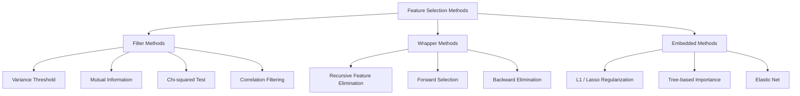
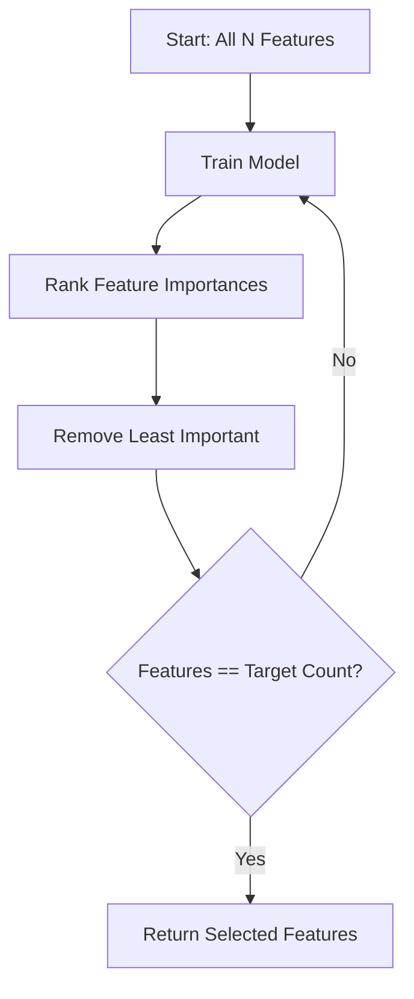
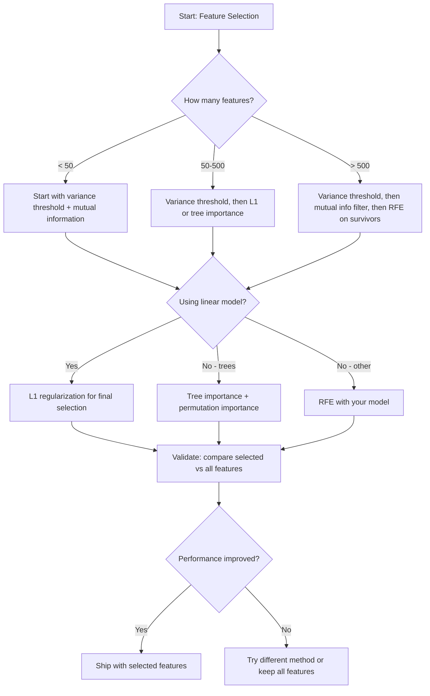

# Feature Selection · 特征选择（要的不是更多特征，而是对的特征）

> More features is not better. The right features is better.

**Type:** Build
**Language:** Python
**Prerequisites:** Phase 2, Lessons 01-09, 08 (feature engineering)
**Time:** ~75 minutes

## Learning Objectives · 学习目标

- 从零实现过滤法（filter methods：方差阈值、互信息、卡方检验）和包裹法（wrapper methods：RFE、前向选择）
- 解释为什么互信息能捕捉相关性会漏掉的非线性特征-目标关系
- 比较 L1 正则化（嵌入式选择）与 RFE（包裹式选择），评估两者在计算成本上的取舍
- 搭建一条组合多种方法的特征选择流水线，并在留出数据上展示泛化能力的提升

> Implement filter methods (variance threshold, mutual information, chi-squared) and wrapper methods (RFE, forward selection) from scratch
> Explain why mutual information captures nonlinear feature-target relationships that correlation misses
> Compare L1 regularization (embedded selection) with RFE (wrapper selection) and evaluate their computational tradeoffs
> Build a feature selection pipeline that combines multiple methods and demonstrate improved generalization on held-out data

## The Problem · 问题在哪

你手上有 500 个特征。模型训练慢、不停过拟合，没人能解释它学到了什么。你加更多特征指望提升性能。结果更糟。

这就是维度灾难（curse of dimensionality）在作祟。特征数量一增长，特征空间的体积就爆炸。数据点变得稀疏，点与点之间的距离趋于趋同。模型需要指数级更多的数据才能找到真实模式。噪声特征淹没信号特征，过拟合成了默认结局。

特征选择（feature selection）是解药。剥掉噪声，去掉冗余，留下真正携带目标信息的特征。结果：训练更快，泛化更好，模型终于解释得清。

目标不是用上所有可用信息，而是用对的信息。

> You have 500 features. Your model trains slowly, overfits constantly, and nobody can explain what it learned. You add more features hoping to improve performance. It gets worse.
> This is the curse of dimensionality in action. As the number of features grows, the volume of the feature space explodes. Data points become sparse. Distances between points converge. The model needs exponentially more data to find real patterns. Noise features drown out signal features. Overfitting becomes the default.
> Feature selection is the antidote. Strip away the noise. Remove the redundancy. Keep the features that carry actual information about the target. The result: faster training, better generalization, and models you can actually explain.
> The goal is not to use all available information. It is to use the right information.

## The Concept · 概念

### Three Categories of Feature Selection · 特征选择的三大类

每种特征选择方法都属于以下三类之一：



**过滤法（filter methods）** 用一个统计量独立地为每个特征打分，不使用模型。快，但看不到特征之间的交互。

**包裹法（wrapper methods）** 训练模型来评估特征子集，用模型性能当分数。效果更好，但代价高——要多次重新训练模型。

**嵌入法（embedded methods）** 在模型训练过程中完成特征选择。L1 正则化把权重压到零；决策树优先在最有用的特征上分裂。选择发生在拟合过程中，而不是单独一步。

> Every feature selection method falls into one of three categories:
> **Filter methods** score each feature independently using a statistical measure. They do not use a model. Fast, but they miss feature interactions.
> **Wrapper methods** train a model to evaluate feature subsets. They use model performance as the score. Better results, but expensive because they retrain the model many times.
> **Embedded methods** select features as part of model training. L1 regularization drives weights to zero. Decision trees split on the most useful features. Selection happens during fitting, not as a separate step.

### Variance Threshold · 方差阈值

最简单的过滤器。如果一个特征在样本之间几乎不变，它几乎不携带任何信息。

设想一个特征在 1000 个样本里有 999 个是 0.0。它的方差接近零。任何模型都无法用它区分类别。删掉。

```
variance(x) = mean((x - mean(x))^2)
```

设一个阈值（比如 0.01），丢掉方差低于阈值的每个特征。这能在完全不看目标变量的情况下去掉常数或近常数特征。

什么时候用：作为其他方法之前的预处理步骤。它以近乎零的成本抓掉明显无用的特征。

局限：一个特征可以方差很大却仍是纯噪声。方差阈值是必要条件，不是充分条件。

> The simplest filter. If a feature barely varies across samples, it carries almost no information.
> Consider a feature that is 0.0 for 999 out of 1000 samples. Its variance is near zero. No model can use it to distinguish between classes. Remove it.
> Set a threshold (e.g., 0.01). Drop every feature with variance below it. This removes constant or near-constant features without looking at the target variable at all.
> When to use it: as a preprocessing step before other methods. It catches obviously useless features at near-zero cost.
> Limitation: a feature can have high variance and still be pure noise. Variance threshold is necessary but not sufficient.

### Mutual Information · 互信息（Mutual Information）

互信息衡量的是：知道特征 X 的值，能在多大程度上降低对目标 Y 的不确定性。

```
I(X; Y) = sum_x sum_y p(x, y) * log(p(x, y) / (p(x) * p(y)))
```

如果 X 和 Y 独立，p(x, y) = p(x) * p(y)，对数项为零，I(X; Y) = 0。X 告诉你的关于 Y 的信息越多，互信息越高。

相比相关性的关键优势：互信息能捕捉非线性关系。一个特征可能与目标零相关，但互信息很高，因为两者之间的关系是二次的或周期的。

对连续特征，先离散化成分箱（bin，基于直方图的估计）。分箱数会影响估计——箱太少丢信息，箱太多加噪声。常见选择：sqrt(n) 个箱，或 Sturges 公式（1 + log2(n)）。


> Mutual information measures how much knowing the value of feature X reduces uncertainty about target Y.
> If X and Y are independent, p(x, y) = p(x) * p(y), so the log term is zero and I(X; Y) = 0. The more X tells you about Y, the higher the mutual information.
> Key advantage over correlation: mutual information captures nonlinear relationships. A feature might have zero correlation with the target but high mutual information because the relationship is quadratic or periodic.
> For continuous features, discretize into bins first (histogram-based estimation). The number of bins affects the estimate -- too few bins lose information, too many bins add noise. A common choice: sqrt(n) bins or Sturges' rule (1 + log2(n)).

### Recursive Feature Elimination (RFE) · 递归特征消除（RFE）

RFE 是一种包裹法。它利用模型自身的特征重要性来迭代修剪：

1. 用全部特征训练模型
2. 按重要性给特征排序（线性模型看系数，树模型看不纯度下降）
3. 删掉最不重要的特征
4. 重复，直到剩下想要的特征数



RFE 考虑特征交互，因为模型把所有剩余特征放在一起看。删掉一个特征会改变其他特征的重要性。这让它比过滤法更彻底。

代价：你要训练模型 N - target 次。500 个特征、目标 10 个，就是 490 次训练。对昂贵的模型来说很慢。可以加速：每一步删掉多个特征（比如每轮删掉最差的 10%）。

> RFE is a wrapper method. It uses a model's own feature importance to iteratively prune:
> 1. Train the model with all features
> 2. Rank features by importance (coefficients for linear models, impurity reduction for trees)
> 3. Remove the least important feature(s)
> 4. Repeat until the desired number of features remains
> RFE considers feature interactions because the model sees all remaining features together. Removing one feature changes the importance of others. This makes it more thorough than filter methods.
> The cost: you train the model N - target times. With 500 features and a target of 10, that is 490 training runs. For expensive models, this is slow. You can speed it up by removing multiple features per step (e.g., remove the bottom 10% each round).

### L1 (Lasso) Regularization · L1（Lasso）正则化

L1 正则化把权重的绝对值加进损失函数：

```
loss = prediction_error + alpha * sum(|w_i|)
```

alpha 参数控制剪枝的激进程度。alpha 越高，越多权重被压到恰好为零。

为什么恰好是零？L1 惩罚在权重空间里造出一个菱形的约束区域，最优解倾向于落在菱形的角上，而角上有一个或多个权重为零。L2 正则化（ridge）的约束区域是圆形，权重会缩小，但很少恰好为零。

这就是嵌入式特征选择：模型在训练过程中自己学到该忽略哪些特征。零权重特征等于被移除。

优点：只需一次训练；能处理相关特征（挑一个，把其余压零）；大多数线性模型实现里都内置。

局限：只适用于线性模型。无法捕捉非线性的特征重要性。

> L1 regularization adds the absolute value of weights to the loss function:
> The alpha parameter controls how aggressively features are pruned. Higher alpha means more weights go to exactly zero.
> Why exactly zero? The L1 penalty creates a diamond-shaped constraint region in weight space. The optimal solution tends to land at a corner of this diamond, where one or more weights are zero. L2 regularization (ridge) creates a circular constraint where weights shrink but rarely hit zero.
> This is embedded feature selection: the model learns during training which features to ignore. Features with zero weight are effectively removed.
> Advantages: single training run, handles correlated features (picks one and zeros the others), built into most linear model implementations.
> Limitation: only works for linear models. Cannot capture nonlinear feature importance.

### Tree-Based Feature Importance · 基于树的特征重要性

决策树及其集成（随机森林、梯度提升）天然会给特征排序。每次分裂都会降低不纯度（分类用 Gini 或熵，回归用方差）。带来更大不纯度下降的特征更重要。

对一棵有 T 棵树的随机森林：

```
importance(feature_j) = (1/T) * sum over all trees of
    sum over all nodes splitting on feature_j of
        (n_samples * impurity_decrease)
```

这给出每个特征归一化的重要性分数。它自动处理非线性关系和特征交互。

注意：基于树的重要性偏向取值很多（高基数，high cardinality）的特征。一个随机 ID 列会显得很重要，因为它把每个样本都完美分开。用置换重要性（permutation importance）做交叉验证。

> Decision trees and their ensembles (random forests, gradient boosting) naturally rank features. Every split reduces impurity (Gini or entropy for classification, variance for regression). Features that produce larger impurity reductions are more important.
> For a random forest with T trees:
> This gives a normalized importance score for each feature. It handles nonlinear relationships and feature interactions automatically.
> Caution: tree-based importance is biased toward features with many unique values (high cardinality). A random ID column will appear important because it perfectly splits every sample. Use permutation importance as a sanity check.

### Permutation Importance · 置换重要性（Permutation Importance）

一种模型无关的方法：

1. 训练模型，在验证数据上记录基线性能
2. 对每个特征：随机打乱它的值，度量性能下降
3. 下降越大，特征越重要

如果打乱一个特征不伤性能，说明模型不依赖它。如果性能崩了，这个特征至关重要。

置换重要性避免了树重要性的基数偏差。但它慢：每个特征要做一次完整评估，还要重复多次以保证稳定。

> A model-agnostic method:
> 1. Train the model and record baseline performance on validation data
> 2. For each feature: shuffle its values randomly, measure the drop in performance
> 3. The bigger the drop, the more important the feature
> If shuffling a feature does not hurt performance, the model does not depend on it. If performance collapses, that feature is critical.
> Permutation importance avoids the cardinality bias of tree-based importance. But it is slow: one full evaluation per feature, repeated multiple times for stability.

### Comparison Table · 对比表

| 方法 | 类型 | 速度 | 非线性 | 特征交互 |
|------|------|-------|-----------|---------------------|
| 方差阈值 | 过滤 | 非常快 | 否 | 否 |
| 互信息 | 过滤 | 快 | 是 | 否 |
| 相关性过滤 | 过滤 | 快 | 否 | 否 |
| RFE | 包裹 | 慢 | 取决于模型 | 是 |
| L1 / Lasso | 嵌入 | 快 | 否（线性） | 否 |
| 树重要性 | 嵌入 | 中等 | 是 | 是 |
| 置换重要性 | 模型无关 | 慢 | 是 | 是 |

### Decision Flowchart · 决策流程图



```figure
f3-feature-prune
```

## Build It · 动手造

### Step 1: Generate synthetic data with known feature structure · 生成已知特征结构的合成数据

```python
import numpy as np


def make_feature_selection_data(n_samples=500, seed=42):
    rng = np.random.RandomState(seed)

    x1 = rng.randn(n_samples)
    x2 = rng.randn(n_samples)
    x3 = rng.randn(n_samples)
    x4 = x1 + 0.1 * rng.randn(n_samples)
    x5 = x2 + 0.1 * rng.randn(n_samples)

    informative = np.column_stack([x1, x2, x3, x4, x5])

    correlated = np.column_stack([
        x1 * 0.9 + 0.1 * rng.randn(n_samples),
        x2 * 0.8 + 0.2 * rng.randn(n_samples),
        x3 * 0.7 + 0.3 * rng.randn(n_samples),
        x1 * 0.5 + x2 * 0.5 + 0.1 * rng.randn(n_samples),
        x2 * 0.6 + x3 * 0.4 + 0.1 * rng.randn(n_samples),
    ])

    noise = rng.randn(n_samples, 10) * 0.5

    X = np.hstack([informative, correlated, noise])
    y = (2 * x1 - 1.5 * x2 + x3 + 0.5 * rng.randn(n_samples) > 0).astype(int)

    feature_names = (
        [f"info_{i}" for i in range(5)]
        + [f"corr_{i}" for i in range(5)]
        + [f"noise_{i}" for i in range(10)]
    )

    return X, y, feature_names
```

我们知道自己埋下的真相：特征 0-4 是有信息的（其中 3 和 4 分别是 0 和 1 的相关副本），特征 5-9 与有信息特征相关，特征 10-19 是纯噪声。好的选择方法应该把 0-4 排最高，10-19 排最低。

> We know the ground truth: features 0-4 are informative (plus 3 and 4 are correlated copies of 0 and 1), features 5-9 are correlated with informative features, features 10-19 are pure noise. A good selection method should rank 0-4 highest and 10-19 lowest.

### Step 2: Variance threshold · 方差阈值

```python
def variance_threshold(X, threshold=0.01):
    variances = np.var(X, axis=0)
    mask = variances > threshold
    return mask, variances
```

### Step 3: Mutual information (discrete) · 互信息（离散）

```python
def discretize(x, n_bins=10):
    min_val, max_val = x.min(), x.max()
    if max_val == min_val:
        return np.zeros_like(x, dtype=int)
    bin_edges = np.linspace(min_val, max_val, n_bins + 1)
    binned = np.digitize(x, bin_edges[1:-1])
    return binned


def mutual_information(X, y, n_bins=10):
    n_samples, n_features = X.shape
    mi_scores = np.zeros(n_features)

    y_vals, y_counts = np.unique(y, return_counts=True)
    p_y = y_counts / n_samples

    for f in range(n_features):
        x_binned = discretize(X[:, f], n_bins)
        x_vals, x_counts = np.unique(x_binned, return_counts=True)
        p_x = dict(zip(x_vals, x_counts / n_samples))

        mi = 0.0
        for xv in x_vals:
            for yi, yv in enumerate(y_vals):
                joint_mask = (x_binned == xv) & (y == yv)
                p_xy = np.sum(joint_mask) / n_samples
                if p_xy > 0:
                    mi += p_xy * np.log(p_xy / (p_x[xv] * p_y[yi]))
        mi_scores[f] = mi

    return mi_scores
```

### Step 4: Recursive Feature Elimination · 递归特征消除

```python
def simple_logistic_importance(X, y, lr=0.1, epochs=100):
    n_samples, n_features = X.shape
    w = np.zeros(n_features)
    b = 0.0

    for _ in range(epochs):
        z = X @ w + b
        pred = 1.0 / (1.0 + np.exp(-np.clip(z, -500, 500)))
        error = pred - y
        w -= lr * (X.T @ error) / n_samples
        b -= lr * np.mean(error)

    return w, b


def rfe(X, y, n_features_to_select=5, lr=0.1, epochs=100):
    n_total = X.shape[1]
    remaining = list(range(n_total))
    rankings = np.ones(n_total, dtype=int)
    rank = n_total

    while len(remaining) > n_features_to_select:
        X_subset = X[:, remaining]
        w, _ = simple_logistic_importance(X_subset, y, lr, epochs)
        importances = np.abs(w)

        least_idx = np.argmin(importances)
        original_idx = remaining[least_idx]
        rankings[original_idx] = rank
        rank -= 1
        remaining.pop(least_idx)

    for idx in remaining:
        rankings[idx] = 1

    selected_mask = rankings == 1
    return selected_mask, rankings
```

### Step 5: L1 feature selection · L1 特征选择

```python
def soft_threshold(w, alpha):
    return np.sign(w) * np.maximum(np.abs(w) - alpha, 0)


def l1_feature_selection(X, y, alpha=0.1, lr=0.01, epochs=500):
    n_samples, n_features = X.shape
    w = np.zeros(n_features)
    b = 0.0

    for _ in range(epochs):
        z = X @ w + b
        pred = 1.0 / (1.0 + np.exp(-np.clip(z, -500, 500)))
        error = pred - y

        gradient_w = (X.T @ error) / n_samples
        gradient_b = np.mean(error)

        w -= lr * gradient_w
        w = soft_threshold(w, lr * alpha)
        b -= lr * gradient_b

    selected_mask = np.abs(w) > 1e-6
    return selected_mask, w
```

### Step 6: Tree-based importance (simple decision tree) · 基于树的重要性（简单决策树）

```python
def gini_impurity(y):
    if len(y) == 0:
        return 0.0
    classes, counts = np.unique(y, return_counts=True)
    probs = counts / len(y)
    return 1.0 - np.sum(probs ** 2)


def best_split(X, y, feature_idx):
    values = np.unique(X[:, feature_idx])
    if len(values) <= 1:
        return None, -1.0

    best_threshold = None
    best_gain = -1.0
    parent_gini = gini_impurity(y)
    n = len(y)

    for i in range(len(values) - 1):
        threshold = (values[i] + values[i + 1]) / 2.0
        left_mask = X[:, feature_idx] <= threshold
        right_mask = ~left_mask

        n_left = np.sum(left_mask)
        n_right = np.sum(right_mask)

        if n_left == 0 or n_right == 0:
            continue

        gain = parent_gini - (n_left / n) * gini_impurity(y[left_mask]) - (n_right / n) * gini_impurity(y[right_mask])

        if gain > best_gain:
            best_gain = gain
            best_threshold = threshold

    return best_threshold, best_gain


def tree_importance(X, y, n_trees=50, max_depth=5, seed=42):
    rng = np.random.RandomState(seed)
    n_samples, n_features = X.shape
    importances = np.zeros(n_features)

    for _ in range(n_trees):
        sample_idx = rng.choice(n_samples, size=n_samples, replace=True)
        feature_subset = rng.choice(n_features, size=max(1, int(np.sqrt(n_features))), replace=False)

        X_boot = X[sample_idx]
        y_boot = y[sample_idx]

        tree_imp = _build_tree_importance(X_boot, y_boot, feature_subset, max_depth)
        importances += tree_imp

    total = importances.sum()
    if total > 0:
        importances /= total

    return importances


def _build_tree_importance(X, y, feature_subset, max_depth, depth=0):
    n_features = X.shape[1]
    importances = np.zeros(n_features)

    if depth >= max_depth or len(np.unique(y)) <= 1 or len(y) < 4:
        return importances

    best_feature = None
    best_threshold = None
    best_gain = -1.0

    for f in feature_subset:
        threshold, gain = best_split(X, y, f)
        if gain > best_gain:
            best_gain = gain
            best_feature = f
            best_threshold = threshold

    if best_feature is None or best_gain <= 0:
        return importances

    importances[best_feature] += best_gain * len(y)

    left_mask = X[:, best_feature] <= best_threshold
    right_mask = ~left_mask

    importances += _build_tree_importance(X[left_mask], y[left_mask], feature_subset, max_depth, depth + 1)
    importances += _build_tree_importance(X[right_mask], y[right_mask], feature_subset, max_depth, depth + 1)

    return importances
```

### Step 7: Run all methods and compare · 跑所有方法并对比

代码文件在同一份合成数据集上跑全部五种方法，并打印一张对比表，展示每种方法各选中了哪些特征。

> The code file runs all five methods on the same synthetic dataset and prints a comparison table showing which features each method selects.

## Use It · 实战用法

用 scikit-learn 的话，特征选择直接内置在流水线里：

```python
from sklearn.feature_selection import (
    VarianceThreshold,
    mutual_info_classif,
    RFE,
    SelectFromModel,
)
from sklearn.linear_model import Lasso, LogisticRegression
from sklearn.ensemble import RandomForestClassifier

vt = VarianceThreshold(threshold=0.01)
X_filtered = vt.fit_transform(X)

mi_scores = mutual_info_classif(X, y)
top_k = np.argsort(mi_scores)[-10:]

rfe_selector = RFE(LogisticRegression(), n_features_to_select=10)
rfe_selector.fit(X, y)
X_rfe = rfe_selector.transform(X)

lasso_selector = SelectFromModel(Lasso(alpha=0.01))
lasso_selector.fit(X, y)
X_lasso = lasso_selector.transform(X)

rf = RandomForestClassifier(n_estimators=100)
rf.fit(X, y)
importances = rf.feature_importances_
```

从零实现让你看清每个方法内部到底发生了什么。方差阈值就是算 `var(X, axis=0)` 然后套掩码。互信息就是在列联表里数联合频率和边际频率。RFE 就是一个「训练、排序、剪枝」的循环。L1 就是带软阈值（soft-thresholding）步骤的梯度下降。树重要性就是把各次分裂的不纯度下降累加起来。没有魔法——只有统计和循环。

sklearn 版本增加了稳健性（比如 mutual_info_classif 用 k-NN 密度估计代替分箱）、速度（C 实现）和流水线集成。

> With scikit-learn, feature selection is built into the pipeline:
> The from-scratch implementations show exactly what happens inside each method. Variance threshold is just computing `var(X, axis=0)` and applying a mask. Mutual information is counting joint and marginal frequencies in a contingency table. RFE is a loop that trains, ranks, and prunes. L1 is gradient descent with a soft-thresholding step. Tree importance accumulates impurity reductions across splits. No magic -- just statistics and loops.
> The sklearn versions add robustness (e.g., mutual_info_classif uses k-NN density estimation instead of binning), speed (C implementations), and pipeline integration.

## Ship It · 交付

本课产出：
- `outputs/skill-feature-selector.md` —— 选择合适特征选择方法的速查决策树

> This lesson produces:
> - `outputs/skill-feature-selector.md` -- a quick reference decision tree for choosing the right feature selection method

## Exercises · 练习

1. **前向选择（forward selection）**：实现 RFE 的反面。从零个特征开始，每一步加入最能提升模型性能的特征，加入不再有帮助时停止。把选出的特征和 RFE 的结果对比。哪个更快？哪个效果更好？

2. **稳定性选择（stability selection）**：把 L1 特征选择跑 50 次，每次用随机 80% 子样本和略有差异的 alpha 值。统计每个特征被选中的次数。在超过 80% 的运行中被选中的特征是「稳定」的。把稳定特征和单次运行的 L1 选择对比。哪个更可靠？

3. **多重共线性检测**：计算所有特征的相关矩阵。实现一个函数：给定相关性阈值（比如 0.9），从每对高相关特征中删掉一个（保留与目标互信息更高的那个）。在合成数据集上测试，验证它确实删掉了冗余的相关特征。

4. **特征选择流水线**：把方差阈值、互信息过滤和 RFE 串成一条流水线。先删近零方差特征，再按互信息保留前 50%，最后对幸存者跑 RFE。把这条流水线和直接对全部特征跑 RFE 对比。流水线更快吗？精度相当吗？

5. **从零实现置换重要性**：实现置换重要性。对每个特征打乱 10 次，度量 F1 分数的平均下降。把排序和基于树的重要性对比。找出两者不一致的案例并解释原因（提示：相关特征）。

> 1. **Forward selection**: implement the opposite of RFE. Start with zero features. At each step, add the feature that improves model performance the most. Stop when adding features no longer helps. Compare the selected features against RFE results. Which is faster? Which gives better results?
> 2. **Stability selection**: run L1 feature selection 50 times, each time on a random 80% subsample of the data, with slightly different alpha values. Count how often each feature is selected. Features selected in > 80% of runs are "stable." Compare stable features against single-run L1 selection. Which is more reliable?
> 3. **Multicollinearity detection**: compute the correlation matrix for all features. Implement a function that, given a correlation threshold (e.g., 0.9), removes one feature from each highly-correlated pair (keeping the one with higher mutual information with the target). Test on the synthetic dataset and verify it removes the redundant correlated features.
> 4. **Feature selection pipeline**: chain variance threshold, mutual information filter, and RFE into a single pipeline. First remove near-zero-variance features, then keep the top 50% by mutual information, then run RFE on the survivors. Compare this pipeline against running RFE alone on all features. Is the pipeline faster? Is it equally accurate?
> 5. **Permutation importance from scratch**: implement permutation importance. For each feature, shuffle its values 10 times, measure the average drop in F1 score. Compare the ranking against tree-based importance. Find cases where they disagree and explain why (hint: correlated features).

## Key Terms · 术语表

| 术语 | 大家怎么说 | 实际含义 |
|------|----------------|----------------------|
| Filter method（过滤法） | "独立给特征打分" | 一种特征选择方法：不训练模型，用一个统计量孤立地评估每个特征并排序 |
| Wrapper method（包裹法） | "让模型来挑特征" | 一种特征选择方法：通过训练模型评估特征子集，并把模型性能当作选择标准 |
| Embedded method（嵌入法） | "模型在训练时自己选特征" | 特征选择作为模型拟合的一部分发生，比如 L1 正则化把权重压到零 |
| Mutual information（互信息） | "一个变量告诉你多少关于另一个变量的信息" | 衡量知道 X 之后对 Y 的不确定性下降了多少，同时捕捉线性与非线性依赖 |
| Recursive Feature Elimination（递归特征消除） | "训练、排序、剪枝、重复" | 一种迭代式包裹法：训练模型，删掉最不重要的特征，重复直到达到目标数量 |
| L1 / Lasso regularization（L1/Lasso 正则化） | "能杀死特征的惩罚项" | 把权重绝对值之和加进损失函数，把不重要特征的权重压到恰好为零 |
| Variance threshold（方差阈值） | "删掉常数特征" | 丢掉样本间方差低于指定阈值的特征，过滤掉不携带信息的特征 |
| Feature importance（特征重要性） | "哪些特征最重要" | 表示每个特征对模型预测贡献大小的分数，由分裂增益（树）或系数大小（线性模型）计算 |
| Permutation importance（置换重要性） | "打乱一下，看看损失多大" | 通过随机打乱每个特征的取值并度量模型性能的下降来评估特征重要性 |
| Curse of dimensionality（维度灾难） | "特征太多，数据不够" | 特征越多，特征空间体积呈指数增长，数据变得稀疏、距离失去意义的现象 |

## Further Reading · 延伸阅读

- [An Introduction to Variable and Feature Selection (Guyon & Elisseeff, 2003)](https://jmlr.org/papers/v3/guyon03a.html) —— 特征选择方法的奠基性综述，至今仍被广泛引用
- [scikit-learn Feature Selection Guide](https://scikit-learn.org/stable/modules/feature_selection.html) —— 过滤法、包裹法和嵌入法的实用参考，附代码示例
- [Stability Selection (Meinshausen & Buhlmann, 2010)](https://arxiv.org/abs/0809.2932) —— 把子采样与特征选择结合，得到稳健、可复现的结果
- [Beware Default Random Forest Importances (Strobl et al., 2007)](https://bmcbioinformatics.biomedcentral.com/articles/10.1186/1471-2105-8-25) —— 论证树重要性的基数偏差，并提出条件重要性作为替代
