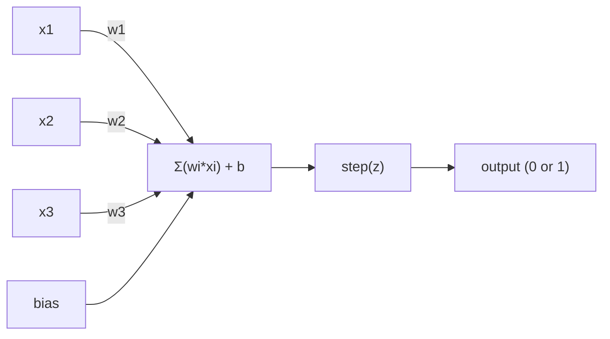
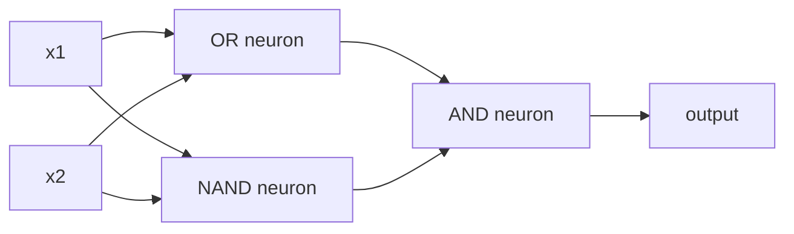

# The Perceptron · 感知机

> 感知机是神经网络的原子。把它拆开，你会看到权重、一个偏置（bias）和一个决策。
>
> The perceptron is the atom of neural networks. Split it open and you find weights, a bias, and a decision.

**Type:** Build
**Languages:** Python
**Prerequisites:** Phase 1 (Linear Algebra Intuition)
**Time:** ~60 minutes

## Learning Objectives · 学习目标

- 用 Python 从零实现一个感知机（perceptron），包括权重更新规则和阶跃（step）激活函数
- 解释为什么单个感知机只能解决线性可分（linearly separable）问题，并演示 XOR 失败案例
- 通过组合 OR、NAND、AND 三个门构建一个多层感知机来解决 XOR
- 用 sigmoid 激活函数和反向传播（backpropagation）训练一个两层网络，让它自动学会 XOR

> Implement a perceptron from scratch in Python, including the weight update rule and step activation function
> Explain why a single perceptron can only solve linearly separable problems and demonstrate the XOR failure case
> Construct a multi-layer perceptron by composing OR, NAND, and AND gates to solve XOR
> Train a two-layer network with sigmoid activation and backpropagation to learn XOR automatically

## The Problem · 问题在哪

你懂向量，也懂点积（dot product）。你懂矩阵能把输入变换成输出。但一台机器是怎么*学到*该用哪个变换的？

感知机回答了这个问题。它是能造出的最简单的学习机器：取一些输入，乘上权重，加上偏置，做一个二值决策。然后调整。就这么多。有史以来造出的每一个神经网络，都是把这个想法层层堆叠起来的产物。

理解感知机，就是理解「学习」在代码里到底意味着什么：不断调整数字，直到输出与现实相符。

> You know vectors and dot products. You know that a matrix transforms inputs into outputs. But how does a machine *learn* which transformation to use?
> The perceptron answers this. It's the simplest possible learning machine: take some inputs, multiply by weights, add a bias, and make a binary decision. Then adjust. That's it. Every neural network ever built is layers of this idea stacked together.
> Understanding the perceptron means understanding what "learning" actually means in code: adjusting numbers until the output matches reality.

## The Concept · 概念

### One Neuron, One Decision · 一个神经元，一次决策

一个感知机接收 n 个输入，把每个输入乘以一个权重，求和，加上偏置，再把结果送进一个激活函数（activation function）。



这个阶跃函数非常粗暴：如果加权和加偏置 >= 0，输出 1；否则输出 0。

```
step(z) = 1  if z >= 0
           0  if z < 0
```

这是一个线性分类器（linear classifier）。权重和偏置定义了一条直线（在更高维度上是一个超平面，hyperplane），把输入空间切成两个区域。

> A perceptron takes n inputs, multiplies each by a weight, sums them up, adds a bias, and passes the result through an activation function.
> The step function is brutal: if the weighted sum plus bias is >= 0, output 1. Otherwise, output 0.
> This is a linear classifier. The weights and bias define a line (or hyperplane in higher dimensions) that splits the input space into two regions.

### The Decision Boundary · 决策边界

对于两个输入，感知机在二维空间里画出一条直线：

```
  x2
  ┤
  │  Class 1        /
  │    (0)          /
  │                /
  │               / w1·x1 + w2·x2 + b = 0
  │              /
  │             /     Class 2
  │            /        (1)
  ┼───────────/──────────── x1
```

直线一侧的一切都输出 0，另一侧的一切都输出 1。训练就是移动这条线，直到它正确地分开两个类别。

> For two inputs, the perceptron draws a line through 2D space:
> Everything on one side of the line outputs 0. Everything on the other side outputs 1. Training moves this line until it correctly separates the classes.

### The Learning Rule · 学习规则

感知机学习规则很简单：

```
For each training example (x, y_true):
    y_pred = predict(x)
    error = y_true - y_pred

    For each weight:
        w_i = w_i + learning_rate * error * x_i
    bias = bias + learning_rate * error
```

如果预测正确，error = 0，什么都不改变。如果预测是 0 但应该是 1，权重增大。如果预测是 1 但应该是 0，权重减小。学习率（learning rate）控制每次调整的幅度。

> The perceptron learning rule is simple:
> If the prediction is correct, error = 0, nothing changes. If it predicts 0 but should be 1, weights increase. If it predicts 1 but should be 0, weights decrease. The learning rate controls how big each adjustment is.

### The XOR Problem · XOR 问题

问题就出在这里。看这几个逻辑门：

```
AND gate:           OR gate:            XOR gate:
x1  x2  out         x1  x2  out         x1  x2  out
0   0   0           0   0   0           0   0   0
0   1   0           0   1   1           0   1   1
1   0   0           1   0   1           1   0   1
1   1   1           1   1   1           1   1   0
```

AND 和 OR 是线性可分的：你能画出一条直线把 0 和 1 分开。XOR 不行。没有任何一条直线能把 [0,1] 和 [1,0] 同 [0,0] 和 [1,1] 分开。

```
AND (separable):        XOR (not separable):

  x2                      x2
  1 ┤  0     1            1 ┤  1     0
    │     /                 │
  0 ┤  0 / 0              0 ┤  0     1
    ┼──/──────── x1         ┼──────────── x1
       line works!          no single line works!
```

这是一个根本性的限制。单个感知机只能解决线性可分问题。Minsky 和 Papert 在 1969 年证明了这一点，这个结论几乎让神经网络研究死寂了十年。

补救办法：把感知机堆成层。一个多层感知机可以把两个线性决策组合成一个非线性决策，从而解决 XOR。

```figure
perceptron-boundary
```

> Here's where it breaks. Look at these logic gates:
> AND and OR are linearly separable: you can draw a single line to separate the 0s from the 1s. XOR is not. No single line can separate [0,1] and [1,0] from [0,0] and [1,1].
> This is a fundamental limit. A single perceptron can only solve linearly separable problems. Minsky and Papert proved this in 1969 and it nearly killed neural network research for a decade.
> The fix: stack perceptrons into layers. A multi-layer perceptron can solve XOR by combining two linear decisions into a nonlinear one.

## Build It · 动手造

### Step 1: The Perceptron class · 第 1 步：Perceptron 类

```python
class Perceptron:
    def __init__(self, n_inputs, learning_rate=0.1):
        self.weights = [0.0] * n_inputs
        self.bias = 0.0
        self.lr = learning_rate

    def predict(self, inputs):
        total = sum(w * x for w, x in zip(self.weights, inputs))
        total += self.bias
        return 1 if total >= 0 else 0

    def train(self, training_data, epochs=100):
        for epoch in range(epochs):
            errors = 0
            for inputs, target in training_data:
                prediction = self.predict(inputs)
                error = target - prediction
                if error != 0:
                    errors += 1
                    for i in range(len(self.weights)):
                        self.weights[i] += self.lr * error * inputs[i]
                    self.bias += self.lr * error
            if errors == 0:
                print(f"Converged at epoch {epoch + 1}")
                return
        print(f"Did not converge after {epochs} epochs")
```

### Step 2: Train on logic gates · 第 2 步：在逻辑门上训练

```python
and_data = [
    ([0, 0], 0),
    ([0, 1], 0),
    ([1, 0], 0),
    ([1, 1], 1),
]

or_data = [
    ([0, 0], 0),
    ([0, 1], 1),
    ([1, 0], 1),
    ([1, 1], 1),
]

not_data = [
    ([0], 1),
    ([1], 0),
]

print("=== AND Gate ===")
p_and = Perceptron(2)
p_and.train(and_data)
for inputs, _ in and_data:
    print(f"  {inputs} -> {p_and.predict(inputs)}")

print("\n=== OR Gate ===")
p_or = Perceptron(2)
p_or.train(or_data)
for inputs, _ in or_data:
    print(f"  {inputs} -> {p_or.predict(inputs)}")

print("\n=== NOT Gate ===")
p_not = Perceptron(1)
p_not.train(not_data)
for inputs, _ in not_data:
    print(f"  {inputs} -> {p_not.predict(inputs)}")
```

### Step 3: Watch XOR fail · 第 3 步：看着 XOR 失败

```python
xor_data = [
    ([0, 0], 0),
    ([0, 1], 1),
    ([1, 0], 1),
    ([1, 1], 0),
]

print("\n=== XOR Gate (single perceptron) ===")
p_xor = Perceptron(2)
p_xor.train(xor_data, epochs=1000)
for inputs, expected in xor_data:
    result = p_xor.predict(inputs)
    status = "OK" if result == expected else "WRONG"
    print(f"  {inputs} -> {result} (expected {expected}) {status}")
```

它永远不会收敛。这就是单个感知机学不会 XOR 的硬核证明。

> It will never converge. This is the hard proof that a single perceptron cannot learn XOR.

### Step 4: Solve XOR with two layers · 第 4 步：用两层解决 XOR

诀窍：XOR = (x1 OR x2) AND NOT (x1 AND x2)。把三个感知机组合起来：



```python
def xor_network(x1, x2):
    or_neuron = Perceptron(2)
    or_neuron.weights = [1.0, 1.0]
    or_neuron.bias = -0.5

    nand_neuron = Perceptron(2)
    nand_neuron.weights = [-1.0, -1.0]
    nand_neuron.bias = 1.5

    and_neuron = Perceptron(2)
    and_neuron.weights = [1.0, 1.0]
    and_neuron.bias = -1.5

    hidden1 = or_neuron.predict([x1, x2])
    hidden2 = nand_neuron.predict([x1, x2])
    output = and_neuron.predict([hidden1, hidden2])
    return output


print("\n=== XOR Gate (multi-layer network) ===")
for inputs, expected in xor_data:
    result = xor_network(inputs[0], inputs[1])
    print(f"  {inputs} -> {result} (expected {expected})")
```

四种情况全部正确。把感知机堆成层，就能造出任何单个感知机都造不出的决策边界。

> The trick: XOR = (x1 OR x2) AND NOT (x1 AND x2). Combine three perceptrons:
> All four cases correct. Stacking perceptrons into layers creates decision boundaries that no single perceptron can produce.

### Step 5: Train a Two-Layer Network · 第 5 步：训练一个两层网络

第 4 步是手工接线的权重。对 XOR 来说可行，但对真实问题行不通——你无法提前知道正确的权重。补救办法：把阶跃函数换成 sigmoid，再通过反向传播自动学出权重。

```python
class TwoLayerNetwork:
    def __init__(self, learning_rate=0.5):
        import random
        random.seed(0)
        self.w_hidden = [[random.uniform(-1, 1), random.uniform(-1, 1)] for _ in range(2)]
        self.b_hidden = [random.uniform(-1, 1), random.uniform(-1, 1)]
        self.w_output = [random.uniform(-1, 1), random.uniform(-1, 1)]
        self.b_output = random.uniform(-1, 1)
        self.lr = learning_rate

    def sigmoid(self, x):
        import math
        x = max(-500, min(500, x))
        return 1.0 / (1.0 + math.exp(-x))

    def forward(self, inputs):
        self.inputs = inputs
        self.hidden_outputs = []
        for i in range(2):
            z = sum(w * x for w, x in zip(self.w_hidden[i], inputs)) + self.b_hidden[i]
            self.hidden_outputs.append(self.sigmoid(z))
        z_out = sum(w * h for w, h in zip(self.w_output, self.hidden_outputs)) + self.b_output
        self.output = self.sigmoid(z_out)
        return self.output

    def train(self, training_data, epochs=10000):
        for epoch in range(epochs):
            total_error = 0
            for inputs, target in training_data:
                output = self.forward(inputs)
                error = target - output
                total_error += error ** 2

                d_output = error * output * (1 - output)

                saved_w_output = self.w_output[:]
                hidden_deltas = []
                for i in range(2):
                    h = self.hidden_outputs[i]
                    hd = d_output * saved_w_output[i] * h * (1 - h)
                    hidden_deltas.append(hd)

                for i in range(2):
                    self.w_output[i] += self.lr * d_output * self.hidden_outputs[i]
                self.b_output += self.lr * d_output

                for i in range(2):
                    for j in range(len(inputs)):
                        self.w_hidden[i][j] += self.lr * hidden_deltas[i] * inputs[j]
                    self.b_hidden[i] += self.lr * hidden_deltas[i]
```

```python
net = TwoLayerNetwork(learning_rate=2.0)
net.train(xor_data, epochs=10000)
for inputs, expected in xor_data:
    result = net.forward(inputs)
    predicted = 1 if result >= 0.5 else 0
    print(f"  {inputs} -> {result:.4f} (rounded: {predicted}, expected {expected})")
```

与第 4 步有两个关键区别。第一，sigmoid 取代了阶跃函数——它是平滑的，所以梯度处处存在。第二，`train` 方法把误差从输出层反向传播到隐藏层，按每个权重对误差的贡献比例来调整它。这就是 20 行代码写成的反向传播。

这是通往第 03 课的桥梁。`d_output` 和 `hidden_deltas` 背后的数学，就是把链式法则（chain rule）应用到网络图上。我们会在那里正式推导它。

> Step 4 hand-wired the weights. That works for XOR, but not for real problems where you don't know the right weights in advance. The fix: replace the step function with sigmoid and learn the weights automatically through backpropagation.
> Two key differences from Step 4. First, sigmoid replaces the step function -- it's smooth, so gradients exist. Second, the `train` method propagates error backward from output to hidden layer, adjusting every weight proportionally to its contribution to the error. That's backpropagation in 20 lines.
> This is the bridge to Lesson 03. The math behind `d_output` and `hidden_deltas` is the chain rule applied to the network graph. We'll derive it properly there.

## Use It · 实战用法

你刚刚从零造出的一切，一次 import 就能拿到：

```python
from sklearn.linear_model import Perceptron as SkPerceptron
import numpy as np

X = np.array([[0,0],[0,1],[1,0],[1,1]])
y = np.array([0, 0, 0, 1])

clf = SkPerceptron(max_iter=100, tol=1e-3)
clf.fit(X, y)
print([clf.predict([x])[0] for x in X])
```

五行代码。你那个 30 行的 `Perceptron` 类做的是同一件事。sklearn 版本额外带来了收敛检查、多种损失函数和稀疏输入支持——但核心循环完全相同：加权和、阶跃函数、出错时更新权重。

真正的差距体现在规模上。生产级网络的不同之处：

- 阶跃函数换成了 sigmoid、ReLU 或其他平滑激活函数
- 权重通过反向传播自动学出（第 03 课）
- 层数更深：3 层、10 层、100+ 层
- 原则不变：每一层都从上一层的输出中创造新特征

单个感知机只能画直线。把它们堆起来，你就能画出任意形状。

> Everything you just built from scratch exists in one import:
> Five lines. Your 30-line `Perceptron` class does the same thing. The sklearn version adds convergence checks, multiple loss functions, and sparse input support -- but the core loop is identical: weighted sum, step function, weight update on error.
> The real gap shows up at scale. What changes in production networks:
> - The step function becomes sigmoid, ReLU, or other smooth activations
> - Weights are learned automatically via backpropagation (Lesson 03)
> - Layers get deeper: 3, 10, 100+ layers
> - The same principle holds: each layer creates new features from the previous layer's outputs
> A single perceptron can only draw straight lines. Stack them, and you can draw any shape.

## Ship It · 交付

本课产出：

- `outputs/skill-perceptron.md` —— 一个 skill，讲清单层与多层架构各自适用的场景

> This lesson produces:
> - `outputs/skill-perceptron.md` - a skill covering when single-layer vs multi-layer architectures are needed

## Exercises · 练习

1. 在 NAND 门（通用门——任何逻辑电路都能用 NAND 搭建）上训练一个感知机。验证它的权重和偏置构成一个有效的决策边界。
2. 修改 Perceptron 类，让它在每个 epoch 都记录决策边界（w1*x1 + w2*x2 + b = 0）。打印在 AND 门上训练时这条线是如何移动的。
3. 构建一个 3 输入感知机，只有当 3 个输入中至少 2 个为 1 时才输出 1（一个多数投票函数）。它是线性可分的吗？为什么？

> Train a perceptron on a NAND gate (the universal gate - any logic circuit can be built from NAND). Verify its weights and bias form a valid decision boundary.
> Modify the Perceptron class to track the decision boundary (w1*x1 + w2*x2 + b = 0) at each epoch. Print how the line shifts during training on the AND gate.
> Build a 3-input perceptron that outputs 1 only when at least 2 of the 3 inputs are 1 (a majority vote function). Is this linearly separable? Why?

## Key Terms · 术语表

| Term | 人们怎么说 | 它实际上是什么意思 |
|------|----------------|----------------------|
| Perceptron | 「一个假神经元」 | 一个线性分类器：输入与权重做点积，加偏置，再过阶跃函数 |
| Weight | 「某个输入有多重要」 | 一个乘数，决定每个输入对决策的贡献大小 |
| Bias | 「阈值」 | 一个平移决策边界的常数，让感知机在输入全为零时也能触发 |
| Activation function | 「把值压扁的那个东西」 | 加权和之后应用的函数——感知机用阶跃函数，现代网络用 sigmoid/ReLU |
| Linearly separable | 「能在它们之间画一条线」 | 一个数据集，其中单个超平面就能完美分开两个类别 |
| XOR problem | 「感知机做不到的事」 | 证明单层网络无法学习非线性可分函数 |
| Decision boundary | 「分类器切换立场的位置」 | 把输入空间分成两类的超平面 w*x + b = 0 |
| Multi-layer perceptron | 「一个真正的神经网络」 | 感知机按层堆叠，每一层的输出作为下一层的输入 |

## Further Reading · 延伸阅读

- Frank Rosenblatt, "The Perceptron: A Probabilistic Model for Information Storage and Organization in the Brain" (1958) —— 一切开始的那篇原始论文
- Minsky & Papert, "Perceptrons" (1969) —— 证明单层网络解不开 XOR、并让感知机研究停滞十年的那本书
- Michael Nielsen, "Neural Networks and Deep Learning", Chapter 1 (http://neuralnetworksanddeeplearning.com/) —— 免费在线，关于感知机如何组合成网络的最好的可视化讲解
