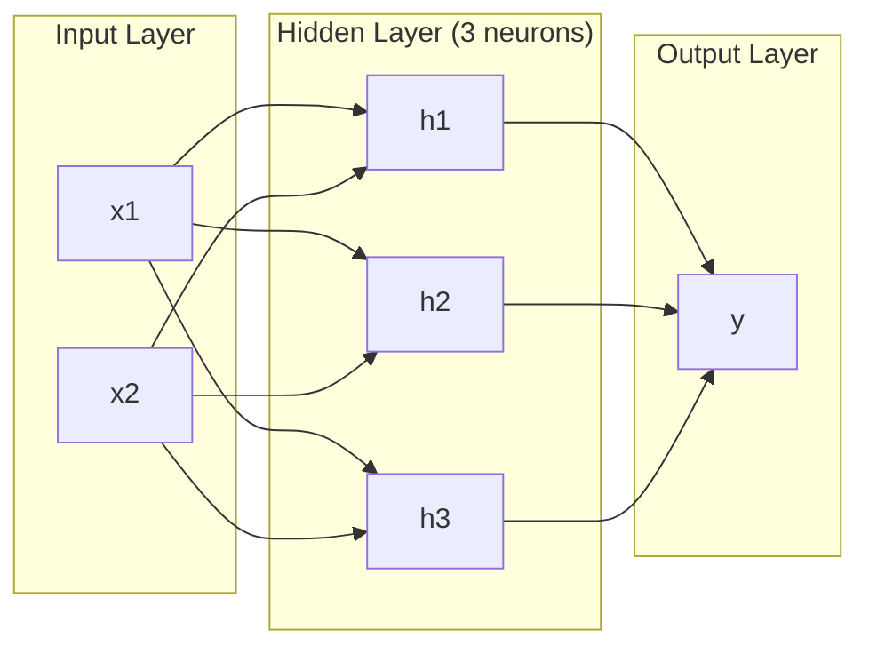
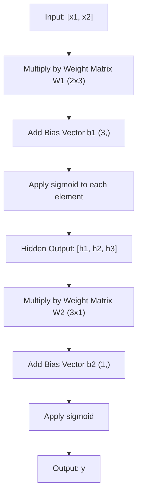
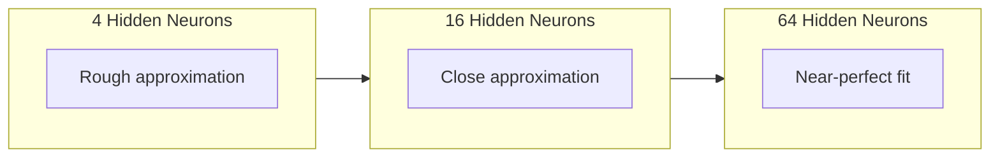

# Multi-Layer Networks and Forward Pass · 多层网络与前向传播

> 一个神经元画一条线。把它们堆起来，你就能画出任何东西。
>
> One neuron draws a line. Stack them, and you can draw anything.

**Type:** Build
**Languages:** Python
**Prerequisites:** Phase 01 (Math Foundations), Lesson 03.01 (The Perceptron)
**Time:** ~90 minutes

## Learning Objectives · 学习目标

- 用 Layer 和 Network 类从零构建一个多层网络，完成一次完整的前向传播（forward pass）
- 追踪矩阵维度在网络每一层中的变化，识别形状不匹配
- 解释堆叠非线性激活如何让网络学会弯曲的决策边界
- 用 2-2-1 架构和手工调好的 sigmoid 权重解决 XOR 问题

> Build a multi-layer network from scratch with Layer and Network classes that perform a complete forward pass
> Trace matrix dimensions through each layer of a network and identify shape mismatches
> Explain how stacking nonlinear activations enables a network to learn curved decision boundaries
> Solve the XOR problem using a 2-2-1 architecture with hand-tuned sigmoid weights

## The Problem · 问题在哪

一个神经元就是一个画直线的。仅此而已。穿过你数据的一条直线。AI 里每一个真实问题——图像识别、语言理解、下围棋——都需要曲线。把神经元堆成层，就是你获得曲线的方式。

1969 年，Minsky 和 Papert 证明了这个限制是致命的：单层网络学不会 XOR。不是「学得费劲」——是数学上不可能。XOR 真值表把 [0,1] 和 [1,0] 放在一侧，[0,0] 和 [1,1] 放在另一侧。没有任何一条直线能把它们分开。

这让神经网络的研究经费枯竭了十多年。补救办法事后看显而易见：别再用一层。把神经元堆成层。让第一层把输入空间雕刻成新特征，让第二层把这些特征组合成任何单条直线都做不出的决策。

这个堆叠结构就是多层网络。它是今天生产环境中每一个深度学习模型的地基。前向传播——数据从输入流经隐藏层到达输出——是在其他任何东西能工作之前，你需要先造出来的第一件事。

> A single neuron is a line drawer. That's it. One straight line through your data. Every real problem in AI -- image recognition, language understanding, playing Go -- requires curves. Stacking neurons into layers is how you get curves.
> In 1969, Minsky and Papert proved this limitation was fatal: a single-layer network cannot learn XOR. Not "struggles to learn" -- mathematically cannot. The XOR truth table places [0,1] and [1,0] on one side, [0,0] and [1,1] on the other. No single line separates them.
> This killed neural network funding for over a decade. The fix was obvious in hindsight: stop using one layer. Stack neurons into layers. Let the first layer carve the input space into new features, and let the second layer combine those features into decisions no single line could make.
> That stack is the multi-layer network. It is the foundation of every deep learning model in production today. The forward pass -- data flowing from input through hidden layers to output -- is the first thing you need to build before anything else works.

## The Concept · 概念

### Layers: Input, Hidden, Output · 层：输入层、隐藏层、输出层

一个多层网络有三种层：

**输入层（input layer）**——其实算不上一层。它存放你的原始数据。两个特征就是两个输入节点。这里不发生任何计算。

**隐藏层（hidden layers）**——干活的地方。每个神经元接收上一层的每一个输出，应用权重和偏置，再把结果送进一个激活函数。之所以叫「隐藏」，是因为你在训练数据里永远看不到这些值。

**输出层（output layer）**——最终答案。二分类用一个带 sigmoid 的神经元。多分类则每个类别一个神经元。



这是一个 2-3-1 网络。两个输入、三个隐藏神经元、一个输出。每条连接都带一个权重。每个神经元（输入层除外）都带一个偏置。

每一层产出一个数字向量，叫做隐藏状态（hidden state）。对文本，隐藏状态在升维——把一个词编码成 768 个数字来捕捉语义。对图像，它们在降维——把数百万像素压缩成一个可管理的表示。学习就活在隐藏状态里。

> A multi-layer network has three types of layers:
> **Input layer** -- not really a layer. It holds your raw data. Two features means two input nodes. No computation happens here.
> **Hidden layers** -- where the work happens. Each neuron takes every output from the previous layer, applies weights and a bias, then passes the result through an activation function. "Hidden" because you never see these values directly in the training data.
> **Output layer** -- the final answer. For binary classification, one neuron with sigmoid. For multi-class, one neuron per class.
> This is a 2-3-1 network. Two inputs, three hidden neurons, one output. Every connection carries a weight. Every neuron (except input) carries a bias.
> Each layer produces a vector of numbers called a hidden state. For text, hidden states increase dimensionality -- encoding a word as 768 numbers to capture semantic meaning. For images, they reduce dimensionality -- compressing millions of pixels into a manageable representation. The hidden state is where the learning lives.

### Neurons and Activations · 神经元与激活

每个神经元做三件事：

1. 把每个输入乘以对应的权重
2. 把所有乘积求和并加上一个偏置
3. 把和送进一个激活函数

本课的激活函数是 sigmoid：

```
sigmoid(z) = 1 / (1 + e^(-z))
```

sigmoid 把任何数压进 (0, 1) 区间。大的正输入推向 1。大的负输入推向 0。零映射到 0.5。这条平滑曲线正是学习成为可能的原因——不像感知机的硬阶跃，sigmoid 处处有梯度。

> Each neuron does three things:
> 1. Multiply every input by its corresponding weight
> 2. Sum all the products and add a bias
> 3. Pass the sum through an activation function
> For now, the activation is sigmoid:
> Sigmoid squashes any number into the range (0, 1). Large positive inputs push toward 1. Large negative inputs push toward 0. Zero maps to 0.5. This smooth curve is what makes learning possible -- unlike the perceptron's hard step, sigmoid has a gradient everywhere.

### Forward Pass: How Data Flows · 前向传播：数据如何流动

前向传播把输入数据逐层推过网络，直到抵达输出。前向传播过程中没有任何学习发生。它是纯粹的计算：乘、加、激活、重复。



在每一层，三个操作按顺序发生：

```
z = W * input + b       (linear transformation)
a = sigmoid(z)           (activation)
```

一层的输出变成下一层的输入。这就是前向传播的全部。

> The forward pass pushes input data through the network, layer by layer, until it reaches the output. No learning happens during the forward pass. It is pure computation: multiply, add, activate, repeat.
> At each layer, three operations happen in sequence:
> The output of one layer becomes the input to the next. That is the entire forward pass.

### Matrix Dimensions · 矩阵维度

追踪维度是深度学习里最重要的一项调试技能。这是那个 2-3-1 网络：

| 步骤 | 操作 | 维度 | 结果形状 |
|------|-----------|------------|-------------|
| 输入 | x | -- | (2,) |
| 隐藏层线性变换 | W1 * x + b1 | W1: (3, 2), b1: (3,) | (3,) |
| 隐藏层激活 | sigmoid(z1) | -- | (3,) |
| 输出层线性变换 | W2 * h + b2 | W2: (1, 3), b2: (1,) | (1,) |
| 输出层激活 | sigmoid(z2) | -- | (1,) |

规则：第 k 层的权重矩阵 W 形状为 (neurons_in_layer_k, neurons_in_layer_k_minus_1)。行对应当前层，列对应当上一层。如果形状对不上，你就有 bug。

> Tracking dimensions is the single most important debugging skill in deep learning. Here is the 2-3-1 network:
> The rule: weight matrix W at layer k has shape (neurons_in_layer_k, neurons_in_layer_k_minus_1). Rows match the current layer. Columns match the previous layer. If the shapes do not line up, you have a bug.

### Universal Approximation Theorem · 万能近似定理

1989 年，George Cybenko 证明了一个非凡的结论：一个带单隐藏层、神经元足够多的神经网络，能以任意想要的精度逼近任何连续函数。

这并不意味着单隐藏层总是最优的。它只是说明这个架构在理论上能力足够。实践中，更深的网络（层数更多、每层神经元更少）用远少于宽而浅网络的总参数量就能学到同样的函数。这就是深度学习有效的原因。

直觉：隐藏层的每个神经元学到一个「鼓包」或特征。足够多的鼓包放在合适的位置，就能逼近任何光滑曲线。神经元越多，鼓包越多，逼近越好。



> In 1989, George Cybenko proved something remarkable: a neural network with a single hidden layer and enough neurons can approximate any continuous function to any desired accuracy.
> This does not mean one hidden layer is always best. It means the architecture is theoretically capable. In practice, deeper networks (more layers, fewer neurons per layer) learn the same functions with far fewer total parameters than shallow-wide networks. That is why deep learning works.
> The intuition: each neuron in the hidden layer learns one "bump" or feature. Enough bumps placed in the right locations can approximate any smooth curve. More neurons, more bumps, better approximation.

### Composability · 可组合性

神经网络是可组合的。你可以堆叠它们、链式连接、并行运行。Whisper 模型用一个编码器（encoder）网络处理音频，再用一个独立的解码器（decoder）网络生成文本。现代 LLM 是 decoder-only。BERT 是 encoder-only。T5 是 encoder-decoder。架构选择定义了模型能做什么。

```figure
mlp-forward
```

> Neural networks are composable. You can stack them, chain them, run them in parallel. A Whisper model uses an encoder network to process audio and a separate decoder network to generate text. Modern LLMs are decoder-only. BERT is encoder-only. T5 is encoder-decoder. The architecture choice defines what the model can do.

## Build It · 动手造

纯 Python。不用 numpy。每个矩阵操作都从零手写。

> Pure Python. No numpy. Every matrix operation written from scratch.

### Step 1: Sigmoid Activation · 第 1 步：Sigmoid 激活

```python
import math

def sigmoid(x):
    x = max(-500.0, min(500.0, x))
    return 1.0 / (1.0 + math.exp(-x))
```

夹到 [-500, 500] 是为了防止溢出。`math.exp(500)` 很大但有限。`math.exp(1000)` 是无穷大。

> The clamp to [-500, 500] prevents overflow. `math.exp(500)` is large but finite. `math.exp(1000)` is infinity.

### Step 2: Layer Class · 第 2 步：Layer 类

整个深度学习里最重要的操作是矩阵乘法。每一层、每个注意力头、每次前向传播——一路下去全是 matmul。一个线性层拿一个输入向量，乘上一个权重矩阵，再加一个偏置向量：y = Wx + b。这一个等式占了一个神经网络 90% 的计算量。

一个 Layer 持有一个权重矩阵和一个偏置向量。它的 forward 方法接收一个输入向量，返回激活后的输出。

```python
class Layer:
    def __init__(self, n_inputs, n_neurons, weights=None, biases=None):
        if weights is not None:
            self.weights = weights
        else:
            import random
            self.weights = [
                [random.uniform(-1, 1) for _ in range(n_inputs)]
                for _ in range(n_neurons)
            ]
        if biases is not None:
            self.biases = biases
        else:
            self.biases = [0.0] * n_neurons

    def forward(self, inputs):
        self.last_input = inputs
        self.last_output = []
        for neuron_idx in range(len(self.weights)):
            z = sum(
                w * x for w, x in zip(self.weights[neuron_idx], inputs)
            )
            z += self.biases[neuron_idx]
            self.last_output.append(sigmoid(z))
        return self.last_output
```

权重矩阵的形状是 (n_neurons, n_inputs)。每一行是一个神经元对所有输入的权重。forward 方法遍历神经元，计算加权和加偏置，应用 sigmoid，并收集结果。

> The most important operation in all of deep learning is matrix multiplication. Every layer, every attention head, every forward pass -- it's matmuls all the way down. A linear layer takes an input vector, multiplies it by a weight matrix, and adds a bias vector: y = Wx + b. That single equation is 90% of the compute in a neural network.
> A layer holds a weight matrix and a bias vector. Its forward method takes an input vector and returns the activated output.
> The weight matrix has shape (n_neurons, n_inputs). Each row is one neuron's weights across all inputs. The forward method loops through neurons, computes the weighted sum plus bias, applies sigmoid, and collects the results.

### Step 3: Network Class · 第 3 步：Network 类

一个网络就是一个层的列表。前向传播把它们串起来：第 k 层的输出喂给第 k+1 层。

```python
class Network:
    def __init__(self, layers):
        self.layers = layers

    def forward(self, inputs):
        current = inputs
        for layer in self.layers:
            current = layer.forward(current)
        return current
```

这就是前向传播的全部。四行逻辑。数据进去，流过每一层，从另一头出来。

> A network is a list of layers. The forward pass chains them: output of layer k feeds into layer k+1.
> That is the entire forward pass. Four lines of logic. Data goes in, flows through every layer, comes out the other side.

### Step 4: XOR with Hand-Tuned Weights · 第 4 步：手工调权重解 XOR

在第 01 课，我们用 OR、NAND、AND 三个感知机的组合解决了 XOR。现在用我们的 Layer 和 Network 类做同样的事。2-2-1 架构：两个输入、两个隐藏神经元、一个输出。

```python
hidden = Layer(
    n_inputs=2,
    n_neurons=2,
    weights=[[20.0, 20.0], [-20.0, -20.0]],
    biases=[-10.0, 30.0],
)

output = Layer(
    n_inputs=2,
    n_neurons=1,
    weights=[[20.0, 20.0]],
    biases=[-30.0],
)

xor_net = Network([hidden, output])

xor_data = [
    ([0, 0], 0),
    ([0, 1], 1),
    ([1, 0], 1),
    ([1, 1], 0),
]

for inputs, expected in xor_data:
    result = xor_net.forward(inputs)
    predicted = 1 if result[0] >= 0.5 else 0
    print(f"  {inputs} -> {result[0]:.6f} (rounded: {predicted}, expected: {expected})")
```

大权重（20, -20）让 sigmoid 表现得像一个阶跃函数。第一个隐藏神经元近似 OR。第二个近似 NAND。输出神经元把它们 AND 起来，而这恰好就是 XOR。

> In Lesson 01, we solved XOR by combining OR, NAND, and AND perceptrons. Now do the same thing with our Layer and Network classes. The 2-2-1 architecture: two inputs, two hidden neurons, one output.
> The large weights (20, -20) make sigmoid act like a step function. The first hidden neuron approximates OR. The second approximates NAND. The output neuron combines them into AND, which is XOR.

### Step 5: Circle Classification · 第 5 步：圆形分类

一个更难的问题：把二维点分类为圆内或圆外，圆的半径为 0.5、圆心在原点。这需要一个弯曲的决策边界——单个感知机不可能做到。

```python
import random
import math

random.seed(42)

data = []
for _ in range(200):
    x = random.uniform(-1, 1)
    y = random.uniform(-1, 1)
    label = 1 if (x * x + y * y) < 0.25 else 0
    data.append(([x, y], label))

circle_net = Network([
    Layer(n_inputs=2, n_neurons=8),
    Layer(n_inputs=8, n_neurons=1),
])
```

用随机权重，这个网络分不好类。但前向传播照样能跑。这就是重点——前向传播只是计算。学出正确的权重是反向传播的事，第 03 课见。

```python
correct = 0
for inputs, expected in data:
    result = circle_net.forward(inputs)
    predicted = 1 if result[0] >= 0.5 else 0
    if predicted == expected:
        correct += 1

print(f"Accuracy with random weights: {correct}/{len(data)} ({100*correct/len(data):.1f}%)")
```

随机权重给出很差的准确率——常常比无脑猜多数类还差。训练之后（第 03 课），同样是这个 8 隐藏神经元的架构，就能画出一条把圆内和圆外分开的曲线边界。

> A harder problem: classify 2D points as inside or outside a circle of radius 0.5 centered at the origin. This requires a curved decision boundary -- impossible for a single perceptron.
> With random weights, the network will not classify well. But the forward pass still runs. This is the point -- the forward pass is just computation. Learning the right weights is backpropagation, coming in Lesson 03.
> Random weights give poor accuracy -- often worse than guessing the majority class. After training (Lesson 03), this same architecture with 8 hidden neurons will draw a curved boundary that separates inside from outside.

## Use It · 实战用法

PyTorch 用四行做完上面所有事：

```python
import torch
import torch.nn as nn

model = nn.Sequential(
    nn.Linear(2, 8),
    nn.Sigmoid(),
    nn.Linear(8, 1),
    nn.Sigmoid(),
)

x = torch.tensor([[0.0, 0.0], [0.0, 1.0], [1.0, 0.0], [1.0, 1.0]])
output = model(x)
print(output)
```

`nn.Linear(2, 8)` 就是你的 Layer 类：形状 (8, 2) 的权重矩阵，形状 (8,) 的偏置向量。`nn.Sigmoid()` 就是逐元素应用的 sigmoid 函数。`nn.Sequential` 就是你的 Network 类：按顺序链接各层。

区别在于速度和规模。PyTorch 跑在 GPU 上，能处理数百万样本的批次，还能为反向传播自动计算梯度。但前向传播的逻辑和你刚从零造出来的完全一致。

> PyTorch does everything above in four lines:
> `nn.Linear(2, 8)` is your Layer class: weight matrix of shape (8, 2), bias vector of shape (8,). `nn.Sigmoid()` is your sigmoid function applied element-wise. `nn.Sequential` is your Network class: chain layers in order.
> The difference is speed and scale. PyTorch runs on GPUs, handles batches of millions of samples, and automatically computes gradients for backpropagation. But the forward pass logic is identical to what you just built from scratch.

## Ship It · 交付

本课产出一个用于设计网络架构的可复用提示词（prompt）：

- `outputs/prompt-network-architect.md`

当你需要为一个给定问题决定用几层、每层几个神经元、用哪些激活函数时，就使用它。

> This lesson produces a reusable prompt for designing network architectures:
> - `outputs/prompt-network-architect.md`
> Use it when you need to decide how many layers, how many neurons per layer, and which activation functions to use for a given problem.

## Exercises · 练习

1. 构建一个 2-4-2-1 网络（两个隐藏层），用随机权重对 XOR 数据跑前向传播。打印中间隐藏层的输出，观察表示（representation）在每一层如何变换。

2. 把圆形分类器的隐藏层大小从 8 改成 2，再改成 32。每次都用随机权重跑前向传播。隐藏神经元的数量会改变输出的范围或分布吗？为什么？

3. 在 Network 类上实现一个 `count_parameters` 方法，返回可训练权重和偏置的总数。在一个 784-256-128-10 网络（经典 MNIST 架构）上测试它。它有多少参数？

4. 为一个 3-4-4-2 网络构建前向传播。喂给它 RGB 颜色值（归一化到 0-1），观察两个输出。这就是一个两类简单颜色分类器的架构。

5. 把 sigmoid 换成一个「泄漏阶跃」（leaky step）函数：z < 0 时返回 0.01 * z，否则返回 1.0。用第 4 步同样的手工调好的权重在 XOR 上跑前向传播。它还能工作吗？为什么平滑的 sigmoid 比硬截断更受青睐？

> Build a 2-4-2-1 network (two hidden layers) and run the forward pass on XOR data with random weights. Print the intermediate hidden layer outputs to see how the representation transforms at each layer.
> Change the hidden layer size in the circle classifier from 8 to 2, then to 32. Run the forward pass with random weights each time. Does the number of hidden neurons change the output range or distribution? Why?
> Implement a `count_parameters` method on the Network class that returns the total number of trainable weights and biases. Test it on a 784-256-128-10 network (the classic MNIST architecture). How many parameters does it have?
> Build a forward pass for a 3-4-4-2 network. Feed it RGB color values (normalized to 0-1) and observe the two outputs. This is the architecture for a simple color classifier with two classes.
> Replace sigmoid with a "leaky step" function: return 0.01 * z if z < 0, else 1.0. Run the forward pass on XOR with the same hand-tuned weights from Step 4. Does it still work? Why is the smooth sigmoid preferred over hard cutoffs?

## Key Terms · 术语表

| Term | 人们怎么说 | 它实际上是什么意思 |
|------|----------------|----------------------|
| Forward pass | 「把模型跑起来」 | 把输入推过每一层——乘权重、加偏置、激活——直到产生一个输出 |
| Hidden layer | 「中间那部分」 | 输入和输出之间的任何一层，它的值在数据中不被直接观测 |
| Multi-layer network | 「一个深度神经网络」 | 神经元层按顺序堆叠，每一层的输出作为下一层的输入 |
| Activation function | 「那个非线性」 | 线性变换之后应用的函数，为决策边界引入曲线 |
| Sigmoid | 「那条 S 形曲线」 | sigma(z) = 1/(1+e^(-z))，把任何实数压到 (0,1)，处处光滑可导 |
| Weight matrix | 「那些参数」 | 形状为 (当前层神经元数, 上一层神经元数) 的矩阵 W，装着可学习的连接强度 |
| Bias vector | 「那个偏移量」 | 矩阵乘之后加上的向量，让神经元在所有输入都为零时也能激活 |
| Universal approximation | 「神经网络什么都能学」 | 单隐藏层加足够多的神经元可以逼近任何连续函数——但「足够」可能意味着十亿级 |
| Linear transformation | 「矩阵乘那一步」 | z = W * x + b，激活之前的计算，把输入映射到一个新空间 |
| Decision boundary | 「分类器切换立场的位置」 | 输入空间中网络输出越过分类阈值的那个曲面 |

## Further Reading · 延伸阅读

- Michael Nielsen, "Neural Networks and Deep Learning", Chapter 1-2 (http://neuralnetworksanddeeplearning.com/) —— 关于前向传播和网络结构最清晰的免费讲解，带交互式可视化
- Cybenko, "Approximation by Superpositions of a Sigmoidal Function" (1989) —— 万能近似定理的原始论文，出奇地好读
- 3Blue1Brown, "But what is a neural network?" (https://www.youtube.com/watch?v=aircAruvnKk) —— 20 分钟可视化走读层、权重和前向传播，帮你建立正确的心智模型
- Goodfellow, Bengio, Courville, "Deep Learning", Chapter 6 (https://www.deeplearningbook.org/) —— 多层网络的标准参考书，免费在线
