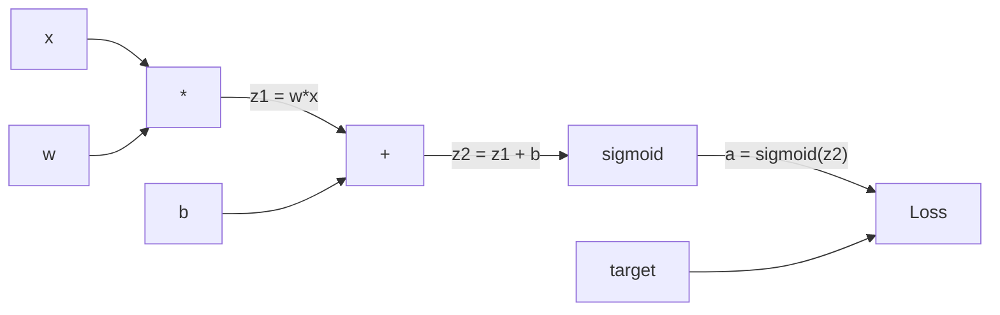
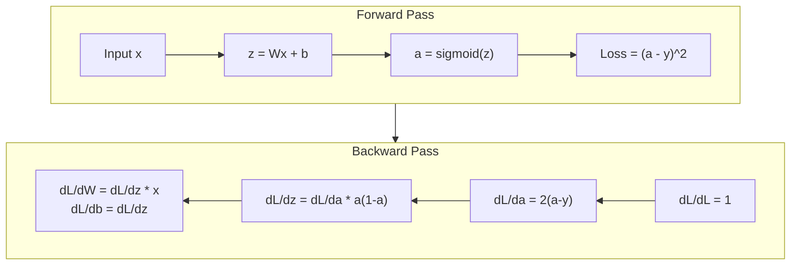
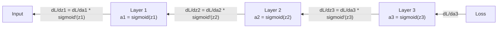

# Backpropagation from Scratch · 从零实现反向传播

> 反向传播（backpropagation）是让学习成为可能的算法。没有它，神经网络只是昂贵的随机数生成器。
>
> Backpropagation is the algorithm that makes learning possible. Without it, neural networks are just expensive random number generators.

**Type:** Build
**Languages:** Python
**Prerequisites:** Lesson 03.02 (Multi-Layer Networks)
**Time:** ~120 minutes

## Learning Objectives · 学习目标

- 实现一个基于 Value 的 autograd 引擎，构建计算图并通过拓扑排序计算梯度
- 用链式法则（chain rule）推导加法、乘法和 sigmoid 的反向传播
- 只用你从零造的反向传播引擎，在 XOR 和圆形分类上训练多层网络
- 识别深层 sigmoid 网络中的梯度消失（vanishing gradient）问题，并解释为什么梯度会指数级缩小

> Implement a Value-based autograd engine that builds a computational graph and computes gradients via topological sort
> Derive the backward pass for addition, multiplication, and sigmoid using the chain rule
> Train a multi-layer network on XOR and circle classification using only your from-scratch backpropagation engine
> Identify the vanishing gradient problem in deep sigmoid networks and explain why gradients shrink exponentially

## The Problem · 问题在哪

你的网络有一个隐藏层，768 个输入、3072 个输出。那就是 2,359,296 个权重。它做了一个错误的预测。是哪些权重导致的？逐个测试每个权重意味着 230 万次前向传播。反向传播用一次反向传播算出全部 230 万个梯度。这不是一种优化。这是「可训练」与「不可能」之间的差别。

朴素做法：取一个权重，轻轻挪动一丁点，再跑一次前向传播，看看损失是升了还是降了。这给你那个权重的梯度。然后对网络里的每个权重都这么干。再乘上几千个训练步和数百万个数据点。你需要地质年代级别的时间才能训练出任何有用的东西。

反向传播解决了这个问题。一次前向传播，一次反向传播，所有梯度都算出来了。诀窍是微积分里的链式法则，被系统地应用到一个计算图（computational graph）上。正是这个算法让深度学习变得实用。没有它，我们至今还卡在玩具问题上。

> Your network has a single hidden layer with 768 inputs and 3072 outputs. That's 2,359,296 weights. It made a wrong prediction. Which weights caused the error? Testing each weight individually means 2.3 million forward passes. Backpropagation computes all 2.3 million gradients in a single backward pass. That's not an optimization. That's the difference between trainable and impossible.
> The naive approach: take one weight, nudge it by a tiny amount, run the forward pass again, measure whether the loss went up or down. That gives you the gradient for that weight. Now do it for every weight in the network. Multiply by thousands of training steps and millions of data points. You'd need geological time to train anything useful.
> Backpropagation solves this. One forward pass, one backward pass, all gradients computed. The trick is the chain rule from calculus, applied systematically to a computational graph. This is the algorithm that made deep learning practical. Without it, we'd still be stuck on toy problems.

## The Concept · 概念

### The Chain Rule, Applied to Networks · 链式法则，应用到网络上

你在 Phase 01 第 05 课见过链式法则。快速回顾：若 y = f(g(x))，则 dy/dx = f'(g(x)) * g'(x)。你沿着链把导数乘起来。

在神经网络里，这条「链」就是从输入到损失的一串操作。每一层应用权重、加偏置、过激活。损失函数把最终输出与目标做比较。反向传播沿着这条链反向回溯，算出每个操作对误差的贡献。

> You saw the chain rule in Phase 01, Lesson 05. Quick recap: if y = f(g(x)), then dy/dx = f'(g(x)) * g'(x). You multiply derivatives along the chain.
> In a neural network, the "chain" is the sequence of operations from input to loss. Each layer applies weights, adds biases, passes through an activation. The loss function compares the final output to the target. Backpropagation traces this chain backward, computing how each operation contributed to the error.

### Computational Graphs · 计算图

每次前向传播都构建一个图。每个节点是一个操作（乘、加、sigmoid）。每条边向前携带一个值，向后携带一个梯度。



前向传播：值从左向右流。x 和 w 生成 z1 = w*x。加上 b 得到 z2。sigmoid 给出激活值 a。用损失函数把 a 与目标 y 比较。

反向传播：梯度从右向左流。从 dL/da（损失随激活的变化）开始。乘上 da/dz2（sigmoid 的导数），得到 dL/dz2。再分成 dL/db（它等于 dL/dz2，因为 z2 = z1 + b）和 dL/dz1。然后 dL/dw = dL/dz1 * x，dL/dx = dL/dz1 * w。

图里的每个节点在反向传播中只做一件事：接收从上游传来的梯度，乘上自己的局部导数，再往下传。

> Forward pass: values flow left to right. x and w produce z1 = w*x. Add b to get z2. Sigmoid gives activation a. Compare a to target y using the loss function.
> Backward pass: gradients flow right to left. Start with dL/da (how loss changes with the activation). Multiply by da/dz2 (sigmoid derivative). That gives dL/dz2. Split into dL/db (which equals dL/dz2, since z2 = z1 + b) and dL/dz1. Then dL/dw = dL/dz1 * x and dL/dx = dL/dz1 * w.
> Every node in the graph has one job during the backward pass: take the gradient coming from above, multiply by its local derivative, and pass it down.

### Forward vs Backward · 前向 vs 反向



前向传播存储每一个中间值：z、a、每层的输入。反向传播需要这些存下来的值来计算梯度。这就是反向传播核心的内存-计算权衡（memory-computation tradeoff）。你用内存（存储激活值）换速度（一次反向传播，而不是几百万次）。

> The forward pass stores every intermediate value: z, a, the inputs to each layer. The backward pass needs these stored values to compute gradients. This is the memory-computation tradeoff at the heart of backprop. You trade memory (storing activations) for speed (one pass instead of millions).

### Gradient Flow Through a Network · 梯度流经一个网络

对一个 3 层网络，梯度逐层链式传递：



在每一层，梯度都要乘上 sigmoid 的导数。sigmoid 的导数是 a * (1 - a)，最大值为 0.25（当 a = 0.5 时）。三层深，梯度最多已被乘上 0.25^3 = 0.0156。十层深：0.25^10 = 0.000001。

> For a 3-layer network, gradients chain through every layer:
> At each layer, the gradient gets multiplied by the sigmoid derivative. The sigmoid derivative is a * (1 - a), which maxes out at 0.25 (when a = 0.5). Three layers deep, the gradient has been multiplied by at most 0.25^3 = 0.0156. Ten layers deep: 0.25^10 = 0.000001.

### Vanishing Gradients · 梯度消失

这就是梯度消失（vanishing gradient）问题。sigmoid 把输出压在 0 和 1 之间。它的导数永远小于 0.25。堆足够多的 sigmoid 层，梯度就会缩到没有。早期层几乎学不到东西，因为它们收到的是接近零的梯度。

```
sigmoid(z):     Output range [0, 1]
sigmoid'(z):    Max value 0.25 (at z = 0)

After 5 layers:   gradient * 0.25^5 = 0.001x original
After 10 layers:  gradient * 0.25^10 = 0.000001x original
```

这就是深层 sigmoid 网络几乎训练不动的原因。补救办法——ReLU 和它的变体——是第 04 课的主题。现在你要明白的是：反向传播本身工作得完美无缺，问题出在它所穿过的事物上。

> This is the vanishing gradient problem. Sigmoid squashes its output between 0 and 1. Its derivative is always less than 0.25. Stack enough sigmoid layers and gradients shrink to nothing. Early layers barely learn because they receive near-zero gradients.
> This is why deep sigmoid networks are nearly impossible to train. The fix -- ReLU and its variants -- is the subject of Lesson 04. For now, understand that backprop works perfectly. The problem is what it's working through.

### Deriving Gradients for a 2-Layer Network · 推导一个两层网络的梯度

具体数学：网络有输入 x、带 sigmoid 的隐藏层、带 sigmoid 的输出层，损失为 MSE。

前向传播：
```
z1 = W1 * x + b1
a1 = sigmoid(z1)
z2 = W2 * a1 + b2
a2 = sigmoid(z2)
L = (a2 - y)^2
```

反向传播（一步步应用链式法则）：
```
dL/da2 = 2(a2 - y)
da2/dz2 = a2 * (1 - a2)
dL/dz2 = dL/da2 * da2/dz2 = 2(a2 - y) * a2 * (1 - a2)

dL/dW2 = dL/dz2 * a1
dL/db2 = dL/dz2

dL/da1 = dL/dz2 * W2
da1/dz1 = a1 * (1 - a1)
dL/dz1 = dL/da1 * da1/dz1

dL/dW1 = dL/dz1 * x
dL/db1 = dL/dz1
```

每个梯度都是从损失出发一路回溯的局部导数的乘积。反向传播的全部内容就这些。

> Concrete math for a network with input x, hidden layer with sigmoid, output layer with sigmoid, and MSE loss.
> Every gradient is a product of local derivatives traced back from the loss. That's all backpropagation is.

```figure
backprop-vanishing
```

## Build It · 动手造

### Step 1: The Value Node · 第 1 步：Value 节点

我们计算中的每个数字都变成一个 Value。它存储自己的数据、自己的梯度，以及自己是如何被创造出来的（这样它就知道如何反向计算梯度）。

```python
class Value:
    def __init__(self, data, children=(), op=''):
        self.data = data
        self.grad = 0.0
        self._backward = lambda: None
        self._children = set(children)
        self._op = op

    def __repr__(self):
        return f"Value(data={self.data:.4f}, grad={self.grad:.4f})"
```

还没有梯度（0.0）。还没有 backward 函数（空操作）。`_children` 记录哪些 Value 产出了这个 Value，这样我们稍后就能对图做拓扑排序。

> Every number in our computation becomes a Value. It stores its data, its gradient, and how it was created (so it knows how to compute gradients backward).
> No gradient yet (0.0). No backward function yet (no-op). The `_children` track which Values produced this one, so we can topologically sort the graph later.

### Step 2: Operations with Backward Functions · 第 2 步：带 backward 函数的运算

每个运算创建一个新的 Value，并定义梯度如何穿过它向后流动。

```python
def __add__(self, other):
    other = other if isinstance(other, Value) else Value(other)
    out = Value(self.data + other.data, (self, other), '+')

    def _backward():
        self.grad += out.grad
        other.grad += out.grad

    out._backward = _backward
    return out

def __mul__(self, other):
    other = other if isinstance(other, Value) else Value(other)
    out = Value(self.data * other.data, (self, other), '*')

    def _backward():
        self.grad += other.data * out.grad
        other.grad += self.data * out.grad

    out._backward = _backward
    return out
```

对加法：d(a+b)/da = 1，d(a+b)/db = 1。所以两个输入都直接拿到输出的梯度。

对乘法：d(a*b)/da = b，d(a*b)/db = a。每个输入拿到「对方的值 × 输出梯度」。

那个 `+=` 至关重要。一个 Value 可能被用于多个运算。它的梯度是所有路径传来的梯度之和。

> Each operation creates a new Value and defines how gradients flow backward through it.
> For addition: d(a+b)/da = 1, d(a+b)/db = 1. So both inputs get the output's gradient directly.
> For multiplication: d(a*b)/da = b, d(a*b)/db = a. Each input gets the other's value times the output gradient.
> The `+=` is critical. A Value might be used in multiple operations. Its gradient is the sum of gradients from all paths.

### Step 3: Sigmoid and Loss · 第 3 步：Sigmoid 与损失

```python
import math

def sigmoid(self):
    x = self.data
    x = max(-500, min(500, x))
    s = 1.0 / (1.0 + math.exp(-x))
    out = Value(s, (self,), 'sigmoid')

    def _backward():
        self.grad += (s * (1 - s)) * out.grad

    out._backward = _backward
    return out
```

sigmoid 的导数：sigmoid(x) * (1 - sigmoid(x))。前向传播时我们已经算出了 sigmoid(x) = s。直接复用。零额外开销。

```python
def mse_loss(predicted, target):
    diff = predicted + Value(-target)
    return diff * diff
```

单个输出的 MSE：(predicted - target)^2。我们把减法表示成加上一个取负的 Value。

> Sigmoid derivative: sigmoid(x) * (1 - sigmoid(x)). We computed sigmoid(x) = s during the forward pass. Reuse it. No extra work.
> MSE for a single output: (predicted - target)^2. We express subtraction as addition with a negated Value.

### Step 4: Backward Pass · 第 4 步：反向传播

拓扑排序保证我们按正确的顺序处理节点——一个节点的梯度在被继续传播之前已经完全累加好。

```python
def backward(self):
    topo = []
    visited = set()

    def build_topo(v):
        if v not in visited:
            visited.add(v)
            for child in v._children:
                build_topo(child)
            topo.append(v)

    build_topo(self)
    self.grad = 1.0
    for v in reversed(topo):
        v._backward()
```

从损失开始（梯度 = 1.0，因为 dL/dL = 1）。沿着排好序的图反向走。每个节点的 `_backward` 把梯度推给它的子节点。

> Topological sort ensures we process nodes in the right order -- a node's gradient is fully accumulated before we propagate through it.
> Start at the loss (gradient = 1.0, since dL/dL = 1). Walk backward through the sorted graph. Each node's `_backward` pushes gradients to its children.

### Step 5: Layer and Network · 第 5 步：Layer 与 Network

```python
import random

class Neuron:
    def __init__(self, n_inputs):
        scale = (2.0 / n_inputs) ** 0.5
        self.weights = [Value(random.uniform(-scale, scale)) for _ in range(n_inputs)]
        self.bias = Value(0.0)

    def __call__(self, x):
        act = sum((wi * xi for wi, xi in zip(self.weights, x)), self.bias)
        return act.sigmoid()

    def parameters(self):
        return self.weights + [self.bias]


class Layer:
    def __init__(self, n_inputs, n_outputs):
        self.neurons = [Neuron(n_inputs) for _ in range(n_outputs)]

    def __call__(self, x):
        out = [n(x) for n in self.neurons]
        return out[0] if len(out) == 1 else out

    def parameters(self):
        params = []
        for n in self.neurons:
            params.extend(n.parameters())
        return params


class Network:
    def __init__(self, sizes):
        self.layers = []
        for i in range(len(sizes) - 1):
            self.layers.append(Layer(sizes[i], sizes[i + 1]))

    def __call__(self, x):
        for layer in self.layers:
            x = layer(x)
            if not isinstance(x, list):
                x = [x]
        return x[0] if len(x) == 1 else x

    def parameters(self):
        params = []
        for layer in self.layers:
            params.extend(layer.parameters())
        return params

    def zero_grad(self):
        for p in self.parameters():
            p.grad = 0.0
```

一个 Neuron 接收输入，计算加权和 + 偏置，然后应用 sigmoid。权重初始化按 sqrt(2/n_inputs) 缩放，以防深层网络中 sigmoid 饱和。一个 Layer 是一列 Neuron。一个 Network 是一列 Layer。`parameters()` 方法收集所有可学习的 Value，供我们更新。

> A Neuron takes inputs, computes weighted sum + bias, and applies sigmoid. Weight initialization scales by sqrt(2/n_inputs) to prevent sigmoid saturation in deeper networks. A Layer is a list of Neurons. A Network is a list of Layers. The `parameters()` method collects all learnable Values so we can update them.

### Step 6: Train on XOR · 第 6 步：在 XOR 上训练

```python
random.seed(42)
net = Network([2, 4, 1])

xor_data = [
    ([0.0, 0.0], 0.0),
    ([0.0, 1.0], 1.0),
    ([1.0, 0.0], 1.0),
    ([1.0, 1.0], 0.0),
]

learning_rate = 1.0

for epoch in range(1000):
    total_loss = Value(0.0)
    for inputs, target in xor_data:
        x = [Value(i) for i in inputs]
        pred = net(x)
        loss = mse_loss(pred, target)
        total_loss = total_loss + loss

    net.zero_grad()
    total_loss.backward()

    for p in net.parameters():
        p.data -= learning_rate * p.grad

    if epoch % 100 == 0:
        print(f"Epoch {epoch:4d} | Loss: {total_loss.data:.6f}")

print("\nXOR Results:")
for inputs, target in xor_data:
    x = [Value(i) for i in inputs]
    pred = net(x)
    print(f"  {inputs} -> {pred.data:.4f} (expected {target})")
```

看着损失下降。从随机预测到正确的 XOR 输出，全程由反向传播驱动：算出梯度，把权重朝正确的方向轻推。

> Watch the loss decrease. From random predictions to correct XOR outputs, driven entirely by backpropagation computing gradients and nudging weights in the right direction.

### Step 7: Circle Classification · 第 7 步：圆形分类

在第 02 课，你为圆形分类手工调了权重。现在让网络自己学出来。

```python
random.seed(7)

def generate_circle_data(n=100):
    data = []
    for _ in range(n):
        x1 = random.uniform(-1.5, 1.5)
        x2 = random.uniform(-1.5, 1.5)
        label = 1.0 if x1 * x1 + x2 * x2 < 1.0 else 0.0
        data.append(([x1, x2], label))
    return data

circle_data = generate_circle_data(80)

circle_net = Network([2, 8, 1])
learning_rate = 0.5

for epoch in range(2000):
    random.shuffle(circle_data)
    total_loss_val = 0.0
    for inputs, target in circle_data:
        x = [Value(i) for i in inputs]
        pred = circle_net(x)
        loss = mse_loss(pred, target)
        circle_net.zero_grad()
        loss.backward()
        for p in circle_net.parameters():
            p.data -= learning_rate * p.grad
        total_loss_val += loss.data

    if epoch % 200 == 0:
        correct = 0
        for inputs, target in circle_data:
            x = [Value(i) for i in inputs]
            pred = circle_net(x)
            predicted_class = 1.0 if pred.data > 0.5 else 0.0
            if predicted_class == target:
                correct += 1
        accuracy = correct / len(circle_data) * 100
        print(f"Epoch {epoch:4d} | Loss: {total_loss_val:.4f} | Accuracy: {accuracy:.1f}%")
```

我们这里用的是 online SGD——每个样本之后立刻更新权重，而不是累积整个批次。这样打破对称性更快，也避免在整个损失面上 sigmoid 饱和。每个 epoch 打乱数据，防止网络记住顺序。

没有任何手工调参。网络自己发现了圆形决策边界。这就是反向传播的力量：你定义架构、损失函数和数据，算法自己算出权重。

> We use online SGD here -- update weights after each sample instead of accumulating the full batch. This breaks symmetry faster and avoids sigmoid saturation on the full loss landscape. Shuffling the data each epoch prevents the network from memorizing the order.
> No hand-tuning. The network discovers the circular decision boundary on its own. That's the power of backpropagation: you define the architecture, the loss function, and the data. The algorithm figures out the weights.

## Use It · 实战用法

PyTorch 用几行代码做完上面所有事。核心思想完全相同——autograd 在前向传播时构建计算图，再沿着它反向回溯来计算梯度。

```python
import torch
import torch.nn as nn

model = nn.Sequential(
    nn.Linear(2, 4),
    nn.Sigmoid(),
    nn.Linear(4, 1),
    nn.Sigmoid(),
)
optimizer = torch.optim.SGD(model.parameters(), lr=1.0)
criterion = nn.MSELoss()

X = torch.tensor([[0,0],[0,1],[1,0],[1,1]], dtype=torch.float32)
y = torch.tensor([[0],[1],[1],[0]], dtype=torch.float32)

for epoch in range(1000):
    pred = model(X)
    loss = criterion(pred, y)
    optimizer.zero_grad()
    loss.backward()
    optimizer.step()

print("PyTorch XOR Results:")
with torch.no_grad():
    for i in range(4):
        pred = model(X[i])
        print(f"  {X[i].tolist()} -> {pred.item():.4f} (expected {y[i].item()})")
```

`loss.backward()` 就是你的 `total_loss.backward()`。`optimizer.step()` 就是你手写的 `p.data -= lr * p.grad`。`optimizer.zero_grad()` 就是你的 `net.zero_grad()`。同一个算法，工业级实现。PyTorch 处理 GPU 加速、混合精度、梯度检查点和数百种层类型。但反向传播就是把链式法则应用到同一张计算图上。

训练跑一遍前向传播，然后一遍反向传播，然后更新权重。推理只跑前向传播。没有梯度，没有更新。这个区别很重要，因为生产环境中发生的是推理。当你调用 Claude 或 GPT 这样的 API 时，你跑的是推理——你的提示词向前流过网络，token 从另一头出来。没有任何权重改变。理解反向传播很重要，因为正是它塑造了那个网络里的每一个权重。

> PyTorch does everything above in a few lines. The core idea is identical -- autograd builds a computational graph during the forward pass and traces it backward to compute gradients.
> `loss.backward()` is your `total_loss.backward()`. `optimizer.step()` is your manual `p.data -= lr * p.grad`. `optimizer.zero_grad()` is your `net.zero_grad()`. Same algorithm, industrial-strength implementation. PyTorch handles GPU acceleration, mixed precision, gradient checkpointing, and hundreds of layer types. But the backward pass is the same chain rule applied to the same computational graph.
> Training runs the forward pass, then the backward pass, then updates weights. Inference runs only the forward pass. No gradients, no updates. This distinction matters because inference is what happens in production. When you call an API like Claude or GPT, you're running inference -- your prompt flows forward through the network, and tokens come out the other end. No weights change. Understanding backprop matters because it shaped every weight in that network.

## Ship It · 交付

本课产出：

- `outputs/prompt-gradient-debugger.md` —— 一个可复用提示词，用于诊断任何神经网络中的梯度问题（消失、爆炸、NaN）

> This lesson produces:
> - `outputs/prompt-gradient-debugger.md` -- a reusable prompt for diagnosing gradient problems (vanishing, exploding, NaN) in any neural network

## Exercises · 练习

1. 给 Value 类添加一个 `__sub__` 方法（a - b = a + (-1 * b)）。再实现一个 `__neg__` 方法。对 (a - b)^2 这样的简单表达式，用手工计算对比来验证梯度是正确的。

2. 给 Value 添加一个 `relu` 方法（输出 max(0, x)，x > 0 时导数为 1，否则为 0）。把隐藏层的 sigmoid 换成 relu，再次在 XOR 上训练。比较收敛速度。你应该会看到训练更快——这是第 04 课的预告。

3. 在 Value 上实现一个支持整数幂的 `__pow__` 方法。用它把 `mse_loss` 换成正经的 `(predicted - target) ** 2` 表达式。验证梯度与原实现一致。

4. 给训练循环加上梯度裁剪：调用 `backward()` 之后，把所有梯度裁剪到 [-1, 1]。训练一个更深的网络（4+ 层 sigmoid），对比有无裁剪的损失曲线。这是你对抗梯度爆炸的第一道防线。

5. 做一个可视化：在 XOR 上训练完之后，打印网络中每个参数的梯度。找出哪一层的梯度最小。这就是你在 Concept 部分读到的梯度消失问题的实证。

> Add a `__sub__` method to the Value class (a - b = a + (-1 * b)). Then implement a `__neg__` method. Verify that the gradients are correct by comparing with manual calculation for a simple expression like (a - b)^2.
> Add a `relu` method to Value (output max(0, x), derivative is 1 if x > 0, else 0). Replace sigmoid with relu in the hidden layers and train on XOR again. Compare convergence speed. You should see faster training -- this previews Lesson 04.
> Implement a `__pow__` method on Value for integer powers. Use it to replace `mse_loss` with a proper `(predicted - target) ** 2` expression. Verify gradients match the original implementation.
> Add gradient clipping to the training loop: after calling `backward()`, clip all gradients to [-1, 1]. Train a deeper network (4+ layers with sigmoid) and compare loss curves with and without clipping. This is your first defense against exploding gradients.
> Build a visualization: after training on XOR, print the gradient of every parameter in the network. Identify which layer has the smallest gradients. This demonstrates the vanishing gradient problem you read about in the Concept section.

## Key Terms · 术语表

| Term | 人们怎么说 | 它实际上是什么意思 |
|------|----------------|----------------------|
| Backpropagation | 「网络在学习」 | 一个算法：沿计算图反向应用链式法则，为每个权重算出 dL/dw |
| Computational graph | 「网络的结构」 | 一个有向无环图，节点是操作，边向前携带值、向后携带梯度 |
| Chain rule | 「把导数乘起来」 | 若 y = f(g(x))，则 dy/dx = f'(g(x)) * g'(x)——反向传播的数学基础 |
| Gradient | 「最陡上升的方向」 | 损失对某个参数的偏导数——告诉你如何改动该参数来降低损失 |
| Vanishing gradient | 「深网络学不动」 | 梯度穿过带饱和激活（如 sigmoid）的层时按指数级缩小 |
| Forward pass | 「跑一遍网络」 | 从输入出发按顺序应用每层的运算算出输出，并存储中间值 |
| Backward pass | 「计算梯度」 | 反向遍历计算图，在每个节点用链式法则累加梯度 |
| Learning rate | 「它学得多快」 | 控制权重更新步长的标量：w_new = w_old - lr * gradient |
| Topological sort | 「正确的顺序」 | 图节点的一种排序，每个节点都排在它依赖的所有节点之后——保证梯度在传播之前完全累加 |
| Autograd | 「自动微分」 | 在前向计算时构建计算图并自动计算梯度的系统——PyTorch 引擎做的就是这件事 |

## Further Reading · 延伸阅读

- Rumelhart, Hinton & Williams, "Learning representations by back-propagating errors" (1986) —— 让反向传播成为主流、解锁多层网络训练的那篇论文
- 3Blue1Brown, "Neural Networks" series (https://www.youtube.com/playlist?list=PLZHQObOWTQDNU6R1_67000Dx_ZCJB-3pi) —— 反向传播与梯度在网络中流动的最好可视化讲解
