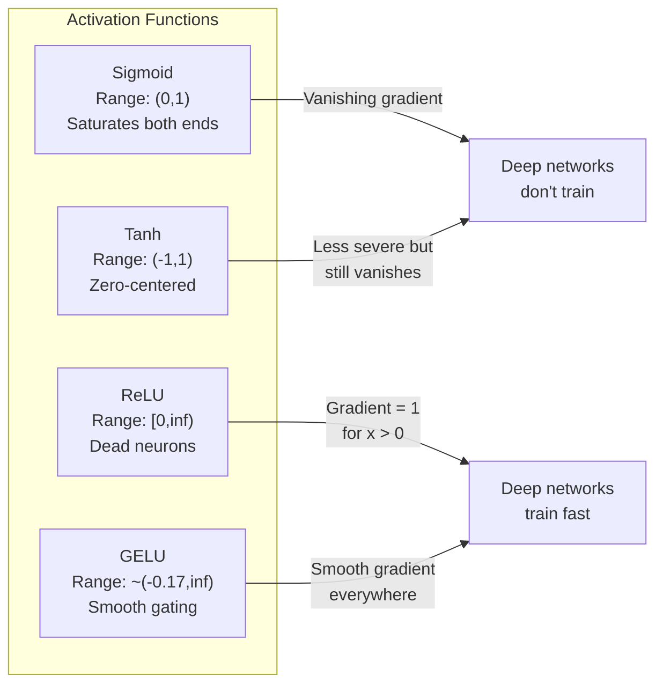
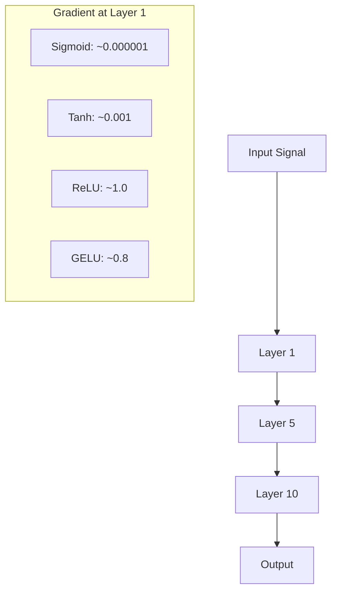
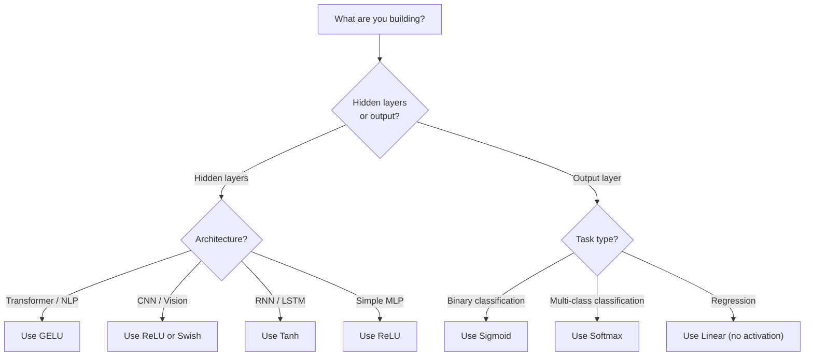

# Activation Functions · 激活函数

> 没有非线性，你的 100 层网络只是一次花哨的矩阵乘法。激活函数，就是让神经网络学会「用曲线思考」的闸门。
>
> Without nonlinearity, your 100-layer network is a fancy matrix multiply. Activations are the gates that let neural networks think in curves.

**Type:** Build
**Languages:** Python
**Prerequisites:** Lesson 03.03 (Backpropagation)
**Time:** ~75 minutes

## Learning Objectives · 学习目标

- 从零实现 sigmoid、tanh、ReLU、Leaky ReLU、GELU、Swish、softmax 以及它们的导数
- 通过测量不同激活函数在 10+ 层中的激活幅值，诊断梯度消失（vanishing gradient）问题
- 检测 ReLU 网络中的死亡神经元（dead neurons），并解释 GELU 为什么能避开这种失效模式
- 针对给定的架构（transformer、CNN、RNN、输出层）选对激活函数

> Implement sigmoid, tanh, ReLU, Leaky ReLU, GELU, Swish, and softmax with their derivatives from scratch
> Diagnose the vanishing gradient problem by measuring activation magnitudes through 10+ layers with different activations
> Detect dead neurons in a ReLU network and explain why GELU avoids this failure mode
> Select the correct activation function for a given architecture (transformer, CNN, RNN, output layer)

---

## The Problem · 问题在哪

把两个线性变换叠起来：y = W2(W1x + b1) + b2。展开：y = W2W1x + W2b1 + b2。这不就是 y = Ax + c —— 一次单独的线性变换吗。线性层叠多少层都没用，结果都会塌缩成一次矩阵乘法。你那 100 层网络的表达能力，和单层一模一样。

这不是理论趣味题。它意味着深层线性网络真的学不会 XOR，分不开螺旋数据集，认不出人脸。没有激活函数，深度就是个幻觉。

激活函数负责打破线性。它们把每一层的输出用一个非线性函数「掰弯」，让网络有能力弯曲决策边界、逼近任意函数、真正开始学习。但选错激活函数，你的梯度会消失成零（深层网络里的 sigmoid）、爆炸到无穷（无界激活又没配小心的初始化），或者神经元永久死亡（带着大负偏置的 ReLU）。激活函数的选择，直接决定你的网络到底学不学得起来。

> Stack two linear transformations: y = W2(W1x + b1) + b2. Expand it: y = W2W1x + W2b1 + b2. That's just y = Ax + c -- a single linear transformation. No matter how many linear layers you stack, the result collapses to one matrix multiply. Your 100-layer network has the same representational power as a single layer. ... This is not a theoretical curiosity. ... Without activation functions, depth is an illusion. ... Activation functions break the linearity. ... But pick the wrong activation and your gradients vanish to zero (sigmoid in deep networks), explode to infinity (unbounded activations without careful initialization), or your neurons die permanently (ReLU with large negative biases). The choice of activation function directly determines whether your network learns at all.

---

## The Concept · 概念

### Why Nonlinearity Is Necessary · 为什么必须非线性

矩阵乘法是可组合的（composable）。一个向量先乘矩阵 A、再乘矩阵 B，和直接乘 AB 完全等价。这意味着叠十层线性层，在数学上等价于一层拿着一个大矩阵的线性层。那么多参数、那么深的深度 —— 全部浪费。你需要某个东西去打断这条链。这就是激活函数的工作。

证明给你看。线性层计算 f(x) = Wx + b。叠两层：

```
Layer 1: h = W1 * x + b1
Layer 2: y = W2 * h + b2
```

代入：

```
y = W2 * (W1 * x + b1) + b2
y = (W2 * W1) * x + (W2 * b1 + b2)
y = A * x + c
```

一层。在层与层之间插入一个非线性激活 g()：

```
h = g(W1 * x + b1)
y = W2 * h + b2
```

现在代入失效了。W2 * g(W1 * x + b1) + b2 无法再被化简成单个线性变换。网络从此能表达非线性函数。每多一层带激活的层，就多一份表达能力。

> Matrix multiplication is composable. Multiplying a vector by matrix A then matrix B is identical to multiplying by AB. This means stacking ten linear layers is mathematically equivalent to one linear layer with one big matrix. All those parameters, all that depth -- wasted. You need something to break the chain. That's what activation functions do.
> Here is the proof. A linear layer computes f(x) = Wx + b. Stack two:
> Substitute:
> One layer. Insert a nonlinear activation g() between layers:
> Now the substitution breaks. W2 * g(W1 * x + b1) + b2 cannot be reduced to a single linear transformation. The network can represent nonlinear functions. Each additional layer with an activation adds representational capacity.

---

### Sigmoid · Sigmoid 激活函数

神经网络最早使用的激活函数。

```
sigmoid(x) = 1 / (1 + e^(-x))
```

输出范围 (0, 1)。光滑、可微，把任意实数映射成一个类似概率的值。

导数：

```
sigmoid'(x) = sigmoid(x) * (1 - sigmoid(x))
```

这个导数的最大值是 0.25，出现在 x = 0 处。反向传播时梯度逐层相乘，十层 sigmoid 意味着梯度最多被 0.25 连乘十次：

```
0.25^10 = 0.000000953674
```

不到原始信号的百万分之一。这就是梯度消失（vanishing gradient）问题。前面几层的梯度小得可怜，权重几乎不更新。网络「看起来」在学习 —— 后面几层的 loss 在降 —— 但最前面几层已经被冻住。深层 sigmoid 网络根本训练不起来。

另一个问题：sigmoid 的输出永远是正的（0 到 1），这意味着权重的梯度永远同号。这会让梯度下降走出之字形（zig-zag）。

> The original activation function for neural networks.
> Output range: (0, 1). Smooth, differentiable, maps any real number to a probability-like value.
> The derivative:
> The maximum value of this derivative is 0.25, occurring at x = 0. In backpropagation, gradients multiply through layers. Ten layers of sigmoid means the gradient gets multiplied by at most 0.25 ten times:
> Less than one millionth of the original signal. This is the vanishing gradient problem. Gradients in early layers become so small that weights barely update. The network appears to learn -- loss decreases in later layers -- but the first layers are frozen. Deep sigmoid networks simply do not train.
> Additional problem: sigmoid outputs are always positive (0 to 1), which means gradients on weights are always the same sign. This causes zig-zagging during gradient descent.

---

### Tanh · Tanh 激活函数

sigmoid 的零中心版本。

```
tanh(x) = (e^x - e^(-x)) / (e^x + e^(-x))
```

输出范围 (-1, 1)。零中心，消除了之字形问题。

导数：

```
tanh'(x) = 1 - tanh(x)^2
```

最大导数在 x = 0 处为 1.0 —— 是 sigmoid 的四倍。但梯度消失问题依然存在：对大的正输入或负输入，导数趋近于零。十层照样把梯度压碎，只是没那么狠。

> The centered version of sigmoid.
> Output range: (-1, 1). Zero-centered, which eliminates the zig-zag problem.
> The derivative:
> Maximum derivative is 1.0 at x = 0 -- four times better than sigmoid. But the vanishing gradient problem still exists. For large positive or negative inputs, the derivative approaches zero. Ten layers still crush the gradient, just less aggressively.

---

### ReLU: The Breakthrough · ReLU：突破性的那一个

修正线性单元（Rectified Linear Unit）。2010 年由 Nair 和 Hinton 在深度学习中推广（函数本身可追溯到 Fukushima 1969 年的工作），它改变了一切。

```
relu(x) = max(0, x)
```

输出范围 [0, 无穷)。导数极其简单：

```
relu'(x) = 1  if x > 0
            0  if x <= 0
```

正输入没有梯度消失：梯度恰好是 1，原样直通。这就是深度网络变得可训练的原因 —— ReLU 让梯度幅值跨层保持。

但它有一个失效模式：死亡神经元（dead neuron）问题。如果一个神经元的加权输入恒为负（因为大负偏置或倒霉的权重初始化），它的输出就恒为零、梯度恒为零、永不更新。它永久死亡。实践中，ReLU 网络里 10-40% 的神经元可能在训练过程中死掉。

> Rectified Linear Unit. Popularized for deep learning by Nair and Hinton in 2010 (the function itself dates to Fukushima's 1969 work), it changed everything.
> Output range: [0, infinity). The derivative is trivially simple:
> No vanishing gradient for positive inputs. The gradient is exactly 1, passed straight through. This is why deep networks became trainable -- ReLU preserves gradient magnitude across layers.
> But there is a failure mode: the dead neuron problem. If a neuron's weighted input is always negative (due to a large negative bias or unfortunate weight initialization), its output is always zero, its gradient is always zero, and it never updates. It is permanently dead. In practice, 10-40% of neurons in a ReLU network can die during training.

---

### Leaky ReLU · Leaky ReLU

死亡神经元最简单的修复。

```
leaky_relu(x) = x        if x > 0
                alpha * x if x <= 0
```

其中 alpha 是一个小常数，典型取 0.01。负半边有一个小斜率而不是零，所以死掉的神经元仍能得到梯度信号，可以恢复。

> The simplest fix for dead neurons.
> Where alpha is a small constant, typically 0.01. The negative side has a small slope instead of zero, so dead neurons still get a gradient signal and can recover.

---

### GELU: The Modern Default · GELU：现代的默认选择

高斯误差线性单元（Gaussian Error Linear Unit）。由 Hendrycks 和 Gimpel 于 2016 年提出。BERT、GPT 和大多数现代 transformer 的默认激活函数。

```
gelu(x) = x * Phi(x)
```

其中 Phi(x) 是标准正态分布的累积分布函数。实践中使用的近似：

```
gelu(x) ~= 0.5 * x * (1 + tanh(sqrt(2/pi) * (x + 0.044715 * x^3)))
```

GELU 处处光滑，允许小的负值（不像 ReLU 那样硬截成零），并且有概率解释：它按每个输入在高斯分布下取正的可能性对其加权。这种平滑门控在 transformer 架构中优于 ReLU，因为它提供更好的梯度流，并彻底避开死亡神经元问题。

> Gaussian Error Linear Unit. Introduced by Hendrycks and Gimpel in 2016. Default activation in BERT, GPT, and most modern transformers.
> Where Phi(x) is the cumulative distribution function of the standard normal distribution. The approximation used in practice:
> GELU is smooth everywhere, allows small negative values (unlike ReLU which hard-clips to zero), and has a probabilistic interpretation: it weights each input by how likely it is to be positive under a Gaussian distribution. This smooth gating outperforms ReLU in transformer architectures because it provides better gradient flow and avoids the dead neuron problem entirely.

---

### Swish / SiLU · Swish / SiLU

通过自动搜索发现的自我门控（self-gated）激活函数，Ramachandran 等人 2017 年提出。

```
swish(x) = x * sigmoid(x)
```

Swish 的正式定义就是 x * sigmoid(x)。Google 通过在激活函数空间上自动搜索发现了它 —— 让神经网络设计神经网络的零件。

和 GELU 一样，它光滑、非单调、允许小的负值。区别很微妙：Swish 用 sigmoid 做门控，GELU 用高斯 CDF。实践中两者的性能几乎一样。Swish 用于 EfficientNet 和一些视觉模型，GELU 统治语言模型。

> Self-gated activation discovered by Ramachandran et al. in 2017 through automated search.
> Swish is formally x * sigmoid(x). Google discovered it through automated search over activation function space -- a neural network designing parts of neural networks.
> Like GELU, it is smooth, non-monotonic, and allows small negative values. The difference is subtle: Swish uses sigmoid for gating while GELU uses the Gaussian CDF. In practice, performance is nearly identical. Swish is used in EfficientNet and some vision models. GELU dominates in language models.

---

### Softmax: The Output Activation · Softmax：输出层激活

不用于隐藏层。Softmax 把原始分数向量（logits）转换成概率分布。

```
softmax(x_i) = e^(x_i) / sum(e^(x_j) for all j)
```

每个输出都在 0 和 1 之间，所有输出加起来等于 1。这使它成为多分类的标准最终激活。最大的 logit 拿到最高概率，但与 argmax 不同，softmax 可微，并保留相对置信度信息。

> Not used in hidden layers. Softmax converts a vector of raw scores (logits) into a probability distribution.
> Every output is between 0 and 1. All outputs sum to 1. This makes it the standard final activation for multi-class classification. The largest logit gets the highest probability, but unlike argmax, softmax is differentiable and preserves information about relative confidence.

---

### Comparison of Shapes · 形状对比



---

### Gradient Flow Comparison · 梯流对比



---

### Which Activation When · 什么场合用什么激活



```figure
softmax-temperature
```

---

## Build It · 动手造

### Step 1: Implement All Activation Functions with Derivatives · 第 1 步：连同导数一起实现所有激活函数

每个函数接收一个浮点数、返回一个浮点数。每个导数函数接收同样的输入、返回梯度。

```python
import math

def sigmoid(x):
    x = max(-500, min(500, x))
    return 1.0 / (1.0 + math.exp(-x))

def sigmoid_derivative(x):
    s = sigmoid(x)
    return s * (1 - s)

def tanh_act(x):
    return math.tanh(x)

def tanh_derivative(x):
    t = math.tanh(x)
    return 1 - t * t

def relu(x):
    return max(0.0, x)

def relu_derivative(x):
    return 1.0 if x > 0 else 0.0

def leaky_relu(x, alpha=0.01):
    return x if x > 0 else alpha * x

def leaky_relu_derivative(x, alpha=0.01):
    return 1.0 if x > 0 else alpha

def gelu(x):
    return 0.5 * x * (1 + math.tanh(math.sqrt(2 / math.pi) * (x + 0.044715 * x ** 3)))

def gelu_derivative(x):
    phi = 0.5 * (1 + math.erf(x / math.sqrt(2)))
    pdf = math.exp(-0.5 * x * x) / math.sqrt(2 * math.pi)
    return phi + x * pdf

def swish(x):
    return x * sigmoid(x)

def swish_derivative(x):
    s = sigmoid(x)
    return s + x * s * (1 - s)

def softmax(xs):
    max_x = max(xs)
    exps = [math.exp(x - max_x) for x in xs]
    total = sum(exps)
    return [e / total for e in exps]
```

> Each function takes a single float and returns a float. Each derivative function takes the same input and returns the gradient.

---

### Step 2: Visualize Where Gradients Die · 第 2 步：可视化梯度在哪里死掉

在 -5 到 5 之间取 100 个均匀分布的点计算梯度。打印一个文本直方图，展示每个激活函数的梯度在哪些区域接近零。

```python
def gradient_scan(name, derivative_fn, start=-5, end=5, n=100):
    step = (end - start) / n
    near_zero = 0
    healthy = 0
    for i in range(n):
        x = start + i * step
        g = derivative_fn(x)
        if abs(g) < 0.01:
            near_zero += 1
        else:
            healthy += 1
    pct_dead = near_zero / n * 100
    print(f"{name:15s}: {healthy:3d} healthy, {near_zero:3d} near-zero ({pct_dead:.0f}% dead zone)")

gradient_scan("Sigmoid", sigmoid_derivative)
gradient_scan("Tanh", tanh_derivative)
gradient_scan("ReLU", relu_derivative)
gradient_scan("Leaky ReLU", leaky_relu_derivative)
gradient_scan("GELU", gelu_derivative)
gradient_scan("Swish", swish_derivative)
```

> Compute the gradient at 100 evenly-spaced points from -5 to 5. Print a text histogram showing where each activation's gradient is near-zero.

---

### Step 3: Vanishing Gradient Experiment · 第 3 步：梯度消失实验

用 sigmoid 和 ReLU 分别把一个信号前向传播过 N 层。测量激活幅值如何变化。

```python
import random

def vanishing_gradient_experiment(activation_fn, name, n_layers=10, n_inputs=5):
    random.seed(42)
    values = [random.gauss(0, 1) for _ in range(n_inputs)]

    print(f"\n{name} through {n_layers} layers:")
    for layer in range(n_layers):
        weights = [random.gauss(0, 1) for _ in range(n_inputs)]
        z = sum(w * v for w, v in zip(weights, values))
        activated = activation_fn(z)
        magnitude = abs(activated)
        bar = "#" * int(magnitude * 20)
        print(f"  Layer {layer+1:2d}: magnitude = {magnitude:.6f} {bar}")
        values = [activated] * n_inputs

vanishing_gradient_experiment(sigmoid, "Sigmoid")
vanishing_gradient_experiment(relu, "ReLU")
vanishing_gradient_experiment(gelu, "GELU")
```

> Forward-pass a signal through N layers using sigmoid vs ReLU. Measure how the activation magnitude changes.

---

### Step 4: Dead Neuron Detector · 第 4 步：死亡神经元检测器

建一个 ReLU 网络，把随机输入喂进去，统计有多少神经元从未激活。

```python
def dead_neuron_detector(n_inputs=5, hidden_size=20, n_samples=1000):
    random.seed(0)
    weights = [[random.gauss(0, 1) for _ in range(n_inputs)] for _ in range(hidden_size)]
    biases = [random.gauss(0, 1) for _ in range(hidden_size)]

    fire_counts = [0] * hidden_size

    for _ in range(n_samples):
        inputs = [random.gauss(0, 1) for _ in range(n_inputs)]
        for neuron_idx in range(hidden_size):
            z = sum(w * x for w, x in zip(weights[neuron_idx], inputs)) + biases[neuron_idx]
            if relu(z) > 0:
                fire_counts[neuron_idx] += 1

    dead = sum(1 for c in fire_counts if c == 0)
    rarely_fire = sum(1 for c in fire_counts if 0 < c < n_samples * 0.05)
    healthy = hidden_size - dead - rarely_fire

    print(f"\nDead Neuron Report ({hidden_size} neurons, {n_samples} samples):")
    print(f"  Dead (never fired):     {dead}")
    print(f"  Barely alive (<5%):     {rarely_fire}")
    print(f"  Healthy:                {healthy}")
    print(f"  Dead neuron rate:       {dead/hidden_size*100:.1f}%")

    for i, c in enumerate(fire_counts):
        status = "DEAD" if c == 0 else "WEAK" if c < n_samples * 0.05 else "OK"
        bar = "#" * (c * 40 // n_samples)
        print(f"  Neuron {i:2d}: {c:4d}/{n_samples} fires [{status:4s}] {bar}")

dead_neuron_detector()
```

> Create a ReLU network, pass random inputs through it, count how many neurons never fire.

---

### Step 5: Training Comparison -- Sigmoid vs ReLU vs GELU · 第 5 步：训练对比

用三种不同的激活函数，在 circle 数据集（圆内的点 = 类 1，圆外的点 = 类 0）上训练同一个两层网络。比较收敛速度。

```python
def make_circle_data(n=200, seed=42):
    random.seed(seed)
    data = []
    for _ in range(n):
        x = random.uniform(-2, 2)
        y = random.uniform(-2, 2)
        label = 1.0 if x * x + y * y < 1.5 else 0.0
        data.append(([x, y], label))
    return data


class ActivationNetwork:
    def __init__(self, activation_fn, activation_deriv, hidden_size=8, lr=0.1):
        random.seed(0)
        self.act = activation_fn
        self.act_d = activation_deriv
        self.lr = lr
        self.hidden_size = hidden_size

        self.w1 = [[random.gauss(0, 0.5) for _ in range(2)] for _ in range(hidden_size)]
        self.b1 = [0.0] * hidden_size
        self.w2 = [random.gauss(0, 0.5) for _ in range(hidden_size)]
        self.b2 = 0.0

    def forward(self, x):
        self.x = x
        self.z1 = []
        self.h = []
        for i in range(self.hidden_size):
            z = self.w1[i][0] * x[0] + self.w1[i][1] * x[1] + self.b1[i]
            self.z1.append(z)
            self.h.append(self.act(z))

        self.z2 = sum(self.w2[i] * self.h[i] for i in range(self.hidden_size)) + self.b2
        self.out = sigmoid(self.z2)
        return self.out

    def backward(self, target):
        error = self.out - target
        d_out = error * self.out * (1 - self.out)

        for i in range(self.hidden_size):
            d_h = d_out * self.w2[i] * self.act_d(self.z1[i])
            self.w2[i] -= self.lr * d_out * self.h[i]
            for j in range(2):
                self.w1[i][j] -= self.lr * d_h * self.x[j]
            self.b1[i] -= self.lr * d_h
        self.b2 -= self.lr * d_out

    def train(self, data, epochs=200):
        losses = []
        for epoch in range(epochs):
            total_loss = 0
            correct = 0
            for x, y in data:
                pred = self.forward(x)
                self.backward(y)
                total_loss += (pred - y) ** 2
                if (pred >= 0.5) == (y >= 0.5):
                    correct += 1
            avg_loss = total_loss / len(data)
            accuracy = correct / len(data) * 100
            losses.append(avg_loss)
            if epoch % 50 == 0 or epoch == epochs - 1:
                print(f"    Epoch {epoch:3d}: loss={avg_loss:.4f}, accuracy={accuracy:.1f}%")
        return losses


data = make_circle_data()

configs = [
    ("Sigmoid", sigmoid, sigmoid_derivative),
    ("ReLU", relu, relu_derivative),
    ("GELU", gelu, gelu_derivative),
]

results = {}
for name, act_fn, act_d_fn in configs:
    print(f"\n=== Training with {name} ===")
    net = ActivationNetwork(act_fn, act_d_fn, hidden_size=8, lr=0.1)
    losses = net.train(data, epochs=200)
    results[name] = losses

print("\n=== Final Loss Comparison ===")
for name, losses in results.items():
    print(f"  {name:10s}: start={losses[0]:.4f} -> end={losses[-1]:.4f} (improvement: {(1 - losses[-1]/losses[0])*100:.1f}%)")
```

> Train the same two-layer network on the circle dataset (points inside a circle = class 1, outside = class 0) with three different activations. Compare convergence speed.

---

## Use It · 实战用法

PyTorch 以函数式和模块式两种形式提供了以上所有激活函数：

```python
import torch
import torch.nn as nn
import torch.nn.functional as F

x = torch.randn(4, 10)

relu_out = F.relu(x)
gelu_out = F.gelu(x)
sigmoid_out = torch.sigmoid(x)
swish_out = F.silu(x)

logits = torch.randn(4, 5)
probs = F.softmax(logits, dim=1)

model = nn.Sequential(
    nn.Linear(10, 64),
    nn.GELU(),
    nn.Linear(64, 32),
    nn.GELU(),
    nn.Linear(32, 5),
)
```

transformer 的隐藏层：GELU。CNN 的隐藏层：ReLU。分类任务的输出层：softmax。回归任务的输出层：不用（线性）。要概率的输出层：sigmoid。就这么简单。从这些默认值开始，只在有证据时才改。

RNN 和 LSTM 的隐藏态用 tanh、门用 sigmoid，但如果你今天是白手起家搭网络，多半根本不会用 RNN。如果你的 ReLU 网络里出现神经元死亡，换成 GELU。没有特殊理由别急着上 Leaky ReLU —— GELU 既解决死亡神经元问题，又带来更好的梯度流。

> PyTorch provides all of these as both functional and module forms:
> Hidden layers in a transformer: GELU. Hidden layers in a CNN: ReLU. Output layer for classification: softmax. Output layer for regression: none (linear). Output layer for probabilities: sigmoid. That's it. Start with these defaults. Change them only when you have evidence.
> RNNs and LSTMs use tanh for hidden state and sigmoid for gates, but if you're building from scratch today, you're probably not using RNNs. If neurons are dying in your ReLU network, switch to GELU. Don't reach for Leaky ReLU unless you have a specific reason -- GELU solves the dead neuron problem and gives better gradient flow.

---

## Ship It · 交付

本课产出：
- `outputs/prompt-activation-selector.md` —— 一个可复用的提示词，帮你在任何架构下选对激活函数

> This lesson produces:
> - `outputs/prompt-activation-selector.md` -- a reusable prompt that helps you pick the right activation function for any architecture

---

## Exercises · 练习

1. 实现 Parametric ReLU（PReLU）：负斜率 alpha 是一个可学习的参数。在 circle 数据集上训练它，并与固定斜率的 Leaky ReLU 对比。

2. 把梯度消失实验改成 50 层再跑一遍。画出 sigmoid、tanh、ReLU、GELU 每一层的幅值。每种激活函数的信号分别在第几层实际上归零？

3. 实现 ELU（Exponential Linear Unit）：elu(x) = x if x > 0, alpha * (e^x - 1) if x <= 0。在同一个网络上比较它与 ReLU 的死亡神经元率。

4. 做一个训练期间运行的「梯度健康监视器」：每个 epoch 计算每一层的平均梯度幅值。当任何一层的梯度低于 0.001 或超过 100 时打印警告。

5. 把训练对比实验改成使用第 01 课的 XOR 数据集，而不是圆圈数据集。哪种激活函数在 XOR 上收敛最快？为什么这与圆圈数据集上的结果不同？

> Implement Parametric ReLU (PReLU) where the negative slope alpha is a learnable parameter. Train it on the circle dataset and compare to fixed Leaky ReLU.
> Run the vanishing gradient experiment with 50 layers instead of 10. Plot the magnitude at each layer for sigmoid, tanh, ReLU, and GELU. At which layer does each activation's signal effectively reach zero?
> Implement the ELU (Exponential Linear Unit): elu(x) = x if x > 0, alpha * (e^x - 1) if x <= 0. Compare its dead neuron rate to ReLU on the same network.
> Build a "gradient health monitor" that runs during training: at each epoch, compute the average gradient magnitude at each layer. Print a warning when any layer's gradient drops below 0.001 or exceeds 100.
> Modify the training comparison to use the XOR dataset from Lesson 01 instead of circles. Which activation converges fastest on XOR? Why does this differ from the circle results?

---

## Key Terms · 术语表

| Term | What people say | What it actually means |
|------|----------------|----------------------|
| Activation function | 「非线性那一部分」 | 作用在每个神经元输出上、打破线性、让网络能学非线性映射的函数 |
| Vanishing gradient | 「梯度在深网络里消失了」 | 当激活函数的导数小于 1 时，梯度逐层指数收缩，让早期层无法训练 |
| Exploding gradient | 「梯度爆炸了」 | 当有效乘子超过 1 时，梯度逐层指数增长，导致训练不稳定 |
| Dead neuron | 「停止学习的神经元」 | 输入恒为负的 ReLU 神经元，输出恒为零、梯度恒为零 |
| Sigmoid | 「把值压到 0-1」 | logistic 函数 1/(1+e^-x)，历史上很重要，但在深网络中造成梯度消失 |
| ReLU | 「把负数截成零」 | max(0, x) —— 通过保持梯度幅值让深度学习变得实用的激活函数 |
| GELU | 「transformer 的激活函数」 | Gaussian Error Linear Unit，一种按输入取正的概率对其加权的平滑激活函数 |
| Swish/SiLU | 「自门控的 ReLU」 | x * sigmoid(x)，通过自动搜索发现，用于 EfficientNet |
| Softmax | 「把分数变成概率」 | 把 logits 向量归一化成概率分布，所有值在 (0,1) 之间且总和为 1 |
| Leaky ReLU | 「不会死的 ReLU」 | max(alpha*x, x)，alpha 很小（0.01），靠允许小的负梯度避免死亡神经元 |
| Saturation | 「sigmoid 的平坦部分」 | 激活函数导数趋近于零的区域，阻断梯度流动 |
| Logit | 「softmax 之前的原始分数」 | 最后一层在应用 softmax 或 sigmoid 之前未归一化的输出 |

---

## Further Reading · 延伸阅读

- Nair & Hinton, "Rectified Linear Units Improve Restricted Boltzmann Machines" (2010) —— 提出 ReLU、让深度网络可训练的那篇论文
- Hendrycks & Gimpel, "Gaussian Error Linear Units (GELUs)" (2016) —— 提出后来成为 transformer 默认激活函数的那篇论文
- Ramachandran et al., "Searching for Activation Functions" (2017) —— 用自动搜索发现 Swish，证明激活函数的设计可以自动化
- Glorot & Bengio, "Understanding the difficulty of training deep feedforward neural networks" (2010) —— 诊断梯度消失/爆炸并提出 Xavier 初始化的那篇论文
- Goodfellow, Bengio, Courville, "Deep Learning" Chapter 6.3 (https://www.deeplearningbook.org/) —— 关于隐藏单元与激活函数的严谨论述
