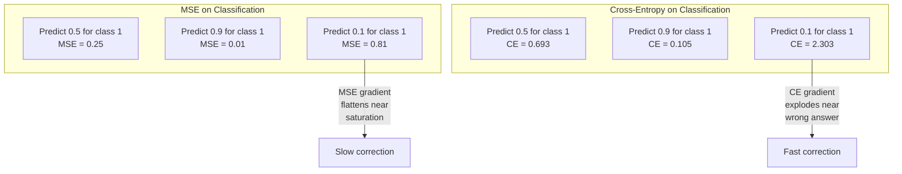
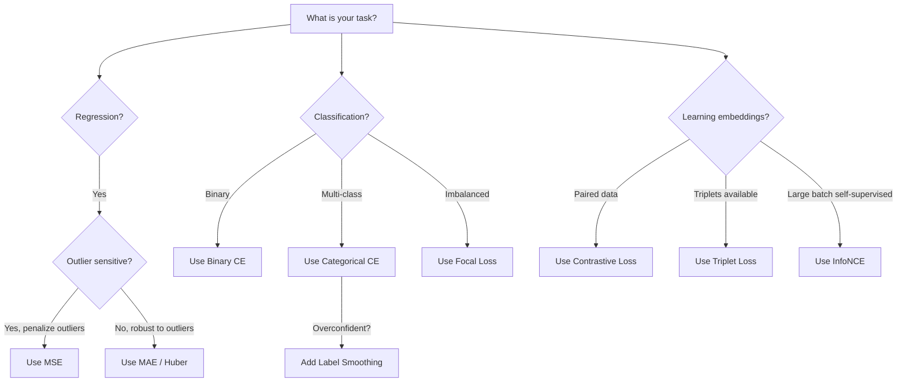
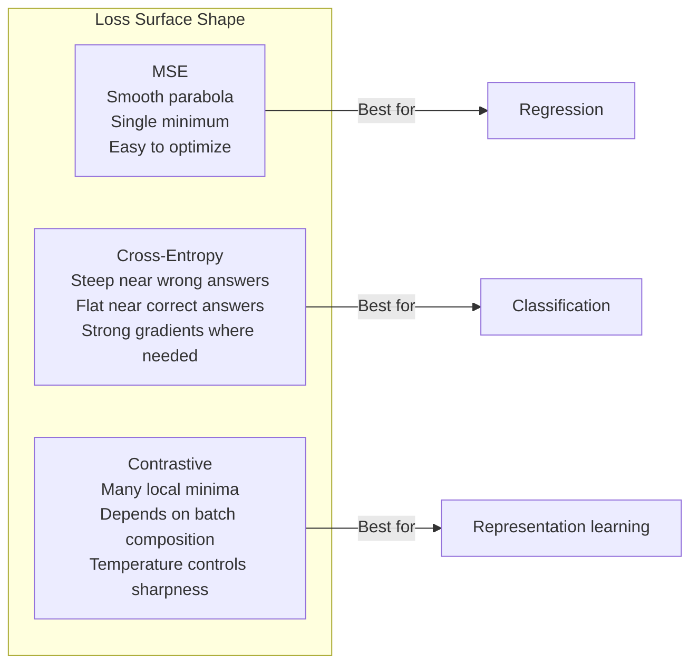

# Loss Functions · 损失函数

> 你的网络做出一个预测。标准答案说不对。错多少？那个数字就是损失。损失函数选错了，你的模型就会整个优化错方向。
>
> Your network makes a prediction. The ground truth says otherwise. How wrong is it? That number is the loss. Pick the wrong loss function and your model optimizes for the wrong thing entirely.

**Type:** Build
**Languages:** Python
**Prerequisites:** Lesson 03.04 (Activation Functions)
**Time:** ~75 minutes

## Learning Objectives · 学习目标

- 从零实现 MSE、二元交叉熵、多类交叉熵和对比损失（InfoNCE），连同它们的梯度
- 通过演示「对所有输入都预测 0.5」这一失效模式，解释 MSE 为什么不适合分类
- 把标签平滑（label smoothing）应用到交叉熵上，并描述它如何防止过度自信的预测
- 为回归、二分类、多分类和嵌入学习任务选对损失函数

> Implement MSE, binary cross-entropy, categorical cross-entropy, and contrastive loss (InfoNCE) from scratch with their gradients
> Explain why MSE fails for classification by demonstrating the "predict 0.5 for everything" failure mode
> Apply label smoothing to cross-entropy and describe how it prevents overconfident predictions
> Choose the correct loss function for regression, binary classification, multi-class classification, and embedding learning tasks

---

## The Problem · 问题在哪

一个在分类问题上最小化 MSE 的模型，会自信地对所有输入都预测 0.5。它确实在最小化损失。它也毫无用处。

损失函数是你的模型唯一真正在优化的东西。不是准确率，不是 F1 分数，不是你汇报给老板的任何指标。优化器拿的是损失函数的梯度，调整权重让那个数字变小。如果损失函数没有抓住你在乎的东西，模型就会找到满足它的数学上最便宜的方式，而那条路几乎从来不是你想要的。

看一个具体例子。二分类任务，两类各占 50%。你用 MSE 做损失。模型对每一个输入都预测 0.5。平均 MSE 是 0.25，这正是「什么都不学」时能达到的最小值。模型没有任何判别能力，却在技术上最小化了你的损失函数。换成交叉熵，同一个模型就被逼着把预测推向 0 或 1，因为 -log(0.5) = 0.693 是个很糟的 loss，而 -log(0.99) = 0.01 奖励自信的正确预测。损失函数的选择，就是「学到了东西的模型」和「钻了指标空子的模型」之间的差别。

更糟的还在后面。在自监督学习里，你连标签都没有。对比损失（contrastive loss）独自定义了学习信号：什么算相似、什么算不同、模型该用多大力气把它们推开。对比损失搞错了，你的嵌入（embedding）会塌缩成一个点 —— 所有输入映射到同一个向量。技术上零损失。实际上完全没用。

> A model minimizing MSE on a classification problem will confidently predict 0.5 for everything. It's minimizing loss. It's also useless. ... The loss function is the only thing your model actually optimizes. Not accuracy. Not F1 score. Not whatever metric you report to your manager. ... If the loss function doesn't capture what you care about, the model will find the mathematically cheapest way to satisfy it, and that way is almost never what you wanted. ... The choice of loss function is the difference between a model that learns and a model that games the metric. ... Get contrastive loss wrong and your embeddings collapse to a single point -- every input maps to the same vector. Technically zero loss. Completely worthless.

---

## The Concept · 概念

### Mean Squared Error (MSE) · 均方误差（MSE）

回归的默认选择。计算预测与目标之间的平方差，再对所有样本取平均。

```
MSE = (1/n) * sum((y_pred - y_true)^2)
```

为什么取平方很重要：它按平方惩罚大误差。误差 2 的代价是误差 1 的 4 倍，误差 10 的代价是 100 倍。这让 MSE 对离群点（outlier）敏感 —— 一个错得离谱的预测就能主导整个损失。

真实数字：如果你的模型预测房价，大多数房子只差 $10,000，但一栋豪宅差了 $200,000，MSE 会不顾一切地去修那一栋豪宅，还可能因此拖累另外 99 栋房子的表现。

MSE 对预测的梯度是：

```
dMSE/dy_pred = (2/n) * (y_pred - y_true)
```

对误差线性。误差越大，梯度越大。对回归这是优点（大误差需要大修正），对分类这是缺点（你想指数级地惩罚自信的错误答案，而不是线性地）。

> The default for regression. Compute the squared difference between prediction and target, average over all samples.
> Why squaring matters: it penalizes large errors quadratically. An error of 2 costs 4x as much as an error of 1. An error of 10 costs 100x. This makes MSE sensitive to outliers -- a single wildly wrong prediction dominates the loss.
> Real numbers: if your model predicts housing prices and is off by $10,000 on most houses but off by $200,000 on one mansion, MSE will aggressively try to fix that one mansion, potentially hurting performance on the other 99 houses.
> The gradient of MSE with respect to a prediction is:
> Linear in the error. Bigger errors get bigger gradients. This is a feature for regression (large errors need large corrections) and a bug for classification (you want to penalize confident wrong answers exponentially, not linearly).

---

### Cross-Entropy Loss · 交叉熵损失

分类任务的损失函数。根植于信息论 —— 它度量预测概率分布与真实分布之间的散度。

**二元交叉熵（Binary Cross-Entropy, BCE）：**

```
BCE = -(y * log(p) + (1 - y) * log(1 - p))
```

其中 y 是真实标签（0 或 1），p 是预测概率。

为什么 -log(p) 有效：真实标签为 1 时，你预测 p = 0.99，loss 是 -log(0.99) = 0.01；你预测 p = 0.01，loss 是 -log(0.01) = 4.6。这 460 倍的差距就是交叉熵好用的原因。它狠狠惩罚自信的错误预测，对自信的正确预测却几乎不罚。

梯度讲的是同一个故事：

```
dBCE/dp = -(y/p) + (1-y)/(1-p)
```

当 y = 1 且 p 接近零时，梯度是 -1/p，趋向负无穷。模型会得到一个巨大的信号去修正错误。当 p 接近 1 时，梯度极小。已经对了，没什么可修的。

**多类交叉熵（Categorical Cross-Entropy）：**

用于 one-hot 编码目标的多分类。

```
CCE = -sum(y_i * log(p_i))
```

只有真实类别贡献损失（其他 y_i 全是零）。如果有 10 个类别，正确类拿到 0.1 的概率（随机瞎猜），loss 是 -log(0.1) = 2.3；正确类拿到 0.9，loss 是 -log(0.9) = 0.105。模型由此学会把概率质量集中到正确答案上。

> The loss function for classification. Rooted in information theory -- it measures the divergence between the predicted probability distribution and the true distribution.
> **Binary Cross-Entropy (BCE):**
> Where y is the true label (0 or 1) and p is the predicted probability.
> Why -log(p) works: when the true label is 1 and you predict p = 0.99, the loss is -log(0.99) = 0.01. When you predict p = 0.01, the loss is -log(0.01) = 4.6. That 460x difference is why cross-entropy works. It brutally punishes confident wrong predictions while barely penalizing confident correct ones.
> The gradient tells the same story:
> When y = 1 and p is near zero, the gradient is -1/p which approaches negative infinity. The model gets an enormous signal to fix its mistake. When p is near 1, the gradient is tiny. Already correct, nothing to fix.
> **Categorical Cross-Entropy:**
> For multi-class classification with one-hot encoded targets.
> Only the true class contributes to the loss (because all other y_i are zero). If there are 10 classes and the correct class gets probability 0.1 (random guessing), the loss is -log(0.1) = 2.3. If the correct class gets probability 0.9, the loss is -log(0.9) = 0.105. The model learns to concentrate probability mass on the right answer.

---

### Why MSE Fails for Classification · 为什么 MSE 不适合分类



预测接近 0 或 1 时，MSE 的梯度会变平（sigmoid 饱和所致）。交叉熵的梯度正好补偿了这一点 —— -log 抵消了 sigmoid 的平坦区，在最需要强梯度的地方给出强梯度。

> MSE gradients flatten when predictions are near 0 or 1 (due to sigmoid saturation). Cross-entropy gradients compensate for this -- the -log cancels the sigmoid's flat regions, giving strong gradients exactly where they are needed most.

---

### Label Smoothing · 标签平滑

标准 one-hot 标签说的是「这 100% 是类 3，其他类都是 0%」。这是个很强的断言。标签平滑把它软化：

```
smooth_label = (1 - alpha) * one_hot + alpha / num_classes
```

alpha = 0.1、10 个类别时：目标从 [0, 0, 1, 0, ...] 变成 [0.01, 0.01, 0.91, 0.01, ...]。模型瞄准 0.91 而不是 1.0。

为什么有效：一个想透过 softmax 精确输出 1.0 的模型，需要把 logits 推向无穷大。这会造成过度自信、伤害泛化，并让模型对分布偏移很脆弱。标签平滑把目标封顶在 0.9（alpha=0.1 时），让 logits 保持在合理范围内。GPT 和大多数现代模型都使用标签平滑或其等价物。

> Standard one-hot labels say "this is 100% class 3 and 0% everything else." That's a strong claim. Label smoothing softens it:
> With alpha = 0.1 and 10 classes: instead of [0, 0, 1, 0, ...], the target becomes [0.01, 0.01, 0.91, 0.01, ...]. The model targets 0.91 instead of 1.0.
> Why this works: a model trying to output exactly 1.0 through a softmax needs to push logits to infinity. This causes overconfidence, hurts generalization, and makes the model brittle to distribution shift. Label smoothing caps the target at 0.9 (with alpha=0.1), keeping logits in a reasonable range. GPT and most modern models use label smoothing or its equivalent.

---

### Contrastive Loss · 对比损失

没有标签，没有类别。只有成对的输入和一个问题：它们相似还是不同？

**SimCLR 风格的对比损失（NT-Xent / InfoNCE）：**

拿一张图像，给它创建两个增强视图（裁剪、旋转、颜色抖动）。这构成「正样本对」—— 它们的嵌入应该相似。batch 里其余每张图像都构成一个「负样本对」—— 它们的嵌入应该不同。

```
L = -log(exp(sim(z_i, z_j) / tau) / sum(exp(sim(z_i, z_k) / tau)))
```

其中 sim() 是余弦相似度，z_i 和 z_j 是正样本对，求和遍历所有负样本，tau（温度）控制分布的尖锐程度。温度越低 = 负样本越难 = 分离越激进。

真实数字：batch size 为 256 意味着每个正样本对对应 255 个负样本。温度 tau = 0.07（SimCLR 默认值）。这个 loss 看起来就是一个作用在相似度上的 softmax —— 它想让正样本对的相似度在全部 256 个选项里最高。

**Triplet Loss（三元组损失）：**

输入三个：anchor（锚点）、positive（同类）、negative（不同类）。

```
L = max(0, d(anchor, positive) - d(anchor, negative) + margin)
```

margin（典型取 0.2-1.0）强制正、负距离之间至少留出这个间隔。如果 negative 已经足够远，损失为零 —— 没有梯度，没有更新。这让训练高效，但需要仔细做三元组挖掘（挑出离 anchor 近的 hard negatives）。

> No labels. No classes. Just pairs of inputs and the question: are these similar or different?
> **SimCLR-style contrastive loss (NT-Xent / InfoNCE):**
> Take one image. Create two augmented views of it (crop, rotate, color jitter). These are the "positive pair" -- they should have similar embeddings. Every other image in the batch forms a "negative pair" -- they should have different embeddings.
> Where sim() is cosine similarity, z_i and z_j are the positive pair, the sum is over all negatives, and tau (temperature) controls how sharp the distribution is. Lower temperature = harder negatives = more aggressive separation.
> Real numbers: batch size 256 means 255 negatives per positive pair. Temperature tau = 0.07 (SimCLR default). The loss looks like a softmax over similarities -- it wants the positive pair's similarity to be highest among all 256 options.
> **Triplet Loss:**
> Takes three inputs: anchor, positive (same class), negative (different class).
> The margin (typically 0.2-1.0) enforces a minimum gap between positive and negative distances. If the negative is already far enough away, the loss is zero -- no gradient, no update. This makes training efficient but requires careful triplet mining (choosing hard negatives that are close to the anchor).

---

### Focal Loss · Focal Loss（焦点损失）

为不平衡数据集而生。标准交叉熵对所有分对的样本一视同仁。Focal loss 降低简单样本的权重：

```
FL = -alpha * (1 - p_t)^gamma * log(p_t)
```

其中 p_t 是真实类的预测概率，gamma 控制聚焦程度。gamma = 0 时就是标准交叉熵。gamma = 2（默认值）时：

- 简单样本（p_t = 0.9）：权重 = (0.1)^2 = 0.01，实际上被忽略。
- 困难样本（p_t = 0.1）：权重 = (0.9)^2 = 0.81，完整的梯度信号。

Focal loss 由 Lin 等人为目标检测提出，在那个领域 99% 的候选区域都是背景（简单负样本）。没有 focal loss，模型会淹没在简单背景样本里，永远学不会检测物体。有了它，模型把容量集中在真正要紧的困难、模糊样本上。

> For imbalanced datasets. Standard cross-entropy treats all correctly classified examples equally. Focal loss down-weights easy examples:
> Where p_t is the predicted probability of the true class and gamma controls the focusing. With gamma = 0, this is standard cross-entropy. With gamma = 2 (the default):
> - Easy example (p_t = 0.9): weight = (0.1)^2 = 0.01. Effectively ignored.
> - Hard example (p_t = 0.1): weight = (0.9)^2 = 0.81. Full gradient signal.
> Focal loss was introduced by Lin et al. for object detection, where 99% of candidate regions are background (easy negatives). Without focal loss, the model drowns in easy background examples and never learns to detect objects. With it, the model focuses its capacity on the hard, ambiguous cases that matter.

---

### Loss Function Decision Tree · 损失函数决策树



---

### Loss Landscape · 损失地形



```figure
cross-entropy-loss
```

---

## Build It · 动手造

### Step 1: MSE and Its Gradient · 第 1 步：MSE 及其梯度

```python
def mse(predictions, targets):
    n = len(predictions)
    total = 0.0
    for p, t in zip(predictions, targets):
        total += (p - t) ** 2
    return total / n

def mse_gradient(predictions, targets):
    n = len(predictions)
    grads = []
    for p, t in zip(predictions, targets):
        grads.append(2.0 * (p - t) / n)
    return grads
```

---

### Step 2: Binary Cross-Entropy · 第 2 步：二元交叉熵

log(0) 问题是真的。如果模型对正样本恰好预测 0，log(0) = 负无穷。裁剪（clipping）就是防这个的。

```python
import math

def binary_cross_entropy(predictions, targets, eps=1e-15):
    n = len(predictions)
    total = 0.0
    for p, t in zip(predictions, targets):
        p_clipped = max(eps, min(1 - eps, p))
        total += -(t * math.log(p_clipped) + (1 - t) * math.log(1 - p_clipped))
    return total / n

def bce_gradient(predictions, targets, eps=1e-15):
    grads = []
    for p, t in zip(predictions, targets):
        p_clipped = max(eps, min(1 - eps, p))
        grads.append(-(t / p_clipped) + (1 - t) / (1 - p_clipped))
    return grads
```

> The log(0) problem is real. If the model predicts exactly 0 for a positive example, log(0) = negative infinity. Clipping prevents this.

---

### Step 3: Categorical Cross-Entropy with Softmax · 第 3 步：softmax 配多类交叉熵

softmax 把原始 logits 转换成概率。然后我们对照 one-hot 目标计算交叉熵。

```python
def softmax(logits):
    max_val = max(logits)
    exps = [math.exp(x - max_val) for x in logits]
    total = sum(exps)
    return [e / total for e in exps]

def categorical_cross_entropy(logits, target_index, eps=1e-15):
    probs = softmax(logits)
    p = max(eps, probs[target_index])
    return -math.log(p)

def cce_gradient(logits, target_index):
    probs = softmax(logits)
    grads = list(probs)
    grads[target_index] -= 1.0
    return grads
```

softmax + 交叉熵的梯度化简得非常漂亮：真实类别就是（预测概率 - 1），其他类别就是（预测概率）。这个优雅的化简不是巧合 —— 正因如此，softmax 和交叉熵才被绑定成对。

> Softmax converts raw logits to probabilities. Then we compute the cross-entropy against one-hot targets.
> The gradient of softmax + cross-entropy simplifies beautifully: it's just (predicted probability - 1) for the true class, and (predicted probability) for all other classes. This elegant simplification is not a coincidence -- it's why softmax and cross-entropy are paired.

---

### Step 4: Label Smoothing · 第 4 步：标签平滑

```python
def label_smoothed_cce(logits, target_index, num_classes, alpha=0.1, eps=1e-15):
    probs = softmax(logits)
    loss = 0.0
    for i in range(num_classes):
        if i == target_index:
            smooth_target = 1.0 - alpha + alpha / num_classes
        else:
            smooth_target = alpha / num_classes
        p = max(eps, probs[i])
        loss += -smooth_target * math.log(p)
    return loss
```

---

### Step 5: Contrastive Loss (Simplified InfoNCE) · 第 5 步：对比损失（简化版 InfoNCE）

```python
def cosine_similarity(a, b):
    dot = sum(x * y for x, y in zip(a, b))
    norm_a = math.sqrt(sum(x * x for x in a))
    norm_b = math.sqrt(sum(x * x for x in b))
    if norm_a < 1e-10 or norm_b < 1e-10:
        return 0.0
    return dot / (norm_a * norm_b)

def contrastive_loss(anchor, positive, negatives, temperature=0.07):
    sim_pos = cosine_similarity(anchor, positive) / temperature
    sim_negs = [cosine_similarity(anchor, neg) / temperature for neg in negatives]

    max_sim = max(sim_pos, max(sim_negs)) if sim_negs else sim_pos
    exp_pos = math.exp(sim_pos - max_sim)
    exp_negs = [math.exp(s - max_sim) for s in sim_negs]
    total_exp = exp_pos + sum(exp_negs)

    return -math.log(max(1e-15, exp_pos / total_exp))
```

---

### Step 6: MSE vs Cross-Entropy on Classification · 第 6 步：分类任务上的 MSE vs 交叉熵

用两种损失函数分别训练第 04 课的那个网络（circle 数据集）。看着交叉熵收敛得更快。

```python
import random

def sigmoid(x):
    x = max(-500, min(500, x))
    return 1.0 / (1.0 + math.exp(-x))

def make_circle_data(n=200, seed=42):
    random.seed(seed)
    data = []
    for _ in range(n):
        x = random.uniform(-2, 2)
        y = random.uniform(-2, 2)
        label = 1.0 if x * x + y * y < 1.5 else 0.0
        data.append(([x, y], label))
    return data


class LossComparisonNetwork:
    def __init__(self, loss_type="bce", hidden_size=8, lr=0.1):
        random.seed(0)
        self.loss_type = loss_type
        self.lr = lr
        self.hidden_size = hidden_size

        self.w1 = [[random.gauss(0, 0.5) for _ in range(2)] for _ in range(hidden_size)]
        self.b1 = [0.0] * hidden_size
        self.w2 = [random.gauss(0, 0.5) for _ in range(hidden_size)]
        self.b2 = 0.0

    def forward(self, x):
        self.x = x
        self.z1 = []
        self.h = []
        for i in range(self.hidden_size):
            z = self.w1[i][0] * x[0] + self.w1[i][1] * x[1] + self.b1[i]
            self.z1.append(z)
            self.h.append(max(0.0, z))

        self.z2 = sum(self.w2[i] * self.h[i] for i in range(self.hidden_size)) + self.b2
        self.out = sigmoid(self.z2)
        return self.out

    def backward(self, target):
        if self.loss_type == "mse":
            d_loss = 2.0 * (self.out - target)
        else:
            eps = 1e-15
            p = max(eps, min(1 - eps, self.out))
            d_loss = -(target / p) + (1 - target) / (1 - p)

        d_sigmoid = self.out * (1 - self.out)
        d_out = d_loss * d_sigmoid

        for i in range(self.hidden_size):
            d_relu = 1.0 if self.z1[i] > 0 else 0.0
            d_h = d_out * self.w2[i] * d_relu
            self.w2[i] -= self.lr * d_out * self.h[i]
            for j in range(2):
                self.w1[i][j] -= self.lr * d_h * self.x[j]
            self.b1[i] -= self.lr * d_h
        self.b2 -= self.lr * d_out

    def compute_loss(self, pred, target):
        if self.loss_type == "mse":
            return (pred - target) ** 2
        else:
            eps = 1e-15
            p = max(eps, min(1 - eps, pred))
            return -(target * math.log(p) + (1 - target) * math.log(1 - p))

    def train(self, data, epochs=200):
        losses = []
        for epoch in range(epochs):
            total_loss = 0.0
            correct = 0
            for x, y in data:
                pred = self.forward(x)
                self.backward(y)
                total_loss += self.compute_loss(pred, y)
                if (pred >= 0.5) == (y >= 0.5):
                    correct += 1
            avg_loss = total_loss / len(data)
            accuracy = correct / len(data) * 100
            losses.append((avg_loss, accuracy))
            if epoch % 50 == 0 or epoch == epochs - 1:
                print(f"    Epoch {epoch:3d}: loss={avg_loss:.4f}, accuracy={accuracy:.1f}%")
        return losses
```

> Train the same network from lesson 04 (circle dataset) with both loss functions. Watch cross-entropy converge faster.

---

## Use It · 实战用法

PyTorch 提供了所有标准损失函数，并内置数值稳定性保护：

```python
import torch
import torch.nn as nn
import torch.nn.functional as F

predictions = torch.tensor([0.9, 0.1, 0.7], requires_grad=True)
targets = torch.tensor([1.0, 0.0, 1.0])

mse_loss = F.mse_loss(predictions, targets)
bce_loss = F.binary_cross_entropy(predictions, targets)

logits = torch.randn(4, 10)
labels = torch.tensor([3, 7, 1, 9])
ce_loss = F.cross_entropy(logits, labels)
ce_smooth = F.cross_entropy(logits, labels, label_smoothing=0.1)
```

用 `F.cross_entropy`（而不是 `F.nll_loss` 加手动 softmax）。它把 log-softmax 和负对数似然合并成一个数值稳定的操作。先单独做 softmax 再取 log 没那么稳定 —— 在大指数项相减时你会丢精度。

做对比学习时，大多数团队用自己实现，或者 `lightly`、`pytorch-metric-learning` 这类库。核心循环永远一样：计算两两相似度，对正负样本做 softmax，反向传播。

> PyTorch provides all standard loss functions with numerical stability built in:
> Use `F.cross_entropy` (not `F.nll_loss` plus manual softmax). It combines log-softmax and negative log-likelihood in one numerically stable operation. Applying softmax separately then taking the log is less stable -- you lose precision in the subtraction of large exponentials.
> For contrastive learning, most teams use custom implementations or libraries like `lightly` or `pytorch-metric-learning`. The core loop is always the same: compute pairwise similarities, create the softmax over positives and negatives, backpropagate.

---

## Ship It · 交付

本课产出：
- `outputs/prompt-loss-function-selector.md` —— 一个帮你选对损失函数的可复用提示词
- `outputs/prompt-loss-debugger.md` —— 一个诊断提示词，用于 loss 曲线看起来不对劲的时候

> This lesson produces:
> - `outputs/prompt-loss-function-selector.md` -- a reusable prompt for choosing the right loss function
> - `outputs/prompt-loss-debugger.md` -- a diagnostic prompt for when your loss curve looks wrong

---

## Exercises · 练习

1. 实现 Huber loss（平滑 L1 loss）：小误差时它是 MSE，大误差时它是 MAE。训练一个预测 y = sin(x) 的回归网络，当 5% 的训练目标被加上随机噪声（离群点）时，比较 MSE 与 Huber 的最终测试误差。

2. 把 focal loss 加进二分类训练循环。造一个不平衡数据集（90% 类 0，10% 类 1）。在 200 个 epoch 后，比较标准 BCE 与 focal loss（gamma=2）在少数类召回率上的表现。

3. 实现带半困难负样本挖掘（semi-hard negative mining）的 triplet loss。为 5 个类别生成 2D 嵌入数据。对每个 anchor，找到比 positive 更远、但已经是最近的那个负样本（semi-hard）。与随机挑选三元组比较收敛情况。

4. 重跑 MSE vs 交叉熵对比，但训练时跟踪每一层的梯度幅值。画出每个 epoch 的平均梯度范数。验证交叉熵在模型最不确定的早期 epoch 产生更大的梯度。

5. 实现 KL 散度损失，并验证当真实分布是 one-hot 时，最小化 KL(true || predicted) 与交叉熵给出相同的梯度。然后试试软目标（比如知识蒸馏），让「真实」分布来自教师模型的 softmax 输出。

> Implement Huber loss (smooth L1 loss), which is MSE for small errors and MAE for large errors. Train a regression network predicting y = sin(x) with MSE vs Huber when 5% of training targets have random noise added (outliers). Compare final test error.
> Add focal loss to the binary classification training loop. Create an imbalanced dataset (90% class 0, 10% class 1). Compare standard BCE vs focal loss (gamma=2) on the minority class recall after 200 epochs.
> Implement triplet loss with semi-hard negative mining. Generate 2D embedding data for 5 classes. For each anchor, find the hardest negative that is still farther than the positive (semi-hard). Compare convergence to random triplet selection.
> Run the MSE vs cross-entropy comparison but track gradient magnitudes at each layer during training. Plot the average gradient norm per epoch. Verify that cross-entropy produces larger gradients in early epochs when the model is most uncertain.
> Implement KL divergence loss and verify that minimizing KL(true || predicted) gives the same gradients as cross-entropy when the true distribution is one-hot. Then try soft targets (like knowledge distillation) where the "true" distribution comes from a teacher model's softmax output.

---

## Key Terms · 术语表

| Term | What people say | What it actually means |
|------|----------------|----------------------|
| Loss function | 「模型错得有多离谱」 | 一个可微函数，把预测和目标映射成一个标量，交给优化器去最小化 |
| MSE | 「平均平方误差」 | 预测与目标之差的平方的平均；按平方惩罚大误差 |
| Cross-entropy | 「分类损失」 | 用 -log(p) 度量预测概率分布与真实分布之间的散度 |
| Binary cross-entropy | 「BCE」 | 两类的交叉熵：-(y*log(p) + (1-y)*log(1-p)) |
| Label smoothing | 「把目标软化」 | 用软值（如 0.1/0.9）替换硬性的 0/1 目标，防止过度自信、改善泛化 |
| Contrastive loss | 「拉近，推远」 | 一种通过让相似对在嵌入空间靠近、不相似对远离来学习表示的损失 |
| InfoNCE | 「CLIP/SimCLR 用的损失」 | 对相似度分数做温度归一化的交叉熵；把对比学习当成一个分类问题 |
| Focal loss | 「不平衡数据的解药」 | 用 (1-p_t)^gamma 加权的交叉熵，压低简单样本、聚焦困难样本 |
| Triplet loss | 「anchor-positive-negative」 | 在嵌入空间把 anchor 推向 positive，并与 negative 至少拉开一个 margin |
| Temperature | 「尖锐度旋钮」 | 作用在 logits/相似度上的标量除数，控制结果分布有多尖；越低越尖 |

---

## Further Reading · 延伸阅读

- Lin et al., "Focal Loss for Dense Object Detection" (2017) —— 为目标检测中的极端类别不平衡提出 focal loss（RetinaNet）
- Chen et al., "A Simple Framework for Contrastive Learning of Visual Representations" (SimCLR, 2020) —— 用 NT-Xent 损失定义了现代对比学习流水线
- Szegedy et al., "Rethinking the Inception Architecture" (2016) —— 提出标签平滑这一正则化技术，如今已是大多数大模型的标准配置
- Hinton et al., "Distilling the Knowledge in a Neural Network" (2015) —— 用软目标和 KL 散度做知识蒸馏，是模型压缩的奠基工作
