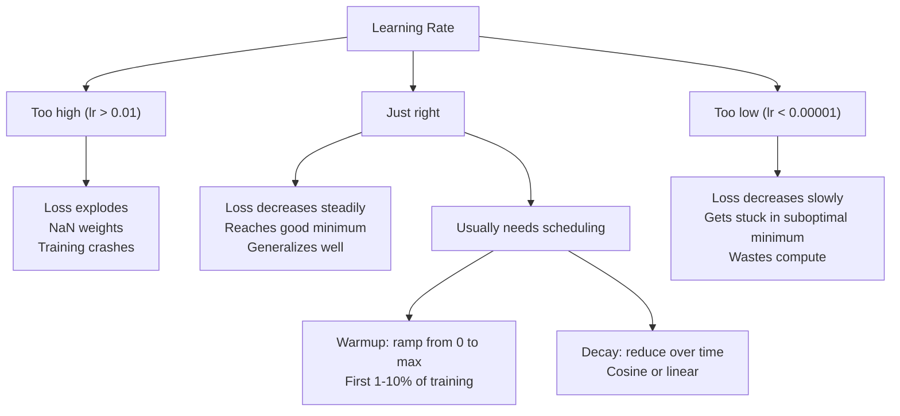
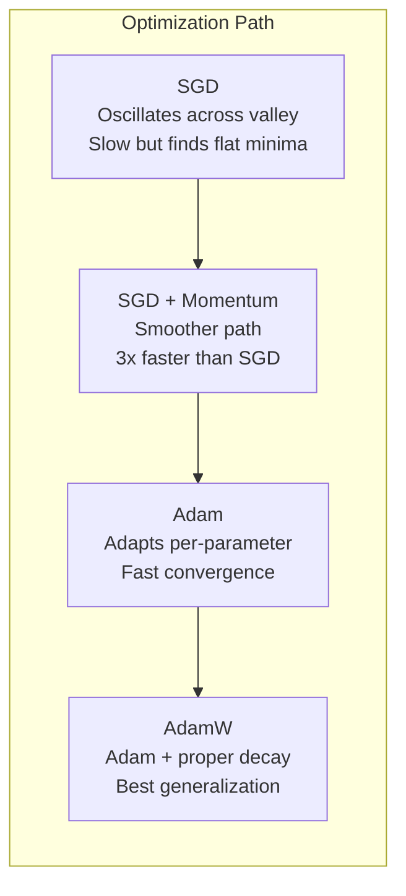
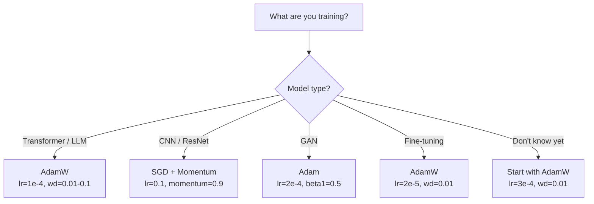

# Optimizers · 优化器

> 梯度下降告诉你往哪个方向走，对走多远、走多快却只字不提。SGD 是一枚指南针，Adam 是带实时路况的 GPS。
>
> Gradient descent tells you which direction to move. It says nothing about how far or how fast. SGD is a compass. Adam is GPS with traffic data.

**Type:** Build
**Languages:** Python
**Prerequisites:** Lesson 03.05 (Loss Functions)
**Time:** ~75 minutes

## Learning Objectives · 学习目标

- 用 Python 从零实现 SGD、SGD with momentum、Adam 和 AdamW 优化器
- 解释 Adam 的偏差修正（bias correction）如何在训练初期的步骤中补偿零初始化的矩估计
- 在同一个任务上演示：相比 Adam 加 L2 正则，AdamW 为什么能带来更好的泛化
- 为 transformer、CNN、GAN 和微调场景选对优化器和默认超参数

> Implement SGD, SGD with momentum, Adam, and AdamW optimizers from scratch in Python
> Explain how Adam's bias correction compensates for zero-initialized moment estimates in early training steps
> Demonstrate why AdamW produces better generalization than Adam with L2 regularization on the same task
> Select the appropriate optimizer and default hyperparameters for transformers, CNNs, GANs, and fine-tuning

---

## The Problem · 问题在哪

你算出了梯度。你知道 4,721 号权重该减 0.003 才能降低 loss。但 0.003 是什么单位？要乘什么系数？还有，第 1 步和第 1,000 步该走一样的距离吗？

原味梯度下降对每个参数、每一步都套用同一个学习率：w = w - lr * gradient。这带来三个问题，让训练神经网络在实践中变得痛苦。

第一，震荡。损失地形很少长得像光滑的碗，它更像一条又长又窄的山谷。梯度指向跨过山谷的方向（陡的方向），而不是沿着山谷的方向（缓的方向）。梯度下降在窄的维度上来回弹跳，在有用的维度上却只前进一丁点。你见过这个现象：loss 先快速下降然后进入平台期 —— 不是模型收敛了，是它在震荡。

第二，所有参数共用一个学习率是错的。有些权重需要大更新（它们还在早期、欠拟合的阶段），有些只需要微小更新（它们已接近最优值）。适合前者的学习率会毁掉后者，反之亦然。

第三，鞍点。高维空间里，损失地形有大片平坦区域，梯度接近零。原味 SGD 以梯度的速度爬过这些区域，而梯度实际上就是零。模型看起来卡住了。它没有卡住 —— 它在一块平坦区里，平坦区的另一头就有有用的下降方向。但 SGD 没有任何机制能推它过去。

Adam 把三个问题全解决了。它给每个参数维护两个滑动平均 —— 梯度均值（动量，管震荡）和梯度平方均值（自适应速率，管大小不一的量级）。再配上前几步的偏差修正（bias correction），它就成了一个靠默认超参数就能搞定 80% 问题的单一优化器。本课从零把它造出来，好让你确切知道它在另外 20% 的问题上什么时候失效、为什么失效。

> You computed the gradients. You know that weight #4,721 should decrease by 0.003 to reduce the loss. But 0.003 in what units? Scaled by what? And should you move the same amount on step 1 as on step 1,000? ... Vanilla gradient descent applies the same learning rate to every parameter on every step: w = w - lr * gradient. This creates three problems that make training neural networks painful in practice. ... Gradient descent bounces back and forth across the narrow dimension while making tiny progress along the useful one. ... Some weights need large updates (they're in the early, underfitting stage). Others need tiny updates (they're near their optimal value). ... Adam solves all three. ... This lesson builds it from scratch so you understand exactly when and why it fails on the other 20%.

---

## The Concept · 概念

### Stochastic Gradient Descent (SGD) · 随机梯度下降（SGD）

最简单的优化器。在一个 mini-batch 上计算梯度，朝反方向走一步。

```
w = w - lr * gradient
```

「随机」（stochastic）的意思是：你用数据的一个随机子集（mini-batch）来估计梯度，而不是整个数据集。这个噪声其实有用 —— 它帮助逃离尖锐的局部极小。但噪声也会造成震荡。

学习率是唯一的旋钮。太高：loss 发散。太低：训练遥遥无期。最优值取决于架构、数据、batch size 和训练所处的阶段。现代网络上原味 SGD 的典型取值在 0.01 到 0.1 之间。但即便在同一次训练里，理想学习率也在不断变化。

> The simplest optimizer. Compute the gradient on a mini-batch and step in the opposite direction.
> The "stochastic" means you use a random subset (mini-batch) of data to estimate the gradient, rather than the full dataset. This noise is actually useful -- it helps escape sharp local minima. But the noise also causes oscillation.
> Learning rate is the only knob. Too high: the loss diverges. Too low: training takes forever. The optimal value depends on the architecture, the data, the batch size, and the current stage of training. For vanilla SGD on modern networks, typical values range from 0.01 to 0.1. But even within a single training run, the ideal learning rate changes.

---

### Momentum · 动量

球滚下山的比喻被用烂了，但确实准确。不是只按梯度走一步，而是维护一个累积了历史梯度的速度。

```
m_t = beta * m_{t-1} + gradient
w = w - lr * m_t
```

Beta（典型取 0.9）控制保留多少历史。beta = 0.9 时，动量约等于最近 10 个梯度的平均（1 / (1 - 0.9) = 10）。

为什么这能治震荡：方向一致的梯度会累积，方向来回翻转的梯度会互相抵消。在那条窄谷里，「跨谷」分量每步翻转一次符号，被阻尼掉；「沿谷」分量保持一致，被放大。结果是在有用方向上的平滑加速。

真实数字：在病态（badly conditioned）的损失地形上，单靠 SGD 可能要 10,000 步；SGD with momentum（beta=0.9）在同一个问题上通常只要 3,000-5,000 步。这个加速不是可有可无的。

> The ball-rolling-downhill analogy is overused but accurate. Instead of stepping by the gradient alone, you maintain a velocity that accumulates past gradients.
> Beta (typically 0.9) controls how much history to keep. With beta = 0.9, the momentum is roughly the average of the last 10 gradients (1 / (1 - 0.9) = 10).
> Why this fixes oscillation: gradients that point in the same direction accumulate. Gradients that flip direction cancel out. In that narrow valley, the "across" component flips sign each step and gets dampened. The "along" component stays consistent and gets amplified. The result is smooth acceleration in the useful direction.
> Real numbers: SGD alone on a badly conditioned loss landscape might take 10,000 steps. SGD with momentum (beta=0.9) typically takes 3,000-5,000 steps on the same problem. The speedup is not marginal.

---

### RMSProp · RMSProp

第一个真正好用的逐参数自适应学习率方法。由 Hinton 在一堂 Coursera 课上提出（从未正式发表）。

```
s_t = beta * s_{t-1} + (1 - beta) * gradient^2
w = w - lr * gradient / (sqrt(s_t) + epsilon)
```

s_t 跟踪梯度平方的滑动平均。持续拿到大梯度的参数会被一个大数除（更小的有效学习率）；梯度小的参数被一个小数除（更大的有效学习率）。

这解决了「所有参数共用一个学习率」的问题。一个一直在拿大更新的权重，多半已经接近目标 —— 让它慢下来。一个一直只拿到微小更新的权重可能训练不足 —— 让它快起来。

Epsilon（典型取 1e-8）防止某个参数从未被更新时发生除以零。

> The first per-parameter adaptive learning rate method that actually worked. Proposed by Hinton in a Coursera lecture (never formally published).
> s_t tracks the running average of squared gradients. Parameters with consistently large gradients get divided by a large number (smaller effective learning rate). Parameters with small gradients get divided by a small number (larger effective learning rate).
> This solves the "one learning rate for all parameters" problem. A weight that's already been getting large updates is probably near its target -- slow it down. A weight that's been getting tiny updates might be undertrained -- speed it up.
> Epsilon (typically 1e-8) prevents division by zero when a parameter hasn't been updated.

---

### Adam: Momentum + RMSProp · Adam：动量 + RMSProp

Adam 把两个想法合在一起。它给每个参数维护两个指数滑动平均：

```
m_t = beta1 * m_{t-1} + (1 - beta1) * gradient        (first moment: mean)
v_t = beta2 * v_{t-1} + (1 - beta2) * gradient^2       (second moment: variance)
```

**偏差修正（bias correction）**是大多数讲解都跳过的关键细节。第 1 步时，m_1 = (1 - beta1) * gradient。beta1 = 0.9 时就是 0.1 * gradient —— 比真实梯度小了十倍。滑动平均还没热身完。偏差修正负责补偿：

```
m_hat = m_t / (1 - beta1^t)
v_hat = v_t / (1 - beta2^t)
```

第 1 步、beta1 = 0.9 时：m_hat = m_1 / (1 - 0.9) = m_1 / 0.1 = 真实梯度。到第 100 步：(1 - 0.9^100) 近似 1.0，修正消失。偏差修正只在前 ~10 步要紧，~50 步之后就无关紧要了。

更新式：

```
w = w - lr * m_hat / (sqrt(v_hat) + epsilon)
```

Adam 默认值：lr = 0.001, beta1 = 0.9, beta2 = 0.999, epsilon = 1e-8。这套默认值能应付 80% 的问题。不奏效时，先改 lr，再改 beta2。beta1 和 epsilon 几乎永远不用动。

> Adam combines both ideas. It maintains two exponential moving averages per parameter:
> **Bias correction** is the key detail most explanations skip. At step 1, m_1 = (1 - beta1) * gradient. With beta1 = 0.9, that's 0.1 * gradient -- ten times too small. The moving average hasn't warmed up yet. Bias correction compensates:
> At step 1 with beta1 = 0.9: m_hat = m_1 / (1 - 0.9) = m_1 / 0.1 = the actual gradient. At step 100: (1 - 0.9^100) is approximately 1.0, so the correction vanishes. Bias correction matters for the first ~10 steps and is irrelevant after ~50.
> The update:
> Adam defaults: lr = 0.001, beta1 = 0.9, beta2 = 0.999, epsilon = 1e-8. These defaults work for 80% of problems. When they don't, change lr first. Then beta2. Almost never change beta1 or epsilon.

---

### AdamW: Weight Decay Done Right · AdamW：把 weight decay 做对

L2 正则化往 loss 里加 lambda * w^2。在原味 SGD 里，这等价于 weight decay（每步从权重里减去 lambda * w）。在 Adam 里，这个等价性破灭了。

Loshchilov & Hutter 的洞见：当你把 L2 加进 loss、再让 Adam 处理这个梯度时，自适应学习率把正则项也一起缩放了。梯度方差大的参数得到更少的正则，方差小的参数得到更多。这不是你想要的 —— 你要的是不管梯度统计如何都一视同仁的正则。

AdamW 的修法是把 weight decay 直接作用在权重上，放在 Adam 更新之后：

```
w = w - lr * m_hat / (sqrt(v_hat) + epsilon) - lr * lambda * w
```

weight decay 项（lr * lambda * w）不再被 Adam 的自适应因子缩放。每个参数都得到同样比例的收缩。

这听起来像个小细节。不是。在几乎每一个任务上，AdamW 都收敛到比 Adam + L2 正则更好的解。它是 PyTorch 里训练 transformer、扩散模型和大多数现代架构的默认优化器。BERT、GPT、LLaMA、Stable Diffusion —— 全是用 AdamW 训的。

> L2 regularization adds lambda * w^2 to the loss. In vanilla SGD, this is equivalent to weight decay (subtracting lambda * w from the weight at each step). In Adam, this equivalence breaks.
> The Loshchilov & Hutter insight: when you add L2 to the loss and then Adam processes the gradient, the adaptive learning rate scales the regularization term too. Parameters with large gradient variance get less regularization. Parameters with small variance get more. This is not what you want -- you want uniform regularization regardless of the gradient statistics.
> AdamW fixes this by applying weight decay directly to the weights, after the Adam update:
> The weight decay term (lr * lambda * w) is not scaled by Adam's adaptive factor. Every parameter gets the same proportional shrinkage.
> This seems like a minor detail. It's not. AdamW converges to better solutions than Adam + L2 regularization on virtually every task. It's the default optimizer in PyTorch for training transformers, diffusion models, and most modern architectures. BERT, GPT, LLaMA, Stable Diffusion -- all trained with AdamW.

---

### Learning Rate: The Most Important Hyperparameter · 学习率：最重要的超参数



如果只调一个超参数，调学习率。学习率上 10 倍的变化，比你要做的任何架构决策都重要。常见默认值：

- SGD：lr = 0.01 到 0.1
- Adam/AdamW：lr = 1e-4 到 3e-4
- 微调预训练模型：lr = 1e-5 到 5e-5
- 学习率 warmup：在前 1-10% 的步数里线性爬升

> If you tune one hyperparameter, tune the learning rate. A 10x change in learning rate matters more than any architectural decision you'll make. Common defaults:
> - SGD: lr = 0.01 to 0.1
> - Adam/AdamW: lr = 1e-4 to 3e-4
> - Fine-tuning pretrained models: lr = 1e-5 to 5e-5
> - Learning rate warmup: linear ramp over first 1-10% of steps

---

### Optimizer Comparison · 优化器对比



---

### When Each Optimizer Wins · 什么任务用什么优化器



```figure
optimizer-trajectory
```

---

## Build It · 动手造

### Step 1: Vanilla SGD · 第 1 步：原味 SGD

```python
class SGD:
    def __init__(self, lr=0.01):
        self.lr = lr

    def step(self, params, grads):
        for i in range(len(params)):
            params[i] -= self.lr * grads[i]
```

---

### Step 2: SGD with Momentum · 第 2 步：带动量的 SGD

```python
class SGDMomentum:
    def __init__(self, lr=0.01, beta=0.9):
        self.lr = lr
        self.beta = beta
        self.velocities = None

    def step(self, params, grads):
        if self.velocities is None:
            self.velocities = [0.0] * len(params)
        for i in range(len(params)):
            self.velocities[i] = self.beta * self.velocities[i] + grads[i]
            params[i] -= self.lr * self.velocities[i]
```

---

### Step 3: Adam · 第 3 步：Adam

```python
import math

class Adam:
    def __init__(self, lr=0.001, beta1=0.9, beta2=0.999, epsilon=1e-8):
        self.lr = lr
        self.beta1 = beta1
        self.beta2 = beta2
        self.epsilon = epsilon
        self.m = None
        self.v = None
        self.t = 0

    def step(self, params, grads):
        if self.m is None:
            self.m = [0.0] * len(params)
            self.v = [0.0] * len(params)

        self.t += 1

        for i in range(len(params)):
            self.m[i] = self.beta1 * self.m[i] + (1 - self.beta1) * grads[i]
            self.v[i] = self.beta2 * self.v[i] + (1 - self.beta2) * grads[i] ** 2

            m_hat = self.m[i] / (1 - self.beta1 ** self.t)
            v_hat = self.v[i] / (1 - self.beta2 ** self.t)

            params[i] -= self.lr * m_hat / (math.sqrt(v_hat) + self.epsilon)
```

---

### Step 4: AdamW · 第 4 步：AdamW

```python
class AdamW:
    def __init__(self, lr=0.001, beta1=0.9, beta2=0.999, epsilon=1e-8, weight_decay=0.01):
        self.lr = lr
        self.beta1 = beta1
        self.beta2 = beta2
        self.epsilon = epsilon
        self.weight_decay = weight_decay
        self.m = None
        self.v = None
        self.t = 0

    def step(self, params, grads):
        if self.m is None:
            self.m = [0.0] * len(params)
            self.v = [0.0] * len(params)

        self.t += 1

        for i in range(len(params)):
            self.m[i] = self.beta1 * self.m[i] + (1 - self.beta1) * grads[i]
            self.v[i] = self.beta2 * self.v[i] + (1 - self.beta2) * grads[i] ** 2

            m_hat = self.m[i] / (1 - self.beta1 ** self.t)
            v_hat = self.v[i] / (1 - self.beta2 ** self.t)

            params[i] -= self.lr * m_hat / (math.sqrt(v_hat) + self.epsilon)
            params[i] -= self.lr * self.weight_decay * params[i]
```

---

### Step 5: Training Comparison · 第 5 步：训练对比

用全部四个优化器，在第 05 课的 circle 数据集上训练同一个两层网络。比较收敛情况。

```python
import random

def sigmoid(x):
    x = max(-500, min(500, x))
    return 1.0 / (1.0 + math.exp(-x))

def make_circle_data(n=200, seed=42):
    random.seed(seed)
    data = []
    for _ in range(n):
        x = random.uniform(-2, 2)
        y = random.uniform(-2, 2)
        label = 1.0 if x * x + y * y < 1.5 else 0.0
        data.append(([x, y], label))
    return data


class OptimizerTestNetwork:
    def __init__(self, optimizer, hidden_size=8):
        random.seed(0)
        self.hidden_size = hidden_size
        self.optimizer = optimizer

        self.w1 = [[random.gauss(0, 0.5) for _ in range(2)] for _ in range(hidden_size)]
        self.b1 = [0.0] * hidden_size
        self.w2 = [random.gauss(0, 0.5) for _ in range(hidden_size)]
        self.b2 = 0.0

    def get_params(self):
        params = []
        for row in self.w1:
            params.extend(row)
        params.extend(self.b1)
        params.extend(self.w2)
        params.append(self.b2)
        return params

    def set_params(self, params):
        idx = 0
        for i in range(self.hidden_size):
            for j in range(2):
                self.w1[i][j] = params[idx]
                idx += 1
        for i in range(self.hidden_size):
            self.b1[i] = params[idx]
            idx += 1
        for i in range(self.hidden_size):
            self.w2[i] = params[idx]
            idx += 1
        self.b2 = params[idx]

    def forward(self, x):
        self.x = x
        self.z1 = []
        self.h = []
        for i in range(self.hidden_size):
            z = self.w1[i][0] * x[0] + self.w1[i][1] * x[1] + self.b1[i]
            self.z1.append(z)
            self.h.append(max(0.0, z))

        self.z2 = sum(self.w2[i] * self.h[i] for i in range(self.hidden_size)) + self.b2
        self.out = sigmoid(self.z2)
        return self.out

    def compute_grads(self, target):
        eps = 1e-15
        p = max(eps, min(1 - eps, self.out))
        d_loss = -(target / p) + (1 - target) / (1 - p)
        d_sigmoid = self.out * (1 - self.out)
        d_out = d_loss * d_sigmoid

        grads = [0.0] * (self.hidden_size * 2 + self.hidden_size + self.hidden_size + 1)
        idx = 0
        for i in range(self.hidden_size):
            d_relu = 1.0 if self.z1[i] > 0 else 0.0
            d_h = d_out * self.w2[i] * d_relu
            grads[idx] = d_h * self.x[0]
            grads[idx + 1] = d_h * self.x[1]
            idx += 2

        for i in range(self.hidden_size):
            d_relu = 1.0 if self.z1[i] > 0 else 0.0
            grads[idx] = d_out * self.w2[i] * d_relu
            idx += 1

        for i in range(self.hidden_size):
            grads[idx] = d_out * self.h[i]
            idx += 1

        grads[idx] = d_out
        return grads

    def train(self, data, epochs=300):
        losses = []
        for epoch in range(epochs):
            total_loss = 0.0
            correct = 0
            for x, y in data:
                pred = self.forward(x)
                grads = self.compute_grads(y)
                params = self.get_params()
                self.optimizer.step(params, grads)
                self.set_params(params)

                eps = 1e-15
                p = max(eps, min(1 - eps, pred))
                total_loss += -(y * math.log(p) + (1 - y) * math.log(1 - p))
                if (pred >= 0.5) == (y >= 0.5):
                    correct += 1
            avg_loss = total_loss / len(data)
            accuracy = correct / len(data) * 100
            losses.append((avg_loss, accuracy))
            if epoch % 75 == 0 or epoch == epochs - 1:
                print(f"    Epoch {epoch:3d}: loss={avg_loss:.4f}, accuracy={accuracy:.1f}%")
        return losses
```

> Train the same two-layer network on the circle dataset from lesson 05 with all four optimizers. Compare convergence.

---

## Use It · 实战用法

PyTorch 的优化器帮你处理参数组、梯度裁剪和学习率调度：

```python
import torch
import torch.optim as optim

model = torch.nn.Sequential(
    torch.nn.Linear(784, 256),
    torch.nn.ReLU(),
    torch.nn.Linear(256, 10),
)

optimizer = optim.AdamW(model.parameters(), lr=3e-4, weight_decay=0.01)

scheduler = optim.lr_scheduler.CosineAnnealingLR(optimizer, T_max=100)

for epoch in range(100):
    optimizer.zero_grad()
    output = model(torch.randn(32, 784))
    loss = torch.nn.functional.cross_entropy(output, torch.randint(0, 10, (32,)))
    loss.backward()
    torch.nn.utils.clip_grad_norm_(model.parameters(), max_norm=1.0)
    optimizer.step()
    scheduler.step()
```

模式永远是：zero_grad, forward, loss, backward, (clip), step, (schedule)。把这个顺序背下来。搞错顺序（比如在 optimizer.step() 之前调用 scheduler.step()）是各种微妙 bug 的常见来源。

对 CNN，很多从业者至今仍偏爱 SGD + momentum（lr=0.1, momentum=0.9, weight_decay=1e-4）配 step 或 cosine 调度。SGD 找到的极小更平坦，往往泛化更好。对 transformer 和 LLM，AdamW + warmup + cosine decay 是通用默认。没有实测过的理由，别跟共识作对。

> PyTorch optimizers handle parameter groups, gradient clipping, and learning rate scheduling:
> The pattern is always: zero_grad, forward, loss, backward, (clip), step, (schedule). Memorize this order. Getting it wrong (e.g., calling scheduler.step() before optimizer.step()) is a common source of subtle bugs.
> For CNNs, many practitioners still prefer SGD + momentum (lr=0.1, momentum=0.9, weight_decay=1e-4) with a step or cosine schedule. SGD finds flatter minima, which often generalize better. For transformers and LLMs, AdamW with warmup + cosine decay is the universal default. Don't fight the consensus without a measured reason.

---

## Ship It · 交付

本课产出：
- `outputs/prompt-optimizer-selector.md` —— 一个决策提示词，帮任何架构选对优化器和学习率

> This lesson produces:
> - `outputs/prompt-optimizer-selector.md` -- a decision prompt for choosing the right optimizer and learning rate for any architecture

---

## Exercises · 练习

1. 实现 Nesterov 动量：在「前瞻」位置（w - lr * beta * v）而不是当前位置计算梯度。在 circle 数据集上与标准动量比较收敛情况。

2. 实现学习率 warmup 调度：前 10% 的训练步数里从 0 线性升到 max_lr，然后 cosine 衰减到 0。比较 Adam + warmup 与不带 warmup 的 Adam。测量各自在 circle 数据集上达到 90% 准确率需要多少 epoch。

3. 在 Adam 训练期间跟踪每个参数的有效学习率。有效学习率是 lr * m_hat / (sqrt(v_hat) + eps)。画出第 10、50、200 步之后有效学习率的分布。所有参数真的在以同样的速度被更新吗？

4. 实现梯度裁剪（按全局范数裁剪）。最大梯度范数设为 1.0。用高学习率（Adam 的 lr=0.01）分别在带裁剪与不带裁剪下训练。跨 10 个随机种子，统计各有多少次训练发散（loss 变成 NaN）。

5. 在一个权重很大的网络上比较 Adam vs AdamW。把所有权重初始化为 [-5, 5] 内的随机值（比正常大得多）。用 weight_decay=0.1 训练 200 个 epoch。画出两个优化器训练过程中权重的 L2 范数。AdamW 应该表现出更快的权重收缩。

> Implement Nesterov momentum, where you compute the gradient at the "lookahead" position (w - lr * beta * v) instead of the current position. Compare convergence to standard momentum on the circle dataset.
> Implement a learning rate warmup schedule: linear ramp from 0 to max_lr over the first 10% of training steps, then cosine decay to 0. Train with Adam + warmup vs Adam without warmup. Measure how many epochs it takes to reach 90% accuracy on the circle dataset.
> Track the effective learning rate for each parameter during Adam training. The effective rate is lr * m_hat / (sqrt(v_hat) + eps). Plot the distribution of effective rates after 10, 50, and 200 steps. Are all parameters being updated at the same speed?
> Implement gradient clipping (clip by global norm). Set the max gradient norm to 1.0. Train with and without clipping using a high learning rate (lr=0.01 for Adam). Count how many runs diverge (loss goes to NaN) with and without clipping over 10 random seeds.
> Compare Adam vs AdamW on a network with large weights. Initialize all weights to random values in [-5, 5] (much larger than normal). Train for 200 epochs with weight_decay=0.1. Plot the L2 norm of weights over training for both optimizers. AdamW should show faster weight shrinkage.

---

## Key Terms · 术语表

| Term | What people say | What it actually means |
|------|----------------|----------------------|
| Learning rate | 「步长」 | 梯度更新上的标量乘子；训练中影响最大的单一超参数 |
| SGD | 「基础梯度下降」 | 随机梯度下降：在一个 mini-batch 上计算梯度，按减去 lr * gradient 更新权重 |
| Momentum | 「滚球比喻」 | 过去梯度的指数滑动平均；阻尼震荡、加速方向一致的运动 |
| RMSProp | 「自适应学习率」 | 把每个参数的梯度除以其近期梯度的滑动 RMS；拉平各参数的学习率 |
| Adam | 「默认优化器」 | 动量（一阶矩）+ RMSProp（二阶矩），并为最初几步做偏差修正 |
| AdamW | 「做对了的 Adam」 | 带解耦 weight decay 的 Adam；正则直接作用在权重上，而不是经由梯度 |
| Bias correction | 「滑动平均的预热」 | 除以 (1 - beta^t)，补偿 Adam 矩估计的零初始化 |
| Weight decay | 「把权重缩小」 | 每步减去权重值的一小部分；一种惩罚大权重的正则化手段 |
| Learning rate schedule | 「随时间改 lr」 | 训练期间调整学习率的函数；warmup + cosine decay 是现代默认 |
| Gradient clipping | 「给梯度范数设上限」 | 当梯度向量的范数超过阈值时按比例缩小它；防止梯度更新爆炸 |

---

## Further Reading · 延伸阅读

- Kingma & Ba, "Adam: A Method for Stochastic Optimization" (2014) —— Adam 原始论文，含收敛分析与偏差修正的推导
- Loshchilov & Hutter, "Decoupled Weight Decay Regularization" (2017) —— 证明 L2 正则与 weight decay 在 Adam 中并不等价，并提出 AdamW
- Smith, "Cyclical Learning Rates for Training Neural Networks" (2017) —— 提出 LR range test 和循环调度，免去调固定学习率之苦
- Ruder, "An Overview of Gradient Descent Optimization Algorithms" (2016) —— 所有优化器变体最好的单篇综述，对比清晰、直觉到位
