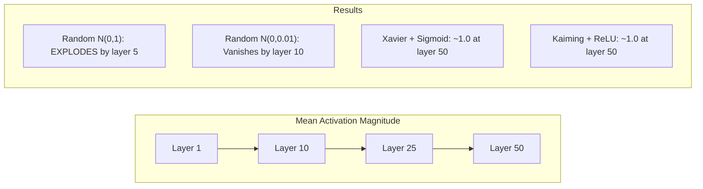
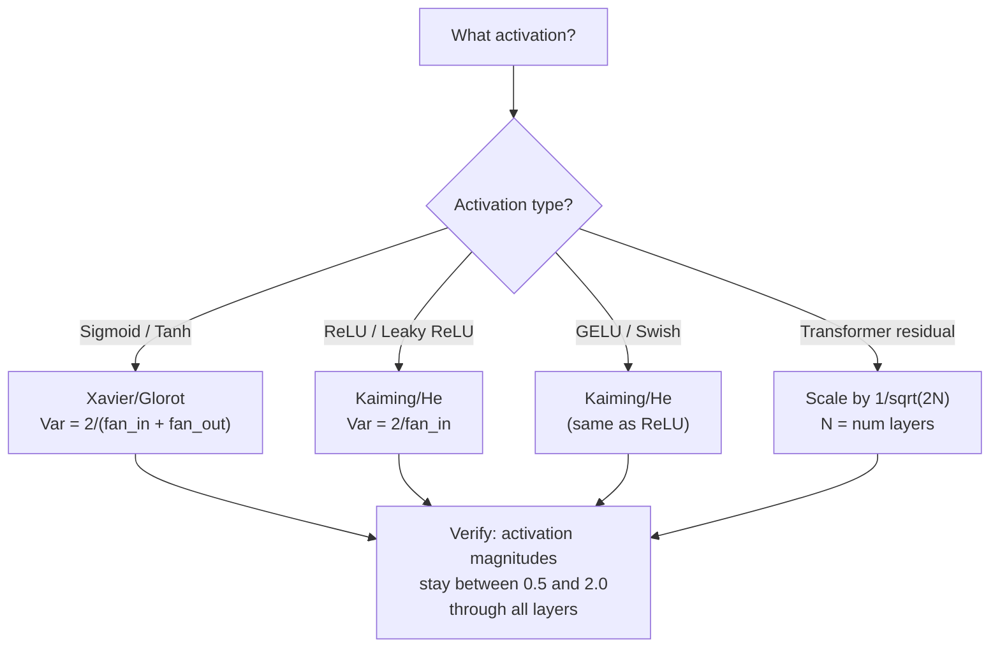

# Weight Initialization and Training Stability · 权重初始化与训练稳定性

> 初始化错了，训练根本不会开始。初始化对了，50 层也能训得像 3 层一样顺滑。

> Initialize wrong and training never starts. Initialize right and 50 layers train as smoothly as 3.

**Type:** Build
**Languages:** Python
**Prerequisites:** Lesson 03.04 (Activation Functions), Lesson 03.07 (Regularization)
**Time:** ~90 minutes

## Learning Objectives · 学习目标

- 实现零初始化、随机初始化、Xavier/Glorot 和 Kaiming/He 初始化策略，并测量它们对 50 层网络中激活幅度的影响
- 推导为什么 Xavier 初始化使用 Var(w) = 2/(fan_in + fan_out)，而 Kaiming 使用 Var(w) = 2/fan_in
- 用零初始化演示对称性问题（symmetry problem），并解释为什么只靠「随机」而不控制尺度是不够的
- 把正确的初始化策略与激活函数配对：sigmoid/tanh 用 Xavier，ReLU/GELU 用 Kaiming

> Implement zero, random, Xavier/Glorot, and Kaiming/He initialization strategies and measure their effect on activation magnitudes through 50 layers
> Derive why Xavier init uses Var(w) = 2/(fan_in + fan_out) and Kaiming uses Var(w) = 2/fan_in
> Demonstrate the symmetry problem with zero initialization and explain why random scale alone is insufficient
> Match the correct initialization strategy to the activation function: Xavier for sigmoid/tanh, Kaiming for ReLU/GELU

## The Problem · 问题在哪

把所有权重初始化成 0。什么也学不到。每个神经元计算相同的函数，收到相同的梯度，更新也一模一样。跑满 10,000 个 epoch，你那个 512 神经元的隐藏层仍然是同一个神经元的 512 份拷贝。你付了 512 个参数的钱，只买到 1 个。

把它们初始化得太大。激活值沿着网络层层爆炸。到第 10 层，数值冲到 1e15。到第 20 层，溢出成无穷大。梯度沿同一条路径反向重演一遍。

用标准正态分布随机初始化。3 层没问题。到 50 层，信号要么塌缩到 0，要么引爆成无穷大——取决于随机尺度是稍微偏小还是稍微偏大。「能用」与「报废」之间的边界薄如刀刃。

权重初始化是深度学习里最被低估的一个决策。架构能换来论文，优化器能换来博客文章，初始化只配得到一个脚注。但它一旦做错，其余一切都无所谓——你的网络在训练开始之前就已经死了。

> Initialize all weights to zero. Nothing learns. Every neuron computes the same function, receives the same gradient, and updates identically. ... The boundary between "works" and "broken" is razor-thin.
> Weight initialization is the most underrated decision in deep learning. Architecture gets papers. Optimizers get blog posts. Initialization gets a footnote. But get it wrong and nothing else matters -- your network is dead before training begins.

## The Concept · 概念

### The Symmetry Problem · 对称性问题

每一层的每个神经元结构都相同：输入乘权重、加偏置、过激活函数。如果所有权重从同一个值出发（0 是极端情形），每个神经元就计算出相同的输出。反向传播时，每个神经元收到相同的梯度。更新时，每个神经元改变相同的量。

你卡死了。网络有几百个参数，却全部步调一致地移动。这叫对称性（symmetry），随机初始化是打破它的暴力手段。每个神经元在权重空间里从不同的点出发，于是各自学到不同的特征。

但「随机」并不够。随机的**尺度**才决定网络能不能训练起来。

> Every neuron in a layer has the same structure: multiply inputs by weights, add bias, apply activation. If all weights start at the same value (zero is the extreme case), every neuron computes the same output. During backpropagation, every neuron receives the same gradient. During the update step, every neuron changes by the same amount.
> You're stuck. The network has hundreds of parameters, but they all move in lockstep. This is called symmetry, and random initialization is the brute-force way to break it. Each neuron starts at a different point in weight space, so each learns a different feature.
> But "random" is not enough. The *scale* of the randomness determines whether the network trains.

### Variance Propagation Through Layers · 方差逐层传播

考虑一个有 fan_in 个输入的单层：

```
z = w1*x1 + w2*x2 + ... + w_n*x_n
```

如果每个权重 wi 采样自方差为 Var(w) 的分布，每个输入 xi 的方差为 Var(x)，那么输出方差是：

```
Var(z) = fan_in * Var(w) * Var(x)
```

如果 Var(w) = 1、fan_in = 512，输出方差就是输入方差的 512 倍。10 层之后：512^10 = 1.2e27。你的信号爆炸了。

如果 Var(w) = 0.001，输出方差每层缩到 0.001 * 512 = 0.512 倍。10 层之后：0.512^10 = 0.00013。你的信号消失了。

目标：选好 Var(w)，让 Var(z) = Var(x)。信号幅度逐层保持不变。

> Consider a single layer with fan_in inputs: ... If each weight wi is drawn from a distribution with variance Var(w) and each input xi has variance Var(x), the output variance is: ... If Var(w) = 1 and fan_in = 512, the output variance is 512x the input variance. After 10 layers: 512^10 = 1.2e27. Your signal has exploded. ... If Var(w) = 0.001, the output variance shrinks by 0.001 * 512 = 0.512 per layer. After 10 layers: 0.512^10 = 0.00013. Your signal has vanished.
> The goal: choose Var(w) so that Var(z) = Var(x). Signal magnitude stays constant across layers.

### Xavier/Glorot Initialization · Xavier/Glorot 初始化

Glorot 和 Bengio（2010）为 sigmoid 和 tanh 激活推导出了解。要让方差在前向和反向传播中都保持恒定：

```
Var(w) = 2 / (fan_in + fan_out)
```

实践中，权重这样采样：

```
w ~ Uniform(-limit, limit)  where limit = sqrt(6 / (fan_in + fan_out))
```

或者：

```
w ~ Normal(0, sqrt(2 / (fan_in + fan_out)))
```

它能奏效，是因为 sigmoid 和 tanh 在 0 附近近似线性，而正确初始化的激活值恰好就落在那里。方差在几十层里都保持稳定。

> Glorot and Bengio (2010) derived the solution for sigmoid and tanh activations. To keep variance constant in both the forward and backward pass: ... This works because sigmoid and tanh are roughly linear near zero, where properly initialized activations live. The variance stays stable through dozens of layers.

### Kaiming/He Initialization · Kaiming/He 初始化

ReLU 杀死一半输出（所有负数都变成 0）。有效 fan_in 因此减半，因为平均有一半输入被清零。Xavier 初始化没有考虑这一点——它低估了所需的方差。

He 等人（2015）调整了公式：

```
Var(w) = 2 / fan_in
```

权重采样自：

```
w ~ Normal(0, sqrt(2 / fan_in))
```

这个因子 2 用来补偿 ReLU 清零一半激活的事实。没有它，信号每层缩水约 0.5 倍。50 层之后：0.5^50 = 8.8e-16。Kaiming 初始化就是用来防止这件事的。

> ReLU kills half the outputs (everything negative becomes zero). The effective fan_in is halved because on average half the inputs are zeroed. Xavier init doesn't account for this -- it underestimates the variance needed.
> He et al. (2015) adjusted the formula: ... The factor of 2 compensates for ReLU zeroing half the activations. Without it, the signal shrinks by ~0.5x per layer. With 50 layers: 0.5^50 = 8.8e-16. Kaiming init prevents this.

### Transformer Initialization · Transformer 初始化

GPT-2 引入了另一种模式。残差连接（residual connection）把每个子层的输出加到它的输入上：

```
x = x + sublayer(x)
```

每次相加都会增大方差。有 N 个残差层，方差就按 N 成比例增长。GPT-2 把残差层的权重乘上 1/sqrt(2N) 的缩放，其中 N 是层数。这样累积的信号幅度就能保持稳定。

Llama 3（4050 亿参数、126 层）用的是类似方案。没有这个缩放，残差流（residual stream）会穿过 126 层注意力和前馈模块无限膨胀。

> GPT-2 introduced a different pattern. Residual connections add the output of each sub-layer to its input: ... Each addition increases variance. With N residual layers, variance grows proportionally to N. GPT-2 scales the weights of residual layers by 1/sqrt(2N), where N is the number of layers. This keeps the accumulated signal magnitude stable.
> Llama 3 (405B parameters, 126 layers) uses a similar scheme. Without this scaling, the residual stream would grow unbounded through 126 layers of attention and feedforward blocks.

```mermaid
flowchart TD
    subgraph "Zero Init"
        Z1["Layer 1<br/>All weights = 0"] --> Z2["Layer 2<br/>All neurons identical"]
        Z2 --> Z3["Layer 3<br/>Still identical"]
        Z3 --> ZR["Result: 1 effective neuron<br/>regardless of width"]
    end

    subgraph "Xavier Init"
        X1["Layer 1<br/>Var = 2/(fan_in+fan_out)"] --> X2["Layer 2<br/>Signal stable"]
        X2 --> X3["Layer 50<br/>Signal stable"]
        X3 --> XR["Result: Trains with<br/>sigmoid/tanh"]
    end

    subgraph "Kaiming Init"
        K1["Layer 1<br/>Var = 2/fan_in"] --> K2["Layer 2<br/>Signal stable"]
        K2 --> K3["Layer 50<br/>Signal stable"]
        K3 --> KR["Result: Trains with<br/>ReLU/GELU"]
    end
```



### Activation Magnitude Through 50 Layers · 50 层中的激活幅度



### Choosing the Right Init · 选择正确的初始化



```figure
weight-init-variance
```

## Build It · 动手造

### Step 1: Initialization Strategies · 初始化策略

四种初始化权重矩阵的方法。每个函数返回一个「列表的列表」（二维矩阵），fan_in 列、fan_out 行。

```python
import math
import random


def zero_init(fan_in, fan_out):
    return [[0.0 for _ in range(fan_in)] for _ in range(fan_out)]


def random_init(fan_in, fan_out, scale=1.0):
    return [[random.gauss(0, scale) for _ in range(fan_in)] for _ in range(fan_out)]


def xavier_init(fan_in, fan_out):
    std = math.sqrt(2.0 / (fan_in + fan_out))
    return [[random.gauss(0, std) for _ in range(fan_in)] for _ in range(fan_out)]


def kaiming_init(fan_in, fan_out):
    std = math.sqrt(2.0 / fan_in)
    return [[random.gauss(0, std) for _ in range(fan_in)] for _ in range(fan_out)]
```

> Four ways to initialize a weight matrix. Each returns a list of lists (a 2D matrix) with fan_in columns and fan_out rows.

### Step 2: Activation Functions · 激活函数

我们需要 sigmoid、tanh 和 ReLU，把每种初始化策略和它配套的激活函数放在一起测试。

```python
def sigmoid(x):
    x = max(-500, min(500, x))
    return 1.0 / (1.0 + math.exp(-x))


def tanh_act(x):
    return math.tanh(x)


def relu(x):
    return max(0.0, x)
```

> We need sigmoid, tanh, and ReLU to test each init strategy with its intended activation.

### Step 3: Forward Pass Through 50 Layers · 穿过 50 层的前向传播

把随机数据送进深网络，测量每一层的平均激活幅度。

```python
def forward_deep(init_fn, activation_fn, n_layers=50, width=64, n_samples=100):
    random.seed(42)
    layer_magnitudes = []

    inputs = [[random.gauss(0, 1) for _ in range(width)] for _ in range(n_samples)]

    for layer_idx in range(n_layers):
        weights = init_fn(width, width)
        biases = [0.0] * width

        new_inputs = []
        for sample in inputs:
            output = []
            for neuron_idx in range(width):
                z = sum(weights[neuron_idx][j] * sample[j] for j in range(width)) + biases[neuron_idx]
                output.append(activation_fn(z))
            new_inputs.append(output)
        inputs = new_inputs

        magnitudes = []
        for sample in inputs:
            magnitudes.append(sum(abs(v) for v in sample) / width)
        mean_mag = sum(magnitudes) / len(magnitudes)
        layer_magnitudes.append(mean_mag)

    return layer_magnitudes
```

> Pass random data through a deep network and measure mean activation magnitude at each layer.

### Step 4: The Experiment · 实验

跑全部组合：零初始化、随机 N(0,1)、随机 N(0,0.01)、Xavier + sigmoid、Xavier + tanh、Kaiming + ReLU。打印关键层上的幅度。

```python
def run_experiment():
    configs = [
        ("Zero init + Sigmoid", lambda fi, fo: zero_init(fi, fo), sigmoid),
        ("Random N(0,1) + ReLU", lambda fi, fo: random_init(fi, fo, 1.0), relu),
        ("Random N(0,0.01) + ReLU", lambda fi, fo: random_init(fi, fo, 0.01), relu),
        ("Xavier + Sigmoid", xavier_init, sigmoid),
        ("Xavier + Tanh", xavier_init, tanh_act),
        ("Kaiming + ReLU", kaiming_init, relu),
    ]

    print(f"{'Strategy':<30} {'L1':>10} {'L5':>10} {'L10':>10} {'L25':>10} {'L50':>10}")
    print("-" * 80)

    for name, init_fn, act_fn in configs:
        mags = forward_deep(init_fn, act_fn)
        row = f"{name:<30}"
        for idx in [0, 4, 9, 24, 49]:
            val = mags[idx]
            if val > 1e6:
                row += f" {'EXPLODED':>10}"
            elif val < 1e-6:
                row += f" {'VANISHED':>10}"
            else:
                row += f" {val:>10.4f}"
        print(row)
```

> Run all combinations: zero init, random N(0,1), random N(0,0.01), Xavier with sigmoid, Xavier with tanh, Kaiming with ReLU. Print the magnitude at key layers.

### Step 5: Symmetry Demonstration · 对称性演示

证明零初始化会产生完全相同的神经元。

```python
def symmetry_demo():
    random.seed(42)
    weights = zero_init(2, 4)
    biases = [0.0] * 4

    inputs = [0.5, -0.3]
    outputs = []
    for neuron_idx in range(4):
        z = sum(weights[neuron_idx][j] * inputs[j] for j in range(2)) + biases[neuron_idx]
        outputs.append(sigmoid(z))

    print("\nSymmetry Demo (4 neurons, zero init):")
    for i, out in enumerate(outputs):
        print(f"  Neuron {i}: output = {out:.6f}")
    all_same = all(abs(outputs[i] - outputs[0]) < 1e-10 for i in range(len(outputs)))
    print(f"  All identical: {all_same}")
    print(f"  Effective parameters: 1 (not {len(weights) * len(weights[0])})")
```

> Show that zero init produces identical neurons.

### Step 6: Layer-by-Layer Magnitude Report · 逐层幅度报告

打印一张 50 层激活幅度的可视化条形图。

```python
def magnitude_report(name, magnitudes):
    print(f"\n{name}:")
    for i, mag in enumerate(magnitudes):
        if i % 5 == 0 or i == len(magnitudes) - 1:
            if mag > 1e6:
                bar = "X" * 50 + " EXPLODED"
            elif mag < 1e-6:
                bar = "." + " VANISHED"
            else:
                bar_len = min(50, max(1, int(mag * 10)))
                bar = "#" * bar_len
            print(f"  Layer {i+1:3d}: {bar} ({mag:.6f})")
```

> Print a visual bar chart of activation magnitudes through 50 layers.

## Use It · 实战用法

PyTorch 把这些做成了内置函数：

```python
import torch
import torch.nn as nn

layer = nn.Linear(512, 256)

nn.init.xavier_uniform_(layer.weight)
nn.init.xavier_normal_(layer.weight)

nn.init.kaiming_uniform_(layer.weight, nonlinearity='relu')
nn.init.kaiming_normal_(layer.weight, nonlinearity='relu')

nn.init.zeros_(layer.bias)
```

当你调用 `nn.Linear(512, 256)` 时，PyTorch 默认使用 Kaiming 均匀初始化。这就是为什么大多数简单网络「开箱即用」——PyTorch 已经替你做了正确的选择。但当你构建自定义架构、或者深度超过 20 层时，你需要理解背后发生了什么，并可能要覆盖这个默认值。

对 Transformer 来说，HuggingFace 模型通常在自己的 `_init_weights` 方法里处理初始化。GPT-2 的实现把残差投影乘以 1/sqrt(N)。如果你从零构建 Transformer，这一步得自己加。

> PyTorch provides these as built-in functions: ... When you call `nn.Linear(512, 256)`, PyTorch defaults to Kaiming uniform initialization. That's why most simple networks "just work" -- PyTorch already made the right choice. But when you build custom architectures or go deeper than 20 layers, you need to understand what's happening and potentially override the default.
> For transformers, HuggingFace models typically handle initialization in their `_init_weights` method. GPT-2's implementation scales residual projections by 1/sqrt(N). If you're building a transformer from scratch, you need to add this yourself.

## Ship It · 交付

本课产出：
- `outputs/prompt-init-strategy.md` —— 一个诊断权重初始化问题、推荐正确策略的提示词

> This lesson produces:
> - `outputs/prompt-init-strategy.md` -- a prompt that diagnoses weight initialization problems and recommends the right strategy

## Exercises · 练习

1. 加入 LeCun 初始化（Var = 1/fan_in，为 SELU 激活设计）。用 LeCun 初始化 + tanh 跑 50 层实验，和 Xavier + tanh 对比。

2. 实现 GPT-2 的残差缩放：在加进残差流之前，把每层的输出乘以 1/sqrt(2*N)。分别跑有缩放和无缩放的 50 层，测量残差幅度的增长速度。

3. 写一个「初始化健康检查」函数：输入网络的层尺寸和激活类型，推荐正确的初始化方法，并在当前初始化会出问题时发出警告。

4. 用 fan_in = 16 和 fan_in = 1024 分别跑实验。Xavier 和 Kaiming 会适应 fan_in，随机初始化不会。展示「能用」和「崩溃」之间的差距如何随层宽拉大。

5. 实现正交初始化（orthogonal initialization）：生成一个随机矩阵，算它的 SVD，用正交矩阵 U。在 50 层 ReLU 网络上和 Kaiming 对比。

## Key Terms · 术语表

| 术语 | 人们的说法 | 实际含义 |
|------|----------------|----------------------|
| Weight initialization（权重初始化） | 「随机设置起始权重」 | 决定网络究竟能不能训练起来的初始权重取值策略 |
| Symmetry breaking（打破对称性） | 「让神经元彼此不同」 | 用随机初始化保证神经元学到各自不同的特征，而不是计算相同的函数 |
| Fan-in（输入维度） | 「一个神经元的输入数量」 | 进入连接的数量，决定加权求和中输入方差如何累积 |
| Fan-out（输出维度） | 「一个神经元的输出数量」 | 发出连接的数量，关系到反向传播时梯度方差能否维持 |
| Xavier/Glorot init | 「sigmoid 的初始化」 | Var(w) = 2/(fan_in + fan_out)，为让方差穿过 sigmoid 和 tanh 激活后保持稳定而设计 |
| Kaiming/He init | 「ReLU 的初始化」 | Var(w) = 2/fan_in，补偿了 ReLU 清零一半激活的事实 |
| Variance propagation（方差传播） | 「信号逐层变大还是变小」 | 对激活方差如何随权重尺度逐层变化的数学分析 |
| Residual scaling（残差缩放） | 「GPT-2 的初始化技巧」 | 把残差连接的权重乘以 1/sqrt(2N)，防止方差穿过 N 层 Transformer 不断增长 |
| Dead network（死网络） | 「什么都训不动」 | 由于糟糕的初始化，所有梯度为 0 或所有激活都饱和的网络 |
| Exploding activations（激活爆炸） | 「数值冲向无穷大」 | 权重方差过高，导致激活幅度逐层指数增长 |

## Further Reading · 延伸阅读

- Glorot & Bengio, "Understanding the difficulty of training deep feedforward neural networks" (2010) —— Xavier 初始化的原始论文，含方差分析
- He et al., "Delving Deep into Rectifiers" (2015) —— 提出面向 ReLU 网络的 Kaiming 初始化
- Radford et al., "Language Models are Unsupervised Multitask Learners" (2019) —— GPT-2 论文，含残差缩放初始化
- Mishkin & Matas, "All You Need is a Good Init" (2016) —— 层序单位方差初始化，解析公式之外的经验替代方案
