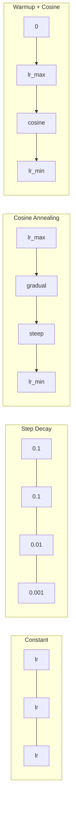
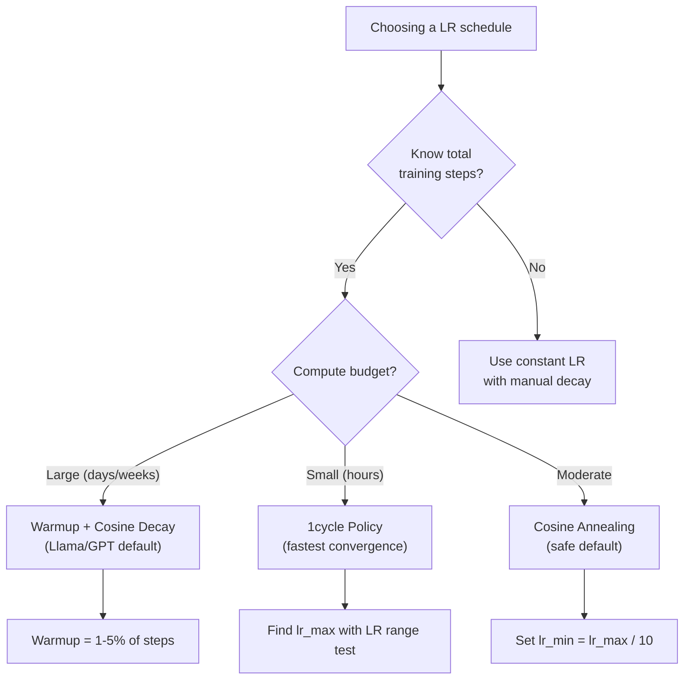
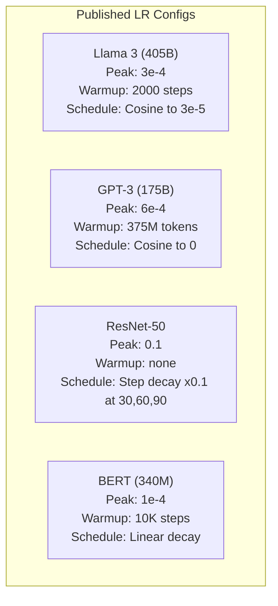

# Learning Rate Schedules and Warmup · 学习率调度与 Warmup

> 学习率是唯一最重要的超参数。不是架构，不是数据集大小，不是激活函数。是学习率。别的都可以不调，这个必须调。

> The learning rate is the single most important hyperparameter. Not the architecture. Not the dataset size. Not the activation function. The learning rate. If you tune nothing else, tune this.

**Type:** Build
**Languages:** Python
**Prerequisites:** Lesson 03.06 (Optimizers), Lesson 03.08 (Weight Initialization)
**Time:** ~90 minutes

## Learning Objectives · 学习目标

- 从零实现 constant、step decay、cosine annealing、warmup + cosine、1cycle 五种学习率调度
- 演示学习率选择的三种失败模式：发散（太大）、停滞（太小）、震荡（没有衰减）
- 解释为什么基于 Adam 的优化器需要 warmup，以及它如何稳定训练的早期阶段
- 在同一任务上对比全部五种调度的收敛速度，并按训练预算选出合适的一种

> Implement constant, step decay, cosine annealing, warmup + cosine, and 1cycle learning rate schedules from scratch
> Demonstrate the three failure modes of learning rate selection: divergence (too high), stalling (too low), and oscillation (no decay)
> Explain why warmup is necessary for Adam-based optimizers and how it stabilizes early training
> Compare convergence speed across all five schedules on the same task and select the appropriate one for a given training budget

## The Problem · 问题在哪

把学习率设成 0.1。训练发散——loss 三步之内冲到无穷大。设成 0.0001。训练在爬——100 个 epoch 过去，模型几乎没离开随机初始化的起点。设成 0.01。训练正常跑了 50 个 epoch，然后 loss 在一个它永远够不着的最小值附近来回震荡，因为步长太大了。

最优学习率不是一个常数。它在训练过程中不断变化。早期要大步快跑抢占地面，后期要小碎步稳稳落进尖锐的极小值。90% 精度的模型和 95% 精度的模型，差距往往只是一个调度。

最近三年发表的每个主流模型都用学习率调度。Llama 3 用峰值 lr=3e-4、2000 步 warmup、cosine 衰减到 3e-5。GPT-3 用 lr=6e-4、在 3.75 亿 token 上做 warmup。这些不是拍脑袋的数字，而是耗资数百万美元的大规模超参数扫描换来的结果。

你必须理解调度，因为默认值对你的问题不管用。微调预训练模型时，正确的调度和从零训练不同。加大 batch size 时，warmup 期需要跟着变。训练在第 10,000 步崩掉时，你得能判断这是调度问题还是别的什么。

> Set the learning rate to 0.1. Training diverges -- loss jumps to infinity in 3 steps. ... The optimal learning rate is not a constant. It changes during training. ... The difference between a 90% accurate model and a 95% accurate model is often just the schedule.
> Every major model published in the last three years uses a learning rate schedule. ... You need to understand schedules because the defaults will not work for your problem.

## The Concept · 概念

### Constant Learning Rate · 固定学习率

最简单的做法。选一个数，每一步都用它。

```
lr(t) = lr_0
```

很少是最优的。要么对训练末期太大（在极小值附近震荡），要么对训练初期太小（小碎步白白浪费算力）。小模型和调试时够用。对任何要训练超过一小时的任务都是糟糕的选择。

> The simplest approach. Pick a number, use it for every step. ... Rarely optimal. It's either too high for the end of training (oscillation around the minimum) or too low for the beginning (wasted compute on tiny steps). Works fine for small models and debugging. A terrible choice for anything that trains for more than an hour.

### Step Decay · 阶梯衰减

ResNet 时代的老派做法。在固定 epoch 处把学习率乘一个因子（通常是缩小 10 倍）。

```
lr(t) = lr_0 * gamma^(floor(epoch / step_size))
```

gamma = 0.1、step_size = 30 的意思是：每 30 个 epoch 学习率降 10 倍。ResNet-50 就是这么干的——lr=0.1，在第 30、60、90 个 epoch 各降 10 倍。

问题在于：最优的衰减时机取决于数据集和架构。换一个问题，你就得重新调「什么时候降」。而且切换很突兀——学习率骤变时 loss 可能突然弹起。

> The old-school approach from the ResNet era. Cut the learning rate by a factor (usually 10x) at fixed epochs. ... The problem: the optimal decay points depend on the dataset and architecture. Move to a different problem and you need to re-tune when to drop. The transitions are abrupt -- loss can spike when the rate suddenly changes.

### Cosine Annealing · 余弦退火

从最大学习率平滑衰减到最小值，沿一条余弦曲线：

```
lr(t) = lr_min + 0.5 * (lr_max - lr_min) * (1 + cos(pi * t / T))
```

其中 t 是当前步数，T 是总步数。

t=0 时余弦项为 1，所以 lr = lr_max。t=T 时余弦项为 -1，所以 lr = lr_min。衰减先缓、中段加速、临近结尾再度放缓。

这是大多数现代训练的默认选择。除了 lr_max 和 lr_min 之外没有别的超参数要调。余弦形状贴合一个经验观察：大部分学习发生在训练中段——你希望在关键期有合理的步长。

> Smooth decay from the maximum learning rate to a minimum, following a cosine curve: ... At t=0, the cosine term is 1, so lr = lr_max. At t=T, the cosine term is -1, so lr = lr_min. ... This is the default for most modern training runs. No hyperparameters to tune beyond lr_max and lr_min. The cosine shape matches the empirical observation that most learning happens in the middle of training -- you want reasonable step sizes during that critical period.

### Warmup: Why You Start Small · Warmup：为什么起步要小

Adam 和其他自适应优化器维护着梯度均值与方差的滑动估计。第 0 步时这些估计初始化为 0。最开始的几次梯度更新建立在垃圾统计之上。如果这段时间学习率很大，模型会迈出巨大而且方向糟糕的步子。

Warmup 修复这个问题。从一个极小的学习率起步（常常是 lr_max / warmup_steps，甚至 0），在前 N 步线性爬升到 lr_max。等你到达全量学习率时，Adam 的统计量已经稳定下来。

```
lr(t) = lr_max * (t / warmup_steps)     for t < warmup_steps
```

典型 warmup：占总训练步数的 1-5%。Llama 3 训练了约 1.8 万亿 token，warmup 了 2000 步。GPT-3 在 3.75 亿 token 上 warmup。

> Adam and other adaptive optimizers maintain running estimates of gradient mean and variance. At step 0, these estimates are initialized to zero. The first few gradient updates are based on garbage statistics. If your learning rate is large during this period, the model takes huge, poorly-directed steps.
> Warmup fixes this. Start with a tiny learning rate (often lr_max / warmup_steps or even zero) and linearly ramp up to lr_max over the first N steps. By the time you reach the full learning rate, Adam's statistics have stabilized. ... Typical warmup: 1-5% of total training steps.

### Linear Warmup + Cosine Decay · 线性 Warmup + 余弦衰减

现代默认配置。先线性爬升，再按余弦衰减：

```
if t < warmup_steps:
    lr(t) = lr_max * (t / warmup_steps)
else:
    progress = (t - warmup_steps) / (total_steps - warmup_steps)
    lr(t) = lr_min + 0.5 * (lr_max - lr_min) * (1 + cos(pi * progress))
```

Llama、GPT、PaLM 以及大多数现代 Transformer 用的就是这个。warmup 防止早期不稳定，cosine 衰减让模型稳稳落进一个好的极小值。

> The modern default. Ramp up linearly, then decay with cosine: ... This is what Llama, GPT, PaLM, and most modern transformers use. The warmup prevents early instability. The cosine decay settles the model into a good minimum.

### 1cycle Policy · 1cycle 策略

Leslie Smith 的发现（2018）：训练前半程把学习率从低值一路拉高，后半程再降回来。反直觉——为什么要在中途*增大*学习率？

理论：高学习率通过给优化轨迹加噪声起到正则化（regularization）的作用。爬升阶段模型探索更多的损失地形，找到更好的盆地；下降阶段再在找到的最好盆地里精修。

```
Phase 1 (0 to T/2):    lr ramps from lr_max/25 to lr_max
Phase 2 (T/2 to T):    lr ramps from lr_max to lr_max/10000
```

在固定算力预算下，1cycle 常常比 cosine annealing 训得更快。代价：必须提前知道总步数。

> Leslie Smith's discovery (2018): ramp the learning rate up from a low value to a high value in the first half of training, then ramp it back down in the second half. Counterintuitive -- why would you *increase* the learning rate midway through?
> The theory: a high learning rate acts as regularization by adding noise to the optimization trajectory. The model explores more of the loss landscape during the ramp-up phase, finding better basins. The ramp-down phase then refines within the best basin found. ... 1cycle often trains faster than cosine annealing for a fixed compute budget. The tradeoff: you must know the total number of steps in advance.

### Schedule Shapes · 调度形态



### Decision Flowchart · 决策流程图



### Real Numbers from Published Models · 已发表模型的真实配置



```figure
lr-schedule
```

## Build It · 动手造

### Step 1: Schedule Functions · 调度函数

每个函数接收当前步数，返回该步的学习率。

```python
import math


def constant_schedule(step, lr=0.01, **kwargs):
    return lr


def step_decay_schedule(step, lr=0.1, step_size=100, gamma=0.1, **kwargs):
    return lr * (gamma ** (step // step_size))


def cosine_schedule(step, lr=0.01, total_steps=1000, lr_min=1e-5, **kwargs):
    if step >= total_steps:
        return lr_min
    return lr_min + 0.5 * (lr - lr_min) * (1 + math.cos(math.pi * step / total_steps))


def warmup_cosine_schedule(step, lr=0.01, total_steps=1000, warmup_steps=100, lr_min=1e-5, **kwargs):
    if total_steps <= warmup_steps:
        return lr * (step / max(warmup_steps, 1))
    if step < warmup_steps:
        return lr * step / warmup_steps
    progress = (step - warmup_steps) / (total_steps - warmup_steps)
    return lr_min + 0.5 * (lr - lr_min) * (1 + math.cos(math.pi * progress))


def one_cycle_schedule(step, lr=0.01, total_steps=1000, **kwargs):
    mid = max(total_steps // 2, 1)
    if step < mid:
        return (lr / 25) + (lr - lr / 25) * step / mid
    else:
        progress = (step - mid) / max(total_steps - mid, 1)
        return lr * (1 - progress) + (lr / 10000) * progress
```

> Each function takes the current step and returns the learning rate at that step.

### Step 2: Visualize All Schedules · 可视化所有调度

打印文本图，展示每种调度在训练过程中的演化。

```python
def visualize_schedule(name, schedule_fn, total_steps=500, **kwargs):
    steps = list(range(0, total_steps, total_steps // 20))
    if total_steps - 1 not in steps:
        steps.append(total_steps - 1)

    lrs = [schedule_fn(s, total_steps=total_steps, **kwargs) for s in steps]
    max_lr = max(lrs) if max(lrs) > 0 else 1.0

    print(f"\n{name}:")
    for s, lr_val in zip(steps, lrs):
        bar_len = int(lr_val / max_lr * 40)
        bar = "#" * bar_len
        print(f"  Step {s:4d}: lr={lr_val:.6f} {bar}")
```

> Print a text-based plot showing how each schedule evolves over training.

### Step 3: Training Network · 训练网络

一个跑在 circle 数据集上的简单两层网络，和前几课一样，但这次我们更换调度。

```python
import random


def sigmoid(x):
    x = max(-500, min(500, x))
    return 1.0 / (1.0 + math.exp(-x))


def relu(x):
    return max(0.0, x)


def relu_deriv(x):
    return 1.0 if x > 0 else 0.0


def make_circle_data(n=200, seed=42):
    random.seed(seed)
    data = []
    for _ in range(n):
        x = random.uniform(-2, 2)
        y = random.uniform(-2, 2)
        label = 1.0 if x * x + y * y < 1.5 else 0.0
        data.append(([x, y], label))
    return data


def train_with_schedule(schedule_fn, schedule_name, data, epochs=300, base_lr=0.05, **kwargs):
    random.seed(0)
    hidden_size = 8
    total_steps = epochs * len(data)

    std = math.sqrt(2.0 / 2)
    w1 = [[random.gauss(0, std) for _ in range(2)] for _ in range(hidden_size)]
    b1 = [0.0] * hidden_size
    w2 = [random.gauss(0, std) for _ in range(hidden_size)]
    b2 = 0.0

    step = 0
    epoch_losses = []

    for epoch in range(epochs):
        total_loss = 0
        correct = 0

        for x, target in data:
            lr = schedule_fn(step, lr=base_lr, total_steps=total_steps, **kwargs)

            z1 = []
            h = []
            for i in range(hidden_size):
                z = w1[i][0] * x[0] + w1[i][1] * x[1] + b1[i]
                z1.append(z)
                h.append(relu(z))

            z2 = sum(w2[i] * h[i] for i in range(hidden_size)) + b2
            out = sigmoid(z2)

            error = out - target
            d_out = error * out * (1 - out)

            for i in range(hidden_size):
                d_h = d_out * w2[i] * relu_deriv(z1[i])
                w2[i] -= lr * d_out * h[i]
                for j in range(2):
                    w1[i][j] -= lr * d_h * x[j]
                b1[i] -= lr * d_h
            b2 -= lr * d_out

            total_loss += (out - target) ** 2
            if (out >= 0.5) == (target >= 0.5):
                correct += 1
            step += 1

        avg_loss = total_loss / len(data)
        accuracy = correct / len(data) * 100
        epoch_losses.append(avg_loss)

    return epoch_losses
```

> A simple two-layer network on the circle dataset, same as previous lessons, but now we vary the schedule.

### Step 4: Compare All Schedules · 对比所有调度

用每种调度训练同一个网络，比较最终 loss 和收敛行为。

```python
def compare_schedules(data):
    configs = [
        ("Constant", constant_schedule, {}),
        ("Step Decay", step_decay_schedule, {"step_size": 15000, "gamma": 0.1}),
        ("Cosine", cosine_schedule, {"lr_min": 1e-5}),
        ("Warmup+Cosine", warmup_cosine_schedule, {"warmup_steps": 3000, "lr_min": 1e-5}),
        ("1cycle", one_cycle_schedule, {}),
    ]

    print(f"\n{'Schedule':<20} {'Start Loss':>12} {'Mid Loss':>12} {'End Loss':>12} {'Best Loss':>12}")
    print("-" * 70)

    for name, schedule_fn, extra_kwargs in configs:
        losses = train_with_schedule(schedule_fn, name, data, epochs=300, base_lr=0.05, **extra_kwargs)
        mid_idx = len(losses) // 2
        best = min(losses)
        print(f"{name:<20} {losses[0]:>12.6f} {losses[mid_idx]:>12.6f} {losses[-1]:>12.6f} {best:>12.6f}")
```

> Train the same network with each schedule and compare final loss and convergence behavior.

### Step 5: LR Too High vs Too Low · 学习率太大 vs 太小

演示三种失败模式：太大（发散）、太小（爬行）、恰到好处。

```python
def lr_sensitivity(data):
    learning_rates = [1.0, 0.1, 0.01, 0.001, 0.0001]

    print("\nLR Sensitivity (constant schedule, 100 epochs):")
    print(f"  {'LR':>10} {'Start Loss':>12} {'End Loss':>12} {'Status':>15}")
    print("  " + "-" * 52)

    for lr in learning_rates:
        losses = train_with_schedule(constant_schedule, f"lr={lr}", data, epochs=100, base_lr=lr)
        start = losses[0]
        end = losses[-1]

        if end > start or math.isnan(end) or end > 1.0:
            status = "DIVERGED"
        elif end > start * 0.9:
            status = "BARELY MOVED"
        elif end < 0.15:
            status = "CONVERGED"
        else:
            status = "LEARNING"

        end_str = f"{end:.6f}" if not math.isnan(end) else "NaN"
        print(f"  {lr:>10.4f} {start:>12.6f} {end_str:>12} {status:>15}")
```

> Demonstrate the three failure modes: too high (divergence), too low (crawling), and just right.

## Use It · 实战用法

PyTorch 在 `torch.optim.lr_scheduler` 里提供了调度器：

```python
import torch
import torch.optim as optim
from torch.optim.lr_scheduler import CosineAnnealingLR, OneCycleLR, StepLR

model = nn.Sequential(nn.Linear(10, 64), nn.ReLU(), nn.Linear(64, 1))
optimizer = optim.Adam(model.parameters(), lr=3e-4)

scheduler = CosineAnnealingLR(optimizer, T_max=1000, eta_min=1e-5)

for step in range(1000):
    loss = train_step(model, optimizer)
    scheduler.step()
```

需要 warmup + cosine 时，可以用 lambda 调度器，或者用 HuggingFace 的 `get_cosine_schedule_with_warmup`：

```python
from transformers import get_cosine_schedule_with_warmup

scheduler = get_cosine_schedule_with_warmup(
    optimizer,
    num_warmup_steps=2000,
    num_training_steps=100000,
)
```

大多数 Llama 和 GPT 微调脚本用的都是 HuggingFace 这个函数。拿不准就用 warmup + cosine，warmup 取总步数的 3-5%。几乎万无一失。

> PyTorch provides schedulers in `torch.optim.lr_scheduler`: ... For warmup + cosine, use a lambda scheduler or the `get_cosine_schedule_with_warmup` from HuggingFace: ... The HuggingFace function is what most Llama and GPT fine-tuning scripts use. When in doubt, use warmup + cosine with warmup = 3-5% of total steps. It works for almost everything.

## Ship It · 交付

本课产出：
- `outputs/prompt-lr-schedule-advisor.md` —— 一个为你的训练配置推荐正确学习率调度和超参数的提示词

> This lesson produces:
> - `outputs/prompt-lr-schedule-advisor.md` -- a prompt that recommends the right learning rate schedule and hyperparameters for your training setup

## Exercises · 练习

1. 实现指数衰减：lr(t) = lr_0 * gamma^t，gamma = 0.999。在 circle 数据集上和 cosine annealing 对比。

2. 实现学习率范围测试（LR range test，Leslie Smith 提出）：训练几百步，同时把 LR 从 1e-7 指数增大到 1。画出 loss 对 LR 的曲线。最优最大 LR 就在 loss 开始上升之前的位置。

3. 用 warmup + cosine 训练，但改变 warmup 长度：占总步数的 0%、1%、5%、10%、20%。找出训练最稳定的最佳点。

4. 实现带热重启的余弦退火（SGDR）：每 T 步把学习率重置回 lr_max 再重新衰减。在更长的训练中与标准 cosine 对比。

5. 造一个「调度外科医生」：监控训练 loss，loss 稳定后自动从 warmup 切换到 cosine，loss 平台期持续太久就降低 lr。

## Key Terms · 术语表

| 术语 | 人们的说法 | 实际含义 |
|------|----------------|----------------------|
| Learning rate（学习率） | 「模型学多快」 | 乘在梯度上的标量，决定参数更新的幅度 |
| Schedule（调度） | 「随时间改变 LR」 | 把训练步数映射到学习率的函数，为优化收敛而设计 |
| Warmup（预热） | 「从小 LR 起步」 | 前 N 步把 LR 从近零线性爬升到目标值，稳定优化器的统计量 |
| Cosine annealing（余弦退火） | 「平滑的 LR 衰减」 | 训练过程中沿余弦曲线从 lr_max 降到 lr_min |
| Step decay（阶梯衰减） | 「在里程碑处降 LR」 | 在固定的 epoch 间隔把 LR 乘一个因子（通常 0.1） |
| 1cycle policy | 「先升后降」 | Leslie Smith 的方法：单个周期内先升 LR 再降，收敛更快 |
| LR range test（LR 范围测试） | 「找到最好的学习率」 | 短暂训练的同时增大 LR，找到 loss 开始发散的位置 |
| Cosine with warm restarts（热重启余弦） | 「重置再来一遍」 | 周期性地把 LR 重置回 lr_max 再重新衰减（SGDR） |
| Eta min（最小学习率） | 「LR 的地板」 | 调度衰减到的最小学习率 |
| Peak learning rate（峰值学习率） | 「最大 LR」 | 训练中达到的最高 LR，通常在 warmup 之后 |

## Further Reading · 延伸阅读

- Loshchilov & Hutter, "SGDR: Stochastic Gradient Descent with Warm Restarts" (2017) —— 提出余弦退火与热重启
- Smith, "Super-Convergence: Very Fast Training of Neural Networks Using Large Learning Rates" (2018) —— 1cycle 策略论文
- Touvron et al., "Llama 2: Open Foundation and Fine-Tuned Chat Models" (2023) —— 记录了大规模训练使用的 warmup + cosine 调度
- Goyal et al., "Accurate, Large Minibatch SGD: Training ImageNet in 1 Hour" (2017) —— 线性缩放规则与大 batch 训练的 warmup
