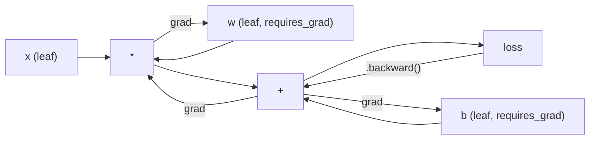
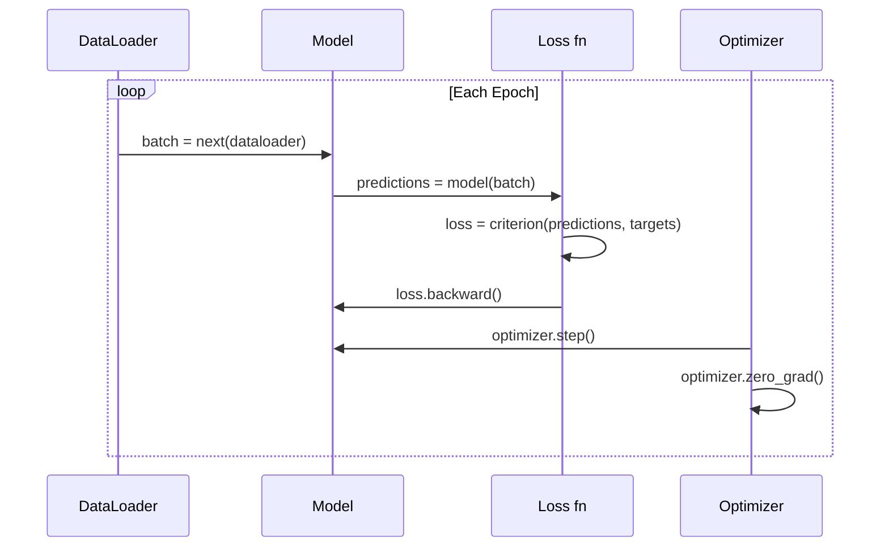

# Introduction to PyTorch · PyTorch 入门

> You built the engine from pistons and crankshafts. Now learn the one everyone actually drives.

**Type:** Build
**Languages:** Python
**Prerequisites:** Lesson 03.10 (Build Your Own Mini Framework)
**Time:** ~75 minutes

## Learning Objectives · 学习目标

- 用 PyTorch 的 nn.Module、nn.Sequential 和 autograd 构建并训练神经网络
- 使用 PyTorch 张量、GPU 加速和标准训练循环（zero_grad、forward、loss、backward、step）
- 把你从零造的迷你框架组件一一对应到 PyTorch 的等价物
- 在同一个任务上测量并对比纯 Python 框架与 PyTorch 的训练速度

> Build and train neural networks using PyTorch's nn.Module, nn.Sequential, and autograd
> Use PyTorch tensors, GPU acceleration, and the standard training loop (zero_grad, forward, loss, backward, step)
> Convert your from-scratch mini framework components to their PyTorch equivalents
> Profile and compare training speed between your pure-Python framework and PyTorch on the same task

---

## The Problem · 问题在哪

你有一个能跑的迷你框架：线性层、ReLU、dropout、batch norm、Adam、DataLoader、训练循环。它能在纯 Python 里训练一个 4 层网络解决圆形分类问题。

它在同一个问题上也比 PyTorch 慢 500 倍。

你的迷你框架用嵌套 Python 循环一次处理一个样本。PyTorch 把同样的操作分发给跑在 GPU 上的优化过的 C++/CUDA 内核。在单块 NVIDIA A100 上，PyTorch 在 ImageNet（128 万张图片）上训练 ResNet-50（2560 万参数）大约要 6 小时。你的框架在同一个任务上大概要 3000 小时——前提是它没有先耗尽内存。

速度不是唯一的差距。你的框架没有 GPU 支持，没有自动微分——每个模块的 backward() 都是你手写的；没有序列化，没有分布式训练，没有混合精度，想调试梯度流除了 print 语句没有别的办法。

PyTorch 填补了上面每一个缺口。而且它保留了你已经亲手造出的那套完全相同的心智模型：Module、forward()、parameters()、backward()、optimizer.step()。概念一一对应，语法几乎相同。区别只在于：PyTorch 在你从零设计的同一套接口背后，包着十年的系统工程。

> You have a working mini framework. Linear layers, ReLU, dropout, batch norm, Adam, a DataLoader, a training loop. It trains a 4-layer network on a circle classification problem in pure Python.
> It is also 500x slower than PyTorch on the same problem.
> PyTorch fills every one of these gaps. And it does so while keeping the exact same mental model you already built: Module, forward(), parameters(), backward(), optimizer.step(). The concepts transfer one-to-one. The syntax is nearly identical.

---

## The Concept · 概念

### Why PyTorch Won · PyTorch 为什么赢了

2015 年，TensorFlow 要求你在运行任何东西之前先定义一张**静态计算图**：先建图、编译，再把数据喂进去。调试意味着盯着图可视化看。改架构意味着从头重建整张图。

PyTorch 在 2017 年带着另一种哲学登场：**eager execution（即时执行）**。你写 Python，它立刻运行。`y = model(x)` 此刻就真的算出 y，而不是「往图里加一个以后才会计算 y 的节点」。这意味着标准 Python 调试工具全部可用：print() 能用，pdb 能用，forward 里的 if/else 也能用。

到 2020 年，市场已经投票。PyTorch 在 ML 研究论文中的份额从 7%（2017）涨到超过 75%（2022）。Meta、Google DeepMind、OpenAI、Anthropic、Hugging Face 都把 PyTorch 当主力框架。TensorFlow 2.x 作为回应采用了 eager execution——默认承认 PyTorch 的设计是对的。

本课的教训：**开发者体验会复利**。一个慢 10% 但调试快 50% 的框架每次都赢。

> In 2015, TensorFlow required you to define a static computation graph before running anything. You built the graph, compiled it, then fed data through it. Debugging meant staring at graph visualizations. Changing the architecture meant rebuilding the graph from scratch.
> PyTorch launched in 2017 with a different philosophy: eager execution. You write Python. It runs immediately.
> By 2020, the market had spoken. PyTorch's share in ML research papers went from 7% (2017) to over 75% (2022).
> The lesson: developer experience compounds. A framework that is 10% slower but 50% faster to debug wins every time.

---

### Tensors · 张量

张量是带三个关键属性的多维数组：shape、dtype、device。

```python
import torch

x = torch.zeros(3, 4)           # shape: (3, 4), dtype: float32, device: cpu
x = torch.randn(2, 3, 224, 224) # batch of 2 RGB images, 224x224
x = torch.tensor([1, 2, 3])     # from a Python list
```

**Shape** 是维度。标量是 ()，向量是 (n,)，矩阵是 (m, n)，一批图片是 (batch, channels, height, width)。

**Dtype** 控制精度和内存。

| dtype | 位数 | 取值范围 | 用途 |
|-------|------|-------|----------|
| float32 | 32 | 约 7 位十进制精度 | 默认训练 |
| float16 | 16 | 约 3.3 位十进制精度 | 混合精度 |
| bfloat16 | 16 | 与 float32 同范围，精度更低 | LLM 训练 |
| int8 | 8 | -128 到 127 | 量化推理 |

**Device** 决定计算发生在哪里。

```python
device = torch.device("cuda" if torch.cuda.is_available() else "cpu")
x = torch.randn(3, 4, device=device)
x = x.to("cuda")
x = x.cpu()
```

每个操作都要求所有张量在同一设备上。这是初学者碰到的第一大 PyTorch 错误：`RuntimeError: Expected all tensors to be on the same device`。修复方法是计算前把所有东西移到同一设备。

**Reshaping（变形）** 是常数时间——改的是元数据，不是数据。

```python
x = torch.randn(2, 3, 4)
x.view(2, 12)      # reshape to (2, 12) -- must be contiguous
x.reshape(6, 4)    # reshape to (6, 4) -- works always
x.permute(2, 0, 1) # reorder dimensions
x.unsqueeze(0)     # add dimension: (1, 2, 3, 4)
x.squeeze()        # remove size-1 dimensions
```

> A tensor is a multi-dimensional array with three critical properties: shape, dtype, and device.
> Every operation requires all tensors on the same device. This is the #1 PyTorch error beginners hit: `RuntimeError: Expected all tensors to be on the same device`. Fix it by moving everything to the same device before computation.
> **Reshaping** is constant-time -- it changes the metadata, not the data.

---

### Autograd · 自动微分

你的迷你框架要求你为每个模块实现 backward()。PyTorch 不需要。它把张量上的每个操作记录成一张有向无环图（计算图），然后反向遍历这张图自动算出梯度。



与你框架的关键区别：PyTorch 使用**基于 tape 的自动微分**。前向传播中每个操作都追加到一条「tape」上。调用 `.backward()` 就是把 tape 倒着放一遍。

```python
x = torch.randn(3, requires_grad=True)
y = x ** 2 + 3 * x
z = y.sum()
z.backward()
print(x.grad)  # dz/dx = 2x + 3
```

autograd 的三条规则：

1. 只有 `requires_grad=True` 的叶子张量会累积梯度
2. 梯度默认是累积的——每次 backward 之前先调用 `optimizer.zero_grad()`
3. `torch.no_grad()` 关闭梯度追踪（评估时使用）

> Your mini framework required you to implement backward() for every module. PyTorch does not. It records every operation on tensors into a directed acyclic graph (the computational graph) and then traverses that graph in reverse to compute gradients automatically.
> The key difference from your framework: PyTorch uses tape-based autodiff. Every operation appends to a "tape" during the forward pass. Calling `.backward()` replays the tape in reverse.
> Three rules of autograd:
> 1. Only leaf tensors with `requires_grad=True` accumulate gradients
> 2. Gradients accumulate by default -- call `optimizer.zero_grad()` before each backward pass
> 3. `torch.no_grad()` disables gradient tracking (use during evaluation)

---

### nn.Module

`nn.Module` 是 PyTorch 中所有神经网络组件的基类。你在 Lesson 10 已经造过这个抽象。PyTorch 的版本额外提供自动参数注册、递归模块发现、设备管理和 state dict 序列化。

```python
import torch.nn as nn

class MLP(nn.Module):
    def __init__(self, input_dim, hidden_dim, output_dim):
        super().__init__()
        self.layer1 = nn.Linear(input_dim, hidden_dim)
        self.relu = nn.ReLU()
        self.layer2 = nn.Linear(hidden_dim, output_dim)

    def forward(self, x):
        x = self.layer1(x)
        x = self.relu(x)
        x = self.layer2(x)
        return x
```

当你在 `__init__` 里把一个 `nn.Module` 或 `nn.Parameter` 赋值为属性时，PyTorch 会自动注册它。`model.parameters()` 递归收集每一个注册过的参数。这就是为什么你再也不用像在迷你框架里那样手动收集权重。

核心构件：

| 模块 | 作用 | 参数量 |
|--------|-------------|------------|
| nn.Linear(in, out) | Wx + b | in*out + out |
| nn.Conv2d(in_ch, out_ch, k) | 2D 卷积 | in_ch*out_ch*k*k + out_ch |
| nn.BatchNorm1d(features) | 归一化激活 | 2 * features |
| nn.Dropout(p) | 随机置零 | 0 |
| nn.ReLU() | max(0, x) | 0 |
| nn.GELU() | 高斯误差线性单元 | 0 |
| nn.Embedding(vocab, dim) | 查找表 | vocab * dim |
| nn.LayerNorm(dim) | 逐样本归一化 | 2 * dim |

> `nn.Module` is the base class for every neural network component in PyTorch.
> When you assign an `nn.Module` or `nn.Parameter` as an attribute in `__init__`, PyTorch automatically registers it. `model.parameters()` recursively collects every registered parameter. This is why you never have to manually gather weights like you did in the mini framework.

---

### Loss Functions and Optimizers · 损失函数与优化器

PyTorch 内置了你造过的每一样东西的生产级版本。

**损失函数**（来自 `torch.nn`）：

| 损失 | 任务 | 输入 |
|------|------|-------|
| nn.MSELoss() | 回归 | 任意形状 |
| nn.CrossEntropyLoss() | 多分类 | Logits（不是 softmax） |
| nn.BCEWithLogitsLoss() | 二分类 | Logits（不是 sigmoid） |
| nn.L1Loss() | 回归（鲁棒） | 任意形状 |
| nn.CTCLoss() | 序列对齐 | 对数概率 |

注意：`CrossEntropyLoss` 在内部组合了 `LogSoftmax` + `NLLLoss`。传入原始 logits，不要传 softmax 输出。这是一个会悄悄产生错误梯度的常见错误。

**优化器**（来自 `torch.optim`）：

| 优化器 | 何时使用 | 典型 LR |
|-----------|-------------|-----------|
| SGD(params, lr, momentum) | CNN、调好的流水线 | 0.01--0.1 |
| Adam(params, lr) | 默认起点 | 1e-3 |
| AdamW(params, lr, weight_decay) | Transformer、微调 | 1e-4--1e-3 |
| LBFGS(params) | 小规模、二阶方法 | 1.0 |

> PyTorch ships production-ready versions of everything you built.
> Note: `CrossEntropyLoss` combines `LogSoftmax` + `NLLLoss` internally. Pass raw logits, not softmax outputs. This is a common mistake that produces wrong gradients silently.

---

### The Training Loop · 训练循环

每个 PyTorch 训练循环都遵循同样的 5 步模式。你在 Lesson 10 已经见过它。



规范写法：

```python
for epoch in range(num_epochs):
    model.train()
    for inputs, targets in train_loader:
        inputs, targets = inputs.to(device), targets.to(device)
        optimizer.zero_grad()
        outputs = model(inputs)
        loss = criterion(outputs, targets)
        loss.backward()
        optimizer.step()
```

batch 循环里就这 5 行。就是这 5 行训练出了 GPT-4、Stable Diffusion 和 LLaMA。架构会变，数据会变，这 5 行不变。

> Every PyTorch training loop follows the same 5-step pattern. You already know this from Lesson 10.
> Five lines inside the batch loop. Five lines that trained GPT-4, Stable Diffusion, and LLaMA. The architecture changes. The data changes. These five lines do not.

---

### Dataset and DataLoader · 数据集与数据加载器

PyTorch 的 `Dataset` 是一个只有两个方法的抽象类：`__len__` 和 `__getitem__`。`DataLoader` 在它外面包上分 batch、打乱和多进程数据加载。

```python
from torch.utils.data import Dataset, DataLoader

class MNISTDataset(Dataset):
    def __init__(self, images, labels):
        self.images = images
        self.labels = labels

    def __len__(self):
        return len(self.labels)

    def __getitem__(self, idx):
        return self.images[idx], self.labels[idx]

loader = DataLoader(dataset, batch_size=64, shuffle=True, num_workers=4)
```

`num_workers=4` 会启动 4 个进程并行加载数据，与此同时 GPU 在当前 batch 上训练。在磁盘瓶颈型负载（大图片、音频）上，仅这一项就能让训练速度翻倍。

> PyTorch's `Dataset` is an abstract class with two methods: `__len__` and `__getitem__`. `DataLoader` wraps it with batching, shuffling, and multi-process data loading.
> `num_workers=4` spawns 4 processes to load data in parallel while the GPU trains on the current batch. On disk-bound workloads (large images, audio), this alone can double training speed.

---

### GPU Training · GPU 训练

把模型移到 GPU：

```python
device = torch.device("cuda" if torch.cuda.is_available() else "cpu")
model = model.to(device)
```

这会递归地把每个参数和 buffer 移到 GPU。然后训练时移动每个 batch：

```python
inputs, targets = inputs.to(device), targets.to(device)
```

**混合精度**在现代 GPU（A100、H100、RTX 4090）上把内存占用减半、吞吐翻倍：前向/反向用 float16 跑，同时主权重保持 float32：

```python
from torch.amp import autocast, GradScaler

scaler = GradScaler()
for inputs, targets in loader:
    with autocast(device_type="cuda"):
        outputs = model(inputs)
        loss = criterion(outputs, targets)
    scaler.scale(loss).backward()
    scaler.step(optimizer)
    scaler.update()
    optimizer.zero_grad()
```

> Moving a model to GPU recursively moves every parameter and buffer to the GPU. Then move each batch during training.
> **Mixed precision** halves memory usage and doubles throughput on modern GPUs (A100, H100, RTX 4090) by running forward/backward in float16 while keeping the master weights in float32.

---

### Comparison: Mini Framework vs PyTorch vs JAX · 对比：迷你框架 vs PyTorch vs JAX

| 特性 | 迷你框架（L10） | PyTorch | JAX |
|---------|---------------------|---------|-----|
| 自动微分 | 手写 backward() | 基于 tape 的 autograd | 函数式变换 |
| 执行方式 | Eager（Python 循环） | Eager（C++ 内核） | 追踪 + JIT 编译 |
| GPU 支持 | 无 | 有（CUDA、ROCm、MPS） | 有（CUDA、TPU） |
| 速度（MNIST MLP） | ~300 秒/epoch | ~0.5 秒/epoch | ~0.3 秒/epoch |
| 模块系统 | 自定义 Module 类 | nn.Module | 无状态函数（Flax/Equinox） |
| 调试 | print() | print()、pdb、breakpoint() | 较难（JIT 追踪会让 print 失效） |
| 生态 | 无 | Hugging Face、Lightning、timm | Flax、Optax、Orbax |
| 学习曲线 | 你亲手造的 | 中等 | 陡峭（函数式范式） |
| 生产使用 | 玩具问题 | Meta、OpenAI、Anthropic、HF | Google DeepMind、Midjourney |

```figure
dropout-mask
```

---

## Build It · 动手造

用纯 PyTorch 原语在 MNIST 上训练一个 3 层 MLP。不用高层封装，不用 `torchvision.datasets`。我们自己下载并解析原始数据。

> A 3-layer MLP trained on MNIST using only PyTorch primitives. No high-level wrappers. No `torchvision.datasets`. We download and parse the raw data ourselves.

### Step 1: Load MNIST From Raw Files · 步骤 1：从原始文件加载 MNIST

MNIST 以 4 个 gzip 文件发布：训练图片（60,000 x 28 x 28）、训练标签、测试图片（10,000 x 28 x 28）、测试标签。我们下载它们并解析二进制格式。

```python
import torch
import torch.nn as nn
import struct
import gzip
import urllib.request
import os

def download_mnist(path="./mnist_data"):
    base_url = "https://storage.googleapis.com/cvdf-datasets/mnist/"
    files = [
        "train-images-idx3-ubyte.gz",
        "train-labels-idx1-ubyte.gz",
        "t10k-images-idx3-ubyte.gz",
        "t10k-labels-idx1-ubyte.gz",
    ]
    os.makedirs(path, exist_ok=True)
    for f in files:
        filepath = os.path.join(path, f)
        if not os.path.exists(filepath):
            urllib.request.urlretrieve(base_url + f, filepath)

def load_images(filepath):
    with gzip.open(filepath, "rb") as f:
        magic, num, rows, cols = struct.unpack(">IIII", f.read(16))
        data = f.read()
        images = torch.frombuffer(bytearray(data), dtype=torch.uint8)
        images = images.reshape(num, rows * cols).float() / 255.0
    return images

def load_labels(filepath):
    with gzip.open(filepath, "rb") as f:
        magic, num = struct.unpack(">II", f.read(8))
        data = f.read()
        labels = torch.frombuffer(bytearray(data), dtype=torch.uint8).long()
    return labels
```

> MNIST ships as 4 gzipped files: training images (60,000 x 28 x 28), training labels, test images (10,000 x 28 x 28), test labels. We download them and parse the binary format.

### Step 2: Define the Model · 步骤 2：定义模型

一个 3 层 MLP：784 -> 256 -> 128 -> 10。ReLU 激活，Dropout 做正则化。为了简单不用 batch norm。

```python
class MNISTModel(nn.Module):
    def __init__(self):
        super().__init__()
        self.net = nn.Sequential(
            nn.Linear(784, 256),
            nn.ReLU(),
            nn.Dropout(0.2),
            nn.Linear(256, 128),
            nn.ReLU(),
            nn.Dropout(0.2),
            nn.Linear(128, 10),
        )

    def forward(self, x):
        return self.net(x)
```

输出层产出 10 个原始 logits（每个数字一个）。没有 softmax——`CrossEntropyLoss` 在内部处理。

参数量：784*256 + 256 + 256*128 + 128 + 128*10 + 10 = 235,146。按现代标准很小。GPT-2 small 有 1.24 亿。这个模型几秒钟就能训完。

> A 3-layer MLP: 784 -> 256 -> 128 -> 10. ReLU activations. Dropout for regularization. No batch norm to keep it simple.
> The output layer produces 10 raw logits (one per digit). No softmax -- `CrossEntropyLoss` handles that internally.
> Parameter count: 784*256 + 256 + 256*128 + 128 + 128*10 + 10 = 235,146. Tiny by modern standards. GPT-2 small has 124M. This trains in seconds.

### Step 3: Training Loop · 步骤 3：训练循环

规范的 forward-loss-backward-step 模式。

```python
def train_one_epoch(model, loader, criterion, optimizer, device):
    model.train()
    total_loss = 0
    correct = 0
    total = 0
    for images, labels in loader:
        images, labels = images.to(device), labels.to(device)
        optimizer.zero_grad()
        outputs = model(images)
        loss = criterion(outputs, labels)
        loss.backward()
        optimizer.step()
        total_loss += loss.item() * images.size(0)
        _, predicted = outputs.max(1)
        correct += predicted.eq(labels).sum().item()
        total += labels.size(0)
    return total_loss / total, correct / total


def evaluate(model, loader, criterion, device):
    model.eval()
    total_loss = 0
    correct = 0
    total = 0
    with torch.no_grad():
        for images, labels in loader:
            images, labels = images.to(device), labels.to(device)
            outputs = model(images)
            loss = criterion(outputs, labels)
            total_loss += loss.item() * images.size(0)
            _, predicted = outputs.max(1)
            correct += predicted.eq(labels).sum().item()
            total += labels.size(0)
    return total_loss / total, correct / total
```

注意评估时的 `torch.no_grad()`。它关闭 autograd，降低内存占用并加速推理。没有它，PyTorch 会为你永远用不到的计算图买单。

> Note `torch.no_grad()` during evaluation. This disables autograd, reducing memory usage and speeding up inference. Without it, PyTorch builds a computational graph you never use.

### Step 4: Wire Everything Together · 步骤 4：把一切接起来

```python
def main():
    device = torch.device("cuda" if torch.cuda.is_available() else "cpu")

    download_mnist()
    train_images = load_images("./mnist_data/train-images-idx3-ubyte.gz")
    train_labels = load_labels("./mnist_data/train-labels-idx1-ubyte.gz")
    test_images = load_images("./mnist_data/t10k-images-idx3-ubyte.gz")
    test_labels = load_labels("./mnist_data/t10k-labels-idx1-ubyte.gz")

    train_dataset = torch.utils.data.TensorDataset(train_images, train_labels)
    test_dataset = torch.utils.data.TensorDataset(test_images, test_labels)
    train_loader = torch.utils.data.DataLoader(
        train_dataset, batch_size=64, shuffle=True
    )
    test_loader = torch.utils.data.DataLoader(
        test_dataset, batch_size=256, shuffle=False
    )

    model = MNISTModel().to(device)
    criterion = nn.CrossEntropyLoss()
    optimizer = torch.optim.Adam(model.parameters(), lr=1e-3)

    num_params = sum(p.numel() for p in model.parameters())
    print(f"Device: {device}")
    print(f"Parameters: {num_params:,}")
    print(f"Train samples: {len(train_dataset):,}")
    print(f"Test samples: {len(test_dataset):,}")
    print()

    for epoch in range(10):
        train_loss, train_acc = train_one_epoch(
            model, train_loader, criterion, optimizer, device
        )
        test_loss, test_acc = evaluate(
            model, test_loader, criterion, device
        )
        print(
            f"Epoch {epoch+1:2d} | "
            f"Train Loss: {train_loss:.4f} | Train Acc: {train_acc:.4f} | "
            f"Test Loss: {test_loss:.4f} | Test Acc: {test_acc:.4f}"
        )

    torch.save(model.state_dict(), "mnist_mlp.pt")
    print(f"\nModel saved to mnist_mlp.pt")
    print(f"Final test accuracy: {test_acc:.4f}")
```

10 个 epoch 后的预期输出：约 97.8% 测试准确率。CPU 训练约 30 秒，GPU 约 5 秒。同样的架构放在你的迷你框架上：约 45 分钟。

> Expected output after 10 epochs: ~97.8% test accuracy. Training time on CPU: ~30 seconds. On GPU: ~5 seconds. On your mini framework with the same architecture: ~45 minutes.

---

## Use It · 实战用法

### Quick Comparison: Mini Framework vs PyTorch · 快速对比：迷你框架 vs PyTorch

| 迷你框架（Lesson 10） | PyTorch |
|---------------------------|---------|
| `model = Sequential(Linear(784, 256), ReLU(), ...)` | `model = nn.Sequential(nn.Linear(784, 256), nn.ReLU(), ...)` |
| `pred = model.forward(x)` | `pred = model(x)` |
| `optimizer.zero_grad()` | `optimizer.zero_grad()` |
| `grad = criterion.backward()` 然后 `model.backward(grad)` | `loss.backward()` |
| `optimizer.step()` | `optimizer.step()` |
| 无 GPU | `model.to("cuda")` |
| 每个模块手写 backward | autograd 全部代劳 |

接口几乎相同。差别在引擎盖下的一切。

> The interface is nearly identical. The difference is everything under the hood.

### Saving and Loading Models · 保存与加载模型

```python
torch.save(model.state_dict(), "model.pt")

model = MNISTModel()
model.load_state_dict(torch.load("model.pt", weights_only=True))
model.eval()
```

永远保存 `state_dict()`（参数字典），不要保存模型对象。保存模型对象用的是 pickle，代码一重构就坏。state dict 是可移植的。

> Always save `state_dict()` (the parameter dictionary), not the model object. Saving the model object uses pickle, which breaks when you refactor code. State dicts are portable.

### Learning Rate Scheduling · 学习率调度

```python
scheduler = torch.optim.lr_scheduler.CosineAnnealingLR(
    optimizer, T_max=10
)
for epoch in range(10):
    train_one_epoch(model, train_loader, criterion, optimizer, device)
    scheduler.step()
```

PyTorch 内置 15+ 个调度器：StepLR、ExponentialLR、CosineAnnealingLR、OneCycleLR、ReduceLROnPlateau。全部接入同一个优化器接口。

> PyTorch ships 15+ schedulers: StepLR, ExponentialLR, CosineAnnealingLR, OneCycleLR, ReduceLROnPlateau. All plug into the same optimizer interface.

---

## Ship It · 交付

本课产出两个工件：

- `outputs/prompt-pytorch-debugger.md` —— 诊断常见 PyTorch 训练失败的提示词
- `outputs/skill-pytorch-patterns.md` —— PyTorch 训练模式的技能参考

---

## Exercises · 练习

1. **加入 batch normalization。** 在每个线性层之后（激活之前）插入 `nn.BatchNorm1d`。对比只用 dropout 的版本，观察测试准确率和训练速度的变化。batch norm 应该用更少的 epoch 达到 98%+。

2. **实现学习率查找器。** 用指数增长的学习率（从 1e-7 到 1.0）训练一个 epoch。画出 loss 对 LR 的曲线。最优 LR 就在 loss 开始上爬之前。用它给 MNIST 模型挑一个更好的 LR。

3. **移植到 GPU 并用混合精度。** 给训练循环加上 `torch.amp.autocast` 和 `GradScaler`。在 GPU 上测量开与不开混合精度的吞吐量（samples/second）。在 A100 上预期约 2 倍加速。

4. **构建自定义 Dataset。** 下载 Fashion-MNIST（格式与 MNIST 相同，内容是衣物）。实现带 `__getitem__` 和 `__len__` 的 `FashionMNISTDataset(Dataset)` 类。训练同样的 MLP 并比较准确率。Fashion-MNIST 更难——预期约 88% vs 约 98%。

5. **把 Adam 换成 SGD + momentum。** 用 `SGD(params, lr=0.01, momentum=0.9)` 训练。比较收敛曲线。然后加上 `CosineAnnealingLR` 调度器，看 SGD 到第 10 个 epoch 能否追上 Adam。

---

## Key Terms · 术语表

| 术语 | 大家怎么说 | 实际含义 |
|------|----------------|----------------------|
| Tensor | 「多维数组」 | 带类型、感知设备的数组，每个操作都内建自动微分支持 |
| Autograd | 「自动反向传播」 | 基于 tape 的系统：前向时记录操作，然后倒放以计算精确梯度 |
| nn.Module | 「一层」 | 任何可微计算块的基类——注册参数、支持嵌套、管理 train/eval 模式 |
| state_dict | 「模型权重」 | 参数名到张量的 OrderedDict 映射——训练好的模型的可移植、可序列化表示 |
| .backward() | 「算梯度」 | 反向遍历计算图，为每个 requires_grad=True 的叶子张量计算并累积梯度 |
| .to(device) | 「搬到 GPU」 | 递归地把所有参数和 buffer 传送到指定设备（CPU、CUDA、MPS） |
| DataLoader | 「数据管道」 | 一个迭代器：分 batch、打乱，并可选地并行化来自 Dataset 的数据加载 |
| Mixed precision | 「用 float16」 | 前向/反向用 float16 换速度，主权重保持 float32 保数值稳定 |
| Eager execution | 「现在就跑」 | 操作被调用时立刻执行，不推迟到之后的编译步骤——PyTorch 区别于 TF 1.x 的核心设计选择 |
| zero_grad | 「梯度清零」 | 在下一次 backward 前把所有参数梯度置零，因为 PyTorch 默认累积梯度 |

---

## Further Reading · 延伸阅读

- Paszke et al., "PyTorch: An Imperative Style, High-Performance Deep Learning Library" (2019) —— 解释 PyTorch 设计取舍的原始论文
- PyTorch Tutorials: "Learning PyTorch with Examples" (https://pytorch.org/tutorials/beginner/pytorch_with_examples.html) —— 从张量到 nn.Module 的官方路径
- PyTorch Performance Tuning Guide (https://pytorch.org/tutorials/recipes/recipes/tuning_guide.html) —— 混合精度、DataLoader workers、pinned memory 等生产级优化
- Horace He, "Making Deep Learning Go Brrrr" (https://horace.io/brrr_intro.html) —— GPU 训练为什么快，附 PyTorch 专属优化策略
